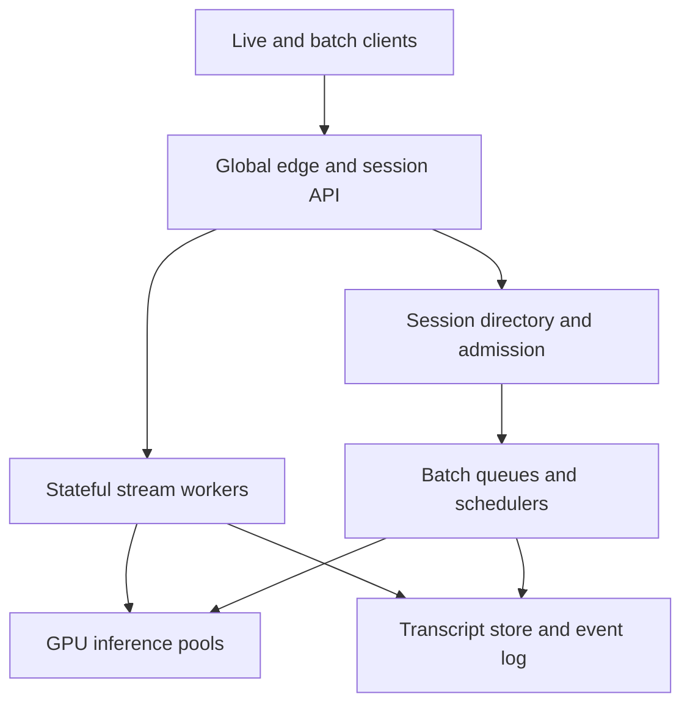

# Design a Global Real-Time Speech-to-Text Platform

**Difficulty:** Senior / Staff  
**Primary themes:** streaming AI inference, GPU scheduling, backpressure, queues, caching, reliability, consistency, multi-region failover, and privacy  
**Interview time budget:** about 45 minutes  
**Educational walkthrough:** intentionally more detailed than what you would say live

This walkthrough follows the public [Hello Interview System Design Delivery Framework](https://www.hellointerview.com/learn/system-design/in-a-hurry/delivery): clarify requirements, name core entities, define the interface, build a complete high-level design one operation at a time, and then deepen the most important bottlenecks. The prompt, numbers, APIs, architecture, dialogue, calculations, and tradeoffs below are original.

---

## Interviewer prompt

> Design a global speech-to-text platform. Clients stream live audio and receive partial and final transcripts with speaker labels. They can also submit recorded audio for asynchronous transcription. The system serves many tenants, multiple languages, and several model versions while meeting tight latency and reliability targets.

## Targeted clarifying questions and assumed interviewer answers

**Candidate:** “Should I design both live streaming and offline transcription?”

**Interviewer:** “Yes. Prioritize live streaming, then show how the same platform supports batch jobs.”

**Candidate:** “What scale should I assume?”

**Interviewer:** “At peak, 2 million concurrent live sessions, 200,000 new sessions per second during bursts, and 10 million hours of uploaded audio per day. Average live sessions last eight minutes. Audio arrives as 20 ms frames at roughly 32 Kbit/s after compression.”

**Candidate:** “What latency matters for live transcripts?”

**Interviewer:** “The p99 time from receiving an audio frame to emitting a partial transcript should be under 800 ms. A finalized segment should normally appear within two seconds of the detected speech boundary.”

**Candidate:** “What availability and durability do we need?”

**Interviewer:** “Live session establishment should be 99.99% available. Once accepted, the platform should preserve at least 99.95% of audio time without server-caused gaps. Final transcript metadata must be durable. Raw audio retention is tenant-configurable and may be disabled.”

**Candidate:** “Are partial transcripts allowed to change?”

**Interviewer:** “Yes. Partials are speculative. Final segments are immutable to ordinary inference workers, although an authorized human-edit workflow can create a new transcript revision.”

**Candidate:** “Do clients need reconnect and resume?”

**Interviewer:** “Yes. Mobile networks are unreliable. A client may reconnect within 60 seconds and replay a bounded window. Do not duplicate transcript text.”

**Candidate:** “Do we support speaker diarization, translation, and custom vocabulary?”

**Interviewer:** “Diarization and tenant vocabulary are in scope. Translation is out of scope. Punctuation and timestamps are in scope.”

**Candidate:** “How are models deployed?”

**Interviewer:** “The platform has language-specific model families, tenant-approved model policies, canaries, and emergency rollback. A session must not silently switch to an incompatible model midstream.”

**Candidate:** “What privacy constraints should I discuss?”

**Interviewer:** “Tenant isolation, encryption, regional residency, configurable retention, redaction, auditability, and deletion matter. Some tenants prohibit storing raw audio.”

### What I would say aloud

> “I’ll separate a low-latency streaming data plane from a slower control and batch plane. The live path needs sticky session ownership, bounded replay, GPU-aware admission, and ordered transcript revisions. I’ll treat partials as replaceable views, finals as durable segment events, and model assignment as immutable session state unless we perform an explicit compatible handoff.”

---

## 1. Requirements (~5 minutes)

### Core functional requirements

1. **Stream audio and receive ordered partial and final transcripts.** An authenticated client opens a session, sends sequenced audio frames, and receives acknowledgements, evolving partial hypotheses, final segments, word timestamps, and optional speaker labels.
2. **Resume interrupted sessions without duplicated or missing text.** A client reconnects with the last acknowledged audio sequence and last applied transcript revision; the system replays the minimum necessary state and deduplicates resent frames.
3. **Submit and retrieve asynchronous transcription jobs.** A client uploads or references recorded audio, receives durable job state, and later retrieves paginated transcript segments and artifacts.

Tenant vocabulary management, model policy, retention, redaction, and human-edit revisions support those three flows but are not separate top-level requirements.

### Quantified non-functional requirements

| Requirement | Target | Design consequence |
|---|---:|---|
| Concurrent live sessions | 2 million peak | Stateful session workers must be horizontally partitioned; a central per-frame service is impossible. |
| Session start burst | 200,000/s | Admission and routing must use precomputed regional capacity, cheap leases, and overload shedding. |
| Streaming latency | frame-to-partial p99 < 800 ms | Keep audio, feature extraction, decoder state, and GPU inference region-local; avoid durable writes per 20 ms frame. |
| Finalization latency | normally < 2 s after speech boundary | Endpoint detection, decoder flush, punctuation, and durable commit need bounded budgets. |
| Live availability | 99.99% session establishment | Multi-AZ gateways and schedulers; existing sessions degrade independently of new-session control failures. |
| Audio continuity | ≥ 99.95% accepted audio time | Sequence numbers, acknowledgements, client replay buffers, server gap detection, and bounded regional recovery. |
| Batch volume | 10 million audio-hours/day | Separate batch queues and GPU pools so offline work cannot consume interactive headroom. |
| Residency | Audio and transcript remain in an allowed region set | Region selection happens before upload; object, queue, log, and inference placement inherit policy. |

### Scope

**In scope**

- Bidirectional streaming over WebSocket or gRPC.
- Voice activity detection, feature extraction, acoustic inference, decoding, punctuation, timestamps, and diarization.
- Language/model selection and tenant vocabulary snapshots.
- Ordered partial/final transcript delivery.
- Resume, replay, duplicate suppression, and explicit gaps.
- Batch transcription using shared preprocessing and inference primitives.
- Multi-tenant quotas, GPU admission, canaries, rollback, audit, privacy, retention, and observability.

**Out of scope**

- Training foundation models.
- Live translation, text-to-speech, or semantic summarization.
- Telephony carrier integration beyond accepting supported audio codecs.
- Human annotation workforce operations.
- Billing implementation, though metering events are emitted.

### Consistency and availability contract

Different state has different semantics:

1. **Audio frames:** at-least-once transport with idempotent application. Frames carry a monotonically increasing `audio_seq`; a session owner applies each sequence once and acknowledges the highest contiguous sequence.
2. **Partial transcript:** replaceable and session-ordered. A newer `transcript_revision` supersedes an older partial for the same active segment. Partials may disappear or change.
3. **Final segment:** exactly-once effect, not exactly-once network delivery. A final is durably committed under `(session_id, segment_id)` before it is considered authoritative. Retries return the same segment content and revision.
4. **Session configuration:** immutable snapshot for model, vocabulary, residency, and decoding policy. Admin changes affect new sessions unless an explicit compatible migration is performed.
5. **Human edits:** append a new transcript revision; they never rewrite the inference evidence in place.

During a transient durable-store failure, a live worker may continue inference within a bounded in-memory buffer and label outputs provisional. It must not claim a segment is final until the final-segment commit succeeds. If the buffer deadline is exceeded, it pauses or terminates with a resumable error rather than silently losing committed semantics.

### What I would say aloud

> “Exactly once is the wrong transport promise. I’ll accept frame redelivery and make frame application idempotent. For transcripts, the durable invariant is that one segment ID has one inference-final payload at a given revision; messages may be redelivered, but the client can apply them idempotently.”

---

## 2. Core entities (~2 minutes)

Name the nouns first, then introduce fields when their owners appear.

| Entity | Purpose | Key fields introduced later |
|---|---|---|
| `Tenant` | Isolation, quota, residency, and retention boundary | `tenant_id`, `region_policy`, `quota_class`, `retention_policy_id` |
| `ModelDeployment` | Deployable language/model artifact and runtime contract | `deployment_id`, `model_digest`, `language_set`, `runtime_abi`, `status` |
| `VocabularySnapshot` | Immutable tenant term biasing input | `snapshot_id`, `tenant_id`, `phrases`, `weights`, `version` |
| `Session` | One live transcription stream | `session_id`, `owner_epoch`, `model_snapshot`, `last_audio_seq`, `state` |
| `AudioFrame` | Sequenced chunk supplied by the client | `session_id`, `audio_seq`, `capture_time`, `codec`, `payload` |
| `Segment` | Time interval with partials and one inference final | `segment_id`, `start_ms`, `end_ms`, `state`, `final_revision` |
| `TranscriptEvent` | Ordered client-visible update | `event_seq`, `segment_id`, `kind`, `revision`, `text`, `words` |
| `Checkpoint` | Recoverable decoder/session state | `session_id`, `audio_seq`, `model_digest`, `state_blob_ref`, `created_at` |
| `BatchJob` | Durable asynchronous transcription request | `job_id`, `input_ref`, `state`, `priority`, `progress`, `output_ref` |
| `UsageEvent` | Auditable metering record | `tenant_id`, `session_id`, `audio_ms`, `gpu_ms`, `quality_tier` |

The essential distinction is between **audio order** and **transcript order**. One audio frame can cause no text, revise a partial, or finalize several words. Therefore `audio_seq` and `event_seq` are separate monotonic streams.

### What I would say aloud

> “I need two sequence spaces. Audio sequence proves which input the worker has consumed; transcript event sequence lets the client apply changing hypotheses in order. Conflating them makes resume and deduplication ambiguous.”

---

## 3. API and system interface (~5 minutes)

External live traffic uses a bidirectional streaming protocol because the client continuously sends audio while the server independently emits transcript events. REST handles resource creation, batch jobs, vocabulary, and transcript retrieval. Identity is derived from the authenticated token; request bodies never choose `tenant_id`.

### Create a live session

```http
POST /v1/transcription-sessions
Authorization: Bearer <tenant-token>
Idempotency-Key: sess_req_01J...
Content-Type: application/json

{
  "audio": {
    "codec": "opus",
    "sample_rate_hz": 16000,
    "channels": 1
  },
  "language": "en-US",
  "features": {
    "diarization": true,
    "word_timestamps": true,
    "punctuation": true
  },
  "vocabulary_snapshot_id": "vocab_87",
  "client_region_hint": "us-east"
}
```

Response:

```json
{
  "session_id": "stt_7f91",
  "stream_url": "wss://use1.stream.example/v1/sessions/stt_7f91",
  "stream_token": "short-lived-session-bound-token",
  "model_snapshot": {
    "deployment_id": "en_stream_142",
    "model_digest": "sha256:ab91...",
    "decoder_config_version": 18,
    "vocabulary_snapshot_id": "vocab_87"
  },
  "owner_epoch": 1,
  "expires_at": "2026-10-31T04:15:00Z"
}
```

The control plane validates entitlement, residency, codec, language, vocabulary ownership, and capacity before returning a region-bound token.

### Stream messages

Client to server:

```json
{
  "type": "audio",
  "session_id": "stt_7f91",
  "owner_epoch": 1,
  "audio_seq": 1842,
  "capture_time_ms": 1772500040120,
  "duration_ms": 20,
  "payload_b64": "..."
}
```

Server acknowledgement:

```json
{
  "type": "ack",
  "highest_contiguous_audio_seq": 1842,
  "buffered_audio_ms": 120,
  "flow_control": {
    "max_unacked_frames": 250,
    "recommended_send_rate": 1.0
  }
}
```

Partial transcript:

```json
{
  "type": "transcript",
  "event_seq": 91,
  "segment_id": "seg_12",
  "revision": 4,
  "is_final": false,
  "audio_through_seq": 1842,
  "start_ms": 34820,
  "end_ms": 36600,
  "text": "schedule the design review",
  "stability": 0.86
}
```

Final transcript:

```json
{
  "type": "transcript",
  "event_seq": 96,
  "segment_id": "seg_12",
  "revision": 7,
  "is_final": true,
  "audio_through_seq": 1910,
  "start_ms": 34820,
  "end_ms": 37940,
  "speaker": "spk_2",
  "text": "Schedule the design review for Friday.",
  "words": [
    {"text": "Schedule", "start_ms": 34820, "end_ms": 35220, "confidence": 0.97}
  ]
}
```

### Resume a session

```http
POST /v1/transcription-sessions/stt_7f91/resumptions
Authorization: Bearer <tenant-token>
Idempotency-Key: resume_01J...

{
  "last_server_ack_audio_seq": 1810,
  "last_applied_event_seq": 88,
  "client_replay_from_audio_seq": 1811
}
```

Response:

```json
{
  "stream_url": "wss://use1.stream.example/v1/sessions/stt_7f91",
  "stream_token": "new-session-bound-token",
  "owner_epoch": 2,
  "replay_audio_from_seq": 1811,
  "replay_events_from_seq": 89,
  "resume_deadline": "2026-10-31T04:07:12Z"
}
```

Incrementing `owner_epoch` fences the previous owner. Any late worker holding epoch 1 can no longer commit finals or checkpoints.

### Create a batch job

```http
POST /v1/transcription-jobs
Authorization: Bearer <tenant-token>
Idempotency-Key: job_01J...

{
  "input": {
    "object_uri": "tenant-object://recordings/call-774.opus",
    "expected_sha256": "7bc1..."
  },
  "language": "en-US",
  "features": {"diarization": true, "word_timestamps": true},
  "priority": "STANDARD",
  "vocabulary_snapshot_id": "vocab_87"
}
```

Response:

```json
{
  "job_id": "job_553",
  "state": "QUEUED",
  "model_snapshot": "en_batch_61",
  "status_url": "/v1/transcription-jobs/job_553"
}
```

### Retrieve final segments

```http
GET /v1/transcription-sessions/stt_7f91/segments?after=seg_100&limit=100
Authorization: Bearer <tenant-token>
```

The cursor is opaque and stable. Authorization checks that the token's tenant owns the session; it does not trust a tenant identifier from the query.

### Interface-to-requirement mapping

| Requirement | Interface |
|---|---|
| Stream ordered transcripts | Create session plus bidirectional audio/ack/transcript stream |
| Resume without duplication | Resumption resource, audio sequence acknowledgement, event replay, owner fencing |
| Batch transcription | Create/read/cancel job plus paginated segment retrieval |

### What I would say aloud

> “The live interface makes backpressure part of the contract. The server acknowledges contiguous audio, tells the client how much is buffered, and can lower the allowed send window. Resume carries both the audio acknowledgement and transcript event cursor because input replay and output replay solve different problems.”

---

## 4. Data flow

### Live session flow

1. Authenticate the caller and derive tenant, quota class, and allowed regions.
2. Select a region with compatible model capacity and reserve a short-lived admission lease.
3. Snapshot model, decoder, vocabulary, and retention policy into the session record.
4. Route the stream by `session_id` to one stateful session worker and fence it with `owner_epoch`.
5. Validate, sequence, deduplicate, decode, and place frames into a bounded jitter buffer.
6. Run voice activity detection and feature extraction on CPU or accelerator workers.
7. The GPU scheduler continuously batches compatible ready sequences for inference.
8. Decode model outputs with tenant vocabulary bias; emit revisioned partials.
9. At an endpoint, finalize timestamps, punctuation, and diarization; durably commit the final segment and outbox event.
10. Send the final to the client; asynchronously index transcript text, meter usage, and apply configured retention/redaction.

### Resume flow

1. Client presents its last audio acknowledgement and last transcript event.
2. Session directory acquires a higher owner epoch and locates the newest compatible checkpoint.
3. New owner restores model/decoder state or replays audio from the checkpoint boundary.
4. Client resends unacknowledged frames; worker drops already-applied sequences.
5. Event replay returns committed events after the client's cursor.
6. The new owner continues only after the old epoch is fenced.

### Batch flow

1. Validate object ownership, digest, format, residency, and job quota.
2. Probe duration and split long audio on silence-aware boundaries with overlap.
3. Enqueue chunks by model family, priority, estimated GPU seconds, and deadline.
4. Batch workers perform faster-than-real-time inference using larger GPU batches.
5. Reconcile overlapped boundaries, diarization identities, punctuation, and timestamps.
6. Commit the transcript manifest and atomically mark the job complete.

---

## 5. High-level design (~10–15 minutes)

Build the simplest complete system one operation at a time.



### Operation 1: admit and pin a live session

The global edge terminates TLS close to the client, authenticates the token, enforces coarse request limits, and chooses an allowed inference region. It does not terminate the logical session state; it proxies the long-lived stream to a regional gateway.

Admission checks:

- tenant concurrent-session and audio-minute quota;
- language, feature, and model entitlement;
- residency-compatible region;
- regional GPU headroom by model family;
- expected session memory and decoder-state budget;
- overload class and priority.

The admission service creates:

```text
Session(
  session_id, tenant_id, home_region, owner_epoch,
  model_deployment_id, model_digest, decoder_config_version,
  vocabulary_snapshot_id, retention_policy_id,
  codec, sample_rate, features, state, lease_expiry
)
```

This is a small strongly consistent write. The model and vocabulary snapshot are pinned so an administrator changing `latest` cannot alter a running session unpredictably.

The directory maps a session to a worker through rendezvous hashing over healthy worker virtual nodes. The directory stores only the current fenced owner and lease; gateways cache the mapping briefly. Sticky routing matters because a decoder's key/value state, language context, and diarization embeddings are expensive to move on every frame.

### Operation 2: ingest ordered audio

Frames arrive every 20 ms. The stream worker validates token binding, epoch, codec, size, and sequence. It maintains:

```text
next_expected_seq
highest_contiguous_seq
recent_seq_bitmap
jitter_buffer
uncommitted_audio_ring
```

Frames below the dedupe window are ignored if already applied. Frames slightly ahead wait in the jitter buffer; a gap timer triggers a retransmission hint. Once the gap exceeds the replay window, the worker emits an explicit `AUDIO_GAP` event with the missing time interval. Fabricating continuity would be worse than exposing the gap.

The worker acknowledges after accepting a frame into its recoverable replay boundary, not merely after reading it from the socket. For tenants that forbid raw storage, “recoverable” means replicated memory on a paired worker or client-held replay, not object storage.

### Operation 3: preprocess and infer

Voice activity detection identifies speech and silence. A feature extractor converts audio into model inputs. Keeping this work near the stream worker reduces repeated encoding and lets silence skip expensive GPU work.

Each active stream produces small ready-to-run inference steps. Sending every step alone to a GPU gives excellent latency but terrible utilization. Waiting for a huge static batch maximizes throughput but violates latency. Use **continuous batching**: a GPU runtime admits compatible sequences into each decoding iteration as slots become available.

Compatibility keys include:

```text
(model_digest, runtime_abi, feature_shape, decoding_tier, adapter_set)
```

The scheduler orders ready work by earliest deadline, then weighted tenant fairness. It caps batch delay, for example 10–20 ms, because the 800 ms p99 budget cannot absorb queue buildup.

The GPU runtime returns acoustic tokens or logits. The session worker owns the language decoder, partial stability calculation, vocabulary bias, segment state, and client ordering. This keeps GPU replicas statistically interchangeable while session correctness remains in one place.

### Operation 4: emit partials and commit finals

A partial is a materialized view of the current decoder hypothesis. The worker increments `revision` when it changes and `event_seq` for every client-visible event. A client replaces the displayed partial only if the new tuple `(segment_id, revision)` is newer.

When endpoint detection finds a stable speech boundary:

1. flush final inference steps;
2. settle token timestamps;
3. apply punctuation and casing;
4. update the online speaker cluster;
5. write the final segment and an outbox event transactionally;
6. advance `last_final_audio_seq`;
7. emit the final to the client.

Relational or strongly consistent wide-column storage can hold final segments partitioned by `session_id`:

```text
PRIMARY KEY (session_id, segment_id)
UNIQUE (session_id, event_seq)
```

The insert is conditional on `owner_epoch`. This prevents a paused old worker from committing after a resumed owner takes over.

### Operation 5: checkpoint and resume

Checkpointing every 20 ms would destroy the latency and storage budget. Instead:

- retain recent compressed audio in a bounded client and server ring;
- checkpoint decoder/model state every few seconds or after a final segment;
- replicate the latest small checkpoint metadata to another AZ;
- store checkpoint blobs only when policy permits.

Checkpoint identity includes `model_digest`, runtime ABI, vocabulary snapshot, and audio sequence. A worker may restore only onto a compatible runtime. Otherwise it replays audio from an earlier safe boundary.

The directory acquires ownership with compare-and-set:

```sql
UPDATE sessions
SET owner_epoch = owner_epoch + 1,
    owner_worker = :new_worker,
    lease_expiry = :new_expiry
WHERE session_id = :session_id
  AND owner_epoch = :observed_epoch;
```

All final writes and checkpoints carry the new epoch. This is a fencing token: even if the old worker is alive but partitioned, storage rejects its stale writes.

### Operation 6: batch transcription

Batch jobs share model artifacts and GPU pools but use separate queues and reservations. A probe worker reads only enough input to validate format, checksum, duration, and codec. It then creates silence-aware chunks, for example 10–30 minutes, with a small overlap.

Chunk records include:

```text
job_id, chunk_id, input_range, overlap_ms, model_snapshot,
attempt, state, estimated_gpu_ms, output_ref
```

Queue delivery is at least once. A chunk result is idempotently stored by `(job_id, chunk_id, model_snapshot)`. The reconciler removes overlapping duplicate words using timestamps and token confidence, then unifies speaker IDs across chunk boundaries.

Batch schedulers optimize throughput with larger batches and may use spot capacity. Interactive pools keep protected headroom. When live demand rises, batch dispatch slows; already-running batch work may checkpoint and yield if the runtime supports it.

### Operation 7: model deployment and rollback

The model registry stores signed immutable artifacts, tokenizer/config digests, supported languages, required GPU type, memory footprint, runtime ABI, and evaluation evidence.

Deployment stages:

1. offline quality, safety, and compatibility gates;
2. shadow traffic with outputs not shown to users;
3. small tenant-eligible canary for new sessions;
4. progressive increase by region and language;
5. promotion to a policy alias;
6. rollback by assigning new sessions to the prior immutable deployment.

Existing sessions remain pinned. A critical defect can terminate and resume on a compatible prior model, but the system makes that transition explicit and emits a model-boundary event. Silent midstream switching would corrupt decoder state and make quality investigations unreproducible.

### Scale estimates that change the design

#### Connection and ingress bandwidth

At 2 million concurrent streams and 32 Kbit/s compressed audio:

```text
2,000,000 × 32 Kbit/s = 64,000,000 Kbit/s
                         = 64 Gbit/s of audio payload
```

With framing, TLS, acknowledgements, and replication, budget materially more—perhaps 100–150 Gbit/s. This requires many regional gateways and direct regional processing; one global WebSocket fleet or cross-region forwarding is not credible.

At 20 ms per frame:

```text
50 frames/s × 2,000,000 sessions = 100 million frames/s
```

That makes a durable queue or database write per frame impossible. Frames stay on long-lived streams and bounded memory buffers; only checkpoints, gaps, finals, and aggregate usage become durable events.

#### GPU capacity

Assume one optimized GPU can process 80 real-time streams for the chosen model at the latency target:

```text
2,000,000 / 80 = 25,000 GPUs at peak
```

Add 25% failure and burst headroom:

```text
25,000 × 1.25 = 31,250 provisioned-equivalent GPUs
```

The exact number depends on model and hardware, but the order of magnitude forces capacity-aware admission, continuous batching, language/model pool consolidation, and graceful quality tiers. Autoscaling alone is too slow because GPU nodes may take minutes to become ready.

#### Checkpoint volume

If each active session created a 2 MiB checkpoint every five seconds:

```text
2,000,000 × 2 MiB / 5 s = 800,000 MiB/s ≈ 781 GiB/s
```

That is absurdly expensive. Therefore checkpoints must be smaller, less frequent, incremental, triggered at stable boundaries, and supplemented by bounded audio replay. This arithmetic directly rejects naive full-state checkpointing.

#### Batch demand

Ten million audio-hours per day is:

```text
10,000,000 / 24 ≈ 416,667 audio-hours/hour
```

At 20× real-time batch processing, the steady compute requirement is roughly:

```text
416,667 / 20 ≈ 20,833 GPU-hours per wall-clock hour
```

That is a fleet comparable to the live system. Batch must have workload shaping, deadlines, cost-aware placement, and a separate capacity plan rather than “using spare live GPUs” as its only strategy.

### What I would say aloud

> “The surprising number is 100 million frames per second. That eliminates per-frame queues and database writes. The checkpoint estimate also shows that recovery must combine sparse checkpoints with audio replay instead of serializing the full model state every few seconds.”

---

## 6. Deep dives (~10–15 minutes)

In a live interview, choose two based on the interviewer's signals. Three are provided for practice.

### Deep dive A: low-latency GPU scheduling and overload control

#### Where the baseline breaks

A naive scheduler sends each stream to a dedicated GPU slot. Utilization collapses during silence and variable utterance lengths. Static batches improve throughput but make a fast stream wait for the slowest member. Autoscaling after queues grow is too late for an 800 ms p99 target.

#### Plausible approaches

| Approach | Benefit | Failure or tradeoff |
|---|---|---|
| Dedicated GPU per fixed stream group | Simple state ownership and predictable latency | Poor utilization under silence and skew; hard rebalancing. |
| Static micro-batches | Easy, high throughput for uniform requests | Head-of-line blocking and wasted slots as sequences finish. |
| Continuous batching | Adds/removes sequences each iteration; high utilization | More complex runtime, fairness, and memory management. |
| Serverless GPU per chunk | Elastic abstraction | Cold starts and cost are incompatible with dense continuous streams. |

#### Selection

Use regional model pools with continuous batching. Session workers enqueue ready inference steps into a scheduler shard keyed by compatibility. The scheduler uses earliest deadline first within weighted fair tenant queues, then forms a batch up to a maximum delay and memory limit.

Each request carries:

```text
session_id, tenant_class, ready_time, deadline,
model_digest, feature_shape, state_handle, estimated_cost
```

The runtime preallocates state pages and uses a paged allocator so one long utterance does not require a contiguous worst-case reservation. Admission budgets both compute and state memory; GPU utilization alone is insufficient.

#### Backpressure ladder

Overload should degrade deliberately:

1. consume reserved headroom;
2. reduce optional partial frequency while preserving finals;
3. disable expensive optional features for tenants whose contract allows it;
4. route new sessions to another allowed nearby region;
5. admit a smaller model or quality tier only with an explicit policy;
6. reject new low-priority sessions with retry guidance;
7. preserve existing sessions and finalization capacity.

Do not accept unlimited audio and hope the queue drains. Once inference lag exceeds a threshold, the gateway reduces the send window. For a live microphone, the client cannot slow wall-clock capture indefinitely, so it keeps a bounded replay buffer. If the platform cannot recover, it terminates with an explicit last acknowledged sequence.

#### Fairness

Pure earliest-deadline scheduling lets a large tenant dominate. Pure round robin ignores expensive requests. Use hierarchical weighted fair queuing:

- reserve capacity by service class;
- enforce tenant token buckets measured in estimated GPU milliseconds;
- schedule earliest deadline inside each tenant/class;
- cap concurrent long utterances and adapter variants;
- age waiting work so it eventually advances.

#### Failure modes and observability

| Failure | Behavior | Key signal |
|---|---|---|
| GPU process crash | Requeue uncompleted steps; restore from state replica/checkpoint or replay | step retry rate, lost state bytes |
| GPU memory fragmentation | Drain replica, reject new state allocations, rebuild allocator | free bytes versus allocatable bytes |
| One model becomes hot | Add warm replicas, route new sessions, protect other model pools | queue delay by model/language |
| Scheduler partition | Session worker stops dispatching after bounded buffer; ownership does not move without fencing | scheduler heartbeat and buffered audio age |
| Optional diarization overload | Shed only when tenant policy permits; mark feature degradation | feature degradation count |

The golden latency decomposition is edge transit, jitter wait, preprocessing, scheduler queue, GPU execution, decoding, final commit, and client delivery. A single end-to-end percentile cannot tell operators which control to pull.

### Deep dive B: resume, ordering, and exactly-once finalization

#### Where the baseline breaks

If reconnect simply starts a new worker, two owners may emit conflicting partials or finals. If the client resends audio without sequence dedupe, words repeat. If the server acknowledges before the replay boundary is safe, a crash creates an unfillable gap. If transcript events use only timestamps, equal or corrected times cannot be ordered reliably.

#### Plausible approaches

| Approach | Benefit | Failure or tradeoff |
|---|---|---|
| Persist every frame before ACK | Strong recovery point | Far too much I/O and latency at 100 million frames/s. |
| Client-only replay | Cheap server | Recovery depends on a connected, well-behaved client and cannot support server failover alone. |
| Replicated memory plus sparse checkpoint | Low latency and bounded recovery | Complex paired placement; AZ loss may require more replay. |
| Full state checkpoint frequently | Fast restoration | State volume is prohibitive and model-version compatibility is fragile. |

#### Selection

Use a layered recovery contract:

- client retains the last 60 seconds of sequenced encoded audio;
- primary worker retains an in-memory ring;
- a paired AZ worker receives compressed audio deltas or periodic recovery markers when policy permits;
- durable checkpoints occur at final boundaries and occasionally during long speech;
- durable final segments and event outbox are the output source of truth.

The server ACK means “you need not resend this frame during an ordinary reconnect under the advertised recovery class.” Tenants that prohibit server audio retention receive a weaker recovery class and must maintain client replay.

#### Ownership and fencing

The session directory is strongly consistent for ownership. A new owner increments `owner_epoch`. Every checkpoint and final insert includes the epoch. Storage performs a conditional write against the session's current epoch. Leases help detect failure; fencing prevents correctness violations after false detection.

#### Reconstructing client state

The client sends:

```text
last_server_ack_audio_seq
last_applied_event_seq
current_partial(segment_id, revision)
```

The new owner returns committed events after `last_applied_event_seq`. Partials need not be durably replayed: it can send `RESET_PARTIAL`, restore/recompute from audio, and emit a newer revision. Finals are replayed from the durable event log.

If audio replay overlaps already-finalized input, the decoder consumes only from `last_final_audio_seq + 1`. Sequence dedupe prevents repeated acoustic input; segment uniqueness prevents repeated final text.

#### Commit protocol

The final transaction writes:

```text
Segment(session_id, segment_id, final_revision, audio_start_seq,
        audio_end_seq, text, words, speaker, model_snapshot, owner_epoch)
Outbox(session_id, event_seq, segment_id, kind=FINAL, payload_hash)
SessionProgress(last_final_audio_seq, last_event_seq)
```

A publisher relays outbox events at least once. Clients deduplicate by `(session_id, event_seq)`. This provides exactly-once user-visible effect without pretending the network delivers once.

#### What happens during storage failure?

Continue provisional partials only while a strict buffer budget remains. Do not label a segment final until storage commits it. If the outage exceeds the budget, tell the client the session is paused, preserve its last safe ACK, and attempt resume elsewhere. This sacrifices some availability to preserve the finality contract.

#### Observability

Track reconnect success by cause, replay seconds, restore duration, checkpoint age, stale-epoch write rejections, duplicate-frame rate, audio gaps, duplicate event suppression, final commit latency, and sessions with provisional output older than the allowed budget. Inject worker, AZ, and directory failures in synthetic calls.

### Deep dive C: model rollout, quality, privacy, and regional reliability

#### Where the baseline breaks

A model can meet latency while degrading word error rate for one accent, language, device, or vocabulary. A global `latest` pointer can move millions of live sessions at once. Cross-region failover may violate residency. Logging raw audio for debugging can violate tenant policy.

#### Deployment alternatives

| Approach | Benefit | Failure or tradeoff |
|---|---|---|
| Update all workers in place | Fast and operationally simple | Unreproducible sessions, large blast radius, state incompatibility. |
| Pin only model name | Easy aliasing | Alias can change meaning; audit and resume become ambiguous. |
| Pin immutable deployment snapshot | Reproducible and safe rollback | More versions resident and slower cleanup. |
| Move live sessions during rollout | Rapid adoption | Requires state compatibility and introduces transcript boundaries. |

#### Selection

Pin an immutable snapshot containing model digest, tokenizer, decoder config, runtime ABI, vocabulary snapshot, feature versions, and postprocessing versions. Rollouts affect new sessions. Keep the previous deployment warm until all pinned sessions finish or their maximum lifetime expires.

Canary assignment is deterministic on `(tenant_id, session_id)` so reconnect does not change variants. Evaluation compares:

- word error rate on consented labeled samples;
- correction rate from human edits;
- endpoint delay and partial churn;
- latency and GPU cost;
- error slices by language, accent proxy where lawful, device, noise, and duration;
- safety/redaction and diarization quality.

An emergency rollback changes admission for new sessions immediately. Existing sessions can finish on the old model unless the defect is security-critical. A forced migration emits a boundary event and may replay a short audio window on the replacement model.

#### Regional failure

Each session has an allowed failover region set derived from tenant policy. On regional impairment:

- DNS/edge routing sends new sessions to another allowed region with warm capacity;
- existing sessions first reconnect within the same region/AZ;
- cross-region resume occurs only if policy permits and the required checkpoint/audio is present;
- otherwise the client receives an explicit terminal gap and may start a new session;
- batch jobs remain queued or move only to residency-compatible capacity.

Prewarming matters: a cold region without the correct model weights cannot meet a rapid failover objective. The control plane keeps minimum warm replicas for critical language families and continuously validates artifact availability.

#### Privacy boundary

- Encrypt transport and storage with tenant-scoped keys where required.
- Keep raw audio out of logs, traces, crash dumps, and queue payloads.
- Store object references, not bytes, in durable queues.
- Apply retention policy at ingestion; “no storage” disables raw durable capture.
- Redaction runs before searchable transcript indexes when configured.
- Deletion writes a tombstone, removes search/index reachability, and asynchronously erases allowed objects; legal holds are explicit.
- Human quality sampling requires tenant consent and auditable access.
- Vocabulary phrases are sensitive tenant data and never become a global cross-tenant cache key.

Shared immutable model weights are safe to cache globally; tenant adapters and vocabularies are partitioned and access-controlled. GPU memory is zeroed or returned through an allocator that prevents cross-tenant reads before reuse.

#### Observability without leaking content

Use numeric features, hashes, opaque IDs, latency, confidence histograms, and aggregate quality metrics. Debug bundles are opt-in, access-controlled, short-lived, and audited. Sampling is policy-aware. A trace should show `session_id`, model digest, sequence ranges, queue delay, and error codes—not transcript text or audio.

---

## 7. Final design

### Concise architecture

- A global edge authenticates clients, enforces coarse limits, and routes them to a residency-compatible region.
- The session API performs capacity-aware admission and snapshots an immutable model, decoder, vocabulary, and retention configuration.
- A strongly consistent session directory owns worker mapping, leases, and monotonically increasing fencing epochs.
- Stateful stream workers sequence and deduplicate audio, maintain jitter/replay buffers, run endpointing and decoding, and order client events.
- Regional GPU pools use compatibility-aware continuous batching with deadline scheduling and tenant fairness.
- Partials are replaceable revisioned views; final segments are conditional durable writes with a transactional outbox.
- Clients and workers hold bounded audio replay; sparse compatible checkpoints plus fencing enable resume without duplicated text.
- Separate batch queues and capacity reservations run larger throughput-oriented batches, with idempotent chunk results and overlap reconciliation.
- Immutable model artifacts pass offline gates, shadowing, deterministic canaries, and progressive rollout; running sessions stay pinned.
- Regional failover respects residency and requires warm compatible models. When safe recovery is impossible, the system exposes an explicit gap.
- Privacy policy controls raw-audio capture, encryption, redaction, retention, deletion, debugging, and quality sampling.

### Requirements check

| Requirement | How the design satisfies it |
|---|---|
| Live partial/final transcripts | Stateful workers, continuous GPU batching, ordered revisioned events, durable final commit |
| Resume without duplication | Audio/event sequence spaces, bounded replay, sparse checkpoints, owner fencing, idempotent finals |
| Batch transcription | Durable job/chunk queues, separate capacity, at-least-once execution with idempotent results |
| p99 < 800 ms partial latency | Region-local pipeline, bounded jitter and batch delay, protected live pools, deadline scheduling |
| 2 million streams | Sharded long-lived gateways/workers and regional GPU pools; no per-frame durable queue |
| High availability | Multi-AZ components, client replay, paired recovery, fenced failover, warm regional capacity |
| Model safety | Immutable snapshots, deterministic canaries, quality slices, rollback, explicit migration boundary |
| Tenant isolation | Auth-derived identity, quotas, policy-bound regions, partitioned vocabularies, memory hygiene |
| Privacy and deletion | Policy-at-ingest, no raw logs, configurable storage, redaction, tombstones, async erasure, audit |

### 90-second candidate summary

> “I split the system into a control plane that admits and pins sessions and a region-local streaming data plane. The client sends sequenced 20 ms frames over a bidirectional stream; a sticky worker deduplicates them, maintains replay and decoder state, and emits separately sequenced transcript events. GPU pools use compatibility-aware continuous batching so we keep utilization high without exceeding a small queue-delay budget. Partials are revisioned and replaceable. At an endpoint, the worker conditionally commits one final segment plus an outbox event under its fencing epoch, then sends it to the client. Resume acquires a higher owner epoch, restores a sparse compatible checkpoint, replays bounded audio, and replays durable output events, which avoids duplicated text despite at-least-once transport. Batch jobs share model artifacts but use separate queues and reservations. Models and vocabulary are immutable per-session snapshots, roll out through deterministic canaries, and roll back for new sessions. Regional failover is allowed only within the tenant's residency policy, and privacy policy decides whether raw audio may be stored at all. The 100-million-frames-per-second estimate is why frames never go through a database or durable queue.”

---

## Realistic interviewer follow-up questions and strong sample answers

### 1. Why use both `audio_seq` and `event_seq`?

**Candidate:** “Input and output are not one-to-one. Silence may produce no event, one frame can revise an existing partial, and finalization can emit several events. Audio sequence controls dedupe and replay; event sequence controls client application and output replay.”

### 2. Is your delivery exactly once?

**Candidate:** “The network is at least once. Exactly-once effect comes from idempotent frame application, unique final segment keys, a transactional outbox, and client event dedupe.”

### 3. When do you acknowledge audio?

**Candidate:** “After it enters the session's advertised recovery boundary—replicated memory, a policy-allowed buffer, or a contract backed by client replay—not merely after socket receipt.”

### 4. What if frames arrive out of order?

**Candidate:** “A bounded jitter buffer waits briefly. Missing sequences trigger retransmission hints. Past the deadline, I record and expose an audio gap rather than shifting timestamps or inventing content.”

### 5. Why not put audio frames on Kafka?

**Candidate:** “At roughly 100 million frames per second, per-frame broker overhead and latency are wasteful. The live stream is already ordered by session. I persist coarse checkpoints, finals, gaps, and usage aggregates; batch jobs use durable queues.”

### 6. Why sticky workers?

**Candidate:** “Decoder context, model state, diarization embeddings, and replay buffers are stateful and expensive to transfer. Sticky ownership keeps the hot path local; fencing and checkpoint/replay handle failure.”

### 7. What does a fencing token add beyond a lease?

**Candidate:** “A lease can expire during a partition while the old worker still runs. The monotonically increasing owner epoch lets storage reject its stale final writes after a new owner takes over.”

### 8. Why are partials not durable?

**Candidate:** “They change quickly and are not authoritative. Persisting each would create enormous write load. On resume I replay finals and reset/recompute the active partial from recent audio.”

### 9. How do you avoid repeated words after resume?

**Candidate:** “The new worker starts decoding after `last_final_audio_seq`, deduplicates resent frames by `audio_seq`, and upserts finals by stable `segment_id`. The client also ignores repeated `event_seq` values.”

### 10. What is continuous batching?

**Candidate:** “Instead of freezing a batch until every sequence finishes, the runtime adds ready sequences and removes completed ones at each iteration. It improves GPU utilization while keeping the wait for a batch bounded.”

### 11. Why not maximize GPU batch size?

**Candidate:** “The objective is cost subject to a latency SLO, not throughput alone. Large waits raise partial latency and cause buffer growth, so I cap batch delay and schedule by deadline.”

### 12. How do you handle a language suddenly becoming hot?

**Candidate:** “Maintain minimum warm capacity, track queue delay by model family, route new sessions among allowed regions, activate warm replicas, and use explicit lower tiers or rejection before harming existing sessions.”

### 13. Can you autoscale from zero?

**Candidate:** “Not for a strict live SLO. Loading large weights and initializing GPU kernels can take minutes. Important model families need warm floor capacity based on forecast plus headroom.”

### 14. How do you prevent a batch workload from hurting live calls?

**Candidate:** “Separate queues, quotas, reservations, and usually GPU pools. Batch may borrow explicitly reclaimable capacity, but live admission never assumes that preemption is instantaneous.”

### 15. How do you split batch audio?

**Candidate:** “Prefer silence-aware boundaries with overlap. Results carry timestamps; a reconciler removes duplicate boundary words and merges speaker identities. Chunk keys make retries idempotent.”

### 16. How do you cancel a batch job safely?

**Candidate:** “Set a durable cancellation epoch. Workers check it before expensive stages and before commit. Results from an older epoch are ignored; completed immutable chunks can be garbage-collected later.”

### 17. How do custom vocabularies work?

**Candidate:** “Compile phrases and weights into an immutable tenant-owned snapshot used by the decoder. The session pins the snapshot. Cache keys include tenant and snapshot ID so terms cannot leak across tenants.”

### 18. Would you switch models mid-session?

**Candidate:** “Normally no. State compatibility and transcript behavior can change. For a critical migration, fence the old owner, emit a model-boundary event, restore a compatible state or replay audio, and record both snapshots.”

### 19. How do you evaluate a canary without ground truth for every call?

**Candidate:** “Use consented labeled sets, shadow comparisons, partial churn, confidence calibration, human correction rate, endpoint timing, error slices, latency, and cost. No single proxy replaces word error rate.”

### 20. What does rollback mean for existing sessions?

**Candidate:** “Admission immediately stops assigning the bad deployment. Existing sessions finish if the issue is noncritical. Security-critical defects use an explicit migration or terminate with a resumable error.”

### 21. What is the source of truth for a transcript?

**Candidate:** “Durable final segments plus append-only human edit revisions. The search index and assembled document are projections.”

### 22. How do human edits preserve auditability?

**Candidate:** “An edit appends a new revision with actor, reason, and parent revision. Inference output remains immutable evidence; the current view points to the latest authorized revision.”

### 23. What happens if the transcript database is down?

**Candidate:** “Continue provisional output within a bounded buffer. Do not call segments final. If the budget expires, pause or end with the last safe audio acknowledgement so the client can resume.”

### 24. How do you meet residency requirements during failover?

**Candidate:** “The session's allowed region set is computed from policy. Edge routing, object storage, queues, checkpoints, and model execution all use that set. If no allowed region is healthy, fail closed rather than export audio.”

### 25. What if the tenant forbids raw-audio storage?

**Candidate:** “Keep only bounded volatile buffers, require client replay for the strongest resume behavior, never write checkpoint audio to object storage, and make the reduced recovery guarantee explicit.”

### 26. How do you delete a session?

**Candidate:** “Authorize a deletion, write a tombstone, remove transcript/search reachability, revoke access tokens, enqueue policy-aware erasure for audio, checkpoints, transcript artifacts, and debug bundles, and retain only permitted audit evidence.”

### 27. How do you debug without logging transcript text?

**Candidate:** “Use opaque IDs, model digest, sequence ranges, timing spans, queue depth, confidence distributions, and error codes. Content-bearing bundles are opt-in, encrypted, short-lived, and audited.”

### 28. What metrics define audio continuity?

**Candidate:** “Accepted audio milliseconds, missing sequence milliseconds, late-dropped milliseconds, replay recovered milliseconds, and server-caused versus client/network gaps. Connection uptime alone hides lost audio.”

### 29. What is the most important invariant?

**Candidate:** “For each session, only the current fenced owner may advance progress; every committed final covers a declared audio sequence interval under one immutable model snapshot, and clients can apply transcript events idempotently in order.”

### 30. What would you build first?

**Candidate:** “One region, one language/model, WebSocket streaming, sticky workers, bounded frame sequencing, a simple dynamic GPU batcher, durable finals, and client replay. Then add multi-AZ fencing, batch jobs, diarization, canaries, regional routing, and policy-driven retention.”

---

## Common pitfalls

1. Treating WebSocket connection continuity as audio continuity.
2. Using one sequence number for both audio input and transcript output.
3. Claiming exactly-once network delivery instead of idempotent effects.
4. Acknowledging a frame before it enters the promised recovery boundary.
5. Writing every 20 ms frame to a database or durable broker.
6. Persisting every changing partial transcript.
7. Ignoring out-of-order frames, jitter, duplicates, and explicit gaps.
8. Allowing two session workers to commit without fencing epochs.
9. Restoring a checkpoint with an incompatible model or runtime ABI.
10. Serializing full decoder/model state so frequently that checkpoints dominate bandwidth.
11. Moving a model alias mid-session without pinning an immutable snapshot.
12. Rolling out a new model to every region and tenant simultaneously.
13. Measuring only latency while ignoring quality slices and partial churn.
14. Maximizing batch size without a queue-delay budget.
15. Scheduling only by GPU utilization and ignoring state-memory pressure.
16. Letting one tenant or hot language starve other queues.
17. Assuming GPU autoscaling is fast enough to handle bursts from zero.
18. Sharing one unconstrained pool between live and batch workloads.
19. Chunking batch audio without overlap and boundary reconciliation.
20. Retrying batch chunks without idempotent result keys.
21. Storing tenant vocabulary in a global cache without tenant isolation.
22. Logging raw audio, transcript text, or vocabulary phrases by default.
23. Replicating audio to a failover region not allowed by residency policy.
24. Promising resume while retaining neither server state nor client replay.
25. Calling a provisional segment final before durable commit.
26. Updating final transcript rows in place for human edits.
27. Using timestamps alone as an ordering mechanism.
28. Hiding unrecoverable audio loss instead of emitting a gap event.
29. Doing scale arithmetic without tying it to per-frame persistence, GPU admission, or checkpoint strategy.
30. Drawing every ML stage before tracing one complete session from frame to final transcript.

---

## Practical interview delivery plan

| Time | What to cover |
|---:|---|
| 0–5 min | Clarify live versus batch, scale, latency, finality, resume, models, and privacy. |
| 5–7 min | Name tenant, deployment, vocabulary, session, frame, segment, event, checkpoint, and job. |
| 7–12 min | Define create-session, streaming messages, resume, batch job, and transcript retrieval. |
| 12–25 min | Build admission, sticky ownership, frame ordering, continuous GPU batching, partials, and final commit. |
| 25–38 min | Deep dive on GPU scheduling and resume/fencing; add model/privacy or regional failover if prompted. |
| 38–43 min | Cover overload, failure modes, observability, consistency, and scale-driven decisions. |
| 43–45 min | Check requirements and give the 90-second summary. |

The written walkthrough is deliberately longer than the live interview. On the whiteboard, first draw the edge, session directory, stream worker, GPU pool, and transcript store. Trace one frame to a partial and one endpoint to a durable final before introducing checkpoints, model rollout, batch scheduling, or cross-region failover.

---

## Public references

The delivery structure and pacing use the public Hello Interview method; all problem-specific content is original.

- [Hello Interview — System Design Delivery Framework](https://www.hellointerview.com/learn/system-design/in-a-hurry/delivery) — requirements, core entities, interface, optional data flow, high-level design, and deep-dive sequence.
- [Hello Interview — API Design](https://www.hellointerview.com/learn/system-design/core-concepts/api-design) — resource-oriented interfaces, protocol selection, idempotency, authentication, pagination, and actionable errors.
- [Hello Interview — System Design in a Hurry](https://www.hellointerview.com/learn/system-design/in-a-hurry/introduction) — prioritize core constraints and first complete the simplest working design before layering on complexity.
