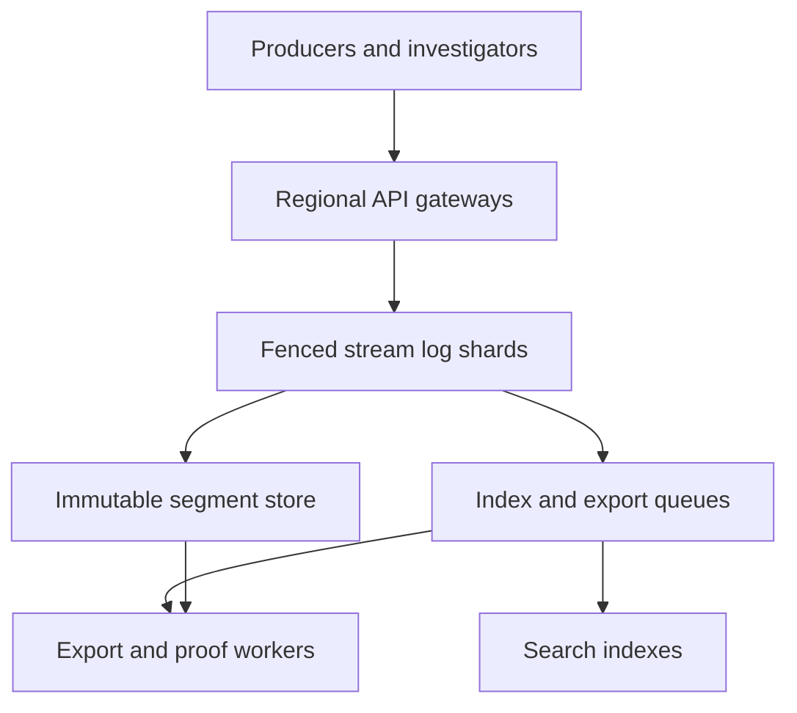

# Design a Global Tamper-Evident Audit Log Service

**Difficulty:** Senior / Staff  
**Primary themes:** append-only databases, partitioning, queues, caching, cryptographic integrity, consistency, multi-region reliability, backpressure, and compliance  
**Interview time budget:** about 45 minutes  
**Educational walkthrough:** intentionally more detailed than what you would say live

This original walkthrough follows the public [Hello Interview System Design Delivery Framework](https://www.hellointerview.com/learn/system-design/in-a-hurry/delivery): clarify requirements, name core entities, define the interface, build the simplest complete design one operation at a time, and then deepen the constraints that force architectural changes. That guidance also recommends tracing requests, state changes, and responses explicitly instead of adding distributed-systems machinery prematurely. genui{"citation":{"ref":"turn190search0"}}

The API uses resource-oriented endpoints, idempotency keys, opaque pagination cursors, authentication-derived tenant identity, and actionable errors in line with Hello Interview's public API guidance. genui{"citation":{"ref":"turn190search1"}}

## Interviewer prompt

> Design a multi-tenant, globally distributed audit log service for a cloud platform. Product services submit security and administrative events. Authorized customers search and export their events, and auditors verify that retained history was not silently modified, deleted, reordered, or fabricated after ingestion.
>
> The system must survive machine and availability-zone failures, isolate noisy tenants, honor regional residency and retention policy, and support emergency investigation during partial outages.

## Targeted clarifying questions and assumed interviewer answers

**Candidate:** “Is this an application debug log, an event bus, or a compliance record?”  
**Interviewer:** “A compliance and security record. Events include login, permission, key, configuration, data-access, and administrator actions. It may feed downstream detection, but arbitrary event-stream processing is out of scope.”

**Candidate:** “What makes the log tamper-evident?”  
**Interviewer:** “A customer or independent verifier should detect unauthorized mutation, deletion, insertion, or reordering within the promised ordering scope. We are not claiming compromised infrastructure can never destroy data; we must make violations detectable and preserve strong durability.”

**Candidate:** “Do we need one global order?”  
**Interviewer:** “No. Preserve a total order within a tenant audit stream, such as an account or organization. Events across unrelated streams need only carry trustworthy time and stable IDs.”

**Candidate:** “May producers retry?”  
**Interviewer:** “Yes. Networks fail. A retry must not create a second logical event. Producers can supply an idempotency key and an optional source sequence.”

**Candidate:** “When may the API acknowledge an event?”  
**Interviewer:** “After the event is durably replicated in its allowed region set and assigned its authoritative stream sequence. Search may lag, but a receipt lookup must find an acknowledged event.”

**Candidate:** “What scale should I assume?”  
**Interviewer:** “Five million events per second globally at peak, 2 KiB average canonical event size, 100,000 tenants, and a 20× burst for a single large tenant. Retain searchable hot data for 30 days and archive some tenants for seven years.”

**Candidate:** “What latency and availability matter?”  
**Interviewer:** “Ingest p99 under 150 ms within the selected region and 99.99% monthly availability. Receipt lookup p99 under 200 ms. New events should normally be searchable within 30 seconds. Large exports may take hours.”

**Candidate:** “What are the privacy and residency requirements?”  
**Interviewer:** “Tenant identity, allowed regions, retention, legal holds, and field-redaction policy are mandatory. Audit payloads can contain sensitive identifiers, so encrypt them and never leak one tenant's content or query timing to another.”

**Candidate:** “Can users delete events?”  
**Interviewer:** “Ordinary users cannot mutate or delete retained events. Retention expiry removes data according to policy. A legal hold prevents expiry. Privacy-driven erasure may replace specifically governed fields with a cryptographically recorded redaction marker, but must not erase the fact that an action occurred.”

**Candidate:** “Do we need offline verification?”  
**Interviewer:** “Yes. Exports should include a manifest and integrity proof that can be checked without trusting the query service.”

### What I would say aloud

> “I’ll separate the authoritative append path from search and export projections. Each audit stream will have a single fenced ordering authority at a time, but unrelated streams scale independently. An ingest acknowledgement means the canonical event and sequence are replicated durably; search is asynchronous. I’ll hash events into sealed segments, link segment roots into a stream chain, and periodically anchor signed checkpoints outside the mutable storage path. That makes tampering detectable without putting a global consensus or public-ledger write on every event.”

---

## 1. Requirements (~5 minutes)

### Core functional requirements

1. **Append audit events and return durable receipts.** Authenticated services submit events; the platform validates and canonicalizes each event, deduplicates retries, assigns an authoritative per-stream sequence, durably replicates it, and returns a receipt.
2. **Search and retrieve authorized history.** Investigators filter by time, actor, action, resource, outcome, and event ID, paginate stably, and retrieve a canonical event by receipt even before secondary indexing catches up.
3. **Export and independently verify retained history.** Customers request immutable exports containing canonical events, manifests, signatures, and inclusion/continuity proofs that an offline verifier can check.

Retention, legal holds, governed redaction, key management, and administrative policy support these three flows rather than becoming unrelated top-level requirements.

### Quantified non-functional requirements

| Requirement | Target | Design consequence |
|---|---:|---|
| Peak ingest | 5 million events/s globally | Partition by tenant stream; batch disk and replication I/O; no database transaction or KMS call per event. |
| Average event size | 2 KiB canonical payload | About 10 GiB/s raw ingress forces compression, tiering, and object storage. |
| Burst isolation | One tenant may burst 20× | Per-tenant admission, shard splitting, quotas, and bounded queues prevent noisy-neighbor collapse. |
| Ingest latency | p99 < 150 ms region-local | Keep the critical path to authentication, validation, ordering, replicated log append, and receipt; indexing is async. |
| Ingest availability | 99.99% monthly | Multi-AZ gateways and replicas, fenced leader failover, and explicit regional failure policy. |
| Search freshness | 99% searchable within 30 s | Durable indexing queues, watermarks, replayable consumers, and query responses that expose index coverage. |
| Receipt lookup | p99 < 200 ms | Maintain a compact event-location index independent of the broad search index. |
| Durability | No acknowledged loss under designed AZ failures; target 11 nines annual durability | Quorum replication before ACK, immutable sealed segments, cross-AZ checksums, archive verification, and repair. |
| Retention | 30 days hot; up to 7 years archive | Hot columnar/search tier plus compressed immutable object segments and lifecycle policy. |
| Integrity publication | Signed checkpoint at least every minute per active stream group | Batch Merkle roots and signatures; do not sign every event. |

### Scope

**In scope**

- Authenticated multi-tenant event ingestion.
- Canonical schemas plus an extensible attributes map.
- Per-stream ordering, idempotency, durable receipts, and direct lookup.
- Search, stable pagination, asynchronous export, and offline verification.
- Immutable segment storage, hash chains, Merkle proofs, signed checkpoints, and external anchoring.
- Residency, encryption, key rotation, retention, legal holds, governed redaction, access audit, quotas, and observability.
- Multi-AZ operation and policy-constrained multi-region disaster recovery.

**Out of scope**

- General-purpose application logging and full-text observability.
- Arbitrary stream processing or SIEM correlation rules.
- Source-device attestation; the service proves what it accepted, not that every producer told the truth.
- A globally ordered ledger across all tenants.
- Blockchain consensus or cryptocurrency.
- User-facing dashboards beyond the query and export interfaces.

### Consistency and availability contract

1. **Per-stream order:** each accepted event receives a monotonically increasing `stream_seq`. There is no meaningful global event order.
2. **Idempotent append:** `(tenant_id, producer_id, idempotency_key)` identifies one logical append for the retention of the dedupe record. A retry returns the original receipt; reusing the key with a different canonical payload returns a conflict.
3. **Durable acknowledgement:** success means the canonical bytes, sequence, and receipt metadata have reached a write quorum across allowed availability zones. A socket read or queue enqueue alone is not sufficient.
4. **Read-your-receipt:** direct receipt lookup is strongly consistent with acknowledged appends. Broad search is eventually consistent and returns an `indexed_through` watermark.
5. **Immutable retained record:** ordinary APIs cannot update or delete an event. Retention and governed redaction append auditable lifecycle records; they do not pretend the original action never happened.
6. **Tamper evidence:** sealed segments and published checkpoints allow detection of changed, missing, inserted, or reordered canonical records within the proof scope. Cryptography does not prevent a sufficiently privileged attacker from causing an outage; independent anchors make silent history rewriting detectable.
7. **Partition behavior:** if a stream cannot reach its regional write quorum, it fails closed for authoritative append rather than acknowledge unreplicated events. Other shards and regions remain available.

### What I would say aloud

> “Search freshness and audit correctness are different contracts. I can acknowledge after a quorum append and let indexing lag, but the receipt must resolve immediately. During a quorum loss I reject new authoritative writes for the affected shard because availability is less important than never issuing a receipt for data I may lose.”

---

## 2. Core entities (~2 minutes)

| Entity | Purpose | Important fields introduced with its owner |
|---|---|---|
| `TenantPolicy` | Isolation, residency, schema, retention, and export policy | `tenant_id`, `allowed_regions`, `retention_class`, `redaction_policy`, `quota_class` |
| `AuditStream` | Unit of ordering and proof continuity | `stream_id`, `tenant_id`, `home_region`, `epoch`, `next_seq`, `last_segment_root` |
| `AuditEvent` | Canonical immutable accepted record | `event_id`, `stream_seq`, `occurred_at`, `received_at`, `actor`, `action`, `resource`, `outcome`, `attributes`, `payload_hash` |
| `AppendReceipt` | Durable client evidence and lookup handle | `receipt_id`, `event_id`, `stream_id`, `stream_seq`, `epoch`, `payload_hash`, `durability_state` |
| `Segment` | Immutable batch of ordered canonical events | `segment_id`, `first_seq`, `last_seq`, `previous_root`, `merkle_root`, `object_ref`, `state` |
| `Checkpoint` | Signed statement of stream progress | `checkpoint_id`, `stream_id`, `through_seq`, `segment_root`, `key_id`, `signature`, `anchor_ref` |
| `IndexDocument` | Search projection, not source of truth | selected fields, `event_location`, `index_generation` |
| `ExportJob` | Asynchronous immutable export request | `job_id`, `snapshot_watermark`, `filters`, `state`, `manifest_ref`, `expires_at` |
| `LifecycleRecord` | Retention, hold, redaction, or deletion evidence | `record_id`, `target_scope`, `policy_version`, `actor`, `reason`, `effective_at`, `proof_ref` |

Three identities matter:

- `event_id` identifies the logical accepted event.
- `stream_seq` identifies its authoritative position in one ordered stream.
- `receipt_id` is the opaque client handle used for direct lookup and support.

### What I would say aloud

> “The search document is deliberately not a core source-of-truth entity. The canonical event lives in an ordered immutable segment. Search can be rebuilt from those segments, while a receipt index maps an acknowledged event directly to its location.”

---

## 3. API and system interface (~5 minutes)

The gateway derives `tenant_id`, producer identity, allowed scopes, and policy from the authenticated workload identity. The request body never chooses a tenant. REST is sufficient for control and query operations; high-volume producers may use streaming gRPC with the same logical messages.

### Append one event

```http
POST /v1/audit-events
Authorization: Bearer <workload-token>
Idempotency-Key: prod-17:01JBNP4...
Content-Type: application/json

{
  "stream_id": "org_42/security",
  "occurred_at": "2026-11-01T04:03:08.441Z",
  "source_sequence": 918331,
  "action": "iam.role_binding.create",
  "actor": {
    "type": "service_account",
    "id": "deploy-controller"
  },
  "resource": {
    "type": "project",
    "id": "payments-prod"
  },
  "outcome": "SUCCESS",
  "attributes": {
    "role": "payments.writer",
    "request_id": "req_6b29"
  }
}
```

Response:

```json
{
  "event_id": "evt_01JBNP5E5V5P",
  "receipt_id": "rcpt_01JBNP5E6A8N",
  "stream_id": "org_42/security",
  "stream_seq": 8874100231,
  "stream_epoch": 18,
  "received_at": "2026-11-01T04:03:08.469Z",
  "payload_hash": "sha256:4915...d93a",
  "durability": "REGIONAL_QUORUM",
  "search_status": "PENDING"
}
```

The API computes `payload_hash` over canonical bytes, not the caller's original JSON formatting. Duplicate keys, non-finite numbers, ambiguous Unicode normalization, and schema-invalid values are rejected before hashing.

### Append a producer batch

```http
POST /v1/audit-event-batches
Authorization: Bearer <workload-token>
Idempotency-Key: batch-prod-17:4402

{
  "stream_id": "org_42/security",
  "events": [
    {"idempotency_key": "e-918332", "source_sequence": 918332, "action": "..."},
    {"idempotency_key": "e-918333", "source_sequence": 918333, "action": "..."}
  ]
}
```

The batch is bounded, for example 1,000 events or 4 MiB. A successful response assigns a contiguous sequence range. Validation failure is per-event only if the caller opts into partial acceptance; the default is all-or-nothing to make producer recovery simple.

### Retrieve by receipt

```http
GET /v1/audit-receipts/rcpt_01JBNP5E6A8N
Authorization: Bearer <investigator-token>
```

```json
{
  "event": {
    "event_id": "evt_01JBNP5E5V5P",
    "stream_seq": 8874100231,
    "action": "iam.role_binding.create",
    "outcome": "SUCCESS",
    "payload_hash": "sha256:4915...d93a"
  },
  "integrity": {
    "segment_state": "SEALED",
    "checkpoint_id": "chk_781",
    "proof_status": "AVAILABLE"
  }
}
```

Before sealing, the event is still durable and retrievable; its response says `segment_state: OPEN` and proof status `PENDING_SEAL`.

### Search events

```http
GET /v1/audit-events?stream_id=org_42%2Fsecurity&from=2026-11-01T00:00:00Z&to=2026-11-02T00:00:00Z&action_prefix=iam.&outcome=FAILURE&limit=100&after=eyJnZW4iOj...
Authorization: Bearer <investigator-token>
```

```json
{
  "events": [
    {
      "event_id": "evt_...",
      "stream_seq": 8874100188,
      "received_at": "2026-11-01T03:58:11.005Z",
      "action": "iam.token.exchange",
      "outcome": "FAILURE"
    }
  ],
  "next_cursor": "eyJnZW4iOj...",
  "index_coverage": {
    "generation": 771,
    "indexed_through_received_at": "2026-11-01T04:02:51Z",
    "may_exclude_newer_events": true
  }
}
```

The opaque cursor pins an index generation and the last sort tuple `(received_at, stream_id, stream_seq)`. Offset pagination would duplicate or skip results while indexing continues.

### Request an export

```http
POST /v1/audit-exports
Authorization: Bearer <auditor-token>
Idempotency-Key: export-case-884

{
  "stream_ids": ["org_42/security"],
  "from": "2026-10-01T00:00:00Z",
  "to": "2026-11-01T00:00:00Z",
  "format": "JSONL",
  "include_integrity_proofs": true,
  "purpose": "case-884"
}
```

```json
{
  "job_id": "exp_01JBNQ0D",
  "state": "QUEUED",
  "snapshot": {
    "stream_id": "org_42/security",
    "through_seq": 8874099000,
    "checkpoint_id": "chk_779"
  },
  "status_url": "/v1/audit-exports/exp_01JBNQ0D"
}
```

The export snapshot is fixed at creation. Later events do not drift into a multi-hour job.

### Verify a proof

Verification should work offline, but a convenience endpoint can explain failures:

```http
POST /v1/audit-verifications
Authorization: Bearer <auditor-token>

{
  "manifest_digest": "sha256:91aa...",
  "checkpoint_id": "chk_779",
  "proof_bundle": "base64:..."
}
```

### Error contract

```json
{
  "error": {
    "code": "STREAM_QUORUM_UNAVAILABLE",
    "message": "The stream cannot safely accept authoritative events.",
    "retryable": true,
    "retry_after_ms": 500,
    "last_confirmed_epoch": 18
  }
}
```

### Interface-to-requirement mapping

| Requirement | Interface |
|---|---|
| Durable append | Single/batch append plus idempotency keys and receipts |
| Search and direct retrieval | Filtered cursor search plus strong receipt lookup |
| Export and verification | Snapshot export job, proof bundle, offline verifier/convenience verification endpoint |

### What I would say aloud

> “A receipt is the synchronous contract; search is a projection with an explicit watermark. The export pins a checkpoint so results do not change underneath a long-running job. Identity comes from authentication, and every collection is cursor-paginated because the result set and index are too large and too dynamic for offsets.”

---

## 4. Data flow

### Append path

1. Authenticate the producer and derive tenant, producer, allowed stream pattern, and regional policy.
2. Apply request size, schema, field allowlist, quota, and sensitive-data policy.
3. Canonicalize the event deterministically and compute its payload hash.
4. Route by `(tenant_id, stream_id)` to the current fenced stream shard.
5. Check the idempotency table and optional producer source sequence.
6. Assign `stream_seq`, append canonical bytes plus metadata to the replicated write-ahead log, and wait for quorum.
7. Persist the receipt mapping in the same replicated state machine and return the receipt.
8. Segment builders batch the ordered log, compute leaf hashes and a Merkle root, compress and encrypt the segment, and write it immutably to object storage.
9. Indexers consume sealed or committed records, update search shards and location indexes, and advance watermarks.
10. A checkpoint service links segment roots, signs batched progress, and publishes an independent anchor.

### Search path

1. Authenticate and authorize the investigator down to tenant, stream, time window, and visible fields.
2. Parse a bounded query and select the pinned index generation from the cursor.
3. Query time-partitioned index shards, merge sorted candidates, and apply policy filters.
4. Fetch canonical payloads only for the returned page, unless the covering index already contains every authorized field.
5. Return results, a continuation cursor, and the minimum index watermark used.

### Export path

1. Authorize the request and choose a sealed checkpoint at or beyond the requested end boundary.
2. Persist an export snapshot containing exact stream sequence ranges and policy version.
3. Queue partition tasks by stream and segment range.
4. Workers read immutable canonical segments, apply authorized field transforms, and emit checksummed chunks.
5. A reducer writes a signed manifest with chunk digests, sequence coverage, source checkpoints, schema, and proof references.
6. Publish a short-lived download reference and audit the download itself.

---

## 5. High-level design (~10–15 minutes)

Build the simplest complete system around the append, search, and export operations.



### Operation 1: append and receive a durable receipt

Regional gateways terminate TLS, validate workload identity, enforce coarse quotas, and route only to regions allowed by tenant policy. A metadata service maps each audit stream to a home region, shard, leader epoch, and replica set. Gateways cache this mapping briefly, but a stale route is harmless because the shard validates its epoch.

Why order per stream rather than per tenant or globally?

- Global order would serialize unrelated customers and add cross-region consensus to every write.
- One order for a huge tenant may become a hot partition.
- A tenant can define a small number of meaningful streams, such as `security`, `data-access`, or regional accounts, while the verifier treats each stream independently.

The leader for a stream shard runs a replicated state machine across three availability zones. It owns:

```text
StreamState(
  tenant_id, stream_id, leader_epoch, next_seq,
  open_segment_id, previous_segment_root,
  dedupe_window, policy_version
)
```

For each append, the leader checks an idempotency structure:

```text
DedupeEntry(
  tenant_id, producer_id, idempotency_key,
  payload_hash, event_id, stream_seq, receipt_id, expires_at
)
```

If the key exists with the same payload hash, return the original receipt. If the hash differs, return `409 IDEMPOTENCY_KEY_REUSED`. The dedupe record and event append are one ordered state-machine command, so failover cannot accept the same key twice with different positions.

The committed record contains:

```text
CanonicalRecord(
  tenant_id, stream_id, stream_seq, leader_epoch,
  event_id, producer_id, source_sequence,
  occurred_at, received_at, schema_version,
  actor, action, resource, outcome, attributes,
  payload_hash, policy_version
)
```

The API acknowledges only after a majority has persisted the log entry to stable storage. With three AZ replicas, one AZ may fail without losing acknowledged data. The minority does not accept writes after losing quorum.

### Operation 2: seal immutable segments

Keeping every event forever in the replicated log is expensive. A segment builder cuts an open segment by size or time, for example 256 MiB or 30 seconds. It computes a leaf hash for each canonical record:

```text
leaf_i = H(domain_event || stream_id || stream_seq || canonical_bytes)
```

It builds a Merkle tree over the ordered leaves. A Merkle tree is a binary hash tree: changing any leaf changes every hash on its path to the root. An inclusion proof contains only sibling hashes, so a verifier checks membership in `O(log n)` hashes rather than downloading the entire segment.

The segment header is:

```text
SegmentHeader(
  format_version, tenant_id, stream_id,
  first_seq, last_seq, event_count,
  previous_segment_root, merkle_root,
  min_received_at, max_received_at,
  compression, encryption_key_version, body_digest
)
```

The builder writes the compressed encrypted body and header to versioned object storage using a create-if-absent key derived from the segment ID. It then commits `SEALED(segment_id, object_digest, merkle_root)` through the same stream log. This avoids a segment being considered authoritative before its object is durable.

The `previous_segment_root` links consecutive segments. Deleting or reordering a whole segment then breaks continuity even if every remaining segment is internally valid.

After all replicas and the immutable object store agree on the sealed boundary, old WAL entries may be compacted. The sealed object, metadata, and checkpoints remain reconstructable.

### Operation 3: index for search

Committed events flow through a durable partitioned queue keyed by stream. The queue is at least once. Indexers upsert documents by immutable `event_id`, so replay is safe.

Use two projections:

1. **Receipt/location index:** compact strongly consistent or rapidly replicated mapping from `receipt_id` and `event_id` to `(segment_id, ordinal, stream_seq)`. This supports the synchronous contract.
2. **Search index:** time-partitioned inverted/columnar index for actor, action, resource, outcome, and bounded attributes. It is eventually consistent and rebuildable.

The broad index stores only fields needed for filtering and result summaries. Large or sensitive attributes remain in canonical storage and are fetched for authorized rows. This reduces index cost and leakage surface.

Index partitions are tenant-bucket plus time bucket. Dedicated large tenants receive their own partitions; small tenants share virtual shards but every key includes `tenant_id`. A generation identifies an immutable view of index segment metadata. Cursors pin a generation to provide stable pagination while new segments arrive.

Each index consumer publishes:

```text
IndexWatermark(
  tenant_id, stream_id, index_generation,
  through_stream_seq, through_received_at, updated_at
)
```

The query service returns the minimum relevant watermark. Investigators can distinguish “no match” from “the newest interval is not indexed yet.”

### Operation 4: search with cache safety

The query service first authorizes tenant, streams, time range, and field visibility. It rejects unbounded regular expressions, unbounded attribute scans, and excessive time ranges or routes them to asynchronous export.

Cache only safe reusable artifacts:

- tenant policy and stream routing with short TTL plus version;
- immutable segment headers and manifests keyed by digest;
- compiled query plans that contain no tenant data;
- result pages only when keyed by tenant, authorization-policy version, index generation, normalized query, and cursor.

Do not use a global cache key built only from query text. Two tenants can submit identical filters and must never share results. Emergency revocation increments an authorization generation so cached pages become unreachable immediately.

### Operation 5: create checkpoints and external anchors

Signing every event would overwhelm the key service and make the hot path depend on HSM latency. Instead, checkpoint asynchronously after segment sealing.

For each active stream, a checkpoint statement contains:

```text
CheckpointStatement(
  tenant_id, stream_id, checkpoint_id,
  through_seq, latest_segment_root,
  previous_checkpoint_digest,
  created_at, signing_key_id, policy_version
)
```

The checkpoint service hashes the statement, signs it with a protected asymmetric key, and stores it in multiple immutable locations. It also batches many checkpoint digests into a higher-level Merkle tree and publishes that root to an independent anchor, such as a separately administered transparency store, another cloud/account, or a public timestamping service.

The anchor matters because an attacker controlling the primary database and signing API should not be able to rewrite old history and all evidence of the rewrite. Verification checks:

1. event canonical bytes hash to the claimed leaf;
2. the inclusion path reaches the segment Merkle root;
3. sequence range and prior-root link establish segment continuity;
4. the signed checkpoint covers the segment root and sequence;
5. the checkpoint digest appears in an independently published anchor;
6. the signing certificate was valid at checkpoint time and not revoked for compromise before that time, according to policy.

Tamper-evident does not mean “magic immutable database.” It means the trusted computing base and detectable attack surface are explicit.

### Operation 6: export a stable snapshot

An export request selects, for every stream, a checkpoint and exact sequence interval. The coordinator stores the snapshot before dispatching work. Partition tasks read immutable segment ranges and emit chunk files using create-if-absent names:

```text
(export_job_id, stream_id, first_seq, last_seq, transform_version)
```

Retries are idempotent. The manifest reducer verifies full non-overlapping coverage, chunk digests, record counts, and proof availability before marking the export complete.

The final package contains:

- canonical or policy-transformed events;
- ordered sequence ranges;
- chunk checksums;
- segment headers and inclusion/continuity proofs;
- signed checkpoints and anchor evidence;
- schema and canonicalization versions;
- a small offline verifier or documented verification algorithm.

### Operation 7: retention, legal hold, and governed redaction

Retention is based on authoritative segment time/sequence metadata, not search index presence. A policy evaluator marks an immutable segment eligible only when:

- its retention deadline passed;
- no applicable legal hold covers it;
- no active export or investigation lease requires it;
- all required lifecycle evidence is durable.

Object deletion is asynchronous and retried. A lifecycle record identifies the deleted segment digest and policy decision. Checkpoints may remain as evidence that a historical range existed, without retaining its sensitive event content beyond policy.

Field-level privacy erasure is harder because changing canonical bytes breaks the original hash. Use one of two explicit policies:

- Prefer tokenization at ingestion so deleting a separately held identity mapping makes the subject irrecoverable while canonical audit bytes remain unchanged.
- When regulation requires stored-field removal, create a new redacted representation plus a signed redaction record referencing the original event hash, authority, fields, reason, and time. Access to the original is destroyed according to policy. Verification reports an authorized redaction rather than claiming the original bytes still exist.

Never silently rewrite the segment and recompute roots.

### Scale estimates that change the design

#### Ingest bandwidth

At 5 million events/s and 2 KiB each:

```text
5,000,000 × 2 KiB = 10,000,000 KiB/s
                     ≈ 9.54 GiB/s raw canonical ingress
```

With three replicas before compaction:

```text
9.54 GiB/s × 3 ≈ 28.6 GiB/s of replicated writes
```

This rejects one-row-at-a-time remote SQL inserts. Shard leaders batch log entries, replication frames, checksums, and disk fsyncs while retaining per-stream logical order.

#### Daily storage

```text
9.54 GiB/s × 86,400 s ≈ 824,000 GiB/day ≈ 805 TiB/day raw
```

At 4:1 compression, canonical object storage is still roughly 201 TiB/day before indexes and redundancy. Thirty hot days approach 6 PiB compressed. Seven years cannot remain in a premium search cluster; immutable object storage with lifecycle tiers is mandatory, and search retention may be shorter than canonical retention.

#### Events per segment

A 256 MiB target segment at 2 KiB/event contains roughly:

```text
256 MiB / 2 KiB ≈ 131,072 events
```

A Merkle inclusion proof needs about `log2(131,072) = 17` sibling hashes. With 32-byte SHA-256 values, the core path is about 544 bytes before metadata—small enough to include in export proofs.

#### Shard capacity

If one log shard safely sustains 50,000 events/s at the target latency:

```text
5,000,000 / 50,000 = 100 active shards
```

Add burst and failure headroom, perhaps 2×, yielding about 200 provisioned shard equivalents. A single tenant's 20× burst can still hot-spot one stream, so very large tenants need multiple meaningful streams or a negotiated dedicated stream group. We cannot transparently split one totally ordered stream across independent leaders without reintroducing a sequencer bottleneck.

#### Checkpoint signing

Signing every event means 5 million signatures/s. If 100,000 active streams checkpoint once per minute:

```text
100,000 / 60 ≈ 1,667 checkpoint statements/s
```

Batching those checkpoint digests into anchor trees can reduce external publications to tens per second or less. This arithmetic moves public-key signing and anchoring off the ingest path.

### What I would say aloud

> “The raw stream is roughly ten gigabytes per second and eight hundred terabytes per day, so the authoritative store must be batched immutable segments, not rows kept forever in a transactional database. A 256 MiB segment gives roughly 131,000 events but only a 17-hash inclusion path. That is the key leverage: batch storage and signatures while preserving efficient per-event proofs.”

---

## 6. Deep dives (~10–15 minutes)

In a live interview, choose two based on interviewer interest. Three are included for study.

### Deep dive A: ordering, idempotency, and durable acknowledgement

#### Where the baseline breaks

A naive design sends events to a generic queue, returns `202`, and lets consumers assign order. It cannot prove whether an acknowledged event was replicated, retries can create duplicates, multiple consumers can assign conflicting sequence numbers, and a queue partition move can silently reorder records.

#### Plausible approaches

| Approach | Benefit | Failure or tradeoff |
|---|---|---|
| Database auto-increment per stream | Familiar transactions and uniqueness | Hot rows, difficult partitioning, and cross-region write latency at this scale |
| Generic partitioned broker | High throughput and ordered partition | Broker offset is not automatically the domain receipt; producer retries and partition reassignment need careful semantics |
| Client-assigned sequence | Easy server scaling | Malicious, buggy, concurrent, or reset clients create gaps and conflicts |
| Fenced replicated stream shard | Explicit domain order, quorum ACK, deterministic dedupe | Stateful leadership, shard placement, and hot-stream management are operationally complex |

#### Selection

Use fenced replicated stream shards. Hash ordinary streams to shard groups, but store each stream's next sequence and dedupe state in the group's replicated state machine. One leader epoch may assign sequence numbers. A new leader must commit a higher epoch before accepting writes.

Every receipt includes the epoch. A delayed old leader cannot commit because replicas reject entries from an obsolete term. This is fencing: a monotonically increasing token protects against a supposedly expired owner that is still running.

#### Producer source sequence

An optional monotonically increasing `source_sequence` detects missing producer events, but it is not the authoritative audit order. Producers may run concurrently or reset after disaster recovery. The service records gaps and regressions as metadata; it does not block all audit logging forever unless the tenant explicitly chooses strict source sequencing.

#### Dedupe retention

Keeping every idempotency key for seven years would be costly. Define the contract: producer keys are guaranteed for, say, seven days, while `event_id` is permanent. Well-behaved producers retry within the window. Batch producers can use deterministic event IDs derived from a producer namespace plus durable source offset.

For long replays, the service may check a compact historical ID index or require an explicit replay namespace. Bloom filters can quickly reject most nonduplicates but cannot be the only authority because false positives would drop real audit events.

#### Replication and failure

- **Leader crashes before quorum:** no success receipt exists; retry is safe.
- **Leader commits but response is lost:** retry finds the dedupe record and returns the original receipt.
- **One AZ fails:** quorum continues, then adds a replacement replica.
- **Leader is partitioned from quorum:** it stops acknowledging; the majority elects a new leader and increments the epoch.
- **Disk reports success but later corrupts:** background scrub compares chunk hashes and repairs from replicas or sealed object storage.
- **Metadata directory is stale:** the destination rejects the wrong epoch and returns a signed redirect or refresh hint.

#### Observability

Track append latency split into gateway, validation, shard queue, replication, and fsync; quorum failures; leader changes; dedupe hits/conflicts; source gaps; per-stream queue age; replica lag bytes; checksum failures; and receipts whose location index has not appeared within the SLO.

### Deep dive B: cryptographic integrity without turning the system into a blockchain

#### Where the baseline breaks

Write-once object storage alone protects against many accidents but still trusts storage administrators and configuration. A hash per event detects changed bytes only if the expected hash is stored somewhere trustworthy. A segment Merkle tree detects internal changes but not removal of an entire segment. A signed root stored beside the data can be replaced by an attacker who also controls the signing path.

#### Plausible approaches

| Approach | Detects | Limitation |
|---|---|---|
| Per-event checksum | Bit rot and accidental corruption | An attacker can replace event and checksum together |
| Merkle root per segment | Mutation/insertion inside a known segment; compact proofs | Does not alone prove segment continuity or publication time |
| Hash chain across segments | Deletion/reordering of linked segments | A privileged attacker could rewrite the chain from a point forward |
| Signed checkpoints | Binds a protected key to stream progress | Compromised signing path may create alternative history |
| Independent external anchors | Makes retroactive alternative history detectable | Adds publication lag, operational independence, and privacy considerations |

#### Selection

Layer all five, each for a different failure class:

1. payload hashes and object checksums detect corruption;
2. Merkle trees provide compact event inclusion proofs;
3. previous-root links establish ordered segment continuity;
4. signed checkpoints bind stream identity and progress;
5. independently administered anchors make old checkpoints difficult to replace silently.

Domain-separate every hash input, include format version, tenant, stream, sequence, and lengths, and use unambiguous canonical encoding. Otherwise different logical structures can hash the same concatenated bytes.

#### Key rotation and compromise

Checkpoint statements name `signing_key_id`. Rotation starts a new key version; it does not resign old checkpoints. A cross-signed transition record links the last checkpoint under the old key to the first under the new key.

If a key is compromised:

- revoke it prospectively;
- identify the last independently anchored checkpoint before compromise;
- preserve old signatures whose trusted timestamp predates the compromise according to policy;
- start a new key and publish a signed incident/transition record;
- require verification to surface the affected interval rather than silently report success.

#### What the proof does not prove

The service proves inclusion and continuity of accepted events. It cannot prove:

- the producer emitted every real-world action;
- event fields were truthful before acceptance;
- an authorized privacy redaction retained the removed plaintext;
- data remains available if all replicas and archives are destroyed.

Say this explicitly. Strong candidates define the trust boundary instead of using “immutable” as a synonym for “correct.”

#### Verification observability

Continuously sample recent and archived segments, reconstruct Merkle roots, follow chains, verify signatures and anchors, and run customer-equivalent export verification. Alert on missing anchors, checkpoint gaps, duplicate sequence ranges, root mismatch, object-version changes, or signing from an unapproved key.

### Deep dive C: hot tenants, multi-region recovery, and searchable freshness

#### Where the baseline breaks

Hash partitioning balances many small tenants but not one stream producing one million events/s. Unbounded index queues let ingestion consume all disk while search freshness collapses. Active-active leaders in two regions can assign conflicting per-stream sequences during a partition. Blind cross-region failover may violate residency.

#### Plausible multi-region contracts

| Contract | Availability | Ordering/cost tradeoff |
|---|---|---|
| Synchronous global quorum per event | Strong cross-region durability and one order | High latency, expensive, sensitive to WAN partitions |
| Active-active per stream | Local writes in multiple regions | Requires conflict/order protocol; hard to preserve one total stream order |
| Single home region plus async DR | Low-latency clear order | Recent committed data may not be in DR unless synchronously replicated |
| Policy-selected regional quorum | Strong within allowed region set; explicit failover | Failover can pause writes while fencing and verifying recovery point |

#### Selection

Use a home region with synchronous multi-AZ quorum. For tenants requiring region-loss durability, synchronously or near-synchronously replicate sealed microsegments/commit records to a second allowed region before advertising a stronger durability class. Keep the API explicit:

- `REGIONAL_QUORUM` survives designed AZ failures;
- `DUAL_REGION_COMMITTED` survives loss of the home region through the acknowledged sequence.

During regional failover:

1. verify the tenant permits the destination region;
2. fence the old home through a globally consistent epoch service or administrative disaster declaration;
3. determine the highest fully replicated sequence and last valid checkpoint;
4. start a new epoch at `last_seq + 1`;
5. expose any unacknowledged tail as unknown, never fabricate it;
6. publish a failover checkpoint linking old and new epochs.

If both sides cannot establish exclusive authority, fail closed for that stream. Receipt lookup and historical search can remain available from replicas.

#### Hot-stream strategy

You cannot scale a strict single total order by independently writing the same stream on many leaders. Options are:

- increase one shard group's capacity with batching and faster hardware;
- let a leader sequence batches while follower/storage workers handle encoding and segment upload;
- encourage semantically separate streams by account, region, or event class;
- provide a higher-level export that merges streams by `(received_at, stream_id, stream_seq)` without claiming a global total order;
- set a documented maximum for one ordered stream and reject beyond it.

Do not promise transparent infinite scaling and strict order simultaneously.

#### Backpressure ladder

1. batch more aggressively within the latency budget;
2. consume reserved per-tenant burst credits;
3. move unrelated streams off the hot shard;
4. slow noncritical indexing and export before ingest;
5. spool committed indexing work to durable object-backed queue segments;
6. throttle the offending tenant with `429` and a retry hint;
7. reject before accepting bytes when the canonical durability path is unsafe.

Never drop acknowledged audit events to save search freshness.

#### Index lag and rebuild

Index consumers track per-stream sequence watermarks. If a consumer corrupts documents or a mapping changes, start a new index generation, replay immutable canonical segments, validate counts and sample hashes, then atomically switch query routing. Old cursors continue on the old generation until expiry.

If indexing is hours behind, receipt lookup still works. The UI and API show coverage. Emergency investigators can run a bounded direct canonical scan from a known receipt or sequence range, rate-limited and audited, rather than receiving a false empty result.

#### Tenant isolation

- quota by accepted bytes, events, index CPU, query CPU, export bytes, and concurrent jobs;
- separate admission queues and weighted fair scheduling;
- dedicated shards/indexes for very large tenants;
- encryption keys and object prefixes scoped by tenant/region;
- tenant and policy generation in every cache and queue key;
- query budgets that prevent one broad scan from exhausting a cluster.

#### Reliability signals

Measure append success and p99 by tenant class; unsealed bytes and oldest open segment; index lag by event count and wall time; queue retention runway; export backlog; anchor age; replica/DR lag; throttled bytes; query partial-result rate; and integrity verification failures. Page on correctness signals before aggregate CPU saturation.

---

## 7. Final design

### Concise architecture

- Regional gateways authenticate producers and investigators, derive tenant policy, validate schemas, and enforce quotas.
- A metadata directory maps each audit stream to an allowed home region, replicated shard, and fenced leader epoch.
- Fenced stream shards canonicalize append commands, deduplicate retries, assign per-stream sequences, and acknowledge only after multi-AZ quorum persistence.
- Compact receipt/location metadata supports strong lookup independently of asynchronous search.
- Segment builders convert ordered log ranges into compressed encrypted immutable objects, with per-event hashes, Merkle roots, and previous-segment links.
- Durable queues feed idempotent search indexers and export workers. Search exposes generation and coverage watermarks.
- Checkpoint workers sign stream progress in batches and publish checkpoint digests through an independently administered anchor.
- Export jobs pin exact sequence/checkpoint snapshots and produce checksummed chunks, signed manifests, and offline-verifiable proof bundles.
- Retention and legal holds act on canonical segment metadata. Governed redaction is explicit and signed; canonical history is never silently rewritten.
- A home-region write authority preserves order. Policy-constrained regional failover fences the old epoch and links continuity with a failover checkpoint.
- Per-tenant queues, byte/CPU quotas, dedicated large-tenant shards, bounded queries, and a degradation ladder isolate bursts.

### Requirements check

| Requirement | How the design satisfies it |
|---|---|
| Durable append and receipt | Quorum-replicated stream state machine, deterministic canonicalization, idempotency records, direct receipt index |
| Per-stream order | One fenced leader epoch assigns monotonically increasing `stream_seq` |
| Search | Rebuildable time-partitioned indexes, stable generation cursors, coverage watermarks, canonical fetch |
| Verifiable export | Pinned checkpoint snapshot, immutable chunks, signed manifest, Merkle inclusion and chain proofs, external anchors |
| 5 million events/s | Sharded stream groups, batched replication/fsync, immutable object segments, async projections |
| p99 ingest under 150 ms | Region-local quorum; no search, object upload, HSM signature, or export work on the ACK path |
| Multi-AZ reliability | Three-AZ quorum, checksums, leader fencing, repair, sealed archive |
| Region-loss options | Explicit durability classes and policy-constrained fenced DR promotion |
| Noisy-neighbor isolation | Per-tenant byte/event/CPU quotas, fair queues, dedicated large-tenant capacity, bounded queries |
| Privacy and compliance | Auth-derived tenant, encryption, field policy, retention, legal hold, explicit redaction evidence, access audit |
| Tamper evidence | Canonical hashes, Merkle roots, segment chain, signed checkpoints, independent anchors, continuous verification |

### 90-second candidate summary

> “I separate the authoritative append path from search and export. A gateway authenticates the producer, applies tenant policy, canonicalizes the event, and routes the audit stream to one fenced replicated shard. That shard deduplicates the producer key, assigns a per-stream sequence, and returns a receipt only after multi-AZ quorum persistence. Segment builders batch ordered records into compressed encrypted immutable objects. Each event is a Merkle leaf, each segment root links to the previous root, and asynchronous checkpoint workers sign stream progress and publish batched digests to an independently administered anchor. Search consumes the committed log at least once and upserts by event ID; its API exposes an index generation and watermark, while receipt lookup remains strongly consistent. Exports pin exact checkpoint and sequence ranges and include manifests and proofs for offline verification. The ten-gigabyte-per-second ingest estimate rules out row-at-a-time storage, while a 256 MiB segment still yields only a 17-hash inclusion proof. A home-region authority preserves order; failover fences the old epoch and explicitly links histories. Retention, legal holds, and redactions are lifecycle records, never silent rewrites.”

---

## Realistic interviewer follow-up questions and strong sample answers

### 1. Why not use Kafka and call it done?

**Candidate:** “A partitioned broker is a useful building block, but the product contract also needs domain idempotency, durable receipts, immutable archival segments, proof continuity, retention/hold policy, stable search, and offline verification. If I use a broker underneath, I still define those layers explicitly.”

### 2. Why not assign one global sequence?

**Candidate:** “It creates a global coordination bottleneck and WAN dependency for unrelated tenants. Audit questions usually need order within an organization or account stream. Across streams I provide trustworthy received time and stable tie-breakers without claiming a global total order.”

### 3. What does an acknowledgement guarantee?

**Candidate:** “The canonical bytes, authoritative per-stream sequence, dedupe result, and receipt mapping are persisted by a quorum in the allowed region set. It does not guarantee the event is searchable yet.”

### 4. A response times out after commit. What happens on retry?

**Candidate:** “The retry carries the same producer idempotency key. The replicated dedupe entry returns the original event ID, sequence, and receipt. A different payload under that key is a conflict.”

### 5. Why store both `occurred_at` and `received_at`?

**Candidate:** “Producer time helps investigation but may be skewed or malicious. `received_at` is assigned by the service and drives authoritative ordering windows, retention, and search coverage. Sequence is the final order inside a stream.”

### 6. How do you detect a missing event?

**Candidate:** “Inside the service, sequence continuity and segment coverage detect missing accepted records. An optional source sequence detects producer-side gaps. But the system cannot prove a producer reported every real-world action; that requires source attestation or independent controls.”

### 7. Why canonicalize before hashing?

**Candidate:** “Semantically identical JSON can have different whitespace, key order, number spelling, or Unicode forms. Deterministic versioned encoding ensures every verifier hashes the same bytes and prevents ambiguous representations.”

### 8. What is a Merkle proof?

**Candidate:** “It is the sibling hashes needed to recompute a tree root from one event leaf. Proof size grows logarithmically, so an event in a roughly 131,000-event segment needs about 17 sibling hashes.”

### 9. Why link segment roots?

**Candidate:** “A Merkle root proves membership inside a known segment. Linking each segment to the prior root makes deleting or reordering whole segments break stream continuity.”

### 10. Why are signed roots not sufficient?

**Candidate:** “If an attacker controls primary storage and the signing service, they could create an alternate history. Publishing checkpoint digests through an independently administered anchor makes retroactive replacement detectable.”

### 11. Is this a blockchain?

**Candidate:** “No. We have a trusted service assigning per-stream order, not decentralized consensus or economic incentives. Hash chains and external anchors give tamper evidence with much lower latency and cost.”

### 12. Can a customer verify one event without downloading the segment?

**Candidate:** “Yes. Give them canonical event bytes, leaf position, Merkle sibling path, segment header, continuity/checkpoint references, signature chain, and anchor evidence.”

### 13. When is a proof available?

**Candidate:** “The receipt is immediate after quorum commit. A final inclusion proof becomes available after the open segment seals and a checkpoint covers it, normally within the stated minute-scale SLO.”

### 14. What if the search index misses an acknowledged event?

**Candidate:** “Receipt lookup goes through the canonical location index and still returns it. Search responses expose `indexed_through`; indexers replay the immutable log, and operators alert when a committed sequence remains unindexed beyond the SLO.”

### 15. How do you paginate while indexing continues?

**Candidate:** “The cursor pins an index generation plus the last sort tuple. New generations do not alter that traversal. I use keyset pagination, not offsets.”

### 16. How do you rebuild an index?

**Candidate:** “Create a new generation, replay immutable segments, validate counts and sampled payload hashes against manifests, catch up to current watermarks, then atomically switch new queries. Old cursors expire on the old generation.”

### 17. What if one tenant creates a hot stream?

**Candidate:** “A strict total order has one sequencing point. I scale batching, replication, and downstream work around it, offer dedicated capacity, and encourage semantically separate streams. I also publish a maximum ordered-stream rate instead of pretending it splits infinitely.”

### 18. How do you isolate noisy tenants?

**Candidate:** “Quota accepted bytes/events, index and query CPU, export bandwidth, and concurrency. Use per-tenant queues with weighted fairness, dedicated capacity for large tenants, and bounded query plans.”

### 19. What do you shed first under overload?

**Candidate:** “Pause or slow exports, then noncritical indexing, while preserving canonical ingest and receipt lookup. If the authoritative path itself is unsafe, reject before acknowledgment. Never drop acknowledged events.”

### 20. Can two regions accept the same stream concurrently?

**Candidate:** “Not under this contract. One home-region epoch owns the stream. Active-active writes would require a different ordering model or cross-region consensus. Failover first fences the old epoch.”

### 21. What if the old region returns after failover?

**Candidate:** “Its epoch is stale, so destination replicas and metadata reject writes. We compare tails, preserve any unacknowledged records as forensic artifacts, and never splice them silently into the new authoritative sequence.”

### 22. How do residency rules affect disaster recovery?

**Candidate:** “The allowed destination set is part of tenant policy and stream metadata. Replicas, queues, objects, indexes, exports, and keys must all stay inside it. If no allowed region can accept authority, we fail closed.”

### 23. How do you rotate encryption keys?

**Candidate:** “Segments use envelope encryption with a data key wrapped by a versioned tenant/region key. New segments use the new wrapping key. Old segments can be rewrapped without changing ciphertext or event hashes.”

### 24. How do you rotate signing keys?

**Candidate:** “New checkpoints name the new key. A cross-signed transition links the final old-key checkpoint to the first new-key checkpoint. Old checkpoints are not rewritten.”

### 25. What if a signing key is compromised?

**Candidate:** “Find the last independently anchored checkpoint before compromise, revoke the key prospectively, publish an incident transition, start a new key, and make verifiers surface the affected interval. Anchors limit how far history can be rewritten silently.”

### 26. How do retention and proofs coexist?

**Candidate:** “After authorized expiry, content objects can be deleted while lifecycle records and non-content checkpoint digests remain. A verifier can prove that a historical range existed and expired under policy without retaining sensitive payload indefinitely.”

### 27. How do you support privacy erasure without breaking the chain?

**Candidate:** “Prefer tokenization so erasing the identity mapping leaves canonical bytes unchanged. If stored fields must be removed, issue a signed redaction record tied to the original hash and make verification report an authorized redaction; never silently recompute history.”

### 28. What is the source of truth?

**Candidate:** “The quorum-committed ordered log until compaction, then sealed canonical segment objects plus authoritative segment/checkpoint metadata. Search indexes, caches, dashboards, and exports are projections.”

### 29. Which metrics are correctness-critical?

**Candidate:** “Quorum commit failures, duplicate/conflicting idempotency keys, sequence or segment coverage gaps, root/signature/anchor verification failures, receipt-location lag, index watermark lag, unsealed bytes, and DR replication lag.”

### 30. What would you build first?

**Candidate:** “One region, three AZs, one schema, fenced stream shards, quorum receipts, immutable segments, a basic receipt index, asynchronous search, and signed segment checkpoints. Then add external anchors, exports, multi-region durability classes, redaction workflows, and tiered retention.”

---

## Common pitfalls

1. Calling a generic message queue a complete audit-log design.
2. Acknowledging after gateway receipt rather than durable quorum commit.
3. Claiming global exactly-once delivery instead of idempotent logical append.
4. Using caller-provided tenant identity instead of authentication-derived identity.
5. Reusing an idempotency key with a different payload without detecting conflict.
6. Assigning one global sequence and creating unnecessary cross-region consensus.
7. Claiming timestamps alone provide deterministic order.
8. Trusting producer time for retention or authoritative sequencing.
9. Hashing noncanonical JSON.
10. Concatenating hash fields without length prefixes or domain separation.
11. Using per-event public-key signatures at five million events per second.
12. Treating a checksum as protection from a privileged attacker.
13. Building Merkle trees but not linking or checkpointing segments.
14. Storing signed roots beside mutable data with no independent anchor.
15. Saying “blockchain” without explaining why decentralized consensus is needed.
16. Promising tamper-proof storage instead of defining tamper evidence and trust boundaries.
17. Keeping the full canonical payload only in the search index.
18. Hiding indexing lag and returning false-empty results.
19. Using offset pagination on a changing distributed index.
20. Caching query results without tenant, policy version, and index generation in the key.
21. Allowing unbounded attribute or regex queries on the synchronous path.
22. Letting exports compete with authoritative ingest for all capacity.
23. Retrying export tasks without deterministic output keys.
24. Failing to pin a stable export sequence/checkpoint snapshot.
25. Assuming hash partitioning solves one extremely hot ordered stream.
26. Running two regional leaders for one stream without a conflict/order contract.
27. Promoting DR without fencing the old region.
28. Replicating audit payloads outside the tenant's allowed region set.
29. Deleting canonical objects based on search-index age rather than authoritative policy metadata.
30. Silently rewriting segments for privacy redaction.
31. Rotating signing keys by resigning old history.
32. Ignoring signing-key compromise and trusted-time semantics.
33. Measuring CPU and QPS but not proof gaps, receipt lag, or index coverage.
34. Doing storage arithmetic without using it to justify batching and tiering.
35. Drawing crypto components before tracing append → receipt → seal → search → proof.

---

## Practical interview delivery plan

| Time | What to cover |
|---:|---|
| 0–5 min | Clarify audit semantics, ordering scope, receipt guarantee, search lag, verification, retention, residency, and scale. |
| 5–7 min | Name policy, stream, event, receipt, segment, checkpoint, index document, export job, and lifecycle record. |
| 7–12 min | Define append/batch, receipt lookup, search, export, and proof interfaces. |
| 12–25 min | Build gateway, fenced replicated shards, quorum ACK, segment sealing, receipt index, search projection, checkpointing, and export. |
| 25–38 min | Deep dive on ordering/dedupe and cryptographic integrity; use hot tenants/multi-region if prompted. |
| 38–43 min | Cover overload, failure modes, retention/redaction, observability, and scale-driven choices. |
| 43–45 min | Check requirements and deliver the 90-second summary. |

The written walkthrough is deliberately longer than the live interview. On the whiteboard, first draw the gateway, fenced log shard, immutable segment store, indexing queue, and search index. Trace one event to a quorum receipt, then to a sealed segment and searchable document. Only after the complete flow works should you add Merkle proofs, anchors, DR promotion, and lifecycle policy.

---

## Public references

The delivery order and interview pacing use public Hello Interview guidance; the problem, dialogue, requirements, numbers, APIs, architecture, calculations, and tradeoffs are original.

- [Hello Interview — System Design Delivery Framework](https://www.hellointerview.com/learn/system-design/in-a-hurry/delivery) — requirements, core entities, interfaces, high-level design, and deep-dive progression. genui{"citation":{"ref":"turn190search0"}}
- [Hello Interview — API Design](https://www.hellointerview.com/learn/system-design/core-concepts/api-design) — resource modeling, idempotency, pagination, authentication, versioning, and actionable errors. genui{"citation":{"ref":"turn190search1"}}
- [Hello Interview — System Design in a Hurry](https://www.hellointerview.com/learn/system-design/in-a-hurry/introduction) — structured reasoning, scaling, and avoiding an incomplete “spaghetti design.” genui{"citation":{"ref":"turn190search3"}}
