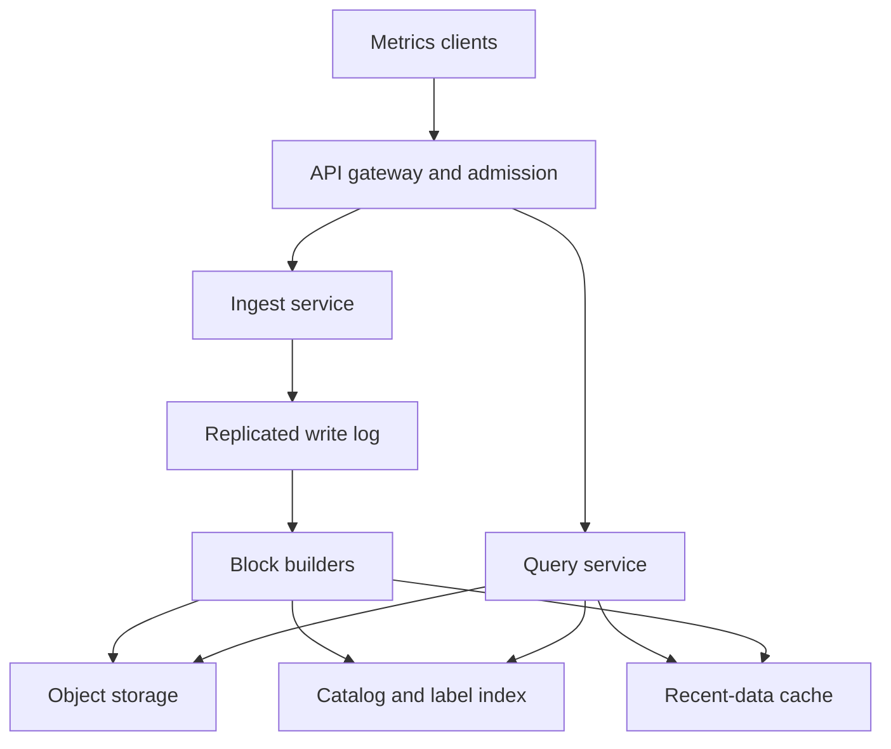
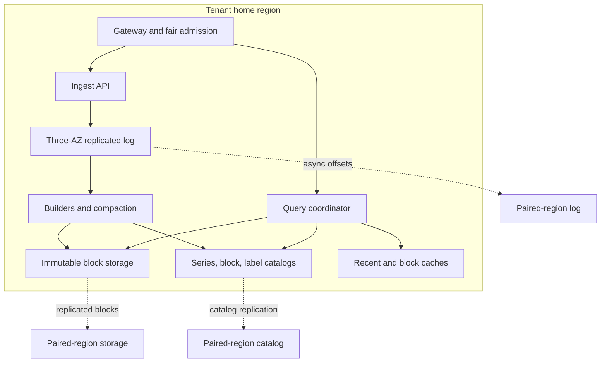

# Design a Multi-Region Time-Series Database

**Difficulty:** Senior / Staff-level  
**Primary themes:** write-heavy databases, partitioning, queues, caching, durability, consistency, multi-region reliability  
**Interview time budget:** about 40–45 minutes  
**Educational walkthrough:** intentionally more detailed than what you would say in the interview

This walkthrough follows the sequence recommended by Hello Interview: clarify requirements, identify core entities, define interfaces, build the simplest complete design one operation at a time, and then spend the remaining time hardening the design around the most important non-functional requirements. The point is not to introduce every distributed-systems component immediately; it is to earn complexity by first showing where the baseline breaks. See [Hello Interview's delivery framework](https://www.hellointerview.com/learn/system-design/in-a-hurry/delivery) and [API design guide](https://www.hellointerview.com/learn/system-design/core-concepts/api-design).

---

## Interviewer prompt

> Design a managed, multi-tenant time-series database similar to the storage layer behind a metrics or IoT platform. Clients write timestamped measurements with labels, run recent and historical range queries, and define retention and downsampling policies. The service should operate across multiple regions.

## Targeted clarifying questions

The candidate should quickly turn “time-series database” into a bounded contract.

**Candidate:** Are we building only the database, or also dashboards, alert evaluation, and host agents?

**Interviewer:** Focus on ingestion, storage, and queries. Agents, dashboards, and alerting are clients. We do need retention and downsampling.

**Candidate:** What query shapes matter most: lookup of one series, aggregation across many series, arbitrary SQL, or full-text search?

**Interviewer:** The main query is a time range over series selected by metric name and exact or regex label filters, followed by simple aggregations such as sum, average, percentile, rate, and group-by label. Arbitrary joins are out of scope.

**Candidate:** What scale and freshness should I design for?

**Interviewer:** Design for 10 million active series, an average of 5 million samples per second globally, bursts to 10 million samples per second, and 30 days of raw retention. Recent points should be queryable within five seconds.

**Candidate:** Are timestamps generated by clients? Can points arrive late, duplicated, or out of order?

**Interviewer:** Yes. Clients may retry and may be offline. Accept points up to 24 hours late. Duplicate submissions are common. A series is identified by tenant, metric name, and its complete label set.

**Candidate:** Do clients need linearizable reads after a write?

**Interviewer:** No. A successful write means the service durably accepted the batch. Normal queries may be eventually consistent within five seconds. Offer an optional read-your-writes mode within the ingest region. Retention and rollups may lag by minutes.

**Candidate:** What is the multi-region expectation during failures?

**Interviewer:** Tenants have a home region and a paired failover region. We prefer availability and no acknowledged-data loss for a single availability-zone failure. For a full-region loss, target an RPO under one minute and RTO under five minutes; synchronous cross-region writes are not required.

**Candidate:** Should we support deleting an individual point or changing labels?

**Interviewer:** Labels are immutable for a series. Tenant or time-range deletion is needed for compliance, but single-point mutation is not on the critical path.

**Candidate:** What should happen when a tenant exceeds quota?

**Interviewer:** Isolate noisy tenants. Reject or throttle before shared queues and storage become unhealthy, and return a retry hint.

### Scope statement I would say aloud

> “I’ll design a multi-tenant database for batched time-series ingestion, label-based range queries, and policy-driven retention and rollups. I’ll optimize for append-heavy writes and bounded-staleness reads rather than transactions or arbitrary joins. I’ll first make a single-region design complete, then harden partitioning, storage, and regional failure behavior.”

---

## 1. Requirements (~5 minutes)

### Core functional requirements

1. **Ingest samples in batches.** Each sample contains a metric name, label set, client timestamp, and numeric value. The service accepts retryable, late, and out-of-order writes.
2. **Query time ranges.** Clients select series using metric name plus label filters, retrieve points or aggregate them over time, group by a label, and paginate or stream large results.
3. **Manage storage policies.** Tenants configure raw retention and rollups such as “keep 10-second averages for 90 days.” The service expires old data and can perform asynchronous range deletion.

### Quantified non-functional requirements

- **Scale:** 5 million samples/second average and 10 million/second peak globally; 10 million active series; up to 100,000 tenants.
- **Write durability and availability:** 99.99% successful ingest availability. After the API acknowledges a batch, no data loss for a single availability-zone failure.
- **Freshness and latency:** accepted samples visible to ordinary queries within 5 seconds; p95 ingest acknowledgment below 200 ms; p95 recent query below 2 seconds for a bounded query scanning at most 1 million points.
- **Regional recovery:** cross-region RPO under 1 minute and RTO under 5 minutes. A full-region disaster may lose the most recent asynchronously replicated data.
- **Isolation:** one tenant's burst or expensive query must not exhaust global write buffers, queue capacity, or query workers.

### Consistency and availability contract

This is where a strong answer becomes precise.

| Operation | Contract |
|---|---|
| Ingest acknowledgment | The batch is durably replicated across a quorum of availability zones in the home region. It may not yet be in query-optimized files. |
| Default query | Eventual consistency; acknowledged samples normally appear within 5 seconds. |
| Read-your-writes query | Within the home region, a client can pass the ingest watermark returned by the write; the query waits briefly for that watermark or merges from the write buffer. |
| Duplicate write | At-least-once transport with best-effort logical deduplication. Identical retries using the same batch id do not create a second accepted batch. |
| Conflicting values at same series and timestamp | Deterministic last-write-wins using server ingest sequence, not client clock. This is documented because silently summing both values would be surprising. |
| Retention and rollups | Eventual; background jobs may lag by minutes, but queries apply the logical retention cutoff even before physical deletion. |
| Full-region failure | Fail over to the paired region within 5 minutes. Up to 1 minute of recently acknowledged data may be unavailable or lost under the stated RPO. |

**What I would say aloud:**

> “I’m separating durable acceptance from query visibility. The write API returns after a regional quorum has the batch, while the read path can lag up to five seconds. That lets us absorb writes through a log and build query-efficient files asynchronously. If the product demanded globally linearizable read-after-write, the cross-region latency and availability cost would force a very different design.”

### Explicitly out of scope

- Arbitrary relational joins and multi-row transactions
- Alert evaluation, dashboards, and client agents
- Traces and unstructured logs
- Per-point updates on the synchronous path
- Active-active writes for the same tenant across arbitrary regions

---

## 2. Core entities (~2 minutes)

Identify nouns before drawing tables. The data model will evolve beside the components that use it.

| Entity | Purpose | Important identity or fields |
|---|---|---|
| **Tenant** | Isolation, routing, quotas, and policies | `tenant_id`, `home_region`, `failover_region`, `write_quota`, `query_quota` |
| **Series** | One unique metric and complete label set | `series_id`, `tenant_id`, `metric_name`, canonical `labels`, `labels_hash`, `created_at` |
| **Sample** | A timestamped measurement | `series_id`, `event_time`, `value`, `ingest_sequence` |
| **IngestBatch** | Retry and durability boundary | `tenant_id`, `batch_id`, `payload_hash`, `accepted_watermark`, `status` |
| **Block** | Immutable time-partitioned storage unit | `tenant_id`, `shard_id`, `min_time`, `max_time`, `object_uri`, `index_uri`, `checksum`, `level` |
| **RetentionPolicy** | Raw and aggregate lifetimes | `tenant_id`, `raw_ttl`, rollup windows and TTLs, `version` |

`series_id` is assigned by the server after canonicalizing labels: sort label keys, normalize their encoding, and hash `(tenant_id, metric_name, canonical_labels)`. We do not use the hash alone as proof of equality; the catalog verifies the full canonical label set to handle the unlikely collision.

---

## 3. API and system interface (~5 minutes)

Identity comes from authentication. A service token maps to `tenant_id`, permissions, and quotas at the gateway. Clients cannot choose another tenant by putting a tenant id in the body.

Hello Interview's API guidance recommends modeling interfaces around resources and making retries safe. This design applies that directly: batches and queries are resources, while the `Idempotency-Key` protects the non-idempotent ingest operation.

### 3.1 Ingest a batch

```http
POST /v1/write-batches
Authorization: Bearer <service-token>
Idempotency-Key: 01JBN5KQ9M6P2W2G4D4M8Y7S1A
Content-Encoding: zstd
Content-Type: application/x-protobuf
```

Conceptual decoded body:

```json
{
  "samples": [
    {
      "metric": "http_request_duration_ms",
      "labels": {"service": "checkout", "region": "us-east", "status": "200"},
      "timestamp_ms": 1793581200123,
      "value": 42.7
    }
  ]
}
```

Response after durable regional acceptance:

```http
HTTP/1.1 202 Accepted
```

```json
{
  "batch_id": "01JBN5KQ9M6P2W2G4D4M8Y7S1A",
  "accepted_samples": 1000,
  "rejected_samples": 2,
  "watermark": "use1:ingest-partition-184:993810221",
  "estimated_visible_at": "2026-11-02T06:00:05Z",
  "errors": [
    {"index": 17, "code": "TIMESTAMP_TOO_OLD"}
  ]
}
```

Key choices:

- A batch amortizes authentication, compression, replication, and network overhead.
- `202` means durably accepted, not necessarily query-visible.
- Reusing an idempotency key with the same payload returns the stored result. Reusing it with a different payload returns `409 IDEMPOTENCY_KEY_REUSED`.
- Quota exhaustion returns `429` with `Retry-After`; overload returns `503` before accepting the batch.

### 3.2 Query a time range

```http
POST /v1/time-series-queries
Authorization: Bearer <service-token>
Content-Type: application/json
X-Min-Watermark: use1:ingest-partition-184:993810221
```

```json
{
  "metric": "http_request_duration_ms",
  "matchers": [
    {"label": "service", "op": "=", "value": "checkout"},
    {"label": "region", "op": "=~", "value": "us-.*"}
  ],
  "start_ms": 1793577600000,
  "end_ms": 1793581200000,
  "aggregation": {"function": "p95", "step_ms": 60000},
  "group_by": ["region"],
  "max_points": 1000000
}
```

```json
{
  "series": [
    {
      "labels": {"region": "us-east"},
      "points": [[1793577600000, 81.2], [1793577660000, 79.6]]
    }
  ],
  "partial": false,
  "data_watermark": "use1:ingest-partition-184:993810250",
  "next_page_token": null,
  "stats": {"series_matched": 842, "points_scanned": 505200}
}
```

Why `POST` for a read? The selector and aggregation plan can be large and structured. It remains a side-effect-free operation even though HTTP does not treat POST as inherently idempotent. The service supplies a `query_id` in real deployments so clients can cancel or inspect long queries.

If `X-Min-Watermark` has not become readable within, say, two seconds, return `409 WATERMARK_NOT_VISIBLE` with the current watermark rather than wait indefinitely. That bounds tail latency.

### 3.3 Manage retention and rollups

```http
PUT /v1/retention-policy
Authorization: Bearer <admin-token>
If-Match: "policy-version-7"
Content-Type: application/json
```

```json
{
  "raw_retention": "30d",
  "rollups": [
    {"window": "1m", "functions": ["min", "max", "sum", "count"], "retention": "180d"},
    {"window": "1h", "functions": ["min", "max", "sum", "count"], "retention": "2y"}
  ]
}
```

The optimistic `If-Match` version prevents two administrators from silently overwriting each other. We store sum and count rather than only average so rollups can be combined correctly.

### 3.4 Internal streaming interfaces

The public API is HTTP, but internal data movement uses partitioned streams:

```text
ingest.accepted.v1      key = tenant_id + logical_shard
blocks.committed.v1     key = tenant_id + logical_shard
rollup.tasks.v1         key = block_id
deletion.tasks.v1       key = tenant_id + time_range
```

Events are versioned and carry `event_id`, schema version, producer timestamp, and trace id. Consumers are idempotent because the broker provides at-least-once delivery.

---

## 4. Data flow

### Write path

1. Authenticate and derive the tenant.
2. Enforce tenant token-bucket quotas and global admission limits.
3. Validate timestamps, sample types, and maximum label count/length.
4. Canonicalize the label set and resolve or create `series_id` in the series catalog.
5. Partition by `(tenant_id, hash(series_id))`, append the compressed batch to a replicated write-ahead log, and return its offset as the watermark.
6. Ingestion workers read the log, sort a bounded window by series and event time, update a recent-memory buffer, and flush immutable blocks to object storage.
7. Commit block metadata atomically, then advance the query-visible watermark.
8. Background workers compact blocks, build rollups, enforce retention, and copy the log or committed blocks to the paired region.

### Query path

1. Authenticate, validate cost limits, and optionally wait for a requested watermark.
2. Use the inverted label index to turn the selector into a set of `series_id`s.
3. Consult the block catalog to find overlapping blocks and available rollups.
4. Read recent points from memory and older columns from object storage, using caches where possible.
5. Merge overlapping blocks, resolve duplicate timestamps by `ingest_sequence`, aggregate, and stream the response.

---

## 5. High-level design (~10–15 minutes)

The interview version should start simple and become complete one operation at a time. Do not begin with compaction levels, multi-region consensus, and ten caches.

### 5.1 Baseline architecture



The control plane stores tenants, quotas, policy versions, and region placement in a strongly consistent relational database. The data plane is partitioned and avoids a central transaction for every sample.

### 5.2 Operation 1: accept writes durably

The gateway authenticates the token and attaches trusted `tenant_id`. A local quota service maintains per-tenant token buckets. Periodic allocation from a regional quota coordinator keeps checks local; small temporary overages are acceptable, but the storage system must never accept unbounded work.

The ingest service validates the batch and consults a cached series catalog. On a catalog miss, it upserts by:

```text
unique key: (tenant_id, metric_name, labels_hash)
stored: canonical_labels, series_id, created_at
```

The database verifies `canonical_labels` before reusing an id. New-series creation has stricter rate limits because high cardinality is often more dangerous than raw sample volume.

The batch then goes to a partitioned, replicated log. Within one region, each partition has replicas in three availability zones; acknowledgment requires a leader plus one follower. The log gives us:

- a durable acceptance boundary;
- ordered offsets within a partition;
- backpressure via consumer lag;
- replay after worker failure;
- a watermark the client can later use.

The idempotency record is stored in the same partition as the accepted batch, conceptually:

```text
(tenant_id, batch_id) -> payload_hash, log_offset, response_summary, expires_at
```

If the service crashes after appending but before replying, the retry finds the record and returns the original watermark.

**Trace the request aloud:**

> “A write is authenticated, quota-checked, mapped to series ids, and appended to a quorum-replicated regional log. The offset becomes the acceptance watermark. Only after that succeeds do I return 202, so an availability-zone failure cannot erase an acknowledged batch.”

### 5.3 Operation 2: make accepted data queryable

Block builders consume log partitions. They maintain bounded in-memory buffers keyed by series and time bucket, such as two-hour windows. They sort points by `(series_id, event_time, ingest_sequence)` and create immutable columnar blocks:

```text
Block header: tenant_id, shard_id, min_time, max_time, row_count, checksum
Columns: series_id[], timestamp_delta[], value[], ingest_sequence[]
Side index: series_id -> byte ranges and min/max timestamps
```

Columnar layout places like fields together, which compresses repeated series ids and timestamp deltas well and lets queries read only needed columns. Blocks go to durable object storage; a small transactional catalog records them only after upload and checksum verification.

A block becomes visible through a two-step commit:

1. upload immutable object under a unique id;
2. insert a committed catalog row and advance the partition's visible watermark in one metadata transaction.

An uploaded but uncommitted object is harmless garbage collected later. A committed row never points to a partial object.

The recent-data cache holds decoded points that have not yet flushed or whose block is very hot. It is not the durability layer; the log is. If the cache disappears, the query service can replay or wait for block materialization.

### 5.4 Operation 3: answer range queries

The label index maps terms to compressed posting lists:

```text
(tenant_id, metric_name) -> candidate series ids
(tenant_id, label_key, label_value) -> series ids
```

Exact match intersects posting lists. Regex matching first uses any exact prefix or other exact labels to narrow candidates, then verifies labels from the series catalog. We cap selector cardinality and estimated scan bytes so an unbounded regex cannot become a cluster-wide table scan.

The block catalog is partitioned by tenant and time. For each selected series set and time range, it returns overlapping blocks. Query workers read block indexes, fetch only required byte ranges, merge recent data and immutable blocks, remove duplicates, and aggregate.

The aggregation planner chooses the coarsest rollup that preserves the requested step. A one-year query with a one-hour step should not scan raw 10-second samples.

Caching has three distinct jobs:

- **Series/index cache:** hot label postings and series metadata.
- **Block cache:** compressed object ranges keyed by immutable block id and byte range. Immutability makes invalidation trivial.
- **Result cache:** only for repeated, fully historical queries. The key includes selector, time range, step, function, policy version, and a block-generation fingerprint. Queries touching the open recent window bypass or use a very short TTL.

**Trace the request aloud:**

> “The query service first turns labels into series ids, then turns series ids plus time into immutable blocks. It reads the newest points from the recent buffer and older points from object storage, merges by timestamp and ingest sequence, aggregates, and streams results. That separation prevents every query from scanning every block.”

### 5.5 Operation 4: retention and rollups

When block metadata is committed, an outbox row creates a `blocks.committed` event in the same metadata transaction. A relay publishes it to the broker. This transactional outbox avoids the classic failure where the block commits but the rollup event is lost.

Rollup workers consume committed blocks, group points into windows, and write new immutable aggregate blocks containing mergeable states:

- min and max;
- sum and count for averages;
- mergeable percentile sketches rather than final percentile values.

The task id is derived from `(source_block_ids, rollup_policy_version)`. A retry writes the same logical output or recognizes the committed result, so at-least-once task delivery does not double-count.

Retention has two layers:

1. **Logical expiration:** the query planner never returns data older than the current policy cutoff.
2. **Physical reclamation:** workers mark old blocks, wait through a grace period for in-flight queries, then delete objects.

That makes retention correct even when deletion workers lag.

### 5.6 Scale estimate that changes the design

Assume an encoded sample averages 16 bytes after batching and compression: roughly 4 bytes for timestamp delta, 8 for value, and 4 amortized bytes for series/id/index overhead.

```text
5,000,000 samples/s × 16 bytes ≈ 80 MB/s
80 MB/s × 86,400 s/day ≈ 6.9 TB/day
30 days raw ≈ 207 TB
With replication, indexes, late-write overlap, and headroom: plan for roughly 0.5–1 PB
```

At 10 million samples/second peak, one log partition sustaining 50,000 samples/second would require about 200 active partitions. We would provision perhaps 300–400 to leave failover and rebalancing headroom.

This arithmetic changes concrete choices:

- a single relational primary cannot be the sample write path;
- object storage is attractive for hundreds of terabytes of immutable blocks;
- batching is mandatory because per-sample RPC and consensus overhead would dominate;
- partitioning must be finer than tenant alone because a few large tenants would create hot partitions;
- rollups materially reduce long-range query cost.

I would not estimate disk spindle counts or exact compression ratios unless the interviewer asks; those numbers would not change the high-level design.

---

## 6. Deep dives (~10–15 minutes)

Choose two or three. In a 45-minute interview, I would lead with partitioning and the late-data storage engine, then cover reliability/consistency. I would discuss query caching only if the interviewer probes latency.

## Deep dive A: partitioning, hot tenants, and cardinality isolation

### Where the baseline breaks

Partitioning only by `tenant_id` overloads one shard for a very large customer. Hashing only by `series_id` spreads writes but makes label-index and tenant scans fan out across the entire fleet. A tenant can also create millions of unique label combinations, exhausting the series catalog and cache even at moderate samples per second.

### Plausible approaches

| Approach | Strength | Failure or cost |
|---|---|---|
| Tenant-only partition | Excellent tenant-local queries and accounting | Hot tenant cannot scale beyond one partition |
| Global hash of series id | Even distribution | Every tenant query and policy job fans out widely; weak isolation |
| Time-only partition | Easy retention | Current time bucket becomes a write hotspot |
| Hierarchical tenant + logical shard + time | Locality, bounded fanout, scalable hot tenants | More routing metadata and resharding logic |

### Selected design

Use a hierarchical key:

```text
logical_shard = hash(series_id) mod tenant_shard_count
write_partition = (tenant_id, logical_shard)
storage_partition = (tenant_id, logical_shard, time_bucket)
```

Small tenants start with one or a few logical shards. Large tenants get more. A placement service maps logical shards to physical log partitions and block-builder groups. This indirection allows migration without changing the public series identity.

To change shard count without instantly rewriting history, version the routing epoch:

```text
tenant_id -> {epoch, shard_count, effective_from_time}
```

New writes use the new epoch; queries crossing the boundary consult both layouts. Old blocks can be compacted into the new layout gradually or remain where they are until expiration.

### Cardinality controls

- Cap label count, label length, batch size, and new series per minute.
- Maintain tenant budgets for active series as well as samples/second.
- Reject pathological series creation at the gateway before catalog writes.
- Expose “top label keys by cardinality” so customers can fix accidental identifiers such as `request_id` used as a label.
- Keep separate worker pools and weighted fair queues for tenant classes.

Weighted fair queuing gives each tenant or service tier a share, while unused capacity can be borrowed. It is better than one global FIFO because a noisy tenant cannot place millions of writes ahead of everyone else.

### Failure modes and observability

Watch per logical shard:

- ingest rate, bytes, and new-series rate;
- leader CPU and replication lag;
- builder lag in seconds and log offsets;
- label-index posting size and cache hit rate;
- throttled samples by reason.

Alert on skew, not only totals. A cluster at 40% CPU can still have one partition at 100%.

**What I would say aloud:**

> “Tenant is my isolation boundary, series hash is my distribution boundary, and time is my lifecycle boundary. I combine all three rather than asking one partition key to solve incompatible problems.”

## Deep dive B: late data, deduplication, and the immutable storage engine

### Where the baseline breaks

If block builders wait 24 hours for all late data, freshness fails. If they mutate large files whenever a late point arrives, random rewrites destroy write throughput. If queries simply concatenate overlapping files, retries and compaction can double-count data.

### Plausible approaches

| Approach | Strength | Failure or cost |
|---|---|---|
| Mutable B-tree rows per sample | Easy point upsert and immediate visibility | Write amplification and index size at millions of writes/s |
| Wait for lateness window before sealing | Simple final files | Data remains unqueryable or memory-heavy for too long |
| Immutable base blocks plus delta blocks and compaction | Sequential writes, cheap object storage, immediate sealing | Query overlap and background compaction complexity |

### Selected design

Use an LSM-like design. An LSM, or log-structured merge design, converts random updates into sequential immutable writes, then merges files in the background.

1. The builder seals a base block after a short interval, such as two minutes.
2. Late points for a sealed time bucket go to smaller delta blocks.
3. Queries read the base plus overlapping deltas and reconcile by `(series_id, event_time)`.
4. Compaction merges them into a new block, retaining the value with the highest server `ingest_sequence` for a timestamp.
5. A metadata transaction adds the new block and marks input blocks superseded. Readers use a catalog snapshot so they see either the old set or new set, never both as independently live.

This provides deterministic results without in-place mutation.

### Deduplication boundaries

There are two different duplicates:

- **Batch retry:** same tenant and idempotency key. Deduplicate at log acceptance and return the original response.
- **Sample duplicate:** different batches contain the same series, timestamp, and value—or a conflicting value. Reconcile during buffer flush, query merge, and compaction using the greatest `ingest_sequence`.

We do not promise infinite global deduplication state. Idempotency records can expire after, for example, 24 hours because writes older than that are rejected. The immutable blocks still reconcile repeated samples by key.

### Compaction control

Compaction is necessary but can compete with user queries. Give it a separate IO budget, pause it when query latency or object-store throttling rises, and prioritize shards with the highest overlap amplification. Useful metrics include:

- number of blocks per query;
- bytes read divided by bytes returned;
- delta-block age;
- compaction input/output bytes;
- superseded bytes awaiting deletion.

### Cache correctness

Block cache keys include immutable `block_id`, so compaction creates new keys rather than invalidating old data in place. The catalog stops returning superseded blocks, and old cache entries expire naturally. Result-cache keys include a generation fingerprint of the live block set or are restricted to finalized historical windows.

**What I would say aloud:**

> “I won’t hold the head open for the full 24-hour lateness window. I’ll seal quickly for freshness, write late data as immutable deltas, and let queries and compaction reconcile with a deterministic server sequence.”

## Deep dive C: durability, watermarks, and multi-region failover

### Where the baseline breaks

A simple asynchronous worker pipeline has several ambiguous failure points:

- the API replies before the queue is durable;
- a builder uploads a block but crashes before catalog commit;
- the catalog commits but no rollup task is published;
- a query asks for a write that is accepted but not materialized;
- cross-region replication is behind when the home region disappears;
- both regions accept writes during a network partition and later conflict.

### Regional write durability options

| Option | Write latency | AZ-loss safety | Region-loss RPO | Availability tradeoff |
|---|---:|---:|---:|---|
| Single-node ack | Lowest | Poor | Poor | High until node loss |
| Regional quorum, async cross-region | Moderate | Strong | Under replication-lag target | Best match for stated contract |
| Synchronous cross-region quorum | Highest | Strong | Near zero | A WAN or remote-region issue can block writes |

Select a three-AZ regional quorum and asynchronous replication to the paired region because it satisfies the agreed RPO without placing WAN latency on every write.

### Watermark model

Each log partition exposes:

- **accepted offset:** durable in the regional log;
- **materialized offset:** included in a committed block or recent query buffer;
- **replicated offset:** available in the failover region.

A tenant watermark is a compact vector of only the logical partitions touched by its batch. The normal query path does not wait. A read-your-writes query checks whether all requested offsets are materialized; it can briefly wait or merge records from the recent buffer/log tail.

Freshness SLO is measured as wall-clock age of the oldest accepted-but-not-materialized record, not merely queue message count. Ten million tiny messages and ten huge messages are not comparable.

### Exactly-once effects without pretending the broker is exactly once

- Log consumption is at least once.
- Immutable block objects have deterministic task/output ids and checksums.
- Catalog commits use uniqueness constraints on logical output id.
- Rollup publication uses a transactional outbox.
- Consumers record completed task ids or make output commits conditional.

This yields effectively-once committed blocks even though messages may be delivered more than once.

### Region failover

Each tenant has a single write home at any moment. A strongly consistent global placement record contains:

```text
tenant_id, write_region, routing_epoch, lease_expiry, failover_region
```

Failover requires fencing the old epoch. Gateways and log leaders reject a stale routing epoch. The control plane promotes the paired region only after the old lease is expired or explicitly revoked. This prevents split-brain writes if the regions can no longer communicate.

During promotion:

1. Freeze or expire the old routing lease.
2. Determine the highest replicated offsets in the paired region.
3. Promote log replicas and restore catalog state.
4. Publish a higher routing epoch.
5. Route new writes and queries to the new home.
6. Report any RPO gap explicitly through an operational event and tenant-visible status.

If preserving every acknowledged sample across regional loss becomes mandatory, we must change the contract: synchronously replicate to the second region or use a multi-region quorum, accepting higher latency and lower availability during WAN faults.

### Backpressure and degraded modes

When block builders fall behind:

- first reduce expensive background compaction and rollups;
- then throttle tenants exceeding reserved shares;
- preserve a bounded share for all healthy tenants;
- reject before appending when log retention or storage safety thresholds approach exhaustion;
- never acknowledge data that cannot be kept for the promised durability window.

When object storage is temporarily unavailable, ingestion can continue only while the replicated log has safe capacity. Queries serve cached and already materialized data, marking partial results only if the client opted into `allow_partial=true`. Silent partial success is unacceptable.

### Observability and testing

Key service-level indicators:

- ingest success and p95 acknowledgment latency;
- accepted-to-visible freshness p95/p99;
- accepted-to-cross-region-replicated lag;
- query latency, timeout rate, bytes scanned, and partial response rate;
- object-store and catalog errors;
- per-tenant throttle and fairness metrics;
- lost, duplicate, or checksum-failed blocks—these should be zero.

Reliability tests include killing a log leader during acknowledgment, crashing a builder after upload but before commit, replaying every event twice, delaying one availability zone, corrupting a block checksum, exhausting a tenant's cardinality budget, and performing a regional game day while writes continue.

**What I would say aloud:**

> “I’ll make the failure boundaries observable with three offsets: accepted, query-visible, and cross-region replicated. That turns vague eventual consistency into measurable lag and lets both clients and operators know what the system has guaranteed.”

---

## 7. Final design and close

### Concise final design



The final system has:

- stateless gateways that derive tenant identity, enforce quotas, and fence routing epochs;
- a partitioned three-AZ write log as the durable acceptance boundary;
- hierarchical tenant/series/time partitioning with reshardable logical shards;
- block builders that produce immutable columnar objects and recent query buffers;
- a series catalog, inverted label index, and transactional block catalog;
- query coordinators that prune series and blocks, select rollups, merge deltas, cache immutable ranges, and stream bounded results;
- background compaction, rollup, retention, and deletion workers driven by idempotent events;
- asynchronous paired-region replication with explicit accepted, visible, and replicated watermarks;
- tenant-aware fair scheduling, backpressure, cost limits, and per-shard observability.

### Requirements check

| Requirement | Where it is satisfied |
|---|---|
| Batched, retryable ingestion | Batch API, idempotency record, regional quorum log |
| Label and range queries | Series catalog, posting lists, block catalog, query workers |
| Retention and rollups | Versioned policy, outbox tasks, mergeable aggregates, logical cutoff |
| 10M samples/s peak | Batching and hundreds of tenant-aware logical partitions |
| Queryable within 5 seconds | Recent buffer, short sealing interval, visible-watermark SLO |
| No acknowledged loss for one AZ | Three-AZ log with quorum acknowledgment |
| Region RPO <1 minute, RTO <5 minutes | Async paired replication, measured replicated watermark, fenced promotion |
| Tenant isolation | Series/sample quotas, fair queues, bounded query cost, separate work pools |

### Thirty-second closing statement

> “I designed an append-optimized time-series database where a regional quorum log defines durable acceptance and immutable columnar blocks define efficient query storage. The read path uses label postings and block metadata to avoid scans, merges recent and late data deterministically, and selects rollups for long ranges. Hierarchical sharding and fair admission isolate tenants. Watermarks make acceptance, visibility, and disaster-recovery progress explicit, while asynchronous paired-region replication meets the agreed RPO without adding WAN latency to every write.”

---

## Realistic interviewer follow-ups and strong sample answers

### 1. Why not put every sample directly into Cassandra or another wide-column database?

**Strong answer:**

> “That can be a valid simpler starting point, especially at lower scale. A row key such as tenant, series, and time bucket would distribute writes. At our volume and 30-day footprint, immutable columnar blocks on object storage give better compression and cheaper long-term scans, while the replicated log preserves ingestion durability. I would still consider a wide-column store for the recent head if product simplicity mattered more than storage cost.”

### 2. What if one query matches five million series?

> “I estimate series count and scan bytes before execution. The API has hard limits and a tenant query budget. Large approved queries become asynchronous jobs with progress, cancellation, spill-to-object-storage, and a result URI. Interactive workers never accept an unbounded fanout.”

### 3. How do regex label filters work without scanning every series?

> “Exact matchers first intersect posting lists. For regex, I extract a literal prefix when possible and use a value dictionary or prefix index, then verify candidates. A pure wildcard with no selective terms is costed as a broad scan and may be rejected or moved to an async tier.”

### 4. How would you support histograms?

> “I would model native histogram samples with bucket schema and counts, and use mergeable representations for rollups. The schema must prevent combining incompatible bucket definitions, or normalize them at query time with an explicit cost. Percentile sketches are useful for approximate long-term rollups, but I would disclose their error bounds.”

### 5. Can your average rollup be rolled up again?

> “Not if I store only the average. I store sum and count, then combine sums and counts. Similarly, percentiles are not algebraically mergeable, so I store a mergeable sketch rather than a final p95.”

### 6. What happens when retention changes from 30 days to 7 days?

> “The new policy version immediately changes the logical query cutoff. A background deletion plan marks older blocks and removes them after a grace period. That separates user-visible correctness from deletion throughput. If compliance requires a deletion deadline, I expose job progress and audit completion.”

### 7. Why last-write-wins for a duplicate timestamp?

> “We need a deterministic contract for conflicting values. Server ingest sequence avoids trusting skewed client clocks. Another product might reject conflicts or keep all versions, but metrics clients commonly resend corrected samples, so deterministic last accepted value is practical. I would make this configurable only if a real use case justified the complexity.”

### 8. How do queries remain correct during compaction?

> “Compaction writes a new immutable block first. A catalog transaction atomically adds the new block and supersedes its inputs. Each query plans from a catalog snapshot, so it sees either the input set or the output block. Old objects are deleted only after a reader grace period.”

### 9. What if the label index is behind the sample log?

> “The series must be resolved before accepting the sample, so the authoritative catalog already knows it. Derived posting lists may lag. Recent series additions can be held in a small delta index that queries merge with the stable index. The index-visible watermark is part of the overall query-visible watermark.”

### 10. Would you support active-active regional writes?

> “Not for the initial contract. A single write home plus fenced failover avoids conflicting routing and simplifies read-your-writes. Active-active is possible by assigning disjoint series or source ids to regions and merging with globally unique ingest versions, but it raises deduplication, ordering, quota, and query-freshness complexity. I would add it only for a concrete latency or sovereignty requirement.”

### 11. How do you protect the service from a high-cardinality accident?

> “Separate new-series rate and active-series quotas from sample-rate quotas. Reject at ingress before catalog amplification, cache negative quota decisions briefly, and report which labels drive cardinality. Existing series should retain a reserved write share so an accidental new label does not block all of a tenant's valid metrics.”

### 12. What would you change for financial tick data?

> “I would revisit almost every consistency assumption: stronger ordering per instrument, longer deduplication history, immutable audit records, exact decimal types, possibly synchronous cross-region durability, and stricter gap detection. The current design is optimized for observability and IoT-style measurements, where bounded staleness and asynchronous disaster recovery were explicitly accepted.”

---

## Common pitfalls

1. **Saying “Kafka makes it exactly once.”** A broker cannot make object upload, catalog commit, rollup, and deletion one transaction. Explain idempotent effects and commit boundaries.
2. **Using tenant id as the only shard key.** Large tenants become permanent hot shards.
3. **Ignoring series cardinality.** Unique label combinations, not just samples per second, drive catalog and index pressure.
4. **Treating acknowledgment as visibility.** State whether the write is durable, queryable, or cross-region replicated; these are different milestones.
5. **Waiting 24 hours to seal files.** Late-data tolerance should not destroy freshness. Use delta blocks and compaction.
6. **Storing final averages or p95 values as rollups.** Store mergeable aggregate state.
7. **Adding a cache without a correctness key.** Immutable block-id caches are easy; result caches over changing recent windows are not.
8. **Letting broad regex queries fan out without limits.** Estimate cost, enforce budgets, and provide an asynchronous tier.
9. **Deleting physically before enforcing retention logically.** Worker lag must not expose expired data.
10. **Claiming zero regional data loss with asynchronous replication.** Match the design to the declared RPO, or pay for synchronous cross-region acknowledgment.
11. **Drawing every component before tracing one request.** Complete ingest, then materialization, then query, then background policy work.
12. **Spending the whole interview on storage internals.** Cover the product contract, API, failure behavior, and operational signals as well.

---

## Interview pacing cheat sheet

| Interview minute | What to do |
|---:|---|
| 0–5 | Clarify query shape, lateness, scale, retention, regional RPO/RTO, and consistency. State three functional requirements. |
| 5–7 | Name Tenant, Series, Sample, Batch, Block, and RetentionPolicy. |
| 7–12 | Define batched ingest, range query, and retention interfaces. State auth-derived identity and idempotency. |
| 12–25 | Trace durable write, block materialization, query, and rollup/retention one at a time. Draw the baseline. |
| 25–37 | Deep dive on hierarchical sharding and immutable base/delta blocks; then durability and failover if time permits. |
| 37–42 | Check requirements, answer probes, call out tradeoffs, and give the closing summary. |

The full walkthrough above is a study guide. In the live interview, use the pacing table, speak in decisions and tradeoffs, and let the interviewer choose where to go deeper.
