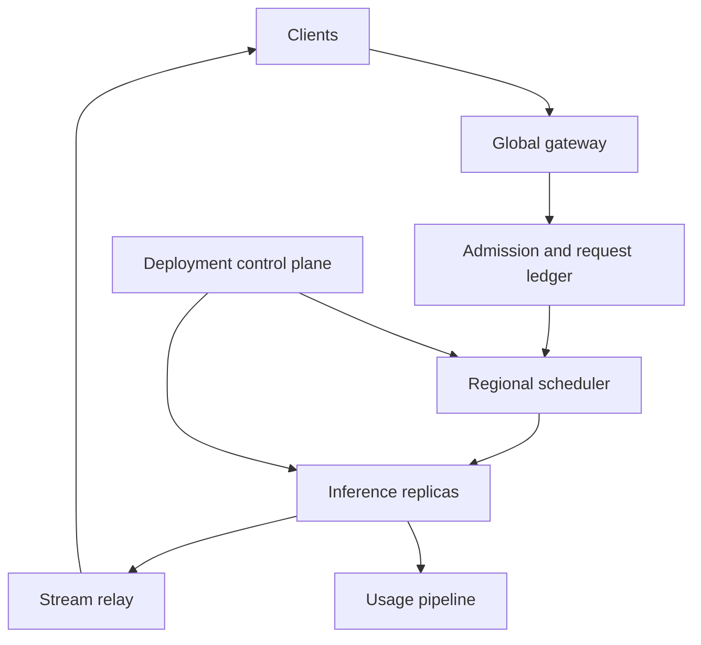
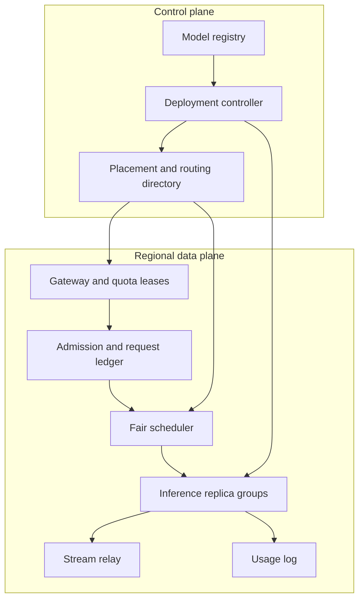

# Design a Multi-Tenant AI Inference Serving Platform

**Difficulty:** Senior / Staff-level  
**Primary themes:** AI inference serving, heterogeneous accelerators, queues, admission control, continuous batching, autoscaling, reliability, fairness, and consistency  
**Interview time budget:** about 40–45 minutes  
**Educational walkthrough:** intentionally more detailed than what you would say live

This walkthrough uses the public Hello Interview delivery sequence: clarify requirements, identify core entities, define interfaces, build the simplest complete system one operation at a time, and then deepen the design around the non-functional requirements most likely to break it. The problem, dialogue, APIs, calculations, architecture, and tradeoffs below are original. See [Hello Interview's delivery framework](https://www.hellointerview.com/learn/system-design/in-a-hurry/delivery) and [API design guide](https://www.hellointerview.com/learn/system-design/core-concepts/api-design).

---

## Interviewer prompt

> Design a managed, multi-tenant inference platform that serves generative models through an API. Customers deploy approved model versions, send interactive and batch inference requests, stream generated tokens, and receive predictable latency and quota isolation. The fleet contains GPUs and CPU servers, and the service operates in multiple regions.

## Targeted clarifying questions with assumed interviewer answers

**Candidate:** Are customers uploading arbitrary model code, or selecting models and versions that our platform has already validated?

**Interviewer:** Start with validated model artifacts in our registry. Tenants may deploy fine-tuned weights and adapters, but arbitrary executable code is out of scope.

**Candidate:** Which request types matter most?

**Interviewer:** Interactive text generation with token streaming is primary. Also support embeddings and asynchronous batch generation, but do not design image or video generation today.

**Candidate:** What scale and models should I assume?

**Interviewer:** Globally, 100,000 requests per second at peak. Around 20,000 are generation requests and the rest are embeddings. Generation prompts average 1,000 input tokens and 250 output tokens, with a long tail up to 32,000 input and 4,000 output tokens. We host about 200 model versions, but 20 versions receive 90% of traffic.

**Candidate:** What latency contract matters?

**Interviewer:** For interactive generation, p95 time-to-first-token should be under 800 ms for warm deployments, and p95 inter-token latency under 80 ms. Embeddings should finish within 300 ms p95 for a bounded batch. Batch jobs optimize throughput rather than latency.

**Candidate:** Does a successful API call guarantee deterministic output?

**Interviewer:** No. Sampling can be nondeterministic. We do need safe retry semantics: a client should not accidentally start and pay for two generations because the initial response was lost.

**Candidate:** Do conversations need server-side state?

**Interviewer:** The inference API is stateless: clients submit the full prompt or an immutable prompt reference. We may cache tokenized prefixes and KV state as an optimization, but it is not the source of truth.

**Candidate:** What isolation is required?

**Interviewer:** Enforce per-tenant request, token, concurrency, and spend quotas. One tenant or one giant prompt must not starve others. Premium tenants can buy reserved capacity; standard tenants use shared capacity.

**Candidate:** What is the multi-region expectation?

**Interviewer:** Route to a nearby healthy region with the requested model. During a regional failure, new requests should fail over within one minute. In-flight streams may be interrupted and retried; exact continuation from the failed token is not required.

**Candidate:** Can the platform shed traffic?

**Interviewer:** Yes. It is better to reject before admission with a retry hint than to accept unbounded work and miss every latency SLO.

### Scope statement I would say aloud

> “I’ll design the online data plane for streaming generation and embeddings, plus the control plane that deploys validated model versions. I’ll make admission, scheduling, batching, execution, streaming, and usage accounting complete in one region first. Then I’ll deepen the design around GPU efficiency versus latency, tenant fairness, autoscaling and cold starts, and failure recovery. Fine-tuning, arbitrary model code, and training are out of scope.”

---

## 1. Requirements (~5 minutes)

### Core functional requirements

1. **Deploy a model version.** An authorized tenant selects a validated base model and optional adapter, hardware policy, regions, autoscaling limits, and service tier. The platform loads and health-checks replicas before sending production traffic.
2. **Serve online inference.** Clients submit generation or embedding requests. Generation returns a server-sent token stream; embeddings return a bounded response. Retries with the same idempotency key refer to one logical request.
3. **Run asynchronous batch inference.** Clients submit an object containing many prompts, inspect job progress, and retrieve deterministic output objects without competing directly with interactive capacity.

### Quantified non-functional requirements

- **Scale:** 100,000 peak requests/s globally: 20,000 generation and 80,000 embedding requests/s. Support 200 deployed model versions, with a highly skewed popularity distribution.
- **Interactive latency:** for warm deployments, p95 time-to-first-token (TTFT) under 800 ms and p95 inter-token latency (ITL) under 80 ms; embedding p95 under 300 ms for requests within published limits.
- **Availability:** 99.95% successful online request availability, excluding explicit quota or overload rejection. New requests fail over from a lost region within 60 seconds.
- **Isolation and overload safety:** enforce per-tenant request, input-token, output-token, concurrency, and cost budgets before expensive execution. Keep admitted queue wait bounded, for example below 300 ms p95 for interactive traffic.
- **Accounting correctness:** admitted tokens, generated tokens, cancellations, and terminal status must be durably recorded; usage may appear in billing within five minutes, but duplicate charges for one logical request are unacceptable.

### Scope and consistency/availability contract

| Concern | Contract |
|---|---|
| Deployment update | Strongly consistent desired-state update. Traffic changes only after ready replicas pass health checks; rollout status is eventually reported. |
| Online request admission | Linearizable per logical request within its home region: one idempotency key maps to one request record and one billing identity. |
| Generation output | Not guaranteed bit-for-bit deterministic unless the model/runtime supports a deterministic mode and the caller pins all parameters. |
| Streaming | At-most-one active producer lease per logical request. Network delivery is at least once at the byte/event layer, so stream events carry sequence numbers for deduplication. |
| Cancellation | Best effort but monotonic: once the authoritative request state becomes `CANCELLED`, no new tokens are billable; already generated work may have been consumed internally. |
| Usage reporting | Eventually visible within five minutes. Durable terminal accounting is idempotent by `request_id`. |
| Overload | Reject before execution with `429` for tenant quota or `503` for capacity. Do not promise availability by hiding an unbounded queue. |
| Regional failure | New requests route elsewhere within 60 seconds. In-flight streams can fail; clients retry the same idempotency key and either resume from retained stream events or receive a new attempt under the same logical billing identity. |

**What I would say aloud:**

> “There are two different consistency questions. Deployment intent and request identity need strong consistency. Generated text does not, because sampling is intentionally nondeterministic. I will make retries safe at the logical-request and billing layer, not claim that replaying a stochastic model always yields identical tokens.”

### Explicitly out of scope

- Model training, fine-tuning pipelines, and dataset management
- Arbitrary tenant code inside inference workers
- Image, audio, and video generation
- A conversational database or RAG retrieval system
- Global ordering of requests
- Transparent mid-token failover with identical continuation

---

## 2. Core entities (~2 minutes)

Name the nouns first; introduce fields beside the components that use them.

| Entity | Purpose | Essential fields |
|---|---|---|
| **Tenant** | Identity, quota, billing, and isolation boundary | `tenant_id`, `service_tier`, request/token/concurrency limits, `allowed_regions` |
| **ModelVersion** | Immutable executable model contract | `model_version_id`, artifact digests, tokenizer digest, runtime version, tensor/pipeline layout, supported hardware |
| **Deployment** | Tenant-visible serving configuration | `deployment_id`, `model_version_id`, adapter digest, regions, min/max replicas, priority class, rollout revision |
| **Replica** | One loaded serving process or distributed worker group | `replica_id`, deployment revision, hardware pool, state, capacity profile, heartbeat, lease epoch |
| **InferenceRequest** | Idempotency, lifecycle, routing, and billing identity | `request_id`, `tenant_id`, `idempotency_key`, prompt digest/reference, parameters digest, status, admitted tokens, attempt, timestamps |
| **StreamEvent** | Recoverable ordered output | `request_id`, `attempt`, `sequence`, token bytes/id, finish reason, usage delta |
| **BatchJob** | Asynchronous work and output snapshot | `job_id`, input object/version, deployment revision, status, progress, output object |

The immutable `ModelVersion` separates artifact identity from mutable `Deployment` policy. A rollout can change replica counts or traffic weights without pretending the underlying weights changed.

---

## 3. API and system interface (~5 minutes)

Authentication maps an API key or workload identity to trusted `tenant_id`, permissions, service tier, and quota policy. The caller never supplies an authoritative tenant id in the JSON body.

### 3.1 Create or update a deployment

```http
PUT /v1/deployments/support-assistant
Authorization: Bearer <admin-token>
If-Match: "revision-12"
Content-Type: application/json
```

```json
{
  "model_version": "registry/llama-family/70b@sha256:9d2...",
  "adapter": "tenant-adapters/support-v7@sha256:b31...",
  "regions": ["us-east", "us-west"],
  "hardware_policy": ["gpu-h100", "gpu-mi300x", "cpu-epyc"],
  "min_replicas": 4,
  "max_replicas": 80,
  "service_tier": "interactive-premium",
  "rollout": {"canary_percent": 5, "max_unavailable": 1}
}
```

```json
{
  "deployment_id": "dep_support_assistant",
  "revision": 13,
  "status": "ROLLING_OUT",
  "ready_replicas": 0,
  "desired_replicas": 4
}
```

`If-Match` prevents two operators from silently overwriting deployment policy. The response confirms desired state, not readiness.

### 3.2 Create a streaming generation

```http
POST /v1/generations
Authorization: Bearer <service-token>
Idempotency-Key: 01JBRAH7PZV6A6M6E9GAX4K7H1
Accept: text/event-stream
Content-Type: application/json
```

```json
{
  "deployment": "support-assistant",
  "messages": [
    {"role": "system", "content": "Answer using the support policy."},
    {"role": "user", "content": "How do I rotate an API key?"}
  ],
  "max_output_tokens": 500,
  "temperature": 0.2,
  "top_p": 0.95,
  "deadline_ms": 5000
}
```

Example stream:

```text
event: accepted
data: {"request_id":"req_7JQ","attempt":1,"estimated_queue_ms":35}

event: token
id: 1
data: {"sequence":1,"text":"To"}

event: token
id: 2
data: {"sequence":2,"text":" rotate"}

event: completed
id: 37
data: {"finish_reason":"stop","input_tokens":41,"output_tokens":36}
```

Important behavior:

- The gateway computes a digest of deployment revision, normalized prompt/reference, and sampling parameters. Reusing the idempotency key with a different digest returns `409`.
- `429` means tenant quota or concurrency is exhausted; `503` means no capacity can meet the deadline. Both include a retry hint.
- Stream event ids let a reconnect provide `Last-Event-ID`. The platform may replay retained events. If replay is unavailable, it returns an explicit restart status instead of silently duplicating billing.
- Deadlines are absolute after admission. A request that cannot plausibly meet its deadline should be rejected early.

### 3.3 Embeddings

```http
POST /v1/embeddings
Authorization: Bearer <service-token>
Idempotency-Key: 01JBRB0BMT66S16WBJ52PGG9TM
Content-Type: application/json
```

```json
{
  "deployment": "search-embedding-v4",
  "input": ["refund policy", "change delivery address"],
  "dimensions": 1024
}
```

```json
{
  "request_id": "req_EMB91",
  "vectors": [[0.013, -0.021], [0.004, 0.018]],
  "input_tokens": 9,
  "model_revision": "rev-44"
}
```

The example vectors are truncated. The server caps count, bytes, and total tokens per request.

### 3.4 Submit a batch job

```http
POST /v1/batch-jobs
Authorization: Bearer <service-token>
Idempotency-Key: 01JBRB7JQ68R1VPMF4QZQQDR2E
Content-Type: application/json
```

```json
{
  "deployment": "support-assistant",
  "input": {"uri": "object://tenant-bucket/jobs/prompts-009.jsonl", "version": "v17"},
  "output_uri": "object://tenant-bucket/jobs/results-009/",
  "completion_window": "24h"
}
```

The job pins the deployment revision and immutable input version. `GET /v1/batch-jobs/{job_id}` returns progress and terminal output manifest.

### 3.5 Cancel and inspect

```http
DELETE /v1/generations/{request_id}
GET /v1/generations/{request_id}
GET /v1/deployments/{deployment_id}
```

Cancellation is idempotent. Inspection returns logical status, attempt number, last durable sequence, and usage—not hidden worker internals.

---

## 4. Data flow

### Online generation path

1. Authenticate and derive tenant, policy, and allowed regions.
2. Validate the request and tokenize or estimate tokens with the deployment's pinned tokenizer.
3. Atomically resolve the idempotency key and reserve request/token/concurrency budget.
4. Admission control selects a region and hardware pool that can meet deadline, policy, and model compatibility.
5. The regional scheduler places the request into a bounded tenant-aware queue for the deployment.
6. A replica scheduler admits prefill work into a batch, then continuously batches decode iterations.
7. The worker emits sequenced stream events through a stream relay while usage deltas flow to durable accounting.
8. Completion or cancellation atomically finalizes the request and releases reserved concurrency; unused output-token reservation is returned.

### Deployment path

1. Validate artifact signatures, tokenizer/runtime compatibility, memory estimate, and tenant policy.
2. Write desired state and rollout revision to the control-plane store.
3. Placement selects regions and hardware pools.
4. Nodes download content-addressed artifacts, verify digests, and load weights/adapters.
5. Warm-up runs representative shapes; health reports capacity profile and supported limits.
6. The router receives an atomic snapshot containing only ready replicas and rollout weights.

### Batch path

1. Pin input object version and deployment revision.
2. Split input into deterministic work chunks.
3. Schedule chunks onto a separate low-priority capacity pool or unused online capacity.
4. Write output chunks under deterministic keys, then commit a manifest.
5. Retries recognize committed chunks and do not duplicate final output or charges.

---

## 5. High-level design (~10–15 minutes)

Build the smallest complete path before adding exotic scheduling.

### 5.1 Baseline architecture



The control plane manages relatively low-QPS desired state: model registry metadata, deployments, placement, rollout, and routing snapshots. The data plane handles high-QPS requests and must keep global coordination off the token-by-token path.

### 5.2 Operation 1: deploy a model safely

The model registry stores immutable, content-addressed artifacts:

```text
ModelVersion:
  model_version_id
  weight_shard_digests[]
  tokenizer_digest
  runtime_image_digest
  architecture and precision
  minimum device memory
  compatible hardware/runtime versions
  safety and validation status
```

An artifact validation service checks signatures, file digests, unsafe serialization formats, tokenizer compatibility, and expected memory. The deployment controller writes desired state to a strongly consistent relational store. A placement service then chooses pools based on hardware compatibility, allowed region, available memory, reserved capacity, and failure-domain spread.

Each node has an artifact manager. It downloads weight shards to local NVMe, verifies them, and coordinates loading into accelerator or host memory. Content-addressed local caches avoid repeated downloads. The serving runtime performs warm-up for representative prompt and batch sizes because “process is alive” does not mean kernels are compiled, memory pools allocated, or collectives ready.

Only after the replica reports `READY` with a lease epoch does the controller publish it in a versioned routing snapshot. Routers swap snapshots atomically, so a request never sees half of a rollout.

**What I would say aloud:**

> “Deployment intent is strongly consistent, but readiness is observed asynchronously. I will not route just because a pod exists. The replica must verify immutable artifacts, load weights, warm its runtime, and publish a capacity profile before entering the routing snapshot.”

### 5.3 Operation 2: admit one online request

The gateway authenticates and performs cheap structural validation. A tokenizer service pinned to the model revision computes exact input tokens when affordable; for very large inputs it can reject by bytes first and then tokenize. Exact token count matters because memory, latency, quota, and cost scale with tokens, not just request count.

The request ledger provides the idempotency boundary:

```text
unique (tenant_id, idempotency_key)
request_id
request_digest
deployment_revision
status: ADMITTED | RUNNING | COMPLETED | FAILED | CANCELLED
reserved_input_tokens
reserved_output_tokens
attempt
producer_lease_epoch
last_durable_sequence
terminal_usage
```

In one transaction, the admission service creates or finds this record and reserves quota. Reusing the key with the same digest returns the existing request. A different digest returns conflict. This prevents two logical charges after an ambiguous client timeout.

Quota has several dimensions:

- request rate prevents gateway overload;
- input/output token rate reflects compute;
- concurrent sequences reflect KV-cache occupancy;
- dollar or accelerator-second budget protects spend;
- new deployment and adapter rates protect control-plane and load churn.

After quota reservation, the admission planner evaluates candidate regions and pools. It uses ready replica capacity, queue delay prediction, model locality, tenant residency, service tier, and network latency. If no candidate can meet the deadline with safety margin, it rejects now rather than adding hopeless work to a queue.

### 5.4 Operation 3: schedule, batch, execute, and stream

The regional scheduler has a bounded queue per `(deployment, priority class)` with tenant subqueues. Requests carry:

```text
request_id, tenant_id, arrival_time, deadline
input_tokens, max_output_tokens
service_tier, scheduling_cost
prefix_hash (optimization only)
```

It selects a replica using a predicted-finish-time score rather than round robin. Round robin ignores prompt length, active sequence count, KV memory, and model-parallel topology. Each replica periodically reports a compact capacity profile: queued prefill tokens, active decode sequences, free KV blocks, recent tokens/s, and health epoch.

Inside a replica, inference has two phases:

- **Prefill:** process all input tokens and build the key-value (KV) cache. Prefill is compute-heavy and benefits from batching large token matrices.
- **Decode:** generate one next token per active sequence per iteration. Decode repeatedly reads model weights and KV state; it is often memory-bandwidth-sensitive.

Static batching waits for every request in a batch to finish, wasting capacity when output lengths differ. Instead, use **continuous batching**: after each decode iteration, completed or cancelled sequences leave and new eligible sequences enter. The scheduler caps batch token count and KV occupancy, not merely request count.

The worker sends sequenced token events to a stream relay. The relay decouples slow clients from the inference loop with a small bounded buffer. If a client is too slow, policy may pause briefly, spill a limited event window, or cancel; it must not let one TCP connection retain unlimited KV memory.

Usage events are appended to a durable partitioned log keyed by `request_id`. A usage aggregator writes the terminal accounting row conditionally: only the first terminal record for `(request_id, billing_version)` wins.

**Trace aloud:**

> “After idempotent admission, I place the request into a tenant-aware bounded queue. The chosen replica batches prefill by token budget and continuously batches decode sequences. Token events carry sequence numbers through a relay, while durable usage finalization is keyed by the logical request—not by how many worker attempts occurred.”

### 5.5 Operation 4: embeddings and batch jobs

Embeddings use separate queues and usually separate replicas because they have different batching and latency behavior. The scheduler combines compatible inputs up to a token or tensor-size limit and returns the result only after the batch finishes. This avoids decode state and simplifies capacity prediction.

Batch jobs never enter the premium interactive queue. A job planner reads the immutable input manifest and creates deterministic chunks, for example:

```text
chunk_id = hash(job_id, input_version, start_row, end_row, deployment_revision)
output_key = jobs/{job_id}/chunks/{chunk_id}.jsonl
```

Workers may retry a chunk. Object creation is conditional, and a manifest transaction records exactly one committed result per chunk. When all chunks are committed, the final manifest becomes visible. This is effectively-once output over at-least-once task delivery.

Batch work uses dedicated capacity, preemptible capacity, or only spare online capacity. Preemption happens between requests or decode quanta where supported; we do not abruptly corrupt an output object.

### 5.6 Scale estimates that change decisions

#### Token throughput

Assume 20,000 generation requests/s, 1,000 average input tokens, and 250 average output tokens:

```text
Prefill demand = 20,000 × 1,000 = 20 million input tokens/s
Decode demand  = 20,000 × 250 = 5 million output tokens/s
```

Suppose a representative 70B replica group sustains 8,000 input tokens/s during prefill-heavy service or 800 output tokens/s during decode-heavy service at the target latency. A crude separate-capacity lower bound is:

```text
20,000,000 / 8,000 = 2,500 prefill-equivalent replica groups
5,000,000 / 800 = 6,250 decode-equivalent replica groups
```

Real mixed workloads share hardware and throughput varies enormously by model, precision, hardware, prompt length, and batch shape. The important decision is not the exact fleet count: decode dominates this assumption, so autoscaling on request QPS alone is wrong. We need per-model input-token, output-token, active-sequence, KV-memory, and latency signals.

#### KV-cache pressure

For an illustrative model, suppose KV state consumes 0.5 MB per token across the distributed replica group. One request with 1,000 prompt tokens and up to 250 output tokens can occupy:

```text
1,250 tokens × 0.5 MB ≈ 625 MB
```

At 64 concurrent sequences, that is roughly 40 GB of KV state. A few 32K-token prompts can consume the same memory as hundreds of short requests. Therefore admission must reserve KV blocks based on tokens, and long-context traffic needs separate limits or pools.

#### Stream events

Five million output tokens/s means roughly five million token events/s if every token is emitted separately. Per-token durable database writes are too expensive. The relay should coalesce small token fragments over a few milliseconds, while the usage pipeline batches append records. Sequence numbers remain logical per token/event even if transport frames contain multiple tokens.

---

## 6. Deep dives (~10–15 minutes)

In a live interview, choose two or three. I would lead with scheduling/batching, then fairness/admission, then autoscaling and reliability if time permits.

## Deep dive A: continuous batching, prefill/decode interference, and KV memory

### Where the baseline breaks

A FIFO queue plus round-robin replicas looks simple, but it breaks in four ways:

1. one 32K prompt blocks short prompts behind a long prefill;
2. static batches wait for the longest generation;
3. aggressive prefill batching improves throughput but stalls decode, increasing inter-token latency;
4. request-count limits ignore KV memory, so a few long contexts cause out-of-memory failures.

### Plausible approaches

| Approach | Benefit | Cost or failure |
|---|---|---|
| FIFO + static batching | Simple | Head-of-line blocking and padding waste |
| Continuous batching in one mixed queue | High utilization | Prefill can interfere with decode; fairness is harder |
| Chunked prefill + continuous decode | Bounds long-prefill monopolization | More scheduler/runtime complexity |
| Disaggregated prefill and decode pools | Independent scaling and less interference | KV transfer cost, more networking, harder failure handling |

### Selected baseline

Use continuous batching with **chunked prefill**. A long prompt is processed in bounded chunks, allowing decode iterations for active sequences between chunks. The replica scheduler enforces:

- maximum tokens processed per iteration;
- reserved decode budget so active streams keep progressing;
- maximum KV blocks per tenant and request;
- deadline-aware selection within each fair-share class;
- separate caps for long-context requests.

The scheduling cost should approximate token work, not count each request equally. A reasonable starting estimate is:

```text
cost = input_tokens × prefill_weight + expected_output_tokens × decode_weight
```

Expected output comes from the requested maximum capped by historical completion ratios for that deployment. It is only a scheduling estimate; billing uses actual tokens.

### When to disaggregate prefill and decode

If measurements show persistent interference and the platform is large enough, split prefill and decode workers. Prefill workers build KV state, then transfer or expose it to decode workers. This allows independent scaling and hardware choices—for example, compute-rich devices for prefill and memory-bandwidth-efficient devices for decode.

I would not start there. KV transfer can be tens of gigabytes for long contexts, adds network latency, and creates a new ownership protocol. Introduce it only when measured gains exceed transfer and complexity costs.

### KV-block allocator and preemption

Use paged KV blocks rather than one contiguous allocation per sequence. Fixed-size blocks reduce fragmentation and allow the scheduler to evict, swap, or migrate a sequence at block granularity. The authoritative request record stores status, but live KV is ephemeral execution state.

When memory is tight, options are:

- reject before admission;
- preempt low-priority sequences and recompute later;
- swap KV to host memory, accepting latency;
- migrate only if the runtime and interconnect make it worthwhile.

For premium interactive traffic, reserve headroom and reject early. Recompute or swap is more acceptable for batch traffic.

### Failure modes and observability

Track per model, hardware class, and prompt-length bucket:

- queue wait, TTFT, and ITL distributions;
- prefill tokens/s and decode tokens/s;
- batch token occupancy and active sequences;
- free/used KV blocks, fragmentation, eviction, and recompute;
- time spent in scheduler, kernels, collectives, relay backpressure;
- OOM and worker reset rate.

Do not rely only on average tokens/s. A throughput improvement that doubles ITL violates the interactive contract.

**What I would say aloud:**

> “I’m protecting decode latency explicitly. Continuous batching keeps the device full, chunked prefill prevents giant prompts from monopolizing it, and admission reserves paged KV blocks by token count. If prefill and decode still interfere at scale, I can disaggregate them, but only after accounting for KV-transfer cost.”

## Deep dive B: multi-tenant fairness, quotas, and overload control

### Where the baseline breaks

One global FIFO lets a large standard tenant occupy every sequence slot. Simple requests-per-second quotas are also misleading: one request may be a 20-token embedding while another requests 32K input plus 4K output tokens. If the platform admits all traffic and “lets the queue absorb it,” queue time grows without bound and deadlines become fiction.

### Plausible approaches

| Approach | Strength | Weakness |
|---|---|---|
| Global FIFO | Simple and work-conserving | No tenant isolation; head-of-line blocking |
| Strict per-tenant partitions | Strong isolation | Strands capacity and handles many tenants poorly |
| Weighted fair queuing by token cost | Shares capacity while allowing borrowing | Requires cost estimates and careful accounting |
| Earliest deadline first globally | Good deadline behavior under light load | Large tenant can dominate; overload can starve long jobs |

### Selected design

Use hierarchical weighted fair queuing:

1. choose service class: reserved premium, shared interactive, embeddings, or batch;
2. within the class, choose tenant using deficit round robin measured in estimated token cost;
3. within the tenant, choose requests using deadline and age, with caps preventing starvation.

Deficit round robin gives each tenant credits proportional to its weight. A request spends credits according to estimated compute. Unused capacity can be borrowed, so the fleet stays work-conserving.

### Distributed quota enforcement

A globally synchronous counter on every token would add latency and become a bottleneck. Instead:

- a regional quota coordinator allocates short-lived token and concurrency leases to gateways/schedulers;
- local admission spends from its lease without a WAN round trip;
- usage reconciliation returns unused reservation and reports actual output;
- hard spend limits use smaller leases and may sacrifice a little availability for tighter enforcement.

This permits bounded overshoot equal to outstanding leases. State that tradeoff explicitly. For strict prepaid balance, require a regional authoritative reservation transaction before admission.

### Load shedding sequence

When predicted demand exceeds safe capacity:

1. stop admitting batch work to shared online capacity;
2. reduce best-effort maximum output or disable optional speculative features only if the API contract permits it;
3. throttle tenants above reserved shares;
4. reject new standard traffic with retry hints;
5. preserve health-check, cancellation, and completion/accounting paths;
6. never evict premium admitted work merely to make the acceptance metric look good.

The queue must have both item and token limits. A full queue produces an explicit rejection. Circuit breakers isolate a failing model or hardware pool so retries do not form a storm.

### Cancellation race

Cancellation and token generation race. The request ledger uses monotonic states and a producer lease epoch. A worker may have computed a token concurrently, but the terminal accounting transaction checks whether cancellation became authoritative before accepting further usage. The relay can discard late events from an old epoch.

### Observability

Measure rejection separately from failure:

- `429` by tenant/quota dimension;
- `503` by deployment and missing capacity reason;
- admitted queue time by tier and tenant;
- fair-share received versus entitled;
- reservation versus actual tokens;
- deadline-miss rate for admitted work;
- cancellation-to-stop latency.

**What I would say aloud:**

> “Fairness is based on estimated token work, not request count. I use short-lived regional quota leases to avoid global coordination, then hierarchical weighted fair queues to preserve service tiers and tenant shares. Once safe queue capacity is gone, I reject early instead of converting overload into universal timeout.”

## Deep dive C: autoscaling, cold starts, and failure recovery

### Where the baseline breaks

CPU-style autoscaling on average utilization is too slow and too coarse. Large models can take minutes to download and load. Accelerator utilization can look low while KV memory is full, or look high while a queue is draining normally. Scaling only after latency rises guarantees repeated SLO violations.

### Autoscaling signals

For each `(deployment, region, hardware class)`, forecast required capacity from:

- admitted and arriving input tokens/s;
- output tokens/s and active decode sequences;
- prompt/output length distributions;
- queue wait and oldest-request age;
- free KV blocks;
- observed capacity profile per replica;
- scheduled events and recent traffic trend.

Maintain minimum warm replicas for popular models and reserved tiers. For the long tail, use a warm artifact cache and possibly shared base-model workers with dynamically loaded adapters.

### Adapter-aware serving

If many tenants share a base model but have small low-rank adapters, loading a full model per tenant wastes memory. A worker can hold the base weights and a bounded adapter cache. Requests batch together only when the runtime supports mixed adapters safely and efficiently; otherwise group by adapter.

Adapter cache keys include immutable digest. Eviction considers size, load cost, popularity, and tenant reservation. The scheduler never routes to a worker merely because an adapter “probably” remains loaded; capability comes from the worker's leased inventory snapshot.

### Cold-start strategy

1. Keep popular weight shards on node-local NVMe.
2. Use content-addressed distribution with peer or regional cache layers.
3. Pre-pull runtime images and compile common kernels ahead of traffic.
4. Maintain a small warm pool of compatible empty workers.
5. Scale from forecasts before the queue grows.
6. Do not advertise readiness until warm-up and collective health pass.

For a rare large model with no warm replica, the API should expose that the deployment is cold or asynchronous rather than hold an interactive HTTP request for several minutes.

### Worker failure during streaming

Each active attempt owns a producer lease `(request_id, attempt, epoch)`. Stream events are accepted only from the current epoch. If the worker dies:

- the scheduler marks the attempt lost after lease expiry;
- the request ledger records `RETRYABLE_FAILED` unless the deadline expired;
- a retry may replay retained stream events and restart generation, or start a new attempt under the same logical request;
- billing finalization deduplicates by request id and records only accepted usage policy.

Exact token continuation requires reconstructing model state, RNG state, KV cache, runtime version, and scheduling behavior. That is expensive and sometimes impossible across heterogeneous devices. The baseline contract allows restart. For enterprise tiers, periodic decode checkpoints could be explored, but checkpoint bandwidth and latency must be justified.

### Multi-region routing

The global gateway uses a versioned deployment directory listing ready regions, residency constraints, and health. New requests select the closest region with acceptable predicted queue time. Existing streams remain region-affine.

On regional loss, health removes that region from new routing within 60 seconds. Control-plane state and immutable artifacts already exist in another region. Minimum warm capacity prevents every failover request from cold-starting simultaneously. Capacity reservations should include failover headroom; otherwise “multi-region” routing simply moves an overload.

### Failure modes to test

- kill a worker after it emits tokens but before usage flush;
- lose the stream relay while the worker continues;
- replay every usage event twice;
- corrupt one weight shard and verify digest rejection;
- fail one member of a tensor-parallel group;
- drain a node with thousands of active sequences;
- make a deployment controller unavailable while the data plane continues on the last valid snapshot;
- lose a region during a traffic spike;
- inject a hot adapter that churns the cache;
- slow one client until relay buffers fill.

### Reliability principle

The data plane should continue serving from the last valid routing snapshot when the control plane is temporarily unavailable. It may not accept new deployment changes, but it should not evict healthy loaded models merely because the controller cannot be reached.

**What I would say aloud:**

> “I scale on token work, active sequences, queue age, and KV memory—not generic utilization. Popular models keep a warm floor, long-tail models rely on artifact and adapter caches, and the data plane survives control-plane outages using leased, versioned snapshots. A failed stream can restart safely under one logical request, but I won’t promise identical mid-token continuation without paying for checkpoints.”

---

## 7. Final design and close

### Concise final architecture



The final system includes:

- immutable signed model versions and mutable, revisioned deployments;
- a control plane for validation, placement, warm-up, rollouts, and versioned routing snapshots;
- authentication-derived tenant identity and multi-dimensional quota reservation;
- an idempotent request ledger separating logical requests from worker attempts;
- regional hierarchical fair queues with deadline- and token-aware admission;
- predicted-finish routing using queue, token, KV-memory, and hardware signals;
- continuous batching with chunked prefill and paged KV blocks;
- sequenced streaming through bounded relays, plus idempotent durable accounting;
- separate embedding and batch paths, with deterministic batch chunks and manifests;
- autoscaling based on token work, active sequences, queue age, and KV pressure;
- regional failover with warm headroom and a data plane that can outlive control-plane outages.

### Requirements check

| Requirement | Design element |
|---|---|
| Deploy validated versions | Signed registry, deployment revisions, placement, warm-up, ready-only routing |
| Stream online generation | Request ledger, fair scheduler, continuous batching, stream relay |
| Serve embeddings | Separate bounded batching path and compatible replicas |
| Run batch inference | Immutable input pinning, deterministic chunks, separate capacity, output manifest |
| 100K peak requests/s | Stateless gateways, regional sharding, per-deployment queues and replica groups |
| TTFT and ITL goals | Early rejection, predicted finish time, chunked prefill, reserved decode budget |
| Tenant isolation | Token/concurrency quotas, quota leases, hierarchical weighted fair queuing |
| Safe retries and billing | Idempotency digest, one logical request, producer epochs, terminal usage dedupe |
| Regional failure | Versioned directory, alternate warm capacity, new-request failover within 60 seconds |

### Thirty-second closing statement

> “The core of this design is bounded admission before expensive execution. A strongly consistent request ledger gives safe retry and billing identity; a regional fair scheduler places token-costed work onto ready model replicas. Those replicas use continuous batching, chunked prefill, and paged KV memory to balance throughput with TTFT and inter-token latency. Sequenced streaming is decoupled from durable idempotent usage accounting. The control plane validates immutable artifacts and publishes ready-only routing snapshots, while token-aware autoscaling, warm capacity, and regional headroom address cold starts and failures.”

---

## Realistic interviewer follow-ups with strong sample answers

### 1. Why not put requests directly into Kafka and let workers consume them?

> “A durable log is useful for usage and batch work, but an unconstrained broker is not an interactive admission controller. It does not know deadlines, KV memory, current model locality, or tenant fair share. I need a bounded scheduler that can reject before queueing. I can log accepted lifecycle events asynchronously without making Kafka's backlog my latency policy.”

### 2. How do you estimate whether a request will meet its deadline?

> “Use recent per-model, hardware, prompt-length, and batch-shape profiles. Estimate queue work ahead, prefill cost from input tokens, and decode cost from expected output. Add network and safety margins. The estimate will be imperfect, so calibrate prediction error and reject conservatively for strict tiers.”

### 3. Why is round robin bad?

> “Replica load is not homogeneous. One replica may hold long sequences and little free KV memory while another is almost empty. Round robin sees neither prompt cost nor active decode state. Predicted finish time uses queued tokens, active sequences, free KV blocks, and measured throughput.”

### 4. What exactly is continuous batching?

> “Instead of forming a batch and waiting until every sequence finishes, the runtime performs one decode iteration, removes completed sequences, and inserts new eligible work. That avoids idle slots caused by different output lengths. Admission is limited by token budget and KV memory.”

### 5. How do you prevent a huge prompt from hurting everyone?

> “Validate a hard context limit, reserve its token and KV cost, place long-context traffic in a capped lane, and use chunked prefill so it cannot monopolize many consecutive iterations. If its predicted completion misses the deadline, reject or route it to an asynchronous tier.”

### 6. Can two retries receive different text?

> “If they become two executions of a sampling request, yes. The idempotency contract prevents accidental concurrent logical requests and duplicate billing. While retained stream events exist, I replay them. If execution must restart, the API reports the new attempt. Deterministic mode requires pinned seed, runtime, model, and supported deterministic kernels.”

### 7. How do you account for a disconnected client?

> “The request policy says whether generation continues briefly for reconnect or is cancelled. The relay detects backpressure and has a bounded replay window. Billing is based on accepted generated usage under the published policy, and terminal accounting is deduplicated by request id. We never let a disconnected socket hold unlimited KV memory.”

### 8. What happens if the usage consumer processes an event twice?

> “Events carry request id, attempt, sequence range, and billing version. The aggregator advances a monotonic per-request usage watermark or conditionally writes the first terminal record. Duplicate or old-epoch events become no-ops.”

### 9. How would speculative decoding change the design?

> “A draft model proposes tokens and the target model verifies them. It can reduce latency when acceptance is high, but consumes extra draft capacity and changes scheduling. I would represent draft and target as a coupled capacity profile, track accepted tokens per proposed token, and enable it only where measured end-to-end cost and latency improve.”

### 10. When would CPU inference be useful?

> “For smaller or quantized models, embeddings, low-QPS long-tail deployments, overflow, or cost-sensitive batch work. The hardware policy records compatible profiles, and routing compares predicted latency and cost. I would not assume a CPU is interchangeable with an accelerator: NUMA placement, memory bandwidth, vector kernels, and model size materially change capacity.”

### 11. How do you handle tensor-parallel replicas?

> “Treat the worker group as one schedulable replica with an atomic health epoch. Placement keeps members in an appropriate topology, and collective failure makes the group unavailable. The router never sends half a request to a partially healthy group.”

### 12. How do model rollouts avoid mixing revisions?

> “Admission pins one deployment revision and model/tokenizer/runtime digests in the request record. Routing snapshots contain ready replicas by revision. A stream stays on that revision even while new traffic shifts to the canary.”

### 13. How do you canary a model when outputs are nondeterministic?

> “Use traffic shadowing where policy permits, offline golden sets, safety and schema checks, latency/cost distributions, and aggregate quality signals rather than exact text equality. For live canaries, compare error, TTFT, ITL, tokens per response, safety flags, and task-specific success metrics.”

### 14. What if the control plane is down?

> “Routers and schedulers keep serving from the last valid signed snapshot until leases expire under a conservative policy. Existing replicas remain loaded. Deployment changes pause. The system should not turn a control-plane outage into an immediate serving outage.”

### 15. What if all replicas for a model are cold?

> “For an interactive deployment with a minimum replica setting, that is an availability failure. Otherwise return a clear cold-start or async response, start loading from regional/NVMe caches, and avoid holding thousands of open requests. The routing directory should not advertise capacity until warm-up completes.”

### 16. How would prefix caching fit?

> “It is an optimization keyed by model, tokenizer, adapter, prompt-token prefix, and relevant runtime format. The scheduler prefers a replica with the prefix only when locality benefit exceeds load imbalance. Cache loss affects performance, not correctness, and tenant privacy rules govern whether prefixes can ever be shared.”

### 17. Why reserve maximum output tokens if many requests stop early?

> “It is the safe upper bound for quota and KV planning. To reduce underutilization, reserve in chunks or use historical completion ratios with hard per-tenant risk limits, then return unused reservation at completion. Premium hard guarantees use more conservative reservation.”

### 18. How do you avoid retry storms after a region fails?

> “Gateways add jittered retry hints, enforce global and tenant admission in surviving regions, and use circuit breakers for unavailable deployments. Failover capacity is reserved ahead of time. Clients retry the same idempotency key so repeated attempts do not become repeated logical charges.”

### 19. What is the source of truth?

> “The control-plane database is authoritative for deployment intent. The regional request ledger is authoritative for logical request state and terminal usage. Model artifacts are immutable objects by digest. Live queues, KV caches, routing caches, and stream buffers are rebuildable execution state.”

### 20. What would you build first?

> “One region, one validated model family, a fixed warm pool, an idempotent request ledger, bounded FIFO per tenant class, continuous batching, SSE streaming, cancellation, and durable usage finalization. Then add weighted fairness, autoscaling, adapters, heterogeneous hardware, batch jobs, and multi-region failover.”

---

## Common pitfalls

1. Treating request QPS as the main capacity unit instead of input/output tokens and KV memory.
2. Using one unbounded queue and calling it reliability.
3. Claiming retries produce identical sampled text.
4. Confusing request idempotency with deterministic inference.
5. Round-robin routing without prompt length, active sequences, or KV pressure.
6. Static batching that waits for the longest generation.
7. Improving throughput while ignoring TTFT and inter-token latency.
8. Letting long prefill work starve active decode streams.
9. Enforcing only requests-per-second quota and ignoring token/concurrency/spend budgets.
10. Writing every token synchronously to a relational database.
11. Billing by worker attempt rather than logical request.
12. Ignoring cancellation races and late events from a dead worker.
13. Advertising a replica ready before weights, kernels, memory pools, and collectives are warm.
14. Autoscaling only on generic accelerator utilization.
15. Assuming another region has enough warm failover capacity.
16. Mixing interactive and batch work in one priority-free queue.
17. Loading one full base model per small adapter.
18. Making the control plane a synchronous dependency of every token.
19. Treating KV cache as durable source of truth.
20. Promising transparent mid-token failover without checkpoint cost.
21. Ignoring slow-client stream backpressure.
22. Forgetting tokenizer and runtime digests when pinning a revision.
23. Sharing prefix caches across tenants without a privacy contract.
24. Counting rejected overload as an internal inference failure, hiding capacity problems.
25. Drawing a sophisticated scheduler before tracing deploy → admit → batch → stream → account.

---

## Practical interview delivery plan

| Time | What to cover |
|---:|---|
| 0–5 min | Clarify model scope, generation/embedding/batch operations, scale, TTFT/ITL, retry semantics, quotas, and regional failure. |
| 5–7 min | Name Tenant, ModelVersion, Deployment, Replica, InferenceRequest, StreamEvent, and BatchJob. |
| 7–12 min | Define deployment, generation, embedding, batch, cancellation, and inspection interfaces. |
| 12–25 min | Trace deployment readiness, idempotent admission, fair scheduling, continuous batching, streaming, and accounting. |
| 25–37 min | Deep dive on batching/KV memory and tenant fairness; add autoscaling/failure recovery if time permits. |
| 37–42 min | Use scale arithmetic, check requirements, cover failure modes and observability, then close. |

The written guide is deliberately longer than the live answer. On the whiteboard, first draw the gateway, request ledger, regional scheduler, inference replicas, stream relay, and usage log. Trace one request completely. Add chunked prefill, paged KV, quota leases, warm pools, and regional failover only after the baseline works.

---

## Public references

The organization and pacing directly use public Hello Interview guidance; all problem-specific content is original.

- [Hello Interview — System Design Delivery Framework](https://www.hellointerview.com/learn/system-design/in-a-hurry/delivery) — requirements, entities, APIs, high-level design, and targeted deep dives.
- [Hello Interview — API Design](https://www.hellointerview.com/learn/system-design/core-concepts/api-design) — resource modeling, idempotency, pagination/versioning concepts, authentication, and actionable errors.
- [Hello Interview — System Design in a Hurry](https://www.hellointerview.com/learn/system-design/in-a-hurry/introduction) — structured progression and prioritizing decisions that satisfy the stated requirements.
