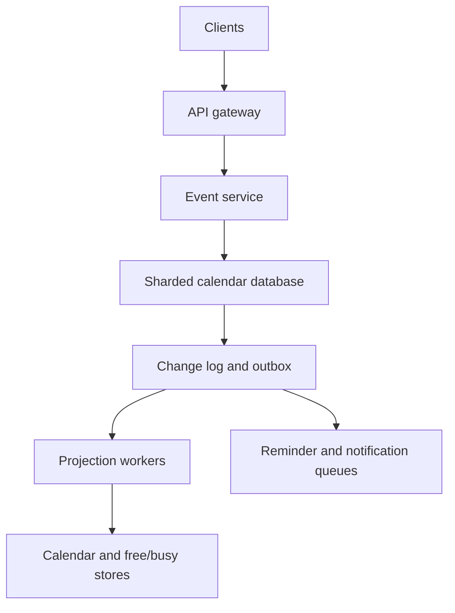
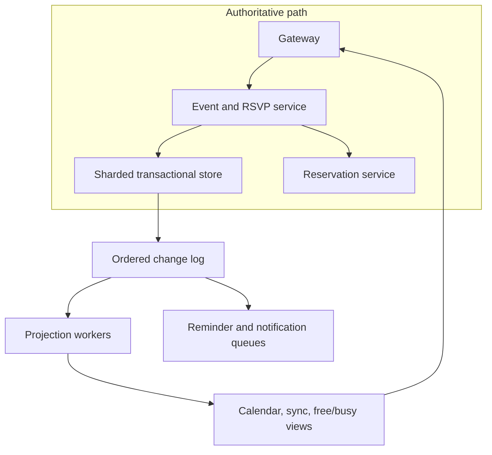

# Design a Global Calendar and Meeting Scheduling Platform

**Difficulty:** Senior / Staff-level  
**Primary themes:** transactional databases, calendar consistency, recurrence, free/busy caching, queues, notifications, multi-region reliability, and conflict resolution  
**Interview time budget:** about 40–45 minutes  
**Educational walkthrough:** intentionally more detailed than what you would say live

This walkthrough follows the public Hello Interview delivery sequence: clarify requirements, identify core entities, define interfaces, build the simplest complete design one operation at a time, and spend the remaining interview time hardening the parts most likely to break. The problem, dialogue, APIs, calculations, and tradeoffs below are original. See [Hello Interview's System Design Delivery Framework](https://www.hellointerview.com/learn/system-design/in-a-hurry/delivery), [API Design guide](https://www.hellointerview.com/learn/system-design/core-concepts/api-design), and [System Design in a Hurry](https://www.hellointerview.com/learn/system-design/in-a-hurry/introduction).

---

## Interviewer prompt

> Design a global calendar platform. Users can create personal and shared calendars, schedule recurring meetings, invite attendees, answer invitations, view free/busy availability, and receive reminders. The system should work across time zones and devices, prevent avoidable double-booking, and remain useful during regional failures.

## Targeted clarifying questions with assumed interviewer answers

**Candidate:** Are we building the calendar of record, or only a scheduling assistant over external calendars?

**Interviewer:** Build the calendar of record. External federation can be discussed later, but the core system stores calendars and events.

**Candidate:** Which user journeys are essential?

**Interviewer:** Create or update an event, invite attendees, accept or decline, list a calendar, query free/busy, and send reminders. Recurring events matter.

**Candidate:** Should the system categorically prevent an attendee from having overlapping meetings?

**Interviewer:** No. Users may intentionally double-book. However, when the organizer requests conflict protection, creating the meeting should atomically verify and reserve required attendees or rooms. Ordinary invitations can still overlap and should show a warning.

**Candidate:** What scale should I assume?

**Interviewer:** 500 million registered users, 100 million daily active users, 2 billion calendars, and 20 billion stored event masters plus overrides. At peak, 200,000 event mutations per second, 1 million calendar or event reads per second, and 2 million free/busy lookups per second globally.

**Candidate:** What latency and freshness goals matter?

**Interviewer:** p95 under 300 ms for calendar reads and under 500 ms for normal event writes. A free/busy query for up to 50 people over 30 days should finish under 700 ms p95. Changes should appear on the organizer's other devices immediately and on attendee calendars within five seconds.

**Candidate:** How should recurring events and time zones behave?

**Interviewer:** Support common recurrence rules, per-occurrence edits, and daylight-saving transitions. A weekly 9:00 AM meeting in New York should remain at 9:00 AM local time when daylight saving changes unless the organizer explicitly chose a fixed UTC instant.

**Candidate:** What is the consistency expectation?

**Interviewer:** An event revision and each attendee's response must not be lost. Conflict-protected booking of scarce resources must be strongly consistent. Calendar lists, free/busy projections, search, reminders, and notifications may be eventually consistent within their stated bounds.

**Candidate:** Can users edit while offline?

**Interviewer:** Clients can queue mutations offline and retry later. The server must detect stale revisions and either merge safe field changes or return a conflict. Do not build a full peer-to-peer offline database.

**Candidate:** What happens during a regional outage?

**Interviewer:** Existing sessions should fail over within one minute. Reads may briefly be stale. Ordinary personal edits can accept a small recovery-point objective, but conflict-protected room booking must not create two confirmed owners.

### Scope statement I would say aloud

> “I’ll design the calendar of record for event creation, attendee responses, calendar listing, free/busy, recurrence, and reminders. I’ll first complete a single-region design, then deepen it around atomic conflict protection, recurrence and time zones, derived availability caches, and multi-region recovery. External-provider federation, email transport internals, video conferencing, and full-text search ranking are secondary.”

---

## 1. Requirements (~5 minutes)

### Core functional requirements

1. **Manage calendars and events.** A user creates, edits, moves, or cancels one-time and recurring events on calendars they can write. Events support attendees, rooms, visibility, reminders, and per-occurrence exceptions.
2. **Coordinate invitations and responses.** The organizer invites users; attendees accept, decline, or tentatively accept. All participants converge on the same event revision while retaining participant-specific state such as response and private reminders.
3. **Find and protect availability.** Clients query free/busy for authorized principals. Optional conflict protection atomically reserves required attendees or resources for a time range; ordinary events may overlap and return warnings.

### Quantified non-functional requirements

- **Scale:** 500 million users, 100 million DAU, 200,000 peak event mutations/s, 1 million event/calendar reads/s, and 2 million free/busy lookups/s globally.
- **Latency:** p95 below 300 ms for calendar reads, below 500 ms for ordinary writes, and below 700 ms for a free/busy query covering at most 50 principals and 30 days.
- **Freshness:** read-your-writes immediately for the writer; invitation and attendee-calendar propagation within five seconds p99; reminder firing within one minute of its target time for normal priority.
- **Availability and recovery:** 99.99% read availability and 99.95% mutation availability. New traffic fails over from a lost region within 60 seconds. Ordinary event data has an RPO below five seconds and RTO below five minutes.
- **Correctness:** no lost acknowledged event revision or RSVP in a healthy region. A conflict-protected resource can have at most one confirmed reservation for an overlapping interval. Notification and reminder delivery is at least once, with idempotent user-visible effects.

### Scope and consistency/availability contract

| Concern | Contract |
|---|---|
| Event master | Optimistic concurrency on a monotonic `event_revision`; acknowledged writes survive normal node failures. |
| Organizer read-after-write | Strong within the event's home shard; the response includes the committed revision. |
| Attendee projection | Eventually consistent within five seconds. It never becomes the authority for event content. |
| RSVP | Linearizable per `(event_id, attendee_id)` so concurrent retries produce one latest response revision. |
| Conflict-protected booking | Serializable for the protected principal and interval. If the coordinator cannot prove exclusivity, it fails closed. |
| Ordinary overlap | Allowed. Free/busy can be slightly stale and returns an `as_of_version` so clients understand freshness. |
| Recurrence | The master rule plus exceptions is authoritative. Expanded occurrences are cache entries, not independent truth. |
| Reminders and notifications | At-least-once delivery. Dedupe keys make user-visible sends effectively once within a delivery epoch. |
| Multi-region failure | Reads can use a stale replica. Writes route to the shard leader or fail over after fencing the old leader. Conflict-protected writes do not use two independent active leaders. |

**What I would say aloud:**

> “I’m separating authoritative state from projections. Event revisions, RSVPs, and protected reservations need strong guarantees. Attendee calendar views, free/busy bitmaps, search, and reminders are rebuildable projections, so bounded eventual consistency buys scale and availability without weakening the booking contract.”

### Explicitly out of scope

- Video-call media and conferencing infrastructure
- Rich document attachments
- Full email delivery-system design
- Arbitrary workflow automation attached to calendar events
- Cross-provider federation protocols in the baseline
- A complete offline-first sync engine or CRDT for every event field
- Natural-language scheduling and AI assistants

---

## 2. Core entities (~2 minutes)

Name the essential nouns before drawing tables.

| Entity | Purpose | Essential fields |
|---|---|---|
| **Principal** | User, group, or bookable resource | `principal_id`, type, home_region, policy, time_zone |
| **Calendar** | Ownership, ACL, and display boundary | `calendar_id`, owner, ACL version, default time zone, deletion state |
| **EventMaster** | Authoritative shared event content | `event_id`, organizer, calendar, start specification, duration, recurrence rule, visibility, revision, status |
| **EventException** | Cancellation or override for one recurrence instance | `event_id`, `recurrence_id`, overridden fields, exception revision |
| **Participation** | Participant-specific invitation state | `event_id`, `principal_id`, role, response, response revision, delivery state |
| **Reservation** | Strong exclusion record for protected booking | `principal_id`, interval, `event_id`, lease/fence, status |
| **CalendarProjection** | Read-optimized membership row | `calendar_id`, occurrence date bucket, event id, revision, display fields |
| **Reminder** | Scheduled user-specific action | `reminder_id`, event instance, principal, fire time, channel, state, dedupe key |
| **ChangeRecord** | Ordered sync and projection input | shard sequence, entity id, revision, mutation type, commit time |

The important modeling decision is that an attendee does not own a copied event. `EventMaster` is shared truth; `Participation` stores the attendee's response; `CalendarProjection` makes reads fast. This prevents divergent event copies from becoming competing authorities.

---

## 3. API and system interface (~5 minutes)

Authentication yields a trusted `actor_principal_id`, tenant or organization policy, and authorized calendar scopes. Clients never supply an authoritative actor in the body.

### 3.1 Create an event

```http
POST /v1/calendars/cal_team/events
Authorization: Bearer <token>
Idempotency-Key: 01JCA5J0VY8M45R6X2Z8HBP4GY
Content-Type: application/json
```

```json
{
  "title": "Architecture review",
  "start": {
    "local_datetime": "2026-11-10T09:00:00",
    "time_zone": "America/New_York"
  },
  "duration_minutes": 45,
  "recurrence": {
    "rule": "FREQ=WEEKLY;BYDAY=TU;COUNT=8",
    "time_semantics": "WALL_CLOCK"
  },
  "attendees": [
    {"principal_id": "usr_maya", "required": true},
    {"principal_id": "room_orchid", "required": true}
  ],
  "conflict_policy": "PROTECT_REQUIRED_RESOURCES",
  "reminders": [{"minutes_before": 10, "channel": "PUSH"}]
}
```

```json
{
  "event_id": "evt_01JC...",
  "revision": 1,
  "status": "CONFIRMED",
  "start_instant": "2026-11-10T14:00:00Z",
  "warnings": [],
  "propagation": "PENDING"
}
```

The idempotency record stores a normalized request digest and committed response. Reusing the key with different content returns `409 IDEMPOTENCY_KEY_REUSED`.

For a recurring series, the baseline protects only a bounded expansion window, such as the next 12 months. The API says so explicitly. An infinite series cannot lock an infinite future.

### 3.2 Update an event or one occurrence

```http
PATCH /v1/events/evt_01JC...
Authorization: Bearer <token>
If-Match: "revision-7"
Content-Type: application/json
```

```json
{
  "title": "Architecture and capacity review",
  "location": "Building 3 / Orchid"
}
```

To edit one instance:

```http
PATCH /v1/events/evt_01JC.../occurrences/2026-11-17T09:00:00[America/New_York]
If-Match: "series-7;exception-0"
```

```json
{
  "start": {
    "local_datetime": "2026-11-17T10:00:00",
    "time_zone": "America/New_York"
  }
}
```

`If-Match` makes stale edits visible. The server may automatically merge changes to disjoint fields only when neither change affects scheduling semantics; otherwise it returns the current revision and a machine-readable field conflict.

### 3.3 Respond to an invitation

```http
PUT /v1/events/evt_01JC.../participants/me/response
Authorization: Bearer <token>
Idempotency-Key: 01JCA61M61Z2F4B4WHN9Y2TP1H
Content-Type: application/json
```

```json
{
  "response": "ACCEPTED",
  "comment": "I will join remotely."
}
```

```json
{
  "event_id": "evt_01JC...",
  "participant_revision": 4,
  "response": "ACCEPTED"
}
```

The identity comes from authentication. A caller cannot answer on behalf of another attendee unless an explicit delegation scope permits it.

### 3.4 List a calendar

```http
GET /v1/calendars/cal_team/events?from=2026-11-01T00:00:00Z&to=2026-12-01T00:00:00Z&limit=200
Authorization: Bearer <token>
```

```json
{
  "items": [
    {
      "event_id": "evt_01JC...",
      "occurrence_id": "2026-11-10T09:00:00[America/New_York]",
      "start": "2026-11-10T14:00:00Z",
      "end": "2026-11-10T14:45:00Z",
      "title": "Architecture review",
      "response": "ACCEPTED",
      "revision": 7
    }
  ],
  "next_cursor": "opaque-snapshot-cursor",
  "projection_as_of": "shard-18:9928812"
}
```

The cursor pins a projection watermark so paging does not silently skip or duplicate rows while updates arrive.

### 3.5 Query free/busy

```http
POST /v1/freebusy:query
Authorization: Bearer <token>
Content-Type: application/json
```

```json
{
  "principals": ["usr_maya", "usr_lee", "room_orchid"],
  "from": "2026-11-10T13:00:00Z",
  "to": "2026-11-10T18:00:00Z",
  "granularity_minutes": 5
}
```

```json
{
  "results": {
    "usr_maya": [{"start": "2026-11-10T14:00:00Z", "end": "2026-11-10T14:45:00Z"}],
    "usr_lee": [],
    "room_orchid": [{"start": "2026-11-10T15:00:00Z", "end": "2026-11-10T16:00:00Z"}]
  },
  "as_of": "2026-11-04T06:59:01Z",
  "staleness_ms": 820
}
```

Authorization is privacy-sensitive: a caller may see only busy intervals, not event titles or attendees. The service caps principal count, range, and resolution.

### 3.6 Incremental device sync

```http
GET /v1/sync?cursor=opaque-device-cursor&limit=500
Authorization: Bearer <token>
```

The response contains changed event references, participation changes, tombstones, a new cursor, and `has_more`. A cursor is scoped to the authenticated principal and device generation. If history has expired, the server returns `410 CURSOR_EXPIRED` and a resync token.

---

## 4. Data flow

### Event creation path

1. Authenticate the organizer and authorize calendar write access.
2. Normalize the local-time specification using the pinned time-zone database version; validate recurrence and expansion limits.
3. Resolve the idempotency key and allocate `event_id`.
4. If conflict protection is requested, transactionally reserve protected principals over the bounded interval set.
5. Commit the event master, participants, reservation references, and outbox rows in one database transaction.
6. Return the committed event revision immediately.
7. Change-log consumers update attendee calendar projections, free/busy indexes, device sync feeds, reminder tasks, and notifications.

### Read path

1. Authenticate and authorize the requested calendar.
2. Query date-bucketed calendar projections from a regional read replica or cache.
3. Batch-fetch authoritative event masters for missing or suspicious revisions.
4. Overlay participant-specific response and visibility rules.
5. Return a snapshot cursor and projection watermark.

### RSVP path

1. Authenticate the attendee and verify current participation.
2. Upsert the response conditionally on the attendee response revision.
3. Write an outbox change in the same transaction.
4. Update projections and notify the organizer asynchronously.

### Reminder path

1. Project event instances and user reminder policies into durable scheduled tasks.
2. Time-bucket schedulers claim due tasks using leases.
3. A delivery worker rechecks the current event revision and cancellation state.
4. It sends with a deterministic dedupe key and records the attempt.
5. Retries use exponential backoff; permanently failing tasks enter a dead-letter queue.

---

## 5. High-level design (~10–15 minutes)

Build a complete design operation by operation before optimizing it.

### 5.1 Baseline architecture



The sharded relational database is the source of truth because event creation touches related rows—event master, organizer membership, participants, reservation references, idempotency, and outbox—and benefits from transactions and constraints. The projection stores scale the read-heavy paths.

### 5.2 Operation 1: create an ordinary event

The gateway authenticates, rate-limits by actor and organization, and routes by the organizer calendar's home shard. The event service normalizes input but preserves both representations:

```text
start_semantics: WALL_CLOCK | FIXED_INSTANT
local_start: 2026-11-10 09:00:00
time_zone: America/New_York
tzdb_version: 2026c
start_instant: 2026-11-10T14:00:00Z
duration_seconds: 2700
recurrence_rule: FREQ=WEEKLY;BYDAY=TU;COUNT=8
```

Keeping local time, zone, and semantics is essential. Storing only UTC would lose the instruction that future occurrences should remain at 9:00 AM after a daylight-saving transition.

Within one transaction, the service:

1. inserts or resolves `(actor, idempotency_key)`;
2. creates `EventMaster(revision=1)`;
3. creates `Participation` rows for organizer and attendees;
4. creates the organizer's projection seed;
5. appends outbox records.

The response waits only for the authoritative transaction, not every attendee projection. A log publisher reads the transactional outbox and appends change records to a partitioned durable log keyed by `event_id`. This avoids a dual-write gap between the database and queue.

Projection consumers are idempotent. A calendar projection row stores the greatest applied event revision. Replaying revision 7 after revision 8 is a no-op.

**What I would say aloud:**

> “I acknowledge after one authoritative transaction that also records an outbox event. I do not synchronously write every attendee calendar, cache, reminder wheel, and notification service. Those consumers can retry because every projection applies monotonic event revisions.”

### 5.3 Operation 2: display organizer and attendee calendars

The organizer's immediate response includes revision 1, so the client can optimistically render it. Subsequent reads may go to a regional projection store organized by:

```text
partition key: calendar_id + month_bucket
sort key: start_instant + event_id + occurrence_id
fields: event_id, event_revision, start, end, visibility, compact display data
```

Date bucketing prevents one lifelong calendar from becoming an unbounded partition. A month bucket is a reasonable starting point; unusually dense resource calendars can split further by week or hash suffix.

The projection contains enough data for a calendar grid, but authoritative event detail is fetched on open or when revisions disagree. Private events project only an opaque busy marker to viewers without detail permission.

For recurring events, a recurrence-expansion worker materializes a rolling horizon, such as 18 months past and 24 months future. Queries beyond the materialized horizon expand the relevant master on demand with strict range limits and cache the result. Occurrence rows carry both the series revision and exception revision.

### 5.4 Operation 3: invite and respond

An event is homed with the organizer; participant rows may be co-located with the event for atomic organizer updates. A secondary principal index maps `(attendee_id, event_id)` to the home shard and response revision.

When an attendee responds, the request routes to the event home shard. A conditional upsert changes only that attendee's participation row and appends an outbox record. This makes RSVP linearizable without rewriting the event master.

Attendee response and shared event content are deliberately separate. The organizer can change the title at event revision 8 while the attendee changes their response at participant revision 4; these changes do not conflict.

Cancellation marks the master `CANCELLED` and increments its revision. Tombstone changes remove or gray out every projection and cancel future reminders. Physical deletion happens later after retention and sync-cursor windows expire.

### 5.5 Operation 4: free/busy lookup

The simplest correct implementation scans authoritative occurrences for each principal. At 2 million queries/s, 50 principals per query, and a 30-day range, that would cause up to 100 million principal-range scans per second—far too expensive.

Instead, maintain privacy-safe busy projections per `(principal_id, day)` using five-minute slots. A 24-hour day has 288 slots, or 36 raw bytes as a bitmap. With metadata and replicas, assume 100 bytes per principal-day.

For 500 million principals and a 90-day hot horizon:

```text
500M × 90 × 100 bytes = 4.5 TB raw hot availability state
With 3 replicas and indexes ≈ 13.5 TB
```

That is large but practical in a sharded in-memory-plus-SSD service, and it replaces repeated event scans with bounded bitmap fetches and bit operations. We do not precompute all history; older or distant ranges fall back to occurrence indexes.

A projection update for an event computes the old and new interval contribution. Because overlapping events exist, one bit is insufficient for deletion: clearing one event could erase another overlapping event. Store small per-slot counts or compact interval fragments, then derive the bitmap. Counts saturate at a small maximum because free/busy only needs zero versus nonzero.

Free/busy is eventually consistent, so it is advisory. A protected booking always rechecks authoritative reservations in its transaction.

### 5.6 Operation 5: reminders and device sync

Reminder projection emits one task per user-visible occurrence and reminder rule within a rolling scheduling horizon. Tasks are grouped into time buckets:

```text
partition: fire_minute + hash(principal_id) % N
sort: fire_time + reminder_id
dedupe: event_id + occurrence_id + principal_id + rule_id + event_revision
```

Schedulers claim partitions, enqueue due tasks, and advance durable watermarks. Delivery workers re-read compact current state before sending; stale reminder tasks for moved or cancelled events become no-ops.

Device sync uses the same change log but exposes a per-principal ordered feed. A fan-out consumer writes compact references into principal feed partitions. The cursor represents partition positions plus a snapshot generation. Tombstones remain until every supported cursor age has elapsed.

### 5.7 Scale estimates that change design decisions

#### Event mutations and fan-out

At 200,000 mutations/s and an average of 4 participants:

```text
Participant projection writes ≈ 200,000 × 4 = 800,000 writes/s
```

Large meetings make the distribution heavy-tailed. A 100,000-person all-hands must not create one synchronous transaction with 100,000 participant rows. Store the event plus a group or audience reference, acknowledge it, and expand invitations asynchronously in chunks. Group membership is pinned to a version so retries are deterministic.

This estimate justifies the durable log, idempotent projection workers, and an asynchronous large-audience path.

#### Calendar reads

At 1 million reads/s, if a month view returns 100 compact rows averaging 250 bytes:

```text
1,000,000 × 100 × 250 bytes = 25 GB/s before protocol overhead
```

Regional projection replicas and compressed responses are necessary. Cache keys include calendar ACL version and projection watermark; otherwise a permission change can expose stale private data.

#### Reminder volume

Suppose 100 million DAU each receive 8 reminders/day:

```text
800 million reminders/day ≈ 9,300/s average
10× peak around common clock boundaries ≈ 93,000/s
```

Minute-bucket partitioning and jitter avoid a midnight or 9:00 AM hot partition. Push/email providers are isolated behind channel-specific queues and circuit breakers.

---

## 6. Deep dives (~10–15 minutes)

In a live interview, I would choose the first two and use the third if the interviewer emphasizes global reliability.

## Deep dive A: conflict-protected booking without making every event serializable

### Where the baseline breaks

A free/busy check followed by an event insert is a classic time-of-check/time-of-use race:

1. Organizer A sees room Orchid free.
2. Organizer B sees room Orchid free.
3. Both insert meetings.
4. Both receive confirmation.

Making the free/busy cache strongly consistent does not solve this unless the check and reservation are one atomic operation. Conversely, serializing every personal event would add unnecessary contention and reduce availability.

### Plausible approaches

| Approach | Benefit | Failure or cost |
|---|---|---|
| Advisory free/busy only | Fast and available | Cannot guarantee exclusivity |
| Distributed lock per resource | Familiar | Lease expiry and stale owners require fencing; interval overlap remains hard |
| Serializable reservation rows | Clear correctness | Hot resources can contend; multi-resource transactions need ordering |
| Preallocated time-slot rows | Simple uniqueness | Coarse granularity and many rows; awkward variable intervals |

### Selected design

Use a dedicated strongly consistent reservation service backed by serializable transactions. Shard reservations by protected principal. Each record contains:

```text
principal_id
start_instant
end_instant
event_id
reservation_state: HELD | CONFIRMED | RELEASED
fencing_token
expires_at (for short-lived holds only)
```

An interval index finds overlapping live reservations. The transaction inserts only if no conflicting row exists under the principal's policy. For rooms this is strict. For people, conflict protection is optional and may consider working hours or tentative events differently.

For a meeting requiring several protected principals, sort principal IDs and acquire shard intents in deterministic order. A coordinator uses a short transaction protocol:

1. create a durable booking operation with an idempotency key;
2. prepare reservations on each involved shard with an expiry and fencing token;
3. commit the event master;
4. confirm all prepared reservations;
5. recovery completes or aborts any in-doubt operation.

If the database supports the necessary cross-shard serializable transaction at acceptable scale, use it. Otherwise the explicit reservation coordinator is a small saga with a crucial rule: it never reports `CONFIRMED` until all required reservations are durably confirmed. Temporary holds may reduce availability, but they do not create two confirmed owners.

### Recurring protected booking

Expand only a bounded policy horizon, for example 12 months or 100 instances, and reserve each occurrence. The result reports conflicts by occurrence. Possible API policies are:

- fail the entire series;
- create only non-conflicting instances;
- create the series as tentative and ask the organizer to resolve exceptions.

The choice is product policy, but the system must not imply an infinite guarantee.

### Failure modes and recovery

- **Coordinator dies after prepare:** reservation expiries and a recovery scanner abort or finish the operation.
- **Old coordinator resumes:** fencing tokens prevent it from confirming after a newer attempt.
- **Event commit succeeds but confirmation response is lost:** retrying the same idempotency key returns the stored booking operation.
- **Resource shard is unavailable:** fail closed for protected booking; ordinary invitations can still proceed without protection if the caller chooses.
- **Organizer moves the event:** reserve the new interval before releasing the old interval, then atomically change the event revision where possible. This favors safety over a brief loss of capacity.

### Observability

Track reservation conflict rate, prepare latency, held-reservation age, recovery backlog, fencing rejections, hot principals, and false failures caused by expired holds. Alert on any invariant violation where two confirmed reservations overlap for a strict resource.

**What I would say aloud:**

> “Free/busy is advice; reservation is authority. I use serializable interval reservations only for principals that request conflict protection. Multi-resource booking reports success only after every required reservation is confirmed, and fencing prevents a delayed coordinator from resurrecting an old hold.”

## Deep dive B: recurrence, time zones, exceptions, and safe edits

### Where the baseline breaks

Pre-expanding every recurring series forever creates unbounded storage and painful edits. Computing every occurrence at read time makes month views and free/busy too slow. Storing only UTC shifts wall-clock meetings when daylight-saving rules change. Copying an occurrence into a standalone event loses its connection to future series edits.

### Plausible approaches

| Approach | Strength | Weakness |
|---|---|---|
| Store every occurrence | Fast reads | Unbounded expansion and mass rewrites |
| Store only rule and expand on every read | Minimal storage | Expensive reads and repeated time-zone work |
| Master rule plus rolling materialization | Bounded storage and fast hot reads | Projection invalidation and exception logic |

### Selected design

Store the recurrence master and sparse exceptions as truth. Materialize a rolling horizon for read and availability paths.

An occurrence identity is based on the original local recurrence position, not its current moved time:

```text
recurrence_id = original_local_datetime + time_zone
```

If the November 17 occurrence moves from 9:00 to 10:00, it remains the exception for the original 9:00 recurrence ID. This lets later series edits find it deterministically.

Each materialized occurrence carries:

```text
event_id
recurrence_id
series_revision
exception_revision
effective_start_instant
effective_end_instant
projection_version
```

The expander is deterministic for a pinned recurrence library and time-zone database version. Projection workers compare versions so delayed expansions cannot overwrite newer exceptions.

### Daylight-saving and time-zone rule changes

For `WALL_CLOCK`, calculate each occurrence from local date/time under the named zone, then convert to an instant. For `FIXED_INSTANT`, repeat elapsed UTC intervals. Ambiguous or nonexistent local times need an explicit policy: choose earlier offset, choose later offset, shift forward, or reject and ask the organizer. Store the chosen policy.

Governments can change future time-zone rules. Store the time-zone database version used for the last materialization. When rules update, identify affected future series and rematerialize them. Notify organizers only if the effective instant changes materially; otherwise silent projection repair is enough.

### Editing “this”, “this and following”, or “all”

- **This occurrence:** write or update one `EventException`.
- **All occurrences:** update the master, increment the series revision, and invalidate/rematerialize the horizon while preserving applicable exceptions.
- **This and following:** split the series. End the old rule immediately before the selected recurrence ID and create a new master for the suffix. Link both with a lineage ID for UI and audit.

Series splitting avoids complex rules that change semantics halfway through. The operation is transactional for the two masters and lineage metadata; projections update asynchronously.

### Concurrent edits

Use field-aware optimistic concurrency:

- changing title and changing an attendee's RSVP commute;
- changing description and adding a private reminder commute;
- moving the event and changing recurrence do not commute;
- two organizer changes to the attendee list require revision comparison and a conflict response unless the server can prove disjoint set edits.

The server returns the current document, rejected fields, and base revision. Silent last-write-wins is inappropriate for scheduling fields because it can move a meeting without the editor noticing.

### Observability

Measure expansion lag, on-demand expansion rate, stale projection rejection, exception density, time-zone conversion failures, rematerialization backlog after a tzdb update, and occurrence mismatches found by sampling authoritative rules against projections.

**What I would say aloud:**

> “The rule plus exceptions is truth; occurrences are a bounded cache. I retain wall-clock intent and the time-zone database version, use the original local recurrence position as occurrence identity, and split a series for ‘this and following.’ That keeps DST and per-instance edits understandable.”

## Deep dive C: free/busy freshness, queues, and multi-region reliability

### Where the baseline breaks

The projection pipeline can lag, duplicate, or reorder changes. A hot executive or room calendar can overload one partition. During a regional outage, independent active writers could accept conflicting protected bookings. Reminder queues can replay after failover and send duplicates.

### Projection correctness

Every change record carries `(entity_id, revision, commit_position)`. Consumers apply only revisions newer than the stored version. For interval changes, a projection record remembers the last applied interval contribution so the worker can remove the old count and add the new count idempotently.

A reconciliation service periodically compares authoritative event ranges with free/busy counts and calendar projections. It repairs drift from the source log or a snapshot. Projections are disposable; rebuilding them must not require guessing from other projections.

### Hot-principal strategy

Most principal-day partitions are cold, but a large shared calendar may receive thousands of mutations per second. Options include:

- serialize by principal for simplest correctness;
- split a principal by day or week while maintaining a per-principal watermark;
- treat huge group events as audience references rather than expanding immediately;
- isolate popular rooms and public calendars into dedicated partitions.

Select day-bucket partitioning with a small sequencer per principal for mutations that cross buckets. Free/busy queries already fetch multiple day buckets in parallel.

### Cache policy

Use regional cache-aside for free/busy responses and hot calendar pages, but keep TTLs short—seconds, not minutes. Keys include principal/calendar ID, day or month bucket, ACL version, privacy policy version, and projection watermark generation. Change consumers issue targeted invalidations. If invalidation is lost, TTL bounds staleness.

Negative caching is safe only for a very short duration because “no events” changes quickly. Protected booking never trusts the cache.

### Multi-region topology

Assign each calendar/event shard one write leader and replicate its log asynchronously to at least two regions. Global routing sends mutations to the leader and reads to a nearby replica when freshness permits. Session tokens carry the last observed commit position; a read that must provide read-your-writes waits for or routes to a replica at that position.

On region loss:

1. quorum-backed membership declares the old leader unavailable;
2. a new leader is elected with a higher epoch;
3. routers reject writes from old epochs;
4. idempotency records make client retries safe;
5. projection consumers resume from replicated checkpoints.

Asynchronous replication means ordinary writes can lose a few seconds in a catastrophic regional loss, matching the declared RPO. If a customer requires zero-RPO event writes, offer a tier that synchronously acknowledges across regions at higher latency.

For strict room reservations, keep the reservation shard on a quorum spanning failure domains or synchronously replicate its commit before returning confirmation. Availability is lower during a partition, but two regions cannot independently confirm the same room.

### Reminder reliability

The reminder scheduler is active in one region per partition epoch. A failover worker can replay due tasks. Delivery dedupe uses:

```text
event_id + recurrence_id + principal_id + reminder_rule_id + event_revision + channel
```

If a reminder was sent for revision 7 and the event later moves to revision 8, the new reminder is legitimate. A replay of revision 7 is not.

### Overload and degradation

When dependencies fail, preserve core calendar truth:

1. keep event writes and RSVPs ahead of search indexing and analytics;
2. degrade calendar reads from fully decorated objects to compact projections;
3. return free/busy with an explicit staleness marker or fall back to authoritative scans for small requests;
4. delay low-priority email reminders before push reminders near fire time;
5. reject expensive 50-person, 30-day free/busy queries before letting queues grow without bound.

### Observability

Track end-to-end propagation lag by commit position, free/busy staleness, projection repair rate, cache hit rate by privacy version, leader epoch changes, replication RPO, reminder lateness, duplicate suppression, queue age, and dead-letter volume. Trace a mutation from database commit through every materialized view.

**What I would say aloud:**

> “Regional projections may be stale, but they are versioned and repairable. Single-leader shard epochs prevent split-brain writes; session positions preserve read-your-writes. I reserve synchronous cross-region quorum for the narrow resource-booking path where duplicate confirmation is worse than temporary unavailability.”

---

## 7. Final design and close

### Concise final architecture



The final system has:

- a sharded transactional source of truth for event masters, exceptions, participation, idempotency, and outbox rows;
- a narrow strongly consistent reservation service for optional conflict protection;
- one shared event master plus participant-specific state, rather than divergent event copies;
- an ordered change log feeding idempotent calendar, free/busy, sync, reminder, and notification projections;
- rolling recurrence materialization based on local-time intent, pinned time-zone rules, and sparse exceptions;
- date-bucketed read models and versioned, privacy-safe free/busy counts;
- snapshot cursors for paging and per-principal change feeds for device sync;
- time-bucketed reminder queues with revision-aware deduplication;
- single-leader home shards, epoch fencing, regional replicas, session commit positions, and explicit RPO tiers;
- reconciliation, backpressure, bounded queues, and observable propagation watermarks.

### Requirements check

| Requirement | Design element |
|---|---|
| Manage one-time and recurring events | Event master, recurrence rule, exceptions, rolling occurrence materialization |
| Invite and respond | Participation rows, linearizable RSVP upsert, asynchronous projections |
| List calendars quickly | Calendar/date buckets, regional replicas, snapshot cursors |
| Query free/busy | Principal-day counts and bitmaps, privacy-aware authorization, bounded range |
| Optional conflict protection | Serializable interval reservations, deterministic multi-resource coordination, fencing |
| Read-your-writes | Committed revision in response and session commit-position routing |
| Five-second propagation | Transactional outbox, partitioned change log, idempotent consumers, lag SLOs |
| Reliable reminders | Durable time buckets, revision recheck, channel queues, deterministic dedupe |
| Regional recovery | Home-shard leaders, replicated logs, leader epochs, retry-safe idempotency |

### Thirty-second closing statement

> “The source of truth is a sharded transactional store containing one shared event master, sparse recurrence exceptions, participant state, and an outbox. Reads scale through date-bucketed calendar projections and privacy-safe free/busy counts built from an ordered log. Ordinary overlap is allowed, while optional conflict protection uses serializable interval reservations and fencing. Recurrence preserves local-time intent and materializes only a rolling horizon. Idempotent consumers drive attendee views, sync, reminders, and notifications. Single-leader shard epochs and regional replicas provide read-your-writes, bounded staleness, and failover without allowing two regions to confirm the same protected resource.”

---

## Realistic interviewer follow-ups with strong sample answers

### 1. Why not store a full copy of the event on every attendee's calendar?

> “Copies are useful as projections, but not as authorities. Otherwise organizer edits and attendee responses create conflicting versions. I keep one event master, participant-specific response rows, and disposable attendee-calendar projections with event revision numbers.”

### 2. Why use a relational source of truth?

> “Creating an event touches idempotency, event content, participants, reservation references, and an outbox. Transactions and constraints are valuable. I still shard horizontally by calendar or event home and use specialized projection stores for read scale.”

### 3. How do you choose the shard key?

> “Home an event with its organizer calendar so organizer operations and event content are co-located. A global event directory maps event ID to home shard. Participant indexes and projections are asynchronous. Protected reservations shard by protected principal because conflict checks must serialize there.”

### 4. Can free/busy return a false free result?

> “Within its staleness bound, yes, so it is advisory and returns an `as_of` value. A conflict-protected create rechecks authoritative reservations transactionally. The UI may warn that availability changed between search and booking.”

### 5. Why use counts rather than a bitmap alone?

> “Events can overlap. If I only set bits, deleting one event could clear a slot still occupied by another. Per-slot counts or interval fragments make removal correct; a bitmap derived from count greater than zero keeps queries fast.”

### 6. What happens when an attendee declines?

> “The participation response changes. Whether the interval remains busy is a user policy—declined usually becomes free, tentative may appear striped, and organizer events remain busy. The free/busy projection recomputes that participant's contribution without changing shared event content.”

### 7. How do you handle a 100,000-person meeting?

> “Do not put every attendee in one transaction. Commit the event and a versioned audience reference, then fan out participation and notifications in idempotent chunks. Calendar reads can temporarily join the audience reference or show a pending invitation until expansion completes.”

### 8. How do you prevent duplicate notifications?

> “At-least-once queues are expected. Each semantic notification has a dedupe key containing event, participant, notification type, and relevant revision. The delivery ledger conditionally records the first successful send for that key.”

### 9. What if the organizer updates the event while an attendee accepts it?

> “They update separate version domains. The event master revision changes for shared fields; the participation response revision changes for the attendee. If the update materially changes time or recurrence, policy can reset responses or mark `needs_action` in a new participant revision.”

### 10. How does ‘this and following’ work?

> “Split the series. Truncate the old recurrence immediately before the selected recurrence ID, create a new master for the suffix, and preserve lineage. This is easier to reason about than embedding a mid-series rule change.”

### 11. What if daylight-saving rules change after the event is created?

> “The master retains local time, named zone, time semantics, and the tzdb version used for materialization. A tzdb update identifies affected future series and rematerializes them. Wall-clock meetings keep local time; fixed-instant meetings keep UTC.”

### 12. How do offline clients avoid overwriting newer edits?

> “They send the base revision with `If-Match`. The server can merge provably disjoint non-scheduling fields; otherwise it returns a conflict with the current revision and field-level differences. Idempotency handles retries, but it does not make stale intent correct.”

### 13. How would external calendar federation change the design?

> “Add provider connectors and map external immutable IDs plus sync tokens to internal shadow events. Those connectors are at-least-once and must handle provider-specific recurrence and cancellation semantics. External events remain owned by the provider; our shadow is a projection, not a competing source of truth.”

### 14. Why not use a distributed lock for room booking?

> “A lock alone does not encode interval overlap and a stale holder can act after lease expiry. Serializable reservation rows express the invariant, while fencing tokens protect downstream actions. Short locks may coordinate work, but the durable reservation is the authority.”

### 15. What is the source of truth for reminders?

> “The event master, occurrence rule or exception, and user reminder policy. Scheduled reminder tasks are projections. A worker rechecks authoritative revision and cancellation state before sending, so stale tasks are harmless.”

### 16. How do you rebuild a corrupted free/busy store?

> “Start from an authoritative snapshot of relevant event and participation rows at log position P, build counts by principal-day, then replay changes after P. Versioned writes and a generation pointer allow an atomic cutover from the old projection.”

### 17. Why not synchronously replicate every write across continents?

> “It would increase write latency and reduce availability for all users. The product accepts a small RPO for ordinary events, so asynchronous replication is appropriate there. Strict reservations or a zero-RPO enterprise tier can pay for quorum acknowledgment across regions.”

### 18. How do you secure private events in caches?

> “Cache only the minimum authorized shape, include ACL and privacy-policy versions in keys, invalidate on policy changes, and never use event titles in the free/busy store. Authorization still runs before cache lookup or before returning cached data.”

### 19. What happens if the change log is delayed?

> “Authoritative writes still succeed, but attendee views, free/busy, sync, and reminders accumulate lag. Expose lag by commit watermark, autoscale consumers, preserve near-term reminder partitions, and let small critical reads fall back to truth. If the freshness SLO cannot be met, return staleness explicitly rather than pretending.”

### 20. What would you build first?

> “One region, one-time events, organizer calendars, invitations, RSVPs, a transactional outbox, attendee projections, and basic reminders. Then add recurrence and exceptions, free/busy counts, conflict-protected resources, device sync, large-audience fan-out, and multi-region failover.”

---

## Common pitfalls

1. Copying events to every attendee and treating every copy as authoritative.
2. Claiming a free/busy check followed by an insert prevents double-booking.
3. Making all personal calendar writes serializable when only protected resources need exclusivity.
4. Storing recurring wall-clock events only as UTC instants.
5. Expanding infinite recurrence forever.
6. Giving moved occurrences a new identity and losing their relationship to the series.
7. Treating occurrence projections as the source of truth.
8. Silently using last-write-wins for concurrent time or attendee edits.
9. Writing the database and message broker separately without an outbox or equivalent recovery mechanism.
10. Assuming exactly-once queues instead of making consumers idempotent.
11. Using a bitmap without accounting for overlapping events during deletion.
12. Caching private event details without ACL versions in the key.
13. Forgetting that large group meetings make fan-out heavy-tailed.
14. Sending reminders without rechecking cancellation and event revision.
15. Physically deleting cancelled events before sync cursors and retention windows expire.
16. Using offset pagination while events are moving and claiming stable pages.
17. Promising read-your-writes from any replica without a session commit position.
18. Claiming zero regional data loss while acknowledging asynchronous replication.
19. Allowing two regions to independently confirm the same protected room during a partition.
20. Building a global lock service before defining the actual reservation invariant.
21. Omitting an explicit policy for ambiguous or nonexistent local times.
22. Letting an expensive free/busy range create unbounded fan-out.
23. Making notification delivery a synchronous dependency of event creation.
24. Ignoring projection reconciliation and assuming queues never lose operational state.
25. Drawing caches and queues before tracing create, read, RSVP, free/busy, and reminder paths end to end.

---

## Practical interview delivery plan

| Time | What to cover |
|---:|---|
| 0–5 min | Clarify calendar-of-record scope, overlap policy, recurrence semantics, scale, freshness, conflict protection, and regional RPO. |
| 5–7 min | Name Principal, Calendar, EventMaster, EventException, Participation, Reservation, Projection, Reminder, and ChangeRecord. |
| 7–12 min | Define create/update, RSVP, calendar list, free/busy, and sync interfaces with auth-derived identity. |
| 12–25 min | Trace ordinary create, calendar read, RSVP, free/busy, and reminder paths. Draw truth, log, and projections. |
| 25–37 min | Deep dive on protected reservation and recurrence/time zones; add multi-region reliability if time permits. |
| 37–42 min | Check requirements, state failure modes and observability, answer probes, and deliver the closing summary. |

The written guide is deliberately longer than the live answer. In the interview, first draw the gateway, event service, transactional store, change log, projections, and reminder queues. Trace one ordinary event completely. Add interval reservations, recurrence materialization, privacy-aware availability caches, and regional fencing only after the baseline works.

---

## Public references

The delivery order and pacing directly use public Hello Interview guidance; all calendar-specific content is original.

- [Hello Interview — System Design Delivery Framework](https://www.hellointerview.com/learn/system-design/in-a-hurry/delivery)
- [Hello Interview — API Design](https://www.hellointerview.com/learn/system-design/core-concepts/api-design)
- [Hello Interview — System Design in a Hurry](https://www.hellointerview.com/learn/system-design/in-a-hurry/introduction)
