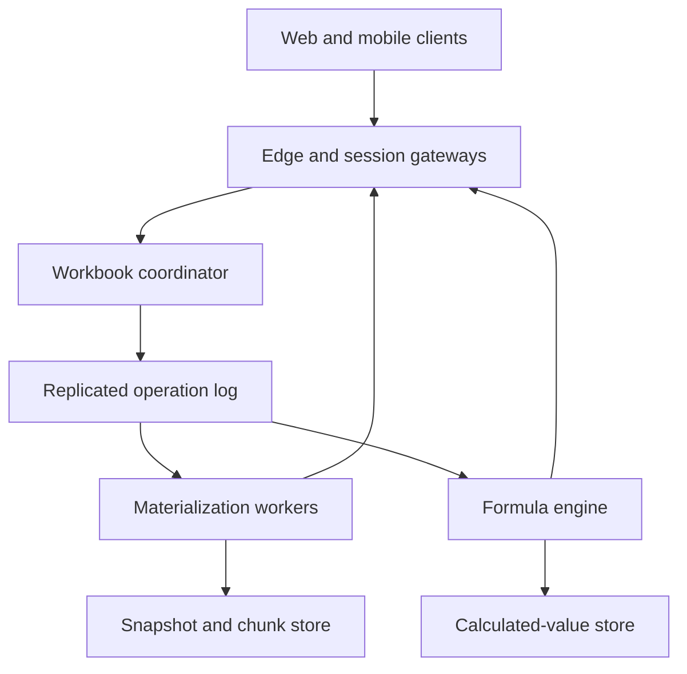
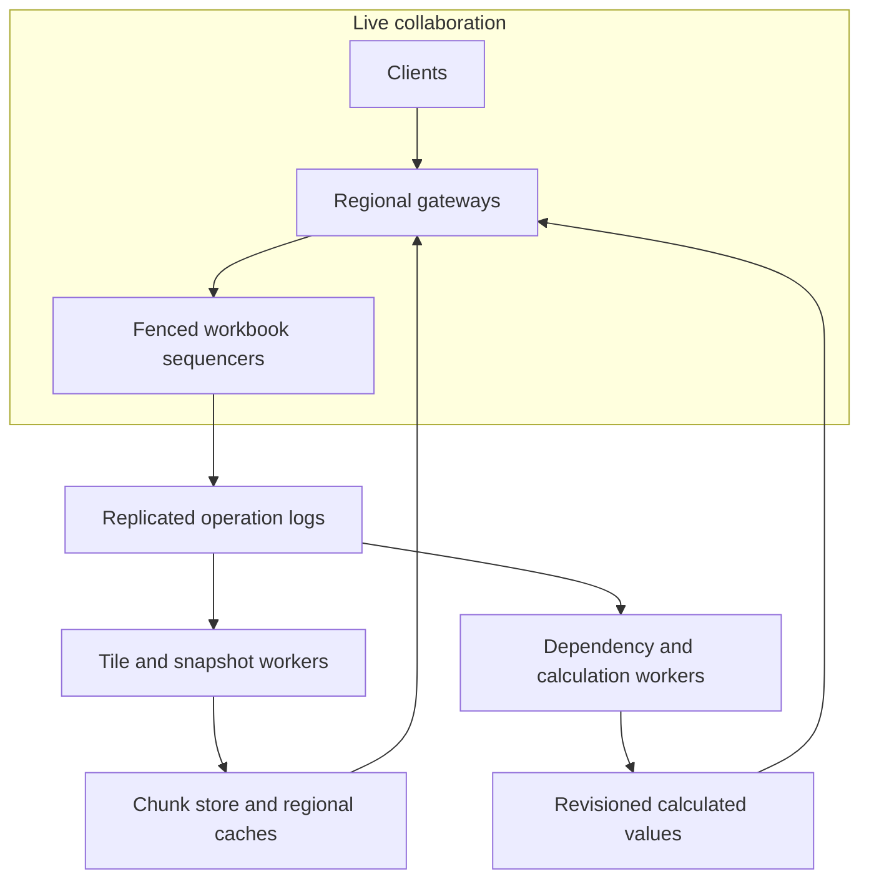

# Design a Real-Time Collaborative Spreadsheet

**Difficulty:** Senior / Staff-level  
**Primary themes:** real-time collaboration, ordered logs, database partitioning, incremental computation, caching, queues, consistency, hot-key mitigation, and multi-region recovery  
**Interview time budget:** about 40–45 minutes  
**Educational walkthrough:** intentionally more detailed than what you would say live

This walkthrough uses the public Hello Interview delivery sequence: clarify and prioritize requirements, identify the core entities, define the system interface, build a complete design operation by operation, and spend the remaining time hardening the load-bearing parts. The spreadsheet-specific design, dialogue, APIs, calculations, and tradeoffs are original. See [Hello Interview's System Design Delivery Framework](https://www.hellointerview.com/learn/system-design/in-a-hurry/delivery), [API Design guide](https://www.hellointerview.com/learn/system-design/core-concepts/api-design), and [System Design in a Hurry](https://www.hellointerview.com/learn/system-design/in-a-hurry/introduction).

---

## Interviewer prompt

> Design a cloud spreadsheet similar to Google Sheets. Multiple users should be able to edit the same workbook concurrently, see changes in real time, use formulas that recalculate when dependencies change, open large workbooks quickly, and recover earlier versions. The service should operate globally and remain useful during failures.

## Targeted clarifying questions with assumed interviewer answers

**Candidate:** Are we designing a general document editor, or should I focus on spreadsheet semantics?

**Interviewer:** Focus on spreadsheets: workbooks, sheets, cells, row and column edits, formulas, formatting, comments, and sharing. Rich text documents and slide layouts are out of scope.

**Candidate:** Which user journeys are essential?

**Interviewer:** Open a workbook, edit cells, insert or delete rows and columns, collaborate live, recalculate formulas, and view or restore version history. Bulk paste and import matter because they produce many cell changes.

**Candidate:** Do formulas include arbitrary user code?

**Interviewer:** Support common deterministic functions, references across sheets, ranges, and a small set of volatile functions such as `NOW` and `RAND`. External data connectors and arbitrary scripts can be discussed later but are not part of the baseline.

**Candidate:** What consistency should collaborators observe?

**Interviewer:** All committed workbook mutations must converge to one order. A user's acknowledged edit must survive normal failures and appear in the canonical history. Collaborators should usually see it within 200 ms. Formula values may lag raw cell edits slightly, but every calculated value must identify the workbook revision from which it was derived.

**Candidate:** How should concurrent edits behave?

**Interviewer:** Concurrent edits to different cells should both survive. If two users edit the same cell concurrently, use a deterministic conflict rule and retain both operations in history. Structural edits—such as inserting a row while another user edits `B17`—must preserve user intent as well as practical spreadsheet products do.

**Candidate:** Do we need offline edits?

**Interviewer:** Clients may edit briefly while disconnected and later reconnect. They submit operations based on their last known workbook revision. The server rebases safe operations and reports conflicts that require user attention. Do not build an indefinitely disconnected peer-to-peer database.

**Candidate:** What scale should I assume?

**Interviewer:** 200 million registered users, 50 million daily active users, 5 million simultaneously open workbooks, 20 million active WebSocket sessions, 2 million cell or structure operations per second globally at peak, and 10 million formula evaluations per second during bursts. A normal workbook has 100,000 populated cells; a very large workbook may have 50 million populated cells and thousands of collaborators.

**Candidate:** What latency and availability targets matter?

**Interviewer:** A nearby collaborator should receive an accepted edit within 200 ms p95. The editor should receive durable acknowledgment within 300 ms p95. Common incremental formula recalculation should finish within 500 ms p95, while very large recomputations may show progress. Opening a normal workbook should render the first viewport within one second p95. Target 99.99% read availability and 99.95% mutation availability.

**Candidate:** Can one workbook accept writes in multiple regions at once?

**Interviewer:** Prefer predictable convergence over write availability. A workbook may have one authoritative write region at a time, with fast failover. Presence and cursor location can be eventually consistent and active-active.

**Candidate:** What belongs in version history?

**Interviewer:** Every accepted mutation should be attributable to an actor and operation ID. Users can inspect historical revisions and restore one as a new head revision; restoration must not erase the intervening audit trail.

### Scope statement I would say aloud

> “I’ll design the workbook data plane for live cell and structural edits, ordered collaboration, formula recalculation, snapshots, and version restore. I’ll first make one workbook correct in one region, then scale it with chunked storage, snapshot caches, partitioned calculation, backpressure, and regional failover. I’ll treat presence as best effort, but the mutation log and calculation revision as explicit consistency boundaries. Arbitrary scripts, external connectors, charts, and file-format fidelity are secondary.”

---

## 1. Requirements (~5 minutes)

### Core functional requirements

1. **Edit and collaborate on workbooks.** Authorized users open workbooks, change cell values or formatting, insert/delete/move rows and columns, paste ranges, and receive collaborators' accepted operations in real time.
2. **Evaluate formulas consistently.** The system parses formulas, maintains dependencies, detects cycles, incrementally recalculates affected cells, and publishes results tagged with the source workbook revision.
3. **Persist, sync, and recover history.** Clients reconnect from a revision cursor, large workbooks load by viewport, every accepted operation is durable and attributable, and users can inspect or restore historical revisions.

### Quantified non-functional requirements

- **Scale:** 20 million concurrent sessions, 5 million open workbooks, 2 million mutation operations/s globally, 10 million formula evaluations/s at burst, normal workbooks with 100,000 populated cells, and outliers up to 50 million cells and thousands of collaborators.
- **Latency:** durable edit acknowledgment under 300 ms p95; collaborator delivery under 200 ms p95 within a healthy region; ordinary incremental recalculation under 500 ms p95; first viewport under one second p95 for a normal workbook.
- **Availability and recovery:** 99.99% reads, 99.95% mutations, workbook write-leader failover under 30 seconds, no loss of acknowledged operations during ordinary zonal failures, and less than five seconds of possible data loss only for an extreme full-region disaster unless a premium zero-RPO mode is selected.
- **Correctness:** every accepted operation receives exactly one canonical workbook sequence number; replicas and clients converge when they have processed the same sequence; formula output is deterministic for a declared calculation epoch and input revision.
- **Freshness and durability:** local read-your-writes immediately after acknowledgment, remote collaborator propagation within 500 ms p99, snapshots no more than 30 seconds or 10,000 operations behind the log, and history retained according to tenant policy.

### Scope and consistency/availability contract

| Concern | Contract |
|---|---|
| Workbook mutations | Linearizable through a single logical sequencer per workbook epoch. Each accepted operation gets a monotonically increasing `workbook_seq`. |
| Different-cell concurrent edits | Both survive and are ordered. Clients render optimistic local state, then reconcile with server sequence. |
| Same-cell concurrent edits | Deterministic winner in current state, usually the later canonical operation; both operations remain in history and conflict metadata may be shown. |
| Structural edits | Rebased against intervening structural operations using stable row/column identities, not only display coordinates. |
| Formula values | Eventually consistent with raw cell state, but revision-stamped. A value computed from revision 910 never masquerades as current at revision 914. |
| Workbook open | Snapshot plus ordered delta log. The client receives an immutable snapshot revision and applies later operations in sequence. |
| Presence and cursors | Best effort, ephemeral, and active-active. Dropped presence updates do not affect workbook truth. |
| Offline edits | Accepted only after server-side rebase against canonical history; unsafe ambiguity returns an explicit conflict. |
| Version restore | Creates a new mutation that points to selected historical content. It never rewinds or deletes the append-only audit trail. |
| Regional partition | The fenced workbook leader continues only if it holds the current lease/epoch. The minority side fails writes rather than creating two histories. |

**Candidate:** I want to make one distinction explicit: raw cells and the operation log are authoritative; calculated values, viewport chunks, indexes, and presence are projections.

**Interviewer:** Why does that distinction matter?

**Candidate:** Because it lets us rebuild calculation and caches after a bug without losing user intent. It also lets us choose strong ordering for mutations while keeping formula evaluation and presence highly available and asynchronous.

### Explicitly out of scope

- Arbitrary macros or user-supplied code
- External database and market-data connectors
- Full Excel import/export compatibility
- Chart rendering and pivot-table execution
- Rich comments, notifications, and email delivery internals
- Indefinite peer-to-peer offline collaboration
- Cross-workbook formulas in the baseline
- Machine-learning suggestions or natural-language formula generation

---

## 2. Core entities (~2 minutes)

Name the essential nouns before expanding the schema.

| Entity | Purpose | Essential fields |
|---|---|---|
| **Workbook** | Ownership, sharing, head revision, and home placement | `workbook_id`, tenant, ACL version, home region, leader epoch, head sequence, calculation mode |
| **Sheet** | A named grid within a workbook | `sheet_id`, workbook, stable order key, name, row/column metadata versions |
| **Row / Column** | Stable structural identity independent of visible position | `row_id` or `column_id`, sheet, fractional order key, tombstone, metadata |
| **Cell** | Authoritative user-entered content and style | sheet, row ID, column ID, input kind, raw value or formula, style reference, last sequence |
| **Operation** | Immutable accepted mutation | operation ID, workbook sequence, base sequence, actor, type, payload, commit time, leader epoch |
| **Snapshot** | Compacted workbook image at a log position | snapshot ID, workbook, sequence, chunk manifest, content hash, schema version |
| **FormulaNode** | Parsed formula and dependency metadata | cell identity, abstract syntax tree, precedents, dependents, volatility, formula version |
| **CalculatedValue** | Derived output for a calculation epoch | cell identity, source workbook sequence, calc epoch, value/error, completion state |
| **Session** | Ephemeral connection state | session ID, principal, workbook, last acknowledged sequence, region, presence expiry |
| **ConflictRecord** | User-visible record for ambiguous concurrent intent | operation IDs, affected identity, resolution, winning sequence |

The key modeling decision is that coordinates such as `B17` are a view, not an identity. A cell is addressed internally by stable `(sheet_id, row_id, column_id)`. Display coordinates are computed from ordered row and column metadata. If a collaborator inserts a row above 17, an edit intended for the old row remains attached to its stable row ID instead of drifting to the wrong data.

**What I would say aloud:**

> “I’m using stable row and column IDs because structural collaboration is the hard case. Human coordinates are convenient API syntax, but they are not durable identifiers under concurrent insert, delete, sort, and move operations.”

---

## 3. API and system interface (~5 minutes)

Authentication produces a trusted `actor_principal_id`, tenant context, and workbook capabilities. The client never supplies an authoritative actor ID in a request body.

The data-plane collaboration interface is a bidirectional WebSocket because the server must push ordered operations, calculation updates, and presence. REST endpoints handle workbook metadata, initial open, history, and restore.

### 3.1 Open a workbook

```http
POST /v1/workbooks/wb_7F2:open
Authorization: Bearer <token>
Content-Type: application/json
```

```json
{
  "known_sequence": 884210,
  "viewport": {
    "sheet_id": "sh_budget",
    "top_left": "A1",
    "bottom_right": "Z200"
  },
  "client_instance_id": "cli_3a1"
}
```

```json
{
  "workbook_id": "wb_7F2",
  "snapshot": {
    "sequence": 884000,
    "manifest_url": "https://objects.example/...signed...",
    "content_hash": "sha256:91ca..."
  },
  "delta_from": 884001,
  "head_sequence": 884233,
  "session_token": "short-lived-workbook-capability",
  "websocket_url": "wss://collab-us-east.example/v1/sessions/s_93...",
  "leader_epoch": 71,
  "acl_version": 18
}
```

If the client already has a valid snapshot, the server can return only deltas. Signed object URLs are scoped to immutable snapshot chunks and expire quickly.

### 3.2 Submit an operation over the collaboration stream

```json
{
  "type": "SUBMIT_OPERATION",
  "operation_id": "01JCG4Q9T3X6H9K6MX2ZA7VY4H",
  "base_sequence": 884233,
  "client_sequence": 991,
  "mutation": {
    "type": "SET_CELL",
    "sheet_id": "sh_budget",
    "row_id": "row_7c1",
    "column_id": "col_revenue",
    "input": {"kind": "FORMULA", "text": "=SUM(C2:C13)"}
  }
}
```

Server acknowledgment:

```json
{
  "type": "OPERATION_COMMITTED",
  "operation_id": "01JCG4Q9T3X6H9K6MX2ZA7VY4H",
  "workbook_sequence": 884234,
  "leader_epoch": 71,
  "canonical_mutation": {
    "type": "SET_CELL",
    "cell_id": ["sh_budget", "row_7c1", "col_revenue"],
    "input": {"kind": "FORMULA", "text": "=SUM(C2:C13)"}
  },
  "calculation_state": "QUEUED"
}
```

The `operation_id` is the idempotency key. Retrying it returns the existing sequence and result. Reusing it with different content returns `OPERATION_ID_REUSED`.

### 3.3 Insert rows

The client resolves visible coordinates to stable identities from its current model.

```json
{
  "type": "SUBMIT_OPERATION",
  "operation_id": "01JCG4SMV7M9T5F17P0MFC0JAB",
  "base_sequence": 884234,
  "mutation": {
    "type": "INSERT_ROWS",
    "sheet_id": "sh_budget",
    "after_row_id": "row_7c1",
    "new_rows": [
      {"row_id": "row_client_a91", "count": 3}
    ]
  }
}
```

The server may replace provisional IDs with canonical IDs or validate globally unique client-generated IDs. The canonical operation contains generated fractional order keys and the committed sequence.

### 3.4 Bulk paste

```http
POST /v1/workbooks/wb_7F2/range-mutations
Authorization: Bearer <token>
Idempotency-Key: 01JCG50E5TD1G5NZFXNQYFA8V7
Content-Type: application/json
```

```json
{
  "base_sequence": 884240,
  "sheet_id": "sh_budget",
  "anchor": {"row_id": "row_100", "column_id": "col_A"},
  "dimensions": {"rows": 10000, "columns": 20},
  "upload_ref": "obj://staged-range/rng_88",
  "mode": "OVERWRITE_VALUES"
}
```

```json
{
  "job_id": "job_range_88",
  "status": "VALIDATING",
  "accepted_base_sequence": 884240
}
```

Huge pastes do not become 200,000 individual WebSocket requests. The service validates the staged range, commits a compact bulk operation, then streams viewport-relevant patches while background workers update other chunks.

### 3.5 Fetch viewport data

```http
GET /v1/workbooks/wb_7F2/sheets/sh_budget/cells?rows=row_1..row_200&columns=col_A..col_Z&at_sequence=884240
Authorization: Bearer <token>
```

```json
{
  "sequence": 884240,
  "cells": [
    {
      "row_id": "row_7c1",
      "column_id": "col_revenue",
      "input": {"kind": "FORMULA", "text": "=SUM(C2:C13)"},
      "calculated": {"value": 1284000, "source_sequence": 884240, "calc_epoch": 551}
    }
  ],
  "row_metadata_version": 94,
  "column_metadata_version": 21,
  "next_chunk_cursor": null
}
```

The response says exactly which workbook sequence and calculation epoch it represents. Clients can display a recalculating indicator if the input revision is newer than the calculated revision.

### 3.6 Version history and restore

```http
GET /v1/workbooks/wb_7F2/revisions?before_sequence=884240&limit=50
Authorization: Bearer <token>
```

```json
{
  "items": [
    {
      "sequence": 884200,
      "committed_at": "2026-11-05T04:57:02Z",
      "actor": {"principal_id": "usr_42", "display_name": "Maya"},
      "summary": "Updated 12 cells in Budget"
    }
  ],
  "next_cursor": "opaque-history-cursor"
}
```

```http
POST /v1/workbooks/wb_7F2/restores
Authorization: Bearer <token>
Idempotency-Key: 01JCG57R2T20E5J8EYV9Z8W44F
Content-Type: application/json
```

```json
{
  "source_sequence": 880000,
  "expected_head_sequence": 884240
}
```

```json
{
  "restore_operation_id": "op_restore_71",
  "new_head_sequence": 884241,
  "source_sequence": 880000
}
```

Restore is conditional on the expected head so an administrator cannot unknowingly overwrite edits committed after opening the history panel.

### 3.7 Presence update

```json
{
  "type": "PRESENCE",
  "sheet_id": "sh_budget",
  "selection": {
    "anchor": ["row_7c1", "col_revenue"],
    "focus": ["row_7c9", "col_revenue"]
  },
  "client_presence_sequence": 881
}
```

Presence messages are rate-limited, coalesced, and never enter the durable operation log.

**What I would say aloud:**

> “The API exposes revision boundaries rather than hiding them. The mutation stream carries an idempotent operation ID and base sequence; open returns a snapshot plus deltas; calculated values carry their source sequence. Identity and authorization come from the token, not from user-controlled fields.”

---

## 4. Data flow

This system benefits from an explicit pipeline because accepting an edit, broadcasting it, updating storage chunks, and recalculating formulas have different correctness and latency requirements.

### Edit path

1. Authenticate the session and verify the workbook ACL version.
2. Route the operation to the workbook's current home-region coordinator and leader epoch.
3. Deduplicate by `(workbook_id, operation_id)`.
4. Rebase the operation from `base_sequence` over intervening structural mutations.
5. Validate permissions, limits, formulas, and stable row/column identities.
6. Append the canonical operation to the replicated workbook log and assign `workbook_sequence`.
7. Acknowledge durability to the editor and broadcast the canonical operation to collaboration gateways.
8. Asynchronous consumers update materialized cell chunks, snapshot deltas, search metadata, history summaries, and the formula dependency graph.
9. Calculation workers publish revision-stamped results, which are pushed to relevant clients and cached by viewport.

### Open path

1. Authorize the caller and locate the workbook's snapshot manifest and head sequence.
2. Return the newest compatible snapshot not newer than the requested revision.
3. Fetch visible row/column metadata and viewport chunks from a regional cache or object store.
4. Replay ordered operations after the snapshot sequence.
5. Subscribe the client to live operations starting at the next sequence.
6. Fetch calculated values whose source revisions are valid for the visible cells.

### Reconnect path

1. Client presents its last applied `workbook_sequence` and unsent operations.
2. Server sends missing canonical operations.
3. Server rebases each offline operation in client order, deduplicates, and accepts or rejects it explicitly.
4. Client rolls back optimistic state for rejected operations and applies canonical replacements.

### Snapshot and compaction path

1. A snapshot worker chooses a committed log boundary.
2. It applies cell and structure mutations into immutable chunks.
3. It writes a content-addressed manifest containing chunk hashes and schema versions.
4. It atomically publishes `(workbook_id, snapshot_sequence) -> manifest`.
5. Old log segments remain until every supported sync cursor, retention rule, and disaster-recovery replica has advanced beyond them.

---

## 5. High-level design (~10–15 minutes)

Build the simplest complete system one operation at a time.

### 5.1 Baseline architecture



The operation log is the authoritative write history. Snapshot chunks and calculated values are read-optimized projections. A metadata database maps a workbook to its home region, current leader epoch, ACL version, latest snapshot, and head sequence.

### 5.2 Operation 1: open and edit a small workbook

A session gateway terminates WebSockets near users but does not independently order writes. It hashes by `workbook_id` to a logical coordinator in the workbook's home region. The coordinator serializes accepted operations for that workbook.

For a first implementation, the coordinator can use a consensus-replicated log partition. Each log append contains:

```text
workbook_id
leader_epoch
workbook_sequence
operation_id
base_sequence
actor_principal_id
mutation_type
canonical_payload
committed_at
```

The coordinator acknowledges only after a quorum in the home region has persisted the append. The editor already rendered its optimistic mutation, so the acknowledgment replaces the provisional client order with the canonical sequence.

Every gateway subscribed to the workbook receives the operation through a regional fan-out topic. Gateways keep a small per-workbook replay buffer. If they detect a sequence gap, they fetch missing operations from the durable log before forwarding later ones.

The initial materialized store can be a transactional key-value or wide-column database keyed by stable cell identity:

```text
partition: workbook_id + sheet_id + tile_id
sort: row_id + column_id
value: raw_input, style_id, last_workbook_sequence
```

A tile might represent 256 logical rows by 64 logical columns for cache locality. Sparse encoding stores only populated cells.

**Candidate:** Why not write the cell table first and publish an event afterward?

**Interviewer:** What risk do you see?

**Candidate:** A database commit followed by a failed publish creates durable state collaborators never learn about. Making the ordered log the write authority avoids that dual-write gap. Cell tiles are idempotent projections: apply only an operation with a greater sequence than the cell or tile watermark.

### 5.3 Operation 2: structural edits

Visible row number 17 is unstable. Rows and columns therefore have stable IDs plus sortable order keys. An insertion allocates keys between neighbors. A fractional indexing scheme might produce order keys such as `a`, `aV`, and `b` without renumbering the whole sheet.

Eventually, dense repeated insertions exhaust convenient key space. A background rebalancer rewrites order keys for a bounded region under a metadata version. Because formula and cell identity use stable IDs, rebalancing changes presentation order but not references.

When a client submits an operation based on sequence 100 but the head is 104, the coordinator loads operations 101–104:

- if they touch unrelated cells, no transformation is needed;
- if they insert rows elsewhere, the stable target row remains valid;
- if they delete the target row, the edit is rejected with `TARGET_DELETED` or retained as a recoverable conflict;
- if they move or sort the target range, stable identities preserve the target;
- if two operations rename the same sheet, canonical order selects the visible value and history retains both.

Formula parsing resolves `B17` into a reference expression over stable row and column identities plus reference behavior. Relative references record how they should transform when copied. Range boundaries use stable IDs and ordering metadata.

### 5.4 Operation 3: formulas and calculation

When a committed operation changes a formula, a dependency consumer parses it into an abstract syntax tree. It records direct precedents and reverse dependents. For example:

```text
D14 = SUM(C2:C13)
E14 = D14 * TaxRate
```

The graph contains edges from every referenced cell or compressed range node toward its dependent formula. A change to `C7` invalidates the range aggregate for `C2:C13`, then `D14`, then `E14`.

The formula engine creates a calculation epoch tied to a source workbook sequence. It walks affected nodes in topological order and writes:

```text
cell_id
formula_version
source_workbook_sequence
calculation_epoch
value_or_error
dependency_fingerprint
```

Clients can safely mix raw edits and formula results only when they understand the revision relationship. If head sequence is 884250 but a visible result says source sequence 884248, the UI shows it as recalculating rather than silently presenting it as current.

Cycles produce a deterministic `#CYCLE!` result and cycle membership metadata. Volatile functions run according to workbook policy: on edit, on open, or on a timed epoch. All workers in one epoch receive the same logical clock and seeded randomness so replicas do not disagree.

### 5.5 Operation 4: fast workbook open

Replaying millions of operations is too slow. Snapshot workers periodically compact state into immutable chunks and a manifest:

```text
manifest
  workbook_id
  snapshot_sequence
  row_metadata_chunks[]
  column_metadata_chunks[]
  cell_tile_chunks[]
  formula_graph_generation
  content_hash
```

Chunks are content-addressed and compressed in object storage. The latest manifest pointer lives in a strongly consistent metadata store. Edge caches hold immutable chunks safely because a content hash never changes.

Opening a normal workbook returns the manifest and only the first viewport's row metadata, column metadata, cell tiles, and recent deltas. The rest loads lazily. This makes first paint depend on visible data, not total workbook size.

Regional caches store:

- immutable snapshot chunks by content hash;
- recent operation segments by workbook and sequence range;
- visible calculated-value tiles by `(workbook_id, tile_id, calc_epoch)`;
- workbook routing and ACL metadata with short TTL and version checks.

Mutable ACL decisions are never trusted from a long-lived content cache. The gateway validates the current ACL version before issuing snapshot capabilities.

### 5.6 Operation 5: history and restore

The immutable log naturally supports history, but presenting every keystroke is noisy. A history summarizer groups adjacent operations by actor, session, sheet, and time window while preserving links to exact sequences.

To read revision 700, choose the latest snapshot at or before 700 and replay through 700 in an isolated reader. Frequently viewed named versions can get retained snapshots.

Restoring revision 700 at current head 950 does not move the log pointer backward. The service computes or references the historical state and commits a `RESTORE_SNAPSHOT` operation as sequence 951. That operation's payload contains the source snapshot hash and restore policy. Subsequent history shows both the original edits and the restoration.

### 5.7 Scale estimates that change design decisions

#### Operation log throughput

Assume 2 million accepted operations/s at peak and an average canonical operation size of 600 bytes after compression:

```text
2,000,000 × 600 bytes = 1.2 GB/s of primary log ingress
Per day: 1.2 GB/s × 86,400 ≈ 104 TB/day
With 3 replicas ≈ 312 TB/day before compaction
```

This rules out one global database table with one index per access pattern. We need partitioned logs, aggressive snapshot compaction, tiered retention, and asynchronous derived indexes. Audit retention may keep compressed operation segments in object storage while hot brokers retain only recent replay windows.

#### Session fan-out

Twenty million WebSockets cannot all terminate on workbook coordinators. If each gateway handles 50,000 connections:

```text
20,000,000 / 50,000 = 400 gateways before headroom
At 60% target utilization, provision roughly 670 gateway equivalents globally
```

Gateways subscribe once per locally active workbook rather than once per user. For a workbook with 10,000 local viewers, one regional operation stream fans out in memory to 10,000 sockets.

#### Formula work

At 10 million formula evaluations/s and a measured average of 0.2 ms CPU per simple formula:

```text
10,000,000 × 0.2 ms = 2,000 CPU-seconds per wall-clock second
```

That is roughly 2,000 fully utilized cores before overhead and complex functions. It justifies incremental dependency-driven calculation, batching, priority by visible viewport, and per-tenant work budgets. Recomputing an entire workbook after every edit is untenable.

#### Snapshot frequency

Suppose a hot workbook receives 5,000 operations/s. A snapshot every 10,000 operations would be needed every two seconds, which is wasteful. Snapshot policy should therefore be adaptive:

- normal workbook: snapshot every 10,000 operations or 30 seconds;
- hot workbook: continuously materialize tiles and publish manifests every 30 seconds;
- cold workbook: snapshot on close or after a larger operation threshold.

The decision is based on replay cost and dirty-chunk volume, not a universal timer.

**What I would say aloud:**

> “The arithmetic drives three choices: partitioned logs because mutations exceed a gigabyte per second, regional fan-out because millions of sockets cannot attach to coordinators, and dependency-driven formula evaluation because full-workbook recomputation would consume orders of magnitude more CPU.”

---

## 6. Deep dives (~10–15 minutes)

In a live interview, choose two based on interviewer interest. For a staff-level discussion, I would lead with concurrency semantics and formula recalculation, then use hot-workbook reliability if time remains.

## Deep dive A: concurrent edits and structural intent

### Where the baseline breaks

Simply assigning last-write-wins timestamps to cells handles two users editing `A1`, but it does not solve structural collaboration:

1. User A starts editing visible row 17.
2. User B inserts a row above 17.
3. User A submits an edit addressed only as `B17`.
4. The server may modify the newly inserted row instead of the row A intended.

Client clocks also cannot provide a trustworthy total order, and accepting writes independently in two regions can create histories that apply structural operations differently.

### Plausible approaches

| Approach | Strength | Weakness |
|---|---|---|
| Last-write-wins by cell coordinate | Very simple | Coordinates drift under structural edits; clocks and intent are ambiguous |
| Operational transformation | Compact operations and strong central ordering | Transformation functions become complex for spreadsheet structures |
| General-purpose CRDT | Offline and multi-writer convergence | Metadata cost, tombstone growth, and formula/reference semantics are difficult |
| Server-ordered log plus stable identities | Predictable history and practical rebasing | Reduced write availability during leader failure; coordinator can become hot |

### Selected design: server order with identity-aware rebasing

Use one logical sequencer per workbook epoch. Operations refer to stable row/column IDs. The server canonicalizes them after rebasing over operations since the client's base sequence.

This is deliberately not a claim that “the system is a CRDT.” Stable identifiers and fractional ordering borrow ideas common in sequence CRDTs, but convergence comes from one canonical log. That makes audit, history, restore, and formula evaluation much easier to reason about.

For ordinary cell writes:

- different cell IDs commute;
- same cell ID is resolved by canonical sequence;
- a conditional edit can include `expected_cell_sequence` and fail instead of overwriting;
- both operations remain queryable in history.

For structure:

- insert targets a stable neighbor or gap;
- delete writes a tombstone for row/column identity;
- move assigns new order keys to stable identities;
- sort is represented as a deterministic permutation over a bounded identity set;
- merge/unmerge uses a region object with its own version to avoid overlapping merge ambiguity.

### Offline rebase example

Client C disconnects at sequence 100 and edits row `row_A`. While offline:

- sequence 101 inserts `row_X` above `row_A`;
- sequence 102 changes `row_A/col_B`;
- sequence 103 deletes `row_A`.

On reconnect, C's edit still targets `row_A`, so the server does not misapply it to `row_X`. But because `row_A` is tombstoned, the server returns:

```json
{
  "code": "TARGET_DELETED",
  "operation_id": "op_offline_9",
  "target": ["sheet_1", "row_A", "col_B"],
  "deleted_at_sequence": 103,
  "recovery_options": ["RESTORE_ROW", "COPY_TO_NEW_ROW", "DISCARD"]
}
```

That is better than silently resurrecting or redirecting user content.

### Hot coordinator mitigation

A single logical sequence does not require one physical thread forever. The coordinator can batch many operations into one replicated append and parallelize validation for disjoint tiles before committing the batch order. It can also separate ephemeral presence from durable edits.

For a massive workbook, lease ownership may move between coordinator instances, but only one epoch can append. The metadata service uses compare-and-swap to advance `leader_epoch`. Log replicas reject an append from an older epoch even if an old process resumes after a pause.

### Failure modes

- **Duplicate client retry:** operation ID returns the original canonical sequence.
- **Gateway loses acknowledgment:** reconnect queries operation status by ID.
- **Coordinator fails after quorum append but before broadcast:** the new coordinator replays the committed log and broadcasts the missing sequence.
- **Sequence gap at a client:** pause live application, fetch the missing range, then resume.
- **Old leader resumes:** epoch fencing causes append rejection.
- **Rebase code bug:** immutable original operation plus canonical operation and deterministic replay enable diagnosis; feature flags can route suspicious operations to fail-safe conflict handling.

### Observability

Measure acknowledgment latency, sequence gaps, rebase latency by operation type, conflict rate, dedupe hits, stale-epoch rejections, operations per hot workbook, batch size, and client rollback frequency. Sample deterministic replay of logs into a clean state and compare content hashes with published snapshots.

**What I would say aloud:**

> “I choose a canonical server order because spreadsheet structure and formulas make general multi-writer merging expensive to prove. Stable row and column IDs preserve intent across inserts and sorts. Different cells commute; same-cell writes are sequence-resolved; deleted targets produce explicit conflicts. Leader epochs fence stale coordinators.”

## Deep dive B: incremental formula recalculation at scale

### Where the baseline breaks

Scanning every formula after each edit is unacceptable. A large workbook may contain millions of formulas, while one cell edit often affects only a small subgraph. Naively storing one edge per cell in a huge range is also expensive: `SUM(A1:A1000000)` should not create one million heavyweight graph objects if a compressed representation works.

Distributed calculation creates more hazards:

- formula B may run before updated formula A even though B depends on A;
- a slow result from revision 90 may overwrite a newer result from revision 91;
- cycles may cross worker partitions;
- volatile functions may produce different values on different workers;
- a formula edit can change both graph structure and value.

### Plausible approaches

| Approach | Benefit | Cost or failure |
|---|---|---|
| Recompute entire workbook | Simple and deterministic | Far too much CPU and latency |
| Trigger each dependent through a queue | Scales independently | Duplicate storms, poor ordering, and high per-node overhead |
| Central in-memory graph per workbook | Fast dependency traversal | Memory pressure and poor recovery for giant workbooks |
| Partitioned persisted graph plus epoch scheduler | Scalable and recoverable | More complex barriers, range indexes, and stale-result handling |

### Selected design: persisted dependency graph with calculation epochs

The dependency service stores formula ASTs and graph metadata durably, while hot graph partitions are cached in memory. It models:

- direct cell references as edges;
- large ranges as range nodes indexed by sheet and ordered row/column interval;
- named ranges as versioned nodes;
- volatile functions as dependencies on a logical clock node;
- cross-sheet references inside the same workbook as ordinary graph edges.

When operation sequence 500 changes `C7`, the invalidation planner:

1. finds formulas directly referencing `C7` or ranges containing it;
2. marks their transitive dependents dirty for calculation epoch 81;
3. identifies strongly connected components to flag cycles;
4. constructs a topological frontier for acyclic nodes;
5. schedules batches by workbook, graph partition, and priority;
6. writes results conditionally for `(formula_version, source_sequence, calc_epoch)`.

A worker cannot overwrite a newer result because the value store accepts the result only if the formula version still matches and no newer calculation epoch has completed for that cell.

### Priority and backpressure

Calculation is not equally urgent everywhere. Use priority classes:

1. cells visible in an active viewport;
2. their direct dependencies;
3. other cells in active workbooks;
4. background completion for inactive regions;
5. maintenance recalculation after engine upgrades.

Each tenant and workbook receives token-bucket budgets measured in estimated formula cost, not merely formula count. Expensive functions and giant ranges consume more tokens. When overloaded, the system preserves raw edits, marks calculation `PENDING`, and reports progress instead of delaying mutation acknowledgment.

### Range aggregation

For associative functions such as `SUM`, `COUNT`, `MIN`, and `MAX`, maintain segment-tree-like aggregate nodes over large ranges. An edit to one leaf updates `O(log n)` aggregates rather than scanning a million cells. Formulas referencing the range depend on the aggregate root.

This optimization is selective: building an aggregate tree for every arbitrary range would be wasteful. Promote hot or large ranges after observing repeated cost, and cache aggregate generations by source sequence.

### Cycles and iterative calculation

Default behavior marks a strongly connected component with `#CYCLE!`. If the product supports iterative calculation, that is an explicit workbook policy with maximum iterations, convergence threshold, and deterministic node order. The resulting value includes convergence metadata. Never let an accidental cycle consume unbounded compute.

### Engine upgrades and determinism

Formula semantics change over time. Store `engine_version` with each calculation epoch. A new engine version first shadows a sample of workbooks and compares results. Recalculating an old revision uses the historical engine version when exact reproducibility is required, or clearly labels a migrated result.

All workers in an epoch receive:

```text
logical_time
random_seed
locale
time_zone
engine_version
source_workbook_sequence
```

This makes `NOW`, seeded `RAND`, date parsing, and locale-sensitive functions consistent within the epoch.

### Failure modes

- **Calculation worker dies:** unacknowledged batch is retried; writes are conditional and idempotent.
- **Dependency update lags:** formula is marked graph-pending; value publication waits for the formula's graph version.
- **Queue backlog:** mutation path stays healthy; UI shows stale source sequence and progress.
- **Poison formula:** cost and time limits produce `#TIMEOUT!` or `#LIMIT!`; the task goes to a diagnostic queue rather than retrying forever.
- **Incorrect engine release:** versioned rollout, shadow comparison, and ability to replay calculation from authoritative inputs limit blast radius.

### Observability

Track dirty-node fan-out, formulas evaluated per edit, graph update lag, visible-cell recalculation p95, queue age by priority, stale-result rejection, cycle count, poison formula rate, cache hit rate, estimated versus actual cost, and result mismatches during shadow execution.

**What I would say aloud:**

> “A mutation commits independently of formula completion. The dependency graph identifies the minimal dirty subgraph, a calculation epoch imposes deterministic inputs and ordering, and conditional result writes reject stale workers. Visible cells get priority; large associative ranges can use hierarchical aggregates.”

## Deep dive C: large workbooks, snapshots, and regional failure

### Where the baseline breaks

A 50-million-cell workbook cannot be loaded into every coordinator or recalculated as one unit. A celebrity workbook with thousands of viewers creates a hot routing key. A full-region outage can leave a stale coordinator alive while another region is promoted. Meanwhile, snapshots, operation logs, and calculated values may be at different revisions.

### Chunking and placement

Partition materialized cells by `(workbook_id, sheet_id, tile_id)`. Tiles are independently cached, snapshotted, and invalidated. Keep structural metadata in smaller ordered partitions because every viewport needs row and column placement.

The coordinator does not hold the whole workbook. It holds routing metadata, a recent structural-operation window, dedupe state, and hot-cell conflict metadata. Validation that needs a cold tile fetches it from the materialized store, but simple append eligibility can often be determined from operation metadata.

Large bulk operations become manifest-backed operations. For a 10-million-cell import, the log records the immutable uploaded range manifest and a canonical application policy. Projection workers materialize tiles in parallel. The operation becomes visible atomically at its sequence, while clients load changed tiles lazily. A progress record distinguishes “committed intent” from “fully materialized projection.”

### Cache correctness

Use immutable caching aggressively for snapshot chunks. Mutable viewport caches include:

```text
workbook_id
tile_id
materialized_through_sequence
acl_version
schema_version
```

The reader applies later log deltas or refuses a tile whose watermark is behind the maximum replay window. A cache invalidation event improves freshness, but correctness does not depend on never losing invalidations because sequence watermarks expose staleness.

Prevent a cache stampede with request coalescing and stale-while-revalidate for immutable or revision-pinned reads. For head reads, one loader reconstructs a missing tile while others either wait briefly or receive a slightly older tile plus deltas.

### Multi-region topology

Each workbook has one write home and epoch. The log is synchronously replicated across zones in that region and asynchronously copied to at least one secondary region. Gateways worldwide forward mutations to the home region; regional fan-out relays accepted operations back to nearby collaborators.

Reads use regional snapshots and log replicas. A session token carries the greatest observed sequence. If a nearby replica has not reached that sequence, the request waits briefly or routes to the home region, preserving read-your-writes.

Failover proceeds as follows:

1. quorum-backed metadata determines the home region is unavailable;
2. promotion selects a secondary with the greatest durable log position;
3. metadata advances the workbook leader epoch;
4. log replicas and gateways reject old-epoch writes;
5. sessions reconnect and resend unacknowledged operations by operation ID;
6. projections and calculation resume from their watermarks.

The standard tier may lose up to the declared regional RPO only if an entire region disappears after acknowledging locally but before replication. A premium tier can synchronously replicate log appends to a remote quorum, trading latency and partition availability for zero RPO.

### Hot-workbook fan-out

Do not publish one broker message per viewer. Publish once per active region, once per gateway subscribed to the workbook, then fan out in memory. Coalesce presence and calculation messages; never coalesce durable operations because clients need every sequence.

Slow clients have bounded outbound buffers. If a buffer overflows, disconnect with the last delivered sequence. On reconnect, the client catches up from the log. This is safer than allowing one slow browser to consume unbounded gateway memory.

### Degradation strategy

Under overload, preserve user intent in this order:

1. accept and durably order authorized raw mutations;
2. deliver canonical operations to active collaborators;
3. calculate visible formulas;
4. materialize off-screen tiles;
5. generate history summaries, thumbnails, search indexes, and analytics.

Presence can be dropped first. Calculation can visibly lag. Mutation acknowledgment should not wait for optional projections.

### Failure modes and repair

- **Snapshot publication fails:** readers continue from the previous manifest plus log; the new unpublished chunks are garbage-collected later.
- **Projection applies operations out of order:** per-tile watermark detects gaps; fetch the missing range before advancing.
- **Corrupt chunk:** content hash fails; refetch another replica or rebuild from prior snapshot plus log.
- **Regional fan-out outage:** edits still commit; clients reconnect through another region and replay from sequence.
- **Secondary promotion is behind:** declare the RPO loss explicitly; operation IDs prevent duplicate user retries, but cannot recreate an operation never replicated and no longer held by the client.
- **ACL revocation races an open session:** gateway checks ACL-version change events and periodically revalidates; coordinator rejects writes with stale authorization epoch.

### Observability

Track log replication lag, snapshot age and replay length, tile materialization lag, cache watermark distance, hot-workbook operations/s, fan-out amplification, slow-client disconnects, leader promotions, stale-epoch writes, RPO at promotion, ACL revalidation lag, and end-to-end sequence propagation by region.

**What I would say aloud:**

> “Large workbooks are chunked projections over one ordered intent log. Immutable snapshots make caching safe; tile watermarks make mutable cache staleness visible. Regional failover advances a fenced epoch, and clients replay by operation ID. Under load I sacrifice presence and off-screen calculation before mutation durability.”

---

## 7. Final design and close

### Concise final architecture



The final system has:

- one logical, epoch-fenced sequencer per workbook for a canonical mutation order;
- idempotent operations with client base sequence and server-assigned workbook sequence;
- stable row and column identities so structural edits preserve intent;
- a replicated append-only operation log as authoritative user history;
- chunked cell tiles and immutable snapshots for fast viewport-first opening;
- regional WebSocket gateways that subscribe once and fan out locally;
- a persisted dependency graph and calculation epochs for incremental, deterministic formulas;
- revision-stamped calculated values that never pretend to be fresher than their inputs;
- priority queues and tenant budgets that protect raw editing from formula storms;
- versioned caches with sequence watermarks, ACL versions, and content hashes;
- restore-as-new-operation semantics that preserve history;
- asynchronous cross-region replication, session sequence tokens, fenced promotion, and an optional zero-RPO tier;
- deterministic replay, reconciliation, backpressure, and end-to-end sequence observability.

### Requirements check

| Requirement | Design element |
|---|---|
| Concurrent editing | Workbook sequencer, stable identities, identity-aware rebase, operation IDs |
| Real-time collaborator updates | Regional WebSocket gateways, replayable sequence stream, local fan-out |
| Structural edits | Stable row/column IDs, fractional order keys, tombstones, canonical transforms |
| Formula support | ASTs, dependency graph, dirty-subgraph scheduling, calculation epochs |
| Formula freshness | `source_workbook_sequence`, conditional writes, client recalculation state |
| Fast large-workbook open | Immutable manifests, sparse tiles, viewport-first loading, regional caches |
| Offline reconnect | Missing-delta replay, ordered offline operations, explicit conflicts |
| Version history and restore | Append-only log, snapshots, grouped history, restore as a new mutation |
| Durability | Quorum log append before acknowledgment, idempotent projections, snapshots |
| Regional recovery | Home region, replicated log, session sequence, leader-epoch fencing |

### Thirty-second closing statement

> “The source of truth is an append-only, quorum-replicated operation log with one fenced sequencer per workbook epoch. Clients optimistically edit, then reconcile against canonical sequence numbers. Stable row and column IDs preserve intent across structural changes. Snapshot workers compact the log into immutable, cacheable tiles so the first viewport loads without reading the whole workbook. Formula workers maintain a persisted dependency graph, incrementally calculate dirty nodes in deterministic epochs, and publish results stamped with their input sequence. Regional gateways handle socket fan-out, while sequence watermarks, idempotent retries, and leader epochs make gaps and failover explicit. Under overload, we protect durable edits first and allow presence, off-screen materialization, and formula completion to lag visibly.”

---

## Realistic interviewer follow-ups with strong sample answers

### 1. Why not use a CRDT for the entire workbook?

> “A general CRDT is attractive for long offline editing, but spreadsheet semantics include row moves, sorts, merged ranges, formulas, and a calculation order. Metadata and tombstones would grow, and proving user-intent preservation is hard. The product accepts one active write region, so a canonical log plus stable identities gives simpler history and calculation. I still borrow stable identifiers and dense ordering ideas from CRDTs.”

### 2. Is one sequencer per workbook a bottleneck?

> “It is one logical ordering point, not one unbatched thread. Validation for disjoint tiles can run in parallel, operations can commit in batches, and presence bypasses it. Most workbooks are small. Exceptional hot workbooks receive dedicated coordinators and partitions. If a product truly requires independent multi-region writes to one workbook, I would revisit the contract and accept more complex merge semantics.”

### 3. Why not order by client timestamps?

> “Client clocks are untrusted and skewed. They also do not guarantee every participant sees structural operations in the same order. The server sequence gives a deterministic replay and audit boundary. Client time can be metadata, not authority.”

### 4. What happens when two people edit the same cell?

> “Both operations enter history. Canonical sequence selects the current input unless the operation requested compare-and-set semantics, in which case a stale edit fails. The UI may surface conflict metadata or allow restoring the losing value. We do not silently discard the operation from the audit trail.”

### 5. How do formulas survive row insertion?

> “The parsed formula resolves references to stable row and column identities plus copy behavior. Inserting a row changes visible coordinates and range order, not the referenced identity. Range semantics determine whether the insertion expands the range, and that transformation is recorded in the canonical structural operation.”

### 6. How do you handle `SUM(A:A)` efficiently?

> “Represent the range compactly and maintain aggregate nodes for hot associative ranges. A leaf edit updates logarithmically many aggregates. Do not create a heavyweight dependency edge for every possible row, and do not scan a million cells after each edit.”

### 7. What if a formula result arrives after the formula was edited again?

> “The result write includes formula version, source workbook sequence, and calculation epoch. The value store conditionally accepts it only if that version is still current and no newer epoch has completed. A late worker is rejected rather than overwriting fresh output.”

### 8. How do you guarantee exactly-once operation application?

> “The transport is at least once. The logical effect is effectively once because the operation ID maps to one canonical sequence, and each projection stores a sequence watermark or per-entity last sequence. Replays are expected and become no-ops.”

### 9. What if a client misses WebSocket messages?

> “Every durable message has a workbook sequence. A gap is detectable. The client or gateway pauses later application, fetches the missing range from the durable log, applies it, and resumes. If the hot replay window expired, it reloads from a newer snapshot plus deltas.”

### 10. How do you open a 50-million-cell workbook?

> “Never fetch it all. Return the row/column metadata needed to map the first viewport, immutable sparse tiles for visible cells, and operations after the snapshot. Prefetch adjacent tiles and calculate visible formulas first. Total workbook size affects background work, not first paint.”

### 11. How do you prevent a popular workbook from overwhelming the broker?

> “Relay one ordered stream per active region, then one subscription per gateway, and fan out in memory to local sockets. Presence and calculation updates can be coalesced. Slow clients have bounded buffers and reconnect by sequence instead of forcing the system to retain unlimited messages.”

### 12. How are access revocations enforced for existing sessions?

> “ACL changes increment an ACL version and publish a high-priority invalidation. Gateways disconnect revoked sessions, and coordinators verify authorization epoch on writes. Periodic revalidation bounds exposure if an invalidation is missed. Snapshot URLs are short-lived and scoped to immutable chunks.”

### 13. How do you implement named versions?

> “A named version is metadata pointing to a workbook sequence, content hash, creator, and label. It can pin a snapshot for fast future access. Renaming the label does not modify historical workbook content.”

### 14. What does restore do to collaborators currently editing?

> “Restore requires an expected head sequence. Once committed, it is a normal canonical operation with a new sequence, so collaborators receive it and rebase later optimistic edits. For a disruptive restore, product policy may require an admin lock or confirmation, but the history remains append-only.”

### 15. How do you rebuild after a formula-engine bug?

> “Raw inputs and formula text remain authoritative in the operation log and snapshots. Deploy a new engine version, rebuild dependency state from formula cells, shadow compare outputs, then publish a new calculation epoch. Do not rewrite user operations.”

### 16. How do you detect snapshot corruption?

> “Every chunk and manifest is content-addressed. Readers verify hashes. A corrupted replica is refetched; if all copies fail, rebuild from a prior verified snapshot plus the immutable log. Periodic restore drills test that path.”

### 17. Why is presence not in the operation log?

> “Presence is high-volume, short-lived, and semantically disposable. Logging cursor movement would inflate durable throughput without helping recovery. It uses regional pub/sub with TTL and sequence coalescing.”

### 18. Can a formula read a cell newer than its declared source sequence?

> “No. A calculation epoch reads a consistent logical revision. Materialized tiles may physically contain newer state, so the formula engine reads versioned cells or a snapshot plus deltas pinned to the source sequence. The source revision is part of correctness, not just display metadata.”

### 19. How do you avoid queue starvation from one enormous recalculation?

> “Use cost-based per-workbook and per-tenant budgets, small resumable batches, visible-viewport priority, and fair scheduling. Persist the calculation frontier so a large job yields between batches. Raw mutations never wait behind formula work.”

### 20. What would you build first?

> “One region, one sequencer per workbook, cell edits, snapshots, WebSocket replay, and a simple in-memory dependency graph backed by durable formula metadata. Then add structural operations with stable IDs, chunked large-workbook storage, history restore, priority calculation, offline rebase, and regional failover.”

---

## Common pitfalls

1. Treating visible coordinates as permanent cell identity.
2. Claiming last-write-wins solves concurrent row insertion and sorting.
3. Using client timestamps as a trustworthy global order.
4. Saying “use a CRDT” without defining spreadsheet operations and metadata cost.
5. Letting multiple regions append independently while promising one deterministic history.
6. Writing a cell database and message broker separately without a recoverable ordering boundary.
7. Acknowledging before the operation is durably replicated.
8. Assuming exactly-once delivery instead of idempotent operation IDs and projection watermarks.
9. Sending one broker copy per viewer of a popular workbook.
10. Putting presence and cursor movement in the durable mutation log.
11. Loading an entire workbook before rendering the first viewport.
12. Making snapshots mutable and therefore unsafe to cache by URL.
13. Omitting the snapshot revision and delta boundary during open.
14. Recomputing the entire workbook after every edit.
15. Creating a heavyweight graph edge for every cell in every large range.
16. Publishing formula values without the source workbook revision.
17. Allowing a late calculation worker to overwrite a newer value.
18. Letting volatile functions use different clocks or random seeds across workers.
19. Retrying poison formulas forever.
20. Allowing formula backlog to block raw mutation acknowledgment.
21. Silently redirecting an offline edit whose target row was deleted.
22. Rewinding history during restore instead of creating a new head operation.
23. Deleting log segments before snapshots, cursors, replicas, and retention policies are safe.
24. Trusting a cached ACL indefinitely.
25. Failing over without a new fenced leader epoch.
26. Promising zero regional data loss while acknowledging only within one region.
27. Keeping unbounded buffers for slow WebSocket clients.
28. Ignoring bulk paste and import, which produce a radically different write shape.
29. Using one snapshot cadence for both cold and extremely hot workbooks.
30. Drawing caches and queues before tracing one edit from optimistic client state to durable order, broadcast, materialization, and calculation.

---

## Practical interview delivery plan

| Time | What to cover |
|---:|---|
| 0–5 min | Clarify spreadsheet scope, collaboration semantics, formulas, scale, latency, offline window, and regional write policy. |
| 5–7 min | Name Workbook, Sheet, Row/Column, Cell, Operation, Snapshot, FormulaNode, CalculatedValue, and Session. |
| 7–12 min | Define open, operation stream, structural edit, bulk paste, viewport read, history, and restore interfaces. |
| 12–25 min | Trace open, cell edit, structural edit, formula update, snapshot load, and history restore. Draw sequencer, log, projections, and calculation. |
| 25–37 min | Deep dive on identity-aware concurrency and incremental formula epochs; add large-workbook failover if time permits. |
| 37–42 min | Use scale arithmetic, check requirements, cover failure modes and observability, then close. |

The written guide is deliberately longer than the live answer. In the interview, first draw the clients, regional gateways, workbook coordinator, replicated operation log, snapshot workers, and formula engine. Trace one cell edit completely. Add stable structural identities, calculation epochs, tile caches, hot-workbook fan-out, and regional fencing only after the baseline works.

---

## Public references

The delivery order and pacing directly use public Hello Interview guidance; all spreadsheet-specific content is original.

- [Hello Interview — System Design Delivery Framework](https://www.hellointerview.com/learn/system-design/in-a-hurry/delivery)
- [Hello Interview — API Design](https://www.hellointerview.com/learn/system-design/core-concepts/api-design)
- [Hello Interview — System Design in a Hurry](https://www.hellointerview.com/learn/system-design/in-a-hurry/introduction)

