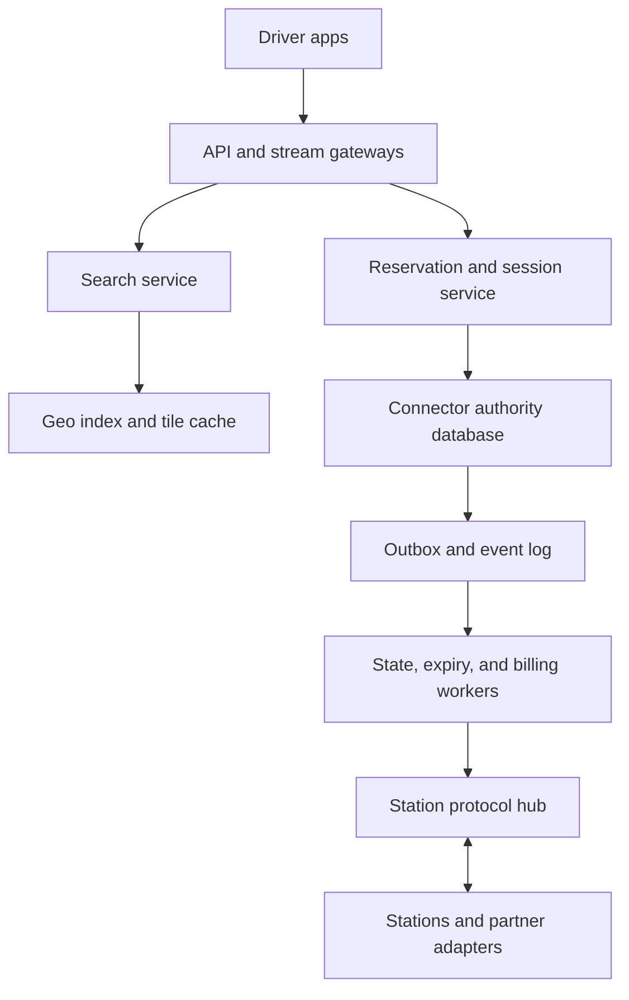
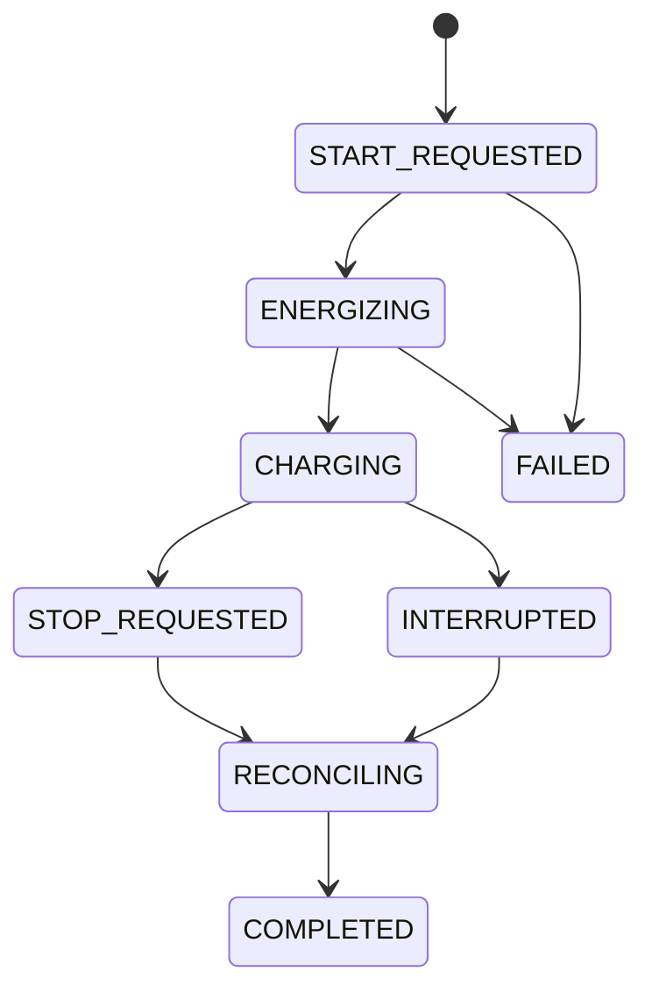
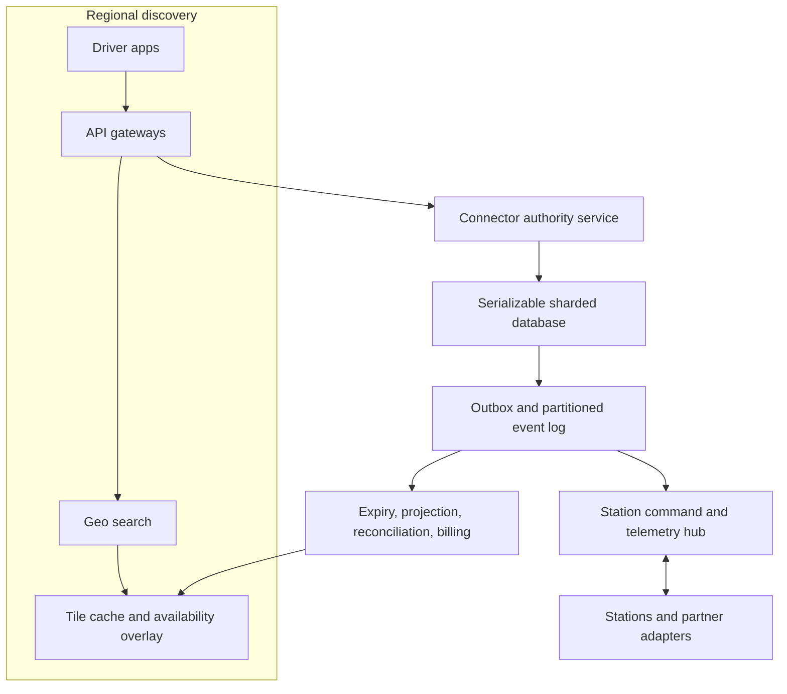

# Design a Global EV Charging Reservation and Session Platform

**Difficulty:** Senior / Staff-level  
**Primary themes:** geospatial search, strong reservation consistency, expiring leases, caching, queues, intermittent device connectivity, reconciliation, payments, reliability, and multi-region operation  
**Interview time budget:** about 40–45 minutes  
**Detailed walkthrough:** intentionally longer than the live interview answer

---

## Interviewer prompt

> Design a global platform for public electric-vehicle charging. Drivers should be able to find compatible chargers, reserve a connector for a short arrival window, start and stop a charging session, and see the final cost. Charging stations are operated by many partners and may lose network connectivity. The system must prevent two drivers from holding the same connector for overlapping time, scale globally, and remain understandable when device state, payment state, and cloud state temporarily disagree.

## Targeted clarifying questions and assumed interviewer answers

**Candidate:** Are we building the electrical control firmware too, or the cloud platform and its protocol with stations?

**Interviewer:** Focus on the cloud platform. Treat station firmware as an external actor that can accept commands, report status, and buffer events while offline.

**Candidate:** What are the three most important user journeys?

**Interviewer:** Find compatible available chargers, reserve one for a short window, and run a charging session from start through final price.

**Candidate:** Is a reservation for an exact connector or merely for any connector at a station?

**Interviewer:** The first version reserves an exact connector. You may discuss station-level capacity later.

**Candidate:** Can reservations overlap if their arrival windows differ?

**Interviewer:** No. A connector can have at most one active hold or confirmed reservation for a given time interval. For simplicity, reservations are immediate: a driver has 10 minutes to arrive, followed by a 5-minute grace period.

**Candidate:** How should a driver prove that they own the reservation when they reach the charger?

**Interviewer:** The authenticated app can send a start request, or the station can scan a short-lived QR token. Do not trust a user ID supplied in the body.

**Candidate:** What does “available” mean in search?

**Interviewer:** Search availability can be a few seconds stale. Booking cannot be stale: the reservation response must be authoritative.

**Candidate:** Must the platform start a session if the station is offline?

**Interviewer:** Partner stations may support offline authorization using a bounded, pre-provisioned token. Otherwise the app should fail clearly and not claim charging started.

**Candidate:** Are roaming partners in scope?

**Interviewer:** Yes at the boundary. A partner can own stations and receive commands through an adapter, but you do not need to design every external protocol.

**Candidate:** How is pricing defined?

**Interviewer:** A versioned tariff may charge per kilowatt-hour, per minute, a session fee, and idle fees. The tariff shown when reserving must be auditable. Taxes and payment-provider internals can be simplified.

**Candidate:** What scale should I design for?

**Interviewer:** Assume 30 million monthly drivers, 5 million connectors, 300,000 station-status events per second at peak, 50,000 reservation attempts per second during travel peaks, and 2 million simultaneous charging sessions.

**Candidate:** What geographic footprint and failure target matter?

**Interviewer:** Global reads, but a connector has one authoritative write region at a time. Search should be 99.99% available. Reservation and session-control APIs should be 99.95% available, with no acknowledged double booking. A full-region failure may interrupt new reservations for affected connectors for under two minutes.

**Candidate:** What is acceptable latency?

**Interviewer:** Nearby search p95 under 300 ms, reservation p99 under 500 ms in the connector's home region, and start-command acknowledgment p95 under 2 seconds when the station is online. The first progress update should normally appear within 5 seconds.

**Candidate:** What consistency contract should drivers see?

**Interviewer:** Search is eventually consistent. Reservation state, connector ownership, and session transitions are linearizable per connector. Meter events are at-least-once and may arrive late or out of order; invoices become final only after reconciliation.

**Candidate:** Can drivers extend or cancel reservations?

**Interviewer:** Cancellation is in scope. Extension is out of scope for the baseline because it complicates fairness and overlap checks.

**Candidate:** Are route planning, charger reviews, fleet accounts, and demand-based pricing required?

**Interviewer:** No. Mention them only as extensions.

**What I would say aloud:**

> “I’ll separate the discoverability contract from the ownership contract. Search may show a connector that was taken a moment ago, but only the connector’s authoritative reservation transaction can grant the lease. I’ll also separate durable commercial truth from device telemetry: reservations and session transitions are strongly ordered per connector, while meter events are deduplicated and reconciled asynchronously.”

---

## 1. Requirements (~5 minutes)

The public [Hello Interview delivery framework](https://www.hellointerview.com/learn/system-design/in-a-hurry/delivery) recommends narrowing the problem to roughly three functional requirements, identifying non-functional requirements that actually shape the design, naming core entities, defining the interface, building the simplest complete design one requirement at a time, and then hardening it in deep dives. I will use that order while keeping the EV-specific design original.

### Core functional requirements

1. **Discover chargers:** A driver can search a geographic area for compatible stations and see connector type, power, price summary, and recently known availability.
2. **Reserve a connector:** A driver can atomically reserve an exact connector for a 10-minute arrival window plus a 5-minute grace period, or receive an explicit failure if it is no longer available. The driver can cancel the reservation.
3. **Run and settle a charging session:** The reservation owner can start and stop a session. The platform receives progress and meter events, shows live status, and produces an auditable final charge.

### Important non-functional requirements

1. **No acknowledged double booking:** Reservation creation and the connector's exclusive session transition are linearizable per connector. Once success is returned, no competing request can also own that connector for the same lease epoch.
2. **Latency:** Nearby search p95 below 300 ms; reservation p99 below 500 ms in the authoritative region; online start-command acknowledgment p95 below 2 seconds; progress visible within 5 seconds normally.
3. **Scale:** 5 million connectors, 300,000 status events/s peak, 50,000 reservation attempts/s peak, 2 million concurrent sessions, and roughly 30 million monthly drivers.
4. **Availability and failure recovery:** Search 99.99%; reservation/session control 99.95%; zone failure without acknowledged reservation loss; affected connectors recover from regional failure in under two minutes. The system prefers rejecting a reservation over creating split-brain ownership.
5. **Auditability and bounded inconsistency:** Every accepted state transition and tariff version is durable and replayable. Search can lag by up to 10 seconds. Progress is eventually consistent. Final billing is delayed until the meter stream is reconciled or explicitly marked estimated.

### Scope

#### In scope

- Authenticated driver application
- Station discovery and compatibility filters
- Exact-connector reservations, expiration, and cancellation
- Online and bounded offline session authorization
- Start, progress, stop, tariff evaluation, payment authorization, and final capture
- Partner-station adapters
- Device event ingestion, deduplication, and reconciliation
- Multi-region reads and fenced regional failover

#### Out of scope

- Vehicle route optimization
- Charger reviews and photos
- Installation, maintenance dispatch, and firmware rollout
- Arbitrary future time-slot scheduling
- Waitlists and station-level pooled reservations
- Fleet billing and subscription plans
- Dynamic-price optimization
- Detailed card-network implementation
- Electrical safety logic inside the charger

### Consistency and availability contract

| Surface | Contract |
|---|---|
| Nearby search | Eventually consistent; availability age returned to the client; stale results may lose at booking time |
| Connector metadata and tariff publication | Versioned; new versions become visible atomically per station; reservations pin a tariff version |
| Reservation | Linearizable per connector; idempotent by client request key; success grants one fenced lease epoch |
| Reservation expiry | Server-time based; an expired lease cannot start a new session unless a session-start transition was committed before expiry |
| Session state | Monotonic state machine under the connector lease epoch; duplicate or regressive transitions are rejected |
| Device command delivery | At least once with command IDs; station applies a command at most once logically |
| Meter events | At least once, late and out of order allowed; deduplicated by station boot ID and sequence |
| Live energy/cost display | Eventually consistent and labeled with last meter time |
| Invoice | Provisional until stop boundary and meter range reconcile; final invoice is immutable, corrections use adjustment records |
| Regional partition | Only the side holding the current connector shard epoch may accept ownership changes; the other side fails closed |

**Candidate:** Why not make search strongly consistent too?

**Interviewer:** What would that cost?

**Candidate:** Every map pan could fan out to authoritative reservation shards for thousands of connectors. That increases tail latency and couples a read-heavy browse path to the write-critical ownership path. I would cache a recent availability projection for discovery, clearly treat it as a hint, and perform the strong check only for the one connector the driver tries to reserve.

**What I would say aloud:**

> “The invariant is not that the map is never stale. The invariant is that only one reservation transaction can mint the current connector lease. Search optimizes discovery; booking establishes truth.”

---

## 2. Core entities (~2 minutes)

Name the nouns before elaborating the schema.

| Entity | Purpose | Essential fields |
|---|---|---|
| **DriverPrincipal** | Authenticated driver and capabilities | principal ID, tenant/market, risk flags, payment-profile reference |
| **Station** | Physical site and routing unit | station ID, operator ID, location, timezone, home region, protocol adapter, metadata version |
| **Connector** | Reservable physical plug | connector ID, station ID, plug type, max power, operational status, availability version, authority epoch |
| **TariffVersion** | Immutable pricing rules | tariff ID/version, currency, effective interval, energy/time/session/idle rules, tax policy reference |
| **Reservation** | Exclusive expiring claim | reservation ID, connector ID, principal ID, state, created time, lease expiry, grace expiry, lease epoch, tariff version, idempotency key |
| **Session** | One charging lifecycle | session ID, connector ID, reservation ID, lease epoch, state, start/stop times, station boot ID, start and stop meter values |
| **Command** | Idempotent cloud-to-station instruction | command ID, connector ID, session ID, type, expected lease epoch, deadline, delivery state |
| **DeviceEvent** | Immutable station report | operator/station ID, boot ID, device sequence, event type, device time, receive time, payload hash |
| **MeterSample** | Energy/progress measurement | session ID, boot ID, meter sequence, cumulative Wh, power, device time, receive time |
| **Invoice** | Versioned financial result | invoice ID, session ID, tariff version, meter range, line items, status, amount, currency |
| **PaymentAttempt** | Authorization/capture lifecycle | payment attempt ID, session/invoice ID, provider key, amount, state |

The essential identity is the physical `connector_id`, not a display label such as “Charger 4B.” Station operators may rename or renumber display labels. Reservation and session invariants attach to the stable connector identity and an authority epoch.

The authority epoch is a monotonically increasing fencing number. When ownership of a connector shard moves to another leader or region, the epoch advances. A delayed old leader or command cannot mutate state with an earlier epoch.

**What I would say aloud:**

> “I need both a reservation lease epoch and a device boot ID. The lease epoch fences competing cloud owners; the boot ID prevents a station reboot from reusing sequence numbers and confusing telemetry deduplication.”

---

## 3. API and system interface (~5 minutes)

The current driver identity comes from the access token. A request body never chooses the authoritative driver ID. Partner stations authenticate with device certificates or operator-scoped credentials.

REST is appropriate for driver commands and reads. Station telemetry uses a persistent protocol such as MQTT or bidirectional gRPC through a partner adapter because devices send frequent events and receive commands. Server-Sent Events or WebSockets push live session progress to the app.

### 3.1 Search nearby chargers

```http
GET /v1/stations:search?lat=42.3601&lng=-71.0589&radius_m=8000&plug=CCS1&min_kw=100&available_now=true
Authorization: Bearer <driver-token>
```

```json
{
  "results": [
    {
      "station_id": "st_bos_218",
      "location": {"lat": 42.347, "lng": -71.083},
      "distance_m": 2410,
      "connectors": [
        {
          "connector_id": "con_218_03",
          "plug": "CCS1",
          "max_kw": 180,
          "availability": "AVAILABLE",
          "availability_observed_at": "2026-11-06T05:01:04Z",
          "price_summary": "$0.42/kWh + idle fee",
          "tariff_version": "tariff_91:v7"
        }
      ]
    }
  ],
  "generated_at": "2026-11-06T05:01:07Z",
  "next_cursor": null
}
```

The response exposes observation time. It does not promise the connector will still be available when selected.

### 3.2 Create a reservation

```http
POST /v1/connectors/con_218_03/reservations
Authorization: Bearer <driver-token>
Idempotency-Key: 01JDP1H7QK4AM9PX2M8R1Z2W6C
Content-Type: application/json
```

```json
{
  "expected_tariff_version": "tariff_91:v7",
  "payment_profile_id": "payprof_default"
}
```

```json
{
  "reservation_id": "res_01JDP1J1F7M8",
  "connector_id": "con_218_03",
  "state": "CONFIRMED",
  "lease_epoch": 1842,
  "arrive_by": "2026-11-06T05:11:12Z",
  "grace_expires_at": "2026-11-06T05:16:12Z",
  "tariff_version": "tariff_91:v7",
  "authorization": {"state": "HELD", "amount": 25.00, "currency": "USD"}
}
```

Possible authoritative failure:

```json
{
  "code": "CONNECTOR_UNAVAILABLE",
  "connector_id": "con_218_03",
  "observed_state": "RESERVED",
  "retryable": false,
  "alternatives_search_token": "opaque-nearby-token"
}
```

The `Idempotency-Key` maps one logical attempt to one result. Retrying after a timeout returns the same reservation or failure result. Reusing the key with different content returns `IDEMPOTENCY_KEY_REUSED`.

### 3.3 Cancel a reservation

```http
POST /v1/reservations/res_01JDP1J1F7M8:cancellation
Authorization: Bearer <driver-token>
Idempotency-Key: 01JDP1KYK8HDX
```

```json
{
  "reservation_id": "res_01JDP1J1F7M8",
  "state": "CANCELLED",
  "released_at": "2026-11-06T05:05:31Z"
}
```

Cancellation is conditional: a reservation already converted to a session cannot be cancelled. The endpoint returns the current canonical state.

### 3.4 Start charging

```http
POST /v1/reservations/res_01JDP1J1F7M8:start-session
Authorization: Bearer <driver-token>
Idempotency-Key: 01JDP1PST4C7H
Content-Type: application/json
```

```json
{
  "station_challenge": "qr_or_proximity_challenge",
  "client_observed_connector_id": "con_218_03"
}
```

```json
{
  "session_id": "sess_01JDP1Q6CBN2",
  "state": "START_REQUESTED",
  "command_id": "cmd_01JDP1Q7D21A",
  "lease_epoch": 1842,
  "stream_url": "/v1/sessions/sess_01JDP1Q6CBN2/events",
  "command_deadline": "2026-11-06T05:07:02Z"
}
```

The response means the cloud durably accepted the start transition and command, not that power is flowing. A later event moves the session to `ENERGIZING` or `CHARGING`. If a product wants synchronous semantics, the API may wait up to two seconds for the station acknowledgment and still return the durable intermediate state on timeout.

### 3.5 Stream progress

```text
event: session_state
data: {"state":"CHARGING","server_version":19,"observed_at":"2026-11-06T05:06:25Z"}

event: meter
data: {"energy_wh":18640,"power_w":142300,"estimated_cost":8.12,"meter_observed_at":"2026-11-06T05:14:08Z"}
```

The client reconnects with `Last-Event-ID`. If the gateway lost the hot stream, it reconstructs current state from the session store and resumes from the durable event log.

### 3.6 Stop charging

```http
POST /v1/sessions/sess_01JDP1Q6CBN2:stop
Authorization: Bearer <driver-token>
Idempotency-Key: 01JDP2A6F0N2
```

```json
{
  "session_id": "sess_01JDP1Q6CBN2",
  "state": "STOP_REQUESTED",
  "command_id": "cmd_01JDP2A7EC12"
}
```

### 3.7 Read final session and invoice

```http
GET /v1/sessions/sess_01JDP1Q6CBN2
Authorization: Bearer <driver-token>
```

```json
{
  "session_id": "sess_01JDP1Q6CBN2",
  "state": "COMPLETED",
  "started_at": "2026-11-06T05:06:25Z",
  "stopped_at": "2026-11-06T05:38:42Z",
  "energy_wh": 38120,
  "invoice": {
    "invoice_id": "inv_01JDP2D0X9",
    "status": "FINAL",
    "tariff_version": "tariff_91:v7",
    "line_items": [
      {"type": "ENERGY", "quantity_kwh": 38.12, "unit_price": 0.42, "amount": 16.01},
      {"type": "SESSION_FEE", "amount": 1.00},
      {"type": "TAX", "amount": 1.06}
    ],
    "total": 18.07,
    "currency": "USD"
  }
}
```

### 3.8 Station event ingestion

An adapter submits events in batches:

```json
{
  "station_id": "st_bos_218",
  "boot_id": "boot_771",
  "events": [
    {
      "device_sequence": 882104,
      "type": "COMMAND_ACK",
      "command_id": "cmd_01JDP1Q7D21A",
      "connector_id": "con_218_03",
      "lease_epoch": 1842,
      "device_time": "2026-11-06T05:06:24.810Z"
    },
    {
      "device_sequence": 882105,
      "type": "METER_SAMPLE",
      "connector_id": "con_218_03",
      "session_id": "sess_01JDP1Q6CBN2",
      "cumulative_wh": 18640,
      "power_w": 142300,
      "device_time": "2026-11-06T05:14:08.012Z"
    }
  ]
}
```

The ingestion acknowledgment returns the highest contiguous device sequence durably stored. The station retains later events until gaps are acknowledged or the adapter explicitly reports an unrecoverable gap.

**What I would say aloud:**

> “The start API returns a durable command intent, not a false claim that electricity is flowing. Device acknowledgment and meter progress advance the session asynchronously. Every boundary carries IDs, epochs, and versions so retries and delayed device messages are safe.”

---

## 4. Data flow

This problem benefits from explicit pipelines because the reservation path, command path, and telemetry path have different latency and correctness requirements.

### Discovery flow

1. Station adapters ingest operational and availability events.
2. A durable event log partitions events by station or connector.
3. State projectors validate monotonic device sequences and update the connector-state store.
4. Geospatial index workers publish compact station documents containing connector compatibility, price summary, and recent projected availability.
5. Search services query regional geospatial shards, apply filters, rank by distance and suitability, and cache popular tiles.
6. The response includes the observation timestamp so the client knows availability is a hint.

### Reservation flow

1. Authenticate the driver and derive `principal_id` and market.
2. Rate-limit by principal, device, payment profile, and connector.
3. Route by `connector_id` to its authoritative reservation shard and epoch.
4. Deduplicate the idempotency key.
5. Verify connector operational policy, no active reservation/session, tariff version, and driver eligibility.
6. Create or verify a bounded payment authorization.
7. In one serializable transaction, create the reservation, advance connector ownership state, and insert an outbox event.
8. Return the committed lease epoch and expiry.
9. Outbox consumers update search availability, schedule expiry, notify the station if required, and emit analytics.

### Start-session flow

1. Authorize the reservation owner and validate challenge/proximity.
2. At the authoritative connector shard, atomically convert `CONFIRMED` to `START_REQUESTED` and create the session and command outbox record.
3. Command relay routes the command through the station's online connection or partner adapter.
4. Station validates connector ID, command ID, lease epoch, deadline, and local safety state.
5. Station acknowledges or rejects the command and later emits `ENERGIZING` and `CHARGING` events.
6. Session projector advances the monotonic state machine and publishes to the driver's live stream.

### Meter and settlement flow

1. Station batches sequenced meter samples, possibly after reconnecting.
2. Ingestion durably appends raw events before acknowledgment.
3. Deduplication keys on `(station_id, boot_id, device_sequence)`; semantic meter dedupe also checks session and cumulative reading.
4. Session aggregators compute live energy and estimated cost.
5. A stop boundary closes the expected meter interval.
6. Reconciliation checks start/stop meter values, gaps, resets, duplicate samples, tariff version, and station clock anomalies.
7. Billing emits an immutable invoice and captures payment. Corrections create adjustments rather than rewriting history.

### Reservation-expiry flow

1. The reservation transaction writes `grace_expires_at` and an expiry outbox event.
2. A delayed queue or timing wheel schedules a wake-up near the deadline.
3. The expiry worker re-reads authoritative state; the timer itself is never trusted as proof.
4. A conditional transaction changes `CONFIRMED` to `EXPIRED` only if the same reservation and lease epoch still own the connector and no start transition committed.
5. The connector becomes available and search projection is updated asynchronously.

---

## 5. High-level design (~10–15 minutes)

Build the simplest complete working system one operation at a time.

### 5.1 Baseline architecture



The baseline has two deliberate planes:

- **Discovery plane:** read-heavy, regionally replicated, cached, and eventually consistent.
- **Control plane for a connector:** write-authoritative, serializable per connector, fenced by epoch, and conservative during partitions.

The event log connects authoritative transitions to projections and asynchronous work without relying on an unsafe database-plus-broker dual write.

### 5.2 Operation 1: search nearby chargers

Station metadata lives in a source-of-truth metadata database. Each published station version contains location, plug types, power limits, operator, and immutable tariff references. Live connector state is projected from station events and cloud reservations.

For search, partition the world into hierarchical cells such as S2 or H3. A search request maps its radius to covering cells, queries the relevant regional shards, and filters exact distance afterward. Each indexed station document contains:

```text
station_id
geo_cell_ids at several levels
lat, lng
metadata_version
connector summaries[]
  connector_id, plug_type, max_kw
  projected_availability, availability_version
  availability_observed_at
tariff_summary_version
operator_quality_flags
```

Cache popular map tiles by `(geo_cell, zoom/filter fingerprint, index_generation)` for a few seconds. Metadata changes invalidate by generation; live availability can use a shorter TTL or a delta overlay.

Request trace:

1. Gateway authenticates and normalizes filters.
2. Search computes geospatial coverings.
3. Tile cache returns candidate station summaries or search reads geo shards.
4. Search merges candidates, applies compatibility and exact distance, and ranks.
5. It returns observation times and a short-lived alternative-search token.

This baseline can show stale availability, which is allowed. It cannot grant ownership.

### 5.3 Operation 2: reserve one connector

Route `connector_id` through a shard map to one authoritative database partition. Start with a relational or distributed-SQL database because the invariant spans a connector row, reservation row, idempotency record, payment-authorization reference, and outbox row.

Relevant records:

```text
ConnectorAuthority
  connector_id PK
  authority_epoch
  ownership_state            // AVAILABLE, HELD, SESSION_ACTIVE, BLOCKED
  owner_reservation_id
  owner_session_id
  state_version
  operational_policy_version

Reservation
  reservation_id PK
  connector_id
  principal_id
  state
  lease_epoch
  arrive_by
  grace_expires_at
  tariff_version
  payment_authorization_id
  created_at

IdempotencyRecord
  principal_id + idempotency_key PK
  request_hash
  result_type
  result_reference
  expires_at

Outbox
  event_id PK
  aggregate_id
  aggregate_version
  type
  payload
  published_at
```

The transaction locks or conditionally updates the one connector authority row:

```sql
UPDATE connector_authority
SET ownership_state = 'HELD',
    owner_reservation_id = :reservation_id,
    state_version = state_version + 1
WHERE connector_id = :connector_id
  AND ownership_state = 'AVAILABLE'
  AND authority_epoch = :expected_authority_epoch;
```

If exactly one row changes, insert the reservation, idempotency result, and outbox event in the same transaction. If no row changes, read the canonical reason and fail. The lease epoch can be the new connector state version or a separately monotonic counter.

**Candidate:** Why not use a distributed lock in Redis?

**Interviewer:** What problem would remain?

**Candidate:** I would still need to make the lock result, reservation row, idempotency result, and expiry durable together. A lock expiring during a pause can also let stale code continue. A serializable conditional transaction on the authoritative row directly protects the business invariant, while the committed epoch fences delayed work.

The payment provider call should not occur while holding the database lock. Two practical approaches are:

- create a short internal `PENDING_PAYMENT` hold, authorize, then confirm; or
- pre-authorize a reusable amount before the connector transaction.

I choose a **very short pending hold**—for example 3 seconds—with a unique attempt ID. The transaction grants `PAYMENT_PENDING`; the service authorizes outside the transaction; a second conditional transaction confirms or releases it. Search treats pending as unavailable. This avoids long database transactions but introduces abandoned holds, cleaned by the same conditional-expiry mechanism.

### 5.4 Operation 3: start and stop a session

The session state machine is explicit:



The start transaction verifies:

- authenticated principal owns the reservation;
- reservation is `CONFIRMED`;
- server time is not past grace expiry;
- connector authority row still points to the reservation and lease epoch;
- no session already exists for the idempotency key;
- QR/proximity challenge is valid if required.

It then creates the session, changes connector ownership to `SESSION_ACTIVE`, marks the reservation `CONSUMED`, and inserts the start command into the outbox. These happen atomically.

The command relay sends:

```text
command_id
station_id
connector_id
session_id
lease_epoch
command_type
issued_at
deadline
authorization_token_hash
```

The station persists recently applied command IDs. A duplicate `START` returns the prior result rather than starting a second electrical transaction. A command with an old lease epoch or expired deadline is rejected.

Stop works similarly but is allowed for the driver, operator, station safety system, or timeout policy. `STOP_REQUESTED` is durable before command delivery. If the station already stopped locally, the later stop event converges the state machine.

### 5.5 Operation 4: ingest telemetry and show progress

Use a partitioned durable log keyed by station ID so events from one station normally retain arrival order. The raw-event key is:

```text
(operator_id, station_id, boot_id, device_sequence)
```

At-least-once ingestion is sufficient because consumers are idempotent. Each session projector stores:

```text
session_id
state
state_version
lease_epoch
last_station_boot_id
highest_contiguous_device_sequence
last_meter_sequence
start_meter_wh
latest_meter_wh
last_meter_device_time
last_meter_receive_time
anomaly_flags[]
```

Progress gateways do not need to retain every meter sample forever. They read current aggregates from a low-latency session store and recent events from a short replay topic. Raw events are retained in cheaper object storage for disputes and audits.

### 5.6 Operation 5: settle the invoice

The tariff engine is a pure versioned function over:

```text
tariff_version
market and tax policy version
session start/stop instants
start and stop cumulative meter values
idle interval if present
currency rounding policy
```

Pinning the tariff version at reservation time prevents a price publication during charging from silently changing the contract. If local regulation requires a newer price at plug-in time, encode that rule explicitly and show it before start.

Settlement waits for:

- a terminal session event or administrative timeout;
- start and stop meter boundaries;
- no recoverable sequence gap inside the required range;
- acceptable clock and meter monotonicity;
- a versioned tariff and tax policy.

If data is missing beyond the reconciliation SLA, the invoice may remain `PENDING_DATA` or become `ESTIMATED` under an explicit policy. Never label an estimate as final silently.

The billing service writes invoice and payment-attempt records before calling the provider through an idempotent provider key. A provider timeout is resolved by querying with the same key, not blindly charging again.

### 5.7 Scale estimates that change design decisions

#### Telemetry ingress

At 300,000 events/s and an average encoded event of 350 bytes:

```text
300,000 × 350 bytes ≈ 105 MB/s logical ingress
Per day: 105 MB/s × 86,400 ≈ 9.1 TB/day
With 3 hot-log replicas ≈ 27 TB/day before compression and tiering
```

This justifies a partitioned log, compact binary encoding, short hot retention, and object-store tiering. It also tells us not to write every raw meter sample synchronously into the reservation database.

#### Concurrent session updates

Two million active sessions reporting every 10 seconds produce:

```text
2,000,000 / 10 = 200,000 meter updates/s
```

The live-session projection must shard by session or station and use append/merge-friendly storage. A single relational primary for meter progress is not credible.

#### Reservation load

At 50,000 reservation attempts/s and an assumed 35% success rate:

```text
50,000 attempts/s
17,500 confirmed reservations/s
32,500 authoritative conflicts or policy failures/s
```

The database must handle failures cheaply. Conditional updates by connector primary key avoid range scans. Sharding by connector spreads normal traffic, while hot-event venues need admission control because many drivers may target a tiny connector set.

#### Expiry timers

If 17,500 reservations/s are confirmed and the average reservation lives 7 minutes before start, cancellation, or expiry:

```text
17,500 × 420 ≈ 7.35 million live reservation timers
```

One process timer per reservation is fragile. Use a durable delayed queue or hierarchical timing wheel partitioned by deadline bucket. The worker must still conditionally re-read authoritative state because timers can be early, late, or duplicated.

#### Search index size

Five million connectors at roughly 500 bytes of searchable summary each are only about 2.5 GB raw, but station documents, multiple geospatial levels, replicas, inverted filters, and headroom multiply that. The challenge is update rate and global latency, not raw capacity. Regionally replicated geo shards plus tile caches are sufficient; a planet-scale general database is unnecessary for every map pan.

**What I would say aloud:**

> “The arithmetic separates the stores. Reservation truth is tens of thousands of small conditional transactions per second. Telemetry is hundreds of thousands of append events per second and several terabytes per day. Search is a small but highly replicated geospatial projection. Forcing all three into one database would optimize none of them.”

---

## 6. Deep dives (~10–15 minutes)

In a live interview, choose two based on the interviewer's signals. I would lead with reservation correctness and intermittent station reconciliation; if time remains, I would cover geospatial cache freshness and hot connectors.

## Deep dive A: preventing double booking with expiring leases

### Where the baseline breaks

A naïve design might read `AVAILABLE`, then insert a reservation. Two requests can both read available before either writes. A cache lock does not make the durable rows atomic. A background timer may expire a reservation while its start request is committing. During regional failover, an old leader may wake and accept a second owner.

We need to protect this invariant:

> For a connector and authority epoch, at most one reservation or active session owns the connector at any logical instant, and only that owner's lease epoch can produce valid commands.

### Plausible approaches

| Approach | Strength | Weakness |
|---|---|---|
| Read then write with unique active flag | Simple concept | Race unless the database enforces the condition atomically; time expiry is awkward |
| Redis distributed lock plus database writes | Fast | Lock and durable state can diverge; pause and expiry require fencing; cross-region recovery is hard |
| Serializable transaction on connector row | Clear invariant and atomic related writes | Write leader can be unavailable; hot connector row serializes attempts |
| Append-only per-connector consensus log | Excellent ordering and replay | More infrastructure; materialized state and transaction side effects still required |

### Selected design

Use a serializable or compare-and-swap transaction on one connector authority record, with a monotonically increasing `lease_epoch`. For very high scale, the database may internally be an append log plus materialized state, but the exposed transaction semantics remain the same.

Reservation states:

```text
PAYMENT_PENDING -> CONFIRMED -> CONSUMED
        |              |          |
        v              v          v
     RELEASED       CANCELLED   SESSION_ACTIVE
                       |
                       v
                    EXPIRED
```

Every transition includes expected reservation state, connector state version, and authority epoch. If any expectation fails, the operation re-reads and returns the canonical result.

### Expiry versus start race

Suppose grace expiry is 10:15:00. A start and expiry worker arrive together.

- Start transaction checks server time, `CONFIRMED`, connector ownership, and lease epoch, then changes the reservation to `CONSUMED` and connector to `SESSION_ACTIVE`.
- Expiry transaction checks `CONFIRMED`, connector ownership, lease epoch, and `grace_expires_at <= database_now()`, then changes reservation to `EXPIRED` and connector to `AVAILABLE`.

Only one can commit because both condition on the same versions. If start commits first, expiry becomes a no-op. If expiry commits first, start returns `RESERVATION_EXPIRED`. Database time avoids trusting app or worker clocks.

### Idempotency

Store the request hash and result inside the same transaction as the business change. There are three cases:

1. Key absent: execute and persist the result.
2. Key present with same hash: return prior result.
3. Key present with different hash: reject misuse.

Retain reservation idempotency records longer than any client retry window and financial dispute window appropriate to the operation. Payment keys often require longer retention than browse operations.

### Hot-connector protection

A stadium or holiday corridor may send 100,000 attempts toward 20 connectors. Sharding cannot split one connector invariant. Protect the authority database with:

- edge rate limits and proof-of-work/CAPTCHA for abuse;
- a per-connector single-flight queue that collapses obviously concurrent attempts;
- randomized client backoff and alternatives rather than immediate retry storms;
- bounded queue length with fast `BUSY` rejection;
- fairness policy based on server arrival order, not client timestamps;
- reservation attempt tokens minted from search to reduce blind bot traffic.

The database still decides the winner. The queue is load shedding, not truth.

### Regional failover and fencing

Each connector shard has `authority_region` and `authority_epoch` in quorum-backed routing metadata. Normal writes synchronously replicate across zones within the home region. A secondary region receives the durable log asynchronously or synchronously depending on the promised RPO.

Failover:

1. Control plane proves the old authority lease has expired or lost quorum.
2. Select the secondary with the greatest durable position.
3. Atomically advance `authority_epoch`.
4. New leader accepts writes only with the new epoch.
5. Database replicas, command relay, and stations reject old epochs.
6. Clients retry by idempotency key and learn whether the prior attempt committed.

If the product promises no acknowledged reservation loss during a region failure, the reservation commit must reach a remote quorum before success. That increases WAN latency. A cheaper tier can acknowledge regionally and declare a small RPO, but must not market “no double booking” without explaining how lost acknowledged reservations are handled after failover. A safe compromise is to mark connectors with uncertain replicated state as temporarily blocked until reconciliation.

### Failure modes

- **Service crashes after commit before response:** retry returns stored idempotent result.
- **Outbox relay is down:** reservation remains correct; search may be stale; relay resumes from unpublished rows.
- **Expiry timer is lost:** periodic sweeper scans deadline buckets; authoritative condition makes duplicate expiry safe.
- **Timer fires early:** database-time predicate fails; worker reschedules.
- **Payment succeeds but confirm transaction fails:** reconciliation queries payment by provider key and either confirms the same pending hold or voids it.
- **Old regional leader resumes:** epoch mismatch rejects transactions and commands.
- **Driver sees stale available map result:** reservation fails authoritatively and returns nearby alternatives.

### Observability

Track reservation p50/p95/p99, conditional-conflict rate, idempotency hits, pending-payment age, expiry lag, timer redelivery, connector hot-key QPS, queue rejection, stale-epoch rejection, outbox lag, search projection lag, failover duration, and ambiguous-payment count.

Add an invariant checker that continuously verifies:

- no connector points to two active owners;
- active reservations point back from the connector authority row;
- sessions use the current reservation lease epoch;
- no expired confirmed reservation remains beyond a bounded cleanup window.

**What I would say aloud:**

> “I do not use a cache lock as the invariant. One conditional transaction changes connector ownership, reservation state, idempotency result, and outbox. Database time resolves expiry races, and a monotonically increasing epoch fences old regions and delayed station commands.”

## Deep dive B: intermittent stations, at-least-once events, and billing reconciliation

### Where the baseline breaks

Stations are not ordinary servers. Cellular links fail, local clocks drift, firmware reboots, events buffer for hours, and partner adapters may duplicate or reorder messages. The station may physically stop charging while the cloud still says `CHARGING`. A meter sample can arrive after the invoice job starts. Blindly trusting arrival order or using “exactly once” as a slogan will misbill customers.

### Plausible approaches

| Approach | Benefit | Failure |
|---|---|---|
| Treat cloud state as the only truth | Simple backend | Cannot explain physical actions during disconnection |
| Trust latest device timestamp | Easy merge | Device clocks drift; delayed old event may overwrite new state |
| Require strict online connectivity | Strong cloud control | Poor user experience and incompatible with many stations |
| Sequenced device log plus reconciliation | Explicit gaps, replay, audit, and bounded offline operation | More protocol state and repair workflows |

### Selected design: dual observation with sequenced logs

Cloud command state and physical device state are related but distinct:

- `START_REQUESTED` means the cloud authorized and dispatched intent.
- `CHARGING` means a valid station event confirmed energy flow.
- `STOP_REQUESTED` means stop intent is durable.
- `RECONCILING` means the physical terminal boundary is known but required meter data or gaps remain.

Every station boot chooses a new random `boot_id` and starts a monotonically increasing sequence. The cloud tracks contiguous ranges per `(station_id, boot_id)`. Device timestamps are retained for billing intervals, but receive order and sequence establish replay structure.

### Command semantics

Commands are delivered at least once. Station firmware stores a bounded command-result journal:

```text
command_id -> request_hash, lease_epoch, result, applied_at
```

On duplicate delivery, return the journaled result. On reused ID with different content, reject. Reject commands with:

- wrong connector;
- older lease epoch;
- expired deadline;
- authorization token mismatch;
- incompatible local connector state.

For offline authorization, the cloud can pre-provision a signed capability:

```text
station_id, connector_id, reservation_id, principal token hash,
lease_epoch, not_before, expires_at, maximum_energy_or_duration,
tariff_version, nonce
```

The station verifies the signature and consumes the nonce once. Offline authorization is bounded in time and energy. It cannot grant arbitrary future access. When the station reconnects, it uploads the offline start event and capability nonce. Cloud reconciliation either attaches it to the expected session or quarantines it for operator review.

### Meter correctness

Cumulative energy readings should normally be monotonic within a meter epoch. Store raw samples and derive energy from validated boundaries instead of summing every delta, which would double-count duplicates.

```text
energy_used = validated_stop_meter_wh - validated_start_meter_wh
```

Handle:

- duplicate sequence: ignore if payload hash matches; quarantine if it differs;
- gap: request retransmission and hold invoice finalization;
- reboot: new boot ID and meter epoch; bridge using signed stop/start boundaries or operator policy;
- meter rollback: flag anomaly; do not silently produce negative energy;
- late sample: update provisional aggregate if invoice not final; otherwise create an adjustment workflow;
- station clock drift: compare device and receive times, use bounded correction, and flag large deviations.

### Reconciliation state machine

The reconciler consumes terminal session events and asks:

1. Is there one authorized session for the connector lease epoch?
2. Did station acknowledgment correspond to the command ID?
3. Are start and stop boundaries present?
4. Are required device sequences contiguous or explicitly declared lost?
5. Are cumulative readings monotonic and within hardware limits?
6. Does the pinned tariff version cover the legally relevant interval?
7. Has an invoice already been produced for this reconciliation version?

Outcomes:

- `READY_FOR_BILLING`
- `WAITING_FOR_EVENTS`
- `ESTIMATE_ALLOWED`
- `OPERATOR_REVIEW`
- `CUSTOMER_CREDIT`

### Queue and backpressure design

Partition raw telemetry by station ID. Separate consumers for:

- operational availability;
- session state;
- live meter aggregation;
- reconciliation;
- anomaly detection;
- long-term archive.

Consumers store input offsets with their projection or perform idempotent upserts. Poison events go to a diagnostic topic after bounded retries; they do not block an entire station partition forever. A quarantine record preserves the raw event and reason.

Under overload prioritize:

1. command acknowledgments and safety/stop events;
2. session state boundaries;
3. current-session meter summaries;
4. availability projection;
5. detailed historical samples and analytics.

Do not drop raw accepted events silently. Apply admission control at partner connections, batch, compress, and spill to durable storage.

### Failure modes

- **Station disconnects while charging:** mark connection stale but do not assume charging stopped; show last observation time; wait for reconnect or physical timeout policy.
- **Stop command acknowledgment lost:** retry same command ID; later stop event converges state.
- **Partner sends duplicate batch:** raw-event key deduplicates it.
- **Sequence gap never arrives:** reconciliation SLA moves to estimate/review policy; the gap remains auditable.
- **Station reboot reuses local counter:** boot ID separates epochs.
- **Late old event tries to regress state:** session state version and allowed-transition table reject it while retaining raw evidence.
- **Billing worker crashes after capture:** provider idempotency key and payment-attempt record prevent double capture.
- **Tariff service is unavailable:** pinned immutable tariff remains locally readable; new reservations may fail closed if no valid tariff exists.

### Observability

Measure station connection age, ingest lag, sequence-gap count and age, duplicate rate, command delivery attempts, command-ack p95, start-to-charging latency, meter anomaly rate, reconciliation age, provisional invoice count, estimated invoice rate, payment ambiguity, and per-operator protocol error rate.

Trace one logical session across reservation ID, lease epoch, command IDs, station boot ID, event sequences, invoice ID, and payment key. This correlation is essential during customer disputes.

**What I would say aloud:**

> “The cloud records authorization intent; the station reports physical truth. I do not collapse those into one boolean. Commands and telemetry are at least once, made logically idempotent with IDs, boot epochs, and sequences. Billing waits for reconciled meter boundaries, and uncertainty becomes an explicit state rather than a guessed final invoice.”

## Deep dive C: geospatial freshness, caching, and hot locations

### Where the baseline breaks

If every map pan queries live connector authority rows, search traffic can overwhelm the booking database. If every status event invalidates every cached radius query, cache churn becomes worse than the database reads. Popular highway corridors produce read hot spots, while an outage can flip thousands of connectors simultaneously.

### Plausible approaches

| Approach | Benefit | Weakness |
|---|---|---|
| Query authoritative rows during search | Fresh result | Expensive fan-out and coupling to critical write path |
| Cache complete radius queries | Fast hits | Huge key cardinality and invalidation fan-out |
| Cache geospatial tiles plus delta overlay | Reusable, bounded invalidation, regional | Merge complexity and still eventually consistent |
| Push every connector change to every client | Very fresh | Excess fan-out, mobile bandwidth, and privacy concerns |

### Selected design: tile snapshots plus short-lived availability overlay

Separate slow and fast fields:

- **Tile snapshot:** station location, connector types, power, operator, and tariff summary. Versioned and cacheable for minutes or by generation.
- **Availability overlay:** connector projected state and observation time. Cached for a few seconds and keyed by connector or tile generation.

A query reads tile snapshots from CDN/regional cache, fetches a compact overlay for candidate connectors, then filters and ranks. For very popular tiles, maintain the overlay in a regional in-memory store fed by the event log.

Cache keys use canonical spatial cells and filter fingerprints rather than arbitrary lat/lng radius strings. A radius query covers several cached cells and performs exact distance filtering in the service.

### Preventing stampedes

- request coalescing per missing tile;
- jittered TTLs;
- stale-while-revalidate for metadata;
- negative caching for empty tiles;
- bounded concurrency to geo shards;
- circuit breaker that returns slightly older availability with observation time instead of timing out;
- bulk projection updates for operator outages.

### Freshness and correction

The availability projector merges cloud ownership with station operational state. A connector is searchable as `AVAILABLE` only if:

- cloud ownership is available;
- station operational state is usable;
- station heartbeat is within freshness threshold;
- no maintenance or operator block applies.

If telemetry is stale, use `UNKNOWN`, not `AVAILABLE`. Search may rank unknown connectors lower or omit them when `available_now=true`.

Reservation events should update the availability overlay quickly through the transactional outbox. Correctness does not depend on invalidation delivery because the booking transaction performs the authoritative check.

### Hot locations and regional reads

Geo data naturally partitions, but Manhattan or a stadium can be much hotter than rural cells. Use hierarchical cells and split hot leaf cells into more shards. Replicate popular tile snapshots widely. Availability overlays can be read replicas because booking remains authoritative elsewhere.

Search fallback under a regional outage can read another region's index with increased observation age. Reservation routes to the connector's authority region or fails closed during authority promotion.

### Observability

Track search latency, cache hit rate by layer, tile regeneration time, overlay lag, percentage of results older than SLA, booking failure after an `AVAILABLE` search result, `UNKNOWN` rate, geo-shard skew, operator outage fan-out, and search-to-reservation conversion.

The most useful quality metric is not only cache hit rate. It is **availability precision**: among connectors shown as available and selected within a short window, what fraction can actually be reserved? A falling precision rate indicates projection lag or station-state quality problems.

**What I would say aloud:**

> “I cache reusable spatial tiles, not arbitrary circles. Metadata is a longer-lived snapshot; availability is a short-lived overlay with an observation timestamp. Reservation truth never comes from the cache, so dropped invalidations hurt precision but cannot create double booking.”

---

## 7. Final design and close

### Concise final architecture



### Final design in one pass

- Search uses hierarchical geospatial cells, regional indexes, reusable tile caches, and a short-lived availability overlay.
- Search results carry observation time and are treated as hints.
- Each connector belongs to one authoritative shard and region at a time.
- A serializable conditional transaction protects connector ownership, reservation state, idempotency result, and outbox event.
- Reservation leases use server deadlines and monotonically increasing lease epochs.
- A durable delayed queue or timing wheel wakes expiry workers; conditional state checks make duplicate or late timers safe.
- Starting a session atomically consumes the reservation, creates the session, changes connector ownership, and writes a command intent.
- Commands are delivered at least once and are logically idempotent by command ID, lease epoch, and deadline.
- Stations report sequenced events under a boot ID; raw telemetry enters a partitioned durable log.
- Session projectors enforce an allowed monotonic state machine and publish live progress.
- Meter samples are deduplicated and reconciled from cumulative boundaries; invoices remain provisional while gaps are unresolved.
- Immutable tariff versions make prices reproducible. Payment provider calls use idempotency keys and durable attempt records.
- Search projections, analytics, and billing consumers are asynchronous; ownership correctness does not depend on them.
- Authority epochs fence stale leaders during failover. The system rejects uncertain writes rather than risk two owners.
- Observability follows reservation ID, connector lease epoch, command ID, boot ID, event sequence, invoice ID, and payment key end to end.

### Requirements check

| Requirement | Design element |
|---|---|
| Find nearby compatible chargers | Hierarchical geo index, filters, tile cache, availability overlay |
| Reserve exact connector | Serializable conditional connector transaction, idempotency record, lease epoch |
| Prevent double booking | One authority per connector, state/version predicates, fenced regional epoch |
| Expire and cancel safely | Server-time deadlines, durable delayed queue, conditional transitions |
| Start/stop charging | Durable session state machine and idempotent command outbox |
| Tolerate intermittent stations | Boot IDs, device sequences, offline bounded capabilities, replay and gaps |
| Show live progress | Session projection, SSE/WebSocket replay, latest observation timestamp |
| Produce correct cost | Pinned tariff, cumulative meter boundaries, reconciliation, immutable invoice |
| Scale telemetry | Partitioned log, idempotent consumers, hot/cold retention |
| Low search latency | Regional replicas, reusable spatial tiles, overlay cache |
| Regional recovery | Quorum metadata, authority epochs, fenced promotion, idempotent retries |
| Auditability | Append-only raw events and transitions, versioned tariffs and adjustments |

### Thirty-second closing statement

> “I split the platform into a cached discovery plane and a strongly ordered connector-control plane. Search uses regional geospatial tiles and a recent availability overlay, but only a serializable transaction on the connector authority row can mint a reservation lease. The lease epoch fences delayed workers, old regions, and station commands. Start and stop become durable session-state transitions whose commands are delivered at least once and deduplicated at the station. Telemetry is a sequenced, boot-scoped event stream; projectors provide live progress while reconciliation validates meter boundaries before final billing. This gives fast global search, no acknowledged double booking, and explicit behavior when stations or regions are uncertain.”

---

## Realistic interviewer follow-up questions with strong sample answers

### 1. Why reserve an exact connector instead of capacity at a station?

> “Exact-connector ownership gives a simple physical invariant and works when plug type or power differs. Station-level capacity can improve utilization, but it requires assignment at arrival and a capacity counter or interval allocator. I would add it as a different reservation product rather than weakening the connector invariant.”

### 2. Could a unique database constraint alone prevent double booking?

> “It can help if active ownership maps cleanly to a unique key. But I also need expiry, session conversion, idempotency, and connector back-reference to move atomically. A conditional transaction on the connector authority row makes the full invariant and state transition explicit.”

### 3. Why not put reservation state in Redis for speed?

> “Redis can absorb rate limits, single-flight attempts, and cached reads. The reservation is a durable commercial promise tied to payment and physical access. I want the authoritative transition in a quorum-replicated transactional store. A cache miss or failover must not create another owner.”

### 4. What if the reservation response times out after commit?

> “The client retries with the same idempotency key. Because the idempotency result commits with the reservation, the service returns the same reservation ID and lease epoch rather than creating another hold.”

### 5. What if the driver arrives exactly as the grace period expires?

> “Start and expiry race through versioned conditional transactions using database time. Only one commits. Product UX can warn near expiry, but correctness does not depend on millisecond-perfect client clocks.”

### 6. Why is the timer not the source of truth?

> “Delayed queues are at least once and can fire early or late. The timer only prompts work. The worker re-reads the reservation and conditionally expires the same lease epoch if its deadline passed and no start transition won.”

### 7. How do you avoid a payment call inside the connector lock?

> “Create a very short `PAYMENT_PENDING` connector hold transaction, authorize outside the transaction with a provider idempotency key, then conditionally confirm or release. A sweeper releases abandoned pending holds. Search treats them as unavailable for those few seconds.”

### 8. Can two regions accept reservations for the same connector?

> “No. Routing metadata assigns one authority region and epoch. Only the current epoch can update the connector shard, and stations reject old-epoch commands. During ambiguous partitions I sacrifice write availability rather than mint two leases.”

### 9. How do you promise zero reservation loss on regional failure?

> “The success path must synchronously replicate the reservation log to a remote failure domain before acknowledgment. That raises latency. If we only replicate asynchronously, we must declare a nonzero RPO and block uncertain connectors during recovery rather than pretend the promise is zero loss.”

### 10. Why not use device time to order station events?

> “Station clocks drift and can jump after reboot. Boot ID and device sequence define the device log. Device time remains useful for the physical interval, but the cloud retains receive time and applies drift checks rather than treating timestamps as total order.”

### 11. How do you deduplicate meter samples?

> “The raw key is station, boot ID, and device sequence. I also validate cumulative meter monotonicity per session. Billing uses validated start and stop boundaries instead of summing every received delta, so duplicate intermediate samples cannot inflate energy.”

### 12. What if the station starts charging offline?

> “Only stations with a signed, bounded offline capability may do so. The capability names connector, reservation, lease epoch, validity window, nonce, and energy or duration limit. The station consumes it once and uploads evidence on reconnect. Otherwise offline start fails clearly.”

### 13. What if the station disconnects after charging starts?

> “The cloud keeps the session in `CHARGING` with stale connection and meter timestamps rather than assuming stop. The UI shows last observation. On reconnect, buffered sequenced events reconcile the physical interval. A hardware or policy timeout may stop locally.”

### 14. How do you prevent a late event from moving `COMPLETED` back to `CHARGING`?

> “The session projector enforces allowed transitions and a state version under the lease epoch. The raw late event is retained for audit but cannot regress the canonical state.”

### 15. How do you handle a meter reset during a session?

> “A reset should create a new meter epoch with signed boundary evidence. The reconciler bridges valid epochs. An unexplained rollback becomes an anomaly and blocks automatic finalization or triggers the documented estimate/credit policy.”

### 16. How do you change prices safely?

> “Publish immutable tariff versions with effective intervals. The reservation pins the shown version. The tariff engine is deterministic over the pinned version, meter interval, and tax-policy version. Corrections create adjustment records, not edits to the original invoice.”

### 17. How do you keep map results fast during an operator-wide outage?

> “Ingest one versioned operator incident and let projection workers apply bulk status overlays by affected station set or region. Tile caches use generations and short availability TTLs. Booking still checks authority, so stale tiles cannot grant an unusable connector.”

### 18. How do you measure search freshness?

> “Return and log `availability_observed_at`, measure projection lag, and track availability precision—the fraction of recently shown available connectors that can be reserved. That metric connects infrastructure staleness to user experience.”

### 19. Is the event bus the source of truth?

> “For raw station telemetry, the durable log is the accepted event history. For reservation ownership, the connector transaction is authoritative and its outbox publishes to the log. Consumers can rebuild projections from both authoritative histories.”

### 20. Exactly once or at least once?

> “Transport is at least once. Logical effects are effectively once through idempotency keys, command journals, event identity, conditional state versions, and projection offsets. I avoid claiming magical exactly-once behavior across databases, brokers, devices, and payment providers.”

### 21. How do you prevent a single popular connector from overloading a shard?

> “The invariant cannot be sharded below one connector. I shed load before the database with rate limits, a bounded per-connector attempt queue, randomized backoff, and alternative suggestions. The database still performs the authoritative conditional update.”

### 22. How would future time-slot reservations change the design?

> “The connector row would no longer hold one immediate lease. I would maintain interval reservations, likely in a serializable per-connector calendar or ordered interval tree, and check overlap atomically. Caching and expiry become more complex, which is why I scoped the baseline to immediate arrival.”

### 23. How would station-level pooled reservations work?

> “Represent capacity by compatibility class and time bucket, atomically decrement a station capacity lease, then assign a connector on arrival. Assignment must be fenced and account for broken connectors. This improves utilization but creates a second invariant distinct from exact-connector ownership.”

### 24. How would you support roaming operators?

> “Use operator adapters behind a canonical internal protocol. Normalize command IDs, station identities, tariffs, and event semantics. Track adapter-specific capability and SLA. The core state machine stays stable while adapters translate external quirks.”

### 25. What would you build first?

> “One region, exact-connector immediate reservations, transactional ownership, online start/stop, a simple station adapter, raw sequenced telemetry, and post-session reconciliation. Then add geo tile caching, partner adapters, bounded offline authorization, multi-region failover, hot-location admission, and advanced tariffs.”

---

## Common pitfalls

1. Treating a search result as a reservation guarantee.
2. Reading `AVAILABLE` and inserting a reservation in separate unprotected steps.
3. Using a Redis lock without atomic durable reservation and fencing.
4. Trusting a client-supplied driver ID.
5. Letting payment calls hold a database transaction open.
6. Failing to clean abandoned payment-pending holds.
7. Using client or worker clocks to decide authoritative expiry.
8. Assuming delayed-queue delivery is exactly once or exactly on time.
9. Expiring a reservation without rechecking state and lease epoch.
10. Allowing start and expiry to update independent records without a shared version condition.
11. Returning `CHARGING` as soon as the cloud sends a command.
12. Omitting command IDs, deadlines, or lease epochs.
13. Letting an old regional leader send commands after failover.
14. Claiming active-active connector writes without merge semantics for physical exclusivity.
15. Treating station disconnect as proof that charging stopped.
16. Trusting device timestamps as a total order.
17. Deduplicating only by session ID when devices reboot and sequences restart.
18. Summing every meter delta and double-counting retries.
19. Finalizing invoices before required meter gaps reconcile.
20. Rewriting a final invoice instead of creating an adjustment.
21. Applying a mutable current tariff to a historical session.
22. Sending one database write per map pan to connector authority shards.
23. Caching arbitrary radius queries with unbounded key cardinality.
24. Invalidating every cached search result for each connector event.
25. Marking stale telemetry as available instead of unknown.
26. Coupling telemetry ingestion availability to reservation transactions.
27. Writing every raw meter sample into the transactional reservation database.
28. Dropping poison telemetry silently or blocking a whole partition forever.
29. Ignoring a stadium-style hot connector where shard count does not help.
30. Optimizing for cache hit rate without measuring availability precision.
31. Forgetting the database-plus-broker dual-write gap.
32. Assuming payment-provider timeouts mean failure and charging again.
33. Promising zero regional data loss with asynchronous replication.
34. Hiding uncertainty instead of exposing `START_REQUESTED`, stale observations, provisional invoices, and reconciliation states.
35. Drawing queues and caches without tracing one reservation and one charging session end to end.

---

## Practical interview delivery plan

| Time | What to cover |
|---:|---|
| 0–5 min | Clarify exact-connector reservations, immediate lease window, offline behavior, scale, latency, and consistency contract. |
| 5–7 min | Name Station, Connector, TariffVersion, Reservation, Session, Command, DeviceEvent, MeterSample, and Invoice. |
| 7–12 min | Define nearby search, reserve, cancel, start, stop, progress, and station-event interfaces. Derive identity from authentication. |
| 12–25 min | Build geo search, connector transaction, session state machine, command relay, telemetry log, and billing pipeline one operation at a time. |
| 25–37 min | Deep dive on lease correctness and intermittent-device reconciliation. Add geo caching/hot locations if time permits. |
| 37–42 min | Use scale estimates, check requirements, cover failover and observability, then deliver the closing statement. |

The educational walkthrough is deliberately much longer than the interview time box. In the live interview, draw only the driver, search service, connector authority service, transactional store, outbox/log, station hub, and station first. Trace one successful reservation completely. Then trace one start command and one delayed meter event. Add fencing, delayed expiry, geo tile caching, and reconciliation only after the baseline works.

---

## Public references

The delivery order and pacing directly follow public Hello Interview guidance; all EV-charging requirements, dialogue, APIs, estimates, and design choices above are original.

- [Hello Interview — System Design Delivery Framework](https://www.hellointerview.com/learn/system-design/in-a-hurry/delivery)
- [Hello Interview — API Design](https://www.hellointerview.com/learn/system-design/core-concepts/api-design)
- [Hello Interview — System Design in a Hurry](https://www.hellointerview.com/learn/system-design/in-a-hurry/introduction)
