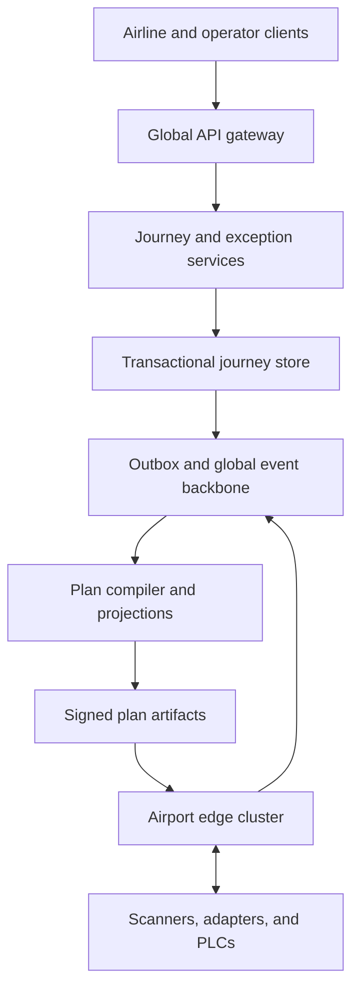
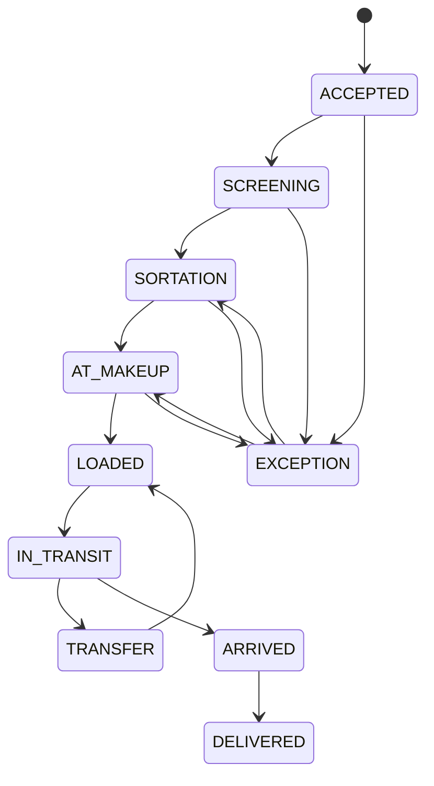
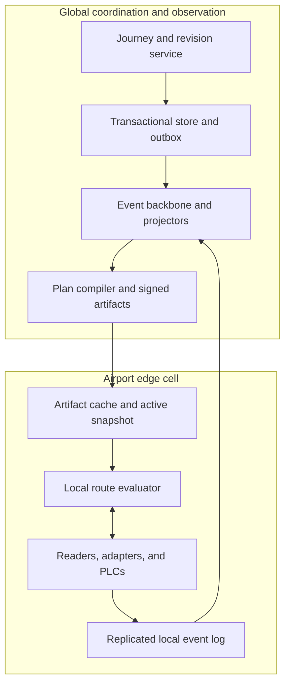

# Design a Global Airport Baggage Tracking and Routing Platform

**Difficulty:** Hard  
**Primary themes:** event-driven systems, deadline-aware routing, device ingestion, queues, caching, consistency, reliability, reconciliation, multi-region operations

> **Interview time versus this walkthrough:** In a 45-minute interview, spend about 5 minutes on requirements, 2 minutes on entities, 5 minutes on interfaces, 10–15 minutes on the high-level design, and 10–15 minutes on deep dives. This document is deliberately much more detailed for study. In the interview, state the invariant, trace one normal bag, then spend the remaining time on missed scans, offline operation, and hot-flight handling.

The delivery order follows the public [Hello Interview system-design delivery framework](https://www.hellointerview.com/learn/system-design/in-a-hurry/delivery): clarify requirements, name entities, define interfaces, build the simplest complete design, and then deepen the parts that determine correctness and scale. The APIs also follow the public [Hello Interview API-design guidance](https://www.hellointerview.com/learn/system-design/core-concepts/api-design) by starting from user-visible operations and deriving identity from authentication. The baggage-domain design, examples, numbers, dialogue, and tradeoffs are original.

---

## Interviewer prompt

> Design a global airport baggage tracking and routing platform used by airlines, airports, and ground handlers. When a passenger checks a bag, the system should create a journey for it, ingest scans and conveyor events, route it through the correct airport sortation paths, show operators and passengers its latest status, detect bags at risk of missing a flight, and support recovery when devices or networks fail.

The prompt sounds like “track bags,” but the hard part is controlling physical movement under deadlines. A bag may pass through check-in, security screening, automated conveyors, manual carts, aircraft loading, an intermediate transfer airport, and arrival reclaim. Not every device is continuously connected, scans can be duplicated or missed, and an airport must keep moving bags even if the central cloud is unreachable.

## Targeted clarifying questions and assumed interviewer answers

**Candidate:** “Are we only tracking observations, or do we also decide where the conveyor should send a bag?”  
**Interviewer:** “Both. The cloud publishes routing plans and airport-local controllers make low-latency divert decisions. Safety interlocks and real-time motor control remain in existing industrial control systems.”

**Candidate:** “What is the primary journey: direct flights, connections, or both?”  
**Interviewer:** “Both. A bag can have multiple flight legs, and irregular operations may rebook the passenger or reroute the bag.”

**Candidate:** “What identifiers are available?”  
**Interviewer:** “Each accepted bag gets a globally unique bag journey ID and a printed tag. Airports may read barcodes, RFID, or both. Devices also have authenticated device IDs.”

**Candidate:** “How quickly must a routing decision be returned?”  
**Interviewer:** “A divert point needs a decision within 50 milliseconds locally. The cloud does not sit in that synchronous loop. A check-in or operator API should usually respond within 300 milliseconds.”

**Candidate:** “What scale should I design for?”  
**Interviewer:** “Assume 20 million bags on a peak day, 25 airports in the initial network, 2 million bags in flight or in airport custody at once, 200,000 devices, an average of 40 accepted observations per bag, and peaks around 100,000 device events per second. A major hub may process 120 bags per second at peak.”

**Candidate:** “What freshness should users see?”  
**Interviewer:** “Operators should see accepted events within two seconds at p99 when connectivity is healthy. Passenger status can lag up to 10 seconds. A conveyor decision must use a locally available plan.”

**Candidate:** “What consistency contract matters most?”  
**Interviewer:** “Never intentionally route a bag to a flight it is not authorized to join. Journey creation, ownership changes, and route-plan activation need strong consistency. Search, dashboards, and passenger status may be eventually consistent. Under ambiguity, send the bag to an exception spur rather than guess.”

**Candidate:** “Can airports continue during a cloud or WAN outage?”  
**Interviewer:** “Yes. Each airport must operate for at least four hours using signed, versioned local snapshots, buffer events durably, and reconcile after reconnecting.”

**Candidate:** “Do we need to design security screening algorithms or conveyor hardware?”  
**Interviewer:** “No. Treat screening systems and programmable logic controllers, or PLCs, as external systems with interfaces. We own routing intent, observation ingestion, journey state, exception management, and auditability.”

**Candidate:** “Should passengers see exact physical locations?”  
**Interviewer:** “No. Operators may see operational zones. Passengers see coarse milestones such as checked in, transferred, loaded, arrived, or delayed.”

**Candidate:** “Are compensation claims and airline ticketing in scope?”  
**Interviewer:** “Ticketing supplies itinerary changes. Claims processing is out of scope, but the platform must retain an auditable history that claims systems can consume.”

**Candidate:** “How should reroutes behave when a passenger changes flights?”  
**Interviewer:** “A new authorized journey revision must supersede the old one. Old route plans and delayed commands must be fenced so they cannot send the bag to the former flight.”

**What I would say aloud:**

> “I’ll separate the physical control loop from the global coordination plane. Airport-local nodes make sub-50-millisecond decisions from signed route snapshots. The cloud owns strongly consistent journey revisions, distributes plans, ingests the event history, and detects exceptions. When identity or revision is uncertain, the safe result is an exception spur, not a guessed chute.”

---

## 1. Requirements (~5 minutes)

### 1.1 Core functional requirements

Prioritize three end-to-end capabilities.

1. **Create and revise a bag journey**
   - Accept a bag at check-in and bind it to an authenticated airline, passenger itinerary, tag identifier, security requirements, and flight legs.
   - Generate an immutable journey revision and airport-specific routing plans.
   - Support rebooking, offload, cancellation, and manual recovery without allowing an old revision to regain authority.

2. **Route and track the bag through physical custody**
   - Distribute signed route-plan snapshots to airport-local routing nodes.
   - Ingest barcode, RFID, conveyor, screening, cart, loading, and arrival events.
   - Update the canonical journey state and expose an operator view plus a privacy-reduced passenger view.

3. **Detect and resolve exceptions**
   - Identify unknown bags, unreadable tags, invalid routes, missing expected observations, screening holds, bags approaching cutoff, wrong-zone observations, and bags whose passenger or flight changed.
   - Create prioritized work items with recommended recovery actions and record operator decisions.

### 1.2 Quantified non-functional requirements

1. **Local decision latency:** p99 below 50 ms at a divert point, including route lookup and policy validation; no WAN dependency in the decision path.
2. **Cloud API latency:** p99 below 300 ms for journey creation or revision, excluding external airline ticketing delays.
3. **Event freshness:** 99% of healthy connected airport events visible to operators within 2 seconds; passenger milestones within 10 seconds.
4. **Availability and autonomy:** 99.99% availability for airport-local routing; tolerate four hours of central-cloud or WAN loss with no loss of accepted local events.
5. **Durability and auditability:** no acknowledged journey mutation or accepted custody event may be silently lost; retain the event and decision audit trail for seven years.
6. **Scale:** 20 million bags per peak day, roughly 800 million accepted observations per day, 100,000 events/s global peak, and 200,000 authenticated devices.

### 1.3 Scope

In scope:

- bag acceptance and journey revisions;
- barcode/RFID tag identity and alias handling;
- route-plan compilation and airport distribution;
- local divert decisions from cached plans;
- sequenced event ingestion, deduplication, and replay;
- operator tracking, passenger milestones, alerts, and exception queues;
- transfer handling, offload, rebooking, and reconciliation;
- audit history, observability, and regional disaster recovery.

Out of scope:

- airline reservation and ticket pricing;
- security-screening image analysis;
- safety-certified PLC logic, motor control, and emergency stops;
- aircraft weight-and-balance algorithms;
- passenger compensation and claims adjudication;
- manufacturing the barcode, RFID, conveyor, or scanner hardware.

### 1.4 Consistency and availability contract

The design deliberately uses different contracts for different data.

| Concern | Contract | Reason |
|---|---|---|
| Journey creation and active revision | Linearizable per `bag_journey_id` | Only one revision may authorize the next physical route |
| Route-plan activation at an airport | Atomic snapshot swap with monotonic revision | A local node must never observe a half-published plan |
| Custody transition such as `LOADED` | Ordered, conditional state transition | A late scan must not regress a completed journey |
| Raw device observations | Durable, at-least-once transport with idempotent effects | Networks and devices naturally retry |
| Operator current view | Read-your-writes for operator actions; otherwise eventual within 2 seconds | Fast operational projection without putting dashboards on the write path |
| Passenger milestone view | Eventually consistent and privacy-filtered | A few seconds of lag is acceptable |
| Analytics and SLA reports | Eventual, replayable | They must not affect physical routing |

The safety-oriented availability rule is:

> If the local node has a valid signed plan for the bag’s current journey revision, it may continue routing during WAN loss. If the bag is unknown, the plan is expired, screening authorization is absent, or revisions conflict, route to a staffed exception spur.

This is a **fail-safe** policy rather than a universal fail-open or fail-closed rule. It preserves physical flow for known bags while refusing unsafe guesses.

### 1.5 Central invariants

1. A bag journey has exactly one active authoritative revision.
2. A route decision is valid only for the same bag journey, airport, revision, plan generation, and validity interval.
3. A bag may be marked loaded onto a flight only after a valid load event for the authorized flight leg and current journey revision.
4. Raw accepted observations are immutable; corrections append superseding facts or operator decisions.
5. Delayed events may enrich history but may not regress the canonical state machine.
6. Airport-local operation may continue from an unexpired signed snapshot, but uncertain bags go to exception handling.

**What I would say aloud:**

> “The key tradeoff is selective availability. I keep known bags moving from a signed local plan during a WAN outage, but I sacrifice automatic routing for unknown or conflicting bags. Journey revisions are strongly ordered; device delivery is at least once; projections are eventual. That contract is more precise than saying the whole platform is strongly or eventually consistent.”

---

## 2. Core entities (~2 minutes)

Name the nouns before designing tables.

| Entity | Purpose | Important fields introduced when needed |
|---|---|---|
| **BagJourney** | Stable identity for one checked bag across all flight legs | `journey_id`, airline, tag aliases, active revision, owner, lifecycle state |
| **JourneyRevision** | Immutable authorization and itinerary snapshot | revision, passenger/itinerary reference, flight legs, security policy, created reason |
| **FlightLeg** | One intended movement between airports | flight ID, origin, destination, scheduled times, cutoff, status |
| **AirportRoutePlan** | Compiled airport-local instructions for one journey revision | airport, plan generation, permitted zones, next-hop rules, expiry, signature |
| **Device** | Authenticated scanner, RFID reader, conveyor controller, cart terminal, or load device | device ID, airport, zone, type, certificate, boot ID, sequence |
| **Observation** | Immutable fact reported by a device | event ID, device sequence, journey/tag, type, zone, time, payload hash |
| **JourneyState** | Current canonical projection | revision, milestone, airport, zone, last accepted event, risk status, version |
| **RoutingDecision** | Auditable local decision at a divert point | journey, revision, plan generation, input, output, reason, local timestamp |
| **ExceptionCase** | Work item for human or automated recovery | type, severity, deadline, assigned queue, recommended actions, state |
| **CustodyTransfer** | Explicit handoff between airline, airport, handler, or aircraft | from/to party, location, evidence, accepted state |
| **OperatorAction** | Authenticated manual decision | principal, case, action, expected version, reason, timestamp |

Avoid prematurely building one enormous “bag row.” The immutable facts, active plan, current projection, and human recovery workflow have different access patterns and retention needs.

**What I would say aloud:**

> “The stable identity is the bag journey, while revisions are immutable authorization snapshots. Observations are append-only evidence. JourneyState is a rebuildable current view, and AirportRoutePlan is the signed artifact consumed in the local control loop.”

---

## 3. API and system interfaces (~5 minutes)

External identities come from authentication:

- airline services use mutually authenticated service credentials with airline and station claims;
- airport devices use device certificates mapped to an airport, zone, and device type;
- operators use workforce identity with role and airport scope;
- passengers authenticate through the airline and receive a scoped journey token.

The client never supplies a trusted `airline_id`, `operator_id`, or `device_zone` as authority. Those values are derived from credentials and server-side registration.

### 3.1 Create a bag journey

```http
POST /v1/bag-journeys
Authorization: Bearer <airline-service-token>
Idempotency-Key: bag-accept-01K9B4N2
Content-Type: application/json
```

```json
{
  "tag_code": "020912345600",
  "passenger_itinerary_ref": "enc:pnr-ref",
  "origin_airport": "BOS",
  "flight_legs": [
    {
      "flight_id": "AA-2134-2026-11-07-BOS-DFW",
      "origin": "BOS",
      "destination": "DFW",
      "scheduled_departure": "2026-11-07T15:35:00Z"
    },
    {
      "flight_id": "AA-481-2026-11-07-DFW-SFO",
      "origin": "DFW",
      "destination": "SFO",
      "scheduled_departure": "2026-11-07T20:10:00Z"
    }
  ],
  "attributes": {
    "priority": false,
    "special_handling": ["FRAGILE"]
  }
}
```

```json
{
  "journey_id": "bag_01K9B5X8T7",
  "revision": 1,
  "tag_code": "020912345600",
  "state": "ACCEPTED",
  "route_plan_status": "COMPILING",
  "operator_view_url": "/v1/bag-journeys/bag_01K9B5X8T7"
}
```

The service validates that the authenticated airline controls the itinerary, creates the journey and revision atomically, records the idempotency result, and emits a transactional outbox event. Plan compilation is asynchronous because each airport may have different topology and policy.

### 3.2 Revise after rebooking or offload

```http
POST /v1/bag-journeys/bag_01K9B5X8T7/revisions
Authorization: Bearer <airline-service-token>
Idempotency-Key: rebook-01K9C1B0
If-Match: "journey-version-12"
```

```json
{
  "reason": "PASSENGER_REBOOKED",
  "replace_remaining_legs": [
    {
      "flight_id": "AA-901-2026-11-07-BOS-LAX",
      "origin": "BOS",
      "destination": "LAX",
      "scheduled_departure": "2026-11-07T17:00:00Z"
    }
  ]
}
```

```json
{
  "journey_id": "bag_01K9B5X8T7",
  "revision": 2,
  "previous_revision": 1,
  "state": "REROUTE_PENDING",
  "fence_epoch": 2,
  "affected_airports": ["BOS"]
}
```

The new revision immediately becomes authoritative in the journey store. Airport route plans for revision 2 compile and distribute. Until a local node has the new plan, a bag observed with a superseded revision is directed to exception rather than the old flight.

### 3.3 Ingest a device event batch

Devices normally talk to an airport edge gateway, which authenticates the device certificate and supplies trusted registration context.

```http
POST /edge/v1/device-events:batch
Authorization: mTLS <device-certificate>
Content-Type: application/json
```

```json
{
  "boot_id": "boot_8f23",
  "events": [
    {
      "sequence": 991204,
      "event_id": "evt_01K9B8A1",
      "observed_at": "2026-11-07T13:02:11.421Z",
      "type": "BARCODE_SCAN",
      "tag_code": "020912345600",
      "sensor_position": "BOS-T1-BELT4-READER12"
    },
    {
      "sequence": 991205,
      "event_id": "evt_01K9B8A2",
      "observed_at": "2026-11-07T13:02:11.469Z",
      "type": "DIVERT_RESULT",
      "tag_code": "020912345600",
      "divert_point": "BOS-T1-DV44",
      "selected_output": "SECURITY_A",
      "journey_revision": 1,
      "plan_generation": 3812
    }
  ]
}
```

```json
{
  "boot_id": "boot_8f23",
  "highest_contiguous_sequence": 991205,
  "durability": "AIRPORT_EDGE_QUORUM",
  "retransmit_ranges": []
}
```

The edge acknowledges only after the batch is durable on an airport-local replicated log. The device retains unacknowledged events. Duplicate delivery is normal.

### 3.4 Local route lookup

This interface is local, not a public cloud API. A divert adapter asks the airport routing node:

```json
{
  "tag_code": "020912345600",
  "divert_point": "BOS-T1-DV44",
  "observed_at_monotonic_ms": 84588392,
  "screening_state": "CLEARED_A"
}
```

```json
{
  "decision": "OUTPUT",
  "output": "SECURITY_A",
  "journey_id": "bag_01K9B5X8T7",
  "journey_revision": 1,
  "plan_generation": 3812,
  "reason": "MATCHED_PRIMARY_RULE",
  "valid_until": "2026-11-07T15:05:00Z"
}
```

If the plan is missing or invalid:

```json
{
  "decision": "EXCEPTION",
  "output": "MANUAL_RESOLUTION_2",
  "reason": "UNKNOWN_OR_STALE_REVISION"
}
```

The adapter and PLC map the logical output to safety-certified hardware behavior. Our service does not directly manipulate motors.

### 3.5 Get the operator journey view

```http
GET /v1/bag-journeys/bag_01K9B5X8T7
Authorization: Bearer <operator-token>
```

```json
{
  "journey_id": "bag_01K9B5X8T7",
  "active_revision": 1,
  "milestone": "AT_ORIGIN_SORTATION",
  "airport": "BOS",
  "operational_zone": "T1_SECURITY_EXIT",
  "last_observed_at": "2026-11-07T13:02:11.469Z",
  "freshness": "FRESH",
  "next_expected": {
    "event": "MAKEUP_ENTRY",
    "deadline": "2026-11-07T14:48:00Z"
  },
  "risk": {
    "level": "LOW",
    "seconds_to_cutoff": 6310
  },
  "open_exception": null,
  "version": 17
}
```

Authorization checks the operator’s airline, handler, airport, and role scope before returning operational detail.

### 3.6 Passenger milestone view

```http
GET /v1/passenger/bags/bag_01K9B5X8T7/status
Authorization: Bearer <airline-passenger-token>
```

```json
{
  "status": "MOVING_THROUGH_ORIGIN_AIRPORT",
  "last_updated": "2026-11-07T13:02:14Z",
  "planned_destination": "SFO",
  "message": "Your bag has been accepted and is moving toward your flight."
}
```

Do not expose conveyor IDs, security zones, staff names, or precise live location.

### 3.7 Resolve an exception

```http
POST /v1/exceptions/exc_01K9C4P2:resolve
Authorization: Bearer <operator-token>
Idempotency-Key: resolve-01K9C4Q0
If-Match: "case-version-7"
```

```json
{
  "action": "ASSIGN_TO_FLIGHT",
  "flight_id": "AA-901-2026-11-07-BOS-LAX",
  "reason_code": "VERIFIED_REBOOKING",
  "scan_challenge": "signed-handheld-confirmation"
}
```

The service checks operator role, airport, custody, active journey revision, flight eligibility, screening state, and case version. It writes the operator action and resulting state transition atomically.

### 3.8 Subscribe to operational changes

Airport control rooms can consume a server-sent event or WebSocket stream:

```text
event: journey_update
id: BOS:partition-17:offset-8830191
data: {"journey_id":"bag_01K9B5X8T7","milestone":"AT_MAKEUP","risk":"MEDIUM","version":21}

event: exception_created
id: BOS:partition-17:offset-8830210
data: {"exception_id":"exc_01K9C4P2","type":"MISROUTE_RISK","deadline":"2026-11-07T14:46:00Z"}
```

On reconnect, the client sends its last event ID. If replay retention expired, it reloads a snapshot and resumes from the snapshot watermark.

**What I would say aloud:**

> “Cloud writes are idempotent and revisioned. Device traffic is batched and acknowledged only after airport-local durability. The local route lookup returns the revision and plan generation that justified the decision, so every physical divert can later be audited.”

---

## 4. Data flow

This problem benefits from explicit pipelines because planning, local routing, telemetry, and exception recovery have different latency and consistency needs.

### 4.1 Journey and plan-publication flow

1. The airline calls `POST /bag-journeys` with an idempotency key.
2. The journey service validates the authenticated airline and itinerary reference.
3. A serializable transaction creates the stable journey, immutable revision 1, tag alias, idempotency result, and outbox record.
4. Plan compiler workers read the revision and airport topology versions.
5. They compile one immutable route plan per airport on the remaining itinerary.
6. A validator checks reachability, security policy, flight cutoff, topology compatibility, and allowed exception fallbacks.
7. Plans are signed and stored in an artifact store.
8. The distribution service publishes a manifest containing plan generation, content hash, validity interval, and minimum compatible edge version.
9. Airport nodes download, verify, stage, and atomically activate the manifest.
10. Activation acknowledgments feed a rollout dashboard; old snapshots remain for bounded rollback and audit.

### 4.2 Local physical-routing flow

1. A reader identifies the tag before a divert point.
2. The adapter sends the tag and trusted sensor position to the airport routing node over the local network.
3. The node resolves tag alias to journey and reads the active plan from an in-memory immutable snapshot.
4. It validates journey revision, plan expiry, screening requirement, current divert point, and rule preconditions.
5. It returns the logical output or an exception output within 50 ms.
6. The industrial adapter requests the PLC action.
7. Reader, routing decision, PLC result, and downstream confirmation become sequenced events in the airport-local log.
8. If no downstream confirmation arrives within a topology-specific window, the exception detector creates a possible jam or missed-divert case.

### 4.3 Observation ingestion and projection flow

1. Devices batch events with `(device_id, boot_id, sequence)`.
2. Edge gateways authenticate device certificates and add trusted airport, zone, and type metadata.
3. A replicated airport log durably stores accepted batches before acknowledgment.
4. Edge consumers update hot local views used by control rooms and risk detection.
5. A WAN replicator uploads compressed batches to the global event backbone when connectivity permits.
6. Global ingestion deduplicates immutable observations and preserves both device time and receive time.
7. Journey projectors enforce allowed transitions against the active revision and update the canonical current-state store.
8. Separate consumers update passenger milestones, search indexes, SLA analytics, exception scoring, and cold audit storage.

### 4.4 Exception flow

1. A stream processor combines actual observations with expected route checkpoints and deadlines.
2. It identifies a risk such as `EXPECTED_SCAN_MISSING`, `WRONG_ZONE`, `CUTOFF_AT_RISK`, `SUPERSEDED_REVISION`, or `SCREENING_HOLD`.
3. It creates or updates one deduplicated exception case for `(journey, revision, exception_type, airport)`.
4. A priority function considers departure cutoff, physical distance, transfer time, passenger status, and available recovery paths.
5. The case is pushed to the correct airport/handler queue.
6. An operator scans the physical bag, reviews evidence, and applies an authorized action.
7. The action creates a state transition and, when necessary, a new journey revision and new route plans.
8. Resolution evidence remains linked to the immutable event history.

### 4.5 Offline and reconnect flow

1. The airport node detects WAN loss but keeps its active signed snapshot.
2. Known bags with unexpired plans continue through local routing.
3. Unknown tags, expired plans, and revision conflicts go to exception spurs.
4. Airport events accumulate in a replicated local log sized for more than four hours plus headroom.
5. On reconnect, the WAN replicator resumes by partition and offset, with bandwidth shaping so live traffic is not starved by backlog.
6. Global ingestion deduplicates and projects delayed events.
7. Reconciliation compares edge and cloud high-water marks, active journey revisions, exception actions, and plan activations.
8. Conflicts are resolved by authoritative revision and conditional state rules; raw evidence is never discarded.

---

## 5. High-level design (~10–15 minutes)

Build the simplest complete working system one operation at a time.

### 5.1 Baseline architecture



There are three planes:

- **Coordination plane:** authoritative journeys, revisions, custody, manual actions, and plan publication.
- **Airport edge plane:** low-latency route evaluation, local event durability, local risk detection, and offline autonomy.
- **Observation plane:** high-volume append log and derived projections for operators, passengers, audit, and analytics.

### 5.2 Operation 1: accept a bag and create the first plan

Use a relational or distributed-SQL journey store because creation must atomically bind several records:

```text
BagJourney
  journey_id PK
  airline_id
  active_revision
  lifecycle_state
  version
  created_at

JourneyRevision
  journey_id + revision PK
  itinerary_digest
  encrypted_itinerary_ref
  flight_legs_json
  security_policy_version
  reason
  created_at

TagAlias
  issuer + tag_code PK
  journey_id
  valid_from
  valid_until

IdempotencyRecord
  caller_id + idempotency_key PK
  request_hash
  result_reference
  expires_at

Outbox
  event_id PK
  aggregate_id
  aggregate_version
  type
  payload
  published_at
```

The transaction checks tag uniqueness within its validity window, writes revision 1, sets `active_revision = 1`, stores the idempotent response, and inserts `JourneyRevisionActivated` into the outbox.

The plan compiler does not mutate the revision. It reads immutable inputs:

```text
journey revision
airport topology version
flight assignment and cutoff version
screening-policy version
handler and zone authorization version
edge-runtime compatibility version
```

For each airport it emits a compact decision artifact:

```text
PlanHeader
  journey_id, revision, airport_id
  plan_generation, compiled_at, valid_until
  topology_version, policy_versions
  content_hash, signature

Rules[]
  divert_point
  required_prior_state
  required_screening_state
  time_window
  primary_output
  fallback_output

ExpectedCheckpoints[]
  checkpoint_type
  earliest_time, deadline
  missing_event_policy
```

The first complete version can compile one plan per bag. At scale, later optimize using shared flight-route templates plus small per-bag overlays. Start with correctness and explicit artifacts.

### 5.3 Operation 2: distribute and activate route plans

Each airport edge cluster runs across at least three local nodes and two power/network fault domains. It maintains:

- a durable plan artifact cache;
- an in-memory active snapshot;
- a local tag-to-journey index;
- a replicated append log for observations and decisions;
- a local exception projection;
- a WAN replication agent.

Distribution is pull-assisted rather than push-only:

1. Cloud publishes a signed manifest and sends a notification.
2. Airport nodes also poll the manifest high-water mark every few seconds.
3. A node downloads missing content-addressed artifacts.
4. It verifies signature, hash, airport identity, validity, topology compatibility, and minimum runtime.
5. It builds a new immutable index off the request path.
6. Nodes report staged generation.
7. When the local quorum is ready, each process atomically swaps an in-memory pointer.
8. Requests already using the old snapshot finish; new requests use the new generation.

This is read-copy-update in spirit: build a new read-only structure, then switch references atomically. It prevents half-applied plans.

For emergency rebooking, the journey revision becomes authoritative before every airport receives the new artifact. A compact **revocation/fence stream** has higher priority than full plan distribution. Local nodes maintain the latest authorized revision per journey. If revision 1 is revoked and plan 2 has not arrived, revision 1 stops routing automatically and the bag goes to exception.

### 5.4 Operation 3: make a local divert decision

The critical request path is entirely local:

1. Validate the caller is a registered adapter for the divert point.
2. Normalize the scanned tag and resolve it in the in-memory tag index.
3. Read the immutable plan entry for `(journey_id, active_revision)`.
4. Verify the plan generation is active and unexpired.
5. Check required screening state and allowed current position.
6. Evaluate deterministic rules.
7. Return the logical output and decision evidence.
8. Append the decision asynchronously to the local durable log, with an in-process buffer protected by backpressure.

The route function is deterministic:

```text
decision = f(
  journey_id,
  active_revision,
  divert_point,
  screening_state,
  trusted_local_time,
  active_plan_generation
)
```

Do not call the global database, an external cache, or a remote service. A local in-memory lookup is faster and more reliable than even a regional cache. The artifact is signed so a compromised distribution path cannot silently alter outputs.

If logging is briefly slow, the router can continue using a bounded write-ahead buffer because physical flow matters. If the local durable log loses quorum or the buffer reaches its safety limit, airport policy decides whether known bags may continue to the next safe accumulation point or must use exception. This behavior is explicit and monitored.

### 5.5 Operation 4: ingest observations and derive state

Raw observations use an immutable identity:

```text
(airport_id, device_id, boot_id, sequence)
```

`event_id` is useful for tracing, but the device tuple detects a rebooted counter and defines contiguous acknowledgment. Store a payload hash. If the same identity arrives with a different hash, quarantine it as device corruption instead of overwriting history.

Partition the airport log by a stable device group or physical zone to preserve device order without forcing total airport order. In the global backbone, partition journey-related events by `journey_id` so one journey’s projector sees a stable processing order. Cross-journey analytics does not need total order.

The journey state machine might be:



The projector stores:

```text
JourneyState
  journey_id PK
  active_revision
  milestone
  airport_id
  operational_zone
  last_event_id
  last_observed_at
  freshness_state
  next_expected_checkpoint
  risk_level
  version
```

Before applying an event, it checks:

- event identity is new or an exact duplicate;
- event revision is current or explicitly historical;
- transition is allowed from the current state;
- zone and device type are capable of asserting that event;
- flight ID matches the authorized leg for load/offload events;
- observed time is plausible, while receive time remains authoritative for processing order.

Invalid events remain in the raw log with rejection reason. They do not mutate the canonical state.

### 5.6 Operation 5: detect risk and manage exceptions

A bag is not necessarily lost when an expected scan is absent. Readers miss tags. The system estimates risk from multiple signals:

- last reliable checkpoint;
- time to flight cutoff and departure;
- topology travel-time distribution from current zone;
- downstream confirmations;
- recent device health and reader miss rate;
- flight or gate changes;
- screening holds;
- airport congestion;
- whether the passenger boarded or was offloaded.

Begin with deterministic rules rather than an opaque model:

```text
if wrong_authorized_flight_load_event:
    CRITICAL
else if superseded_revision_observed:
    CRITICAL
else if deadline - now < p99_remaining_travel_time:
    HIGH
else if expected_checkpoint_missing and upstream_reader_healthy:
    MEDIUM
else:
    LOW
```

Exception records are versioned:

```text
ExceptionCase
  exception_id PK
  dedupe_key UNIQUE
  journey_id
  journey_revision
  airport_id
  type
  priority_score
  deadline
  status
  assignee
  recommended_actions
  evidence_watermark
  version
```

Use a priority queue per airport and handler, but persist cases in a database. The queue is an acceleration structure, not the source of truth. A reconciler re-enqueues open cases missing from the broker.

Operator resolution uses optimistic concurrency through `If-Match`. If another operator or an airline revision already changed the case, the stale action fails and the UI refreshes. High-risk actions such as assigning a bag to a flight require scanning the physical tag and may require two-person approval depending on policy.

### 5.7 Operation 6: expose operator and passenger views

Operator reads need low latency and fresh state. Use a regional or airport-local key-value projection keyed by journey and indexes by:

- flight;
- airport and operational zone;
- exception queue and priority;
- tag alias;
- last observation age.

Do not query the seven-year raw event store for dashboards. When an operator opens a bag, return the current state immediately and load the detailed timeline from a recent-event store or object-storage query asynchronously.

Passenger projection applies a privacy transform:

```text
ACCEPTED, SCREENING, SORTATION -> MOVING_THROUGH_ORIGIN_AIRPORT
AT_MAKEUP, LOADED            -> PREPARED_FOR_FLIGHT / LOADED
TRANSFER                     -> TRANSFERRING
ARRIVED                      -> ARRIVED_AT_DESTINATION
DELIVERED                    -> DELIVERED
EXCEPTION                    -> DELAYED or CONTACT_AIRLINE, policy dependent
```

Cache passenger status by `(journey_id, public_version)` for a short TTL. Invalidation events improve freshness, but correctness does not depend on every cache invalidation arriving because TTL and versioned reads recover.

### 5.8 Scale estimates that change decisions

#### Event volume and retention

Assume 20 million bags/day and 40 accepted observations per bag:

```text
20,000,000 × 40 = 800,000,000 events/day
800,000,000 / 86,400 ≈ 9,260 events/s average
```

Traffic is bursty across departure banks, so design for 100,000 events/s global peak. At 500 bytes encoded per observation:

```text
800,000,000 × 500 bytes ≈ 400 GB/day logical raw data
With 3 hot replicas ≈ 1.2 TB/day before compression
Seven years raw ≈ 1 PB logical before indexes and compression
```

Decision: keep a few days in the hot event backbone, compact summaries in operational stores, and tier immutable raw events to object storage with lifecycle policies. Do not retain seven years in the broker or transactional journey database.

#### Airport outage buffer

A major hub peaks at 25,000 events/s including readers, decisions, and control confirmations. Four hours of autonomy at 500 bytes/event:

```text
25,000 × 14,400 × 500 ≈ 180 GB logical
```

With three replicas, indexes, and 2× safety headroom, provision roughly 1–1.5 TB of durable local capacity per very large hub. This calculation justifies a disk-backed replicated log rather than an in-memory queue.

#### Route-plan representation

Two million bags may be in custody. If a naive per-bag airport plan averages 8 KB:

```text
2,000,000 × 8 KB ≈ 16 GB active globally
```

An individual airport holds only its relevant subset, but a large hub might still need several gigabytes plus indexes. This fits memory across a cluster, yet update churn matters. Compile shared route templates per flight/topology and store small per-bag overlays for revision, special handling, and security state. If a 2 KB shared template serves 5,000 bags and each overlay is 300 bytes, memory and distribution traffic fall substantially.

Start the interview with per-bag plans because they are easy to reason about; introduce template-plus-overlay after the estimate.

#### Snapshot churn

Suppose a hub has 300,000 active bags and 5% change during a disruption window:

```text
300,000 × 5% = 15,000 plan changes
```

Publishing one full airport snapshot for every change is wasteful. Use immutable base generations plus signed delta segments, then periodically compact into a new base. The edge builds a coherent next view and swaps atomically.

#### Operator exception capacity

If 0.5% of 20 million daily bags create a real exception:

```text
20,000,000 × 0.005 = 100,000 cases/day
```

At a ten-minute average handling time, fully manual resolution would require enormous staffing. The exception system must suppress duplicates, distinguish reader failure from bag failure, recommend actions, and auto-resolve when a late downstream confirmation proves the bag is healthy.

**What I would say aloud:**

> “The scale estimate separates three storage tiers. Local airports need hundreds of gigabytes of replicated outage buffering. The global hot log holds days, not years. Long-term evidence moves to object storage. Plan memory is manageable, but disruption churn pushes us from per-change full snapshots toward shared templates, deltas, and atomic compaction.”

---

## 6. Deep dives (~10–15 minutes)

In a live interview, I would choose deep dives A and B first. Deep dive C is valuable if the interviewer emphasizes operations or scaling.

## Deep dive A: revisions, races, and safe physical routing

### Where the baseline breaks

The airline can rebook a passenger while the bag is already moving. A delayed route plan can arrive after the new plan. A scanner can report an event for the old flight. A local node may be offline and unaware of the change. If “last message wins,” an old message can resurrect an invalid route and send the bag toward the wrong aircraft.

We need a fencing invariant:

> Only decisions made for the current authoritative journey revision and a valid airport plan generation may automatically route a bag. Older revisions can contribute historical evidence but cannot authorize future movement.

### Plausible approaches

| Approach | Benefit | Failure |
|---|---|---|
| Mutable journey document overwritten in place | Simple reads | Poor auditability; delayed replication can restore stale fields |
| Timestamps and last-write-wins | Easy multi-writer merge | Clock skew and business ordering are not the same |
| Distributed lock around every bag | Explicit exclusion | Locks do not span offline edge nodes and physical actions; stale holders need fencing |
| Immutable revisions plus monotonic fence | Auditable, retry-safe, and works offline | Requires explicit plan/revocation distribution and conflict states |

### Selected design

Use an immutable revision log and a linearizable `active_revision` pointer per journey. Creating revision `r+1` is one transaction:

```sql
UPDATE bag_journey
SET active_revision = :new_revision,
    version = version + 1
WHERE journey_id = :journey_id
  AND active_revision = :expected_revision
  AND version = :expected_version;
```

The transaction also inserts the new revision and outbox event. Only one concurrent revision wins. The revision number is the primary fencing token; the journey version protects other state transitions.

Every derived artifact and action carries:

```text
journey_id
journey_revision
airport_id
plan_generation
artifact_hash
validity interval
```

Plan generations are monotonic per airport distribution stream, but a higher generation does not make an old journey revision valid. Both dimensions are checked.

### Rebooking while the bag approaches a divert

Consider this race:

1. Revision 1 routes the bag to flight A.
2. The airline commits revision 2 for flight B.
3. The bag reaches a divert before the full revision-2 plan downloads.

The cloud immediately emits a compact revision fence. Edge distribution prioritizes fences ahead of full artifacts. Once the edge sees `active_revision = 2`, it refuses automatic decisions under revision 1. If plan 2 is not ready, the safe decision is the exception spur. This may reduce availability briefly but prevents a wrong-flight route.

During total WAN loss, the edge cannot know about a new revision. The business must define a cutoff for rebooking changes. Options:

1. **Strict safety:** airlines cannot confirm a baggage-affecting rebook until the relevant airport acknowledges the fence.
2. **Bounded risk:** confirm immediately, flag the bag, and rely on local offload/exception processes.
3. **Hybrid:** strict acknowledgment when the bag is near load cutoff; asynchronous earlier in the journey.

Choose the hybrid. The journey API can commit the new revision, but the airline-facing workflow reports `BAG_REROUTE_PENDING` until the airport acknowledges. Near aircraft loading, departure control must not treat the passenger/bag reconciliation as complete without the airport fence acknowledgment.

### Load-event correctness

`LOADED` is not inferred merely because a bag was last seen near a gate. It requires an authenticated load device or aircraft container event with:

- current journey revision;
- authorized flight ID;
- current custody party;
- required screening clearance;
- bag tag or container membership evidence;
- device airport and zone capability;
- idempotent event identity.

The projector applies a conditional transition. A late load event for flight A after revision 2 points to flight B is stored as evidence and raises `WRONG_FLIGHT_LOAD_RISK`; it cannot set canonical state to loaded on A.

### Handling tag replacement

A damaged tag may be reprinted. Never reuse the old tag identity for a different active bag. Add a new `TagAlias` for the same journey and close the old alias validity interval. Local plans may recognize both during a short overlap, but decisions resolve to the same journey/revision. Reprinting requires an authenticated operator action and physical scan challenge.

### Idempotency and retries

- Journey creation stores the result with the idempotency key in the same transaction.
- Revision creation stores the request hash and resulting revision.
- Operator actions use idempotency plus expected case/journey version.
- Device events deduplicate by device boot sequence.
- Local decisions receive a unique decision ID and can be reported repeatedly.

### Failure modes

- **Journey service commits revision but response is lost:** retry returns the same revision.
- **Outbox publication is delayed:** authoritative revision is correct; distribution lag alarm fires; risky airline workflow remains pending.
- **Old plan arrives after new plan:** generation and revision checks reject activation.
- **Edge restarts during snapshot swap:** it reloads the last fully activated manifest; staged partial content is never active.
- **Two operators resolve the same case:** expected version permits one; the other refreshes.
- **Wrong-flight load event arrives late:** raw evidence is retained, canonical state does not regress, critical case opens.
- **Tag is reprinted twice:** unique active-alias constraints and operator idempotency prevent conflicting assignments.

### Observability and verification

Track revision commit latency, fence-distribution p99, full-plan distribution p99, number of edges on stale revisions, bags routed to exception due to missing new plan, rejected stale decisions, wrong-flight load attempts, and time from rebooking to local acknowledgment.

Run a continuous invariant checker:

- every active journey points to an existing immutable revision;
- every active plan references the current or intentionally staged revision;
- no canonical loaded state references an unauthorized flight;
- every operator action has a principal, expected version, and evidence;
- all activated artifacts have valid signatures and known topology versions.

**What I would say aloud:**

> “I do not solve rebooking with timestamps. The active revision is a linearizable fencing token. Full plans may lag, so a small high-priority fence disables the old revision first. If the new plan is absent, we temporarily lose automatic routing and use exception handling rather than let an old plan regain authority.”

## Deep dive B: offline airports, at-least-once telemetry, and reconciliation

### Where the baseline breaks

Airport connectivity is imperfect. Devices reboot and reuse local counters. RFID readers can report the same tag many times. Gateway retries duplicate batches. Events from a disconnected concourse arrive hours late. Device clocks drift. A local operator may resolve a case while the global control plane is unavailable. Claiming “exactly once” across scanners, gateways, brokers, databases, and human actions is not credible.

### Plausible approaches

| Approach | Strength | Weakness |
|---|---|---|
| Require cloud connectivity for every decision | Central simplicity | Airport stops during WAN failure; latency target impossible |
| Best-effort UDP-style event reporting | Low overhead | Lost evidence, no replay, poor claims audit |
| Local SQL database per device | Durable locally | Hard fleet management and cross-device ordering |
| Airport replicated log plus idempotent cloud replay | Durable, scalable, supports autonomy | Requires offset reconciliation, local capacity, and conflict rules |

### Selected design: airport edge cell

Each airport is an edge cell with three or five log nodes across fault domains. Device gateways append records to the local quorum. The acknowledgment means `AIRPORT_EDGE_QUORUM`, not yet global replication. The durability contract explicitly allows the airport to operate while disconnected, so local replicated storage is part of the acknowledged system.

Device event identity:

```text
airport_id / device_id / boot_id / sequence
```

The device persists its current boot ID and next sequence when practical. If it cannot, a reboot creates a fresh random boot ID. Gateway registration rejects implausible reuse. The cloud stores payload hashes to distinguish exact duplicates from conflicting duplicates.

### Why not order by device timestamp?

Device time describes when the physical observation probably occurred, but it is not a safe global ordering mechanism. Store:

- `device_observed_at`;
- `edge_received_at` from an airport-synchronized clock;
- `cloud_received_at`;
- device boot and sequence;
- uncertainty or drift estimate.

Projectors use journey partition order and allowed state transitions for canonical state. Event-time analytics can later reorder within bounded windows. A delayed historical scan can fill a timeline gap without moving `ARRIVED` back to `SORTATION`.

### Local event durability and backpressure

The edge log separates priority classes:

1. route decisions, screening transitions, load/offload, safety-relevant exceptions;
2. barcode/RFID observations and downstream confirmations;
3. device health and topology telemetry;
4. verbose diagnostics.

Under pressure, batch and compress lower-priority traffic, reduce redundant RFID presence events, and spill diagnostics to a secondary store. Do not silently drop accepted custody or decision events. If storage crosses thresholds, alert early and apply a documented degradation policy.

RFID readers may emit dozens of reads for one stationary bag. Edge aggregation can convert them into a presence interval:

```text
TAG_PRESENT(zone, first_seen, last_seen, reader_set, max_signal, sample_count)
```

Keep raw samples briefly for diagnosis, but send compacted presence events upstream. Never compact across a custody boundary or a configured forensic window.

### WAN replay

The replicator tracks per-partition offsets:

```text
edge_partition
local_high_watermark
cloud_acked_watermark
earliest_retained_offset
backlog_bytes
```

On reconnect:

1. exchange watermarks;
2. resume from the first unacknowledged offset;
3. prioritize live high-severity records;
4. interleave backlog with live data using weighted fair queues;
5. retry until cloud acknowledgment advances;
6. retain local segments until retention and acknowledgment conditions are satisfied.

If a local segment is corrupt, the edge reports an explicit gap record with affected offsets and evidence. The global reconciler does not pretend the gap never existed.

### Offline operator actions

Most manual actions that change flight authorization require the cloud or a locally cached signed capability. During WAN loss, allow a bounded set:

- move to exception storage;
- confirm physical custody;
- mark tag unreadable and print a provisional alias under airport policy;
- stop automatic routing;
- attach evidence.

Assigning a new flight offline is higher risk. If supported, the airline pre-provisions a signed recovery capability that limits airport, journey, candidate flights, validity, operator role, and nonce. The edge consumes the nonce once and uploads the action later. Otherwise the bag waits in exception storage.

### Reconciliation after reconnect

Reconciliation compares facts rather than overwriting whole documents.

1. Deduplicate raw events by immutable identity.
2. Load the authoritative active journey revision.
3. Replay valid observations through the state machine.
4. Apply offline operator capabilities if signatures, scopes, and nonces are valid.
5. Mark events for superseded revisions as historical or exception evidence.
6. Compare edge local case resolutions with cloud case versions.
7. Produce explicit conflicts for human review when both sides made incompatible authorized decisions.
8. Advance edge/cloud reconciliation watermarks.

The global projection is rebuildable from the revision log, raw observations, and operator actions. This is the recovery story; caches are not.

### Failure modes

- **Gateway sends duplicate batch:** identity and payload hash make it a no-op.
- **Same sequence has different payload:** quarantine device stream and alert.
- **Device reboots:** new boot ID creates a new sequence epoch.
- **WAN is down four hours:** signed plans and local quorum continue; backlog remains durable.
- **One edge log node fails:** quorum continues and repairs replicas.
- **Edge loses quorum:** use documented safe accumulation/exception policy; alarm immediately.
- **Cloud receives hours-old scan:** history is enriched, canonical state only advances through valid transition logic.
- **Cloud and edge both resolve a case:** capability scope and version rules choose a valid winner or create a conflict case; neither history is erased.
- **Backlog replay overwhelms cloud:** weighted fair upload and per-airport quotas preserve live ingestion.

### Observability

Measure device sequence gaps, conflicting duplicates, edge append p99, local replica health, disk-hours remaining, per-priority backlog, cloud replication lag, replay throughput, clock drift, event rejection reasons, reconciliation conflicts, and percentage of route decisions made from snapshots older than target.

Test with fault injection:

- disconnect an airport for four hours;
- kill one and then two edge nodes;
- replay duplicate/corrupt device batches;
- skew device clocks;
- delay a rebooking fence;
- deliver events in reverse order;
- fill edge disks near threshold;
- restart during snapshot activation.

**What I would say aloud:**

> “Transport is at least once. Logical effects become effectively once through device boot sequences, payload hashes, idempotent projectors, and versioned actions. The airport acknowledges after a local quorum so it can survive WAN loss. Reconnection is offset-based replay plus reconciliation against the authoritative journey revision, not a blind last-write-wins merge.”

## Deep dive C: hot flights, plan distribution, and exception overload

### Where the baseline breaks

Normal sharding hides correlated bursts. A gate change can affect thousands of bags for one departure bank. Weather can rebook tens of thousands of passengers. One reader failure can generate false missing-scan alerts for every bag on a belt. If each change triggers an individual compile, push, cache invalidation, and exception, the control plane and operators are overwhelmed precisely during disruption.

### Separate bag risk from infrastructure incidents

Before creating thousands of bag cases, correlate signals:

- many bags miss the same checkpoint;
- one reader’s health events fail;
- downstream readers still see the bags;
- one conveyor segment reports stopped state;
- a gate or flight assignment changed centrally.

Create an `InfrastructureIncident` and attach affected journeys. Suppress or downgrade derivative bag exceptions when evidence suggests observability failure rather than physical loss. Restore individual cases if downstream deadlines become unsafe.

### Plan compilation choices

| Approach | Strength | Weakness |
|---|---|---|
| Compile a complete plan per bag | Simple and explicit | High duplicate work and distribution churn |
| One plan per flight | Compact | Special handling and individual revision overlays are awkward |
| Shared template plus per-bag overlay | Efficient and expressive | Two-layer validation and activation complexity |

Select shared templates plus overlays:

```text
FlightRouteTemplate
  airport, flight_id, topology_version
  route rules, cutoff rules, default exception outputs
  template_generation, signature

BagOverlay
  journey_id, revision
  template_generation
  special handling, security state reference
  overrides, validity, signature
```

A decision is valid only if template and overlay generations are compatible. The edge stages both and atomically publishes a coherent index.

### Delta distribution and compaction

Publish content-addressed delta segments:

```text
generation 3812 base
generation 3813 delta: 2,000 overlays changed
generation 3814 delta: flight template gate change
generation 3815 delta: 300 revocations
```

Nodes download missing segments, verify hashes, build the next view, and swap. Periodically compact to bound lookup and startup costs. Keep fence/revocation messages in a priority channel and make nodes poll high-water marks so dropped notifications recover.

### Preventing a distribution stampede

- CDN or regional artifact mirrors for content-addressed blobs;
- request coalescing at airport gateways;
- jittered polling;
- manifests before blobs so nodes know exactly what is missing;
- bounded parallel downloads;
- staged rollout by airport fault domain;
- per-airport bandwidth budgets;
- prewarming templates for scheduled flights;
- priority lanes for fences and imminent departures.

### Exception queue fairness

A pure priority score can starve low-priority cases indefinitely. Use deadline-aware weighted queues:

```text
priority = urgency_to_cutoff
         + safety_or_wrong-flight severity
         + transfer criticality
         + age boost
         + service policy weight
```

The age boost prevents starvation. Reserve operator capacity for critical wrong-flight and security cases. During overload, automatically group cases by common incident and offer bulk-safe actions only when every bag satisfies the same authorization predicate.

### Cache behavior

- Local route plans are immutable snapshots, not TTL-only cache entries.
- Tag resolution caches include journey revision and alias validity.
- Operator views may use cache-aside with versioned values and short TTLs.
- Negative tag lookups use very short TTLs because newly accepted bags appear rapidly.
- Passenger status can use CDN/private edge caching keyed by scoped token and public version.
- Never let an ordinary cache eviction make a bag routable under an older plan; active generation metadata is persisted and signed.

### Failure modes

- **Gate change triggers thousands of updates:** change one shared template plus affected overlays rather than every full plan.
- **Artifact mirror is unavailable:** edge keeps last valid snapshot; distributor retries alternate mirror.
- **Notification is dropped:** manifest polling discovers the new generation.
- **One airport node activates early:** requests are node-local coherent; rollout monitor blocks quorum completion and traffic can drain from stale nodes.
- **Reader outage creates false cases:** incident correlation suppresses duplicates and uses downstream evidence.
- **Exception broker loses messages:** database sweeper re-enqueues open cases.
- **Critical cases starve behind volume:** reserved critical capacity and weighted deadline queues.

### Observability

Track compile queue age, template reuse ratio, artifact bytes per plan change, distribution lag by airport, fence lag separately from full-plan lag, activation generation skew, snapshot build time, exception creation/auto-resolution rate, incident fan-out, queue age by severity, operator throughput, and bags whose deadline expired while queued.

**What I would say aloud:**

> “Disruptions create correlated hot keys, not uniform load. I share route templates by flight, keep per-bag overlays for authorization, distribute signed deltas, and prioritize revision fences. On the operations side, I correlate reader or belt incidents before creating thousands of independent bag cases.”

---

## 7. Final design and close

### 7.1 Concise final architecture



### 7.2 Final design in one pass

- A stable `BagJourney` owns immutable, monotonically numbered revisions.
- One linearizable pointer identifies the active revision; it is the fencing token for future movement.
- Journey creation and revision commit atomically with idempotency results and transactional outbox events.
- Plan compilers consume immutable journey, topology, screening, flight, and handler-policy versions.
- They produce signed airport artifacts: shared flight templates plus per-bag overlays at scale.
- Airport edge clusters verify, stage, and atomically swap immutable snapshots.
- A high-priority revision-fence channel disables superseded plans before full replacements arrive.
- Local divert decisions use in-memory snapshots and have no WAN dependency.
- Missing, expired, unauthorized, or conflicting plans route to exception spurs.
- Devices emit boot-scoped monotonic sequences; airport gateways acknowledge after local quorum durability.
- Airport logs buffer at least four hours and replay by partition offset after reconnect.
- The global event backbone accepts at-least-once delivery and partitions journey events by journey ID.
- Idempotent projectors enforce revision and state-machine predicates; invalid events remain auditable.
- Operator state is a low-latency projection, while seven-year raw history lives in object storage.
- Passenger status is a privacy-reduced eventual projection.
- Deadline-aware stream processors compare actual observations with expected checkpoints and create deduplicated exceptions.
- Infrastructure incidents suppress floods of derivative bag alerts.
- Operator actions are authenticated, versioned, idempotent, and tied to physical evidence.
- Regional and airport disaster recovery rebuilds from immutable revisions, events, actions, and signed artifacts—not caches.

### 7.3 Requirements check

| Requirement | Design element |
|---|---|
| Create and revise a journey | Serializable journey transaction, immutable revisions, idempotency |
| Route within 50 ms | Airport-local in-memory signed snapshot |
| Prevent stale reroutes | Active revision fence plus plan generation checks |
| Track device events | Boot-scoped sequence, local replicated log, global event backbone |
| Operate four hours offline | Durable airport edge cell and cached signed plans |
| Show current status | Journey projections and operator stream |
| Protect passenger privacy | Coarse public milestone projection |
| Detect missed-flight risk | Expected checkpoints, travel-time/cutoff rules, deadline scoring |
| Resolve exceptions | Persistent deduplicated cases, weighted queues, versioned operator actions |
| Handle disruption bursts | Shared templates, delta distribution, incident correlation |
| Preserve audit history | Immutable raw events, revisions, decisions, and object-store retention |
| Recover from duplicates/reordering | Idempotent consumers and monotonic state machine |
| Survive regional failure | Multi-zone stores, replicated logs, signed artifacts, rebuildable projections |

### 7.4 Thirty-second closing statement

> “The design separates global authorization from airport-local physical control. The cloud owns immutable journey revisions and compiles signed route artifacts. Airport edge clusters atomically activate those snapshots and make sub-50-millisecond decisions without WAN calls. A monotonic revision fences rebookings and delayed plans; uncertain bags go to exception. Devices deliver boot-sequenced events at least once into a replicated local log, which buffers outages and replays to a journey-partitioned global backbone. Idempotent projectors build operator and passenger views, while deadline-aware processors create deduplicated recovery cases. Shared flight templates, per-bag overlays, priority fences, and incident correlation keep the system stable during gate changes and weather disruptions.”

---

## Realistic interviewer follow-up questions with strong sample answers

### 1. Why can’t the cloud answer every conveyor decision?

> “The 50-millisecond deadline, WAN jitter, and airport-autonomy requirement rule that out. The cloud publishes signed policy snapshots. The airport evaluates them locally and later reports evidence.”

### 2. What is the source of truth: the event log or the journey database?

> “The journey database and immutable revision log are authoritative for authorization. The accepted device log is authoritative evidence of observations. Current JourneyState is a projection rebuilt from both plus operator actions.”

### 3. Why not mutate the journey document after rebooking?

> “Immutable revisions preserve auditability and give me a monotonic fencing token. A mutable document makes it harder to reject delayed plans and explain which itinerary authorized a physical decision.”

### 4. What if the new plan is not at the airport when the old plan is revoked?

> “The bag goes to exception. I prioritize a small revision fence ahead of the full artifact. I accept temporary loss of automatic routing rather than use a superseded flight authorization.”

### 5. Does committing revision 2 guarantee the airport knows it?

> “No. The API distinguishes committed global authorization from airport acknowledgment. Near loading, airline workflow remains `BAG_REROUTE_PENDING` until the relevant airport acknowledges the fence or plan.”

### 6. How do you keep routing during a WAN outage?

> “The edge keeps the last unexpired signed snapshot, tag index, topology compatibility data, and a replicated local event log. Known bags continue. Unknown or conflicting bags use staffed exception outputs.”

### 7. What if the snapshot expires during the outage?

> “Do not silently extend trust. Scheduled plans can have a validity window sized for the promised outage tolerance, but after expiry the configured safe policy applies—usually exception routing and local operations escalation.”

### 8. Why sign route artifacts if transport already uses TLS?

> “TLS protects a connection. Artifact signatures protect content at rest, through mirrors, across retries, and during offline use. They also make the decision evidence independently auditable.”

### 9. How do you prevent a half-applied snapshot?

> “Download and verify immutable artifacts, construct the next index off-path, then atomically swap a pointer. Persist the activation manifest. A crash loads the last complete generation.”

### 10. How do you deduplicate device events?

> “Use airport, device, boot ID, and sequence as the identity and retain a payload hash. Exact retries are no-ops; the same identity with a different payload is corruption and gets quarantined.”

### 11. Why include a boot ID?

> “A device sequence may restart after reboot or replacement. The random boot ID creates a new sequence epoch so sequence 1 from two boots is not mistaken for a duplicate.”

### 12. Can you claim exactly-once processing?

> “No across this many boundaries. Transport is at least once. Effects are effectively once through immutable identities, idempotency records, conditional versions, and deterministic projectors.”

### 13. How do you order events from different devices?

> “I do not invent a total physical order. Device sequence orders one device stream. Journey partition order provides deterministic processing, while state-transition rules and revision checks decide canonical effects. Timestamps remain evidence with uncertainty.”

### 14. What if a late scan arrives after the bag is delivered?

> “It is appended to history and may fill a gap, but the projector cannot regress `DELIVERED` to an earlier milestone. If it contradicts the journey, it becomes anomaly evidence.”

### 15. How is `LOADED` different from `AT_MAKEUP`?

> “`AT_MAKEUP` is proximity to the flight build area. `LOADED` requires authenticated evidence tied to the authorized flight leg, current revision, screening state, and custody context.”

### 16. What happens when RFID reads the same bag 100 times?

> “The edge can compact redundant reads into a presence interval while retaining short-lived raw samples. It never compacts across custody or forensic boundaries.”

### 17. How do you detect a truly missing bag versus a broken reader?

> “Correlate many journeys, device health, upstream and downstream readers, conveyor state, and expected travel time. A shared reader incident suppresses thousands of false individual cases unless deadlines still create real risk.”

### 18. Why is the exception queue not the source of truth?

> “Brokers redeliver and can lose derived scheduling state. Cases live in a versioned database. A sweeper re-enqueues open cases, making the queue a delivery accelerator.”

### 19. How do you prevent low-priority cases from starving?

> “Use deadline-aware weighted queues with an age boost and reserve capacity for critical security or wrong-flight cases.”

### 20. What if two operators act on the same bag?

> “Actions carry idempotency keys and expected case/journey versions. Only one incompatible transition commits. The second operator sees the new state and must re-evaluate.”

### 21. How would you support offline manual rerouting?

> “Prefer waiting in exception. If the business requires it, use a pre-signed, narrow capability naming the journey, airport, candidate flights, operator role, expiry, and one-time nonce. Upload and reconcile the evidence later.”

### 22. Why use shared flight templates?

> “Thousands of bags often share the same physical route. Templates reduce compile work and distribution bytes, while signed per-bag overlays preserve individual revision and special-handling authorization.”

### 23. What if a template and overlay are from incompatible generations?

> “The edge refuses to activate or evaluate that pair. Compatibility IDs are part of the signed metadata, and activation publishes a coherent index atomically.”

### 24. How do you protect against a hot flight or gate change?

> “Change one shared template, distribute a delta through mirrors, preempt lower-priority downloads, and keep revision fences on a separate priority path. Rate limits protect compilers and edge nodes coalesce artifact requests.”

### 25. What database would you choose?

> “A distributed SQL or carefully sharded relational store for journeys, revisions, custody, and actions because their invariants are transactional. A partitioned log handles observations. Key-value projections serve current views, and object storage holds long-term immutable evidence.”

### 26. How would you shard the journey store?

> “By `journey_id`, keeping revisions, idempotency references, and current authorization co-located. Flight and airport queries use projections rather than cross-shard scans on the write store.”

### 27. What is your multi-region write strategy?

> “Assign each journey an authority region based on accepting airline/airport and replicate synchronously across zones. Remote disaster recovery may be asynchronous with a declared RPO or synchronous for stronger guarantees. Authority epochs fence a promoted region.”

### 28. Could two regions revise the same journey?

> “Only the current authority epoch accepts writes. Promotion advances the epoch through quorum-backed metadata. Old leaders and delayed clients are rejected.”

### 29. What do you cache?

> “The edge keeps immutable plan snapshots and tag indexes. Operators use versioned current-state caches. Passenger milestones use short private caching. I never use a generic cache as the authority for the active revision.”

### 30. How do you handle an unreadable tag?

> “Route it to exception, identify it using alternate evidence under operator policy, and create a new tag alias for the same journey. Close or bound the old alias; do not invent a new journey unless identity cannot be established.”

### 31. What metrics best reflect user impact?

> “Misroute rate, bags missing cutoff, time to recover exceptions, percentage of decisions from stale snapshots, fence-to-airport latency, event freshness, false exception rate, and passenger milestone lag—not just broker throughput.”

### 32. How do you test this system?

> “Use topology simulators and recorded event replays, property tests for invariants, shadow plan evaluation, staged airport rollouts, and fault injection for WAN loss, disk pressure, duplicate events, clock skew, delayed fences, and node crashes.”

### 33. What is the most dangerous silent failure?

> “An old revision still authorizing movement after rebooking. That is why revision fencing, high-priority revocation, decision evidence, and stale-plan metrics are first-class.”

### 34. What would you build first?

> “One airport, barcode scans, direct flights, immutable journey revisions, signed per-bag plans, a three-node edge log, operator tracking, and a basic exception queue. Then add transfers, RFID compaction, offline capabilities, shared templates, multi-region authority, and incident correlation.”

---

## Common pitfalls

1. Putting the WAN or cloud database in the conveyor decision path.
2. Treating baggage tracking as only a CRUD location table.
3. Mutating an itinerary in place and losing the authorization history.
4. Using timestamps instead of a monotonic journey revision for fencing.
5. Allowing an old route plan to become valid again after delayed delivery.
6. Publishing a new plan before revoking a dangerous old authorization.
7. Failing open for an unknown or conflicting bag instead of using exception routing.
8. Assuming every scanner and reader is continuously connected.
9. Acknowledging device events before they are durable anywhere.
10. Claiming end-to-end exactly once across devices, brokers, databases, and people.
11. Deduplicating only by event ID without a device boot/sequence identity.
12. Ignoring conflicting duplicates with the same sequence but different payload.
13. Ordering all events by device timestamp despite drift and delayed upload.
14. Letting late events regress the canonical journey state.
15. Inferring `LOADED` from proximity instead of authorized load evidence.
16. Exposing precise operational zones to passengers.
17. Storing seven years of raw data in the hot broker or journey database.
18. Keeping the four-hour outage buffer only in memory.
19. Replaying backlog without protecting live traffic.
20. Blindly merging edge and cloud documents after reconnect.
21. Allowing unrestricted offline operator rerouting.
22. Treating the message broker as the only record of exception cases.
23. Creating one bag exception for every missed scan during a reader outage.
24. Using a pure priority queue that starves old low-priority work.
25. Recompiling and redistributing a full per-bag plan for every gate change.
26. Activating templates and overlays independently without compatibility checks.
27. Updating in-memory plan maps in place and exposing partial generations.
28. Relying only on push notifications with no manifest polling.
29. Using unsigned cached artifacts during offline operation.
30. Evicting the active plan without a persisted activation manifest.
31. Failing to separate device observation, routing decision, and PLC result.
32. Hiding uncertainty instead of exposing stale, pending, or exception states.
33. Omitting tag-reprint alias rules and accidentally assigning one tag to two active bags.
34. Running dashboard scans against the transactional journey write store.
35. Measuring infrastructure throughput without misroute, cutoff, and recovery metrics.

---

## Practical interview delivery plan

| Time | What to cover |
|---:|---|
| 0–5 min | Clarify control versus tracking, direct and transfer legs, local latency, offline autonomy, scale, and fail-safe consistency. |
| 5–7 min | Name BagJourney, JourneyRevision, FlightLeg, AirportRoutePlan, Device, Observation, JourneyState, and ExceptionCase. |
| 7–12 min | Define journey creation/revision, device batch ingestion, local route lookup, operator read, passenger status, and exception resolution. |
| 12–25 min | Build journey transaction, plan compiler/distribution, airport edge evaluator, local/global logs, projector, and exception service. |
| 25–37 min | Deep dive on revision fencing and offline replay/reconciliation. Add hot-flight template distribution if time permits. |
| 37–42 min | Use scale estimates, cover failure modes and observability, check requirements, and deliver the closing statement. |

The detailed walkthrough is intentionally longer than the interview. On the whiteboard, first draw only the airline, journey service, transactional store/outbox, plan compiler, airport edge cluster, and devices. Trace one direct-flight bag from check-in to loading. Then introduce rebooking revision 2 and show exactly why revision 1 can no longer authorize a divert. Finally disconnect the WAN and explain local durability plus replay.

---

## Public references

- [Hello Interview — System Design Delivery Framework](https://www.hellointerview.com/learn/system-design/in-a-hurry/delivery)
- [Hello Interview — API Design](https://www.hellointerview.com/learn/system-design/core-concepts/api-design)
- [Hello Interview — System Design in a Hurry](https://www.hellointerview.com/learn/system-design/in-a-hurry/introduction)
