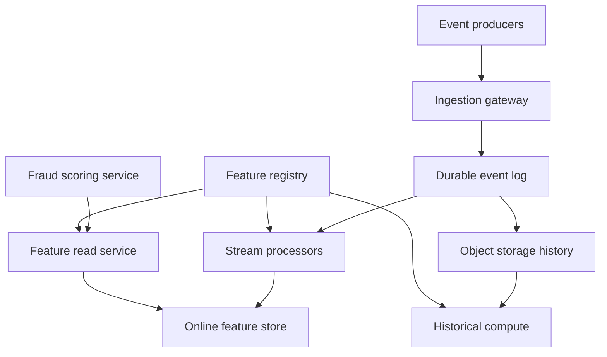
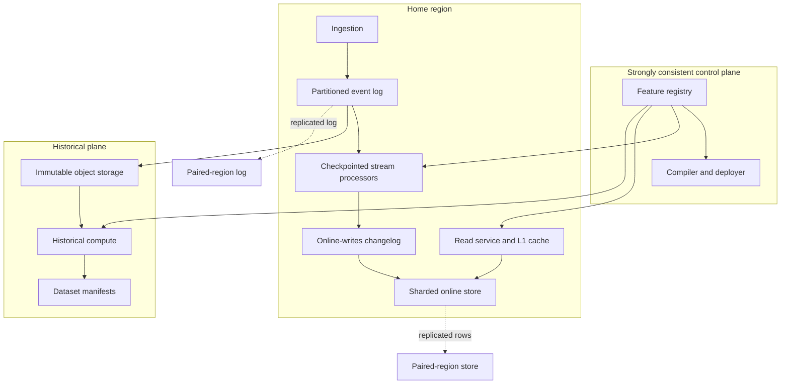

# Design a Real-Time Fraud Feature Platform

**Difficulty:** Senior / Staff-level  
**Primary themes:** event streaming, low-latency databases, caching, consistency, replay, hot keys, reliability, ML feature serving  
**Interview time budget:** about 40–45 minutes  
**Educational walkthrough:** intentionally more detailed than what you would say in the timed interview

> This is an original walkthrough organized using the public [Hello Interview delivery framework](https://www.hellointerview.com/learn/system-design/in-a-hurry/delivery): requirements, core entities, API, a simple complete design, and then targeted deep dives. In particular, the high-level design is built one operation at a time before adding complexity, following that guide’s advice. The queue and cache choices also use the vocabulary in Hello Interview’s public [key technologies guide](https://www.hellointerview.com/learn/system-design/in-a-hurry/key-technologies). The problem, assumptions, dialogue, calculations, architecture, and tradeoffs below are original.

---

## Interviewer prompt

> Design a real-time fraud feature platform for a global payments company.
>
> When a payment authorization request arrives, a fraud model needs fresh features such as “number of card attempts in the last 10 minutes,” “amount spent by this account in the last 24 hours,” and “number of distinct devices seen for this user in the last 30 days.” The platform must ingest events, maintain those features, serve them at low latency, and let data scientists reproduce historical feature values for training and investigations.

The phrase **feature platform** matters. We are not designing the fraud model itself and we are not deciding whether to approve a transaction. We are designing the data system that calculates and serves the model’s inputs.

---

## Targeted clarifying questions and assumed interviewer answers

These questions are deliberately selective. They expose the requirements that change the architecture.

### Product and scope

**Candidate:** “Who calls the platform, and is the critical path synchronous?”  
**Interviewer:** “The fraud scoring service calls it synchronously during payment authorization.”

**Candidate:** “Do we own the final fraud decision or only feature computation and serving?”  
**Interviewer:** “Only features. Model execution and payment authorization are out of scope.”

**Candidate:** “Are features predefined, or must users submit arbitrary code at request time?”  
**Interviewer:** “Features are registered ahead of time. No arbitrary computation on the serving path.”

**Candidate:** “Do we need both real-time and batch-derived features?”  
**Interviewer:** “Yes. Some features update from streams in seconds; others are refreshed daily from the warehouse.”

**Candidate:** “Do data scientists need historical values as they were known at a past timestamp?”  
**Interviewer:** “Yes. Training must avoid using information that arrived after the prediction time.”

### Scale and latency

**Candidate:** “What event and lookup volumes should I design for?”  
**Interviewer:** “Assume 200,000 events per second on average, 1 million per second at peak, and 100,000 online feature requests per second at peak. Each request asks for roughly 100 features.”

**Candidate:** “What latency budget does feature serving receive?”  
**Interviewer:** “p99 under 20 ms within a region. Availability should be at least 99.99%.”

**Candidate:** “How fresh must streaming features be?”  
**Interviewer:** “For 99% of events, a feature derived from an accepted event should be queryable within five seconds.”

### Semantics and failures

**Candidate:** “Can source systems retry and duplicate events? Can events arrive late or out of order?”  
**Interviewer:** “Both happen. Every source event has a stable event ID and an event timestamp. Most late events arrive within two minutes, but rare events can arrive hours later.”

**Candidate:** “For money-like aggregates, may a duplicate be counted twice?”  
**Interviewer:** “No. We need effectively-once business results even if infrastructure delivers at least once.”

**Candidate:** “During a regional failure, should we fail closed, return stale features, or fail the payment?”  
**Interviewer:** “The feature platform should return the safest available response with freshness metadata. The fraud service owns the business fallback. Cross-region recovery should take under five minutes.”

### Security and tenancy

**Candidate:** “Is this multi-tenant, and does the platform contain sensitive payment data?”  
**Interviewer:** “Multiple internal fraud teams share it. Raw card numbers must never enter the platform; identifiers are tokenized. Access must be tenant- and feature-set-aware, with audit logs.”

### Concise scope restatement

> **What I would say aloud:** “I’ll design a multi-region platform that registers versioned feature definitions, ingests duplicate and out-of-order events, maintains online aggregates, serves about 100 features per authorization under a 20 ms p99 budget, and reproduces point-in-time-correct historical features. I’ll treat model execution and the final payment decision as clients of this platform rather than part of it.”

---

# 1. Requirements (~5 minutes in the interview)

## 1.1 Core functional requirements

Prioritize three. Everything else supports them.

### FR1 — Define and publish versioned features

Authorized teams can register an immutable version of a feature definition, validate it, and promote it to production. A definition identifies:

- input event type;
- entity key, such as `account_id`, `card_token`, or `device_id`;
- transformation, such as count, sum, or approximate distinct count;
- window, such as 10 minutes or 24 hours;
- default value, data type, and freshness expectation;
- online and/or offline materialization targets.

Definitions must be versioned because silent changes corrupt both model behavior and training reproducibility.

### FR2 — Ingest events and materialize fresh feature values

The platform accepts events from payment, login, account, device, and chargeback systems. It validates, deduplicates, orders where necessary, and updates the registered features for affected entities.

Examples:

- `card_attempt_count_10m`
- `account_approved_amount_24h`
- `user_distinct_devices_30d`
- `merchant_chargeback_rate_7d`

### FR3 — Serve online and historical feature vectors

For online scoring, the caller requests a named feature set for one or more entity keys and receives a type-safe vector, value timestamps, freshness, and definition versions.

For training or investigation, the caller submits rows containing entity keys and prediction timestamps. The platform returns the value of each feature **as it would have been known at that timestamp**, not the newest value today.

## 1.2 Quantified non-functional requirements

| Requirement | Target | Why it matters |
|---|---:|---|
| Online latency | p50 < 5 ms, p99 < 20 ms in-region | Payment authorization has a tight end-to-end budget |
| Online availability | 99.99% monthly | About 4.4 minutes of downtime per month |
| Streaming freshness | 99% of accepted events reflected within 5 s | Fast fraud patterns lose value when delayed |
| Correctness | No duplicate contribution for a stable `event_id`; deterministic replay | Double-counting can move a payment across a risk threshold |
| Recovery | Regional RTO < 5 min; committed-event RPO ≈ 0 | A region may fail without losing accepted evidence |

We should also retain raw events for 13 months for replay and investigation, encrypt data in transit and at rest, and provide tenant-level authorization and auditability.

## 1.3 Scale estimates that change design decisions

We calculate only where arithmetic affects architecture.

### Event log throughput

Assume an encoded event averages 1 KB after including headers and indexes.

\[
200{,}000\ \text{events/s} \times 1\ \text{KB} = 200\ \text{MB/s}
\]

Per day:

\[
200\ \text{MB/s} \times 86{,}400\ \text{s} \approx 17.3\ \text{TB/day}
\]

With replication factor 3 in the hot log, that is roughly 52 TB/day of replicated broker writes. We therefore need a partitioned durable log rather than a single queue or database table. Long retention belongs in compressed object storage, not on brokers.

### Online read amplification

Peak traffic is 100,000 requests/s × 100 features = 10 million logical feature values/s. If every feature were an independent network read, connection overhead and tail latency would dominate.

**Design consequence:** co-locate features for the same entity into a versioned row/document and use multi-get or pipelined reads across a small number of entity keys. A typical request might require three storage reads—account, card, and device—not 100 reads.

### Update amplification

Suppose one event affects an average of 12 registered features:

\[
1{,}000{,}000\ \text{peak events/s} \times 12 = 12\ \text{million logical updates/s}
\]

Writing each feature separately would be expensive. Stream processors should maintain local keyed state, batch writes, and publish compact entity-row updates. Exact counts and sums use bucketed aggregates rather than storing every event in the online database.

### Online state size

Assume 500 million active entities across account, card, device, and merchant keys. If the compact online row averages 2 KB:

\[
500\ \text{million} \times 2\ \text{KB} \approx 1\ \text{TB raw}
\]

With indexes, headroom, and three replicas, plan for 4–5 TB of memory/SSD-backed serving state. This is feasible as a sharded key-value store, but not as one in-memory node.

> **What I would say aloud:** “The two numbers that drive the design are about 17 TB of raw events per day and 10 million logical feature values served per second. That pushes me toward a partitioned log plus object storage for history, and toward entity-packed rows with multi-get rather than per-feature reads.”

## 1.4 Scope and consistency/availability contract

The platform cannot promise one universal consistency model. Different operations need different contracts.

### Control plane

Feature registration and promotion use **strong consistency**. A published `(feature_id, version)` is immutable. Production promotion uses compare-and-swap so two operators cannot race.

### Event ingestion

Once the API acknowledges an event, it is durably replicated in the regional log and asynchronously copied to another region. Infrastructure delivery is **at least once**, while deduplication makes materialized business results **effectively once** for the retention period of event IDs.

“Effectively once” means duplicates may move through the pipeline, but deterministic processing and idempotent writes make the externally visible result equivalent to processing each event once.

### Online serving

Reads are highly available and bounded-stale:

- normally reflect 99% of accepted events within five seconds;
- return `computed_at`, `source_watermark`, and `definition_version`;
- never mix incompatible definition versions inside a named feature-set version;
- may return the last safe value during a partition, marked stale;
- never invent zero when data is unavailable; a default is explicit and distinguishable from missing.

The caller chooses a policy per feature set: `REQUIRE_FRESH`, `ALLOW_STALE`, or `ALLOW_DEFAULT`. The fraud service, not the feature store, decides whether stale data should block a payment.

### Historical serving

Historical results are deterministic for a fixed feature version, source snapshot, event-time cutoff, and allowed-lateness policy. Very late corrections can produce a new snapshot but do not silently rewrite a completed training dataset.

> **What I would say aloud:** “I’m choosing strong consistency for definitions, effectively-once materialization for event effects, and bounded-stale highly available reads for the authorization path. Every response carries freshness so the risk service can make the safety decision.”

---

# 2. Core entities (~2 minutes)

Name entities before diving into schema. This keeps the whiteboard anchored to product concepts.

| Entity | Purpose | Important identity |
|---|---|---|
| **FeatureDefinition** | Immutable transformation contract | `(feature_id, version)` |
| **FeatureSet** | Versioned bundle requested by a model | `(feature_set_id, version)` |
| **SourceEvent** | Immutable input fact | `(tenant_id, event_id)` |
| **EntityFeatureRow** | Latest online values co-located by entity | `(tenant_id, entity_type, entity_id, row_schema_version)` |
| **FeatureValueHistory** | Time-versioned values for offline retrieval | `(feature_id, version, entity_id, valid_time)` |
| **MaterializationJob** | Deployment, backfill, or replay lifecycle | `job_id` |
| **DatasetSnapshot** | Reproducible historical result | `snapshot_id` |

Important distinction:

- A **feature definition** says how one value is computed.
- A **feature set** freezes the exact versions a model expects.
- An **entity feature row** is a physical serving optimization and may contain many features.

> **What I would say aloud:** “I’ll keep the logical model separate from physical storage. Features and feature sets are immutable contracts; source events are immutable facts; online rows are denormalized projections; historical values and dataset snapshots make past results reproducible.”

---

# 3. API and system interfaces (~5 minutes)

Identity is derived from authentication. The caller never sends an authoritative `tenant_id` or `user_id` in the body. The gateway validates a service identity, then injects tenant, roles, and allowed feature namespaces into trusted request context.

## 3.1 Register a feature version — FR1

```http
POST /v1/features
Authorization: Bearer <service-token>
Idempotency-Key: 83b0c85e-...
Content-Type: application/json

{
  "name": "card_attempt_count_10m",
  "entity_type": "CARD",
  "source": "payment_attempts.v3",
  "value_type": "INT64",
  "transform": {
    "operation": "COUNT",
    "filter": "status IN ['APPROVED', 'DECLINED']",
    "window": "10m"
  },
  "default": 0,
  "max_staleness": "5s",
  "materializations": ["ONLINE", "OFFLINE"]
}
```

```json
{
  "feature_id": "feat_7K2",
  "version": 4,
  "status": "DRAFT",
  "definition_hash": "sha256:7e9..."
}
```

Validation compiles the declarative definition into a stream-processing plan and a historical SQL/compute plan. Production promotion is separate:

```http
POST /v1/features/feat_7K2/versions/4:promote
If-Match: "current-production-v3"
```

This avoids mutating production merely because a draft was created.

## 3.2 Publish a feature set — FR1

```http
POST /v1/feature-sets
Authorization: Bearer <service-token>

{
  "name": "payment_risk_v12",
  "features": [
    {"feature_id": "feat_7K2", "version": 4, "alias": "card_attempts_10m"},
    {"feature_id": "feat_A19", "version": 8, "alias": "account_amount_24h"},
    {"feature_id": "feat_D31", "version": 2, "alias": "user_devices_30d"}
  ]
}
```

The response returns an immutable `feature_set_id`, version, and schema hash. A model deployment pins this version.

## 3.3 Ingest events — FR2

High-volume producers normally use a binary streaming protocol, but an HTTP example makes semantics concrete:

```http
POST /v1/events:batch
Authorization: Bearer <producer-token>
Content-Type: application/json

{
  "source": "payment_attempts.v3",
  "events": [
    {
      "event_id": "evt_01JAZ9...",
      "event_time": "2026-11-08T05:01:02.341Z",
      "entities": {
        "account_id": "acct_tok_91",
        "card_id": "card_tok_28",
        "merchant_id": "m_731"
      },
      "attributes": {
        "amount_minor": 1299,
        "currency": "USD",
        "status": "DECLINED"
      }
    }
  ]
}
```

```json
{
  "accepted": [
    {"event_id": "evt_01JAZ9...", "partition": 417, "offset": 991281}
  ],
  "rejected": []
}
```

Acknowledgment means schema validation passed and the event is durably appended. It does **not** mean all features already reflect it.

## 3.4 Read an online feature vector — FR3

```http
POST /v1/online-feature-vectors:read
Authorization: Bearer <fraud-scorer-token>
Content-Type: application/json

{
  "feature_set": {"name": "payment_risk_v12", "version": 3},
  "entities": {
    "ACCOUNT": "acct_tok_91",
    "CARD": "card_tok_28",
    "USER": "user_tok_44"
  },
  "freshness_policy": "ALLOW_STALE",
  "request_id": "auth_01JB..."
}
```

```json
{
  "feature_set_version": 3,
  "schema_hash": "sha256:20c...",
  "values": {
    "card_attempts_10m": 7,
    "account_amount_24h": 48290,
    "user_devices_30d": 3
  },
  "metadata": {
    "card_attempts_10m": {
      "computed_at": "2026-11-08T05:01:03.102Z",
      "source_watermark": "2026-11-08T05:01:01.900Z",
      "quality": "FRESH"
    },
    "account_amount_24h": {
      "computed_at": "2026-11-08T05:00:59.221Z",
      "source_watermark": "2026-11-08T05:00:58.700Z",
      "quality": "STALE"
    }
  },
  "served_at": "2026-11-08T05:01:03.811Z"
}
```

Do not take `tenant_id`, feature permissions, or caller identity from the JSON body. They come from the validated token.

## 3.5 Start a historical point-in-time join — FR3

This is a long-running operation, so it is asynchronous.

```http
POST /v1/historical-datasets
Authorization: Bearer <data-science-token>
Idempotency-Key: train-risk-v12-2026w44

{
  "feature_set": {"name": "payment_risk_v12", "version": 3},
  "observation_source": "s3://approved-bucket/training/labels-2026w44.parquet",
  "entity_columns": {
    "ACCOUNT": "account_id",
    "CARD": "card_id",
    "USER": "user_id"
  },
  "observation_time_column": "authorization_time",
  "late_data_policy": {"allowed_lateness": "2h"}
}
```

```json
{
  "job_id": "job_H71",
  "status": "QUEUED",
  "snapshot_contract": {
    "feature_set_version": 3,
    "source_cutoff": "2026-11-08T05:05:00Z"
  }
}
```

The caller polls `GET /v1/jobs/job_H71` or subscribes to a completion event. The result is an immutable dataset manifest with checksums and lineage.

## 3.6 Interface-to-requirement map

| Requirement | Interface |
|---|---|
| Define/version features | `POST /v1/features`, promote endpoint |
| Bundle exact model inputs | `POST /v1/feature-sets` |
| Ingest source facts | streaming producer API or `POST /v1/events:batch` |
| Serve synchronous features | `POST /v1/online-feature-vectors:read` |
| Reproduce historical features | `POST /v1/historical-datasets`, job status API |

> **What I would say aloud:** “The online read is a batch-by-feature-set API, not one endpoint per feature. That lets us authorize once, compile a read plan, and fetch packed entity rows in parallel. Every response exposes freshness and exact feature-set version.”

---

# 4. Data flow

This problem benefits from explicit pipelines because the write path, read path, and historical path have different latency and correctness needs.

## 4.1 Streaming materialization

1. A producer authenticates and publishes a versioned event.
2. The ingestion gateway validates schema, size, tokenized identifiers, and producer authorization.
3. The event is appended to a durable partitioned log and archived to object storage.
4. A stream processor consumes the event, deduplicates by stable event ID, advances event-time watermarks, and updates keyed window state.
5. The processor emits a versioned row mutation to an online-writes log.
6. A materializer conditionally writes the online row using a monotonic sequence or source offset.
7. The read service fetches packed rows and assembles the requested feature set.

## 4.2 Historical materialization

1. Raw immutable events and daily batch sources live in object storage in partitioned columnar files.
2. A historical compute job reads observation rows with entity keys and timestamps.
3. It computes or reads versioned feature history.
4. For each observation, an as-of join selects the latest feature value whose effective timestamp is at or before the observation time and whose source data satisfies the snapshot cutoff.
5. The job writes immutable partitioned output plus lineage, schema, and checksums.

An **as-of join** is a temporal join: for an observation at time `T`, choose the newest value valid at or before `T`, never a value from after `T`.

---

# 5. High-level design (~10–15 minutes in the interview)

Start with the simplest complete system that supports all three core requirements. We will deliberately defer hot-key mitigation, exact replay semantics, and multi-region failover to deep dives.

## 5.1 Compact baseline architecture



The control plane—registry, validation, deployment—is logically separate from the data plane—ingestion, processing, storage, and reads. A control-plane outage must not stop already deployed feature serving.

## 5.2 Operation 1: register and deploy a feature

### Request trace

1. The API gateway validates the service token and derives `tenant_id`, roles, and namespaces.
2. The registry service validates names, types, entity key, window, source schema, allowed operations, and default semantics.
3. A compiler creates:
   - a streaming execution plan;
   - a historical execution plan;
   - an online row-layout mapping;
   - dependency and lineage metadata.
4. The registry transaction inserts an immutable feature version and an outbox record.
5. A deployment worker consumes the outbox, provisions the stream job, waits for health checks, and marks the version `READY`.
6. Promotion uses compare-and-swap against the currently promoted version.

### Why relational storage here?

Definitions have relationships, constraints, approvals, and small write volume. A relational database is a natural fit.

Relevant fields introduced with the registry:

```text
FeatureDefinition(
  tenant_id, feature_id, version, name,
  entity_type, source_schema_version,
  transform_ast, value_type, default_value,
  window_spec, max_staleness,
  definition_hash, status, created_by, created_at
)

FeatureSet(
  tenant_id, feature_set_id, version, name,
  ordered_feature_refs, schema_hash, status
)
```

The **transactional outbox** stores a deployment event in the same database transaction as the definition. A relay publishes it later. This prevents “definition committed but deployment message lost.”

### Candidate/interviewer dialogue

**Candidate:** “I’ll keep this path strongly consistent and low volume. Definitions are immutable, and promotion is a conditional state transition. The data plane caches the last valid registry snapshot, so a registry failure does not interrupt reads.”

**Interviewer:** “Why not let teams upload Python?”

**Candidate:** “Arbitrary code makes determinism, sandboxing, historical parity, and capacity planning much harder. I’d begin with a declarative DSL for filters, joins to approved dimensions, and standard aggregations. If custom code becomes necessary, it runs in isolated reviewed jobs, not in the synchronous read path.”

## 5.3 Operation 2: ingest an event and update features

### Request trace

1. The producer sends a batch or maintains a streaming connection.
2. The gateway checks authentication, schema version, required entity keys, maximum event size, tokenization, and quotas.
3. It chooses a partition key. For an account feature, `hash(tenant_id, account_id)` preserves per-account order. One physical source event may be routed to separate derived topics keyed by account, card, device, or merchant.
4. The regional log replicates the append across broker nodes. Only then does ingestion acknowledge acceptance.
5. Stream processors load the deployed plans for that source and update local keyed state.
6. At a checkpoint, processor state and consumed offsets become durable together.
7. The processor emits compact row mutations to an online-writes log.
8. Materializers apply mutations conditionally and acknowledge their offsets.

### Why two logs?

The source event log is an immutable fact stream. The online-writes log is a derived changelog. Separating them:

- isolates serving-store slowness from computation;
- permits re-materializing the online store without rereading all raw events;
- gives retries and dead-letter handling a clear boundary;
- allows different online-store technologies later.

### Relevant event and row fields

```text
SourceEvent(
  tenant_id, event_id, source, schema_version,
  event_time, ingest_time, entities,
  attributes, producer_id, trace_id
)

EntityFeatureRow(
  tenant_id, entity_type, entity_id, row_schema_version,
  values: map<feature_slot, typed_value>,
  value_event_times: map<feature_slot, timestamp>,
  definition_versions: map<feature_slot, version>,
  source_watermarks: map<source, timestamp>,
  mutation_sequence, updated_at
)
```

### Baseline window representation

For `amount_24h`, do not store every transaction in the serving database. Keep time buckets in stream state, such as 5-minute sums. A rolling 24-hour value combines 288 buckets. The processor updates the aggregate incrementally as buckets enter and expire.

For a 10-minute count, 10 one-minute buckets may be sufficient. Smaller buckets improve boundary accuracy but increase state and update work. Exact semantics must be part of the feature definition.

### Candidate/interviewer dialogue

**Interviewer:** “Why not write directly from ingestion into the online database?”

**Candidate:** “Because many features are windows over event time, not simple last-value fields. A log gives durable ordering and replay; stateful processors handle windows; the derived changelog decouples computation from serving-store outages.”

## 5.4 Operation 3: read an online vector

### Request trace

1. The fraud scoring service calls the nearest regional read endpoint.
2. The gateway authenticates it and attaches allowed feature namespaces.
3. The read service resolves the immutable feature-set version from an in-process registry cache.
4. It compiles the request into entity-row keys—typically account, card, user, device, and merchant.
5. It issues parallel multi-get operations to the online store.
6. It extracts the required slots, checks type and definition version, applies explicit missing/default policy, and calculates quality from watermarks and timestamps.
7. It returns the vector plus metadata.

The read service is stateless. The online store is sharded by a hash of `(tenant_id, entity_type, entity_id)`, replicated across availability zones, and optimized for predictable key reads.

### Baseline storage choice

A distributed key-value store with memory plus local SSD is appropriate because access is by exact entity key, not ad hoc query. We need:

- conditional writes by `mutation_sequence`;
- multi-get or pipelining;
- per-key atomic row replacement or field update;
- cross-zone replication;
- TTL for inactive entities;
- predictable p99 latency.

We do **not** require a distributed transaction across account, card, and device rows. Instead, each row carries its watermark. The response exposes if rows represent slightly different stream positions.

### Read cache

The baseline can first read the online store directly. If load testing shows repeated merchant or device lookups, add a small near-cache in each read-service process:

- key: full physical row key plus row schema version;
- value: packed row;
- TTL: 1–2 seconds for fast-changing rows, longer only for declared slow features;
- bound by memory and tenant quota;
- update/invalidate through the online-writes changelog where useful.

The cache is an optimization, not the authority. Short TTL limits staleness and stampedes are controlled with request coalescing.

### Candidate/interviewer dialogue

**Candidate:** “I’m deliberately packing values by entity, so 100 logical features become perhaps three to five multi-get keys. I’ll return watermarks instead of pretending those independent rows form one transaction.”

**Interviewer:** “Can the model rely on feature order?”

**Candidate:** “Yes. A feature-set version has an ordered schema and hash. The response can use a compact ordered vector internally, while this JSON example uses names for readability. A schema mismatch is an error, never silent reordering.”

## 5.5 Operation 4: build a historical dataset

### Request trace

1. The job API validates access to the feature set and observation source.
2. It freezes a snapshot contract: feature versions, source manifests, cutoff, lateness policy, transformation hashes, and software version.
3. The scheduler partitions work by date and hashed entity range.
4. Workers read columnar raw events or precomputed feature history from object storage.
5. Workers compute event-time feature histories and perform as-of joins against observation timestamps.
6. Output files are written to a staging prefix.
7. When every partition succeeds, a manifest transaction atomically publishes checksums, lineage, row count, and output paths.

Relevant snapshot fields:

```text
DatasetSnapshot(
  tenant_id, snapshot_id, feature_set_id, feature_set_version,
  observation_manifest, source_manifests,
  source_cutoff, allowed_lateness,
  transform_hashes, engine_version,
  output_manifest, row_count, checksums,
  status, created_at
)
```

“Atomic publication” means readers see either no completed dataset or the complete manifest. They never infer completeness by listing a partially written directory.

### Candidate/interviewer dialogue

**Interviewer:** “Why not query the online store for old values?”

**Candidate:** “The online store is optimized for the latest value and may expire inactive entities. Training needs bulk scans and past event-time state, so immutable columnar history in object storage is cheaper and reproducible.”

## 5.6 Baseline completeness check

At this point the simple design supports:

- versioned feature definitions and sets;
- durable event ingestion;
- streaming windows and online materialization;
- low-latency online reads;
- historical point-in-time datasets.

Only now do we deepen the design around the requirements most likely to break it.

---

# 6. Deep dives (~10–15 minutes in the interview)

Choose three connected deep dives:

1. event-time correctness, duplicates, and replay;
2. p99 latency under hot keys and bursty load;
3. multi-region reliability and safe degradation.

## Deep dive 1 — Event-time correctness, duplicates, and deterministic replay

### Where the baseline breaks

The baseline says “deduplicate and maintain windows,” but difficult cases remain:

- a producer retries the same event after a timeout;
- an event with `event_time=12:00` arrives at 12:04 after a newer event;
- the processor crashes after writing the online store but before committing its input offset;
- a definition is redeployed with different code;
- a replay races with live processing and overwrites a newer value;
- a chargeback correction arrives days later.

If untreated, duplicates inflate counts, arrival-time windows differ from historical windows, and replay corrupts live state.

### Compare plausible approaches

| Approach | Advantages | Problems |
|---|---|---|
| Exactly-once distributed transaction across log, processor, and store | Simple mental model | Expensive, technology-coupled, poor cross-system availability |
| At-least-once delivery with blind writes | High throughput, simple | Duplicate effects and crash ambiguity |
| At-least-once delivery + deterministic state + idempotent conditional materialization | Scalable and recoverable | Requires stable IDs, versioning, checkpoints, and careful retention |

### Selection

Choose the third approach. Promise effectively-once **results**, not magical exactly-once transport.

### Step 1: stable event identity and deduplication

Every producer supplies an immutable `event_id`. The dedup key is `(tenant_id, source, event_id)`.

Options for the dedup set:

1. Keep exact IDs forever—too large.
2. Use only a Bloom filter—bounded memory but false positives could drop legitimate events.
3. Keep an exact partitioned ID store for the operational retry horizon, with older raw events protected by deterministic offline replay.

Select option 3. Suppose the peak is 1 million events/s and we retain exact IDs for 24 hours. That is 86.4 billion IDs—still enormous globally. But state is partitioned and only the realistic retry horizon needs high-speed exact dedup. If 99.99% of retries occur within one hour:

\[
1{,}000{,}000 \times 3{,}600 = 3.6\ \text{billion IDs at peak}
\]

At an average 24 bytes per hashed ID plus metadata, that is about 86 GB before replication, distributed across hundreds of partitions. A 24-hour compacted dedup topic or SSD-backed state is plausible, but we should size from measured retry behavior. Beyond the hot horizon, offline jobs deduplicate by event ID during compaction.

Do not use a probabilistic filter as the only authority for financial effects. It may be used as a negative-result accelerator in front of the exact set.

### Step 2: event time, processing time, and watermarks

- **Event time**: when the source says the action happened.
- **Ingest time**: when the platform accepted it.
- **Processing time**: when a worker handled it.
- **Watermark**: the processor’s estimate that most events earlier than time `W` have arrived.

Windows use event time. For common delays, keep window state mutable for a two-minute allowed-lateness interval. An event older than the current watermark can follow one of three policies encoded per feature:

- `DROP_AND_AUDIT`: ignore online, preserve offline;
- `CORRECT`: update the online value if the correction is still meaningful;
- `SIDE_OUTPUT`: send to a late-events topic for specialized handling.

For fast fraud velocity features, choose `CORRECT` within a bounded horizon and `SIDE_OUTPUT` beyond it. A correction carries a higher mutation sequence so it cannot be overwritten by an older retry.

### Step 3: checkpointed processor state

Stateful processors periodically create a checkpoint containing:

- keyed window buckets;
- dedup state snapshot/reference;
- input offsets for every partition;
- deployed plan and definition hashes;
- output sequence positions.

After a crash, a task restores the latest checkpoint and replays input from recorded offsets. Duplicate output may occur, so the sink remains idempotent.

### Step 4: conditional online writes

Each emitted mutation includes:

```text
(row_key, feature_slot, definition_version,
 epoch, partition, sequence,
 value, value_event_time, source_watermark)
```

The online store applies the mutation only if `(epoch, sequence)` is greater than the stored value for that slot or row. Retries become no-ops.

An **epoch** separates generations such as a controlled replay. A replay writes to a new namespace or higher epoch, validates completeness, and then atomically switches a routing pointer. It does not race field by field with live production.

### Step 5: deterministic definitions

Each definition version pins:

- transform AST or artifact digest;
- source schema version;
- window boundary rules;
- timezone and numeric rounding;
- dimension-table snapshot semantics;
- engine version if behavior can vary.

No wall-clock reads, random values, or unversioned network lookups are allowed in feature code.

### Evolved replay design

1. Archive the raw log continuously to immutable object storage.
2. Start a replay into a shadow namespace with a new epoch.
3. Restore the exact definition versions and dimension snapshots.
4. Recompute by event time and compare invariants/sample rows with live state.
5. Pause or dual-write at a known cutover offset.
6. Catch the shadow namespace up to that offset.
7. Atomically switch the read routing manifest.
8. Retain the old namespace for rollback.

### Failure modes and observability

| Failure | Detection | Response |
|---|---|---|
| Duplicate storm from producer | duplicate rate by producer/source | Rate-limit, quarantine producer, preserve accepted unique events |
| Watermark stalls | watermark lag and partition-idle metrics | Mark features stale; reassign or repair stuck partition |
| State corruption | checkpoint checksum/restore failure | Restore prior checkpoint and replay |
| Replay differs from live | sampled value diff and aggregate invariants | Block cutover; inspect definition/source drift |
| Late-event surge | lateness histogram and side-output depth | Extend capacity, keep online bound, reconcile offline |

> **What I would say aloud:** “I won’t claim end-to-end exactly once across unrelated systems. I’ll use at-least-once transport, stable event IDs, checkpointed deterministic state, and monotonic conditional writes. Replays build a shadow namespace and cut over atomically, which prevents older recomputation from clobbering live state.”

## Deep dive 2 — p99 latency, hot keys, and burst protection

### Where the baseline breaks

Hash sharding assumes keys are reasonably distributed. Fraud traffic is not:

- one large merchant can receive tens of thousands of events per second;
- a credential-stuffing attack can hammer one account or device;
- popular merchant features are read on many authorizations;
- a cache miss after deployment can create a stampede;
- multi-get latency becomes the maximum latency of all participating shards.

At p99, one slow shard makes the whole vector slow.

### Compare storage/read approaches

| Approach | Advantages | Problems |
|---|---|---|
| One record per feature | Simple independent updates | Up to 100 reads/request; high tail latency |
| One giant row per entity | Few reads | Write contention, oversized rows, unrelated invalidations |
| Group features into bounded entity row families | Few reads, bounded writes, independent freshness classes | Requires schema/layout management |

Select bounded row families. For example:

```text
CARD:velocity:v4
CARD:reputation:v2
ACCOUNT:velocity:v7
MERCHANT:risk_stats:v3
```

A feature-set manifest maps logical features to physical row families. Cap a row near 8–32 KB and avoid combining ultra-hot counters with slow daily features.

### Read plan optimization

At feature-set publish time, precompile:

- authorized feature slots;
- physical row keys by entity type;
- expected types and definition versions;
- default/missing rules;
- cache TTL class.

At request time, the read service only substitutes entity IDs and executes parallel multi-get. This avoids per-request registry joins or dynamic expression work.

### Tiered caching

Use caching selectively, not as a vague box.

1. **L1 process cache** for immutable feature-set manifests and very short-lived rows.
2. **Online store’s block/page cache** for frequently accessed partitions.
3. Optionally, a **distributed cache** for expensive slow-changing merchant or reputation rows—not rapidly changing account velocity unless its staleness budget allows it.

Cache key includes tenant, entity type, entity ID, row-family schema version, and serving epoch. That makes deployments and replay cutovers safe without global deletion.

For a missing key, request coalescing lets one request load it while others await the same promise. Add TTL jitter so millions of keys do not expire simultaneously. Negative-cache truly missing entities for a short duration, but never cache a transient store error as “missing.”

### Hot-write mitigation

One merchant can overload a single partition. Consider:

1. **Vertical shard only**: easy but has a hard ceiling.
2. **Random write sharding**: spreads load but every read must merge all shards.
3. **Two-stage aggregation**: processors compute partials by `(merchant_id, subshard)`, then a second stage combines them.

Choose two-stage aggregation for known hot aggregate types.

For an associative aggregate such as count or sum:

- stage 1 key: `(merchant_id, hash(event_id) mod N)`;
- stage 1 emits periodic partial deltas;
- stage 2 key: `merchant_id` combines deltas;
- online store receives fewer consolidated writes.

An aggregate is **associative** when grouping does not change the result: `(a + b) + c = a + (b + c)`. Counts, sums, min, max, and mergeable sketches fit. Exact distinct sets do not scale well; use a mergeable HyperLogLog-style sketch when an approximation and error bound are acceptable.

For an attacked single account where exact order matters, random sharding may violate semantics. Preserve its single-key order, enforce per-entity rate limits, and expose overload quality. Security-sensitive callers may choose to treat overload as high risk.

### Admission control and backpressure

A queue smooths bursts but does not create capacity. Track processing lag, online-write lag, and state-store saturation. Then:

- enforce per-tenant ingestion quotas;
- reject oversized or unauthorized batches before the log;
- autoscale processors on partition lag and CPU, not CPU alone;
- cap retry rates with exponential backoff and jitter;
- use dead-letter topics only for non-transient poison records;
- protect online reads from batch and replay traffic with separate pools and priority classes.

For serving, use bounded concurrency and deadline propagation. If the client gives a 20 ms deadline, do not spend 50 ms retrying. A single quick retry may target a different replica only when the remaining budget permits.

### Latency budget

A practical 20 ms p99 budget might be:

| Stage | p99 budget |
|---|---:|
| Regional edge + authentication | 3 ms |
| Read-plan lookup and validation | 1 ms |
| Parallel store/cache reads | 10 ms |
| Assemble, quality checks, serialize | 2 ms |
| Network and safety margin | 4 ms |

This is not a guarantee derived by addition of independent percentiles; it is an engineering budget. End-to-end load testing must verify the actual distribution.

### Capacity isolation

Use separate quotas and resource pools for:

- online fraud reads;
- live streaming materialization;
- historical jobs;
- backfills/replays;
- control-plane deployment.

Historical jobs must never saturate the online store. They read object storage and write shadow namespaces with explicit rate limits.

### Observability

Measure by tenant, feature set, and physical shard without creating unbounded metric-cardinality:

- p50/p95/p99/p99.9 vector latency;
- number of physical reads per vector;
- cache hit rate by row family;
- shard latency and throttling;
- top hot keys via sampled heavy-hitter detection;
- feature freshness and watermark lag;
- default, missing, stale, and error rates;
- processor and materializer lag;
- request deadline exceeded rate.

Avoid putting raw entity IDs into standard metrics. Use protected sampled traces for entity-level debugging.

> **What I would say aloud:** “The 10-million-values-per-second headline is misleading because I’ll pack them into bounded row families. The remaining risk is skew. I’ll precompile multi-get plans, use short safe caches, and apply two-stage aggregation only to mergeable hot-key features. Online reads get isolated capacity and strict deadlines.”

## Deep dive 3 — Multi-region reliability and safe degradation

### Where the baseline breaks

A single regional stack cannot meet 99.99% availability or the five-minute regional recovery objective. But naïve active-active writes create difficult questions:

- the same retried event reaches two regions;
- two processors update the same entity independently;
- regions have different watermarks;
- control-plane changes race during a partition;
- failover returns an older feature value without telling the caller.

### Compare regional strategies

| Strategy | Advantages | Problems |
|---|---|---|
| Single active region, cold standby | Simple consistency | Slow recovery, cross-ocean latency, poor availability |
| Active-passive per home region with warm replica | Clear writer ownership, simpler ordering | Brief failover and bounded staleness |
| Fully active-active computation for every entity | Fast local writes everywhere | Conflict resolution and duplicate processing complexity |

Select **home-region ownership with warm cross-region replication**, while allowing read-local replicas.

### Home-region model

Use consistent hashing on `(tenant_id, entity_type, entity_id)` to assign a home region. Producers normally route entity-keyed events to the home region. The regional event log replicates accepted events asynchronously to a paired region and archives them to multi-region object storage.

For one source event affecting entities with different homes, the ingestion layer emits derived entity updates to each home region using the same event ID. Dedup remains per entity pipeline.

Benefits:

- one logical writer per entity epoch;
- preserved entity ordering;
- easier conditional writes and replay;
- region-local reads from replicated online state.

### Fencing during failover

The ownership service stores `(entity_range, owner_region, epoch, lease_expiry)` in a strongly consistent global metadata system. When region B takes over a range, it obtains a higher epoch. Online stores reject writes from older epochs.

This is **fencing**: even if the old region recovers and still believes it is primary, its stale lease cannot modify current state.

Avoid failover for tiny transient faults. Use health thresholds and operator safeguards because oscillation is dangerous.

### Control-plane availability

Registry writes use a globally consistent primary/quorum path and may be temporarily unavailable during a partition. That is acceptable: creating a feature is not on the authorization path.

Every data-plane process keeps a signed, versioned snapshot of the last known-good registry and feature-set manifests. Existing reads and processing continue even if the registry is unavailable. No process activates a half-published definition.

### Online read degradation ladder

For each physical row read:

1. read fresh local replica;
2. if unavailable and deadline permits, read paired-region replica;
3. use last-known-good L1 value within feature policy;
4. return explicit missing/default according to feature-set policy;
5. include `quality`, age, source watermark, and serving region.

Never turn an infrastructure timeout into the numeric default `0` without metadata. Zero could mean “no failed attempts,” which is materially different from “unknown.”

### What does RPO ≈ 0 mean here?

If ingestion acknowledges after only local quorum, a sudden regional loss may strand a small tail that was not yet cross-region replicated. To claim committed-event RPO near zero, choose one of:

- synchronously replicate the durable ingest record to a paired region before acknowledgment; or
- let the source retain an outbox and retry until a globally durable acknowledgment is received.

Synchronous cross-region acknowledgment increases ingest latency but ingestion is usually not the payment response path if producers send events through a durable local outbox. Prefer the second pattern for payment services:

1. payment transaction commits business state plus an event in its local outbox;
2. relay retries publishing;
3. the feature platform acknowledges regional durability quickly;
4. source outbox retains until cross-region durability status is confirmed if strict RPO is required.

The exact promise must be honest. If cross-region replication is asynchronous and the source deletes immediately, the RPO is not zero.

### Reconciliation after recovery

1. Compare log ranges and object-store manifests by partition.
2. Republish missing events using stable event IDs.
3. Dedup prevents double effects.
4. Rebuild affected shadow state if divergence exceeds a safe incremental threshold.
5. Compare watermarks and sampled feature values.
6. Restore home ownership with a new epoch only after catch-up.

### Failure-mode table

| Failure | User-visible behavior | Recovery |
|---|---|---|
| Read-service instance fails | Load balancer routes elsewhere | Stateless replacement |
| Online shard leader fails | Replica promotion; brief tail spike | Quorum replication and automatic failover |
| Stream task fails | Freshness degrades for its partitions | Restore checkpoint and replay |
| Entire region fails | Paired region serves stale/fresh replicated state with metadata | Fenced ownership takeover, catch-up under 5 min |
| Registry unavailable | Existing versions continue; new changes pause | Serve last signed snapshot |
| Object storage delayed | Online path unaffected; historical jobs pause | Retry idempotently from manifests |
| Poison event | One partition could stall | Schema gate, bounded retry, quarantine/side output |

### SLOs and alerting

Use service-level indicators that reflect the contract:

- **availability:** valid vector responses / eligible requests;
- **latency:** p99 for valid vector responses;
- **freshness:** percentage of feature values within declared maximum age;
- **correctness proxies:** duplicates suppressed, conditional-write rejects, live-vs-replay sample diffs;
- **recovery:** failover time and range catch-up time.

An HTTP 200 full of silent defaults should not count as successful availability. Score responses by required feature quality.

> **What I would say aloud:** “I’ll keep one fenced writer epoch per entity range and replicate state for local reads. During failure, the API returns value quality rather than hiding staleness. The control plane may stop accepting changes, but cached immutable manifests keep the data plane running.”

---

# 7. Final design

## 7.1 Evolved architecture



## 7.2 Concise component summary

| Component | Responsibility |
|---|---|
| API gateway | Authenticates callers, derives tenant/roles, quotas requests |
| Feature registry | Stores immutable definitions and feature-set versions |
| Compiler/deployer | Produces deterministic online and historical plans |
| Ingestion gateway | Validates and durably appends versioned events |
| Partitioned event log | Buffers bursts, preserves keyed order, enables replay |
| Stream processors | Deduplicate, manage event-time windows, checkpoint state |
| Online-writes changelog | Decouples computation from store materialization |
| Online feature store | Serves packed entity row families with conditional writes |
| Read service | Executes precompiled multi-get plans and returns quality metadata |
| Object storage | Retains immutable raw events, feature history, manifests |
| Historical compute | Performs deterministic replay and point-in-time joins |
| Ownership/epoch service | Fences home-region writers and coordinates failover |

## 7.3 End-to-end request narrative

An authorization request causes the fraud scorer to ask for a pinned feature-set version. The read service resolves a precompiled plan, fetches a few entity row families in parallel, verifies definition versions, and returns values with timestamps and watermarks under 20 ms p99.

Meanwhile, payment and identity services publish immutable events through durable outboxes. Ingestion appends them to a partitioned log. Stateful processors deduplicate by event ID, calculate event-time windows, and emit monotonic row mutations. Materializers conditionally update the online store. Raw events also flow to immutable object storage, where historical jobs reproduce features through version-pinned event-time computation and as-of joins.

During failures, processor checkpoints and logs enable replay; conditional writes absorb duplicate delivery; shadow epochs make rebuilds safe; paired regions serve replicated state; and every degraded response makes staleness explicit.

## 7.4 Requirements check

| Requirement | How the design satisfies it |
|---|---|
| Register versioned features | Immutable registry, compiler, validation, compare-and-swap promotion |
| Materialize stream and batch features | Stateful stream processors plus scheduled historical/batch jobs |
| Serve online vectors | Packed entity row families, precompiled plans, parallel multi-get |
| Reproduce historical values | Immutable events, pinned definitions, as-of joins, dataset manifests |
| p99 < 20 ms | In-region reads, few keys, L1 cache, bounded deadlines, isolated capacity |
| 99.99% availability | Multi-AZ storage, stateless reads, paired-region failover, degradation ladder |
| 99% fresh within 5 s | Partition-lag autoscaling, watermark monitoring, changelog materialization |
| No duplicate event effect | Stable IDs, exact hot-horizon dedup, checkpointing, conditional sequences |
| RTO < 5 min, RPO ≈ 0 | Warm paired region, fenced epochs, replicated logs/state, honest acknowledgment contract |
| Security and audit | Tokenized IDs, identity-derived tenant context, feature authorization, audit trail |

## 7.5 Final 60-second interview summary

> **What I would say aloud:** “The system has a strongly consistent control plane for immutable feature and feature-set versions, and a separately scalable data plane. Producers append tokenized events to a partitioned durable log. Checkpointed stream processors deduplicate by stable event ID, compute event-time windows, and publish monotonic mutations through a changelog into a sharded online store. Features are packed into bounded row families, so an online vector requires only a few parallel key reads and returns explicit timestamps and watermarks. Raw events are archived to object storage, where version-pinned jobs perform point-in-time joins for reproducible training. For correctness, I use at-least-once transport plus deterministic state and idempotent conditional writes. For skew, I use precompiled read plans, short safe caches, and two-stage aggregation for mergeable hot keys. For regional failures, one fenced epoch owns each entity range while replicated stores serve local reads and expose staleness rather than hiding it.”

---

# Realistic interviewer follow-ups with strong sample answers

## 1. “How do you stop training-serving skew?”

**Strong answer:** “Both plans compile from the same immutable feature definition AST. The definition pins source schemas, boundary rules, rounding, dimension snapshots, and code hashes. We run conformance fixtures through streaming and historical engines, then continuously compare sampled online values with independently recomputed values. A feature version cannot promote if parity exceeds its tolerance.”

Training-serving skew means the value used during model training is computed differently from the value served in production. Sharing definitions is necessary but not sufficient; test data, pinned dependencies, and live comparisons are also required.

## 2. “What if a feature depends on another feature?”

**Strong answer:** “The registry maintains a directed acyclic dependency graph. Publication rejects cycles. The compiler topologically orders transformations and decides whether dependent features can share one processor or need an intermediate versioned stream. A feature references an exact upstream version, never `latest`, so replay remains deterministic.”

## 3. “How would you support joins with merchant metadata?”

**Strong answer:** “Small slowly changing dimensions can be broadcast as a versioned local table to stream processors. Large dimensions use a partitioned lookup cache with an explicit snapshot or change-log position. The feature definition must state whether the join uses event-time validity or latest-known metadata. Historical computation reads the same temporal dimension version, preventing future merchant attributes from leaking into past rows.”

## 4. “Why not calculate all features on demand?”

**Strong answer:** “At 100,000 requests per second and 100 features per request, scanning raw events or executing windows on demand cannot meet 20 ms p99. Precomputation shifts work to the write path, where the log buffers bursts. On-demand computation remains useful for rare investigative queries, but not authorization.”

## 5. “What happens when the online value is missing?”

**Strong answer:** “Missing is distinct from the declared default. The feature-set policy says whether to fail the vector, return a typed default with `quality=DEFAULTED`, or allow partial results. The fraud scorer sees that metadata. We also monitor missing/default rates per feature version because a successful HTTP response can still be semantically unhealthy.”

## 6. “Would you use Redis?”

**Strong answer:** “Redis could work for a smaller system or as a cache, but I would decide from persistence, multi-terabyte capacity, conditional-write semantics, cross-zone replication, and operational cost. At this scale I want a sharded key-value store with memory/SSD tiers and predictable p99. The interview-level requirement is the access pattern and guarantees, not a brand name.”

## 7. “How do you delete a user under privacy rules if the log is immutable?”

**Strong answer:** “Keep direct identifiers out of events and use scoped pseudonymous tokens. A deletion workflow revokes or destroys the token mapping and encryption key, removes online rows and derived datasets, and writes tombstones that future replays honor. Immutable storage can use per-subject or per-tenant envelope keys where crypto-erasure is required. Retention and legal-hold policy need explicit product and legal agreement.”

## 8. “Can you return a transactionally consistent vector across account, card, and device?”

**Strong answer:** “Not cheaply at this scale with independent partition keys. The default contract is watermark-visible bounded staleness. If one model truly requires a common snapshot, the caller can provide a minimum source position and the read service waits briefly until all required rows reach it, bounded by the deadline. Alternatively, materialize that model’s small vector as one composite key, trading write amplification for atomic reads.”

## 9. “How do you evolve the physical row layout?”

**Strong answer:** “Row-family layout is versioned separately from logical features. Writers can dual-write old and new layouts; readers choose by feature-set manifest and serving epoch. After backfill and parity checks, switch the manifest atomically, then retire the old layout after the rollback window.”

## 10. “What if Kafka or the log is down?”

**Strong answer:** “Producers use durable local outboxes, so the business transaction does not lose its event. Ingestion returns an error rather than claiming acceptance. Existing online features remain readable but age; the response’s watermark exposes that freshness degradation. We alert on source-to-log lag and let the fraud policy decide how stale is acceptable.”

## 11. “How do you backfill a new 30-day feature?”

**Strong answer:** “Compile the exact definition into a historical job, read the prior 30 days from object storage, write a shadow online namespace, and record the source cutoff. Then consume the live log from that cutoff until caught up, validate parity and completeness, and atomically activate the new feature-set version. The backfill uses isolated quotas so it cannot harm production reads.”

## 12. “How would you reduce cost?”

**Strong answer:** “First measure cost by feature and tenant. Then expire inactive online entities, move cold history to cheaper object tiers, reduce unnecessary window precision, pack compatible features, share intermediate aggregates, use approximate mergeable sketches where error is acceptable, and stop materializing unused feature versions. Cost controls must not silently change semantics.”

---

# Common pitfalls

1. **Designing the fraud model instead of the feature platform.** Keep scoring and payment policy outside the boundary.
2. **Saying “exactly once” without defining the boundary.** Explain transport, deduplication, checkpoint, and sink semantics.
3. **Using processing-time windows.** Fraud features and historical training need event-time semantics.
4. **Ignoring point-in-time correctness.** Joining today’s merchant status onto last month’s transaction leaks the future.
5. **One network read per feature.** Pack features into bounded entity row families and precompile multi-get plans.
6. **Adding a cache without naming keys, TTL, invalidation, or staleness impact.** A vague cache box is not a design.
7. **Treating default as missing.** `0 failed attempts` and `unknown failed attempts` are different risk signals.
8. **Letting replay overwrite live state.** Use shadow namespaces, epochs, validation, and atomic cutover.
9. **Assuming queues solve overload.** Track lag, apply backpressure, quotas, and capacity isolation.
10. **Ignoring hot keys.** Merchant and attack traffic can defeat uniform hash assumptions.
11. **Putting the registry on every read.** Cache immutable manifests so the data plane survives control-plane failure.
12. **Claiming RPO zero with asynchronous cross-region replication.** Tie the promise to acknowledgment behavior or source outbox retention.
13. **Using raw card numbers or caller-supplied tenant identity.** Tokenize identifiers and derive identity from authentication.
14. **Mixing online and historical workloads.** Separate resource pools and storage access patterns.
15. **Listing technologies before tracing operations.** Show how each request changes state and produces a response.

---

# Interview pacing versus this walkthrough

This document is deliberately more complete than a 45-minute answer. In the interview:

- spend about 5 minutes on requirements and the consistency contract;
- spend about 2 minutes naming entities;
- spend about 5 minutes on the interfaces;
- spend 10–15 minutes building the baseline one operation at a time;
- spend 10–15 minutes on two or three interviewer-selected deep dives;
- reserve 2 minutes to check requirements and summarize.

Do not recite every failure mode or schema field. Use the detail here to answer probes. The strongest delivery is to state the contract, build the smallest complete design, identify where it breaks, and then evolve it with explicit tradeoffs.

## One compact opening script

> “I’ll first clarify the serving latency, event semantics, and historical correctness because they determine the architecture. Then I’ll define three core requirements and a consistency contract, name the entities, sketch the main APIs, and build the system in four operations: register, ingest, read, and backfill. I’ll leave hot keys, replay correctness, and regional failure for deep dives unless you’d prefer another area.”

## One compact transition into deep dives

> “The baseline now satisfies every functional requirement. The three places it will break first are duplicate and late data, skew-driven tail latency, and a regional outage. I’d like to evolve those in that order because correctness constrains the other optimizations.”

---

# Public guidance referenced

- [Hello Interview — System Design Delivery Framework](https://www.hellointerview.com/learn/system-design/in-a-hurry/delivery)
- [Hello Interview — System Design Key Technologies](https://www.hellointerview.com/learn/system-design/in-a-hurry/key-technologies)
- [Hello Interview — System Design Quick References](https://www.hellointerview.com/learn/quick-references)

