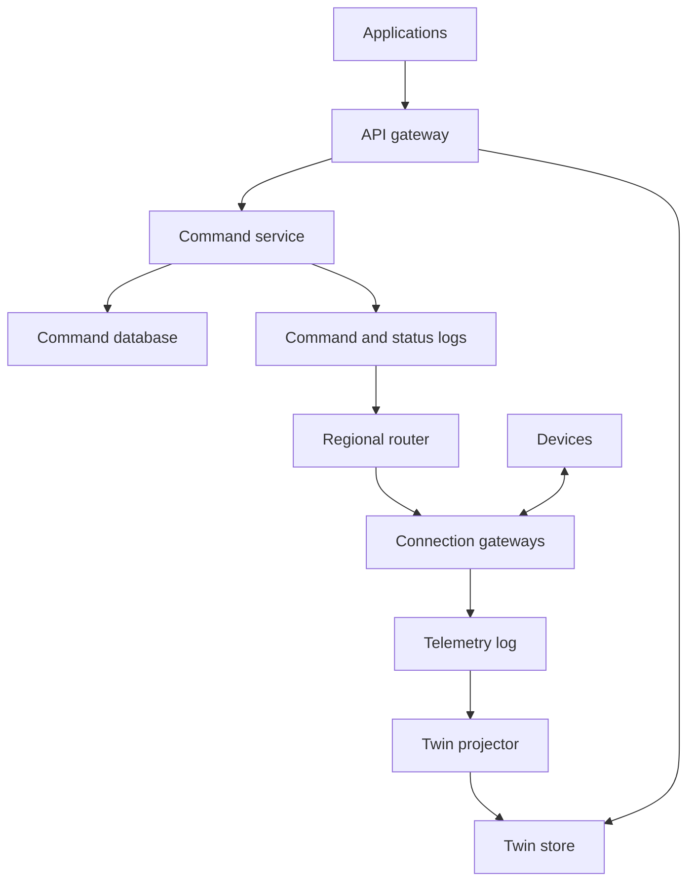
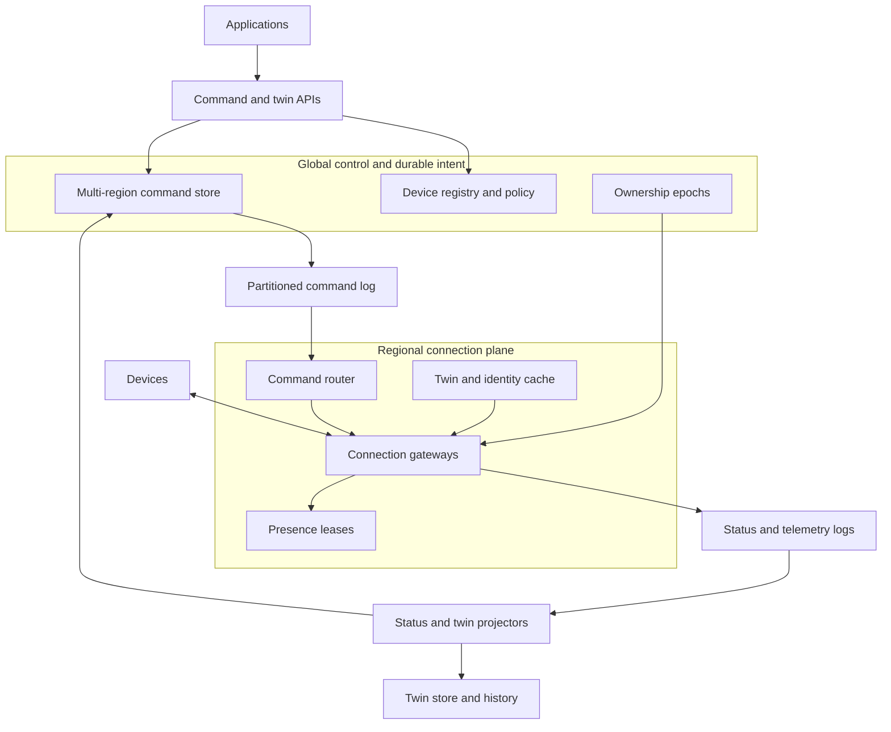

# Design a Global IoT Device Command-and-Control Platform

**Difficulty:** Senior-level  
**Primary themes:** millions of long-lived connections, offline queues, device twins, command idempotency, ordering, multi-region reliability, caching, observability  
**Interview time budget:** about 40–45 minutes  
**Educational walkthrough:** intentionally more detailed than what you would say in the timed interview

> This is an original walkthrough organized with the public [Hello Interview delivery framework](https://www.hellointerview.com/learn/system-design/in-a-hurry/delivery): requirements, core entities, interfaces, a simple complete design, and targeted deep dives. The high-level design follows the guide’s advice to satisfy operations one at a time before layering on caches, queues, and failure-handling complexity. Queue and cache terminology follows Hello Interview’s public [key technologies guide](https://www.hellointerview.com/learn/system-design/in-a-hurry/key-technologies). All problem details, dialogue, calculations, architecture, and tradeoffs below are original.

---

## Interviewer prompt

> Design a global platform that lets customers monitor and remotely control connected devices such as thermostats, industrial sensors, smart locks, and point-of-sale terminals.
>
> Devices maintain persistent connections when online, send telemetry and state updates, and may be offline for hours. Authorized applications can read a device’s latest state and issue commands such as changing a setting, restarting software, or installing a configuration. The system must safely deliver commands when devices reconnect and show command progress to users.

The system is the control plane between applications and devices. We are not designing device firmware, a general-purpose time-series analytics product, or arbitrary over-the-air binary distribution unless it directly supports command delivery.

---

## Targeted clarifying questions and assumed interviewer answers

### Product behavior

**Candidate:** “Are commands synchronous, or does the caller submit one and observe progress asynchronously?”  
**Interviewer:** “Asynchronous. The API should acknowledge durable acceptance quickly, and clients can poll or subscribe to status.”

**Candidate:** “Can devices be offline, and how long should commands wait?”  
**Interviewer:** “Yes. Commands specify an expiration time, from seconds to seven days. Deliver unexpired commands when a device reconnects.”

**Candidate:** “Do all commands have the same semantics?”  
**Interviewer:** “No. Setting target temperature is replaceable by a newer desired value, but unlocking a door or rebooting a terminal is an action that must not be repeated accidentally.”

**Candidate:** “Do users need the device’s last reported state and the state they want it to reach?”  
**Interviewer:** “Yes. Expose both reported and desired state, plus whether they have converged.”

**Candidate:** “Do we need groups or fleet-wide commands?”  
**Interviewer:** “Support commands to a named group of up to one million devices, but protect the system from a sudden fan-out spike.”

### Scale and latency

**Candidate:** “What scale should I use?”  
**Interviewer:** “Assume 100 million registered devices, 20 million concurrently connected, 2 million connection attempts per minute during regional recovery, 500,000 telemetry messages per second on average, and 2 million per second at peak. Command submissions peak at 100,000 per second, excluding group expansion.”

**Candidate:** “What latency targets matter?”  
**Interviewer:** “Accept a single-device command in under 200 ms at p99. For an online healthy device, 99% of commands should reach its regional gateway within two seconds. State reads should be under 100 ms at p99.”

### Correctness and availability

**Candidate:** “Can the network duplicate, delay, or reorder messages?”  
**Interviewer:** “Assume all three. Devices can reconnect through another gateway or region.”

**Candidate:** “Does the platform promise exactly-once device execution?”  
**Interviewer:** “No network can guarantee that after losing an acknowledgment. Provide effectively-once execution for devices that implement command IDs and a durable deduplication journal; otherwise report at-least-once delivery semantics.”

**Candidate:** “What happens during a regional outage?”  
**Interviewer:** “Devices should reconnect to another region. Previously accepted commands must not be lost. Regional recovery should be under five minutes, though reconnect storms must not take down the backup region.”

### Security and tenancy

**Candidate:** “How are users and devices authenticated?”  
**Interviewer:** “Applications use OAuth-style service or user tokens. Every device has an individual certificate or hardware-rooted credential. Tenants may access only their own devices. Audit every command.”

**Candidate:** “Are dangerous commands special?”  
**Interviewer:** “Yes. Door unlock, factory reset, and similar commands may require step-up authorization, an approval policy, and a short expiration.”

### Concise scope restatement

> **What I would say aloud:** “I’ll design a multi-tenant platform for 100 million devices and 20 million live connections. It will durably accept single-device and fleet commands, deliver them over regional persistent connections or after reconnect, track status, and expose desired versus reported state. I’ll make ordering and retry semantics explicit rather than claiming universal exactly once.”

---

# 1. Requirements (~5 minutes in the interview)

## 1.1 Core functional requirements

Prioritize three.

### FR1 — Connect, authenticate, and maintain device presence

A device authenticates with an individual credential, establishes a long-lived bidirectional connection, sends heartbeats and state updates, and reconnects safely through another gateway or region.

Applications can determine whether a device is currently reachable, while understanding that presence is inherently time-bounded rather than perfectly instantaneous.

### FR2 — Submit and track commands

An authorized application can submit a command to one device or a named group. The system durably records it, enforces policy, delivers it before expiration, and exposes a state machine such as:

```text
PENDING -> DISPATCHED -> RECEIVED -> EXECUTING -> SUCCEEDED
                                      \-> FAILED
PENDING/DISPATCHED -> EXPIRED or CANCELED
```

The system must distinguish:

- **desired-state commands**, where a newer value can supersede an older value;
- **action commands**, where duplicate execution can be harmful.

### FR3 — Read and synchronize device state

Applications can read:

- the latest **reported state** from the device;
- the platform’s **desired state**;
- version and timestamps for both;
- convergence status and recent command history.

Devices can request the current desired-state document after reconnect and report which version they have applied.

## 1.2 Quantified non-functional requirements

| Requirement | Target | Why it matters |
|---|---:|---|
| Command acceptance | p99 < 200 ms | API acknowledgment should mean durable acceptance, not device execution |
| Online delivery | 99% reach the regional gateway within 2 s | Interactive controls should feel responsive |
| State reads | p99 < 100 ms | Dashboards and automation rules read frequently |
| Availability | 99.99% for command submission and state reads | Device control may be operationally critical |
| Durability/recovery | No loss of acknowledged commands; regional RTO < 5 min | Offline and failover delivery rely on durable command records |

Additional goals:

- tolerate 2 million telemetry messages/s at peak;
- absorb 2 million connection attempts/minute during recovery;
- preserve per-device command order where the command type requires it;
- encrypt traffic and stored secrets, isolate tenants, and audit all command lifecycle events;
- retain command history for one year and high-volume telemetry according to separate retention policy.

## 1.3 Scale estimates that change the design

### Persistent connection fleet

Twenty million simultaneous connections cannot live behind a small stateless web tier. If one gateway process safely handles 50,000 connections:

\[
20{,}000{,}000 / 50{,}000 = 400\ \text{gateway processes}
\]

At 60% target utilization for failure headroom:

\[
400 / 0.60 \approx 667\ \text{processes}
\]

Across several regions and availability zones, plan for roughly 700–900 gateway instances, depending on connection memory, TLS cost, heartbeat rate, and kernel limits.

**Design consequence:** gateways are specialized connection servers with event-driven I/O, bounded per-connection state, and regional sharding. They are not ordinary request/response API pods.

### Heartbeats and presence writes

If 20 million devices heartbeat every 30 seconds:

\[
20{,}000{,}000 / 30 \approx 667{,}000\ \text{heartbeats/s}
\]

Writing each heartbeat synchronously to a relational database would overwhelm it and provide little value.

**Design consequence:** presence lives in an ephemeral partitioned store with TTL and batched/coalesced updates. Durable device metadata remains in a separate database.

### Telemetry throughput

At 500,000 messages/s average and an average encoded payload of 600 bytes:

\[
500{,}000 \times 600\ \text{B} = 300\ \text{MB/s}
\]

That is about 25.9 TB/day before replication and compression. Peak is four times higher.

**Design consequence:** ingest telemetry through a partitioned log and archive to object storage. Do not store all raw telemetry in the command database or keep it on message brokers for a year.

### Fleet-command fan-out

A single request targeting one million devices is not one database write in practice. If expanded immediately, it can produce one million command records and connection lookups at once. At a controlled rate of 20,000 devices/s, expansion takes about 50 seconds.

**Design consequence:** group commands are asynchronous campaigns with rate-limited expansion, progress counters, pause/cancel controls, and per-tenant quotas.

### Command state storage

Assume 100,000 command submissions/s at peak and 10,000/s average. With roughly four lifecycle events per command:

\[
10{,}000 \times 4 \times 86{,}400 \approx 3.46\ \text{billion status events/day}
\]

The current status and recent per-device index need fast serving, while the complete append-only history belongs in a scalable event log/object store.

> **What I would say aloud:** “The two decisive numbers are 20 million persistent sockets and about 667,000 heartbeats per second. That separates connection/presence infrastructure from durable metadata. Fleet fan-out also has to be a paced campaign, not a million synchronous writes.”

## 1.4 Scope and consistency/availability contract

### Device registry and authorization

Device ownership, credentials, policy, and group definitions use strong consistency within a tenant. A command must never be authorized from a stale ownership record after a device transfer or credential revocation.

### Command acceptance

An API response of `202 Accepted` means:

1. authentication and authorization passed;
2. the command or campaign is durably replicated;
3. its idempotency key is bound to the created resource;
4. it will be retried until terminal state or expiration.

It does **not** mean the device received or executed the command.

### Per-device ordering

For commands in the same ordering domain, such as configuration version updates, preserve per-device order. Independent commands may execute concurrently only if the device capability declares that safe.

### Delivery and execution

The platform offers at-least-once delivery. Effectively-once execution requires the device to persist recently completed `command_id` values and return the previous result when a duplicate arrives.

The unavoidable ambiguity is: the device may execute a command, crash before acknowledging, and receive it again. The platform alone cannot distinguish “never executed” from “executed but acknowledgment lost.”

### State consistency

Desired-state updates use optimistic concurrency and are strongly ordered per device. Reported state is eventually consistent and carries device version, event time, ingest time, and session epoch. Reads return both documents rather than pretending they are atomically synchronized.

### Availability during partitions

Command submission remains available if a quorum of the command store is reachable. Delivery may be delayed. Reads may return last-known reported state with freshness metadata. Safety-critical operations can require fresh presence and a short-lived authorization token.

> **What I would say aloud:** “I’ll strongly protect ownership, authorization, command creation, and desired-state versioning. Presence and reported state are bounded-stale. Delivery is at least once; effectively-once execution is a device-plus-platform protocol based on durable command IDs.”

---

# 2. Core entities (~2 minutes)

| Entity | Purpose | Important identity |
|---|---|---|
| **Tenant** | Security, quota, and billing boundary | `tenant_id` |
| **Device** | Durable identity, ownership, capabilities, home region | `(tenant_id, device_id)` |
| **DeviceSession** | One authenticated connection generation | `(device_id, session_epoch)` |
| **DeviceTwin** | Desired and reported state with independent versions | `(device_id, twin_namespace)` |
| **Command** | Durable requested operation and current status | `command_id` |
| **CommandAttempt** | One dispatch/ack lifecycle attempt | `(command_id, attempt_no)` |
| **DeviceGroup** | Versioned membership rule or materialized membership | `(group_id, version)` |
| **Campaign** | Rate-limited group command and aggregate progress | `campaign_id` |
| **AuditEvent** | Immutable security and lifecycle record | `audit_event_id` |

Do not treat presence as the durable `Device` record. Presence is a derived lease: “gateway X observed a valid heartbeat for session epoch Y recently.”

> **What I would say aloud:** “The important separation is Device versus DeviceSession, and Command versus CommandAttempt. The device is durable; sessions and presence are replaceable. A command is the user’s intent; attempts are transport retries.”

---

# 3. API and system interfaces (~5 minutes)

Application identity is derived from the validated access token. The body never supplies authoritative tenant or actor identity. Device identity is derived from its certificate and bound during provisioning; a device may not claim an arbitrary `device_id` after connecting.

## 3.1 Submit a single-device command — FR2

```http
POST /v1/devices/dev_42/commands
Authorization: Bearer <application-token>
Idempotency-Key: 8e507bb0-...
Content-Type: application/json

{
  "type": "SET_CONFIGURATION",
  "payload": {
    "target_temperature_c": 21.5,
    "mode": "ECO"
  },
  "expires_at": "2026-11-09T08:15:00Z",
  "ordering_key": "hvac_config",
  "expected_twin_version": 117
}
```

```json
{
  "command_id": "cmd_01JC...",
  "status": "PENDING",
  "accepted_at": "2026-11-09T07:02:11.284Z",
  "expires_at": "2026-11-09T08:15:00Z",
  "status_url": "/v1/commands/cmd_01JC..."
}
```

If the client retries with the same idempotency key and identical request hash, return the same `command_id`. If the payload differs, return `409 Conflict`.

For a dangerous action:

```http
POST /v1/devices/lock_17/commands
Authorization: Bearer <step-up-token>
Idempotency-Key: 3f1b...

{
  "type": "UNLOCK",
  "payload": {"duration_seconds": 10},
  "expires_at": "2026-11-09T07:03:00Z",
  "approval_id": "approval_81"
}
```

The policy engine verifies the token’s recent authentication, actor role, approval, device capability, and maximum expiration.

## 3.2 Read command status — FR2

```http
GET /v1/commands/cmd_01JC...
Authorization: Bearer <application-token>
```

```json
{
  "command_id": "cmd_01JC...",
  "device_id": "dev_42",
  "status": "EXECUTING",
  "status_version": 4,
  "attempts": 2,
  "last_transition_at": "2026-11-09T07:02:13.481Z",
  "device_result": null,
  "delivery_semantics": "EFFECTIVELY_ONCE_CAPABLE"
}
```

Clients may also subscribe to a tenant-scoped WebSocket, server-sent events stream, or webhook with cursor-based replay. Polling remains the simplest baseline.

## 3.3 Read a device twin — FR3

```http
GET /v1/devices/dev_42/twin
Authorization: Bearer <application-token>
```

```json
{
  "device_id": "dev_42",
  "desired": {
    "version": 118,
    "state": {"target_temperature_c": 21.5, "mode": "ECO"},
    "updated_at": "2026-11-09T07:02:11.284Z"
  },
  "reported": {
    "version": 9441,
    "applied_desired_version": 117,
    "state": {"temperature_c": 22.3, "mode": "COMFORT"},
    "device_event_time": "2026-11-09T07:01:58.010Z",
    "ingested_at": "2026-11-09T07:01:58.207Z"
  },
  "converged": false,
  "presence": {
    "status": "ONLINE",
    "observed_at": "2026-11-09T07:02:10.010Z"
  }
}
```

## 3.4 Patch desired state — FR3

```http
PATCH /v1/devices/dev_42/twin/desired
Authorization: Bearer <application-token>
If-Match: "desired-v117"
Idempotency-Key: a94d...

{
  "target_temperature_c": 21.5,
  "mode": "ECO"
}
```

```json
{
  "desired_version": 118,
  "sync_command_id": "cmd_01JC..."
}
```

`If-Match` prevents two controllers from silently overwriting each other. The twin service updates desired state and creates a synchronization command in one transaction or through a transactional outbox.

## 3.5 Create a fleet campaign — FR2

```http
POST /v1/campaigns
Authorization: Bearer <fleet-manager-token>
Idempotency-Key: rollout-fw-policy-2026-11-09

{
  "group": {"group_id": "group_northeast_pos", "version": 37},
  "command": {
    "type": "RELOAD_CONFIGURATION",
    "payload": {"config_version": 812},
    "expires_at": "2026-11-12T00:00:00Z"
  },
  "rollout": {
    "max_devices_per_second": 20000,
    "max_concurrent": 50000,
    "failure_threshold_percent": 2,
    "canary_percent": 1
  }
}
```

```json
{
  "campaign_id": "camp_7G2",
  "status": "CANARY_PENDING",
  "estimated_device_count": 824115
}
```

Pinning group version 37 makes the target population reproducible. A dynamic group evaluated continuously would make audit and progress ambiguous.

## 3.6 Device protocol

The persistent protocol could use MQTT, WebSockets, or a custom binary stream. The important contract is:

```text
CONNECT(certificate, protocol_version, capabilities, last_seen_command_cursor)
CONNACK(session_epoch, heartbeat_interval, desired_twin_version)
COMMAND(command_id, sequence, type, payload, expires_at)
COMMAND_ACK(command_id, phase, result_hash, device_time)
STATE_REPORT(device_report_version, applied_desired_version, state_delta)
HEARTBEAT(session_epoch, last_received_sequence)
```

The gateway derives `device_id` and tenant from the authenticated credential. The `session_epoch` fences messages from an older connection.

## 3.7 Interface-to-requirement map

| Requirement | Interface |
|---|---|
| Connect and report presence | persistent device protocol |
| Submit and track commands | command POST/GET APIs and status subscription |
| Read/synchronize state | twin GET/PATCH and `STATE_REPORT` |
| Control fleet fan-out | campaign POST/status/pause/cancel APIs |

> **What I would say aloud:** “Commands are resources, not synchronous RPCs. The API durably creates one and returns 202. The device protocol then moves it through explicit phases. Application and device identities come from authentication, not caller-provided tenant fields.”

---

# 4. Data flow

This is a processing system, so an explicit flow is useful.

## 4.1 Online-device command

1. The application submits a command with an idempotency key.
2. The command service authorizes it and durably writes the command plus an outbox event.
3. An outbox relay publishes `CommandReady` to a partitioned command log.
4. A regional router looks up the current device session.
5. The owning gateway receives the command through an internal stream.
6. The gateway validates the session epoch and sends the command.
7. Device acknowledgments flow back through the gateway into a status log.
8. A status projector conditionally advances the command state and notifies subscribers.

## 4.2 Offline-device command

The command remains durable and indexed by device. Presence is absent or stale, so routing does not repeatedly hammer gateways. When the device reconnects, it supplies its command cursor; the session coordinator leases the device’s pending command stream and dispatches unexpired commands in order.

## 4.3 Device state

State reports enter a telemetry log. A twin projector checks session epoch and monotonic device report version, updates the latest reported state, archives the event, and determines whether reported `applied_desired_version` has caught up with desired state.

## 4.4 Fleet campaign

A campaign coordinator snapshots target membership, creates canary work first, observes failure policy, then emits rate-limited device work items. Workers create commands idempotently using `(campaign_id, device_id)` as a uniqueness key.

---

# 5. High-level design (~10–15 minutes in the interview)

Build the smallest complete design operation by operation. Defer reconnect storms, exact retry semantics, and multi-region ownership to the deep dives.

## 5.1 Baseline architecture



The application API and persistent device network are separate planes. The API can be stateless and autoscaled per request; gateways hold millions of sockets and have different deployment, kernel, TLS, and drain requirements.

## 5.2 Operation 1: device connects and becomes reachable

### Request trace

1. Global DNS/anycast directs the device to a healthy nearby region.
2. A connection load balancer selects a gateway with available connection capacity.
3. The gateway performs mutual TLS and validates the device certificate against cached issuer/revocation data.
4. The identity service maps the credential to `(tenant_id, device_id, credential_version)` and checks status.
5. A session coordinator atomically increments or acquires a `session_epoch` for the device.
6. The gateway registers an ephemeral presence lease:

```text
Presence(
  tenant_id, device_id,
  region_id, gateway_id, session_epoch,
  protocol_version, capabilities_hash,
  connected_at, last_heartbeat_at, lease_expires_at
)
```

7. If an older session exists, its lower epoch is fenced. It may still have a TCP connection, but its later state updates and acknowledgments are rejected.
8. The coordinator returns desired twin version and the pending-command cursor.
9. The gateway begins heartbeat supervision and pending-command delivery.

### Why an ephemeral presence store?

Presence changes frequently and tolerates short-lived uncertainty. Use a partitioned in-memory or memory/SSD key-value store with TTL, replicated within the region. Heartbeats renew leases in batches. If the store fails, devices remain connected; gateways rebuild presence from their local connection tables.

Do not synchronously persist every heartbeat to the durable registry.

### Durable device fields

```text
Device(
  tenant_id, device_id, status,
  credential_version, capability_set,
  home_region, policy_id,
  created_at, ownership_version
)
```

### Dialogue

**Candidate:** “I’ll represent presence as a renewable lease rather than a Boolean in the device row. A Boolean becomes incorrect when a gateway dies before writing `offline`. TTL gives a bounded-stale interpretation.”

**Interviewer:** “Can two connections exist?”

**Candidate:** “Physically, briefly yes. Logically, only the highest session epoch owns the device. Every report and acknowledgment includes that epoch, so the previous socket is fenced.”

## 5.3 Operation 2: submit and deliver one command

### Command creation transaction

The command service:

1. derives tenant and actor from the token;
2. reads strongly consistent device ownership and policy;
3. validates command type against device capabilities;
4. validates expiration, payload schema, approval, and rate limit;
5. inserts the command and idempotency record;
6. inserts an outbox row in the same transaction;
7. commits and returns `202 Accepted`.

Relevant fields:

```text
Command(
  tenant_id, command_id, device_id,
  type, payload_ref_or_ciphertext, payload_hash,
  ordering_key, sequence,
  status, status_version,
  created_by, created_at, expires_at,
  desired_twin_version,
  delivery_semantics, campaign_id,
  last_attempt_at, terminal_at, result
)

IdempotencyRecord(
  tenant_id, actor_id, idempotency_key,
  request_hash, command_id, expires_at
)
```

The payload may be stored encrypted inline when small; large configuration blobs belong in object storage and the command contains a signed short-lived reference and content hash.

### Delivery trace

1. The outbox relay publishes `CommandReady(command_id, device_id, sequence)`.
2. The command log is partitioned by `(tenant_id, device_id)`, preserving device order.
3. The router checks regional presence.
4. If online, it sends a dispatch envelope to the owning gateway.
5. The gateway rechecks the session epoch and expiration, then writes `COMMAND` on the socket.
6. The gateway emits attempt and acknowledgment events; it does not directly mutate command rows.
7. A status projector applies valid transitions with compare-and-swap on `status_version`.

### Why a transactional outbox?

Without it, the database could commit the command but crash before publishing the queue message. The outbox row is committed atomically, then a relay retries publication. Duplicate publication is harmless because downstream processing uses `command_id` and monotonic state transitions.

### Offline path

If presence is absent, do not continuously retry network routing. The durable per-device pending index is sufficient. On reconnect, the session coordinator starts a dispatcher from the device’s last acknowledged sequence. Expired commands are terminally marked without dispatch.

### Dialogue

**Interviewer:** “Why not call the gateway directly from the command API?”

**Candidate:** “That would make acceptance depend on transient presence and gateway health. The durable log decouples user intent from delivery. It also handles an offline device and preserves per-device ordering.”

## 5.4 Operation 3: process acknowledgments and expose status

Devices acknowledge phases, not merely bytes received:

- `RECEIVED`: command persisted or accepted by the device;
- `EXECUTING`: optional long-running phase;
- `SUCCEEDED` or `FAILED`: terminal result.

The gateway wraps the acknowledgment with authenticated device identity, session epoch, gateway ID, receive time, and attempt number. A status log partitions by command ID.

The projector validates:

- command belongs to authenticated device;
- session epoch is current or allowed for an in-flight handoff;
- transition is legal;
- terminal state is immutable except through a separately audited reconciliation operation;
- duplicate acknowledgments are no-ops.

```text
CommandAttempt(
  command_id, attempt_no,
  region_id, gateway_id, session_epoch,
  dispatched_at, transport_acked_at,
  device_received_at, completed_at,
  outcome, error_code
)
```

The current command row supports fast reads. The append-only status log supports audit, debugging, replay, and subscriber notification.

For notifications, subscribers track a cursor. Delivery is at least once; notification consumers deduplicate by `(command_id, status_version)`.

## 5.5 Operation 4: synchronize desired and reported state

### Desired state write

The twin service performs an optimistic-concurrency update:

```text
UPDATE desired
SET document = merge(document, patch), version = version + 1
WHERE device_id = ? AND version = expected_version
```

In the same transaction it records an outbox event that creates or updates a replaceable `SYNC_DESIRED_STATE` command.

### Reported state write

The device sends a delta containing:

- `device_report_version` monotonically increasing within firmware storage;
- `applied_desired_version`;
- `session_epoch`;
- device event time and state delta.

The twin projector applies a report only if its tuple `(device_boot_epoch, device_report_version)` is newer than the stored tuple and the connection session is valid. This prevents late packets from an older connection from rolling state backward.

```text
DeviceTwin(
  tenant_id, device_id, namespace,
  desired_document, desired_version, desired_updated_at,
  reported_document, device_boot_epoch,
  reported_version, reported_event_time, reported_ingest_time,
  applied_desired_version, schema_version
)
```

The read service may use cache-aside for twins:

- key: `(tenant_id, device_id, twin_namespace)`;
- value: both documents and versions;
- TTL: tens of seconds for dashboards, shorter for interactive control;
- invalidate/update from the twin changelog;
- never cache authorization independently of ownership version.

The API returns timestamps and versions, so callers know whether the reported state is old.

### Dialogue

**Candidate:** “I won’t collapse desired and reported state into one document. They have different writers and consistency. Convergence means the device reports an applied desired version at least as new as the requested one, not that two JSON objects happen to match.”

## 5.6 Operation 5: execute a fleet campaign

1. The campaign service validates the command, group version, quota, and rollout policy.
2. It writes a durable campaign record and group snapshot reference.
3. An expander scans membership in stable pages and emits `(campaign_id, device_id)` work items.
4. A token-bucket rate limiter enforces per-campaign, per-tenant, per-region, and global rates.
5. Workers create commands with uniqueness constraint `(campaign_id, device_id)`.
6. The first canary cohort runs; aggregated terminal outcomes determine continuation or pause.
7. Approximate streaming counters power live progress; periodically reconciled database/object-store counts provide authoritative totals.

```text
Campaign(
  tenant_id, campaign_id,
  group_id, group_version, command_template_hash,
  state, rollout_policy, target_count,
  expanded_count, terminal_count, failure_count,
  membership_snapshot_ref,
  created_by, created_at, paused_at, completed_at
)
```

Campaign cancellation prevents new command creation and attempts to cancel commands not yet dispatched. It cannot undo commands already executed.

## 5.7 Baseline completeness check

The baseline now supports:

- authenticated persistent device connections and presence;
- durable single-device commands and offline delivery;
- status tracking and subscriptions;
- desired/reported twin state;
- paced group campaigns.

Now evolve the system where the baseline breaks first.

---

# 6. Deep dives (~10–15 minutes in the interview)

Choose three:

1. delivery semantics, ordering, and ambiguous outcomes;
2. connection scale and reconnect storms;
3. multi-region ownership, durability, and failover.

## Deep dive 1 — Delivery semantics, ordering, and ambiguous outcomes

### Where the baseline breaks

The network can fail at every boundary:

1. Platform sends a command; device never receives it.
2. Device receives and persists it; acknowledgment is lost.
3. Device executes it; terminal result is lost.
4. Device reboots between receiving and executing.
5. An old gateway retries after the device has reconnected elsewhere.
6. Two application retries create duplicate logical actions.
7. A newer desired value should replace an older pending value.

Blind retries can unlock twice, reboot repeatedly, or apply old configuration after new configuration.

### Compare delivery promises

| Promise | Benefit | Limitation |
|---|---|---|
| At-most-once delivery | No transport retry duplicates | Commands may disappear after uncertain failure |
| At-least-once delivery | Eventual delivery when connectivity returns | Device may receive duplicates |
| Exactly-once execution | Ideal API contract | Impossible for platform alone after lost post-execution acknowledgment |
| At-least-once delivery + durable device dedup | Effectively-once for capable devices | Requires firmware storage and command-result journal |

Select the fourth approach for action commands. Expose capability explicitly; do not claim it for legacy devices.

### End-to-end idempotency layers

1. **Application idempotency:** `(tenant_id, actor_id, idempotency_key)` maps retries to one command.
2. **Pipeline idempotency:** `command_id` and conditional status versions make duplicate queue events harmless.
3. **Gateway idempotency:** gateway avoids two simultaneous in-flight sends for the same `(command_id, session_epoch)`.
4. **Device idempotency:** device persists `command_id -> terminal/in-progress result` before or with execution.

For a dangerous action, device-side pseudocode is conceptually:

```text
if command_id in journal:
    return journal[command_id]
validate sequence, expiry, signature, and policy
persist journal[command_id] = IN_PROGRESS
execute action
persist journal[command_id] = terminal_result
return terminal_result
```

The journal must survive reboot. Its retention must exceed the platform’s maximum retry and replay window.

### Ordering domains

One total order for every device is simple but can cause head-of-line blocking: a slow firmware operation could block a temperature update.

Compare:

- one device-wide sequence;
- independent sequences per `ordering_key`;
- no ordering, relying only on command versions.

Choose independent ordering domains, declared by capability. Examples:

- `configuration` ordered;
- `firmware` ordered;
- `diagnostics` may run concurrently;
- `safety_action` serialized exclusively.

The command store allocates a monotonically increasing sequence per `(device_id, ordering_key)`. A device rejects or buffers gaps according to policy.

### Replaceable desired-state commands

Suppose versions 118, 119, and 120 are pending while the device is offline. Sending all three wastes bandwidth and may cause flicker. Because these commands represent state, the dispatcher may coalesce them to version 120.

Do not coalesce action commands. The feature schema marks commands as:

- `REPLACEABLE_STATE(version)`;
- `IDEMPOTENT_ACTION(command_id)`;
- `NON_IDEMPOTENT_LEGACY_ACTION` with stricter retry policy.

### Retry policy

Retries use exponential backoff with jitter, capped by command expiry and device presence:

- retry quickly if a live connection loses a transport acknowledgment;
- stop network retries when presence expires;
- resume on reconnect;
- never retry a terminal command;
- for a legacy non-idempotent action after ambiguous execution, mark `OUTCOME_UNKNOWN` rather than automatically retrying.

`OUTCOME_UNKNOWN` is a legitimate terminal or operator-review state. Hiding ambiguity as `FAILED` invites a dangerous retry.

### State transition enforcement

Use compare-and-swap:

```text
UPDATE command
SET status = new_status, status_version = status_version + 1
WHERE command_id = ?
  AND status_version = expected
  AND status IN allowed_predecessors
```

Illegal or stale transitions go to an anomaly stream for investigation; they do not mutate the authoritative state.

### Failure modes and observability

| Failure | Detection | Response |
|---|---|---|
| Duplicate application request | idempotency-key hit | Return existing command |
| Lost device acknowledgment | dispatch timeout with online presence | Retry same command ID |
| Device executed but result lost | repeated command returns journal result | Project terminal result once |
| Legacy ambiguous action | no durable device dedup capability | Mark `OUTCOME_UNKNOWN`, alert/caller decision |
| Sequence gap | device/gateway reports expected sequence | Replay missing command or supersede if replaceable |
| Old session ack | session epoch lower than current | Reject and record anomaly |

Track accepted-to-dispatched, dispatched-to-received, received-to-terminal latency; retry counts; ambiguous outcome rate; sequence gaps; duplicate suppression; expiration by cause; and per-command-type success rate.

> **What I would say aloud:** “The platform can guarantee durable intent and at-least-once delivery, but not universal exactly-once execution. For capable devices, the same command ID is durably deduplicated on the device. If a legacy device may have executed a dangerous action and lost its response, I surface `OUTCOME_UNKNOWN` instead of retrying blindly.”

## Deep dive 2 — Connection scale and reconnect storms

### Where the baseline breaks

Twenty million steady connections are manageable when balanced. The dangerous event is correlated reconnection:

- region failure redirects millions of devices;
- certificate validation and TLS handshakes spike CPU;
- every device reads desired state and pending commands;
- presence writes spike;
- aggressive firmware reconnect loops amplify the outage;
- backup gateways become full before autoscaling finishes.

Two million attempts per minute is about 33,333 attempts/s. If a TLS/auth handshake consumes 5 ms of CPU, that alone needs roughly 167 CPU-seconds per second before application work.

### Gateway architecture

Each gateway uses:

- event-driven nonblocking I/O;
- bounded memory per connection;
- connection admission limits based on memory, file descriptors, and event-loop lag;
- local maps from device to socket/session epoch;
- batched heartbeat and acknowledgment processing;
- separate worker pools for CPU-heavy authentication;
- graceful drain, where no new connections are accepted and existing sessions migrate gradually.

Do not make gateways persist authoritative command state. Losing one should cause reconnect and replay, not data loss.

### Admission control versus queueing

An unbounded queue of TLS handshakes only moves overload into memory and increases timeout storms. Use layered admission control:

1. global traffic manager routes only to regions with spare capacity;
2. connection load balancer enforces per-source and per-tenant limits;
3. gateway exposes a hard connection ceiling and handshake concurrency limit;
4. rejected devices receive a retry-after range or protocol backoff hint;
5. firmware uses exponential backoff with full jitter and respects server hints.

A queue is useful for asynchronous command work, but the live connection handshake has a user/device timeout and needs bounded admission.

### Reconnect shaping

Use a signed reconnect token containing:

- suggested region pool;
- earliest retry time plus randomized window;
- previous session epoch/cursor hints;
- short expiration.

During planned drain, gateways proactively distribute reconnect times across several minutes. During an unplanned outage, DNS responses and surviving regions use per-device hash buckets to stagger admission.

For example, if five million devices must reconnect over five minutes:

\[
5{,}000{,}000 / 300 \approx 16{,}667\ \text{successful connections/s}
\]

Capacity must handle that rate plus normal churn, not all five million in the first second.

### Authentication cache and revocation

Certificate-chain verification and device lookup are expensive. Cache:

- trusted issuer chains;
- device identity and capability records keyed by credential fingerprint and ownership version;
- negative revocation results for a short TTL.

But revocation is security-sensitive. Distribute a signed revocation/version stream to gateways. Cache entries include `credential_version`; a revocation increments the durable version and invalidates regional caches. For high-risk devices, require an online introspection check.

### Presence write coalescing

The gateway need not write every heartbeat. It renews presence when:

- a configurable fraction of the lease has elapsed;
- routing-relevant fields change;
- the session disconnects cleanly.

If heartbeat is every 30 seconds and presence lease is 90 seconds, a gateway might flush presence every 45 seconds in batches. Gateway failure lets leases expire automatically.

### Protect downstream systems on reconnect

A reconnection should not trigger uncontrolled reads against the command database and twin store. Instead:

- session coordinator reads a compact per-device cursor/index;
- desired twin cache is warmed from changelog-driven regional replicas;
- dispatcher limits pending-command fetch concurrency;
- devices with no pending command are filtered using a compact indicator/index;
- fleet campaigns have separate quotas from interactive commands.

### Load shedding priorities

Under overload, preserve:

1. safety-critical commands and terminal acknowledgments;
2. interactive single-device commands;
3. desired-state synchronization;
4. routine telemetry;
5. bulk campaigns and low-priority diagnostics.

Telemetry can be sampled or delayed by policy; command acknowledgments should not be dropped because they prevent costly retries and ambiguity.

### Observability

Monitor:

- active connections and headroom by region/AZ/gateway;
- connection attempts, accepts, rejects, and reason codes;
- TLS/auth CPU time and cache hit rate;
- event-loop lag, socket memory, file descriptors;
- reconnect cohort completion and retry distribution;
- heartbeat lag and presence rebuild rate;
- downstream reads per reconnect;
- gateway drain duration;
- command delivery latency during churn.

> **What I would say aloud:** “Steady-state socket count is not the hardest part; correlated reconnection is. I’ll preprovision headroom, bound handshake concurrency, require exponential backoff with jitter, and stagger reconnect cohorts. Reconnect reads are also rate-limited so saving the gateway tier does not overload the command store.”

## Deep dive 3 — Multi-region ownership, durability, and failover

### Where the baseline breaks

Devices may connect to any healthy region, while commands can be submitted anywhere. Without ownership rules:

- two regions may dispatch the same command concurrently;
- presence records race;
- reported state moves backward;
- an old gateway publishes acknowledgments after failover;
- commands accepted just before region loss may be unavailable elsewhere;
- fleet expansion may duplicate work.

### Compare regional models

| Model | Advantages | Problems |
|---|---|---|
| Global synchronous path for every message | Strong simple ordering | High latency and low partition availability |
| Device home region only | Clear ownership | Poor roaming latency and slower failover |
| Local connections with fenced per-device session ownership | Low connection latency and safe handoff | Requires epochs, replicated command data, and routing metadata |

Choose local connections with fenced session ownership.

### Session ownership and fencing

A strongly consistent metadata service allocates a monotonically increasing `session_epoch` per device or device shard. The active tuple is:

```text
(device_id, session_epoch, region_id, gateway_id, lease_expiry)
```

The new connection obtains a higher epoch before becoming authoritative. Gateways, twin projectors, and status projectors reject lower-epoch messages.

At 20 million live devices, a single global consensus write on every heartbeat is impossible and unnecessary. Consensus is used only at session acquisition/handoff. Heartbeats renew regional presence leases; ownership changes are much less frequent.

To reduce metadata load, ownership can be hierarchical:

- global service owns device hash ranges by region epoch;
- regional coordinator assigns individual devices/gateways within that range;
- cross-region reconnect obtains a new range/device epoch through the failover protocol.

### Command data durability

Acknowledged commands must survive region loss. Options:

1. synchronously write a multi-region database before returning;
2. write regionally and asynchronously replicate;
3. write regionally, retain a caller outbox, and confirm cross-region durability later.

For a <200 ms p99 acceptance budget, a nearby paired-region quorum may be feasible within a continent but not globally. Select a multi-region command store with quorum replicas across at least three failure domains, or a regional quorum plus synchronous replicated command log to a paired region.

Be explicit: if the response is returned before any remote copy exists, “no loss of acknowledged commands after total region loss” is false.

Large telemetry can use asynchronous cross-region replication because its contract differs. Do not force every telemetry message through the command durability path.

### Global API routing

Command APIs may accept writes in multiple regions. The durable command record contains device ID and sequence. A routing stream sends it toward the device’s current connection region. If routing metadata is stale, the receiving region forwards once to the higher-epoch owner or returns a redirect event; it does not loop indefinitely.

Use a hop count and ownership epoch in the routing envelope. A stale router refreshes metadata when it sees a newer epoch.

### Region failure sequence

1. Health system marks the region unavailable after thresholded evidence.
2. Global traffic stops new application and device connections to it.
3. Backup regions activate reserved capacity and admission shaping.
4. Devices reconnect gradually and acquire higher session epochs.
5. Regional dispatchers resume from durable per-device command cursors.
6. Desired twins and current command status are served from replicated data.
7. Late events from the failed region carry old epochs and are rejected or audited.
8. When the region returns, it rejoins empty/draining; it does not reclaim sessions automatically.

### Split-brain defense

Leases alone are insufficient if clocks or networks misbehave. Use fencing tokens checked at the mutation sink. A gateway with an expired or superseded epoch cannot update twin state or advance a command, even if it still has a socket.

The device should also accept the highest platform session/server epoch it has observed when protocol support allows. This is a second line of defense, not the only authority.

### Campaign failover

Campaign workers use deterministic page cursors and uniqueness `(campaign_id, device_id)`. Another region may resume expansion from the durable manifest. Duplicate work-item emission is acceptable because command creation is idempotent.

Progress counters are derived and may temporarily lag. The authoritative answer comes from campaign membership plus per-device command state.

### Failure-mode table

| Failure | Behavior | Recovery |
|---|---|---|
| Gateway process dies | Sockets reconnect; presence lease expires | New session epoch and command replay |
| Availability zone fails | Regional load balancer uses other zones | Replicated presence/command services |
| Region fails | Staggered reconnect to backups | Higher epochs, replicated command cursors |
| Command database replica fails | Quorum remains writable or fails safely | Automatic replica replacement |
| Command log lags | Acceptance may continue; delivery SLO degrades | Alert, scale consumers, expose backlog |
| Stale region sends ack | Sink rejects old epoch | Audit and discard |
| Twin replica stale | Read returns version/freshness | Route critical reads to leader/quorum |
| Campaign worker retries | Duplicate expansion item | Unique `(campaign_id, device_id)` no-op |

### SLOs and observability

Define service-level indicators that match user-visible contracts:

- durable command acceptance success and p99 latency;
- accepted-to-gateway dispatch latency for devices online throughout the interval;
- reconnect recovery time by cohort;
- command loss count, expected to be zero;
- status projection lag;
- stale ownership redirects and rejected old epochs;
- twin freshness and convergence delay;
- ambiguous action outcome rate;
- campaign fan-out rate, pause trigger latency, and overrun.

Do not count an expired offline-device command as an online delivery SLO failure. Define eligibility carefully: the device must have maintained valid presence and protocol health during the measured interval.

> **What I would say aloud:** “Connections can be local, but mutation authority is fenced by a monotonically increasing session epoch. Commands are replicated before acknowledgment, and a new region resumes from durable per-device cursors. Old-region messages cannot mutate state because sinks enforce the epoch.”

---

# 7. Final design

## 7.1 Evolved architecture



## 7.2 Component summary

| Component | Responsibility |
|---|---|
| API gateway | Application authentication, tenant context, rate limiting |
| Device registry/policy | Ownership, credentials, capabilities, dangerous-action policy |
| Command service/store | Durable intent, idempotency, ordering sequences, current status |
| Transactional outbox/log | Reliable decoupling from submission to dispatch |
| Connection gateways | TLS sessions, protocol framing, heartbeat supervision |
| Presence store | TTL-based regional route to current session |
| Ownership service | Allocates fenced session/range epochs |
| Command router | Routes durable work to the current gateway/region |
| Status projector | Enforces legal monotonic command transitions |
| Twin projector/store | Maintains desired and reported state independently |
| Campaign service | Snapshots membership and paces fleet fan-out |
| Object storage | Long-term telemetry, audit, and command event history |

## 7.3 End-to-end narrative

An application submits an authorized command with an idempotency key. The command service commits the command and an outbox event to a multi-region durable store, then returns `202`. A relay publishes it to a log partitioned by device. The router consults a TTL-based presence lease and sends the command to the gateway holding the highest session epoch. The gateway delivers the same stable command ID until the device acknowledges or the command expires. Status events are projected through legal conditional transitions and exposed to polling or subscriptions.

If the device is offline, the command stays in its durable pending stream. On reconnect, the device acquires a higher session epoch, supplies its cursor, receives unexpired commands in the appropriate ordering domains, and deduplicates previously executed IDs when capable. Desired and reported twin documents remain separately versioned. Fleet campaigns expand a pinned membership snapshot through canary and rate-limited phases.

During regional failure, devices reconnect in shaped cohorts to reserved capacity, obtain higher epochs, and resume commands from replicated cursors. Old connections are fenced at mutation sinks.

## 7.4 Requirements check

| Requirement | Design response |
|---|---|
| Persistent authenticated connections | Specialized gateways, mTLS, session epochs, TTL presence |
| Durable command submission | Multi-region store, idempotency record, transactional outbox |
| Online and offline delivery | Presence routing plus durable per-device pending stream |
| Status tracking | Append-only status log and conditional projector |
| Desired/reported state | Independently versioned device twin and convergence metadata |
| Fleet commands | Pinned membership, canary, paced expansion, unique per-device work |
| p99 acceptance < 200 ms | Regional API plus quorum durable write, no device round trip |
| 99% online dispatch < 2 s | Partitioned log, direct regional routing, capacity isolation |
| No acknowledged command loss | Remote durability before acknowledgment |
| Regional RTO < 5 min | Warm capacity, staggered reconnect, replicated cursors, fencing |
| Security and audit | Derived identity, individual credentials, policy engine, immutable audit |

## 7.5 Final 60-second interview summary

> **What I would say aloud:** “I separate durable intent from transient connectivity. Applications create command resources in a multi-region store; a transactional outbox publishes them to a per-device ordered log. Regional gateways own long-lived device sockets, publish TTL presence leases, and are fenced by monotonically increasing session epochs. Online commands route to the current gateway, while offline commands wait in a durable per-device stream and resume from a cursor after reconnect. The platform uses at-least-once delivery; capable devices persist command IDs to provide effectively-once execution, while ambiguous legacy actions surface `OUTCOME_UNKNOWN`. Desired and reported twin state have independent versions. Fleet commands become canary, rate-limited campaigns. During a regional outage, devices reconnect in shaped cohorts to warm capacity, obtain higher epochs, and resume from replicated command cursors.”

---

# Realistic interviewer follow-ups with strong sample answers

## 1. “Why use both a command database and a log?”

**Strong answer:** “The database is the queryable authority for idempotency, current status, policy-linked records, and per-device indexes. The log decouples delivery, preserves keyed order, absorbs bursts, and supports replay. A transactional outbox bridges them so committing a command cannot lose its dispatch event.”

## 2. “Can MQTT QoS 2 solve exactly-once execution?”

**Strong answer:** “It can reduce duplicate message delivery within a protocol session, but it cannot prove the physical action executed exactly once after device crash or lost application acknowledgment. End-to-end execution still needs a durable command ID journal around the action itself.”

## 3. “How do you know a device is online?”

**Strong answer:** “Online means a valid session lease was renewed recently by a gateway that owns the current epoch. It is bounded-stale, not absolute. I return `observed_at` and lease age, and safety-critical operations can require freshness below a stricter threshold.”

## 4. “How do you prevent a stale gateway from controlling a reconnected device?”

**Strong answer:** “A new connection receives a higher session epoch. Every command attempt, state report, and acknowledgment carries the epoch; projectors reject older epochs. The device can also remember the highest server epoch when supported.”

## 5. “What happens if the command expires while in flight?”

**Strong answer:** “The gateway checks expiration immediately before send and the device checks it before execution using a bounded clock-skew policy or server-relative TTL. If it expires after execution starts, the command type defines whether execution continues or supports cancellation. Status records preserve the actual outcome rather than rewriting it as expired.”

## 6. “How do you handle device clocks being wrong?”

**Strong answer:** “Use platform ingest time for ordering and SLOs, retain device time as diagnostic metadata, and send expiration as both an absolute server timestamp and remaining TTL where possible. The device enforces the TTL using elapsed monotonic time from receipt, avoiding dependence on wall-clock accuracy.”

## 7. “Would you store presence in Redis?”

**Strong answer:** “A sharded in-memory key-value store with TTL fits, and Redis is one implementation. I need predictable TTL, replication, batched writes, and recovery from gateways. I would not make it the only durable source for commands or ownership epochs.”

## 8. “How do you stop one tenant’s fleet campaign from delaying interactive commands?”

**Strong answer:** “Separate priority queues or weighted scheduling classes, plus per-tenant and per-campaign token buckets. Interactive commands reserve capacity. Campaigns have explicit concurrency and regional rates and pause automatically on failure or latency thresholds.”

## 9. “How would firmware updates fit?”

**Strong answer:** “The command carries a signed manifest, content hash, and short-lived download URL. Firmware binaries live in object storage behind a CDN, not in the command log. The campaign coordinates canary and staged rollout; the device verifies signature and hash before install and reports phases.”

## 10. “How do you transfer a device between tenants safely?”

**Strong answer:** “Use a strongly consistent ownership-version transaction: revoke old authorization, increment ownership and credential versions, invalidate caches, fence existing sessions, clear or re-encrypt tenant-scoped twin/command data according to policy, and require reprovisioning. Commands carry ownership version and are rejected if it no longer matches.”

## 11. “How do you support device-to-cloud telemetry without hurting commands?”

**Strong answer:** “Separate logical streams, quotas, buffers, and worker pools. Command acknowledgments have higher priority. Telemetry enters a partitioned log and object store; under overload, policy may sample or shed low-priority telemetry while retaining control traffic.”

## 12. “What if a device never acknowledges?”

**Strong answer:** “Retry within capability-specific limits while presence is valid, then wait for reconnect until expiration. Expose attempt count and last phase. A dangerous legacy action that may have executed becomes `OUTCOME_UNKNOWN`; a safely idempotent command can continue retrying with the same ID.”

## 13. “Can two applications update desired state concurrently?”

**Strong answer:** “They must use the desired-state version through `If-Match`. One succeeds; the stale writer receives 412/409, rereads, and deliberately merges. For fields with independent ownership, split the twin into namespaces or enforce field-level controller leases.”

## 14. “How do you test disaster recovery?”

**Strong answer:** “Continuously verify remote command durability and cursors, run controlled gateway/AZ failures, then periodic regional evacuation games with synthetic devices. Measure reconnect cohort completion, command replay correctness, old-epoch rejection, and delivery SLO recovery. A runbook that has never been exercised is not a recovery design.”

---

# Common pitfalls

1. **Treating command submission as a synchronous device RPC.** Offline devices and transient connections require durable asynchronous resources.
2. **Claiming exactly-once execution from a queue setting.** The device action and durable command-ID journal define end-to-end semantics.
3. **Storing presence as a durable Boolean.** Use a TTL lease and return its observation time.
4. **Writing every heartbeat to a relational database.** Coalesce lease renewals in an ephemeral partitioned store.
5. **Letting two device sessions mutate state.** Fence with monotonically increasing epochs.
6. **Mixing desired and reported state.** They have different writers, versions, and consistency.
7. **Retrying dangerous ambiguous actions blindly.** Surface `OUTCOME_UNKNOWN` when safe deduplication is unavailable.
8. **Expanding a million-device group synchronously.** Use campaigns, membership snapshots, canaries, and pacing.
9. **Using one total command order unnecessarily.** Ordering domains avoid head-of-line blocking.
10. **Caching ownership without a version/revocation path.** Security data needs explicit invalidation and short risk-based TTLs.
11. **Sizing only steady-state connections.** Reconnect rate, TLS CPU, and downstream reconnect reads usually dominate failure capacity.
12. **Allowing unbounded handshake queues.** Use admission control and jittered backoff.
13. **Putting large firmware/configuration blobs in the command database.** Store content separately and send signed references with hashes.
14. **Counting HTTP 202 as delivery success.** Measure acceptance, dispatch, device receipt, and execution separately.
15. **Ignoring old-region messages after failover.** Enforce fencing at every authoritative mutation sink.

---

# Interview pacing versus this walkthrough

This document is intentionally more detailed than a 45-minute interview answer.

- Requirements and contract: about 5 minutes.
- Core entities: about 2 minutes.
- Interfaces: about 5 minutes.
- Baseline design, operation by operation: 10–15 minutes.
- Two or three deep dives chosen with the interviewer: 10–15 minutes.
- Requirements check and summary: about 2 minutes.

In the interview, do not recite every field or failure mode. Establish the semantic boundaries early, especially the meaning of `202 Accepted`, online presence, and exactly-once limitations. Then use the detailed material to answer probes.

## Compact opening script

> “I’ll first clarify command semantics, offline behavior, device scale, and what acknowledgment means. Then I’ll define the three main operations, name the entities, and build connection, command, twin, and fleet paths. I’ll defer delivery ambiguity, reconnect storms, and multi-region fencing to deep dives.”

## Compact transition into deep dives

> “The baseline meets the functional requirements. Its first failure points are duplicate or ambiguous action execution, correlated reconnect load, and split-brain routing during regional failover. I’d like to evolve those next.”

---

# Public guidance referenced

- [Hello Interview — System Design Delivery Framework](https://www.hellointerview.com/learn/system-design/in-a-hurry/delivery)
- [Hello Interview — System Design Key Technologies](https://www.hellointerview.com/learn/system-design/in-a-hurry/key-technologies)
- [Hello Interview — API Design](https://www.hellointerview.com/learn/system-design/core-concepts/api-design)
- [Hello Interview — Caching](https://www.hellointerview.com/learn/system-design/core-concepts/caching)

