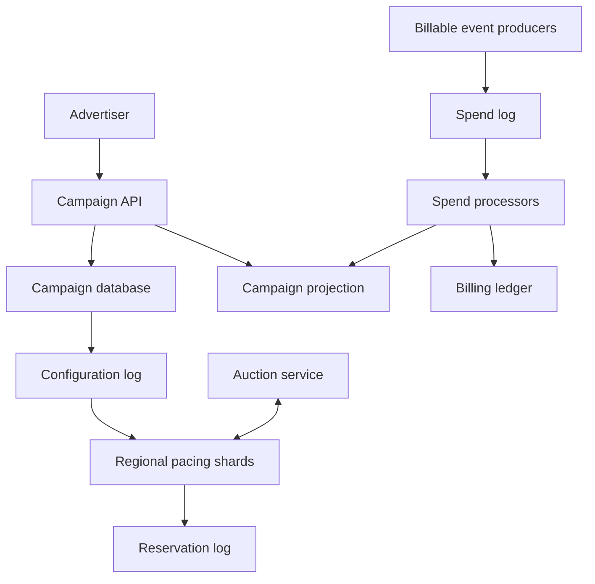
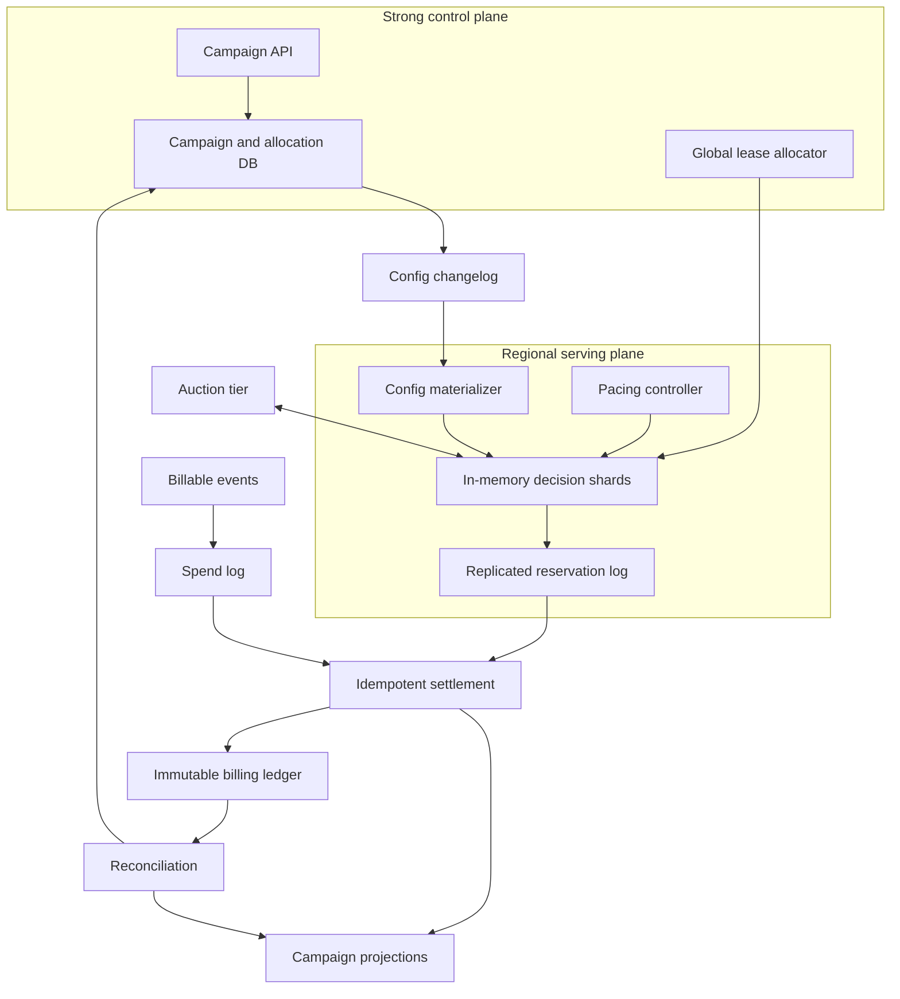

# Design a Global Advertising Budget Pacing and Spend-Control System

**Difficulty:** Senior/Staff-level  
**Primary themes:** high-rate counters, budget consistency, cache design, event streams, queues, reconciliation, multi-region reliability, approximate versus exact decisions  
**Interview time budget:** about 40–45 minutes  
**Educational walkthrough:** intentionally more detailed than the timed interview answer

> This is an original walkthrough organized using the public [Hello Interview delivery framework](https://www.hellointerview.com/learn/system-design/in-a-hurry/delivery): requirements, core entities, interfaces, a simple complete design, and focused deep dives. Following that guidance, the high-level design satisfies one operation at a time before adding scale and reliability mechanisms. Queue and cache terminology follows Hello Interview’s public [key technologies guide](https://www.hellointerview.com/learn/system-design/in-a-hurry/key-technologies) and [caching guide](https://www.hellointerview.com/learn/system-design/core-concepts/caching). All product assumptions, dialogue, calculations, architecture, and tradeoffs below are original.

---

## Interviewer prompt

> Design the budget pacing and spend-control system for a global advertising platform.
>
> Advertisers create campaigns with total and daily budgets. Ad-serving systems around the world ask whether a campaign may participate in an auction and later report impressions, clicks, conversions, and final billable cost. The platform should spend budgets smoothly over time, react to traffic changes, avoid materially overspending, and remain available during regional failures.

We are designing the budget and pacing subsystem—not the complete ad auction, ranking model, creative service, attribution system, or advertiser billing ledger. We will integrate with those systems through explicit interfaces.

---

## Targeted clarifying questions and assumed interviewer answers

### Product behavior

**Candidate:** “Does the pacing service choose the winning ad?”  
**Interviewer:** “No. It returns an eligibility decision and optionally a bid multiplier or spend token. The auction service ranks eligible ads.”

**Candidate:** “What budgets are supported?”  
**Interviewer:** “Each campaign has a lifetime budget, an optional daily budget in the advertiser’s billing timezone, start/end times, and an optional account-level credit cap.”

**Candidate:** “Should spend be uniform throughout the day?”  
**Interviewer:** “Usually smooth, but not perfectly uniform. Campaigns may use even pacing, accelerated pacing, or a scheduled delivery curve. The system should adapt to observed traffic.”

**Candidate:** “When is cost known?”  
**Interviewer:** “The auction can estimate a maximum cost before serving, but final cost arrives asynchronously. Events can be delayed, duplicated, or corrected.”

**Candidate:** “How strict is the no-overspend guarantee?”  
**Interviewer:** “Do not materially overspend. For ordinary campaigns, keep platform-caused overspend below the larger of 0.5% or $1. For regulated or very small budgets, offer a strict mode that sacrifices some availability and utilization.”

**Candidate:** “Can advertisers change budgets while campaigns run?”  
**Interviewer:** “Yes. Increases should propagate within seconds. Decreases must not allow new reservations beyond the new limit, though already-served ads may still settle.”

### Scale and latency

**Candidate:** “What scale should I design for?”  
**Interviewer:** “Assume 10 million active campaigns, 5 million auction requests per second globally at average load, 20 million per second at peak, and 2 million billable events per second. A single auction request may consider hundreds of campaigns, but the auction tier should batch pacing checks.”

**Candidate:** “What latency is available?”  
**Interviewer:** “The pacing decision adds at most 5 ms at p99 inside a region. Configuration changes should reach serving regions within five seconds. Spend dashboards may lag by up to one minute.”

### Correctness and availability

**Candidate:** “Can auction requests retry?”  
**Interviewer:** “Yes. Requests and spend events can be duplicated. Every reservation and event carries a stable idempotency key.”

**Candidate:** “Should regions keep serving if isolated?”  
**Interviewer:** “Ordinary campaigns may consume a preallocated regional budget lease. Strict campaigns fail closed when they cannot obtain authoritative budget.”

**Candidate:** “Is the billing ledger part of this system?”  
**Interviewer:** “No, but the final spend stream must be reconcilable with an immutable billing ledger. Pacing counters may be approximate; invoices may not be.”

### Security and tenancy

**Candidate:** “How is identity established?”  
**Interviewer:** “Advertiser APIs use authenticated principals. Internal auction and event producers use mutually authenticated service identities. Tenant and actor identities come from authentication, never from untrusted request fields.”

### Concise scope restatement

> **What I would say aloud:** “I’ll design a regional, sub-5-ms eligibility and reservation path backed by globally controlled budget allocations. It will pace spend against campaign curves, reserve expected cost before an auction, settle asynchronous actual cost idempotently, and reconcile against the billing ledger. I’ll make the contract different for highly available leased budgets and strict fail-closed budgets.”

---

# 1. Requirements (~5 minutes in the interview)

## 1.1 Core functional requirements

Prioritize three.

### FR1 — Configure campaigns and pacing policy

An authorized advertiser can create or update:

- lifetime and daily budgets;
- start/end time and billing timezone;
- pacing mode: even, accelerated, or scheduled curve;
- strict or standard spend-control mode;
- targeting and auction metadata references.

The serving plane receives versioned configuration changes within five seconds.

### FR2 — Make low-latency eligibility and reservation decisions

For a batch of candidate campaigns, the regional pacing service returns:

- eligible or ineligible;
- reason code;
- optional bid multiplier or sampling probability;
- a reservation token for the maximum expected charge.

The decision accounts for remaining global budget, the region’s spend lease, current pacing target, in-flight reservations, campaign state, and account credit controls.

### FR3 — Settle spend and expose progress

The system consumes billable events, deduplicates them, converts reservations into actual spend, releases unused reservation, and handles late corrections. Advertisers can read near-real-time delivery and spend progress. A reconciliation pipeline compares pacing state with the immutable billing ledger and repairs drift.

## 1.2 Quantified non-functional requirements

| Requirement | Target | Why it matters |
|---|---:|---|
| Decision latency | added p99 < 5 ms within region | Auction latency directly affects revenue and user experience |
| Decision availability | 99.999% standard mode; 99.9% strict mode | Standard campaigns should continue through control-plane disruption |
| Overspend | platform-caused overspend < max(0.5%, $1) standard; zero new authorizations past hard limit in strict mode | Business and contractual correctness |
| Configuration propagation | 99.9% within 5 s | Pauses and budget reductions must take effect quickly |
| Dashboard freshness | p99 lag < 60 s | Advertisers need useful but not ledger-grade progress |

Additional goals:

- process 20 million auction checks/s peak and 2 million settlement events/s;
- tolerate duplicated and out-of-order events;
- recover a failed region without losing accepted spend events;
- isolate noisy tenants and hot campaigns;
- preserve an immutable audit trail for configuration, allocations, reservations, and corrections.

## 1.3 Scale estimates that change the design

### Decision throughput

At 20 million auction requests/s peak, checking pacing through a global database is impossible within 5 ms. Suppose batched requests contain 50 locally relevant campaign candidates on average:

\[
20{,}000{,}000 \times 50 = 1\ \text{billion campaign checks/s}
\]

Most checks must be memory-local and vectorized. Even if prefiltering reduces this tenfold, the hot path still needs tens of millions of campaign decisions per second per large region.

**Design consequence:** campaign configuration and pacing state are pushed into regional in-memory shards. The hot path performs no cross-region call.

### Serving-state memory

Assume 10 million active campaigns and roughly 500 bytes of compact serving state per campaign:

\[
10{,}000{,}000 \times 500\ \text{B} \approx 5\ \text{GB}
\]

With indexes, allocator overhead, replica copies, and regional targeting subsets, perhaps 15–30 GB per complete regional copy. That is feasible, but a single process would be a failure and CPU bottleneck.

**Design consequence:** shard by campaign ID, replicate each shard, and push only region-relevant campaigns when possible.

### Spend-event stream

At 2 million events/s and 300 encoded bytes/event:

\[
2{,}000{,}000 \times 300\ \text{B} = 600\ \text{MB/s}
\]

That is 51.8 TB/day before replication and compression.

**Design consequence:** use a partitioned durable log for recent events, then compact and archive to object storage. Do not keep every event in the transactional campaign database.

### Reservation exposure

If final settlement arrives in 10 seconds on average and potential billable wins create 200,000 reservations/s:

\[
200{,}000 \times 10 = 2\ \text{million concurrent reservations}
\]

At 100 bytes of compact state, the live reservation index is hundreds of MB before replication. During delayed reporting it can grow much larger.

**Design consequence:** reservations need TTL, durable append events, compact regional indexes, and explicit expiry/reconciliation—not one synchronous row lock per auction candidate.

### Hot campaigns

A viral campaign may be evaluated millions of times per second. A centralized atomic counter for that campaign becomes a hot key even if the database is otherwise well sharded.

**Design consequence:** allocate spend authority hierarchically—global to region to pacing shard—so most decrements are local. Bound local exposure rather than synchronizing every impression.

> **What I would say aloud:** “The decisive number is up to a billion campaign checks per second after candidate expansion. That makes the hot path an in-memory regional decision, not a global transaction. The correctness problem becomes how much spend authority we safely lease to those regional shards.”

## 1.4 Scope and consistency/availability contract

### Strongly consistent control state

Campaign ownership, budget changes, pause status, account credit limits, and allocation epochs are strongly consistent in the control plane. Each mutation creates a monotonically increasing `config_version`.

### Standard campaign contract

A standard campaign uses bounded regional budget leases. A healthy isolated region may continue authorizing spend within its unexpired lease. This favors availability and smooth delivery while bounding overspend by the sum of outstanding leases and reservations.

### Strict campaign contract

A strict campaign obtains small, short-lived allocations from an authoritative coordinator. If the coordinator or quorum is unavailable and the local allocation is exhausted, new reservations fail closed. This reduces utilization and availability but enforces a hard limit on new authorizations.

### Pacing accuracy

Pacing is intentionally approximate over short windows. The system aims to track a target cumulative spend curve, not spend an identical amount every second. Final money uses the billing ledger; pacing counters are operational projections with explicit reconciliation.

### Event semantics

Reservation requests and settlement events are at-least-once. Idempotency keys make processing effectively once at each state transition. Event time and ingest time are both preserved because settlement and correction can be late.

### Read semantics

Serving decisions read region-local state that may lag the control plane by up to five seconds. A pause or budget decrease includes an urgent invalidation path. Dashboard reads are eventually consistent and include freshness metadata. Ledger-grade reports come from reconciled billing data.

> **What I would say aloud:** “I’ll keep authoritative configuration and allocation epochs strongly consistent, but make auction decisions region-local under bounded leases. The sum of outstanding leases defines maximum platform exposure. Strict campaigns use smaller leases and fail closed. Dashboard spend is a projection; invoices come from the immutable ledger.”

---

# 2. Core entities (~2 minutes)

| Entity | Purpose | Important identity |
|---|---|---|
| **AdvertiserAccount** | Tenant, credit, currency, policy boundary | `account_id` |
| **Campaign** | Budget, schedule, state, pacing policy | `campaign_id` |
| **BudgetWindow** | Daily/lifetime limit and consumed amounts | `(campaign_id, window_id)` |
| **PacingPlan** | Target cumulative spend curve and controller parameters | `(campaign_id, plan_version)` |
| **AllocationLease** | Spend authority granted to region/shard | `allocation_id` |
| **Reservation** | Temporary maximum-cost authorization | `reservation_id` |
| **SpendEvent** | Actual charge, release, refund, or correction | `event_id` |
| **CampaignProjection** | Fast operational view of allocated, reserved, and settled spend | `(campaign_id, projection_version)` |
| **AuditEvent** | Immutable configuration and control history | `audit_event_id` |

The important separation is between **authorization state** and **billing truth**. An allocation says a shard may authorize up to an amount; a reservation earmarks part of it; a settlement states actual charge; the billing ledger is the final financial record.

> **What I would say aloud:** “The entities follow the money lifecycle: budget window, allocation, reservation, and settlement. Keeping those separate lets us bound in-flight exposure and recover from delayed actual cost.”

---

# 3. API and system interfaces (~5 minutes)

Advertiser identity and `account_id` come from the validated access token. Internal callers are mutually authenticated; the auction service cannot claim another service identity or tenant through request fields.

## 3.1 Create a campaign — FR1

```http
POST /v1/campaigns
Authorization: Bearer <advertiser-token>
Idempotency-Key: launch-winter-2026
Content-Type: application/json

{
  "name": "Winter Boston",
  "currency": "USD",
  "lifetime_budget_micros": 50000000000,
  "daily_budget_micros": 5000000000,
  "billing_timezone": "America/New_York",
  "starts_at": "2026-11-10T05:00:00Z",
  "ends_at": "2026-12-01T05:00:00Z",
  "pacing": {"mode": "EVEN"},
  "spend_control": "STANDARD"
}
```

```json
{
  "campaign_id": "cmp_7F2",
  "state": "SCHEDULED",
  "config_version": 1
}
```

Money is stored as integer micros, not floating point. Currency conversion is outside the reservation hot path; a campaign budget uses one settlement currency.

## 3.2 Update budget or pause — FR1

```http
PATCH /v1/campaigns/cmp_7F2
Authorization: Bearer <advertiser-token>
If-Match: "config-v12"
Idempotency-Key: reduce-budget-2026-11-10

{
  "daily_budget_micros": 3000000000,
  "state": "PAUSED"
}
```

```json
{
  "campaign_id": "cmp_7F2",
  "state": "PAUSED",
  "config_version": 13,
  "effective_at": "2026-11-10T05:06:14.522Z"
}
```

`If-Match` prevents administrators from silently overwriting concurrent changes. A pause emits a high-priority invalidation in addition to the normal configuration changelog.

## 3.3 Batch eligibility and reserve — FR2

The auction tier batches candidates by pacing shard.

```http
POST /internal/v1/pacing:reserveBatch
Authorization: Service <auction-identity>
Idempotency-Key: auction_req_01K9...
Content-Type: application/json

{
  "auction_id": "auc_01K9...",
  "region": "us-east",
  "candidates": [
    {
      "campaign_id": "cmp_7F2",
      "max_cost_micros": 42000,
      "request_features_hash": "f_81"
    },
    {
      "campaign_id": "cmp_9A1",
      "max_cost_micros": 28000,
      "request_features_hash": "f_54"
    }
  ]
}
```

```json
{
  "decisions": [
    {
      "campaign_id": "cmp_7F2",
      "eligible": true,
      "bid_multiplier": 0.72,
      "reservation_id": "res_31C",
      "reservation_micros": 42000,
      "expires_at": "2026-11-10T05:06:25.010Z",
      "allocation_epoch": 884
    },
    {
      "campaign_id": "cmp_9A1",
      "eligible": false,
      "reason": "PACED_AHEAD"
    }
  ]
}
```

In an optimized implementation this is a binary RPC rather than public JSON/HTTP, but the semantic contract is the same.

Only a potential winner needs a firm reservation. If the auction evaluates hundreds of candidates, it can first call a cheaper read-only eligibility API, rank candidates, then reserve the top few. This prevents reservation amplification.

## 3.4 Release a losing reservation — FR2

```http
POST /internal/v1/reservations/res_31C:release
Authorization: Service <auction-identity>
Idempotency-Key: auction_req_01K9...-release-cmp_7F2

{
  "reason": "LOST_AUCTION"
}
```

Release is idempotent. Reservation TTL is the safety net when an explicit release is lost.

## 3.5 Settle actual spend — FR3

Settlement normally arrives through a durable stream rather than a synchronous API:

```json
{
  "event_id": "evt_01K9...",
  "event_type": "CHARGE",
  "reservation_id": "res_31C",
  "campaign_id": "cmp_7F2",
  "actual_cost_micros": 35700,
  "auction_id": "auc_01K9...",
  "occurred_at": "2026-11-10T05:06:16.010Z",
  "producer_version": 3
}
```

A correction uses a new immutable `event_id` and references the original event:

```json
{
  "event_id": "evt_correction_77",
  "event_type": "ADJUSTMENT",
  "original_event_id": "evt_01K9...",
  "campaign_id": "cmp_7F2",
  "delta_cost_micros": -5700,
  "occurred_at": "2026-11-10T07:41:00Z"
}
```

Never edit historical spend events in place.

## 3.6 Read campaign delivery — FR3

```http
GET /v1/campaigns/cmp_7F2/delivery
Authorization: Bearer <advertiser-token>
```

```json
{
  "campaign_id": "cmp_7F2",
  "window": {
    "starts_at": "2026-11-10T05:00:00Z",
    "ends_at": "2026-11-11T05:00:00Z",
    "budget_micros": 3000000000
  },
  "settled_spend_micros": 1210000000,
  "reserved_micros": 42000000,
  "allocated_unspent_micros": 86000000,
  "target_spend_micros": 1275000000,
  "pacing_ratio": 0.949,
  "projection_as_of": "2026-11-10T05:06:10Z",
  "ledger_reconciled_through": "2026-11-10T05:05:00Z"
}
```

## 3.7 Interface-to-requirement map

| Requirement | Interface |
|---|---|
| Configure campaign | Campaign POST/PATCH plus configuration changelog |
| Decide and reserve | Regional batch eligibility/reservation RPC |
| Release unused authority | Idempotent reservation release or TTL expiry |
| Settle actual cost | Partitioned spend-event stream |
| Observe progress | Delivery read API and optional update subscription |

> **What I would say aloud:** “The auction path has two stages: cheap eligibility for many candidates and a firm reservation for likely winners. That avoids writing hundreds of reservations per auction. Every reservation and settlement has a stable idempotency key, and advertiser identity comes from authentication.”

---

# 4. Data flow

This system is a pipeline, so an explicit flow is useful.

## 4.1 Configuration flow

1. Advertiser writes a versioned campaign mutation.
2. The control service commits campaign state and an outbox event atomically.
3. A changelog distributes the new version to regional config consumers.
4. Regional pacing shards apply only newer versions and acknowledge progress.
5. The control plane monitors propagation lag; urgent pause messages use a priority channel.

## 4.2 Decision and reservation flow

1. Auction service batches candidates by local pacing shard.
2. Shard reads in-memory campaign, pacing, and allocation state.
3. It computes eligibility and bid multiplier.
4. For likely winners, it atomically deducts maximum cost from its local allocation and creates a reservation.
5. It returns the reservation token to the auction.
6. Auction losers release tokens; winners proceed to ad serving.

## 4.3 Settlement flow

1. Impression/click accounting publishes a billable event.
2. A spend processor deduplicates `event_id`.
3. It finds the reservation, charges actual cost, and releases the difference.
4. It updates a campaign projection and emits accounting records.
5. The immutable billing ledger independently records final financial events.
6. Reconciliation compares projection, reservations, allocations, and ledger totals.

---

# 5. High-level design (~10–15 minutes in the interview)

Build the simplest complete design one operation at a time. Defer precise lease sizing, pacing control math, and failure reconciliation to the deep dives.

## 5.1 Baseline architecture



There are three planes:

- **control plane:** strongly consistent campaign configuration and allocation policy;
- **serving plane:** region-local, in-memory decisions and reservations;
- **accounting plane:** durable asynchronous settlement, projection, and reconciliation.

## 5.2 Operation 1: configure and distribute a campaign

### Authoritative write

The campaign service validates ownership, budget, currency, dates, and account credit policy. It writes:

```text
Campaign(
  account_id, campaign_id,
  state, currency,
  lifetime_budget_micros, daily_budget_micros,
  billing_timezone, starts_at, ends_at,
  pacing_mode, spend_control_mode,
  config_version, updated_at
)
```

The database also contains an idempotency record and outbox event in the same transaction.

### Regional materialization

Configuration events are keyed by campaign ID. Regional consumers maintain a compact serving record:

```text
ServingCampaign(
  campaign_id, state, config_version,
  window_start, window_end, budget_micros,
  plan_version, target_curve_ref,
  strict_mode, allocation_epoch,
  policy_bits
)
```

Each pacing shard uses a local immutable snapshot plus atomic mutable counters. Applying a config update swaps the immutable record and migrates counters under the new allocation epoch.

### Cache strategy

This is push-based materialization, not ordinary cache-aside on the hot path. A cache miss that calls a remote database would violate the latency SLO.

Use:

- in-process serving state for decisions;
- a regional replicated key-value snapshot for fast shard restart;
- the configuration log as replay source;
- version checks so delayed updates cannot roll state backward.

### Dialogue

**Candidate:** “I’m treating campaign state as a versioned materialized view inside each serving region. The auction path never waits for the control database. A pause is a high-priority versioned invalidation, but correctness still comes from monotonically increasing configuration versions.”

**Interviewer:** “What if a shard misses an event?”

**Candidate:** “It detects an offset or version gap, stops authorizing that campaign if the gap is safety-relevant, loads the regional snapshot, and replays the log. Periodic anti-entropy compares versions with the control plane.”

## 5.3 Operation 2: determine pacing eligibility

For campaign `c` at time `t`, define:

- `B`: budget for the current window;
- `F(t)`: desired fraction of budget spent by time `t` from 0 to 1;
- `T(t) = B × F(t)`: target cumulative spend;
- `S`: settled spend;
- `R`: active reserved spend;
- `A`: recent authorized amount not yet reflected in projection.

A conservative effective spend is:

\[
E = S + R + A
\]

The pacing error is:

\[
e(t) = T(t) - E
\]

If `e(t)` is positive, the campaign is behind target; if negative, it is ahead. A simple controller maps that error to a probability or bid multiplier. For example:

```text
if remaining_authority < max_cost: INELIGIBLE_BUDGET
else if campaign paused/expired: INELIGIBLE_STATE
else if pacing_ratio is far ahead: INELIGIBLE_PACING
else eligible with multiplier = clamp(base + k * normalized_error)
```

The baseline can use a token bucket whose refill rate follows the target curve. Tokens represent permission to reserve spend. This naturally handles bursts while enforcing a long-term rate.

### Why not query settled spend for every decision?

Settlement is delayed and the query would be too slow. The pacing shard maintains a local projection updated from spend and reservation streams. It deliberately counts in-flight reservations so reporting delay does not cause runaway spend.

## 5.4 Operation 3: reserve maximum expected cost

Eligibility alone is racy: thousands of concurrent auctions could all see the same remaining budget. A likely winner therefore creates a reservation against local authority.

Within a single pacing shard, use an atomic compare-and-swap:

```text
if available_micros >= max_cost and request_not_seen:
    available_micros -= max_cost
    reserved_micros += max_cost
    create reservation
else:
    reject or return prior result
```

Relevant reservation state:

```text
Reservation(
  reservation_id, request_id,
  campaign_id, allocation_id, allocation_epoch,
  max_cost_micros, settled_cost_micros,
  status, created_at, expires_at,
  auction_id, region_id, shard_id
)
```

The shard appends a reservation event to a replicated regional log before returning a firm token. For extremely small reservations, it may batch log replication, but then the maximum lost/burst exposure must be explicitly included in the overspend bound.

An idempotency table or bounded request-ID cache ensures a retried auction request receives the same reservation. The durable reservation log remains the recovery source when the cache entry expires.

### Dialogue

**Interviewer:** “Why reserve the maximum cost rather than the expected cost?”

**Candidate:** “Maximum cost gives a hard upper bound. Expected cost improves utilization but can overspend if actual cost is higher. We can reserve a conservative cap, then quickly release the difference at settlement. For products with a proven upper bound, that is the safer contract.”

## 5.5 Operation 4: settle actual cost and release unused authority

The spend processor consumes events partitioned by campaign ID or reservation ID.

For a normal charge:

1. deduplicate `event_id`;
2. load reservation state;
3. validate campaign, allocation epoch, and currency;
4. atomically transition `RESERVED -> SETTLED`;
5. add actual cost to settled spend;
6. subtract maximum reserved amount from reserved spend;
7. return `max - actual` to available allocation;
8. emit projection and ledger-facing events.

For a release, transition `RESERVED -> RELEASED`. For expiry, transition `RESERVED -> EXPIRED`. All are idempotent conditional transitions.

```text
SpendEventDedup(
  producer_id, event_id,
  payload_hash, applied_at,
  resulting_projection_version
)
```

The processor rejects a duplicate ID with a different payload to an anomaly queue rather than silently accepting corruption.

### Late settlement after reservation expiry

An expired reservation may still correspond to an ad that was served. The actual charge must still be recorded. The settlement consumes unallocated campaign headroom or creates a controlled deficit. The allocator reduces future leases until the deficit is repaid. Strict mode may keep a longer hold or require serving confirmation before release.

## 5.6 Operation 5: show advertiser progress

Stream processors produce a queryable campaign projection:

```text
CampaignProjection(
  campaign_id, window_id,
  budget_micros,
  settled_micros, reserved_micros,
  allocated_unspent_micros,
  target_micros,
  projection_version,
  projection_as_of,
  ledger_reconciled_through
)
```

The read API uses cache-aside because dashboard reads are tolerant of seconds of staleness:

- key by `(account_id, campaign_id, window_id)`;
- TTL of 5–15 seconds;
- invalidate on material projection changes;
- coalesce cache misses to avoid a thundering herd;
- return freshness timestamps.

The authoritative ledger report is a separate endpoint with higher latency.

## 5.7 Baseline completeness check

The baseline now supports:

- versioned campaign configuration;
- region-local eligibility and pacing;
- atomic local reservations;
- asynchronous idempotent settlement;
- near-real-time progress reads.

The baseline still needs a safe way to divide global budget across regions, a robust pacing controller, and recovery from lost/delayed events. Those are the deep dives.

---

# 6. Deep dives (~10–15 minutes in the interview)

Choose three:

1. bounded global overspend with hierarchical budget leases;
2. adaptive pacing under uncertain traffic and delayed feedback;
3. idempotent settlement, reconciliation, and regional failure recovery.

## Deep dive 1 — Bounded global overspend with hierarchical budget leases

### Where the baseline breaks

If every region maintains an independent copy of “remaining budget,” they can collectively spend the full budget multiple times. If every decision uses a global strongly consistent counter, latency and availability fail. A hot campaign also overloads the counter leader.

### Compare approaches

| Approach | Advantage | Failure |
|---|---|---|
| Global transaction per reservation | Strongest immediate consistency | Cannot meet 5 ms globally; hot-key bottleneck |
| Eventually replicated regional counters | Very fast and available | Unbounded overspend during lag/partition |
| Periodic fixed regional quotas | Bounded overspend | Stranded budget and poor traffic adaptation |
| Short-lived hierarchical leases | Fast local decisions with bounded exposure | More allocator and reclaim complexity |

Choose hierarchical leases.

### Allocation hierarchy

```text
Campaign budget window
  -> regional allocation
      -> pacing-shard allocation
          -> reservation
              -> settled spend or release
```

The global allocator owns the unallocated remainder. It grants an `AllocationLease`:

```text
AllocationLease(
  allocation_id, campaign_id, window_id,
  parent_allocation_id,
  region_id, shard_id,
  epoch, granted_micros,
  consumed_micros, returned_micros,
  issued_at, expires_at, status
)
```

The invariant is:

\[
\text{settled} + \text{active reservations} + \text{outstanding leases} \leq \text{budget} + \text{explicit tolerance}
\]

The allocator never grants the same authority twice. It uses a strongly consistent transaction for grant, renewal, return, and epoch changes.

### Lease sizing

Large leases improve availability and reduce control traffic but increase stranded capital and worst-case exposure after a region is lost. Small leases improve control but create allocator load and starvation risk.

A practical lease target may cover 10–30 seconds of predicted spend plus safety margin:

\[
L_r = \min(remaining, predictedRate_r \times horizon \times safetyFactor)
\]

Example: a campaign is spending $100/s globally, with 40% in `us-east`. A 20-second horizon and 1.25 safety factor grants:

\[
100 \times 0.4 \times 20 \times 1.25 = \$1{,}000
\]

This region can survive a brief allocator outage, while the maximum stranded authority is explicit.

### Overspend bound

Suppose the campaign budget remaining is $10,000 and outstanding regional leases total $9,700, active reservations are already included within those leases, and unreplicated local batches can expose at most $50 per region across four regions. Worst platform exposure is roughly:

\[
9{,}700 + 4 \times 50 = \$9{,}900
\]

The allocator retains $100 unallocated safety margin. Lease and batching parameters are chosen so total exposure stays within contract.

For a $20 strict campaign, use tiny or synchronous authority because a $1 overshoot is 5%. For a $1 million campaign, larger leases are efficient and still below 0.5% tolerance.

### Budget decreases and epochs

A dangerous case is decreasing budget below outstanding authority. The control plane:

1. commits new budget and increments `allocation_epoch`;
2. broadcasts urgent revoke/update;
3. stops issuing old-epoch leases;
4. serving shards reject new reservations under the old epoch;
5. waits for acknowledgments or lease expiry;
6. records already reserved/served exposure separately.

If the new budget is below settled plus in-flight spend, the system cannot undo already served ads. It pauses future spend and surfaces an over-budget operational state.

### Lease expiry and fencing

Time expiry alone is risky under clock skew. Leases include:

- allocator epoch;
- signed or authenticated grant;
- server-issued expiry with bounded clock policy;
- renewal sequence;
- shard identity.

The serving shard refuses new reservations after local safe expiry. Settlement for old reservations remains valid; only new authorization is fenced.

### Regional partition behavior

- **Standard mode:** continue within the remaining unexpired lease; then fail closed for that campaign.
- **Strict mode:** use smaller leases and fail closed earlier.
- **Accelerated mode:** may intentionally allocate most remaining budget to healthy regions, but never reissue authority still valid in the partitioned region.

Reclaim only after lease expiry or an explicit fenced revocation acknowledgment. Otherwise a delayed region and its replacement could both spend the same allocation.

### Observability

Track:

- unallocated, allocated, reserved, settled, and returned amounts per window;
- lease renewal latency and exhaustion rate;
- stranded authority by region;
- old-epoch reservation attempts;
- budget decreases with in-flight exposure;
- campaigns throttled because authority, rather than traffic, was unavailable;
- invariant violations, which page immediately.

> **What I would say aloud:** “I avoid a global counter on every auction by leasing bounded spend authority. The allocator’s invariant includes settled spend, reservations, and every outstanding lease. A partitioned region can spend only its lease, and authority is never reissued until expiry or fenced return. Lease size is the explicit availability-versus-exposure knob.”

## Deep dive 2 — Adaptive pacing under uncertain traffic and delayed feedback

### Where the baseline breaks

An even hourly quota is not enough:

- user traffic varies by hour and region;
- auction win rate and price change;
- settlement feedback is delayed;
- a campaign can underdeliver early and have no traffic later;
- reacting too strongly creates on/off oscillation;
- reservations temporarily overstate final spend.

### Compare pacing strategies

| Strategy | Benefit | Problem |
|---|---|---|
| Fixed hourly buckets | Simple and predictable | Ignores traffic shape; stranded budget |
| Greedy spend until exhausted | Maximizes early delivery | Poor advertiser experience; misses daypart goals |
| Static probability sampling | Cheap hot path | Needs frequent manual recomputation |
| Feedback controller against target curve | Adapts to spend and traffic | Must handle delay and avoid oscillation |
| Forecast/optimization model | Better opportunity allocation | More complexity and model risk |

Choose a feedback controller as the reliable baseline; optionally use forecasts to choose the target curve and initial parameters.

### Target curve

For even pacing, `F(t)` may be linear over the campaign’s active hours. A scheduled curve can give more weight to evenings. The curve is cumulative and monotonic.

Example: a $2,400 daily budget over 24 hours has a naive target of $100/hour. If historical eligible traffic is 2× higher from 6–10 p.m., a traffic-shaped curve reserves more target budget for those hours instead of spending linearly.

### Controller input

Use:

```text
effective_spend = settled + weighted_reserved + recent_unprojected_authorizations
target = budget * target_fraction(now)
error = target - effective_spend
```

`weighted_reserved` may be less than 100% only if historical settlement ratio is stable and an additional safety cap exists. Counting 100% is conservative but can underdeliver when many reservations lose or settle below maximum.

### Probability or bid multiplier

The controller outputs one of:

- probability of admitting an eligible opportunity;
- token refill rate;
- bid multiplier passed to auction ranking;
- combination of hard budget gate and soft bid multiplier.

A simple proportional-integral controller can use current error plus accumulated error. Explain unfamiliar terms:

- **proportional term:** reacts to how far behind/ahead we are now;
- **integral term:** corrects persistent underdelivery over time;
- **damping/clamps:** prevent large abrupt swings.

Conceptually:

\[
p_{next} = clamp(p_{current} + k_p e + k_i \sum e, p_{min}, p_{max})
\]

The exact production formula is less important than the stability controls.

### Avoiding oscillation

Use:

- update intervals such as 1–10 seconds, not on every event;
- exponentially weighted moving averages for spend rate and win rate;
- bounded parameter changes per interval;
- hysteresis so tiny error does not flip eligibility;
- reservation-aware effective spend;
- separate emergency hard stop near budget exhaustion.

If feedback is delayed 30 seconds and the campaign spends $1,000/s, ignoring in-flight authorization can overshoot by $30,000. Reservations close that feedback gap.

### Traffic forecasts

Forecasts estimate future eligible opportunities and clearing prices by region/time. They improve allocation but should not be the only safety mechanism.

If forecast service fails:

- retain the last bounded forecast briefly;
- fall back to target-curve feedback;
- reduce aggressive catch-up;
- never bypass the hard allocation limit.

### Cold start

A new campaign lacks win-rate and price history. Initialize from similar campaigns or conservative defaults, run a small exploration allocation, and update quickly. Bound exploration so an erroneous estimate cannot exhaust the budget.

### Hot campaign computation

Do not recompute the pacing model per auction. A background controller updates compact parameters every few seconds. The hot path reads:

```text
eligible_state, probability, bid_multiplier,
available_authority, config_version, plan_version
```

This makes each decision a handful of memory reads, random sampling, and an atomic reservation only for likely winners.

### Fairness and priority

When inventory is scarce, auction ranking—not pacing alone—decides economic priority. Pacing should not guarantee delivery that inventory cannot support. It supplies an eligibility probability or multiplier while preserving campaign budget limits.

### Observability and experiments

Measure:

- cumulative target versus effective and settled spend;
- underdelivery at campaign end;
- overspend and emergency-stop frequency;
- controller oscillation and parameter-change rate;
- forecast error by region/hour;
- reservation-to-settlement ratio;
- spend opportunity lost due to stale or exhausted allocations;
- distribution by campaign size and pacing mode.

Roll out controller changes through shadow computation and controlled experiments. Compare what the new controller would have decided without immediately affecting spend.

> **What I would say aloud:** “The hard lease protects money; the pacing controller optimizes delivery inside that boundary. I compare reservation-aware effective spend to a cumulative target curve and update an admission probability or bid multiplier every few seconds. Smoothing, bounded changes, and hysteresis prevent delayed feedback from causing oscillation.”

## Deep dive 3 — Idempotent settlement, reconciliation, and failure recovery

### Where the baseline breaks

The accounting pipeline faces:

- duplicate events from producer retries;
- a reservation event committed locally but lost during region failure;
- settlement before reservation replication;
- events arriving days late;
- correction and refund events;
- projection consumer restarts;
- reservation expiry followed by legitimate charge;
- divergence between pacing projection and billing ledger.

### Delivery semantics

The durable log is at-least-once. “Exactly once” is achieved operationally through deterministic IDs and atomic state transitions, not by assuming the queue never duplicates.

Each producer creates stable `event_id` from its durable source identity. The processor transaction includes:

1. insert dedup key if absent;
2. apply reservation transition or adjustment;
3. update campaign projection/version;
4. write an outbox event for downstream consumers.

If the transaction retries, the dedup key returns the prior result.

### Partitioning and ordering

Partition spend events by `campaign_id` to serialize projection updates for a campaign. Reservation lookup may use a distributed key-value store keyed by `reservation_id`.

Strict global event order is unnecessary. Per-campaign processors use event IDs and conditional transitions. Corrections explicitly reference prior events. Event-time windows remain open for a lateness period, while older corrections update both historical aggregates and current financial balance.

### Reservation durability choices

| Choice | Latency | Failure exposure |
|---|---:|---|
| Synchronous cross-AZ log append | Low regional latency | Survives process/AZ failure |
| Synchronous cross-region append | Higher latency | Survives full region loss |
| Batched local append | Lowest latency | Bounded unreplicated exposure |

For standard mode, replicate across availability zones before returning and include bounded unreplicated batches in exposure calculations. For strict/high-value mode, use synchronous durable append to a paired region or authoritative reservation service.

### Region failure

1. Global allocator stops issuing new leases to the region.
2. Other regions continue using their own leases.
3. The failed region’s authority is not reissued until lease expiry/fencing.
4. Replicated reservation and spend logs resume in a healthy region.
5. Projectors replay from durable offsets.
6. Settlements referencing missing reservations enter a pending join buffer and lookup/reconciliation path.
7. When the region returns, its old allocation epoch is read-only; it cannot authorize new spend.

### Missing reservation at settlement

Do not discard the charge. The processor:

- verifies the signed producer and campaign association;
- stores the event in a pending unmatched table;
- retries reservation lookup for a bounded period;
- checks replicated auction outcome data;
- if validated, records spend as an unreserved charge and creates campaign deficit;
- sends suspicious mismatches to an anomaly/dead-letter workflow.

The deficit reduces future allocation, so operational drift self-corrects without altering billing truth.

### Reservation expiry

A sweeper partitions by expiry time and conditionally marks old reservations expired. Expiry releases local authority but retains a compact tombstone for the maximum lateness/idempotency window.

Deleting reservation state immediately is dangerous: a late settlement would look unrelated. After the hot retention window, compact tombstones to object storage/indexed history.

### Reconciliation layers

Use three loops:

1. **Fast projection reconciliation** every few minutes: reservation log versus campaign counters.
2. **Allocator invariant reconciliation**: parent grants equal child grants plus returns and consumption.
3. **Financial reconciliation** hourly/daily: pacing settlements versus immutable billing ledger.

Reconciliation emits compensating events; it does not rewrite history silently.

Example invariant per campaign window:

```text
budget
= unallocated
 + active_allocations
 + settled_spend
 + recognized_adjustments
 + explicit_deficit_or_tolerance
```

Small rounding or timing differences are classified; unexplained material differences halt new allocation and page operators.

### Budget-window boundaries

Daily budgets use the advertiser’s billing timezone. Daylight-saving transitions make some days 23 or 25 hours. Store the explicit UTC start/end instants for each window rather than assuming 86,400 seconds.

A reservation belongs to the window active when the ad opportunity was authorized or served according to billing policy. Settlement carries that `window_id`; processing time does not decide the day.

### Dead-letter handling

A dead-letter queue is not a graveyard. Every reason has an owner and replay policy:

- invalid schema: producer team;
- duplicate ID with different payload: security/data-integrity incident;
- unknown campaign: delayed configuration lookup;
- currency mismatch: reject and investigate;
- missing reservation: pending join/reconciliation;
- illegal terminal transition: anomaly audit.

### Observability

Track:

- event ingest and processing lag by partition;
- dedup hit rate and payload conflicts;
- unmatched settlement count and age;
- expired reservation amount and late-settlement rate;
- projection-versus-ledger drift;
- replay duration and projector checkpoint age;
- allocation invariant violations;
- dead-letter count by reason and oldest age;
- RPO/RTO during regional exercises.

> **What I would say aloud:** “The stream is at least once, so money transitions are idempotent database operations keyed by stable event IDs. Projection state is replayable; the immutable ledger remains financial truth. Region loss cannot cause authority reuse because leases are fenced, and three reconciliation loops repair projection, allocation, and ledger drift through compensating events.”

---

# 7. Final design

## 7.1 Evolved architecture



## 7.2 Component summary

| Component | Responsibility |
|---|---|
| Campaign API/database | Strong campaign ownership, budget, state, and config versions |
| Configuration changelog | Ordered dissemination and replay of campaign changes |
| Global allocator | Strongly consistent regional/shard spend leases and epochs |
| Regional materializer | Builds restartable serving snapshots |
| Pacing controller | Computes target curves and periodically updates decision parameters |
| Decision shards | Sub-5-ms eligibility and local atomic reservation |
| Reservation log/index | Durable reservation lifecycle and recovery |
| Spend log/processors | At-least-once events, deduplication, settlement, corrections |
| Campaign projection | Fast operational spend and delivery reads |
| Billing ledger | Immutable financial truth |
| Reconciliation workers | Detect and repair projection/allocation drift |

## 7.3 End-to-end narrative

An advertiser creates a versioned campaign in the strongly consistent control plane. The outbox publishes its configuration to regional materializers. A global allocator grants each active region a short-lived, epoch-fenced portion of the budget. Background pacing controllers compare reservation-aware effective spend with the campaign’s cumulative target curve and update a compact admission probability or bid multiplier.

The auction service performs batch eligibility against in-memory regional shards. Likely winners atomically reserve maximum cost from local leased authority and receive stable reservation tokens. Losing reservations are released; TTL handles lost releases. Actual cost arrives asynchronously through a durable spend log. Idempotent processors settle the reservation, release unused amount, update the operational projection, and feed the immutable billing ledger.

During a partition, a standard campaign continues only within its existing lease. Strict campaigns use smaller authority and fail closed sooner. No region’s allocation is reissued until it expires or is explicitly fenced. Reconciliation continuously compares reservation events, allocator invariants, projections, and ledger truth.

## 7.4 Requirements check

| Requirement | Design response |
|---|---|
| Configure campaigns | Strong versioned writes, optimistic concurrency, changelog |
| Propagate changes within 5 s | Push materialization, lag monitoring, urgent pause channel |
| Decision p99 < 5 ms | In-process sharded state; no cross-region hot-path call |
| Smooth pacing | Reservation-aware target curve and bounded feedback controller |
| Bound overspend | Hierarchical leases, safety margin, firm reservations, epochs |
| Strict spend mode | Small authoritative leases and fail-closed behavior |
| Duplicate-safe settlement | Stable event IDs and conditional transactional transitions |
| Region failure | Independent leases, replicated logs, fenced recovery |
| Dashboard freshness < 60 s | Streaming projection plus short cache TTL |
| Ledger correctness | Immutable financial events and layered reconciliation |
| Noisy-tenant isolation | Sharding, quotas, batched RPCs, per-account rate limits |

## 7.5 Final 60-second interview summary

> **What I would say aloud:** “I separate financial authority, fast serving, and ledger truth. Campaign configuration and allocation epochs are strongly consistent. The global allocator leases bounded spend authority to regions and shards, so auctions make sub-5-ms in-memory decisions without a global counter. Likely winners reserve maximum cost; settlements idempotently convert reservations to actual spend and release the difference. A feedback controller compares reservation-aware effective spend with a target curve and updates admission probability or bid multiplier every few seconds. Standard campaigns remain available within leases; strict campaigns use smaller leases and fail closed. Replicated logs plus projection, allocator, and ledger reconciliation recover from duplicates, late events, and regional failure.”

---

# Realistic interviewer follow-ups with strong sample answers

## 1. “Why not use one Redis atomic counter per campaign?”

**Strong answer:** “A regional Redis counter is fast but cannot enforce a global budget across partitions, and a globally centralized counter adds latency and becomes a hot key. I use strongly allocated regional authority, then local atomic counters. Redis could implement a regional shard, but the lease invariant supplies global correctness.”

## 2. “Does a reservation guarantee the ad wins?”

**Strong answer:** “No. It guarantees budget authority if the ad wins. Losers release immediately, and TTL covers lost release messages. To avoid hundreds of reservations per auction, reserve only top candidates after a read-only eligibility pass.”

## 3. “What if actual cost exceeds reserved cost?”

**Strong answer:** “The product should provide a valid maximum-cost bound. If a bug or correction exceeds it, record the full legitimate charge, create a campaign deficit, stop or reduce future allocation, and alert. Never truncate billing truth to make the pacing counter look correct.”

## 4. “How do you prevent an isolated region and its replacement from both spending?”

**Strong answer:** “The allocator does not reissue a region’s authority until the old lease expires or returns under fencing. Every grant has an epoch and shard identity. The old region cannot renew or create new reservations after safe expiry.”

## 5. “How do budget increases and decreases differ?”

**Strong answer:** “An increase can safely create more unallocated authority and propagate normally. A decrease increments the allocation epoch, urgently revokes new old-epoch reservations, and waits for lease expiry or acknowledgment. Already served and reserved exposure remains visible; the system cannot retroactively undo it.”

## 6. “Why include reservations in effective spend?”

**Strong answer:** “Settlement feedback can lag. Without reservations, a campaign spending $1,000 per second with 30 seconds of delay might overshoot by $30,000. Reservations represent recent authorized exposure and close that feedback gap.”

## 7. “How would you reduce underdelivery caused by conservative maximum reservations?”

**Strong answer:** “Use product-specific tight upper bounds, fast loser release, historical settlement ratios with a conservative weighting, and short reservation TTLs. Any probabilistic overbooking remains below a hard allocation cap and is disabled for strict campaigns.”

## 8. “What happens when the pacing controller fails?”

**Strong answer:** “Serving shards retain the last versioned parameters for a short bounded period. The hard budget lease still prevents unbounded spend. If parameters become too stale, fall back to a conservative token rate or pause rather than bypass budget control.”

## 9. “How do you handle a campaign that becomes extremely hot?”

**Strong answer:** “Shard evaluation by campaign and request, replicate immutable state, and subdivide its regional lease among several execution shards. A parent regional allocator periodically rebalances subleases. That removes a single atomic counter while keeping total authority bounded.”

## 10. “Can settlement be exactly once?”

**Strong answer:** “Transport is at least once. The effect becomes effectively once because a stable event ID, dedup insert, reservation transition, projection update, and outbox write occur in one transaction. A repeated event returns the prior result.”

## 11. “What is the source of truth for the advertiser dashboard?”

**Strong answer:** “The near-real-time dashboard uses a streaming operational projection and clearly reports freshness. Invoice-grade reports use the reconciled immutable billing ledger. Mixing those contracts would either make serving too slow or make billing too approximate.”

## 12. “How do daily budgets behave across daylight-saving changes?”

**Strong answer:** “Materialize each budget window as explicit UTC start and end instants using the advertiser’s timezone rules. Do not assume every day is 86,400 seconds. Reservations and spend carry the window ID determined by billing policy.”

## 13. “How would you support account-level credit caps across campaigns?”

**Strong answer:** “Add another parent allocation level: account credit grants campaign budget authority, campaigns grant regions, and regions grant shards. The same conservation invariant applies at every level. Large account changes increment a parent epoch and constrain new child grants.”

## 14. “How do you test this system?”

**Strong answer:** “Use deterministic simulations with duplicated, delayed, reordered, and corrected events; property-test the allocation conservation invariant; shadow new pacing controllers; inject region and log failures; and replay production-like traffic. The key assertions are no unauthorized authority creation, bounded exposure, idempotent settlement, and eventual ledger reconciliation.”

---

# Common pitfalls

1. **Calling a global database on every auction.** It cannot meet the latency or hot-key requirements.
2. **Replicating “remaining budget” independently to every region.** That permits unbounded collective overspend.
3. **Counting only settled spend.** Delayed feedback causes runaway authorization; include reservations.
4. **Reserving for every candidate.** Use read-only eligibility first, then reserve likely winners.
5. **Using floating-point money.** Store integer minor units or micros with explicit currency.
6. **Claiming the queue provides exactly once.** Stable IDs and atomic transitions make effects idempotent.
7. **Treating pacing projections as invoice truth.** Reconcile to an immutable billing ledger.
8. **Reissuing a failed region’s lease immediately.** Wait for expiry or fenced return.
9. **Ignoring budget decreases with outstanding leases.** Increment allocation epoch and expose in-flight liability.
10. **Letting a controller update per auction.** Compute parameters in the background; keep the hot path tiny.
11. **Using a fixed hourly quota without traffic awareness.** It strands budget and causes end-of-day underdelivery.
12. **Deleting expired reservations immediately.** Retain tombstones for late settlement and deduplication.
13. **Failing to distinguish standard and strict campaigns.** Availability and overspend guarantees require different lease policies.
14. **Ignoring daylight-saving time.** Budget windows need explicit UTC boundaries.
15. **Treating a dead-letter queue as success.** Every failure class needs ownership, replay, and age alerts.

---

# Interview pacing versus this walkthrough

This document is intentionally more detailed than a 45-minute interview answer.

- Requirements and contract: about 5 minutes.
- Core entities: about 2 minutes.
- Interfaces: about 5 minutes.
- Baseline design, one operation at a time: 10–15 minutes.
- Two or three deep dives: 10–15 minutes.
- Requirements check and summary: about 2 minutes.

In an interview, establish the distinction between budget authority, reservations, pacing projections, and billing truth early. Then let the interviewer choose whether to probe leases, pacing control, or reconciliation.

## Compact opening script

> “I’ll clarify what counts as spend, the overspend tolerance, and the regional-failure contract. Then I’ll model configuration, decisions, reservations, and settlements. I’ll build the regional hot path first and defer global lease allocation, pacing stability, and reconciliation to deep dives.”

## Compact transition into deep dives

> “The baseline is functionally complete, but three things can still break it: independent regions can overspend collectively, delayed feedback can destabilize pacing, and duplicate or missing accounting events can drift from billing truth. I’ll harden those next.”

---

# Public guidance referenced

- [Hello Interview — System Design Delivery Framework](https://www.hellointerview.com/learn/system-design/in-a-hurry/delivery)
- [Hello Interview — System Design Key Technologies](https://www.hellointerview.com/learn/system-design/in-a-hurry/key-technologies)
- [Hello Interview — Caching](https://www.hellointerview.com/learn/system-design/core-concepts/caching)
- [Hello Interview — Scaling Writes](https://www.hellointerview.com/learn/system-design/patterns/scaling-writes)
