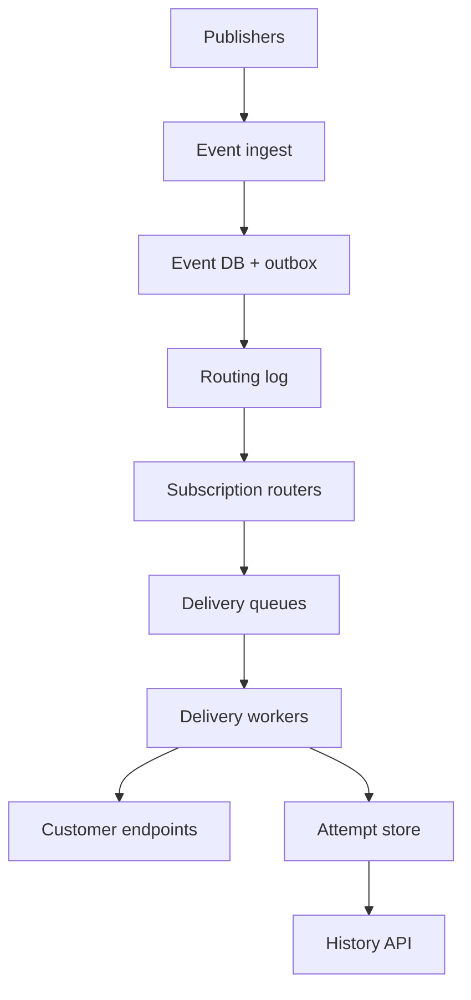
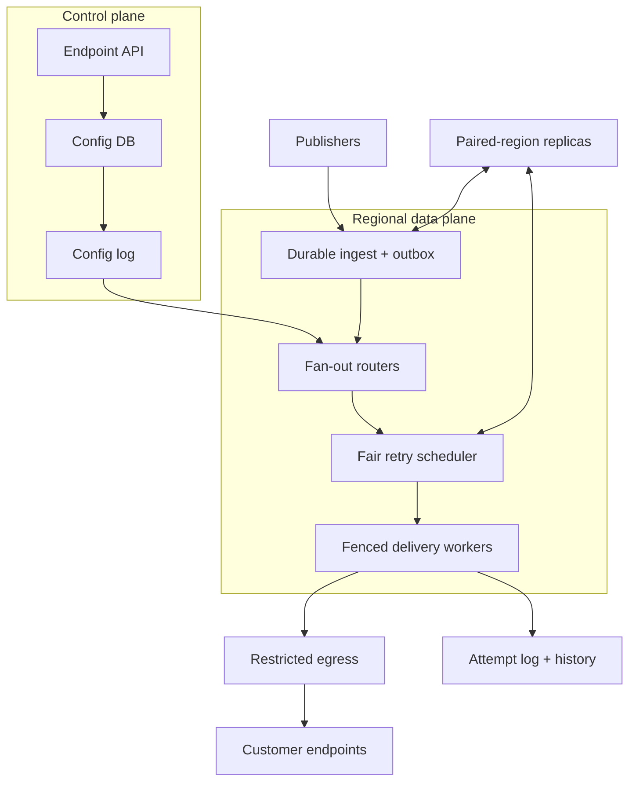

# Design a Global Webhook Delivery Platform

**Difficulty:** Senior / Staff-level  
**Primary themes:** durable queues, retry scheduling, backpressure, idempotency, per-endpoint ordering, caching, multi-region reliability, security, and observability  
**Interview time budget:** roughly 40–45 minutes  
**Educational walkthrough:** intentionally more detailed than what you would say during the timed interview

This walkthrough uses the sequence recommended in Hello Interview's public [System Design Delivery Framework](https://www.hellointerview.com/learn/system-design/in-a-hurry/delivery): establish requirements, name core entities, define the interface, build the simplest complete design one functional requirement at a time, and then deepen the design around the non-functional requirements. The problem, assumptions, dialogue, numbers, and design choices below are original.

---

# Interviewer prompt

> Design a global webhook delivery platform. Product teams publish events such as `invoice.paid` or `deployment.failed`. Customers register HTTPS endpoints and subscribe to event types. The platform must deliver matching events reliably, retry transient failures, provide delivery history, and remain safe when customer endpoints are slow, broken, or malicious.

The interviewer is testing whether you can separate durable acceptance from unreliable network delivery, reason honestly about at-least-once versus exactly-once semantics, prevent one endpoint from harming others, and evolve a queue-based baseline into a multi-region service.

---

# Targeted clarifying questions and assumed interviewer answers

## Product behavior

**Candidate:** “Who publishes events: only internal services, or external customers too?”  
**Interviewer:** “Both. Internal product services are the main publishers, but authenticated customer applications may also publish into their own accounts.”

**Candidate:** “Can one event fan out to many webhook endpoints?”  
**Interviewer:** “Yes. A customer can have multiple subscriptions, and each matching subscription creates one logical delivery.”

**Candidate:** “Do we need transformations or only the original event?”  
**Interviewer:** “Support a versioned envelope and simple field filtering. Arbitrary customer code and complex transformations are out of scope.”

**Candidate:** “What does success mean?”  
**Interviewer:** “Any HTTP `2xx` response within 10 seconds. `429` and most `5xx` responses are retryable. Most other `4xx` responses are permanent failures, except a few explicitly configured cases.”

**Candidate:** “How long should we retry?”  
**Interviewer:** “Up to 24 hours by default, with exponential backoff and a configurable maximum attempt count. Customers can manually replay retained deliveries for 30 days.”

## Semantics and ordering

**Candidate:** “Is at-least-once delivery acceptable?”  
**Interviewer:** “Yes, but explain duplicates and offer a practical idempotency contract. Do not claim the public internet gives us exactly-once delivery.”

**Candidate:** “Is ordering required?”  
**Interviewer:** “Best effort by default. Customers may enable strict ordering per endpoint and ordering key, such as `customer_123`, accepting lower throughput and head-of-line blocking.”

**Candidate:** “Must a subscription change affect already accepted events?”  
**Interviewer:** “No. Match subscriptions using the configuration version visible when the event is routed. Disabling an endpoint should stop new attempts quickly, while preserving history.”

## Scale and reliability

**Candidate:** “What scale should I design for?”  
**Interviewer:** “Five billion published events per day, an average of two matching deliveries per event, ten-times peak traffic, one million active endpoints, and payloads averaging 2 KB with a 256 KB limit.”

**Candidate:** “What availability and latency matter?”  
**Interviewer:** “Durable publish acceptance should be 99.99% available with p99 under 200 ms within the publisher's region. For healthy endpoints, 99% of first attempts should begin within 30 seconds. Once accepted, an event must not be silently lost.”

**Candidate:** “How global is the service?”  
**Interviewer:** “Publishers and endpoint owners are global. Customer data has a selected home geography. A regional failure should not lose accepted events; recovery may take several minutes.”

## Scope

**Candidate:** “Are endpoint discovery, customer DNS, and receiver implementation in scope?”  
**Interviewer:** “No. We own registration, routing, signing, delivery, retries, replay, and observability. We do not own the customer's server.”

**Candidate:** “Should I design billing or a full event-streaming product?”  
**Interviewer:** “No. Mention quotas and metering, but focus on webhook delivery.”

> **What I would say aloud:** “I’ll design durable event acceptance, subscription fan-out, HTTPS delivery, retries, and delivery history. The core contract is at-least-once. Optional ordering is per endpoint and ordering key, not global. I’ll first build one-region end-to-end flow, then deep-dive on retry/backpressure, idempotency and ordering, and multi-region failure safety.”

---

# 1. Requirements (~5 minutes)

## 1.1 Prioritized functional requirements

### FR1 — Manage endpoints and subscriptions

An authenticated customer can:

- register and verify an HTTPS endpoint;
- rotate signing secrets;
- subscribe the endpoint to event types and optional simple filters;
- pause, disable, or delete the endpoint;
- choose best-effort or keyed strict ordering.

### FR2 — Publish, route, and deliver events

An authenticated publisher can submit an event with a stable idempotency key. The platform durably accepts it, finds matching subscriptions, creates one logical delivery per match, signs the request, and attempts HTTPS delivery.

### FR3 — Retry, inspect, and replay deliveries

The platform classifies outcomes, schedules bounded retries, exposes event and attempt history, moves exhausted deliveries to a dead-letter state, and lets authorized customers replay retained deliveries.

## 1.2 Quantified non-functional requirements

| Requirement | Target |
|---|---:|
| Publish acceptance | 99.99% availability; regional p99 < 200 ms |
| Durability | no acknowledged event silently lost; cross-AZ RPO 0, regional-disaster RPO near 0 |
| First-attempt freshness | 99% begins within 30 s for healthy, non-throttled endpoints |
| Delivery semantics | at-least-once; stable delivery ID; duplicates explicitly possible |
| Isolation | one slow or failing endpoint cannot materially increase healthy tenants’ p99 lag |
| Scale | 5B events/day, 10B logical deliveries/day, 10× peak, 1M active endpoints |
| Retention | attempt metadata 30 days; payload retention 30 days by default |
| Security | TLS, signed payloads, secret rotation, SSRF-safe egress, tenant isolation |

## 1.3 Scale estimates that change the design

### Event and delivery rate

Five billion events per day is:

\[
\frac{5{,}000{,}000{,}000}{86{,}400} \approx 57{,}900\ \text{events/s average}
\]

At two matching subscriptions per event:

\[
57{,}900 \times 2 \approx 115{,}800\ \text{deliveries/s average}
\]

At the stated ten-times peak, the system must absorb roughly 580,000 events/s and 1.16 million new delivery tasks/s.

**Design consequence:** routing and delivery must be partitioned streams. A transactional row insert plus synchronous HTTP call for every destination will not survive peak traffic.

### Payload volume

At 2 KB per published event:

\[
5\ \text{billion} \times 2\ \text{KB} \approx 10\ \text{TB/day}
\]

Copying the payload into two delivery rows doubles that before indexes and replication.

**Design consequence:** store the immutable payload once, reference it from delivery tasks, and tier older payloads into object storage. Keep queue messages compact.

### Retry amplification

Assume 2% of logical deliveries need an average of three additional attempts:

\[
10\ \text{billion} \times 0.02 \times 3 = 600\ \text{million extra attempts/day}
\]

An outage at one popular SaaS destination can produce much more. If 100,000 endpoints behind that provider all retry together, synchronized exponential backoff becomes a self-created denial of service.

**Design consequence:** retries need jitter, endpoint-level circuit breakers, fair scheduling, and a durable delay mechanism. Retry work cannot share an unbounded FIFO with fresh work.

### Connection concurrency

At 1.16 million attempts/s and a healthy average HTTP latency of 250 ms:

\[
1{,}160{,}000 \times 0.25 \approx 290{,}000\ \text{concurrent requests}
\]

At the 10-second timeout, a widespread endpoint slowdown could imply millions of sockets if unconstrained.

**Design consequence:** enforce per-endpoint and per-destination concurrency limits, global worker admission control, connection pooling, and hard timeouts.

### Configuration size

One million endpoints with a few subscriptions each is small enough for a distributed configuration database, but too large to query synchronously for every delivery. A compact 1 KB routing/config record per endpoint is roughly 1 GB before indexes and replicas.

**Design consequence:** build versioned routing indexes and regional caches; do not put the control database on the publish hot path.

## 1.4 Scope and consistency/availability contract

### Strong control-plane consistency

Endpoint ownership, subscription mutations, secret versions, pause state, and replay authorization are strongly consistent within the customer's home geography. Mutations receive monotonically increasing configuration versions.

### Durable acceptance boundary

The publish API returns `202 Accepted` only after the immutable event and its outbox/log position are replicated across availability zones. The response means “the platform owns eventual processing,” not “every endpoint has received it.”

### Delivery semantics

Delivery is at least once. The platform may send the same logical delivery more than once when a request times out after the receiver processed it but before the acknowledgment reached us. A stable `delivery_id` and event ID let the receiver deduplicate.

### Ordering contract

- Default: no strict ordering; maximize throughput.
- Optional: FIFO for the same `(endpoint_id, ordering_key)`.
- No global order across endpoints, partitions, or unrelated keys.
- Strict ordering may block later items behind a retrying earlier item.

### Configuration visibility

Routing uses a versioned subscription snapshot. A subscription update need not retroactively change events already routed. A pause or security disable uses an urgent invalidation path so dispatchers stop new attempts quickly.

### Availability during failures

Publishing may fail over to a paired region after fencing the old regional writer. Accepted work remains durable. Delivery can lag during failover; the system prioritizes no loss and no uncontrolled dual dispatch over instant recovery.

### Read consistency

Endpoint configuration reads are strongly consistent after mutation. Delivery-history views are eventually consistent, typically seconds behind, and return a freshness watermark.

> **What I would say aloud:** “The important boundary is the `202`: once I return it, the event is durably ours. Delivery remains at least once because a remote receiver and our database cannot participate in one atomic transaction. Optional ordering is only per endpoint and ordering key, because global order would destroy parallelism.”

---

# 2. Core entities (~2 minutes)

| Entity | Purpose | Key identity |
|---|---|---|
| **Tenant** | Ownership, quotas, region, retention policy | `tenant_id` |
| **Endpoint** | Destination URL, state, ordering mode, rate limits | `endpoint_id` |
| **SecretVersion** | Versioned HMAC credential and validity window | `(endpoint_id, secret_version)` |
| **Subscription** | Event-type and filter match for an endpoint | `subscription_id` |
| **Event** | Immutable published payload and metadata | `event_id` |
| **Delivery** | One logical event-to-subscription delivery | `delivery_id` |
| **Attempt** | One concrete HTTP attempt and outcome | `(delivery_id, attempt_no)` |
| **ReplayJob** | Authorized selection of deliveries to redeliver | `replay_job_id` |

The crucial distinction is **event**, **delivery**, and **attempt**:

- one event is published once;
- the router may create many deliveries for that event;
- each delivery may produce several HTTP attempts.

> **What I would say aloud:** “I’m separating the immutable event from its fan-out deliveries and from retry attempts. That prevents payload duplication, gives retries a stable logical identity, and makes delivery history easy to explain.”

---

# 3. API and system interface (~5 minutes)

Tenant and actor identity come from a validated access token or mutually authenticated service identity. A caller never supplies an authoritative `tenant_id` in the body.

## 3.1 Register an endpoint — FR1

```http
POST /v1/endpoints
Authorization: Bearer <customer-token>
Idempotency-Key: billing-webhook-prod
Content-Type: application/json

{
  "url": "https://hooks.example.com/billing",
  "description": "Production billing events",
  "ordering": {"mode": "KEYED_FIFO"},
  "max_requests_per_second": 200,
  "max_concurrency": 50
}
```

```json
{
  "endpoint_id": "ep_7F2",
  "state": "PENDING_VERIFICATION",
  "verification": {
    "challenge_id": "ch_91A",
    "expires_at": "2026-11-11T05:15:00Z"
  },
  "config_version": 1
}
```

The platform verifies control of the endpoint before enabling delivery. Verification may require the receiver to echo a nonce over HTTPS.

## 3.2 Create a subscription — FR1

```http
POST /v1/endpoints/ep_7F2/subscriptions
Authorization: Bearer <customer-token>
Idempotency-Key: invoice-events-v1

{
  "event_types": ["invoice.paid", "invoice.failed"],
  "filter": {
    "field": "data.currency",
    "op": "IN",
    "values": ["USD", "CAD"]
  }
}
```

```json
{
  "subscription_id": "sub_4C8",
  "endpoint_id": "ep_7F2",
  "state": "ACTIVE",
  "config_version": 2
}
```

Filters use a bounded expression language with indexed fields. Arbitrary scripts are excluded because they make routing latency and security unpredictable.

## 3.3 Publish an event — FR2

```http
POST /v1/events
Authorization: Service <publisher-identity>
Idempotency-Key: invoice-inv_481-paid-v3
Content-Type: application/json

{
  "type": "invoice.paid",
  "source": "billing-service",
  "occurred_at": "2026-11-11T05:04:11.349Z",
  "ordering_key": "customer_123",
  "schema_version": 3,
  "data": {
    "invoice_id": "inv_481",
    "customer_id": "customer_123",
    "currency": "USD",
    "amount_cents": 12900
  }
}
```

```json
{
  "event_id": "evt_01K9Z...",
  "status": "ACCEPTED",
  "accepted_at": "2026-11-11T05:04:11.402Z"
}
```

The publisher-generated idempotency key is scoped to the authenticated publisher and retained long enough to cover retries. The server returns the original result if the same key and payload are repeated; the same key with a different payload is a conflict.

## 3.4 Receiver request

```http
POST /billing HTTP/1.1
Host: hooks.example.com
Content-Type: application/json
Webhook-Event-Id: evt_01K9Z...
Webhook-Delivery-Id: del_88B
Webhook-Attempt: 3
Webhook-Timestamp: 1794373712
Webhook-Secret-Version: 7
Webhook-Signature: v1=9f54...

{
  "id": "evt_01K9Z...",
  "type": "invoice.paid",
  "occurred_at": "2026-11-11T05:04:11.349Z",
  "data": {"invoice_id": "inv_481", "amount_cents": 12900}
}
```

The signature covers the timestamp, delivery ID, and exact body bytes. The receiver verifies the timestamp is recent, computes HMAC using the indicated secret version, compares in constant time, and deduplicates `Webhook-Delivery-Id`.

## 3.5 Inspect delivery history — FR3

```http
GET /v1/endpoints/ep_7F2/deliveries?status=FAILED&limit=50
Authorization: Bearer <customer-token>
```

```json
{
  "items": [
    {
      "delivery_id": "del_88B",
      "event_id": "evt_01K9Z...",
      "event_type": "invoice.paid",
      "status": "RETRY_SCHEDULED",
      "attempt_count": 2,
      "next_attempt_at": "2026-11-11T05:12:42Z",
      "last_result": {
        "http_status": 503,
        "duration_ms": 1007,
        "error_class": "REMOTE_5XX"
      }
    }
  ],
  "next_cursor": "cur_...",
  "as_of": "2026-11-11T05:10:04Z"
}
```

## 3.6 Replay a delivery — FR3

```http
POST /v1/deliveries/del_88B:replay
Authorization: Bearer <customer-token>
Idempotency-Key: replay-del-88b-after-fix

{
  "reason": "Receiver configuration repaired"
}
```

```json
{
  "replay_job_id": "rpl_52D",
  "new_delivery_id": "del_replay_6A0",
  "status": "QUEUED"
}
```

A replay creates a new auditable logical delivery referencing the original. It does not erase or mutate old attempt history.

## 3.7 Interface-to-requirement map

| Functional requirement | Interface |
|---|---|
| Manage endpoint and subscriptions | Endpoint and subscription APIs plus verification callback |
| Publish and route | Durable event publish API plus internal routing stream |
| Deliver | Signed HTTPS receiver contract |
| Retry and inspect | Delay scheduler, history API, replay API |

> **What I would say aloud:** “The publisher key prevents duplicate event creation; the stable delivery ID lets the receiver deduplicate network retries. Those are different idempotency scopes. Identity always comes from authentication, and a replay creates new auditable work instead of rewriting history.”

---

# 4. Data flow

This is a multi-stage asynchronous pipeline, so making the flow explicit prevents vague queue diagrams.

## 4.1 Configuration flow

1. Customer creates and verifies an endpoint.
2. Control service commits endpoint/subscription state and a versioned outbox record atomically.
3. Configuration events update regional routing indexes and dispatcher caches.
4. Urgent pause, delete, or credential-compromise events use a priority invalidation channel.

## 4.2 Publish and route flow

1. Gateway authenticates the publisher, checks quota and payload limit.
2. In one transaction, the ingest service writes the immutable event, idempotency result, and outbox entry.
3. It returns `202` after cross-AZ replication.
4. An outbox relay publishes the event reference to the routing log.
5. Router loads the versioned event-type index, evaluates bounded filters, and creates one delivery task per match.
6. Delivery tasks are appended durably, partitioned by endpoint/order key.

## 4.3 Attempt and retry flow

1. Fair scheduler admits a task only if tenant, endpoint, destination, and global limits allow it.
2. Worker loads payload and endpoint config, rechecks pause/version safety, signs the exact request, and sends HTTPS.
3. Worker records an immutable attempt result.
4. `2xx` completes the delivery.
5. Retryable outcomes schedule `next_attempt_at` with exponential backoff and jitter.
6. Permanent or exhausted failures enter terminal dead-letter state.
7. Status-change events update the customer-facing projection.

---

# 5. High-level design (~10–15 minutes in the interview)

Build the smallest complete system one operation at a time. Do not begin with twelve queues and a global failover story.

## 5.1 Baseline architecture



The control plane for endpoint configuration is omitted from the first drawing but will feed the router and workers through versioned caches.

## 5.2 Operation 1: register configuration safely

The control service stores:

```text
Endpoint(
  tenant_id, endpoint_id,
  url, url_fingerprint,
  state, ordering_mode,
  max_rps, max_concurrency,
  active_secret_version,
  config_version, home_region,
  created_at, updated_at
)

Subscription(
  tenant_id, subscription_id, endpoint_id,
  event_type_pattern, filter_expression,
  state, config_version
)
```

### URL validation

Registration accepts only HTTPS. Resolve and validate the hostname through controlled resolvers, reject loopback, link-local, private, metadata-service, and otherwise prohibited ranges, and repeat checks at connection time to resist DNS rebinding. Delivery workers use restricted egress proxies rather than unrestricted network access.

### Verification and secrets

The endpoint begins `PENDING_VERIFICATION`. After challenge success it becomes `ACTIVE`. Secret material is encrypted under a key-management service; normal list APIs reveal only metadata. Rotation overlaps old and new versions for a bounded period so in-flight attempts remain verifiable.

### Routing materialization

Build a regional index:

```text
(tenant_id, event_type) -> [subscription_id, endpoint_id, filter_ref, config_version]
```

Routers keep a local read-only snapshot plus a distributed-cache fallback. Versioned updates ensure a delayed message cannot restore deleted configuration.

**Candidate:** “The database is authoritative, but routing uses a pushed materialized index. A cache miss never performs an unbounded scan of subscriptions. Endpoint disable is an urgent versioned invalidation checked again before network dispatch.”

**Interviewer:** “Why check state twice?”

**Candidate:** “Routing and delivery are separated by queues. An endpoint can be disabled after a task is routed but before it is sent. The worker-side check closes that time-of-check/time-of-use gap.”

## 5.3 Operation 2: durably accept an event

The baseline uses a relational or strongly consistent distributed database for event metadata and publisher idempotency:

```text
Event(
  tenant_id, event_id,
  publisher_id, idempotency_key,
  type, schema_version,
  occurred_at, accepted_at,
  ordering_key,
  payload_ref, payload_hash,
  home_region
)
```

For small payloads, the current hot payload can live in an append-optimized event store. Larger payloads and older retained payloads move to object storage through a content-addressed reference. The queue carries `event_id`, `payload_ref`, and routing metadata, not another 2 KB copy for every stage.

The ingest transaction atomically:

1. inserts `(publisher_id, idempotency_key, payload_hash)` if absent;
2. writes the event;
3. writes an outbox row.

If the process crashes after commit but before publishing, the outbox relay resumes. If it crashes before commit, the publisher retries the same idempotency key.

This is the **transactional outbox pattern**: business state and the fact that a message must be emitted are committed together, avoiding the “database succeeded but queue publish failed” gap.

## 5.4 Operation 3: route and fan out

Routers consume the partitioned routing log. Partition by `(tenant_id, event_id)` so one event is handled by one logical consumer at a time. For each event:

1. look up candidate subscriptions by tenant and event type;
2. evaluate bounded filters;
3. construct deterministic logical identity, for example:

\[
delivery\_id = H(event\_id, subscription\_id, subscription\_version)
\]

4. append compact delivery tasks in batches;
5. persist a routing-complete checkpoint or dedup marker.

```text
Delivery(
  tenant_id, delivery_id,
  event_id, subscription_id, endpoint_id,
  ordering_key, config_version,
  state, attempt_count,
  next_attempt_at,
  first_queued_at, completed_at,
  replay_of_delivery_id
)
```

Deterministic IDs make router replay safe. If the router emits the same delivery twice, a compacted delivery log or unique database key collapses it into the same logical work item.

### Fan-out choice

For ordinary fan-out, create individual tasks immediately. For an event matching hundreds of thousands of endpoints, writing all children in one transaction is too large. Store a fan-out manifest and let sharded expanders claim ranges. The manifest tracks progress so expansion can resume without losing or duplicating logical deliveries.

## 5.5 Operation 4: deliver once

For the baseline, partition ready tasks by `hash(endpoint_id)`. This keeps an endpoint's work near the same scheduler shard and makes endpoint-local rate limiting cheap.

Before sending, the scheduler checks hierarchical limits:

```text
global capacity
  -> destination-domain capacity
      -> tenant quota
          -> endpoint RPS and concurrency
```

The worker then:

1. loads current endpoint config and payload;
2. validates task/config state;
3. allocates `attempt_no` through a conditional transition;
4. signs timestamp + delivery ID + exact body;
5. sends with connect and total deadlines;
6. records status, latency, bounded response headers/body sample, resolved IP, and error class;
7. emits the next state transition.

```text
Attempt(
  delivery_id, attempt_no,
  started_at, finished_at,
  worker_region, resolved_ip,
  request_secret_version,
  http_status, error_class,
  duration_ms, response_excerpt_ref,
  retry_after, trace_id
)
```

Do not keep database locks open during the network call. Claim the attempt with a short lease and fencing token, perform I/O, then conditionally apply the result. A lease expiry may create a duplicate attempt, which the at-least-once contract permits.

## 5.6 Operation 5: classify and retry

Baseline policy:

| Outcome | Action |
|---|---|
| `2xx` | mark delivered |
| timeout / connect / TLS transient | retry |
| `408`, `425`, `429` | retry; honor bounded `Retry-After` |
| `5xx` | retry |
| most other `4xx` | permanent failure |
| disabled endpoint | suppress until re-enabled or terminal policy |

Use exponential backoff with full jitter:

\[
cap_n = \min(maxDelay, base \times 2^n)
\]

\[
delay_n = random(0, cap_n)
\]

Jitter spreads retries over time instead of making every worker retry at the same second.

The baseline can use a durable delayed-message service or time-bucketed retry topics. A database query that scans `WHERE next_attempt_at <= now()` at million-attempts-per-second scale becomes a hotspot.

## 5.7 Operation 6: history and replay

Attempt-state events feed a query projection optimized by tenant, endpoint, time, and status. Payloads and large response excerpts live separately. The history API reads this projection and returns `as_of` so customers understand freshness.

A replay job:

1. authorizes the caller and selection;
2. snapshots matching original deliveries;
3. applies quotas;
4. emits new deliveries with references to originals;
5. exposes progress and cancellation.

Replay traffic uses a lower-priority fair queue so a large historical replay cannot starve fresh events.

## 5.8 Baseline completeness check

The design now supports endpoint management, durable publishing, indexed routing, signed delivery, retries, history, and replay. It still breaks under retry storms, ambiguous acknowledgments, strict ordering, and regional failover. Those are the deep dives.

---

# 6. Deep dives (~10–15 minutes in the interview)

Choose three deep dives:

1. retry scheduling, backpressure, and noisy-endpoint isolation;
2. idempotency, ambiguous outcomes, and optional ordering;
3. multi-region durability, failover fencing, security, and observability.

## Deep dive 1 — Retry scheduling, backpressure, and isolation

### Where the baseline breaks

A simple queue with workers that immediately retry has several failure modes:

- a down endpoint consumes worker slots repeatedly;
- retries crowd out first attempts;
- one shared SaaS domain outage creates a retry storm;
- a hot tenant monopolizes partitions;
- millions of 10-second timeouts exhaust sockets and memory;
- synchronized backoff attacks the receiver at predictable boundaries.

### Compare retry mechanisms

| Approach | Strength | Weakness |
|---|---|---|
| Sleep inside worker | trivial | wastes workers; lost on crash |
| Scan delivery DB by due time | simple source of truth | index hotspot and polling load |
| Broker-native delayed messages | operationally convenient | delay limits and broker-specific behavior |
| Time-bucketed queues / timing wheel | scalable due-time scheduling | more scheduler machinery |

Choose durable time buckets or a hierarchical timing wheel for large scale. A **timing wheel** groups tasks into slots by due time; advancing time activates only the current slots rather than scanning all future tasks.

For example:

- near-term wheel: one-second slots for the next hour;
- medium wheel: one-minute slots for the next day;
- long-term buckets: object/DB manifests for later work.

Promotion workers move tasks from coarse to fine buckets as time approaches. Every task retains a durable delivery ID and due time, so scheduler replay is safe.

### Separate traffic classes

Use distinct logical queues and quotas for:

- fresh first attempts;
- automatic retries;
- customer replays;
- internal recovery/reconciliation.

Weighted fair scheduling might reserve 70% of capacity for fresh work, 25% for retries, and 5% for replay, while allowing unused capacity to be borrowed. The exact weights are configurable.

### Endpoint and destination circuit breakers

A **circuit breaker** stops sending when recent failures indicate the receiver is unhealthy.

States:

- `CLOSED`: normal attempts;
- `OPEN`: do not send; schedule probes after cooldown;
- `HALF_OPEN`: permit a small number of probes;
- close after sustained success or reopen after failure.

Maintain endpoint breakers and aggregate destination-domain/IP breakers. Endpoint breakers isolate customer failures; destination breakers protect against a shared provider outage.

Do not permanently disable after a brief outage. Auto-pause only after policy thresholds, notify the customer, and retain queued work within the retry window.

### Adaptive concurrency

Static concurrency is safe but inefficient. Start with a configured maximum and adapt downward when latency, timeout rate, or `429` responses rise. Additive-increase/multiplicative-decrease is a simple choice: slowly add capacity on success, cut it sharply on congestion.

The scheduler still enforces hard ceilings. Adaptive logic never grants more than tenant and endpoint policy.

### Hot-key and partition isolation

Partitioning only by endpoint preserves locality but a single hot endpoint can overload one shard. Use virtual shards:

- default endpoints map to one shard;
- hot unordered endpoints may spread across multiple subshards;
- strictly ordered keys remain pinned by `(endpoint_id, ordering_key)`;
- a directory maps endpoint/key to current shard epoch.

Consumer-side fair queues ensure one endpoint cannot drain an entire partition batch.

### Backpressure to publishers

The service should absorb temporary delivery slowness without coupling publishers to receivers. But storage is finite.

Apply backpressure in layers:

1. endpoint throttling grows that endpoint's queue;
2. tenant backlog quota rejects or spills low-priority publish traffic;
3. regional backlog guard returns `429` or `503` before durability is endangered;
4. emergency policy may stop accepting noncritical event classes.

Never return `202` and silently discard later.

### Failure modes

- **Scheduler crash:** replay durable bucket manifest; deterministic IDs prevent logical duplication.
- **Worker dies mid-request:** attempt lease expires and task is retried; duplicate is possible.
- **Queue partition unavailable:** producers buffer only within bounded memory, then fail publishing or routing visibly.
- **Retry-After is absurdly large:** clamp to policy maximum.
- **Receiver keeps connection open:** total request deadline terminates it.
- **Retry backlog exceeds retention:** surface terminal `EXPIRED`, notify, and preserve audit metadata.

### Observability

Track by region, tenant, endpoint, destination, event type, and traffic class:

- queue depth and oldest age;
- first-attempt lag and retry lag percentiles;
- attempts per logical delivery;
- success rate by attempt number;
- open circuit breakers and probe outcomes;
- active sockets, timeout rate, connection reuse;
- throttled tasks and fairness debt;
- retry amplification factor;
- replay traffic versus fresh traffic;
- storage days remaining at current backlog growth.

> **What I would say aloud:** “Retries are scheduled work, not sleeping workers. I put due tasks into durable time buckets, add full jitter, and schedule fresh, retry, and replay traffic with separate weighted quotas. Endpoint and destination circuit breakers plus hierarchical concurrency limits prevent one outage from consuming the fleet.”

## Deep dive 2 — Idempotency, ambiguous outcomes, and ordering

### Where the baseline breaks

Consider this sequence:

1. receiver commits the invoice update;
2. receiver sends `200`;
3. the response is lost;
4. our worker times out and retries.

The platform cannot know whether the first request was applied. Marking it successful risks loss; retrying risks duplication.

### Why exactly once is not a platform-only guarantee

Our database and the customer's database do not share a transaction coordinator. Even a coordinator would be inappropriate across arbitrary internet services. Therefore:

- transport is at least once;
- logical identity is stable;
- receiver cooperation makes processing effectively once.

The receiver should store `delivery_id` in the same transaction as its business effect:

```text
BEGIN;
  INSERT INTO webhook_dedup(delivery_id) VALUES (?)
    ON CONFLICT DO NOTHING;
  if inserted:
      apply business change;
COMMIT;
```

Return `2xx` for an already processed delivery so retries stop.

### Publisher, router, worker, and receiver idempotency

There are four distinct layers:

| Layer | Idempotency key | Prevents |
|---|---|---|
| Publisher ingest | `(publisher_id, idempotency_key)` | duplicate event creation |
| Router fan-out | deterministic `(event, subscription, version)` | duplicate logical deliveries |
| Attempt state | `(delivery_id, attempt_no)` + fencing token | conflicting attempt records |
| Receiver | `delivery_id` | duplicate business effect |

Calling all of these “exactly once” hides important failure boundaries.

### Attempt leasing and fencing

The scheduler grants a short attempt lease:

```text
(delivery_id, attempt_no, lease_owner, lease_epoch, lease_expires_at)
```

If a stalled worker later reports after its lease was replaced, the state store accepts the result only if its epoch is still current. This prevents stale workers from overwriting newer terminal state. It cannot prevent the stale worker's network request from reaching the receiver, so stable delivery ID remains necessary.

### Default unordered mode

Deliveries are independent. A later event may arrive before an earlier event because of partitioning, retries, or different network latency. Include `occurred_at`, event ID, and optional producer sequence so receivers can apply their own conflict rules.

### Optional keyed FIFO

For `KEYED_FIFO`, route by:

\[
partition = H(endpoint\_id, ordering\_key)
\]

Maintain a small per-key state machine:

```text
READY -> IN_FLIGHT -> ACKED -> next READY
                    -> RETRY_WAIT -> IN_FLIGHT
                    -> DEAD_LETTER -> policy decision
```

Only one delivery per key is in flight. Later deliveries wait behind it.

### Head-of-line blocking choices

If event 10 keeps failing, what happens to event 11?

| Policy | Benefit | Cost |
|---|---|---|
| Block until success/exhaustion | strongest FIFO | one poison event stalls key |
| Skip after max attempts | bounded stall | creates sequence gap |
| Deliver later events with gap marker | availability | no longer strict FIFO |

Choose block-until-terminal for the explicit strict mode. After exhaustion, move event 10 to dead letter, expose a gap, and require the customer to choose replay-and-resume or skip-and-resume. Do not silently violate the requested order.

### Sequence allocation

The platform need not assign one global sequence. If publishers require meaningful order, accept `ordering_key` and optionally a monotonically increasing producer sequence. Validate monotonicity only within a producer/key stream if the product requires it. Generating a global sequence would create a serialization bottleneck.

### Subscription changes and deterministic routing

Record `subscription_id` and `subscription_version` on the delivery. Retries use the original routing decision and payload. A later filter update does not make an old delivery disappear. A security pause can suppress sending regardless of original version.

### Secret rotation

Each attempt records `secret_version`. During overlap, workers sign with the newest active version; receivers accept both. After the overlap window, retire the old version. Retrying an old delivery does not require reproducing the original signature; it uses the currently valid signing policy while retaining the same delivery ID.

### Observability

- duplicate publish-key hit rate and payload conflicts;
- duplicate router emission rate;
- stale lease-result rejections;
- receiver-reported duplicate rate if available;
- ordered-key backlog and oldest blocked key;
- poison-message count and gap decisions;
- events with producer-sequence regressions;
- secret-version usage and verification failures.

> **What I would say aloud:** “A timeout after receiver commit is fundamentally ambiguous. I retry because the service contract prefers no loss, and I give every logical delivery a stable ID that the receiver commits with its business change. Strict ordering is keyed, single-flight, and explicitly accepts head-of-line blocking; it is never global.”

## Deep dive 3 — Multi-region durability, failover, security, and observability

### Where the baseline breaks

If two regions actively dispatch the same endpoint partition after a network split, duplicates spike and per-endpoint ordering breaks. If only one region owns everything, a regional failure stops delivery and may lose unreplicated accepted events. URL delivery also introduces SSRF, DNS rebinding, credential, and data-exfiltration risks.

### Compare regional strategies

| Strategy | Benefit | Cost |
|---|---|---|
| Single region + backups | simplest | poor availability and recovery time |
| Active-passive paired region | clear ownership and ordering | failover pause; spare capacity |
| Active-active independent ownership | low local latency | ownership and duplicate complexity |
| Active-active with deterministic home shards | scalable and local | control-plane/fencing complexity |

Choose active-active globally, but single-writer ownership per tenant or endpoint shard. Each tenant has a home geography for residency. Within that geography, a shard has one active dispatch region and one warm replica.

### Durable replication

Before returning `202`, replicate event and outbox state across availability zones. Replicate the event log and delivery log asynchronously to a paired region with tight lag monitoring. For customers requiring regional-disaster RPO 0, synchronously replicate the acceptance record to the pair at higher latency and cost.

State the contract honestly:

- standard tier: cross-AZ RPO 0; paired-region RPO measured in seconds;
- premium tier: paired-region RPO 0 for acknowledged publishes;
- both: history projections are rebuildable from logs.

### Ownership leases and fencing

The global control plane assigns:

```text
DispatchOwnership(
  shard_id, active_region,
  ownership_epoch,
  lease_expires_at,
  last_checkpoint
)
```

Every claim and attempt carries `ownership_epoch`. On failover:

1. stop renewing old region's lease;
2. wait for expiry or obtain quorum-confirmed revocation;
3. increment ownership epoch;
4. promote paired-region consumers from durable checkpoint;
5. reject attempt-state writes from old epochs;
6. resume cautiously under reduced concurrency.

The old region may already have sent requests whose responses were lost. Duplicates after disaster are still possible; stable delivery IDs preserve the contract. Fencing prevents uncontrolled long-lived dual dispatch.

### Recovery order

After failover, prioritize:

1. endpoint pause/security invalidations;
2. accepted but unrouted events;
3. fresh first attempts;
4. due automatic retries;
5. replays and historical projections.

This preserves safety and user-visible freshness.

### Cache recovery

Regional config caches may be empty. Restore a versioned snapshot, then replay configuration log from its watermark. Until an endpoint's configuration is known and current enough, fail closed for delivery rather than sending to a stale URL or with a revoked secret.

### SSRF-safe egress

Webhook platforms are attractive SSRF proxies. Defenses include:

- HTTPS-only URLs and allowed ports;
- validation at registration and every connection;
- controlled DNS resolution with private/special IP rejection;
- protection against DNS rebinding and redirect revalidation;
- no automatic redirects by default, or validate every hop;
- egress proxies with network ACLs and destination attribution;
- block cloud metadata and internal service ranges;
- strict request size, response size, and time limits;
- no customer-controlled headers that can inject platform credentials;
- abuse rate limits and anomaly detection.

### Signature and replay protection

Use HMAC-SHA-256 over exact bytes and timestamp, version the scheme, and include delivery ID. Receivers reject timestamps outside a tolerance window. For manual replay, the request gets a fresh timestamp and signature but retains explicit replay metadata.

### Data isolation and retention

Encrypt payloads at rest with tenant-scoped envelope keys where required. Authorization filters every history query by token-derived tenant. Redact configured sensitive fields from logs. Deletion and retention jobs remove payload material while preserving minimal audit metadata when legally allowed.

### End-to-end observability

Use a trace context spanning:

```text
publish -> route -> queue -> schedule -> attempt -> outcome
```

Because work is asynchronous, propagate trace IDs in message metadata rather than relying on one synchronous span.

Core service-level indicators:

- accepted events with no routing completion beyond threshold;
- first-attempt delay for healthy endpoints;
- delivery success within 1 minute, 1 hour, and 24 hours;
- queue oldest age by traffic class;
- regional replication lag and failover RPO;
- ownership-epoch conflicts and stale writes;
- config propagation lag and paused-endpoint sends;
- signature failures and suspicious destination changes;
- payload lookup failures and reconciliation gaps.

### Reconciliation

Run periodic comparisons:

1. every accepted event has routing completion or an active routing lease;
2. every delivery has exactly one current state;
3. every in-flight attempt has a lease or has expired back to schedulable state;
4. every terminal delivery is represented in history projection;
5. payload references resolve for all retained nonterminal work.

Repairs emit auditable compensating tasks. Do not edit history invisibly.

### Disaster exercises

Regularly test:

- total region loss;
- control-plane partition;
- stale region returning after failover;
- DNS provider outage;
- destination-wide `429` storm;
- KMS unavailability during secret fetch;
- corrupted or missing payload object;
- replay of a billion historical deliveries.

> **What I would say aloud:** “The service is active-active globally but single-owner per dispatch shard. Failover increments a fencing epoch before the paired region resumes. That controls dual dispatch, though it cannot eliminate duplicates from ambiguous in-flight requests. Security is part of the architecture: controlled DNS, restricted egress, redirect validation, signed payloads, and tenant-scoped authorization.”

---

# 7. Final design

## 7.1 Evolved architecture



## 7.2 Component summary

| Component | Responsibility |
|---|---|
| Endpoint API / config DB | Strong tenant ownership, verification, subscriptions, secrets, pause state |
| Config log and caches | Versioned routing indexes and urgent invalidations |
| Event ingest / event store | Idempotent durable acceptance and immutable payload reference |
| Outbox / routing log | Reliable handoff from accepted event to asynchronous routing |
| Fan-out routers | Filter matching, deterministic delivery creation, resumable large fan-out |
| Ready queues / timing wheel | Durable immediate and delayed scheduling |
| Fair scheduler | Traffic-class weights, quotas, circuit breakers, endpoint admission |
| Delivery workers | Fenced attempt claims, signing, HTTPS, outcome classification |
| Restricted egress | SSRF-safe DNS, ACLs, redirect and destination enforcement |
| Attempt log / history projection | Audit, status queries, dashboards, replay selection |
| Paired-region replicas | Disaster recovery and durable checkpoints |
| Reconciliation workers | Detect missing routing, stuck attempts, projection drift, payload gaps |

## 7.3 End-to-end narrative

A customer registers and verifies an HTTPS endpoint, creates subscriptions, and receives versioned signing credentials. Configuration is strongly stored and pushed into regional routing and dispatch caches.

A publisher submits an event with an idempotency key. The ingest service atomically writes the immutable event, the prior-result record, and an outbox entry, then returns `202` only after required replication. Routers consume the log, use a versioned event-type index, evaluate bounded filters, and create deterministic logical deliveries referencing one stored payload.

The fair scheduler separates fresh attempts, retries, and replays. It admits work under global, destination, tenant, and endpoint limits. Workers claim attempts using leases and fencing tokens, recheck current endpoint safety state, sign the payload, and send through restricted egress. A `2xx` completes the delivery; retryable failures enter a durable timing wheel with exponential backoff and jitter. Attempt events build a queryable history projection, and replay creates new auditable deliveries.

At-least-once semantics are explicit. The same stable delivery ID is used across retries, allowing receivers to commit deduplication with their business update. Keyed FIFO mode pins an endpoint/order key to one single-flight sequence and accepts head-of-line blocking. Multi-region failover promotes a paired owner only after an ownership epoch change; stale workers cannot update state, though ambiguous in-flight requests may still duplicate.

## 7.4 Requirements check

| Requirement | Design response |
|---|---|
| Endpoint and subscription management | Strong versioned control plane, verification, secret rotation |
| Durable publish under 200 ms | Regional ingest, cross-AZ replication, transactional outbox |
| Large fan-out | Partitioned routing log, deterministic deliveries, resumable manifests |
| First attempt within 30 s | Separate fresh queue, autoscaling, lag SLOs, fair admission |
| Reliable retries | Durable timing wheel, exponential backoff, full jitter |
| At-least-once semantics | Stable delivery ID, attempt fencing, receiver dedup contract |
| Optional ordering | Partition and single-flight by endpoint + ordering key |
| Noisy endpoint isolation | Hierarchical quotas, circuit breakers, adaptive concurrency |
| History and replay | Attempt log, eventually consistent projection, low-priority replay jobs |
| Regional failure | Replicated logs/checkpoints, single-owner shard epochs, fenced promotion |
| Security | TLS, HMAC versions, restricted egress, SSRF and DNS-rebinding controls |
| Auditability | Immutable event/delivery/attempt identities and compensating repairs |

## 7.5 Final 60-second interview summary

> **What I would say aloud:** “I separate durable acceptance, routing, and unreliable network delivery. A publish returns `202` only after the event and outbox are replicated. Versioned routers create deterministic deliveries, and a fair scheduler handles fresh work, retries, and replay under endpoint and destination limits. Workers use leased, fenced attempts, sign requests, and classify outcomes; retries go through a durable timing wheel with exponential backoff and jitter. The contract is at least once because a receiver may commit before our acknowledgment arrives, so every retry keeps a stable delivery ID for receiver-side transactional deduplication. Optional ordering is single-flight per endpoint and ordering key. Paired-region failover changes an ownership epoch before dispatch resumes, and restricted egress plus repeated DNS/IP validation prevents the webhook service from becoming an SSRF proxy.”

---

# Realistic interviewer follow-up questions with strong sample answers

## 1. “Why not send the webhook synchronously from the publish request?”

**Strong answer:** “The receiver is outside our reliability boundary. Synchronous sending couples publisher latency and availability to arbitrary customer servers, and one event may fan out widely. I durably accept first, then route and deliver asynchronously.”

## 2. “Can you guarantee exactly-once delivery?”

**Strong answer:** “No, not unilaterally across the public internet. If the receiver commits and the response is lost, we cannot distinguish success from failure. We guarantee at least once and provide a stable delivery ID. The receiver gets effectively-once processing by storing that ID in the same transaction as its business effect.”

## 3. “What does the `202 Accepted` guarantee?”

**Strong answer:** “It means the event and the obligation to process it are durably replicated according to the tenant tier. It does not mean routing or endpoint delivery has completed.”

## 4. “How does the transactional outbox help?”

**Strong answer:** “It atomically stores the event and a record saying a routing message must be emitted. Without it, a crash between database commit and queue publish could acknowledge an event that never enters the pipeline.”

## 5. “How do you prevent retries from overwhelming a recovering endpoint?”

**Strong answer:** “Full-jitter backoff spreads due times. Endpoint and destination circuit breakers stop normal attempts during failure, half-open probes test recovery, and adaptive concurrency ramps up gradually. Retry traffic also has a separate quota from fresh work.”

## 6. “What if a customer requests ordering but one event always fails?”

**Strong answer:** “Strict keyed FIFO intentionally creates head-of-line blocking. After the retry policy exhausts, I dead-letter the poison event, expose a sequence gap, and require an explicit replay-and-resume or skip-and-resume choice. I do not silently deliver later events out of order.”

## 7. “Why partition by endpoint and ordering key?”

**Strong answer:** “It preserves locality for rate limits and gives all events for one ordered key a single serialization point. Unordered hot endpoints can use multiple virtual subshards, while strict keys stay pinned.”

## 8. “How do you stop an endpoint from targeting cloud metadata services?”

**Strong answer:** “Use HTTPS-only controlled egress, reject private and special ranges at registration and connection time, resolve through controlled DNS, defend against rebinding, revalidate redirects, block metadata ranges, and give workers no unrestricted internal network path.”

## 9. “How would secret rotation work without dropping retries?”

**Strong answer:** “Secrets are versioned. During a bounded overlap the receiver accepts old and new versions, while workers sign new attempts with the newest active version and send the version in a header. Attempt history records which version was used.”

## 10. “What if the router processes the same event twice?”

**Strong answer:** “Delivery ID is deterministic from event ID, subscription ID, and subscription version. Reprocessing recreates the same logical identity, and a unique key or compacted delivery log prevents duplicate logical state. Network attempts can still repeat later under the at-least-once contract.”

## 11. “How do you handle a million-destination fan-out?”

**Strong answer:** “I avoid one giant transaction. Store a fan-out manifest, split the candidate range into independently claimed shards, checkpoint expansion, and emit deterministic child deliveries in batches. The manifest makes restart and progress reporting safe.”

## 12. “What happens when the active region fails?”

**Strong answer:** “The paired region restores from replicated logs and checkpoints, but it does not dispatch until ownership is fenced: old lease expires or is revoked, then the control plane increments the shard epoch. Stale workers cannot update state. Some ambiguous in-flight HTTP calls may duplicate, which stable IDs handle.”

## 13. “Would you store every payload in the queue?”

**Strong answer:** “No. At 10 TB/day before replication and fan-out, payload copies become expensive. Store the immutable payload once and put compact references plus hashes in queue messages. Cache hot payloads and tier retained bodies to object storage.”

## 14. “How do you keep history queries from affecting delivery?”

**Strong answer:** “Attempt events asynchronously build a separate query projection. Customer dashboards read that store and include a freshness watermark. The delivery hot path appends outcomes; it does not run dashboard queries.”

## 15. “How would you test the platform?”

**Strong answer:** “Use deterministic fault injection for crashes between every state transition, duplicate and reorder queue messages, simulate receiver commit with lost acknowledgment, open retry storms, return a stale region after failover, test DNS rebinding and redirect attacks, and property-test that every accepted event is routed or visibly pending and every delivery has one valid current state.”

---

# Common pitfalls

1. **Calling the customer endpoint inside the publish request.** This couples two unrelated availability domains.
2. **Returning success before durable acceptance.** Once `202` is returned, loss is a contract violation.
3. **Claiming exactly-once webhook delivery.** Ambiguous acknowledgments make platform-only exactly once impossible.
4. **Using a new ID on every retry.** The receiver then cannot reliably deduplicate the logical delivery.
5. **Treating event, delivery, and attempt as one row.** Fan-out and retry history become awkward and error-prone.
6. **Copying the payload into every queue and delivery row.** At this scale it multiplies storage and I/O.
7. **Sleeping inside workers for backoff.** It wastes capacity and loses schedule state on crash.
8. **Putting fresh work and all retries in one FIFO.** An outage can starve healthy first attempts.
9. **Retrying without jitter.** Synchronized retries create thundering herds.
10. **Ignoring per-destination limits.** Many endpoints may share one failing provider or IP.
11. **Holding a database lock during HTTP.** Slow receivers exhaust transactions and connections.
12. **Adding global ordering.** It creates unnecessary serialization; scope order to endpoint/key.
13. **Promising ordered mode without discussing poison messages.** Strict order creates head-of-line blocking.
14. **Trusting URL validation only at registration.** DNS rebinding and redirects require connection-time checks.
15. **Letting delivery workers access internal networks.** A webhook platform otherwise becomes an SSRF service.
16. **Failing over without fencing the old owner.** Split-brain dispatch breaks ordering and amplifies duplicates.
17. **Using the control database on every publish.** Push versioned subscription indexes into routing regions.
18. **Allowing replays to compete equally with fresh traffic.** Large replays can violate the first-attempt SLO.
19. **Deleting attempt history when replaying.** Preserve immutable audit state and create new work.
20. **Monitoring only success rate.** Queue age, retry amplification, circuit state, and replication lag reveal failures earlier.

---

# Interview pacing versus this walkthrough

This document deliberately exceeds the spoken 40–45 minute answer.

- Clarification and requirements: about 5 minutes.
- Core entities: about 2 minutes.
- Interfaces: about 5 minutes.
- Baseline design, operation by operation: 10–15 minutes.
- Two or three deep dives: 10–15 minutes.
- Requirements check and summary: about 2 minutes.

## Compact opening script

> “I’ll define the acceptance and delivery contracts first, especially at-least-once semantics and optional keyed ordering. Then I’ll model event, delivery, and attempt separately; build durable publish, routing, delivery, retry, and replay; and finally harden retry isolation, idempotency/ordering, and regional failover.”

## Compact transition into deep dives

> “The baseline is functionally complete, but it still fails in three places: retry storms can consume the fleet, an ambiguous timeout can duplicate receiver effects, and a regional split can create two dispatch owners. I’ll address those next.”

---

# Public guidance referenced

- [Hello Interview — System Design Delivery Framework](https://www.hellointerview.com/learn/system-design/in-a-hurry/delivery)
- [Hello Interview — System Design Key Technologies](https://www.hellointerview.com/learn/system-design/in-a-hurry/key-technologies)
- [Hello Interview — Idempotency](https://www.hellointerview.com/learn/system-design/patterns/idempotency)
- [Hello Interview — Scaling Writes](https://www.hellointerview.com/learn/system-design/patterns/scaling-writes)
- [Hello Interview — Caching](https://www.hellointerview.com/learn/system-design/core-concepts/caching)
