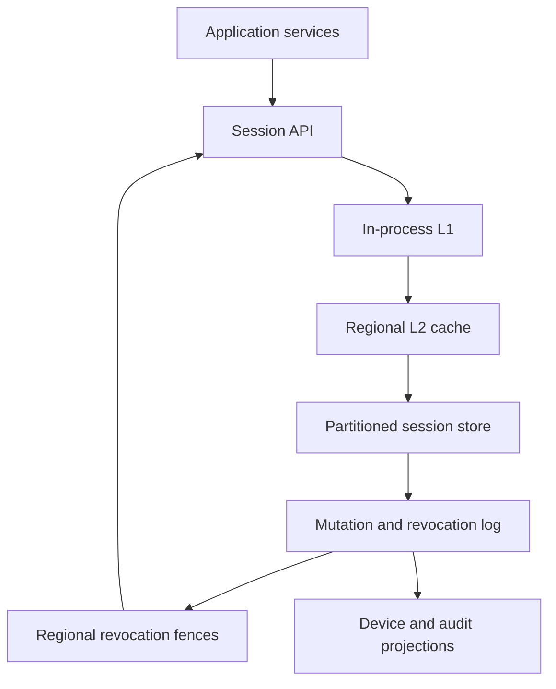
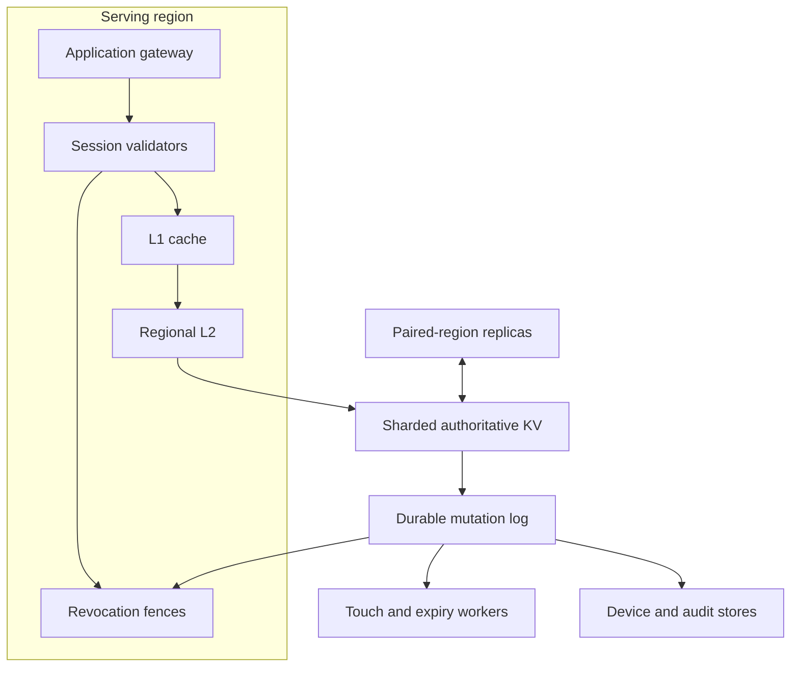

# System Design Interview: Global Authentication Session Store

**Difficulty:** Medium-hard  
**Primary themes:** distributed databases, caching, TTLs, revocation consistency, multi-region reliability, security  
**Interview time budget:** roughly 40–45 minutes  
**Educational walkthrough:** intentionally more detailed than the spoken interview answer

This walkthrough uses the staged delivery structure described in Hello Interview’s public [System Design Delivery Framework](https://www.hellointerview.com/learn/system-design/in-a-hurry/delivery): focused requirements, core entities, interfaces, a simple complete design, and then targeted deep dives. The problem, assumptions, dialogue, calculations, and design decisions below are original.

---

# Interviewer prompt

> Design a global authentication session store used by web and mobile applications. After a user signs in, applications should be able to create a session, validate that session on every request, refresh or rotate it, and revoke one or all sessions. The system serves many first-party products in multiple regions and must make validation extremely fast without allowing a revoked session to reappear because of stale caches.

## Targeted clarifying questions with assumed interviewer answers

**Candidate:** “Are we designing credential verification too, or does another identity service already validate passwords, passkeys, and MFA?”

**Interviewer:** “Another identity service performs primary authentication. Start once that service has produced a trusted authentication result.”

**Candidate:** “Should the session credential be an opaque server-side token or a self-contained signed token such as a JWT?”

**Interviewer:** “You may choose. We require administrators and users to revoke sessions globally within two seconds, so explain the consequence of your choice.”

**Candidate:** “What are the core client operations?”

**Interviewer:** “Create a session after authentication, validate it on application requests, rotate it, revoke one session, revoke all sessions for a user, and show a user their active devices.”

**Candidate:** “Is strict ordering required for every session mutation?”

**Interviewer:** “A rotation or revocation must not be undone by an older delayed write. The device list can lag by several seconds.”

**Candidate:** “What scale and geography should I assume?”

**Interviewer:** “Two billion active sessions, ten million validation requests per second globally at peak, 150,000 create or rotate operations per second at peak, and 50,000 revocations per second during a security incident. Traffic is served from eight active regions.”

**Candidate:** “What latency and availability targets matter?”

**Interviewer:** “Validation should be under 20 ms at p99 inside the serving region and 99.999% available. Session creation and rotation can be under 300 ms at p99. A successful revoke must be enforced in every healthy region within two seconds.”

**Candidate:** “What lifetime rules should sessions have?”

**Interviewer:** “A default seven-day idle timeout and a 30-day absolute lifetime. Enterprise policy may shorten both. Activity may extend the idle timeout, but never the absolute lifetime.”

**Candidate:** “During a network partition, should validation favor availability or revocation consistency?”

**Interviewer:** “Existing low-risk sessions may use a short, explicitly bounded stale window. High-risk operations such as changing a password, viewing recovery codes, or moving money must fail closed if the region cannot prove its revocation state is current.”

**Candidate:** “Are session tokens treated as secrets?”

**Interviewer:** “Yes. Do not store raw tokens. Assume TLS everywhere, secure cookie support for browsers, and device secure storage for mobile clients.”

**Candidate:** “Should deleting an account or changing a password revoke all sessions?”

**Interviewer:** “Yes. Those actions advance a per-user security epoch and invalidate sessions created under older epochs.”

> **What I would say aloud:** “I’ll focus on the session system after primary authentication. I’ll first define a durable create path, a very fast validation path, and revocation semantics. The critical tension is that validation is availability-heavy while successful revocation is consistency-heavy, so I’ll make that boundary explicit rather than claiming one CAP choice for every operation.”

---

# 1. Requirements (~5 minutes)

## 1.1 Prioritized functional requirements

### FR1 — Create and rotate a session

After trusted authentication, an application can create an opaque session credential. It can later rotate the credential without changing the logical session or user identity. Rotation invalidates the previous credential version.

### FR2 — Validate and touch a session

On every application request, a trusted application service can exchange the opaque credential for a principal: user ID, tenant, scopes, authentication strength, session metadata, and expiry. Validation may record coarse activity so an active session’s idle expiry advances without writing on every request.

### FR3 — Revoke and inspect sessions

A user or administrator can revoke one session or all sessions for a user. The user can list active devices. A successful revoke is globally effective within two seconds and cannot be undone by an older write, replayed queue message, cache refill, or regional failover.

## 1.2 Explicitly out of scope

- Password, passkey, social login, and MFA verification.
- OAuth consent and third-party access-token issuance.
- Fine-grained application authorization beyond returning session scopes.
- Full fraud detection; the session service can emit risk signals and require step-up authentication.
- Browser UI implementation.

## 1.3 Quantified non-functional requirements

| Requirement | Target |
|---|---|
| Validation latency | p99 under 20 ms within a serving region; p50 under 5 ms |
| Availability | 99.999% for validation; 99.99% for create, rotate, and revoke APIs |
| Scale | 2B active sessions; 10M validation/s peak; 150K create/rotate/s peak; 50K revokes/s incident peak |
| Revocation | acknowledged revocation enforced in every healthy region within 2 s |
| Durability and security | no acknowledged session mutation lost; raw credentials never persisted; encrypted records and audit logs |
| Lifetime | 7-day idle timeout, 30-day absolute timeout, policy-configurable shorter limits |

## 1.4 Scale estimates that change the design

Hello Interview’s framework recommends doing arithmetic when it changes a design decision, rather than producing numbers that only conclude “the system is large.” That is the approach here.

### Validation traffic

Peak validation traffic is 10 million requests per second. If every validation reads the authoritative database, even an excellent distributed key-value store becomes needlessly expensive and its tail latency becomes the application’s tail latency.

Suppose a two-layer regional cache achieves a 99.5% hit rate:

\[
10{,}000{,}000 \times 0.005 = 50{,}000\ \text{authoritative reads/s}
\]

At only a 95% hit rate:

\[
10{,}000{,}000 \times 0.05 = 500{,}000\ \text{authoritative reads/s}
\]

**Design consequence:** cache hit rate and invalidation correctness are first-class requirements. We use an in-process L1 cache plus a regional distributed L2 cache, but add a separate revocation-fence path so a stale positive cache entry cannot authorize a revoked credential.

### Session storage

Assume a compact authoritative session record averages 400 bytes before database overhead:

\[
2\ \text{billion} \times 400\ \text{bytes} = 800\ \text{GB}
\]

With indexes, version history, replication, and operational headroom, plan for several terabytes. This is large but routine for a partitioned key-value store. A user-to-session secondary index is larger and has a different access pattern.

**Design consequence:** partition the primary store by a uniformly random `session_id`; do not partition by `user_id`, which would create hot partitions for heavily automated or compromised accounts. Maintain device listing as an asynchronously built secondary projection.

### Write amplification from activity

Writing `last_seen_at` on all 10M validations/s would create 864 billion writes per day:

\[
10{,}000{,}000 \times 86{,}400 = 864{,}000{,}000{,}000
\]

If we durably advance activity at most once per session per hour, a session active all day produces at most 24 touch updates rather than thousands.

**Design consequence:** update activity in memory and emit an idempotent, coalesced touch event only when the durable activity bucket changes. The authoritative update is `last_seen_at = max(existing, event_time)`, so duplicate or reordered events are harmless.

### Revocation broadcast

At an incident peak of 50,000 revocations/s across eight regions, naive point-to-point fan-out would create 400,000 regional messages/s before retries. That volume is manageable, but correctness requires replay, ordering by key, and watermarks.

**Design consequence:** use a partitioned durable revocation log replicated to every region. Each region applies events to a compact revocation-fence store and reports its applied watermark. The revoke API acknowledges only after the required regional fences have advanced.

### Token entropy

A 256-bit random secret has \(2^{256}\) possibilities. Even at internet scale it makes online guessing infeasible; rate limiting remains necessary because it also protects infrastructure and detects abuse.

**Design consequence:** issue a token such as `session_id.secret`, store only a keyed digest of `secret`, and compare digests in constant time. The session ID enables one indexed lookup without weakening the unguessable credential.

## 1.5 Scope and consistency/availability contract

### Creation and rotation

- The API returns success only after the new session version is durably replicated in its home shard.
- A read using the new token in the creating region is immediately valid.
- Rotation uses compare-and-swap on `session_version`; an older credential version can never overwrite a newer one.
- The old token becomes invalid globally within the same two-second bound used for revocation.

### Validation

- Validation is a local-region operation in the common case.
- It returns a principal only if the session record is active, the token digest and version match, the idle and absolute deadlines are valid, and no single-session or user-epoch revocation fence supersedes it.
- Low-risk applications may accept a cached result only while the region’s revocation watermark is less than two seconds stale.
- High-risk applications fail closed whenever current revocation state cannot be proven.

### Revocation

- A successful single-session revoke is linearizable for that session and monotonic: once acknowledged, no later validation in a healthy region may return active.
- “Revoke all” increments a per-user security epoch. Every session stores the epoch at creation; a session with an older epoch is invalid.
- During a partition that prevents the global two-second contract, the revoke API fails rather than falsely acknowledging success. Local enforcement can still happen immediately and the operation continues retrying with an idempotency key.

### Device list

- The list of active sessions is eventually consistent, normally within five seconds.
- It is not used as the authorization source of truth.

### Availability during failures

- Cached low-risk validations may continue for a short bounded window if the authoritative store is unavailable and the revocation feed remains current.
- If both the authoritative store and revocation freshness are unavailable, sensitive validations deny access. Products explicitly classified as low-risk may accept a session for at most a configured emergency grace period, for example 30 seconds.

> **What I would say aloud:** “I’m not assigning one blanket consistency model. The validation data path is local and highly available, but a successful revoke is a global security barrier. If I cannot install that barrier everywhere required, I return an error instead of claiming the session is globally revoked.”

---

# 2. Core entities (~2 minutes)

Identify the nouns before committing to a full schema.

| Entity | Purpose | Key identity |
|---|---|---|
| **Session** | One logical signed-in device/browser session | `session_id` |
| **CredentialVersion** | Current token digest and rotation version for a session | `(session_id, credential_version)` |
| **UserSessionState** | Per-user epoch and security status used by revoke-all | `(tenant_id, user_id)` |
| **RevocationFence** | Monotonic deny information installed in each region | session version or user epoch |
| **SessionActivity** | Coalesced last-seen information for idle expiry | `session_id` |
| **DeviceSessionProjection** | Eventually consistent user-facing device list | `(user_id, session_id)` |
| **IdempotencyRecord** | Prior result for create, rotate, and revoke retries | `(caller_id, idempotency_key)` |
| **AuditEvent** | Immutable security-relevant mutation record | `audit_event_id` |

The distinction between a logical session and its credential versions is important. A rotation changes the secret and version but keeps the session’s device identity and audit history.

> **What I would say aloud:** “The core authorization record is the session, while credential versions handle safe rotation. I also separate the authoritative session from the user-facing device projection, because a stale device list is tolerable but a stale authorization decision is not.”

---

# 3. API and system interface (~5 minutes)

Application identity comes from mutually authenticated service credentials. End-user identity comes from a trusted authentication assertion or an already validated session. The server never accepts an authoritative `user_id` from an untrusted request body.

## 3.1 Create a session — FR1

This internal API is called after the identity service has verified credentials and MFA.

```http
POST /v1/sessions
Authorization: Service <identity-service-credential>
Idempotency-Key: login-flow-01KA2...
Content-Type: application/json

{
  "authentication_assertion": "signed-one-time-assertion",
  "client": {
    "device_id": "device_7ac",
    "platform": "ios",
    "app_version": "42.3"
  },
  "requested_scopes": ["profile:read", "orders:write"]
}
```

```json
{
  "session_id": "ses_01KA3...",
  "session_token": "ses_01KA3....tkn_q9uJ...",
  "credential_version": 1,
  "idle_expires_at": "2026-11-19T05:10:00Z",
  "absolute_expires_at": "2026-12-12T05:10:00Z",
  "authentication_strength": "MFA"
}
```

The assertion is short-lived, signed, audience-bound, and single use. The response is the only place the raw token appears. Browser adapters put it in a `Secure`, `HttpOnly`, `SameSite` cookie; mobile apps put it in platform secure storage.

## 3.2 Validate a session — FR2

This can be an internal RPC for lower overhead, shown here as HTTP for clarity.

```http
POST /v1/sessions:validate
Authorization: Service <orders-api-credential>
X-Session-Token: ses_01KA3....tkn_q9uJ...
X-Operation-Risk: standard
```

```json
{
  "active": true,
  "principal": {
    "tenant_id": "tenant_12",
    "user_id": "user_481",
    "scopes": ["profile:read", "orders:write"],
    "authentication_strength": "MFA"
  },
  "session": {
    "session_id": "ses_01KA3...",
    "credential_version": 3,
    "idle_expires_at": "2026-11-19T05:10:00Z",
    "absolute_expires_at": "2026-12-12T05:10:00Z"
  },
  "revocation_watermark_age_ms": 74
}
```

Inactive responses use a stable reason category such as `EXPIRED`, `REVOKED`, `TOKEN_MISMATCH`, or `STEP_UP_REQUIRED`, but public gateways should avoid details that help attackers enumerate credentials.

## 3.3 Rotate a credential — FR1

```http
POST /v1/sessions/ses_01KA3...:rotate
Authorization: Session <current-token>
Idempotency-Key: rotation-2026-11-12-1
If-Match: "credential-version-3"
```

```json
{
  "session_id": "ses_01KA3...",
  "session_token": "ses_01KA3....tkn_newSecret...",
  "credential_version": 4,
  "previous_version_invalid_after": "2026-11-12T05:11:02Z"
}
```

The conditional version prevents two concurrent rotations from both succeeding. For ordinary security rotation, the old version is denied immediately. A narrowly controlled overlap can be supported for clients that require atomic token handoff, but it should be short and explicit.

## 3.4 Revoke one session — FR3

```http
POST /v1/sessions/ses_otherDevice...:revoke
Authorization: Session <current-user-token>
Idempotency-Key: revoke-lost-phone-1
Content-Type: application/json

{
  "reason": "LOST_DEVICE"
}
```

```json
{
  "session_id": "ses_otherDevice...",
  "status": "REVOKED",
  "revocation_version": 8,
  "globally_enforced_at": "2026-11-12T05:12:41.442Z"
}
```

Authorization ensures the caller owns the session or holds an administrator capability. The current session may revoke another session without submitting a user ID.

## 3.5 Revoke all sessions — FR3

```http
POST /v1/users/me/sessions:revoke-all
Authorization: Session <current-token>
Idempotency-Key: password-change-01KA4

{
  "include_current_session": false,
  "reason": "PASSWORD_CHANGED"
}
```

```json
{
  "user_session_epoch": 44,
  "globally_enforced_at": "2026-11-12T05:13:08.009Z",
  "excepted_session_id": "ses_current..."
}
```

Keeping the current session is implemented as a new session/credential created under epoch 44, not as an unbounded exception list.

## 3.6 List active devices — FR3

```http
GET /v1/users/me/sessions?limit=50
Authorization: Session <current-token>
```

```json
{
  "items": [
    {
      "session_id": "ses_01KA3...",
      "device": "iPhone",
      "approximate_location": "New York, US",
      "created_at": "2026-11-12T05:10:00Z",
      "last_seen_at": "2026-11-12T05:13:00Z",
      "current": true
    }
  ],
  "as_of": "2026-11-12T05:13:02Z",
  "next_cursor": null
}
```

## 3.7 Interface-to-requirement map

| Requirement | Interface |
|---|---|
| Create and rotate | `POST /sessions`, `POST /sessions/{id}:rotate` |
| Validate and touch | internal `sessions:validate` RPC/HTTP call |
| Revoke and inspect | single revoke, revoke-all, and device-list APIs |

> **What I would say aloud:** “The raw token is returned once and never stored. End-user identity is derived from a signed authentication assertion or current session, while application identity comes from mTLS. Rotation is conditional on the credential version, and every mutation is idempotent because clients will retry on ambiguous timeouts.”

---

# 4. Data flow

This system has a short online path plus asynchronous invalidation and activity pipelines, so an explicit flow is useful.

## 4.1 Create flow

1. Verify the identity service assertion, audience, nonce, and policy.
2. Generate a random `session_id` and 256-bit secret.
3. Compute a keyed digest of the secret; never persist the raw credential.
4. Read the current user security epoch.
5. Atomically write the session, idempotency result, and outbox event.
6. Populate the creating region’s caches.
7. Return the raw token once.
8. Replicate the event to device-list projections and other regional caches.

## 4.2 Validate flow

1. Authenticate and authorize the calling application.
2. Parse `session_id` and secret; reject malformed input cheaply.
3. Read the session from L1, then L2, then the authoritative store.
4. Verify digest and credential version in constant time.
5. Compare the session against single-session and per-user revocation fences.
6. Check idle and absolute deadlines and application scope.
7. Return the principal.
8. Coalesce a last-seen update and emit it asynchronously if the activity bucket changed.

## 4.3 Revoke flow

1. Authorize the actor and deduplicate the request.
2. Apply a conditional monotonic mutation to the session or user epoch.
3. Commit a revocation event in the same transaction/outbox boundary.
4. Regional consumers install the fence before evicting positive caches.
5. Each region acknowledges the applied log position.
6. The API returns success only when required healthy regions report installation within the contract.
7. Audit and device-list projections update asynchronously.

---

# 5. High-level design (~10–15 minutes in the interview)

Build the simplest complete design one operation at a time.

## 5.1 Baseline architecture



## 5.2 Token format and storage choice

A self-contained JWT makes validation independent of a database, but immediate global revocation requires a blocklist, per-user epoch lookup, or very short token lifetime. Once those lookups are added, much of the apparent statelessness disappears.

| Choice | Advantage | Main problem here |
|---|---|---|
| Long-lived signed JWT | offline validation | revocation remains valid until expiry unless every request checks state |
| Short-lived JWT + refresh token | bounded stale access | refresh system still stores state; two-second revoke needs deny state |
| Opaque server-side session | simple rotation, revocation, policy updates | requires a highly available low-latency lookup path |

Choose opaque sessions because the two-second revocation contract is central. Caching makes reads cheap, while the authoritative record remains small.

Token format:

```text
ses_<random session id>.<256-bit random secret>
```

The record stores `HMAC(token_pepper, secret)` rather than the secret. Pepper versions live in a hardware-backed key service and can rotate. Verification computes the digest and compares it in constant time.

## 5.3 Operation 1: create a session

Introduce the fields needed by creation:

```text
Session(
  tenant_id, session_id, user_id,
  credential_digest, credential_version,
  user_epoch_at_create,
  state, auth_strength, scopes,
  device_id, device_summary,
  created_at, last_seen_at,
  idle_expires_at, absolute_expires_at,
  policy_version, home_shard,
  record_version
)
```

The primary key is a uniformly random `session_id`. The service reads `UserSessionState`:

```text
UserSessionState(
  tenant_id, user_id,
  security_epoch,
  account_state,
  policy_version,
  record_version
)
```

In one strongly consistent transaction within the session’s home shard, write:

- the session record;
- `(caller_id, idempotency_key, request_hash, response_reference)`;
- an outbox entry for projection and cache propagation.

If the same idempotency key arrives with the same request hash, return the original result. If the key is reused with a different request, return a conflict.

The raw secret is held only long enough to construct the response. Avoid logging authorization headers, tokens, or full cookies.

**Candidate:** “I use an opaque token because revocation is a core requirement. The record is keyed by a random session ID, and only a keyed digest of the secret is stored. Creation returns after the authoritative session and its outbox obligation are committed.”

**Interviewer:** “Why not put the entire token hash in the primary key?”

**Candidate:** “A visible random session ID gives me a direct shard lookup and stable audit identity, while the secret still proves possession. It also lets me rotate the secret without changing the logical session ID.”

## 5.4 Operation 2: validate a session

The common path is:

1. L1 lookup by `session_id` in the API process.
2. On miss, regional L2 cache lookup.
3. On miss, authoritative store lookup and cache fill.
4. Verify digest, state, version, scopes, and expiry.
5. Check revocation fences.
6. Return the principal.

The cache entry includes:

```text
CachedSession(
  session fields required for validation,
  session_revocation_version,
  user_epoch_at_create,
  source_record_version,
  cached_at,
  hard_cache_expires_at
)
```

L1 entries live for seconds, not minutes. L2 entries may live longer but still cannot authorize by themselves: validation compares them with the region’s current single-session fence and user epoch.

The cache is therefore a positive data cache, not the security authority.

## 5.5 Operation 3: record activity without a write per request

When a valid session is used, the API updates an in-memory activity entry. If the current time crosses a new durable bucket—say one hour—it emits:

```text
SessionTouched(session_id, observed_at, source_region, event_id)
```

A partitioned consumer performs:

```text
last_seen_at = max(last_seen_at, observed_at)
idle_expires_at = min(absolute_expires_at, last_seen_at + idle_timeout)
```

The `max` merge makes duplicate and out-of-order events safe. The event stream is durable and partitioned by session ID. Cache entries may optimistically show newer activity, but the hard absolute expiry always comes from the authoritative record.

We accept that a catastrophic loss of unflushed activity can require a user near the idle boundary to sign in again. It must never extend a session beyond a securely known deadline.

## 5.6 Operation 4: rotate credentials

Rotation generates a new secret and executes a compare-and-swap:

```text
if credential_version == expected_version and state == ACTIVE:
    credential_digest = new_digest
    credential_version += 1
    record_version += 1
```

The transaction also writes a revocation event for all versions below the new version. A delayed rotation with an older expected version fails. The current record version and revocation fence prevent a stale cache fill from resurrecting the old credential.

## 5.7 Operation 5: revoke one session

The authoritative mutation is monotonic:

```text
state = REVOKED
session_revocation_version += 1
revoked_at = now
record_version += 1
```

The same transaction writes a durable outbox event:

```text
SessionRevoked(
  session_id,
  min_denied_credential_version,
  session_revocation_version,
  record_version,
  occurred_at,
  event_id
)
```

Every region installs the fence before deleting cache entries. This order matters. If eviction happened first, a concurrent miss could reload stale replicated data before the deny fence arrived.

## 5.8 Operation 6: revoke all sessions

Increment the user’s security epoch with compare-and-swap:

```text
security_epoch = security_epoch + 1
record_version = record_version + 1
```

Every session created under an older epoch becomes invalid without scanning or updating all of the user’s session rows. Regions cache the latest user epoch in the revocation-fence store.

For “revoke all except this device,” create or rotate the retained session under the new epoch in the same workflow. Do not maintain a permanent exception list.

## 5.9 Operation 7: list devices

The validation table is keyed by session ID, so listing by user would require a scatter query. Instead, mutation and activity events update a projection:

```text
DeviceSessionProjection(
  tenant_id, user_id,
  session_id, device_summary,
  state, created_at, last_seen_at,
  approximate_location,
  projection_version
)
```

Partition by `(tenant_id, user_id)` for efficient pagination. This projection can lag because authorization never consults it. The API returns an `as_of` watermark.

## 5.10 Baseline completeness check

The baseline now supports create, validate, touch, rotate, revoke-one, revoke-all, and device listing. It still has three hard questions:

1. How do caches remain fast without violating revocation?
2. How do we shard and fail over across regions without resurrecting older state?
3. How do expiry, security controls, and degraded modes behave under failure?

Those become the deep dives.

---

# 6. Deep dives (~10–15 minutes in the interview)

## Deep dive 1 — Cache correctness and globally bounded revocation

### Where the baseline breaks

Plain cache-aside is unsafe for session authorization:

1. Region A caches an active session for five minutes.
2. The user revokes it in Region B.
3. Region B updates the database and deletes its local cache.
4. Region A continues returning the stale active entry.

Even “update database, then delete cache” has races. A concurrent cache miss may read a lagging replica and repopulate the stale record after deletion.

### Compare approaches

| Approach | Benefit | Failure or tradeoff |
|---|---|---|
| Very short positive TTL | simple | two-second TTL at 10M QPS causes churn and still gives a stale window |
| Broadcast cache deletion | fast common case | deletion can be lost; refill races can resurrect stale data |
| Validate against database every time | strongest simple semantics | misses the 20 ms/10M QPS goal and couples availability to storage |
| Versioned invalidation only | replayable and ordered | consumer lag still permits stale authorization |
| Versioned revocation fences + cache | fast reads and monotonic denial | additional regional state and acknowledgement protocol |

Choose versioned revocation fences.

### Regional fence state

Each region maintains a compact, highly replicated in-memory/durable structure:

```text
SessionFence(session_id -> min_denied_version, fence_version)
UserFence((tenant_id, user_id) -> security_epoch, fence_version)
AppliedWatermark(log_partition -> offset, applied_at)
```

Validation requires:

```text
cached credential_version >= required version
session state is ACTIVE
session.user_epoch_at_create >= current UserFence epoch
regional watermark age <= allowed staleness for operation risk
```

Fence updates are monotonic `max` operations. Duplicates and reordering cannot lower a fence.

### Revoke acknowledgement

The revoke coordinator appends a revocation event and receives a target offset per log partition. Regional consumers apply through that offset and acknowledge. The API succeeds when all healthy regions required by policy have installed the fence.

If a region is declared unhealthy and removed from the acknowledgement set, traffic routing must stop sending validation there before success is returned. On rejoin, the region restores a snapshot and replays the log through the global safe watermark before serving traffic.

### Cache fill race

Use this sequence on a cache miss:

1. Read the current fence version.
2. Read the authoritative session record.
3. Read the fence again.
4. If the fence changed or denies the record, reject and do not cache.
5. Store the cache entry with both record and fence versions.

This resembles optimistic concurrency control. It prevents a stale database read concurrent with revocation from becoming a reusable positive cache entry.

### Negative caching

Cache invalid tokens and revoked session IDs briefly to absorb attacks and retries, but cap negative TTLs. A long negative cache could hide a newly created session if identifiers were reused. We never reuse session IDs, which makes negative caching safer.

### Cache stampede protection

The public Hello Interview [caching guide](https://www.hellointerview.com/learn/system-design/core-concepts/caching) describes cache-aside, TTL, and request coalescing. Here, on an L2 miss, one request per session ID loads the record while concurrent requests await the result. Add TTL jitter so large cohorts do not expire simultaneously. Hot sessions can be refreshed before expiry.

### Failure modes

- **L1 cache corrupt or stale:** fence comparison still denies superseded data; flush the process cache.
- **L2 unavailable:** fall back to L1 and authoritative store under rate limits; shed nonessential listing traffic.
- **Revocation consumer lag:** stop high-risk validation; alert; low-risk validation continues only within its bounded watermark window.
- **Lost invalidation:** replayable log and durable offsets recover it; correctness depends on the fence, not best-effort deletion.
- **Region rejoins with old memory:** require snapshot/log catch-up before load balancers mark it ready.
- **Clock skew:** use log watermarks and server monotonic clocks; expiry uses trusted server time with bounded skew alarms.

### Observability

- L1 and L2 hit ratio, miss latency, and authoritative fallback QPS;
- cache fill coalescing ratio and stampede events;
- revocation end-to-end propagation p50/p95/p99/max;
- fence watermark age by region and partition;
- validations denied because the fence was stale;
- stale-record/fence-version mismatches;
- revoke calls that could not satisfy the global acknowledgement contract;
- positive validations of a session after its authoritative revocation timestamp—this should be zero beyond the contract.

> **What I would say aloud:** “Deleting cache entries is an optimization, not my security guarantee. The guarantee is a monotonic regional deny fence installed from a durable log. A cached positive record is usable only if its session version and user epoch are at least as new as the local fence, and sensitive requests also require a fresh regional watermark.”

## Deep dive 2 — Sharding, multi-region ownership, and failover

### Where the baseline breaks

Two billion sessions cannot live on one node. Multi-region writes can also conflict:

- Region A rotates version 7 to 8.
- A network partition isolates Region B.
- Region B revokes version 7 or tries a different rotation.
- Last-writer-wins by timestamp could resurrect a credential or lose a revoke.

Security state needs monotonic conflict rules, not generic wall-clock conflict resolution.

### Partition key choices

| Key | Benefit | Problem |
|---|---|---|
| `user_id` | list all sessions easily | hot users; uneven distribution; revoke-all contention |
| token hash | uniform | rotation changes identity; awkward audit correlation |
| random `session_id` | uniform, stable across rotation | device list needs secondary projection |

Choose random `session_id`. Use consistent hashing with many virtual shards so capacity can move incrementally. Each virtual shard has one write owner and replicas in at least two failure domains.

### Home-shard writes, local reads

Every session ID encodes or maps to a home shard. Mutations route to the current shard leader, which serializes create, rotate, revoke, and terminal expiry with compare-and-swap. Validation reads regional replicas or caches.

This keeps the write conflict domain small while preserving local read latency.

### Replication tiers

- Within a region: synchronous quorum across availability zones before acknowledging a mutation.
- To paired disaster-recovery region: synchronous or near-synchronous replication depending on product tier.
- To all validation regions: log replication plus caches; revocation fences use the stricter two-second acknowledgement path.

Session creation may not need immediate materialization in all eight databases. The creating region validates immediately; other regions can fetch from the home shard on a cache miss until local replication catches up. Revocation is stricter because stale acceptance is the security risk.

### Fencing ownership during failover

Maintain:

```text
ShardOwnership(
  shard_id,
  leader_region,
  ownership_epoch,
  lease_expires_at,
  committed_log_position
)
```

Every mutation carries `ownership_epoch`. On failover:

1. stop or revoke the old leader lease through quorum;
2. increment the ownership epoch;
3. promote a replica at the highest committed log position;
4. reject writes from older epochs;
5. resume mutation traffic;
6. reconcile idempotency records and outbox positions.

A stale leader may still respond to an isolated client, but its write cannot commit to quorum and cannot later overwrite the new epoch.

### Monotonic merge rules

Different fields use explicit rules:

- `credential_version`: only increase through leader CAS;
- `session_revocation_version`: maximum wins;
- `user security_epoch`: maximum wins;
- `state`: `REVOKED` or `EXPIRED` is terminal for that session ID;
- `last_seen_at`: maximum wins, bounded by absolute expiry;
- `absolute_expires_at`: policy may shorten it, never extend it after creation without reauthentication.

These rules prevent generic last-writer-wins from weakening security.

### Hot partitions and abusive sessions

A session ID is normally one user and is not a hot write key because touches are coalesced. A stolen token can become a hot read key. L1 caching absorbs legitimate repetition; per-token and per-source limits contain abuse. If a single cache shard becomes hot, replicate that key within the regional cache or use client-side consistent hashing with bounded replication.

The per-user epoch is read frequently only if every validation looks it up separately. Instead, cache it in the fence store and carry it in the session cache entry. Revoke-all writes are rare, so the user key is not normally hot.

### Rebalancing

For a virtual shard move:

1. stream a snapshot to the new replica;
2. replay mutations after the snapshot watermark;
3. dual-read or shadow-check during warm-up;
4. transfer the ownership epoch;
5. route new writes to the new leader;
6. retain the old replica until verification completes.

Do not dual-write from clients; ownership fencing keeps one mutation authority.

### Failure modes

- **Leader crashes before response:** client retries idempotency key; return committed prior result or execute once.
- **Leader commits session but not event:** transactional outbox ensures the event obligation is part of the commit.
- **Replica serves old active record:** regional revocation fence still denies it.
- **Regional partition:** mutations that cannot reach quorum fail; bounded cached validation follows risk policy.
- **Disaster loses standard-tier async replica tail:** sessions created in the lost tail require reauthentication; never fabricate them from cache as durable state.
- **Split brain:** ownership epochs reject stale mutation commits.

### Observability

- QPS, bytes, and p99 latency per virtual shard;
- replica lag and quorum availability;
- ownership-epoch conflicts and rejected stale writes;
- failover RTO and mutation RPO;
- cross-region home-shard fallback rate;
- rebalancing progress and checksum mismatch;
- hot-key amplification and rate-limit events;
- idempotency replay and conflict rate.

> **What I would say aloud:** “I shard by stable random session ID for uniform load, accept that user device listing needs a projection, and keep one write owner per virtual shard. Failover changes an ownership epoch, while security fields use monotonic merge rules. A revoke can only move the system toward more denial, never back toward active.”

## Deep dive 3 — Expiry, degraded operation, security, and auditability

### Where the baseline breaks

TTL sounds simple until several clocks and state layers disagree:

- a cache thinks the session was recently active;
- the database has an older `last_seen_at` because touch events lag;
- one region’s wall clock is ahead;
- an enterprise policy shortens the lifetime;
- the authoritative store is unavailable at the idle boundary.

Separately, an opaque credential is a bearer secret: anyone who steals it can replay it unless the system adds defensive controls.

### Absolute versus idle expiry

Store both:

```text
absolute_expires_at = created_at + absolute_lifetime
idle_expires_at = min(last_seen_at + idle_timeout, absolute_expires_at)
```

Validation uses the earlier deadline. Activity can move idle expiry forward but can never move the absolute deadline.

### Expiration implementation choices

| Approach | Strength | Weakness |
|---|---|---|
| Delete exactly at deadline with one timer per session | intuitive | billions of timers; failure recovery complexity |
| Database TTL | operationally simple | physical deletion may lag; not enough for authorization |
| Check deadline on read + background cleanup | correct authorization, simple | expired rows occupy storage temporarily |
| Timing wheel for cleanup | efficient batches | more machinery; still must check on read |

Choose deadline checks on every validation for correctness, database TTL/background buckets for storage reclamation, and never rely on physical deletion to mean “expired.”

### Touch durability and idle-boundary behavior

Touch events are at-least-once and merged with `max`. Consumers expose lag. If lag approaches the idle timeout—not normally possible with a seven-day window—stop using the lagging projection and consult recent regional activity buffers.

At a boundary where activity cannot be proven durable, prefer reauthentication over silently extending access. This may create a rare false logout but not a security extension.

### Policy changes

Each session records `policy_version`. A policy service emits versioned changes. If an enterprise shortens maximum lifetime or disables a scope, regional policy fences apply immediately, just like revocation. Background jobs rewrite or expire old records later; validation enforces the new policy before compaction finishes.

### Degraded-mode matrix

| Authoritative store | Revocation feed | Risk | Decision |
|---|---|---|---|
| healthy | fresh | any | normal validation |
| unavailable | fresh | low | use eligible cached session within bounded grace |
| unavailable | fresh | high | fail closed or require step-up against another trusted factor |
| healthy | stale | low | authoritative record alone is insufficient for global revoke; bounded policy only |
| healthy | stale | high | fail closed |
| unavailable | stale | any sensitive action | fail closed |

The product team, not an individual service, configures which actions are low risk. The session service returns freshness metadata so gateways can enforce centrally.

### Credential theft defenses

- TLS everywhere; HSTS and secure cookies for browsers.
- `HttpOnly` and `SameSite` cookie defaults; CSRF tokens where cross-site requests are allowed.
- Do not log tokens; redact headers and crash dumps.
- Encrypt records and audit logs; restrict pepper access to the validation service.
- Rate limit malformed and invalid tokens by source, application, and token prefix.
- Rotate credentials after privilege elevation and suspicious activity.
- Bind softly to device signals, not brittle exact IP addresses. Large location/device changes trigger step-up rather than automatic denial in every case.
- Return only minimum principal data required by the application.
- Use constant-time digest comparison.
- Detect concurrent use from implausibly distant regions and emit risk events.

### Pepper rotation

Store `pepper_version` with the digest. During rotation, validators can verify current and previous pepper versions. On successful validation under an old pepper, asynchronously rewrite the digest under the new version, or rotate the session credential. If a pepper is compromised, force user-epoch advancement or global reauthentication according to incident scope.

### Audit model

Append immutable events for:

- session created and authentication strength;
- credential rotated;
- single-session and revoke-all actions;
- policy-driven invalidation;
- administrator action and reason;
- regional fence installation;
- failover and ownership-epoch change.

Audit storage is separate from the validation path, encrypted, retention-controlled, and access-audited. Raw token material never enters it.

### Reconciliation

Periodic workers verify:

1. every committed mutation has an outbox/log event;
2. every region’s fence watermark advances;
3. no projection marks a terminal session active beyond its source version;
4. session records never have `idle_expires_at > absolute_expires_at`;
5. revoked records are eventually removed from positive caches;
6. pepper and policy versions remain supported;
7. device projections converge with authoritative terminal state.

Repairs are monotonic and auditable. Never repair a revoked session back to active automatically.

### Key service outage

Validators need pepper material. Keep short-lived pepper keys in locked process memory and refresh before expiry. If the key service is briefly unavailable, existing processes continue. New processes should not become ready without required keys. A long outage triggers controlled fail-closed behavior before cached key lifetime ends.

### Observability

- validation success/deny/error by reason and risk class;
- p50/p95/p99 validation latency split by L1, L2, and database;
- absolute and idle expiry counts;
- touch-log lag, coalescing ratio, and write rate;
- policy-fence propagation;
- suspicious concurrent-use and invalid-token rate;
- key-service and pepper-version health;
- audit pipeline lag and reconciliation findings;
- emergency grace usage by application and region.

> **What I would say aloud:** “Expiration is a validation rule, not a deletion event. I check both idle and absolute deadlines on every request, then clean up asynchronously. In degraded mode, the decision depends on revocation freshness and operation risk. High-risk actions fail closed; availability exceptions are explicit, short, and observable.”

---

# 7. Final design

## 7.1 Evolved architecture



## 7.2 Component summary

| Component | Responsibility |
|---|---|
| Session API / validators | Parse tokens, verify digests, enforce expiry, scopes, risk, and fences |
| L1 cache | Microsecond process-local hot-session reads with very short TTL |
| Regional L2 cache | Shared high-hit-rate session cache with jitter and single-flight fill |
| Revocation fence store | Monotonic per-session versions, per-user epochs, and regional watermarks |
| Authoritative session KV | Durable versioned session state, partitioned by random session ID |
| User session state | Security epoch, account state, and policy version |
| Mutation/revocation log | Replayable propagation, ordering by key, and regional acknowledgements |
| Touch pipeline | Coalesce activity and apply idempotent max-timestamp updates |
| Device projection | Eventually consistent list by user and last activity |
| Audit store | Immutable security mutation history without token material |
| Ownership control plane | Virtual-shard leader leases and fencing epochs |
| Reconciliation workers | Detect missing events, stale projections, and invariant violations |

## 7.3 End-to-end narrative

After the identity service verifies a user, the session service generates a random session ID and secret, stores only a keyed digest, records the user’s current security epoch, and commits an outbox event with the session. The raw opaque token is returned once.

An application validates the token through a regional service. The validator reads the session from L1, L2, or the authoritative key-value store; verifies the secret digest and credential version; checks idle and absolute deadlines; and compares the record with regional single-session and per-user revocation fences. A positive cache entry can accelerate data retrieval, but cannot override a newer deny fence. Activity is coalesced into hourly durable touch events rather than written on every request.

A single revoke writes a terminal session version. Revoke-all increments a per-user security epoch, invalidating every older session without scanning them. The mutation and revocation event commit atomically. Every serving region installs the monotonic fence and advances its watermark before the API acknowledges global enforcement. Cache deletion follows fence installation and is merely cleanup.

The authoritative store is partitioned by random session ID into virtual shards with one fenced write owner and replicated local reads. Rotation and revocation use compare-and-swap. Regional failover increments the ownership epoch so stale leaders cannot commit. Device lists and audit views are separate projections and may lag without affecting authorization.

## 7.4 Requirements check

| Requirement | Design response |
|---|---|
| Create and rotate sessions | durable opaque-session records, one-time raw token return, versioned CAS rotation |
| Validate under 20 ms p99 | L1 + regional L2 cache, local fence checks, partitioned fallback store |
| 10M validations/s | 99%+ cache target, uniform sharding, coalesced misses, no per-request touch write |
| Revoke one or all | terminal session versions and per-user security epochs |
| Global revoke within 2 s | durable revocation log, regional fence acknowledgements, traffic removal for unhealthy regions |
| No resurrection | monotonic fences, record versions, ownership epochs, terminal-state merge rules |
| 99.999% validation availability | local caches and replicas, explicit bounded low-risk degraded mode |
| High-risk security | fail closed when revocation freshness is unprovable; step-up option |
| Idle and absolute expiry | validate deadlines on read, idempotent touches, asynchronous cleanup |
| Device list | eventual user-keyed projection with freshness watermark |
| Secret protection | 256-bit token secret, keyed digest only, TLS, secure storage, redaction |
| Multi-region reliability | synchronous local quorum, paired replicas, fenced shard promotion |

## 7.5 Final 60-second interview summary

> **What I would say aloud:** “I choose opaque server-side sessions because global two-second revocation is a primary requirement. A random session ID provides a uniform shard key, and the server stores only a keyed digest of the random secret. Validation is local and fast through L1 and regional L2 caches, but cached positives are always checked against a separate monotonic revocation-fence store containing per-session versions and per-user epochs. A revoke commits authoritative state and an outbox event, then succeeds only after required regions install the fence. Activity is coalesced so ten million validations per second do not become ten million writes. Virtual shards have one fenced write owner; rotation uses compare-and-swap; failover increments an ownership epoch. Expiry is checked on every validation, cleanup is asynchronous, and high-risk requests fail closed whenever revocation freshness cannot be proven.”

---

# Realistic interviewer follow-up questions with strong sample answers

## 1. “Why not use JWTs and avoid all session lookups?”

**Strong answer:** “A long-lived JWT remains valid until expiry unless every request checks a blocklist or user epoch. Our two-second global revoke requirement brings state back into the validation path. Opaque sessions make rotation, policy changes, and revocation direct, while caches keep the lookup fast.”

## 2. “What exactly does a successful revoke mean?”

**Strong answer:** “The authoritative mutation is committed and every healthy serving region required by policy has installed a monotonic deny fence through the event’s log position. If a region cannot install it, I remove that region from traffic before acknowledging or return an error.”

## 3. “Why isn’t deleting the cache enough?”

**Strong answer:** “Deletion can be lost, and a concurrent miss can refill from a lagging replica. I install a versioned deny fence first. Any cache fill or validation whose session version or user epoch is older is rejected.”

## 4. “How do you prevent revoke-all from updating billions of rows?”

**Strong answer:** “Increment a per-user security epoch. Sessions capture the epoch at creation, and validation compares it with the current regional user fence. Older sessions become invalid without a scan.”

## 5. “Does reading a per-user epoch on every validation create another bottleneck?”

**Strong answer:** “It lives in the compact regional fence store and is included with cached session validation metadata. Revoke-all writes are rare. Validators do not query the authoritative user table on every request.”

## 6. “What happens if the revocation event arrives before a stale session replica catches up?”

**Strong answer:** “That is safe. The fence denies older record versions. We intentionally apply the fence before cache deletion, so stale replicas can no longer produce an authorizing cache entry.”

## 7. “How do you avoid writing last-seen on every request?”

**Strong answer:** “Coalesce activity by session into coarse time buckets and emit at most one durable touch per bucket. The consumer applies `max(last_seen_at, observed_at)`, making duplicate and reordered touch events harmless.”

## 8. “What if an activity event is lost?”

**Strong answer:** “The touch log is durable and retried, so ordinary loss is recovered. A catastrophic loss near idle expiry may force reauthentication, but I never extend a session without securely known activity. That favors safety over a rare false logout.”

## 9. “How do you shard the data?”

**Strong answer:** “By stable random session ID across many virtual shards. It is uniform and survives token rotation. Listing sessions by user is handled by an eventual secondary projection rather than compromising the primary hot path.”

## 10. “How do you handle simultaneous rotations from two devices or retries?”

**Strong answer:** “Rotation is conditional on the expected credential version. Only one compare-and-swap succeeds. An idempotency key returns the original result after an ambiguous retry; a different request under the same key is rejected.”

## 11. “What if the authoritative store is down?”

**Strong answer:** “If revocation fences remain fresh, explicitly low-risk applications may use eligible cached sessions for a short grace window. Sensitive actions fail closed or require step-up. If fence freshness is also lost, sensitive validation always fails closed.”

## 12. “How is regional failover kept from resurrecting old state?”

**Strong answer:** “Each virtual shard has a single write owner and ownership epoch. Promotion requires quorum fencing and a higher epoch. Security fields merge monotonically—revoke and higher epochs win—so a stale leader cannot overwrite them.”

## 13. “What is the role of physical database TTL?”

**Strong answer:** “Storage reclamation only. Authorization checks logical idle and absolute deadlines on every validation because physical deletion can lag.”

## 14. “How would you keep the current device during revoke-all?”

**Strong answer:** “Advance the user epoch, then create or rotate the retained session under the new epoch. I would not maintain an exception list that every validator must check forever.”

## 15. “How would you protect token material?”

**Strong answer:** “Generate at least 256 random bits, return the secret once, store only a keyed digest, use TLS and secure client storage, redact headers and logs, compare in constant time, restrict pepper access, and rotate after privilege or risk changes.”

## 16. “What do you monitor during a security incident?”

**Strong answer:** “Revocation propagation max latency, regional fence watermark age, validations denied by stale-fence policy, positive validations after revoke, invalid-token rates, hot keys, queue lag, and whether any region must be removed from traffic.”

## 17. “Can the device list be strongly consistent?”

**Strong answer:** “It could, but it would couple a user-facing management query to the sharded authorization store. Since it is not the security authority, a five-second-lag projection is simpler and safer. The revoke action itself remains strongly authorized and globally fenced.”

## 18. “How would you test this?”

**Strong answer:** “Inject crashes between authoritative commit and event publication, duplicate and reorder revocation events, race cache fill against revoke, return an old region after failover, skew clocks, stop the key service, rotate tokens concurrently, and property-test that security versions never decrease and terminal sessions never become active.”

---

# Common pitfalls

1. **Choosing JWTs without discussing revocation.** Stateless validation and immediate global revoke are in tension.
2. **Storing raw session tokens.** A database leak would become immediate account takeover.
3. **Trusting a user ID from the request body.** User identity must come from a trusted assertion or validated session.
4. **Reading the database on all 10M validations/s.** This ignores the dominant read workload and tail latency.
5. **Adding a cache without a revocation strategy.** Faster stale authorization is not a correct design.
6. **Treating cache deletion as the security guarantee.** Deletions can be lost and stale data can be refilled.
7. **Applying cache eviction before the deny fence.** A concurrent miss can repopulate active state.
8. **Using only TTL for revocation.** Even a short TTL violates the explicit two-second contract or causes excessive churn.
9. **Writing last-seen on every validation.** That turns a read-heavy system into an impossible write workload.
10. **Partitioning primary records by user ID.** Heavy accounts and attacks create hot partitions.
11. **Using last-writer-wins timestamps for security state.** Clock skew can resurrect older credentials.
12. **Failing over without ownership fencing.** Two shard leaders can rotate or revoke inconsistently.
13. **Acknowledging a global revoke while a serving region is stale.** Remove the region from traffic or return failure.
14. **Using physical TTL deletion as authorization.** Database cleanup can be delayed.
15. **Allowing idle extension past absolute expiry.** Absolute lifetime must be a hard cap.
16. **Making the device list the source of truth.** It is an eventual projection, not an authorization record.
17. **Ignoring idempotency on create and rotate.** Ambiguous retries can create extra sessions or expose multiple tokens.
18. **Logging tokens for debugging.** Logs and traces often have broader access and retention.
19. **Hard-binding every session to an IP address.** Mobile networks and VPNs cause false positives; use risk-based step-up.
20. **Saying “fail closed” without a product contract.** Distinguish sensitive actions from explicitly approved short low-risk grace.
21. **Ignoring cache stampedes.** Use TTL jitter and single-flight fills.
22. **No reconciliation.** Lost events or stalled regional consumers can silently weaken security.

---

# Interview pacing versus this walkthrough

This document is deliberately more detailed than the spoken answer.

- Clarification and requirements: about 5 minutes.
- Core entities: about 2 minutes.
- Interfaces: about 5 minutes.
- Baseline design, operation by operation: 10–15 minutes.
- Two or three selected deep dives: 10–15 minutes.
- Requirements check and final summary: about 2 minutes.

## Compact opening script

> “I’ll design the session system after primary authentication. I’ll define create, validate, rotate, and revoke contracts; use an opaque credential because two-second global revocation is central; build a cache-backed validation path; and then deep-dive cache correctness, multi-region fencing, and expiry/degraded behavior.”

## Compact transition into deep dives

> “The baseline is functionally complete, but normal cache-aside can authorize revoked data, multi-region writers can resurrect old versions, and TTL behavior becomes ambiguous during failure. I’ll harden those three areas now.”

---

# Public guidance referenced

- [Hello Interview — System Design Delivery Framework](https://www.hellointerview.com/learn/system-design/in-a-hurry/delivery)
- [Hello Interview — Caching](https://www.hellointerview.com/learn/system-design/core-concepts/caching)
- [Hello Interview — API Design](https://www.hellointerview.com/learn/system-design/core-concepts/api-design)
- [Hello Interview — Sharding](https://www.hellointerview.com/learn/system-design/core-concepts/sharding)
- [Hello Interview — Consistent Hashing](https://www.hellointerview.com/learn/system-design/core-concepts/consistent-hashing)
- [Hello Interview — Scaling Reads](https://www.hellointerview.com/learn/system-design/patterns/scaling-reads)

