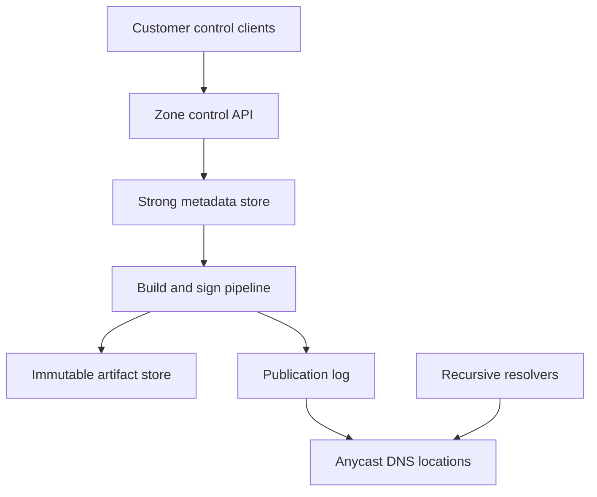
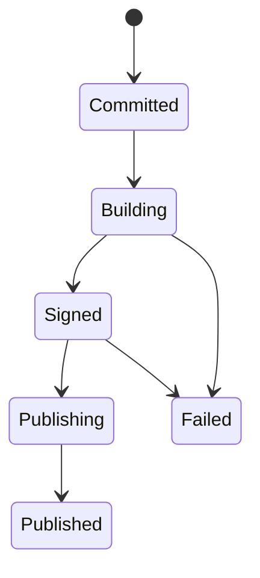
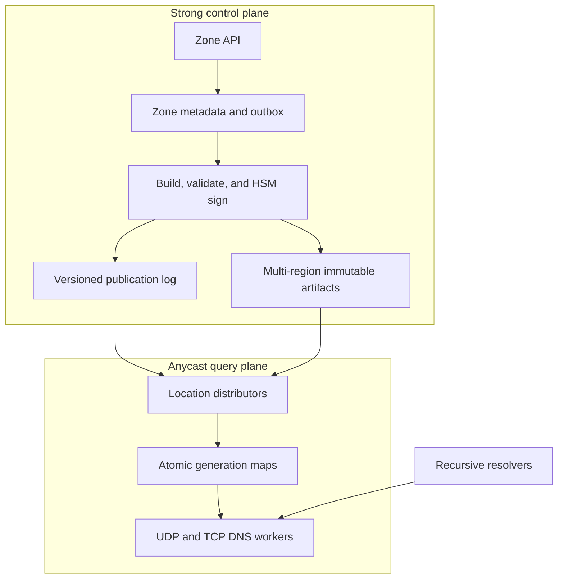

# Design a Globally Distributed Authoritative DNS Platform

**Date:** 2026-11-13  
**Difficulty:** Senior/Staff  
**Primary themes:** global read scale, versioned data publication, caching, reliability, consistency, DNSSEC, queues, and abuse resistance

---

# Interviewer prompt

> Design a managed authoritative DNS platform similar to a cloud DNS service. Customers create DNS zones, add and change records, and delegate their domains to our nameservers. Recursive resolvers around the world query our authoritative servers. The system must answer with very low latency, publish changes globally without exposing partially updated zones, remain available during regional failures and denial-of-service attacks, and support DNSSEC.

The system is **authoritative**, not recursive: it stores the records for zones customers host with us and answers resolvers from that source of truth. It does not crawl the DNS hierarchy or resolve arbitrary external domains on behalf of end users.

---

# Targeted clarifying questions and assumed interviewer answers

**Candidate:** Are zone creation, record mutation, and public query serving all in scope?

**Interviewer:** Yes. Cover zone lifecycle, atomic record changes, publication, and authoritative query serving. Include secondary transfer support if useful, but do not design domain registration.

**Candidate:** What DNS record types should we support?

**Interviewer:** Common types such as `A`, `AAAA`, `CNAME`, `MX`, `TXT`, `NS`, `SRV`, `CAA`, and `PTR`. Treat the record payload as type-specific data after validation. Alias records at the zone apex are a managed extension and may resolve to platform-owned targets.

**Candidate:** Are updates individual writes, or can customers publish a group of changes atomically?

**Interviewer:** A customer may submit a change set containing multiple additions and deletions. Resolvers must see either the old zone version or the new version, never a mixture.

**Candidate:** What propagation target should I design for?

**Interviewer:** A committed change should become available at 99.99% of healthy serving locations within 30 seconds and everywhere healthy within 60 seconds. The API must expose publication status.

**Candidate:** Does that mean recursive resolvers stop returning the old value within 60 seconds?

**Interviewer:** No. Our platform controls authoritative publication, not caches operated by recursive resolvers. Existing answers may remain in external caches until their TTL expires. Explain this distinction.

**Candidate:** What query scale and latency should I target?

**Interviewer:** Design for 20 million DNS queries per second globally at peak, 5× attack bursts, and 100 million hosted zones. Healthy edge locations should answer cached ordinary queries under 20 ms p99 server-side, excluding internet transit.

**Candidate:** What availability is required?

**Interviewer:** 99.999% monthly availability for the authoritative query plane. Control-plane mutations may have lower availability, such as 99.95%, because stale-but-complete DNS data is safer than no DNS response.

**Candidate:** Is DNSSEC mandatory?

**Interviewer:** Yes. Support platform-managed signing keys and customer-supplied key material through an HSM-backed interface. Key rollovers must not cause a validation outage.

**Candidate:** Do we need per-query analytics?

**Interviewer:** Provide delayed aggregate query analytics, not a synchronous durable log on the serving path. Sampling is acceptable for very high-volume zones.

**Candidate:** Should the design support private DNS?

**Interviewer:** No. Limit the core design to public authoritative DNS. Private split-horizon views, health-checked traffic steering, and domain registration are follow-ups.

**Candidate:** What consistency should zone-management reads provide?

**Interviewer:** The control API should be strongly consistent for a zone. A successful mutation returns a durable zone version. Public query serving is eventually consistent across locations, but each response must come from one complete version.

> **What I would say aloud:** “I’ll separate a strongly consistent control plane from a highly available global query plane. The important contract is version-atomic publication: an edge may temporarily serve the previous version, but it must never construct a response from a partial new version.”

---

# Interview time budget versus this walkthrough

In a 40–45 minute interview, I would budget approximately:

| Phase | Interview time | Goal |
|---|---:|---|
| Clarification and requirements | 5 minutes | Establish authoritative scope, scale, propagation, and consistency |
| Core entities | 2 minutes | Name the versioned nouns before drawing storage |
| Interfaces | 5 minutes | Map mutations, status, queries, and transfers to requirements |
| High-level design | 10–15 minutes | Build a complete control plane and query plane one operation at a time |
| Deep dives | 10–15 minutes | Harden publication, hot-zone serving/DDoS, and DNSSEC/recovery |
| Final check | 2 minutes | Revisit requirements and summarize tradeoffs |

This written walkthrough is intentionally more detailed than the spoken version. In the interview, I would present the baseline quickly, mark likely deep dives, and let the interviewer choose where to spend the remaining time.

The organization follows the public [Hello Interview System Design Delivery Framework](https://www.hellointerview.com/learn/system-design/in-a-hurry/delivery): requirements, core entities, interfaces, a simple design built operation by operation, and then deep dives that harden the load-bearing non-functional requirements. The explanations and DNS design below are original.

---

# 1. Requirements (~5 minutes)

## 1.1 Three core functional requirements

### FR1 — Manage zones and publish atomic change sets

An authenticated customer can:

- create or delete a hosted zone;
- add, replace, and delete resource-record sets;
- submit several changes as one atomic change set;
- validate conflicts such as a `CNAME` coexisting with other data at the same owner name;
- observe the durable version and global publication progress;
- enable DNSSEC and perform safe key rollover.

The system must never expose a zone that contains only half of a submitted change set.

### FR2 — Answer authoritative DNS queries globally

Recursive resolvers can query the platform over UDP or TCP. The platform returns:

- a positive authoritative answer;
- a referral/delegation where appropriate;
- `NODATA` when the name exists but the requested type does not;
- `NXDOMAIN` when the name does not exist;
- DNSSEC proofs and signatures when enabled;
- truncation over UDP when the response does not fit the safe payload size, allowing retry over TCP.

The common query path must not depend on a central database or cross-region RPC.

### FR3 — Operate zones safely

The platform supports:

- zone publication status and rollback to a prior immutable version;
- secondary DNS transfers through `AXFR` and incremental `IXFR` where configured;
- delayed aggregate query analytics;
- zone suspension or emergency deny actions for abuse, while preserving auditability;
- disaster recovery without silently reverting to a partially signed or older unsafe generation.

## 1.2 Explicitly out of scope

- domain registration, registrar billing, and registry protocols;
- recursive resolution for end users;
- private DNS and per-network views;
- full traffic management based on health checks, latency, or geography;
- arbitrary server-side code in DNS responses;
- detailed packet-capture retention for every query;
- the internals of the public-key algorithms used by DNSSEC.

## 1.3 Quantified non-functional requirements

1. **Scale:** 20 million queries/s at peak, tolerate 100 million packets/s during attack bursts, 100 million zones, and roughly 3 billion resource-record sets.
2. **Latency:** ordinary in-memory authoritative answers under 20 ms p99 server time at a healthy serving location; the local lookup budget should be far lower, typically sub-millisecond.
3. **Availability:** 99.999% monthly query-plane availability; no dependence on the control plane for already published data.
4. **Publication:** 99.99% of healthy locations on the committed version within 30 seconds and all healthy locations within 60 seconds, with measurable per-location watermarks.
5. **Durability and correctness:** acknowledged control-plane versions survive a regional loss; each query uses one complete zone generation; DNSSEC-signed zones never publish an unsigned or incompletely signed generation.

## 1.4 Scale estimates that change the design

### Query traffic

At 20 million queries/s:

\[
20{,}000{,}000 \times 86{,}400
= 1.728 \times 10^{12}
\]

That is about **1.7 trillion queries per day**. If we synchronously persisted even a compact 100-byte event for every query, raw ingestion would be roughly:

\[
1.728 \times 10^{12} \times 100 \approx 173\text{ TB/day}
\]

before replication and indexes.

**Design consequence:** query serving must be memory-local and analytics must be asynchronously aggregated, sampled, or sketched. The serving process increments in-memory counters and emits bounded batches; it never waits on analytics durability.

### Zone storage

Assume 100 million zones, an average of 30 record sets per zone, and about 180 bytes per canonical record set including owner name compression opportunities, type, TTL, routing metadata, and storage overhead:

\[
100{,}000{,}000 \times 30 \times 180
\approx 540\text{ GB}
\]

The real footprint is larger because of immutable versions, DNSSEC signatures, indexes, manifests, and replicas—plausibly several terabytes. That is large but manageable in durable object storage and partitioned control databases. It is too expensive to load every version of every zone into every edge process.

**Design consequence:** retain immutable zone snapshots in object storage, but distribute only the active generation. Edge nodes use a shared memory-mapped snapshot plus a hot in-process cache, partitioned across the fleet.

### Publication traffic

Assume 100,000 committed change sets/s at a busy peak, with a long tail of bulk-import zones. Broadcasting a complete zone snapshot for every one-record edit wastes bandwidth. Conversely, applying an unbounded chain of deltas at the edge makes recovery slow and risks partial state.

**Design consequence:** publish a versioned manifest plus either a compact delta or a new snapshot. Periodically compact deltas into complete immutable snapshots. An edge stages the entire target generation, verifies checksums and signatures, then atomically swaps the active pointer.

### Hot-zone skew

DNS traffic is highly skewed. If one zone receives 10% of peak traffic, it alone produces 2 million queries/s. Uniformly sharding by zone without replication would create a hot partition.

**Design consequence:** the serving plane replicates popular zone data across all nodes in a point of presence, while long-tail zones are consistently partitioned with bounded replication. Popularity-driven promotion is local and does not alter the durable zone owner.

## 1.5 Consistency and availability contract

### Control plane

- Zone mutations for one `zone_id` are linearizable and serialized by expected version.
- A successful mutation returns a durable immutable `zone_version` after quorum replication and creation of the publication obligation.
- Retrying the same idempotency key returns the original result; reusing the key with a different request returns a conflict.
- Management reads after success observe the new durable version, although its publication status may still be `PROPAGATING`.

### Query plane

- A serving location may temporarily answer from version `N` while another answers from `N+1` during the documented propagation window.
- One response is computed entirely from one complete version. The system never merges record sets across versions.
- Once a location acknowledges version `N+1`, it never intentionally returns to `N` unless an explicit rollback publishes a new generation derived from `N`.
- During control-plane failure, edges continue serving their last verified version.

### External caching

- Authoritative publication and resolver-cache expiry are different.
- If the old record has TTL 3,600 seconds, a recursive resolver that cached it immediately before publication may legitimately return it for nearly an hour.
- Customers who need a rapid migration must lower the TTL in an earlier version, wait for the prior TTL to age out, and then change the value.
- Negative answers also have a cache lifetime derived from the zone’s SOA policy.

### Deletion and suspension

- Normal record deletion follows the same versioned propagation contract.
- Zone deletion first publishes a tombstoned generation and holds durable data for a recovery period; nameserver delegation outside our system may remain, so edges must return a deliberate authoritative failure/negative policy rather than accidentally serving another tenant’s zone.
- Emergency suspension is a signed, monotonic override distributed through a separate high-priority channel. Security actions favor denial over stale positive answers.

> **What I would say aloud:** “I choose availability for the public query path and strong consistency for mutations. Eventual consistency is bounded between locations, but there is no partial-version consistency: each edge atomically serves a verified generation. I also separate our 60-second publication SLO from external resolver TTL behavior.”

---

# 2. Core entities (~2 minutes)

Identify the essential nouns before elaborating the schema.

| Entity | Purpose | Identity |
|---|---|---|
| **HostedZone** | Customer-owned DNS namespace and policy | `zone_id` and normalized apex name |
| **RecordSet** | All records for one owner name and type with one TTL | `(zone_id, owner_name, type)` |
| **ChangeSet** | Idempotent atomic mutation request | `(zone_id, change_id)` |
| **ZoneVersion** | Immutable, complete logical generation | `(zone_id, version)` |
| **ZoneArtifact** | Snapshot/delta, checksum, and signed manifest distributed to edges | `artifact_digest` |
| **Publication** | Desired version and per-location progress | `(zone_id, version)` |
| **NameserverAssignment** | Stable authoritative nameserver set and routing metadata | `assignment_id` |
| **DNSSECKeySet** | KSK/ZSK references, states, and rollover schedule | `(zone_id, keyset_version)` |
| **ServingOverride** | Monotonic emergency suspension or safety fence | `(zone_id, override_epoch)` |
| **QueryAggregate** | Delayed counts, response codes, types, and latency buckets | `(zone_id, time_bucket)` |

A `RecordSet`, not an individual record value, is the mutation unit because DNS semantics apply one TTL to the RRset. A `ZoneVersion` is immutable because safe global publication and rollback are easier when the serving artifact never changes in place.

> **What I would say aloud:** “The key modeling choice is that the live zone is an immutable generation. A change set creates a new version and a publication record; edges stage the version and flip a pointer. That gives me atomic visibility without coordinating every query.”

---

# 3. API and system interface (~5 minutes)

The management API is authenticated with an OAuth access token or signed service identity. `tenant_id` and actor identity come from the authentication context, never from a trusted-looking request-body field. Public DNS queries are unauthenticated protocol traffic.

## 3.1 Create a hosted zone — FR1

```http
POST /v1/zones
Authorization: Bearer <token>
Idempotency-Key: create-example-com-7d4
Content-Type: application/json

{
  "name": "example.com.",
  "dnssec": {"mode": "MANAGED"},
  "default_ttl": 300
}
```

```json
{
  "zone_id": "zone_01KB0Q...",
  "name": "example.com.",
  "nameservers": [
    "ns1.dns-platform.net.",
    "ns2.dns-platform.net.",
    "ns3.dns-platform.net.",
    "ns4.dns-platform.net."
  ],
  "durable_version": 1,
  "publication_state": "PROPAGATING",
  "delegation_state": "NOT_OBSERVED"
}
```

The service derives ownership from the caller, normalizes the name to canonical lower-case DNS wire form, checks that another active tenant does not own the exact apex, creates SOA/NS records, and assigns a stable nameserver set. Observing delegation is advisory; the registrar remains outside the platform.

## 3.2 Submit an atomic change set — FR1

```http
POST /v1/zones/zone_01KB0Q.../changes
Authorization: Bearer <token>
Idempotency-Key: deploy-web-2026-11-13-17
If-Match: "zone-version-41"
Content-Type: application/json

{
  "changes": [
    {
      "action": "UPSERT",
      "name": "www.example.com.",
      "type": "A",
      "ttl": 60,
      "values": ["192.0.2.10", "192.0.2.11"]
    },
    {
      "action": "DELETE",
      "name": "old.example.com.",
      "type": "A"
    }
  ]
}
```

```json
{
  "change_id": "chg_01KB0R...",
  "zone_id": "zone_01KB0Q...",
  "previous_version": 41,
  "durable_version": 42,
  "state": "PROPAGATING",
  "submitted_at": "2026-11-13T06:58:10Z"
}
```

`If-Match` prevents a stale editor from overwriting a newer zone. The response means version 42 is durable and accepted for publication, not that every resolver will immediately observe it.

## 3.3 Read publication status — FR3

```http
GET /v1/zones/zone_01KB0Q.../changes/chg_01KB0R...
Authorization: Bearer <token>
```

```json
{
  "change_id": "chg_01KB0R...",
  "durable_version": 42,
  "state": "PUBLISHED",
  "healthy_locations_total": 180,
  "healthy_locations_applied": 180,
  "published_99_99_at": "2026-11-13T06:58:24Z",
  "published_all_healthy_at": "2026-11-13T06:58:31Z",
  "external_cache_note": "Prior answers may remain cached until their TTL expires."
}
```

The public API need not reveal internal location names. Operators receive the detailed lagging-partition and point-of-presence view.

## 3.4 Enable or roll DNSSEC — FR1/FR3

```http
POST /v1/zones/zone_01KB0Q.../dnssec/rollovers
Authorization: Bearer <token>
Idempotency-Key: ksk-roll-2026-11
Content-Type: application/json

{
  "key_role": "KSK",
  "mode": "PREPUBLISH",
  "not_before": "2026-11-20T00:00:00Z"
}
```

```json
{
  "rollover_id": "roll_01KB1...",
  "state": "WAITING_FOR_PARENT_DS",
  "new_ds_records": [
    "2371 13 2 8A4F..."
  ],
  "old_key_retire_not_before": "2026-11-28T00:00:00Z"
}
```

KSK rollover pauses until the parent DS state is confirmed or the customer explicitly acknowledges the registrar step. ZSK rollover can usually be automated entirely inside the signed zone.

## 3.5 DNS query interface — FR2

Wire-level request, shown conceptually:

```text
;; QUESTION SECTION:
;www.example.com.      IN      A
```

Response:

```text
;; flags: qr aa rd; QUERY: 1, ANSWER: 2
;; ANSWER SECTION:
www.example.com.  60   IN      A       192.0.2.10
www.example.com.  60   IN      A       192.0.2.11
```

The server sets `AA` because it is authoritative. It does not perform recursion. If the UDP response is too large, it sets the truncated flag so the resolver retries over TCP. DNS Cookies, response-rate limiting, and safe EDNS payload sizing reduce spoofing and fragmentation risk.

## 3.6 Zone transfer — FR3

Configured secondaries authenticate using TSIG or an equivalent mutually authenticated channel:

```text
IXFR example.com. from serial 202611130041
```

The transfer gateway maps the SOA serial to immutable zone versions and streams a bounded incremental delta. If the requested history is compacted, it falls back to a full `AXFR` snapshot. Transfer traffic is isolated from the latency-critical UDP query pool.

## 3.7 Aggregate analytics — FR3

```http
GET /v1/zones/zone_01KB0Q.../analytics?start=2026-11-13T00:00:00Z&interval=5m
Authorization: Bearer <token>
```

```json
{
  "as_of": "2026-11-13T07:00:00Z",
  "sample_rate": 0.1,
  "buckets": [
    {
      "start": "2026-11-13T06:55:00Z",
      "queries_estimated": 12840000,
      "nxdomain_estimated": 18300,
      "p99_server_latency_ms": 2.8
    }
  ]
}
```

## 3.8 Interface-to-requirement map

| Requirement | Interface |
|---|---|
| Create/manage zones | `POST /zones`, atomic `POST /zones/{id}/changes` |
| Observe publication | change-status API with durable version and watermarks |
| Serve DNS globally | UDP/TCP authoritative DNS on port 53 |
| DNSSEC lifecycle | enablement and explicit rollover workflow |
| Secondary integration | TSIG-authenticated AXFR/IXFR |
| Analytics | delayed aggregate query API |

> **What I would say aloud:** “The mutation API returns a durable version and a publication handle. I do not claim that a DNS record is globally visible in the mutation response. The DNS protocol path is separate, unauthenticated, and read-only, while management identity always comes from the authenticated principal.”

---

# 4. Data flow

This system has a control-plane build pipeline and a separate online query plane, so an explicit flow is valuable.

## 4.1 Zone mutation and publication

1. Authenticate the actor and authorize access to `zone_id`.
2. Deduplicate the idempotency key and verify `If-Match`.
3. Normalize names and values, validate DNS invariants, quotas, and record conflicts.
4. In one zone-serialized transaction, commit the change set, new logical version, idempotency result, and outbox event.
5. A builder reads the previous immutable version plus the change set and creates the new canonical zone artifact.
6. If DNSSEC is enabled, signing workers request HSM operations and generate all required RRSIG/NSEC or NSEC3 data.
7. Validate the complete artifact, checksum it, and write it to multi-region object storage.
8. Publish a signed manifest to the distribution log, partitioned by zone or artifact bucket.
9. Each serving location downloads/stages the snapshot or delta, verifies digest and signature, and atomically advances its active-version pointer.
10. Locations report applied watermarks; the publication service updates customer-visible status.

## 4.2 Query serving

1. Anycast routing sends the resolver to a nearby healthy point of presence.
2. The packet frontend validates syntax and applies stateless anti-abuse checks.
3. The query worker performs longest-suffix zone lookup against an immutable zone index.
4. It reads the active generation pointer once.
5. It resolves the owner name/type, wildcard, delegation, CNAME, and negative-answer rules entirely within that generation.
6. It assembles the response, applies DNSSEC records if requested, and respects safe response-size limits.
7. It sends the UDP or TCP response.
8. It increments local counters and optionally emits a sampled analytics event asynchronously.

## 4.3 Rollback

1. The operator selects prior version 41.
2. The control plane creates **new version 43** whose logical content references or copies version 41.
3. Version 43 is signed under the currently valid key set, validated, and published normally.
4. Edges monotonically advance from 42 to 43. They never move their generation counter backward.

This distinction prevents a stale delayed message for version 42 from later overriding a rollback.

---

# 5. High-level design (~10–15 minutes)

Build the simplest complete system one operation at a time.

## 5.1 Baseline architecture



The architecture is deliberately asymmetric:

- the **control plane** prefers correctness and durable serialization;
- the **distribution plane** moves immutable versions;
- the **query plane** prefers availability and local memory access.

## 5.2 Operation 1: create a zone

Introduce only the fields required now:

```text
HostedZone(
  zone_id, tenant_id, normalized_apex,
  lifecycle_state, durable_version,
  desired_publication_version,
  nameserver_assignment_id,
  dnssec_mode, keyset_version,
  record_quota, created_at
)
```

The metadata store has a unique constraint on the active normalized apex. A single tenant may create subzones, but exact ownership cannot be ambiguous. The transaction also creates:

```text
ZoneVersion(
  zone_id, version,
  parent_version, change_id,
  logical_digest, build_state,
  artifact_digest, created_at
)
```

and an outbox record. The initial version contains managed SOA and NS records. A nameserver assignment is stable so routine backend changes do not force customers to update registrar delegation.

**Candidate:** “The create call commits zone ownership and version 1, then publishes asynchronously. The globally advertised nameserver names stay stable while anycast lets us move their IP service behind the scenes.”

**Interviewer:** “Why not tell each zone which exact edge machines host it?”

**Candidate:** “That would couple customer delegation to fleet topology. Stable nameserver identities plus anycast give the control plane freedom to add, remove, and drain locations without registrar changes.”

## 5.3 Operation 2: mutate records atomically

The write coordinator serializes one zone by `zone_id`, either through the database’s row/partition consensus or an explicit per-zone leader. The transaction checks expected version 41, validates the full change set against a logical view, and commits version 42 plus an outbox event.

Relevant record model:

```text
RecordSet(
  zone_id, owner_name, rr_type,
  ttl, canonical_values,
  created_in_version, deleted_in_version
)
```

This history representation is useful in the builder, but the edge artifact should be optimized for reads rather than exposing database rows. The builder produces a compact trie or sorted name table plus type-indexed RRsets.

The transactional outbox is important. Without it, a crash after committing version 42 but before enqueueing publication could leave a durable customer-visible change that never propagates. Committing both the version and publication obligation in one database boundary removes that gap.

## 5.4 Operation 3: build a complete immutable artifact

The builder consumes `ZoneVersionCreated(zone_id, 42)`. It loads the nearest base snapshot and applies ordered deltas through version 42. It then:

- validates SOA and apex NS presence;
- validates CNAME exclusivity and delegation boundaries;
- canonicalizes value ordering so identical content has the same digest;
- generates an optimized lookup structure;
- signs the zone when DNSSEC is enabled;
- calculates a content digest and manifest;
- stores the artifact durably in two or more regions;
- marks the version `READY_TO_PUBLISH`.

Artifacts are content-addressed:

```text
ZoneArtifact(
  artifact_digest,
  zone_id, zone_version,
  base_digest, encoding_version,
  object_locations, byte_size,
  keyset_version, signature_expiry,
  validation_result
)
```

The builder is at-least-once. Rebuilding the same canonical version yields the same digest, so retries are safe.

## 5.5 Operation 4: publish globally

The publication service appends:

```text
PublishZoneVersion(
  zone_id, version, artifact_digest,
  minimum_override_epoch,
  manifest_signature,
  published_at
)
```

to a durable log. The log is partitioned for throughput but ordered per zone. Every serving location runs a distributor:

1. consume the target manifest;
2. download the delta or full artifact;
3. verify object digest, manifest signature, encoding compatibility, and DNSSEC completeness;
4. stage it outside the live index;
5. atomically update `active_generation[zone_id]`;
6. persist the applied log offset/version;
7. acknowledge to the publication tracker.

At no point are live RRsets mutated one by one.

## 5.6 Operation 5: answer an authoritative query

At the edge, a read-optimized generation contains:

```text
ServingZone(
  zone_id, apex, version,
  name_index,
  rrset_blocks,
  wildcard_index,
  delegation_index,
  negative_proof_index,
  dnssec_key_tags,
  soa_negative_ttl
)
```

The worker performs longest-suffix matching to find the closest hosted zone. Within the chosen immutable generation, it applies DNS rules:

- exact owner/type match;
- CNAME answer if applicable;
- referral at a delegated child;
- wildcard synthesis only when no closer name exists;
- `NODATA` versus `NXDOMAIN` distinction;
- SOA and denial-of-existence proof for negative answers;
- DNSSEC signatures for validating resolvers.

The active version pointer is captured at request start. Even if publication flips the pointer mid-query, the request holds a reference to the old immutable generation until response completion. Reference counting or epoch-based memory reclamation frees old data only after in-flight readers finish.

## 5.7 Operation 6: analytics without hurting queries

Each worker maintains bounded counters keyed by zone, response code, query type, and latency bucket. Once per second or minute it flushes aggregates to a local collector. For extremely high-cardinality dimensions such as source network, use sampling and sketches.

Collectors write batches to a regional stream. A stream processor aggregates into time buckets in an analytical store. If the pipeline is unavailable, the edge drops or coarsens telemetry rather than delaying DNS.

## 5.8 Operation 7: rollback and deletion

Rollback creates a new monotonic version. Zone deletion creates a tombstone generation and sets `lifecycle_state=DELETING`. The platform retains prior artifacts for a recovery window, but the active pointer selects the tombstone behavior. After the hold period and delegation checks, background garbage collection removes unreachable versions and cryptographic material according to policy.

## 5.9 Baseline requirements check

The baseline can create zones, atomically change records, build and sign immutable generations, distribute them, answer queries, expose status, transfer zones, produce analytics, roll back, and delete. Three difficult areas remain:

1. How do we guarantee fast global publication without partial or regressing versions?
2. How does the query plane survive hot zones, regional failures, and 5×–50× attack traffic?
3. How do DNSSEC key lifecycle and disaster recovery avoid a global validation outage?

Those are the deep dives.

---

# 6. Deep dives (~10–15 minutes)

## Deep dive 1 — Atomic global publication, freshness, and rollback

### Where the baseline breaks

A naive system sends individual record mutations to every edge:

1. version 42 deletes `old.example.com` and changes `www.example.com`;
2. an edge receives the deletion but not the new address;
3. it serves a state that never existed in the control plane;
4. after a reconnect, an old queued message may overwrite a newer value.

The failure is not merely “eventual consistency.” It violates atomic change-set semantics and can break DNSSEC because signatures no longer match the visible RRsets.

### Compare plausible approaches

| Approach | Benefit | Where it fails or costs |
|---|---|---|
| Push each record mutation | small messages, simple producer | partial zones, replay complexity, DNSSEC mismatch |
| Store zones in a globally replicated database queried by edges | familiar consistency model | query availability depends on database; cross-region latency; hot keys |
| Full snapshot for every update | simplest immutable correctness | expensive for large frequently updated zones |
| Delta chains with in-place apply | bandwidth efficient | long recovery, partial application, compaction complexity |
| Immutable snapshots plus bounded deltas and atomic manifest swap | atomic reads, efficient normal updates, fast recovery | requires build pipeline and generation lifecycle |

Choose immutable snapshots plus bounded deltas.

### Version state machine



The desired control-plane version can be ahead of the last published version. This is observable rather than hidden.

```text
Publication(
  zone_id, version,
  desired_at, state,
  eligible_location_count,
  applied_location_count,
  p99_99_applied_at,
  all_healthy_applied_at,
  failure_reason
)
```

### Snapshot and delta policy

- Small change set and recent base: produce a delta containing changed trie blocks plus a target manifest.
- Delta chain exceeds, for example, 20 steps or 25% of the zone size: produce a fresh full snapshot.
- New or recovering location: fetch the latest snapshot, then replay only deltas after its watermark.
- Large bulk import: build a new snapshot directly rather than emitting millions of record messages.

The target manifest lists every block digest. The edge builds a new generation directory and verifies the Merkle root/content digest before activation.

### Monotonic activation and stale messages

Each edge stores:

```text
AppliedZoneState(
  zone_id,
  active_version,
  active_artifact_digest,
  override_epoch,
  applied_log_offset
)
```

Activation uses compare-and-swap:

```text
activate target only if
  target.version > active_version
  and target.override_epoch >= local_override_epoch
  and artifact verification succeeds
```

A rollback from logical content 41 is published as version 43, so ordinary monotonic comparison remains valid.

### Publication acknowledgements

The tracker does not require every machine to acknowledge individually. Each location’s local distributor confirms that all serving shards in its currently eligible capacity set can reach the target generation. It reports `(location_id, version, applied_at, health_epoch)`.

If a location is unhealthy and removed from the global routing set, it is excluded from the “healthy locations” denominator. Before rejoining, it must restore a verified snapshot, replay through the safe publication watermark, and pass query probes.

### Superseding rapid updates

If versions 42, 43, and 44 arrive quickly, the builder may coalesce unpublished intermediate versions when policy allows. It must still preserve their audit history and idempotent API results. The edge may jump from 41 to 44 because 44 is a complete version. It must not build 44 from a missing unverified delta chain.

### Read-your-write and diagnostics

DNS itself cannot force external resolver caches to refresh. Provide:

- durable control read showing version 44;
- publication watermarks by healthy-location percentage;
- an authoritative probe endpoint that queries selected platform locations with recursion disabled;
- an explanation of observed TTL and negative-cache TTL;
- an optional preflight TTL-lowering workflow.

### Failure modes

- **Builder crashes:** another worker retries from the committed immutable inputs.
- **Outbox relay stops:** committed publication obligations remain discoverable and replayable.
- **Artifact upload succeeds in one region only:** do not publish manifest until minimum durable copies exist.
- **Edge downloads corrupt bytes:** digest mismatch rejects activation; continue serving old version.
- **Edge lacks new encoding support:** mark incompatible and drain or upgrade it; never partially interpret the artifact.
- **Publication log duplicates/reorders across partitions:** per-zone versions and monotonic CAS make application idempotent.
- **Old generation freed too early:** reference/epoch reclamation retains it until in-flight queries finish.
- **Control database unavailable:** no new versions, but existing edge generations continue serving.

### Observability

- commit-to-build, build-to-sign, and sign-to-activation latency;
- propagation p50/p95/p99.99/max by version and location;
- count and age of zones where durable version exceeds globally published version;
- snapshot/delta sizes and chain depth;
- checksum, signature, and encoding-verification failures;
- edge version regressions—must remain zero;
- locations excluded from the propagation denominator and why;
- resolver-visible probe mismatches versus expected version;
- stale external-cache reports separated from platform publication failures.

> **What I would say aloud:** “I never stream live RRset mutations into the serving map. I distribute a target manifest, stage the entire immutable generation, verify it, and atomically swap one pointer. Rollback also advances the version number, so delayed messages cannot undo it.”

## Deep dive 2 — Hot-zone scaling, anycast reliability, caching, and DDoS

### Where the baseline breaks

Uniformly hashing zones to one edge shard fails under skew. A globally popular zone or a random-subdomain attack can overload one owner shard. DNS also uses UDP, so an attacker can spoof source addresses and attempt reflection amplification. A regional network event can withdraw or misroute an anycast prefix.

### Compare serving layouts

| Layout | Benefit | Tradeoff |
|---|---|---|
| Every zone on every node | simplest routing and failure behavior | memory grows with total corpus; expensive distribution |
| Each zone on one node per location | memory efficient | hot zones and single-node failures |
| Consistent-hash partitioning with replicas | balanced long tail | still needs hot-key handling |
| Long-tail partitioning plus popularity-driven full replication | memory efficient and hot-zone resilient | promotion/demotion machinery |

Choose long-tail partitioning with bounded replicas and promote hot zones across the point of presence.

### Two-level lookup and cache

Each location maintains:

1. a compact global apex-to-owner directory;
2. a distributed immutable zone store across query nodes;
3. a per-process hot-zone cache;
4. a location-wide cache for promoted popular generations.

This is not ordinary cache-aside against the control database. Cache entries are immutable and version-addressed. The active pointer selects a version, so stale cache blocks cannot masquerade as the new generation. Old blocks are harmless until garbage-collected.

The public [Hello Interview caching guide](https://www.hellointerview.com/learn/system-design/core-concepts/caching) emphasizes that caching reduces read latency but adds invalidation and failure concerns. Version-addressed immutable data avoids destructive invalidation: publication changes a small pointer, and eviction is capacity management rather than correctness.

### Anycast and regional failure

The platform advertises the same nameserver IP prefixes from many locations. Internet routing usually sends a resolver to a nearby advertisement. Health agents withdraw a location’s route when:

- packet loss or query error rate crosses a threshold;
- its active publication watermark is too stale for policy;
- capacity is exhausted;
- dependency or kernel health makes responses unsafe.

Resolvers retry another authoritative nameserver/IP. Nameserver assignments span independent failure domains and, ideally, independent route prefixes.

Route withdrawal is not instantaneous everywhere, so the node also performs local fail-safe behavior. A degraded location can reject or shed low-value attack traffic, but it should continue answering legitimate queries from its last verified snapshot while possible.

### DDoS layers

1. **Network edge:** upstream scrubbing, ACLs for malformed packets, per-prefix capacity, and anycast absorption.
2. **Stateless packet frontend:** validate header counts, opcode, name length, EDNS size, and known-bad patterns before allocating expensive state.
3. **Response-rate limiting:** limit repeated identical negative or large responses per source prefix while preserving a small “slip” rate so legitimate resolvers still receive some answers.
4. **DNS Cookies and TCP fallback:** give cooperating resolvers stronger source validation and move large responses to a connection-oriented path.
5. **Zone/query policy:** cap response size, avoid needless additional-section data, and choose NSEC3 parameters that do not make denial proofs excessively expensive.
6. **Per-tenant protection:** an attacked zone cannot exhaust all query-worker memory or TCP connection slots.

### Random-subdomain attacks

An attacker may query millions of unique nonexistent names, defeating exact-answer caches. The edge must answer negative queries from the immutable name index without consulting origin storage. Cache compact negative structures at the zone generation level, not every random name.

DNSSEC denial proofs are precomputed in the artifact. The edge performs bounded lookup, not an HSM signature operation per query.

### Amplification control

The server cannot perfectly distinguish a spoofed UDP source. Reduce amplification by:

- conservative EDNS UDP payload size, commonly around 1,232 bytes to avoid fragmentation on typical paths;
- minimal responses and no recursion;
- no `ANY` response containing the entire zone data set;
- rate limiting unusually large response patterns;
- truncating and requiring TCP when appropriate;
- monitoring response-bytes/request-bytes ratio.

### Capacity model

At 20 million normal QPS across 200 locations, the simple average is 100,000 QPS/location, but geography and attacks are uneven. Design each location for perhaps 3× its expected legitimate peak and the global fleet for a simultaneous loss of major locations.

If a query core safely serves 200,000 simple in-memory QPS, 100 cores would theoretically cover 20 million QPS. That arithmetic is misleading because network interrupts, TCP, DNSSEC responses, skew, software upgrades, and failure reserve dominate. Benchmark real packet mixes and keep N+2 regional capacity rather than sizing from the average alone.

**Design consequence:** autoscaling helps TCP workers and collectors, but UDP attack defense requires pre-provisioned network and packet-processing headroom. New virtual machines that appear minutes later do not stop a 30-second flood.

### Overload policy

Prioritize:

1. well-formed queries for existing popular names;
2. queries with valid cookies or established TCP;
3. ordinary negative queries within fair limits;
4. repeated abusive patterns last.

Do not return fabricated positive answers. Under extreme overload, dropping selected UDP packets may be safer than returning `SERVFAIL` for everything because resolvers can retry alternate nameservers.

### Failure modes

- **One query node dies:** bounded replica owners and hot replicas continue; directory excludes the node.
- **Location loses artifact storage:** serve memory-resident verified generations and withdraw before unsafe eviction.
- **Anycast route leak:** RPKI/route monitoring and automated withdrawal; independent nameserver prefixes reduce correlated impact.
- **Hot-zone promotion stampede:** single-flight local loading, admission quotas, and prewarming based on moving QPS.
- **Cache memory exhaustion:** version-aware weighted eviction; active minimum replicas are pinned.
- **TCP SYN/connection flood:** SYN cookies/proxies, strict connection budgets, and independent TCP pools.
- **Telemetry outage:** drop/sample telemetry; never block responses.
- **Attack on one tenant:** hierarchical fair limits prevent it from consuming the entire location.

### Observability

- QPS, packets/s, bytes/s, and response amplification ratio by location;
- p50/p95/p99 latency separated by UDP, TCP, positive, negative, and DNSSEC;
- drops and rate limits by reason, source prefix, and zone;
- anycast path/route changes and withdrawn locations;
- hot-zone promotions, cache hit ratio, and owner-shard skew;
- NXDOMAIN uniqueness and random-subdomain indicators;
- TCP fallback and truncation rate;
- node/location capacity headroom during loss scenarios;
- legitimate-query success measured from external probes.

> **What I would say aloud:** “Anycast gets queries to a healthy nearby location, but it is not the entire resilience story. Inside the location I partition the long tail, replicate hot zones, answer random-subdomain negatives from immutable indexes, and apply layered anti-amplification controls before expensive parsing or TCP state.”

## Deep dive 3 — DNSSEC key lifecycle, signing safety, and disaster recovery

### Where the baseline breaks

DNSSEC converts some operational mistakes into complete outages. If a validating resolver sees a parent DS record pointing to a key that no longer signs the child zone, it treats answers as bogus. Publishing records before signatures, allowing signatures to expire, or retiring a key before caches age out can make a healthy DNS server unusable.

### Concepts introduced

- **ZSK (Zone Signing Key):** usually signs the zone’s RRsets.
- **KSK (Key Signing Key):** signs the DNSKEY RRset and is represented by a DS record in the parent zone.
- **RRSIG:** a signature over an RRset with inception and expiration times.
- **NSEC/NSEC3:** authenticated denial-of-existence structures for negative answers.

The platform stores key references and public material, not exportable private keys, when using managed HSM keys.

### Compare signing approaches

| Approach | Benefit | Failure/tradeoff |
|---|---|---|
| Sign every query online | always current | HSM latency/cost on read path; DDoS becomes signing attack |
| Sign changed RRsets during publication | bounded work, no query HSM call | must manage signature refresh before expiry |
| Periodically sign entire zone | simple artifact | expensive for huge zones |
| Incremental signing plus scheduled full validation | efficient and safe | more pipeline state |

Choose incremental offline signing inside the build pipeline, with periodic full validation and proactive resigning.

### Key data model

```text
DNSSECKey(
  zone_id, key_id, role,
  algorithm, public_key,
  hsm_key_reference,
  lifecycle_state,
  publish_at, activate_at,
  retire_at, remove_at
)
```

Lifecycle states include `GENERATED`, `PUBLISHED`, `ACTIVE`, `RETIRING`, `REMOVED`, and `COMPROMISED`. Transitions are audited and guarded by minimum TTL-derived wait windows.

### Safe ZSK rollover

1. Generate the new ZSK in the HSM.
2. Publish its DNSKEY while the old key still signs.
3. Wait at least the relevant DNSKEY TTL plus safety margin.
4. Start signing with the new ZSK, optionally double-sign during overlap.
5. Wait until old signatures and cached DNSKEY material can expire.
6. Retire and later remove the old key.

### Safe KSK rollover

KSK rollover crosses an organizational boundary because the parent DS must change:

1. publish the new KSK in the child DNSKEY RRset;
2. provide or automatically submit the new DS to the registrar/parent;
3. verify the parent publishes it from multiple vantage points;
4. wait for old parent/child TTLs;
5. sign the DNSKEY RRset with the new KSK, often with overlap;
6. remove the old DS only after validators can trust the new chain;
7. retire the old KSK after caches expire.

The workflow pauses rather than guessing if parent state cannot be proven.

### Signature freshness

Signatures have an inception and expiration window. A scheduler continuously scans:

```text
minimum_signature_expiry - now
```

and creates a new version before a safety threshold, such as several days. The edge reports the minimum signature expiry of active generations. Publication readiness rejects an artifact whose remaining lifetime is below policy.

Clock skew matters. Signing services use hardened time sources and allow a small inception backdate so resolvers with slightly slow clocks do not reject newly published signatures.

### HSM and signer isolation

- HSM clusters span failure domains and enforce per-tenant/key authorization.
- Signing workers receive a content digest and constrained key handle, not arbitrary key access.
- Quotas stop a malicious tenant from exhausting HSM capacity with repeated rebuilds.
- The build queue separates unsigned ordinary zones, ZSK work, KSK workflows, and emergency resigning.
- Audit logs record actor, artifact digest, key ID, algorithm, and transition, never private key material.

### Disaster recovery

Durable recovery state includes:

- control metadata and immutable change history;
- artifact manifests and objects in multiple regions;
- HSM-replicated or escrow-policy-compliant key references;
- publication-log offsets and location watermarks;
- emergency override epochs.

A replacement region may serve only after it:

1. restores a trusted software/configuration version;
2. downloads signed manifests from durable storage;
3. verifies artifacts independently;
4. checks signature-lifetime thresholds and override epochs;
5. replays the publication log through the safe watermark;
6. passes authoritative and DNSSEC validation probes;
7. announces anycast routes.

It must not simply load an old disk snapshot and announce routes.

### Emergency key compromise

If a ZSK is suspected compromised, create an emergency rollover generation, double-sign only if policy permits, and prioritize its publication. If a KSK is compromised, coordinate an emergency DS change with the parent. The platform exposes explicit risk state; it does not hide the fact that parent coordination may exceed the normal 60-second propagation SLO.

For a suspected platform signing-key compromise affecting manifest authenticity, increment the global trust epoch, stop accepting old manifests for new activation, distribute a new trust root through a separately secured control channel, and keep serving already verified zones only according to the incident policy.

### Failure modes

- **HSM unavailable:** continue serving existing signed generations; queue new builds; alert before signature safety margin shrinks.
- **Signer produces incomplete signatures:** artifact validation rejects publication.
- **Signature refresh pipeline stalls:** expiry forecasts page operators days before impact; emergency capacity is reserved.
- **Parent DS not updated:** KSK workflow remains in waiting state; old valid key remains active.
- **Clock skew:** signing readiness checks trusted time; backdated inception absorbs bounded resolver skew.
- **Wrong key removed early:** state-machine guards and TTL wait conditions prevent destructive transition; manual override requires multi-party authorization.
- **Recovery region has stale keyset:** it cannot pass manifest/keyset validation and does not advertise routes.

### Observability

- minimum active RRSIG lifetime by zone and percentile;
- zones below signature safety threshold;
- signing queue lag and HSM latency/error rate;
- key-state transitions and time spent waiting for parent DS;
- DNSSEC validation success from independent external validators;
- published artifact/keyset mismatches—must be zero;
- emergency rollover propagation time;
- restored-location readiness failures;
- HSM quota pressure and per-tenant signing amplification.

> **What I would say aloud:** “DNSSEC private-key operations stay off the query path. I publish only complete signed generations, track minimum signature lifetime continuously, and make rollover a TTL-aware state machine. A recovery site cannot announce routes until it has current override epochs, verified artifacts, and successful DNSSEC probes.”

---

# 7. Final design

## 7.1 Evolved architecture



## 7.2 Component responsibilities

| Component | Responsibility |
|---|---|
| Zone control API | Authentication, authorization, normalization, validation, idempotency, expected-version checks |
| Strong metadata store | Zone ownership, serialized versions, change sets, DNSSEC state, outbox obligations |
| Build workers | Materialize canonical immutable zone generations from snapshots/deltas |
| HSM signing workers | Incremental DNSSEC signing and key-lifecycle enforcement |
| Artifact validators | DNS invariants, digest, signature completeness, encoding compatibility |
| Immutable object store | Multi-region snapshots, deltas, manifests, and retained rollback generations |
| Publication log | Replayable desired generations ordered per zone |
| Publication tracker | Healthy-location watermarks and customer-visible status |
| Location distributors | Download, verify, stage, and atomically activate generations |
| Anycast packet frontends | Routing, packet parsing, stateless abuse filters, safe UDP behavior |
| DNS query workers | Immutable authoritative lookup, DNSSEC proofs, UDP/TCP response assembly |
| Hot-zone cache/store | Popularity-driven local replication of immutable generations |
| Analytics pipeline | Sampled/batched aggregates outside the response path |
| Override channel | High-priority monotonic suspension and incident fences |
| Reconciliation | Detect stuck versions, stale locations, signature risk, and leaked artifacts |

## 7.3 End-to-end narrative

A customer creates a zone or submits an authenticated, idempotent change set with an expected version. The control database serializes mutations for the zone and atomically commits the new immutable version plus a publication obligation. A build worker creates a canonical read-optimized artifact from a bounded delta chain or snapshot. For DNSSEC zones, HSM-backed workers sign changed RRsets and generate denial-of-existence proofs. Validators reject any incomplete or inconsistent artifact.

Once the artifact is durably stored in multiple regions, the platform appends a signed target manifest to a publication log. Each healthy serving location downloads and verifies the complete generation outside its live index, then atomically advances a monotonic per-zone pointer. Publication status is calculated from location acknowledgements. A rollback creates a new higher version referencing old logical content, so delayed events cannot regress an edge.

Recursive resolvers reach stable nameserver IPs through anycast. The local packet frontend applies cheap anti-abuse checks, and query workers resolve entirely from immutable local data. Popular zones are replicated across the location while long-tail zones use consistent ownership with bounded replicas. DNSSEC signing never occurs on a query. Analytics is sampled and batch-flushed so telemetry failure cannot delay DNS.

During control-plane or signing outages, edges keep serving the last verified, unexpired signed generation. During a location failure, routes are withdrawn and resolvers retry other nameservers. A recovering location must catch up publication and override watermarks and pass DNS/DNSSEC probes before announcing routes.

## 7.4 Requirements check

| Requirement | Design response |
|---|---|
| Atomic change sets | Zone-serialized durable versions and immutable generation activation |
| 20M peak QPS | Anycast, local immutable lookup, partitioned long tail, replicated hot zones |
| Under 20 ms p99 | No central RPC; memory-mapped/in-process reads and bounded packet work |
| 99.999% query availability | Independent data plane, stable snapshots, multiple anycast locations/nameservers |
| 30/60-second publication | Replayable log, parallel artifact distribution, per-location watermarks |
| No partial zones | Stage/verify complete target and atomically swap one pointer |
| No version regression | Monotonic generation number; rollback becomes a higher version |
| Resolver cache correctness | Explicit TTL distinction and preflight TTL-lowering workflow |
| DNSSEC | Offline HSM signing, complete signed artifacts, safe rollover state machines |
| DDoS resilience | Anycast absorption, stateless filters, RRL, cookies, TCP isolation, tenant fairness |
| Zone transfer | Isolated authenticated AXFR/IXFR gateway backed by immutable versions |
| Analytics | Sampled and batched regional aggregation off the serving path |
| Disaster recovery | Multi-region artifacts/metadata, override watermarks, verify-before-route readiness |

## 7.5 Final 60-second interview summary

> **What I would say aloud:** “I split the system into a strongly consistent control plane and a highly available authoritative query plane. Each atomic change set creates an immutable zone version and transactional publication obligation. Builders materialize a canonical artifact, DNSSEC sign it through HSMs, validate it, and publish a signed manifest. Every edge stages the whole generation and atomically swaps a monotonic pointer, so locations may briefly differ by version but no response sees a partial zone. Stable nameserver IPs use anycast; queries are answered from local immutable data, with hot zones replicated and the long tail partitioned. Layered rate limits, safe UDP sizing, cookies, and isolated TCP pools resist amplification and random-subdomain attacks. Rollback creates a higher version, analytics stays asynchronous, and a recovering location cannot announce routes until artifacts, override epochs, publication watermarks, and DNSSEC probes are current.”

---

# Realistic interviewer follow-up questions with strong sample answers

## 1. “Why is the control plane allowed to be less available than the query plane?”

**Strong answer:** “DNS is read-dominated, and the last complete zone is usually safer than accepting a mutation we cannot durably serialize or sign. Existing DNS should survive a management outage, so the query plane has no synchronous control dependency.”

## 2. “What does atomic publication mean if locations can serve different versions?”

**Strong answer:** “Atomicity is per serving location and response: an edge serves all of version N or all of N+1. Eventual consistency exists only in which complete version locations currently select. The API exposes that propagation window.”

## 3. “Why not update RRsets in place at the edge?”

**Strong answer:** “A multi-record change or DNSSEC update could become partially visible, and a crash could leave a state that never existed. Immutable staging plus a pointer swap makes activation atomic and rollback simple.”

## 4. “How does rollback avoid a delayed version overwriting it?”

**Strong answer:** “Rollback publishes new version 43 whose content derives from version 41. Edges only advance monotonically, so delayed version 42 cannot replace 43.”

## 5. “Why can a user still observe an old address after global publication succeeds?”

**Strong answer:** “A recursive resolver may have cached the previous authoritative answer until its TTL. Our publication SLO describes our nameservers, not third-party caches. For planned cutovers, lower TTL in advance and wait out the old TTL.”

## 6. “How do you distinguish NXDOMAIN and NODATA?”

**Strong answer:** “NXDOMAIN means the queried owner name does not exist in the zone; NODATA means the name exists but lacks the requested type. Both include authoritative negative metadata and, under DNSSEC, the appropriate denial proof.”

## 7. “How do you keep a hot zone from overloading one shard?”

**Strong answer:** “Long-tail zones use consistent partition ownership with replicas, but a popularity controller promotes hot immutable generations across all query nodes in the location. Because data is version-addressed, replicas do not create write conflicts.”

## 8. “What happens during a random-subdomain attack?”

**Strong answer:** “The query is answered as a bounded negative lookup from the zone’s immutable name and denial-proof indexes. I do not insert every random name into cache or call storage/HSM. Response-rate limits and per-zone fairness contain the attack.”

## 9. “Why not sign responses online?”

**Strong answer:** “Online signing places HSM latency and scarce key operations on an unauthenticated DDoS path. DNSSEC signatures cover RRsets, so we precompute them when building the immutable generation and refresh them before expiry.”

## 10. “How would you roll a KSK safely?”

**Strong answer:** “Prepublish the new key, coordinate its DS with the parent, verify the parent from multiple vantage points, wait through relevant TTLs, overlap trust, then remove the old DS/key only after cached material can expire. The workflow pauses if parent state is uncertain.”

## 11. “What if the HSM is unavailable for an hour?”

**Strong answer:** “Already signed generations keep serving. New signed publications queue. We continuously track minimum signature lifetime and reserve enough safety margin that a short HSM outage is operational degradation, not immediate DNS failure.”

## 12. “How do AXFR and IXFR fit?”

**Strong answer:** “A separate authenticated transfer gateway maps SOA serials to immutable versions. It streams retained deltas for IXFR or a full artifact for AXFR. Transfer CPU and connections are isolated from public UDP workers.”

## 13. “Would you store every zone at every location?”

**Strong answer:** “Every location needs access to every active zone, but not every process must hold every zone in private memory. I use a location-wide immutable store, bounded replicas for the long tail, and process-local replication for hot zones.”

## 14. “How do you garbage-collect old artifacts safely?”

**Strong answer:** “Retain versions referenced by active pointers, in-flight publication, rollback policy, secondary-transfer history, or audits. Edge epoch reporting and object-store reference manifests establish reachability. Deletion is delayed and idempotent.”

## 15. “What if a location activates the artifact but crashes before acknowledging?”

**Strong answer:** “On restart it reads its durable applied state and log offset, verifies the active artifact, and re-acknowledges. The tracker may temporarily undercount propagation, but correctness is unchanged.”

## 16. “How do you handle a zone with millions of records?”

**Strong answer:** “Build a partitioned artifact with a manifest over immutable blocks, stream changes through bounded deltas, and snapshot after a chain threshold. The edge swaps the generation manifest atomically even if blocks are memory-mapped rather than copied into one heap object.”

## 17. “Can you promise exactly-once publication?”

**Strong answer:** “I do not need exactly-once delivery. The log is at-least-once, and activation is idempotent by `(zone_id, version, digest)` with monotonic compare-and-swap. The observable effect is once per version.”

## 18. “What is your degraded behavior if a location is 10 minutes behind?”

**Strong answer:** “It is withdrawn from anycast before being counted healthy. It can keep its last verified generation for local diagnostics, but it does not serve production until it catches up through the safe watermark and passes probes.”

## 19. “How do you test the partial-version invariant?”

**Strong answer:** “Fault-inject crashes after every staging step, corrupt blocks, reorder and duplicate manifests, hold one delta, flip pointers under concurrent queries, and property-test that every response is explainable by exactly one committed zone digest.”

## 20. “How would you add health-checked traffic steering later?”

**Strong answer:** “Keep health decisions outside the query worker. A controller consumes health signals, applies hysteresis, and publishes a new version or a tightly scoped signed overlay. The data plane still answers from a deterministic immutable generation, and stale-health policy is explicit.”

---

# Common pitfalls

1. **Designing a recursive resolver instead of an authoritative service.** The storage and trust boundaries are different.
2. **Saying “eventual consistency” without defining atomic version visibility.** Edges may lag, but partial change sets are unacceptable.
3. **Updating record sets in place at every edge.** Crashes and reordering expose impossible zone states.
4. **Claiming 60-second publication defeats resolver caches.** External caches obey the prior TTL.
5. **Ignoring negative caching.** NXDOMAIN may persist according to SOA policy after a name is created.
6. **Using the control database on the query path.** A database outage would become a global DNS outage.
7. **Logging every query synchronously.** Trillion-query/day scale makes this too expensive and fragile.
8. **Uniformly sharding zones without hot-key replication.** Popular zones and attacks create severe skew.
9. **Treating anycast as automatic perfect failover.** Route convergence, leaks, and partial reachability require health withdrawal and independent nameservers.
10. **Ignoring UDP spoofing and amplification.** Authoritative servers are an abuse target even without recursion.
11. **Caching every NXDOMAIN name.** Random-subdomain attacks destroy cache efficiency and memory.
12. **Signing on every query.** This exposes scarce HSM operations to unauthenticated traffic.
13. **Publishing unsigned data before signatures arrive.** DNSSEC validators will reject the zone.
14. **Removing a KSK before the parent DS and caches are safe.** This can make the whole zone bogus.
15. **Allowing RRSIGs to approach expiry unnoticed.** Signature-lifetime observability is a correctness SLO.
16. **Rolling back by decrementing the version.** Delayed messages can reapply the bad version.
17. **Freeing the old generation immediately after pointer swap.** In-flight readers may still reference it.
18. **Letting AXFR compete with UDP workers.** Large transfers can consume connections and memory needed for queries.
19. **Counting unhealthy locations as publication failures without removing them from traffic.** Health and propagation denominators must be explicit.
20. **Restoring an edge from a disk snapshot and announcing routes immediately.** It may miss overrides, versions, or current keys.
21. **Trusting request-body tenant identity.** Zone ownership comes from the authenticated principal.
22. **No idempotency or expected-version check.** Retries and concurrent editors can create duplicate or lost changes.
23. **Treating cache eviction as correctness.** Immutable version addressing and active pointers carry correctness; eviction manages capacity.
24. **No reconciliation.** Stuck outbox events, lagging edges, or signing drift can silently violate the publication contract.

---

# Compact interview scripts

## Opening script

> “I’ll design public authoritative DNS, not recursive resolution or registration. I’ll separate a strongly consistent zone-management plane from an anycast query plane, make every change set an immutable version, and then deep-dive atomic propagation, hot-zone/DDoS behavior, and DNSSEC lifecycle.”

## Transition into the high-level design

> “The API contract gives me a durable version before global publication. I’ll now trace zone creation, an atomic record change, artifact building/signing, edge activation, and a DNS query so the baseline is complete before adding hardening.”

## Transition into deep dives

> “The baseline works functionally, but individual edge mutations could expose partial zones, traffic skew and UDP abuse could collapse a location, and DNSSEC mistakes can turn a key rollover into a full outage. I’ll harden those three areas.”

## Closing script

> “The central invariant is that every response comes from one verified immutable zone generation. Strong per-zone writes create versions; an asynchronous log distributes signed manifests; edges stage and atomically activate; and anycast plus local replication keeps reads available. Operational safety comes from monotonic rollback versions, explicit propagation watermarks, TTL-aware DNSSEC rollovers, and fail-safe route readiness.”

---

# Public guidance referenced

- [Hello Interview — System Design Delivery Framework](https://www.hellointerview.com/learn/system-design/in-a-hurry/delivery)
- [Hello Interview — API Design and Core Concepts](https://www.hellointerview.com/learn/system-design/in-a-hurry/core-concepts)
- [Hello Interview — Data Modeling](https://www.hellointerview.com/learn/system-design/core-concepts/data-modeling)
- [Hello Interview — Caching](https://www.hellointerview.com/learn/system-design/core-concepts/caching)
- [Hello Interview — Scaling Writes](https://www.hellointerview.com/learn/system-design/patterns/scaling-writes)
- [Hello Interview — Long-Running Tasks](https://www.hellointerview.com/learn/system-design/patterns/long-running-tasks)

The framework citations explain the interview delivery structure and general patterns. The authoritative-DNS problem, assumptions, dialogue, arithmetic, architecture, and tradeoff analysis are original.
