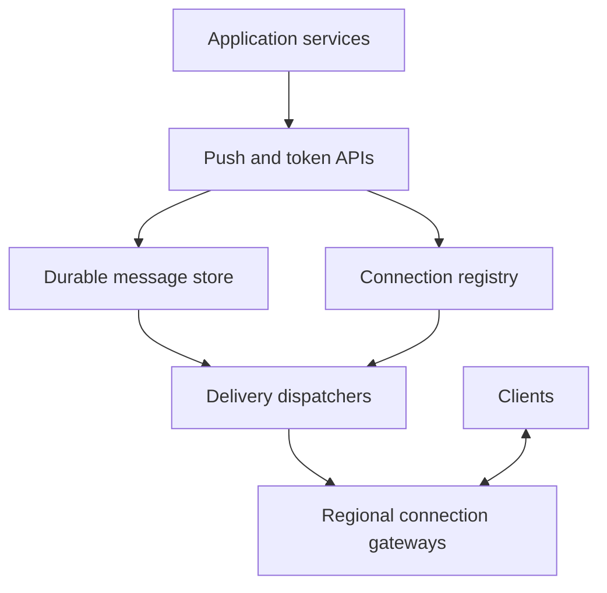
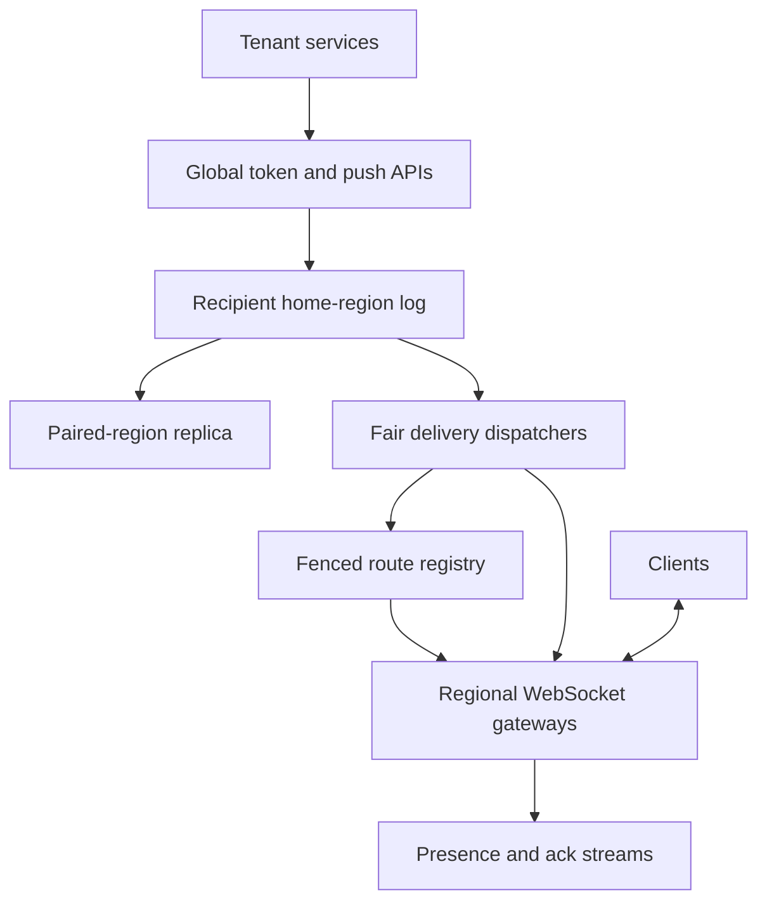

# Design a Global WebSocket Gateway and Presence Platform

**Difficulty:** Hard  
**Primary themes:** persistent connections, routing, queues, backpressure, reliability, presence consistency, multi-region failover  
**Interview time budget:** roughly 40–45 minutes  
**Educational walkthrough:** intentionally more detailed than what you would say in the timed interview

This is an infrastructure problem, not a chat-product problem. The platform gives many application teams a managed way to keep client connections open and push events to particular users or devices. Chat, collaborative editing, live dashboards, multiplayer games, and operational consoles may all use it, but message meaning belongs to those applications.

The delivery order below follows the public [Hello Interview System Design Delivery Framework](https://www.hellointerview.com/learn/system-design/in-a-hurry/delivery): clarify requirements, name core entities, define the interface, build a complete baseline one operation at a time, and then use deep dives to harden the design. The architecture and dialogue are original.

---

# Interviewer prompt

> Design a globally distributed WebSocket gateway that application services can use to maintain bidirectional connections with clients and push messages to users or devices. The platform should expose connection presence, tolerate regional failures, and prevent slow clients or noisy tenants from destabilizing the fleet.

# Targeted clarifying questions and assumed interviewer answers

**Candidate:** “Is this the underlying gateway for many products, or should I design chat conversations and message history too?”

**Interviewer:** “It is a multi-tenant gateway. Applications own their domain data and payload semantics. Your system owns connections, routing, delivery attempts, acknowledgements, and presence.”

**Candidate:** “Do clients send messages through the same connection, or is this server-to-client only?”

**Interviewer:** “Bidirectional. Client frames are authenticated and forwarded to an application-defined upstream; services can push frames back to a user, device, connection, or channel.”

**Candidate:** “What delivery guarantee should the gateway offer?”

**Interviewer:** “For explicitly durable pushes, provide at-least-once delivery within a 24-hour retention window. Ephemeral events such as typing indicators may be best effort. Exactly-once business effects are out of scope.”

**Candidate:** “Does ordering matter?”

**Interviewer:** “Preserve order for durable messages within one application stream to one logical recipient. Do not promise a total order across regions, tenants, or unrelated streams.”

**Candidate:** “How should presence behave?”

**Interviewer:** “Presence is advisory and eventually consistent. It is acceptable for a user to appear online for up to 30 seconds after an unclean disconnect. Authorization and billing must never rely on presence.”

**Candidate:** “What scale should I design for?”

**Interviewer:** “Ten million concurrent connections globally, one million messages per second at peak, and occasional reconnect storms of two million clients in five minutes after a regional event.”

**Candidate:** “What latency and availability targets matter?”

**Interviewer:** “For a connected recipient in a healthy region, p99 service-to-gateway-to-client delivery latency should be under 200 ms. Connection establishment should be under one second p99. Target 99.99% availability for establishing and maintaining connections.”

**Candidate:** “Can clients connect from multiple devices and browser tabs?”

**Interviewer:** “Yes. A user may have many connections. Push APIs must state whether to target one connection, a device, all active devices, or a named channel.”

**Candidate:** “May payloads be large?”

**Interviewer:** “Cap a frame at 64 KiB and a durable message at 256 KiB. Larger objects should live in object storage and be referenced by URL or identifier.”

**Candidate:** “Should the gateway inspect or transform application payloads?”

**Interviewer:** “Only a small routing envelope. Treat the body as opaque bytes, enforce size and policy, and encrypt transport with TLS.”

**Candidate:** “Should we support browsers behind restrictive proxies?”

**Interviewer:** “WebSocket is primary. A fallback such as Server-Sent Events plus HTTP writes may be mentioned, but do not spend the interview designing it.”

**Candidate:** “Are tenant quotas and isolation in scope?”

**Interviewer:** “Yes. One tenant or slow consumer must not exhaust connections, memory, queue capacity, or egress for others.”

> **What I would say aloud:** “I’ll design a multi-tenant connection and delivery substrate, not chat storage. I’ll separate ephemeral connection routing from durable message intent, guarantee at-least-once delivery only where requested, and treat presence as eventually consistent advisory state.”

---

# 1. Requirements (~5 minutes)

## 1.1 Core functional requirements

Prioritize three requirements.

### FR1 — Establish and maintain authenticated bidirectional connections

- A client upgrades an HTTPS request to WebSocket using a short-lived connection token.
- The platform binds the socket to `tenant_id`, `user_id`, `device_id`, scopes, and a unique `connection_id` derived from authenticated claims—not from a client-supplied tenant field.
- It supports heartbeats, token refresh, graceful close, and client-to-service frames.

### FR2 — Route and deliver service-originated messages

- A trusted application service can target a `connection_id`, `device_id`, all connections for a user, or a channel.
- Ephemeral messages are low-latency best effort.
- Durable messages are persisted before acceptance, retried until acknowledged or expired, and may be delivered more than once.
- Ordering is scoped to `(tenant_id, recipient_id, stream_id)` for durable messages.

### FR3 — Expose connection state and recover from disconnects

- Services can query or subscribe to advisory presence.
- Clients reconnect with exponential backoff and resume from an acknowledged sequence.
- Operators can drain gateways and fail traffic away from unhealthy zones or regions without silently discarding accepted durable messages.

## 1.2 Quantified non-functional requirements

1. **Scale:** 10 million concurrent sockets, 1 million inbound plus outbound frames/s peak, and 2 million reconnects over 300 seconds—about 6,700 connection attempts/s before safety margin.
2. **Latency:** connected-recipient durable or ephemeral push p99 under 200 ms inside a healthy region; connection establishment p99 under 1 second.
3. **Availability:** 99.99% monthly availability for connection establishment and the managed delivery API. Existing sockets should survive control-plane outages.
4. **Durability:** once the durable push API returns `ACCEPTED`, message intent survives a gateway process, availability-zone, or single-region failure; retain for 24 hours unless acknowledged earlier.
5. **Isolation and overload safety:** enforce tenant connection, ingress, queued-byte, and egress quotas; memory use per socket and per recipient is bounded.

## 1.3 Scope

### In scope

- WebSocket termination and connection lifecycle
- identity binding and authorization hooks
- service-to-client and client-to-service routing
- durable and ephemeral delivery modes
- acknowledgement, replay, presence, draining, quotas, and observability
- multi-zone and multi-region operation

### Out of scope

- chat rooms, document operations, game state, or other product semantics
- permanent message history beyond the 24-hour delivery window
- end-to-end payload encryption key management
- mobile push notification providers
- arbitrary large-file transfer
- exactly-once business processing

## 1.4 Consistency and availability contract

| Concern | Contract |
|---|---|
| Connection ownership | One active lease epoch owns a `connection_id`; stale owners may not send after fencing |
| Presence | Eventually consistent, advisory, up to 30 seconds stale after unclean loss |
| Ephemeral push | Best effort; may be dropped during disconnect, overload, or failover |
| Durable acceptance | Strong: `ACCEPTED` means replicated message intent exists before response |
| Durable delivery | At least once until client ack or 24-hour expiry |
| Ordering | Per recipient stream, subject to retries; no global total order |
| Client-to-service frames | At least once only if the application opts into durable ingress; otherwise live best effort |
| Regional partition | Prefer continued local connection service; durable cross-region pushes may queue rather than violate ordering/fencing |

Exactly-once delivery is not promised because the gateway can send a frame, the client can process it, and the acknowledgement can be lost. The gateway must retry; therefore the client or application deduplicates by `message_id`.

> **What I would say aloud:** “My strongest invariant is durable acceptance, not exactly-once receipt. After acceptance I can replay until a client acknowledgement, but an acknowledgement can be lost, so duplicates are fundamental. Presence is intentionally weaker and never participates in authorization.”

---

# 2. Core entities (~2 minutes)

Name entities before expanding schemas, as recommended by the [Hello Interview delivery guidance](https://www.hellointerview.com/learn/system-design/in-a-hurry/delivery).

- **Tenant** — an application customer with quotas, routing policy, and upstream endpoints.
- **Principal** — authenticated user/service identity and scopes.
- **Connection** — one live client socket, bound to a gateway and lease epoch.
- **Device** — a stable client installation that may create successive connections.
- **Recipient** — a target such as user, device, connection, or channel.
- **Message** — an opaque payload plus routing, durability, ordering, and expiry metadata.
- **Delivery** — per-target state for a durable message: pending, in flight, acknowledged, or expired.
- **Subscription** — a connection’s membership in named channels.
- **Presence** — derived advisory state summarized from live connection leases.
- **Cursor** — the client’s highest contiguous acknowledged sequence for a durable stream.

Do not design every column yet. Fields appear when a component needs them.

> **What I would say aloud:** “The important distinction is Message versus Delivery. One accepted message can fan out to several devices, and each target has an independent attempt and acknowledgement state.”

---

# 3. API and system interface (~5 minutes)

REST is appropriate for management and service pushes; the live client protocol is WebSocket. The public [Hello Interview real-time updates guide](https://www.hellointerview.com/learn/system-design/patterns/realtime-updates) frames WebSockets as the full-duplex choice when both client and server need low-latency push.

## 3.1 Mint a short-lived connection token

The application backend authenticates its user and calls the gateway’s token service. The browser never chooses authoritative identity fields.

```http
POST /v1/connection-tokens
Authorization: Bearer <tenant-service-token>
Idempotency-Key: login-7f1e
Content-Type: application/json

{
  "subject": "user_123",
  "device_id": "device_ios_9",
  "scopes": ["connect", "publish:client-events"],
  "ttl_seconds": 120
}
```

```json
{
  "token": "eyJ...signed...",
  "expires_at": "2026-11-14T07:02:00Z",
  "websocket_url": "wss://gateway.example.net/v1/connect"
}
```

The signed token includes `tenant_id` from the authenticated service principal, the subject, device, scopes, expiry, token ID, and allowed region policy.

## 3.2 Establish the WebSocket

```http
GET /v1/connect HTTP/1.1
Host: gateway.example.net
Upgrade: websocket
Connection: Upgrade
Authorization: Bearer <connection-token>
Sec-WebSocket-Protocol: gw.v1
```

First server frame:

```json
{
  "type": "connected",
  "connection_id": "conn_01KB2...",
  "session_epoch": 17,
  "heartbeat_interval_ms": 20000,
  "resume_token": "resume_signed_...",
  "max_frame_bytes": 65536
}
```

The gateway creates the `connection_id`; a reconnect creates a new connection and lease epoch. The resume token authorizes reading only the caller’s delivery stream and carries no reusable tenant service privilege.

## 3.3 Client-to-application frame

```json
{
  "type": "publish",
  "client_message_id": "ios-9-8841",
  "route": "collab.document.command",
  "durability": "ephemeral",
  "payload": {"document_id": "doc_88", "op": "cursor_move", "x": 421}
}
```

Server response:

```json
{
  "type": "publish_result",
  "client_message_id": "ios-9-8841",
  "status": "FORWARDED"
}
```

The gateway authorizes `route` against token scopes, attaches trusted identity, and forwards an envelope to the tenant’s upstream. The upstream never trusts identity inside the opaque payload.

## 3.4 Service push to a user

```http
POST /v1/messages
Authorization: Bearer <tenant-service-token>
Idempotency-Key: order-884-status-shipped
Content-Type: application/json

{
  "target": {"type": "user", "id": "user_123", "fanout": "all_devices"},
  "stream_id": "orders",
  "durability": "durable",
  "ttl_seconds": 86400,
  "payload": {
    "type": "order_status",
    "order_id": "order_884",
    "status": "shipped"
  }
}
```

```json
{
  "message_id": "msg_01KB3...",
  "status": "ACCEPTED",
  "sequence": 9182,
  "accepted_at": "2026-11-14T07:05:17Z"
}
```

`ACCEPTED` means the message and recipient-stream sequence are durably committed. It does not mean a client has received it.

## 3.5 Ephemeral push

```http
POST /v1/messages
Authorization: Bearer <tenant-service-token>
Content-Type: application/json

{
  "target": {"type": "connection", "id": "conn_01KB2..."},
  "durability": "ephemeral",
  "payload": {"type": "typing", "active": true}
}
```

```json
{"status": "QUEUED_TO_LIVE_ROUTE"}
```

This response means the live route accepted the frame into a bounded in-memory queue. Loss is allowed by contract.

## 3.6 Client acknowledgement and resume

Server frame:

```json
{
  "type": "message",
  "message_id": "msg_01KB3...",
  "stream_id": "orders",
  "sequence": 9182,
  "redelivery_count": 0,
  "payload": {"type": "order_status", "order_id": "order_884", "status": "shipped"}
}
```

Client acknowledgement:

```json
{
  "type": "ack",
  "stream_id": "orders",
  "through_sequence": 9182,
  "delivery_epoch": 17
}
```

After reconnect:

```json
{
  "type": "resume",
  "resume_token": "resume_signed_...",
  "streams": [{"stream_id": "orders", "through_sequence": 9182}]
}
```

The cumulative ack reduces write amplification. Gaps can use a selective acknowledgement bitmap within a bounded window.

## 3.7 Presence query

```http
GET /v1/presence/users/user_123
Authorization: Bearer <tenant-service-token>
```

```json
{
  "user_id": "user_123",
  "state": "ONLINE",
  "active_connections": 2,
  "last_observed_at": "2026-11-14T07:05:19Z",
  "staleness_bound_seconds": 30
}
```

Presence deliberately returns an observation time and staleness bound.

## 3.8 Channel subscriptions

```json
{"type": "subscribe", "channel": "tenant_7:dashboard:ops", "request_id": "r_91"}
```

```json
{"type": "subscription_result", "request_id": "r_91", "status": "SUBSCRIBED"}
```

The gateway authorizes channel membership through cached policy or a tenant callback. Massive durable channel fanout is not synchronously expanded on a connection process.

## 3.9 Interface-to-requirement map

| Requirement | Interface |
|---|---|
| Authenticated connection | token API plus WebSocket upgrade |
| Bidirectional frames | `publish` and server `message` frames |
| Durable push | `POST /messages` with idempotency key and client ack |
| Resume | signed resume token plus per-stream cursor |
| Presence | advisory presence API/stream |
| Channels | subscribe/unsubscribe frames and service channel targets |

> **What I would say aloud:** “The REST response for a durable push acknowledges replicated intent, while the WebSocket acknowledgement records client receipt. These are intentionally different milestones. Identity comes from signed authentication claims, never from the JSON payload.”

---

# 4. Data flow

An explicit data flow is useful because live routing and durable replay take different paths.

## 4.1 Connect

1. Global traffic management sends the client to a healthy nearby region.
2. An edge load balancer completes TLS and forwards the upgrade to a connection gateway.
3. The gateway verifies the token locally using cached signing keys and checks revocation/tenant status.
4. It allocates `connection_id`, increments a fenced session epoch, and installs an in-memory socket record.
5. It writes a short-lived connection lease to the regional registry and emits a presence event.
6. It returns connection metadata and begins heartbeat supervision.

## 4.2 Durable service push

1. The push API authenticates the tenant, enforces quota, and deduplicates the idempotency key.
2. It resolves the logical recipient shard and appends the message with the next stream sequence to a replicated durable log/store.
3. Only after quorum commit does it return `ACCEPTED`.
4. A delivery dispatcher reads the recipient partition and checks the live route cache/registry.
5. If connected, it sends the message to the owning gateway through an internal regional stream.
6. The gateway appends the frame to the socket’s bounded send buffer.
7. The client processes and acknowledges it.
8. The ack advances a durable cursor; replay state before the cursor becomes garbage-collectable.

## 4.3 Ephemeral push

1. Authenticate and rate-limit.
2. Read the live route.
3. Forward directly to the owning gateway.
4. Enqueue if the socket has capacity; otherwise drop or reject according to priority policy.

There is no durable write and no later replay.

## 4.4 Reconnect and replay

1. The client reconnects with jittered exponential backoff.
2. The new gateway establishes a higher session epoch and fences the old lease.
3. The client supplies last acknowledged cursors.
4. The dispatcher replays sequences above each cursor, subject to expiry and per-connection flow control.
5. Duplicate messages are possible; the client deduplicates by `message_id`.

---

# 5. High-level design (~10–15 minutes)

Build the simplest complete design one operation at a time.

## 5.1 Baseline architecture



The gateway process is optimized for many mostly idle sockets. The push API and durable store are optimized for acceptance and replay. The dispatcher bridges them.

## 5.2 Operation 1: accept a connection

The connection gateway keeps hot state in memory:

```text
LiveConnection(
  connection_id,
  tenant_id, user_id, device_id,
  gateway_id, region, zone,
  session_epoch,
  connected_at, last_heartbeat_at,
  scopes,
  send_buffer_bytes,
  subscriptions
)
```

The regional connection registry stores only the routable lease:

```text
ConnectionLease(
  connection_id,
  tenant_id, user_id, device_id,
  gateway_id, region,
  session_epoch,
  lease_expires_at
)
```

The gateway renews leases in batches. A local in-memory map remains authoritative for whether the process can actually write a socket. The distributed registry is a directory, not the socket itself.

**Interviewer:** “Why not put the socket in Redis?”

**Candidate:** “A socket is an operating-system resource tied to one process. Redis can store where it lives, but delivery still requires an RPC to that gateway. I keep the descriptor and send buffer local and store only a renewable, fenced route externally.”

## 5.3 Operation 2: route an ephemeral message

Start with a route lookup by connection or user. A route cache in the push/dispatcher tier maps recipient to one or more `gateway_id` values. Cache entries include lease epoch and expire quickly.

```text
RecipientRoute(
  tenant_id, recipient_type, recipient_id,
  connection_id, gateway_id,
  region, session_epoch,
  observed_at, expires_at
)
```

The dispatcher sends an internal `DeliverEphemeral` RPC to the gateway. The gateway verifies that the connection and epoch still match before appending to the socket buffer. A stale route returns `NOT_OWNER`, causing one registry refresh. Because delivery is best effort, repeated failure ends there.

## 5.4 Operation 3: accept a durable message

The durable API selects a partition by `(tenant_id, recipient_id, stream_id)` so messages for one ordered stream land together. In one transactional or consensus-backed append it writes:

```text
Message(
  tenant_id, recipient_id, stream_id,
  sequence, message_id,
  idempotency_key,
  payload_ref_or_bytes,
  created_at, expires_at,
  priority
)
```

and the idempotency result. The message can be stored in a partitioned log, wide-column database, or log-backed inbox. The key requirement is ordered append per stream and replicated durability before acceptance.

## 5.5 Operation 4: dispatch and acknowledge

Each recipient-stream partition has one active delivery consumer group member at a time. It may pipeline a bounded number of unacknowledged frames per connection.

```text
DeliveryCursor(
  tenant_id, recipient_id, device_id, stream_id,
  acknowledged_through,
  selective_ack_bitmap,
  delivery_epoch,
  updated_at
)
```

The client ack is batched by the gateway and sent to the cursor service. The gateway may optimistically remove bytes from its local send buffer, but replay safety depends on the durable cursor. If the gateway dies before persisting the ack, duplicates are replayed, not lost.

## 5.6 Operation 5: forward a client frame upstream

The gateway validates frame type and size, attaches trusted identity, and publishes to a tenant-specific ingress route:

```text
ClientEnvelope(
  tenant_id, user_id, device_id, connection_id,
  route, client_message_id,
  received_at, payload
)
```

Ephemeral ingress uses a low-latency stream with bounded buffering. Durable ingress, if enabled, first appends to a tenant-partitioned log and returns an accepted acknowledgement. Tenant webhook or stream consumers process independently.

## 5.7 Operation 6: derive presence

Gateways emit `Connected`, `HeartbeatSummary`, and `Disconnected` events to a regional presence stream. An aggregator maintains:

```text
PresenceSummary(
  tenant_id, user_id,
  active_connection_count,
  last_observed_at,
  state,
  version
)
```

Clean closes decrement quickly. Unclean disconnects disappear when the 30-second lease/heartbeat window expires. Presence reads use a cache backed by the compacted stream; they never scan all connections.

## 5.8 Operation 7: channels

Small channel membership may be cached and fanned out directly. For a channel with millions of recipients, the push API appends one channel event to a fanout log. Regional fanout workers intersect channel membership with regional online users and then group deliveries by gateway. Durable channel delivery creates per-recipient delivery references asynchronously; otherwise the API would block on millions of writes.

## 5.9 Baseline request traces

### Connected durable recipient

1. Service posts message.
2. Message store commits sequence 9182.
3. API returns `ACCEPTED`.
4. Dispatcher finds gateway G7.
5. G7 verifies epoch 17 and writes frame.
6. Client acks 9182.
7. Cursor advances and old delivery data becomes eligible for deletion.

### Offline durable recipient

1. Steps 1–3 are identical.
2. No live route exists.
3. Dispatcher leaves the message pending without hot-looping.
4. On the next connection, a wake-up event starts replay above the cursor.

### Stale route

1. Dispatcher reads G7/epoch 17 from cache.
2. Client has reconnected to G9/epoch 18.
3. G7 rejects because it no longer owns epoch 17.
4. Dispatcher refreshes once and sends to G9.

## 5.10 Baseline limitations

The system works, but three areas need hardening:

1. Ten million connections make route and presence churn expensive; stale ownership can create duplicates or loss.
2. Slow clients and bursts can create unbounded buffers, queue lag, head-of-line blocking, and tenant interference.
3. Regional failures can trigger massive reconnect storms while durable messages and per-stream ordering cross region boundaries.

These become the deep dives.

> **What I would say aloud:** “The complete baseline has two paths. Ephemeral traffic reads a short-lived route and goes straight to the socket. Durable traffic first appends to an ordered recipient stream, then dispatches from that durable source and advances only on client acknowledgement.”

---

# 6. Deep dives (~10–15 minutes)

## Deep dive 1 — Connection routing, leases, fencing, and presence consistency

### Where the baseline breaks

At ten million sockets, writing one database row on every 20-second heartbeat would produce 500,000 writes/s just for liveness. A cache may return an old gateway after a reconnect. During a network partition, both the old and new gateway might believe they own the same logical session. Blindly trusting either creates split-brain sends and misleading presence.

### Compare plausible approaches

| Approach | Benefit | Failure or cost |
|---|---|---|
| Central strongly consistent lookup per frame | simple ownership truth | latency, cost, and central dependency on hot path |
| Pure pub/sub topic per user | easy fanout to subscribed gateways | large topic cardinality; subscriptions race; weak durability |
| DNS/load-balancer stickiness only | no registry write | services cannot locate a user; reconnect changes owner |
| Sharded leases plus route caches and fencing epochs | low-latency cached routing with stale-owner protection | lease lifecycle and invalidation complexity |

Choose sharded leases, gateway-local ownership, short route caching, and monotonic session epochs.

### Lease acquisition and fencing

For each connection, a small strongly consistent lease shard allocates the next `session_epoch`. The new gateway records `(connection_id, gateway_id, epoch, expiry)`. Internal delivery always carries the epoch. The gateway accepts a send only if its in-memory connection has that exact epoch.

A **fencing token** is a monotonically increasing number that makes an older owner harmless. Even if the old gateway is paused and resumes later, it has epoch 17 while the active connection has epoch 18; downstream components reject the stale token.

For “one logical device session” semantics, lease by `(tenant_id, device_id)` and close or fence the older connection. For multiple browser tabs, allocate distinct connection IDs and epochs.

### Reduce heartbeat write load

Do not synchronously renew every connection in a remote database.

- Gateways supervise per-socket ping/pong locally.
- Every few seconds, each gateway publishes a compact heartbeat containing its gateway epoch, health, and connection-count checksum.
- Connection leases have a longer TTL and are renewed in batches or represented as members beneath the live gateway lease.
- Clean connect/disconnect deltas update the registry stream.
- If the gateway lease expires, all its child routes are invalidated together.

This changes the write unit from “every socket every heartbeat” to “gateway liveness plus batched connection deltas.”

### Scale estimate tied to the decision

Assume 10 million connections and a 20-second client heartbeat:

```text
10,000,000 / 20 = 500,000 heartbeat exchanges per second
```

At roughly 100 bytes per ping and pong including framing, that is about 50 MB/s in each direction globally before network overhead—manageable across the fleet. Persisting 500,000 heartbeat writes/s is unnecessary. With 2,000 gateways each publishing one summary every 5 seconds:

```text
2,000 / 5 = 400 gateway-liveness writes per second
```

Connection deltas remain workload-dependent, but steady-state liveness becomes three orders of magnitude cheaper. This arithmetic directly selects hierarchical leases.

### Route cache behavior

- Cache key: `(tenant_id, recipient_type, recipient_id)`.
- Value: connection list grouped by region/gateway, including epoch and expiry.
- TTL: a few seconds, with event-driven invalidation on connect/disconnect.
- Negative cache: very short, perhaps one second, to avoid hiding a new connection.
- On `NOT_OWNER`, refresh once; never retry unboundedly.

Recipient-to-many-connections results are size-limited. High-fanout users or channels use fanout workers rather than returning enormous route values.

### Presence is derived, not authoritative

Presence merges active connection observations. A user becomes offline when no connection remains after the expiry window. Because events can reorder, the aggregator applies per-connection epochs and event versions. A delayed `Disconnected(epoch=17)` cannot remove `Connected(epoch=18)`.

Presence can favor availability during partitions: each region reports what it sees, and the global summary is a union with timestamps. A false-online state for 30 seconds is within contract. Authorization, concurrency billing, and security revocation read stronger sources.

### Failure modes

- **Gateway process dies:** gateway lease expires; child routes invalidate; clients reconnect and replay durable messages.
- **Registry shard unavailable:** existing sockets continue; cached routes work until expiry; new connections may be accepted in a degraded region only if a safe epoch can be allocated.
- **Stale route cache:** old owner rejects the epoch; dispatcher refreshes once.
- **Delayed disconnect:** higher epoch/version wins in the presence aggregator.
- **Gateway isolated from registry but still connected to clients:** stop accepting new durable ownership after lease uncertainty; existing best-effort traffic may continue briefly according to policy.
- **Thundering invalidation:** invalidate by gateway ID and lazily refresh recipient entries rather than emitting millions of individual deletes.

### Observability

- active connections by region, zone, gateway, tenant, and protocol version
- connection churn and reconnect rate
- route-cache hit, negative-hit, and stale-owner rejection rates
- lease acquisition/renewal latency and expiry count
- simultaneous-owner invariant violations—target zero
- presence convergence delay and false-online sampling
- heartbeat timeouts by client network/ASN and application version
- registry shard skew and largest recipient route

> **What I would say aloud:** “I do not make a distributed cache the socket owner. The process owns the socket; the registry holds a renewable route. Every route carries a monotonic session epoch, so a stale cache can cause one extra lookup or a duplicate attempt, but it cannot authorize an old gateway to act as the current owner.”

## Deep dive 2 — Backpressure, slow consumers, ordering, and durable retries

### Where the baseline breaks

TCP applies byte-level flow control, but it does not protect application memory. If a client reads at 10 KiB/s while a service produces 1 MiB/s, a naive gateway accumulates almost 60 MiB in one minute for one socket. Thousands of slow clients can exhaust a gateway. A queue can hide overload until latency becomes hours.

The [Hello Interview key technologies guide](https://www.hellointerview.com/learn/system-design/in-a-hurry/key-technologies) describes queues as burst buffers and work distributors, while warning that backpressure is required when arrival rate persistently exceeds processing capacity. We apply that distinction explicitly: bounded queues absorb bursts; admission control handles sustained overload.

### Compare approaches

| Approach | Benefit | Failure or cost |
|---|---|---|
| Unbounded per-socket queue | simple and temporarily lossless | memory exhaustion and unbounded latency |
| Drop every new frame when full | bounded | loses important durable messages and favors old stale data |
| Block producer thread | propagates pressure | one slow socket can stall unrelated recipients |
| Bounded priority buffers plus durable replay and admission control | isolates sockets and preserves durable intent | more states and retry logic |

Choose bounded per-socket and per-tenant queues, priority-aware shedding, and durable replay outside gateway memory.

### Queue hierarchy

1. **Per-socket send buffer:** perhaps 256 KiB or 100 frames, whichever comes first.
2. **Per-gateway ready queue:** fair scheduling across tenants and sockets.
3. **Per-tenant regional budget:** caps queued bytes, dispatch rate, and egress.
4. **Durable recipient log:** stores accepted intent for replay; it is not copied wholesale into gateway RAM.

The gateway uses deficit round robin or weighted fair queuing so a tenant with large frames cannot monopolize egress.

### Overload policy by message class

| Class | Example | When socket buffer is full |
|---|---|---|
| Ephemeral replaceable | cursor position, metrics sample | coalesce by key or drop oldest |
| Ephemeral non-replaceable | transient alert | reject/drop with metric |
| Durable normal | order state, control event | stop dispatching; retain in durable log |
| Durable urgent | security instruction | reserve small priority lane; disconnect pathological client if still blocked |

Do not keep retrying a durable message into a full socket queue. Mark the connection flow-controlled and resume when writable.

### Ordering model

The partition key `(tenant, recipient, stream)` gives a total sequence only within that stream. Dispatchers allow a bounded in-flight window, for example 32 messages, but acknowledgements advance the cumulative cursor only through the highest contiguous sequence.

If sequence 101 is missing but 102 arrives, the client may buffer 102 or selectively ack it. The system does not let 102 advance the durable cursor past 101. An application that does not require order can use separate streams or an unordered delivery mode for more parallelism.

### At-least-once mechanics

Delivery state is reconstructed from immutable messages plus cursor, rather than updating a row for every attempt. The dispatcher records only exceptional retry metadata:

```text
RetryState(
  recipient_id, stream_id, sequence,
  attempt_count, next_attempt_at,
  last_error
)
```

Timeout or disconnect schedules exponential backoff with jitter. Reconnect is a positive signal that immediately wakes the recipient stream. Messages expire at `expires_at` and move to an audit/dead-letter summary if required.

### Why not exactly once?

Suppose the client applies message 101 and sends an ack. The gateway forwards the ack, then dies before the cursor commits. Replay sends 101 again. No protocol can know whether the client applied it unless the client persists deduplication or the application operation itself is idempotent.

Use stable `message_id`, sequence, and a bounded client dedup cache. Business commands should carry their own idempotency key.

### Capacity estimate tied to buffering

If every one of 10 million sockets were allowed a 1 MiB send buffer, worst-case reserved memory would be:

```text
10,000,000 × 1 MiB ≈ 10 TiB
```

Even a 256 KiB limit implies 2.5 TiB globally, although not all sockets are full. A gateway with 5,000 sockets and a 256 KiB hard maximum could expose 1.25 GiB of payload buffers before runtime/TLS overhead.

**Design consequence:** allocate buffers lazily, cap them by bytes and frames, use pooled slabs, and set an aggregate gateway watermark below physical memory. Durable backlog remains in the message store, not preloaded into every connection.

At 1 million messages/s and an average 800-byte envelope, raw payload ingress is roughly 800 MB/s before replication. With replication factor 3, indexing, and protocol overhead, budget multiple GB/s across partitions. Partition count is driven by both throughput and hot recipients; oversized tenants receive dedicated partitions or quota shaping.

### Queue lag and admission control

For each tenant and priority, estimate:

```text
lag_seconds = queued_deliverable_bytes / recent_egress_bytes_per_second
```

When durable lag approaches the 24-hour retention contract:

- reject new durable pushes with `429` or `503` before accepting them;
- return `Retry-After` and current quota utilization;
- allow reserved emergency traffic;
- alert the tenant and operators.

Acceptance must not continue indefinitely merely because storage remains available.

### Failure modes

- **Slow client:** buffer fills, ephemeral frames coalesce/drop, durable dispatch pauses, then the socket is closed after a grace period.
- **Gateway memory pressure:** stop accepting connections, drain low-priority buffers, and transfer clients through reconnect; never OOM the process silently.
- **Dispatcher crash:** another consumer resumes from message log and durable cursor; duplicates are possible.
- **Ack batching loss:** replay duplicates but does not lose accepted messages.
- **Poison payload/client crash loop:** attempt budget plus expiry/dead-letter metadata prevents infinite hot retry.
- **Hot recipient:** per-recipient token bucket and isolated stream prevent one celebrity or bot from monopolizing a partition.
- **Tenant burst:** bounded queue absorbs short burst; sustained excess is rate-limited at acceptance.

### Observability

- per-socket, gateway, tenant, and stream queued bytes
- writable-stall duration and slow-consumer disconnects
- durable acceptance QPS, dispatch QPS, ack QPS, and expiry rate
- end-to-end acceptance-to-ack latency percentiles
- duplicate/redelivery count and ack gap size
- queue lag in seconds, not only message count
- drops/coalesces by priority and reason
- fairness metrics: largest tenant share, starved streams, egress utilization
- dead-letter and poison-message rate

> **What I would say aloud:** “A queue is not capacity. I bound every in-memory layer, keep durable backlog in the recipient log, and stop dispatching when the socket is not writable. If sustained input exceeds deliverable egress, admission control rejects before acceptance instead of promising a 24-hour delivery SLO that the system cannot meet.”

## Deep dive 3 — Multi-region failover and reconnect storms

### Where the baseline breaks

A region loss can disconnect millions of sockets simultaneously. If every client retries immediately, authentication, TLS handshakes, lease allocation, and replay reads spike together. Meanwhile services may continue pushing messages, and two regions may disagree about the current owner. Active-active writes can also reorder messages for the same recipient stream.

### Compare regional models

| Model | Benefit | Tradeoff |
|---|---|---|
| Single global region | simple ordering | poor latency and regional single point of failure |
| Fully active-active stream writes everywhere | local acceptance | conflict and ordering complexity for one recipient |
| Home region per recipient, global connection edges | simple ordered stream | cross-region hop for non-home pushes; home failover needed |
| Region-local streams with weak merge | highest availability | cannot promise per-stream order |

Choose a home region per ordered recipient stream, while allowing connections at nearby edge regions. The home assignment is replicated and changes only through a fenced failover epoch.

### Normal operation

- Global traffic management places the socket near the client.
- The recipient stream has a home region chosen by consistent hashing plus tenant residency rules.
- Durable pushes append in the home region, which replicates synchronously across zones and asynchronously or semi-synchronously to a paired region.
- Dispatch may cross the backbone from the home region to the client’s edge region.
- Ephemeral traffic may route directly to the edge region.

This adds one regional hop to some durable messages but keeps an unambiguous sequence authority.

### Home-region failure

The paired region promotes only after obtaining a failover epoch from a small global control quorum or a preconfigured witness. New appends carry the higher epoch. The old home, if isolated, cannot accept durable writes once its lease expires.

Two policies are possible:

1. **RPO 0:** require cross-region quorum before `ACCEPTED`; higher latency and lower availability during partitions.
2. **Small RPO:** acknowledge after multi-zone local commit, replicate asynchronously, and disclose that a catastrophic regional loss may lose seconds of accepted messages.

The requirement says accepted intent must survive a single-region failure, so select cross-region replication before acknowledgement for durable traffic. Ephemeral traffic remains available without it.

### Reconnect storm arithmetic

Two million clients over five minutes means:

```text
2,000,000 / 300 ≈ 6,667 connection attempts/s
```

If clients retry three times due to overload, the platform sees 20,000 attempts/s and makes the outage worse. Design for at least 3× the expected one-shot rate, but more importantly prevent synchronized retries:

- client exponential backoff with full jitter;
- server-provided `retry_after_ms` and alternate region hints;
- DNS/traffic-manager ramping instead of moving all traffic at once;
- stateless local token verification to avoid a central auth call per reconnect;
- admission tokens or retry cookies so rejected clients do not redo expensive work;
- pre-scaled handshake/lease capacity and reserved failover headroom;
- staged replay: establish socket first, then resume streams under per-tenant budgets.

### Connection resumption

The resume token contains identity, prior connection ID, stream cursor digest, home epoch, and expiry, signed by the platform. It does not restore the TCP/WebSocket connection; it accelerates authorization and tells the new gateway what replay state to fetch.

The server still checks revocation and tenant status. A compromised or very old resume token cannot resurrect privileges.

### Draining planned maintenance

1. Stop assigning new sockets to a gateway/zone.
2. Send clients a `reconnect_hint` with jitter window and alternate endpoint.
3. Continue flushing acks and durable buffers.
4. Close remaining sockets gradually with a restart close code.
5. Expire the gateway lease only after drain deadline.

The platform does not migrate a live TCP socket between processes; it coordinates reconnect.

### Cross-region ordering

Only the current home epoch may append sequence numbers. A promotion starts from the replicated high watermark and uses a higher epoch. If the old region returns with unpublished local work, it does not merge that work into the ordered stream; it reconciles or dead-letters it operationally. Because durable acceptance required cross-region replication, acknowledged work should already exist in the promoted region.

### Failure modes

- **Availability-zone failure:** load balancer shifts new connections; clients on dead gateways reconnect; regional message store remains quorum-available.
- **Entire edge region failure:** traffic manager sends clients elsewhere; durable home may remain unchanged if healthy.
- **Home message region failure:** paired region promotes with higher epoch after quorum fencing.
- **Backbone partition:** local sockets and ephemeral traffic continue; durable operations that cannot reach home or quorum fail closed rather than split order.
- **Global registry degradation:** existing sockets continue; route caches and regional indexes work briefly; durable messages remain queued.
- **Reconnect stampede:** jitter, retry cookies, admission shaping, and staged replay cap work.
- **Replay storm after recovery:** per-tenant and per-recipient replay budgets prioritize recent/urgent messages without violating stream order.
- **Traffic manager sends clients to saturated region:** regional health includes connection slots, handshake CPU, replay lag, and egress—not merely process liveness.

### Observability

- connections and new handshakes per region/zone
- TLS handshake CPU, token verification latency, and lease-allocation latency
- reconnect attempts per successful connection and retry-reason distribution
- failover epoch changes and stale-home write rejections
- cross-region replication lag and durable-accept latency
- replay backlog and time-to-catch-up after failover
- regional connection slots, egress, memory, and file-descriptor headroom
- traffic-manager shift rate and failed-region residual traffic
- RPO/RTO drills with measured results

> **What I would say aloud:** “I separate connection locality from ordered-write authority. Clients connect near themselves, but each durable recipient stream has one fenced home region. For the stated RPO-zero requirement, I replicate accepted intent to the paired region before returning. During failover, jittered reconnect and staged replay are as important as raw server count.”

---

# 7. Final design

## 7.1 Evolved architecture



## 7.2 Component responsibilities

| Component | Responsibility |
|---|---|
| Global traffic manager | Route clients to healthy regions using real capacity signals |
| Token API | Mint short-lived signed connection/resume credentials from authenticated service identity |
| Push API | Authenticate, quota, deduplicate, assign recipient home, and acknowledge durable commit |
| Recipient home-region log | Ordered append per recipient stream and 24-hour durable intent |
| Paired-region replica | Survive single-region failure before acceptance |
| Delivery dispatchers | Read pending sequences, locate live routes, apply fairness/backoff, and process acks |
| Connection registry | Sharded leases, route directory, gateway lease hierarchy, fencing epochs |
| WebSocket gateways | Own sockets, validate frames, heartbeat, buffer within bounds, and forward traffic |
| Presence pipeline | Derive advisory user state from versioned connection events |
| Cursor store | Persist cumulative/selective acknowledgements for replay |
| Channel fanout workers | Expand large fanout asynchronously and group by region/gateway |
| Tenant ingress router | Forward authenticated client envelopes to application upstreams |
| Quota service | Connection, ingress, queued-byte, replay, and egress budgets |
| Reconciliation | Detect stale routes, stuck streams, expired messages, and cursor/log divergence |

## 7.3 Final end-to-end narrative

A tenant backend authenticates a user and mints a short-lived connection token. A nearby regional gateway verifies the token locally, allocates a fenced session epoch, owns the actual socket in memory, and publishes a short-lived route beneath its gateway lease. Versioned connection events feed an eventually consistent presence view.

For an ephemeral push, the service API reads a short-lived route and forwards directly to the owning gateway. The gateway verifies the epoch and either writes into a bounded priority buffer or sheds the message according to contract. Nothing durable is promised.

For a durable push, the API hashes the recipient stream to one home region, assigns the next sequence, and commits the message to multiple zones and a paired region before returning `ACCEPTED`. A fair dispatcher consults the route registry and sends only a bounded in-flight window. Client acknowledgements advance a durable cursor. Gateway or ack loss causes replay and possible duplicates, never silent loss of accepted intent.

Slow clients cannot accumulate unbounded RAM: replaceable events coalesce, ephemeral events drop, and durable messages remain in the log until the socket is writable. Tenant quotas and weighted scheduling isolate noisy customers. During regional failure, a higher failover epoch fences the old stream home. Clients reconnect with full jitter and signed resume tokens, while replay is staged under capacity budgets.

## 7.4 Requirements check

| Requirement | Design response |
|---|---|
| 10M concurrent connections | Event-driven gateways, hierarchical leases, local socket ownership |
| 1M messages/s | Partitioned recipient logs and dispatchers, batching, route caches |
| p99 delivery under 200 ms | Direct ephemeral route and hot durable dispatch path; no global lookup per frame |
| p99 connect under 1 second | Regional gateways, local token verification, pre-scaled handshake capacity |
| 99.99% availability | Multi-zone gateways, independent data/control paths, regional failover |
| Durable accepted intent survives region loss | Cross-region replication before `ACCEPTED` |
| At-least-once | Durable log plus replay cursor and stable message ID |
| Per-stream ordering | Single fenced home and partition key by recipient/stream |
| Presence | Derived, versioned, eventually consistent, explicitly timestamped |
| Slow-consumer safety | Bounded buffers, flow control, coalescing, durable replay, disconnect policy |
| Tenant isolation | Hierarchical quotas and weighted fair scheduling |
| Reconnect storm handling | Jitter, retry hints/cookies, staged replay, failover headroom |

## 7.5 Final 60-second interview summary

> **What I would say aloud:** “The gateway process owns sockets, while a sharded registry stores only short-lived fenced routes. Ephemeral pushes use that route directly and are explicitly best effort. Durable pushes first append to an ordered recipient stream in its home region and replicate to a paired region before acceptance; dispatchers then deliver a bounded window and advance only on client acknowledgement, so the contract is at least once. Every in-memory queue is byte-bounded: replaceable events coalesce, ephemeral traffic sheds, and durable backlog stays in the log. Session and home-region epochs fence stale owners. Presence is derived and eventually consistent. A regional loss promotes a higher home epoch and reconnects clients with full jitter, retry admission, and staged replay so recovery does not become a second outage.”

---

# Realistic interviewer follow-up questions with strong sample answers

## 1. “Why not use Kafka consumer groups directly for every client?”

**Strong answer:** “Ten million consumers and constantly changing group membership would overwhelm broker coordination. I use a moderate number of dispatcher consumers per partition and keep client cursors in a purpose-built store. Dispatchers multiplex many recipients onto gateways.”

## 2. “What is authoritative: the registry or the gateway?”

**Strong answer:** “The gateway owns the actual socket. The registry is the routable lease directory. A send succeeds only when the gateway’s in-memory connection matches the route’s epoch, so stale registry/cache data is safely rejected.”

## 3. “Can a stale cache lose a durable message?”

**Strong answer:** “No. It can send one attempt to a stale owner, which rejects `NOT_OWNER`. The dispatcher refreshes the route. If no owner is found, the message remains pending in the durable stream for reconnect/replay.”

## 4. “Why is presence eventually consistent?”

**Strong answer:** “Immediate global truth would require synchronous coordination on every connect, heartbeat, and disconnect. Presence is a user-experience hint, so a timestamped 30-second bound gives much better availability and cost. Security decisions use authoritative identity and policy stores.”

## 5. “How do you avoid a write per heartbeat?”

**Strong answer:** “Gateways detect socket health locally. A gateway-level renewable lease covers its child routes, and batched connect/disconnect deltas update the directory. Ten million client heartbeat exchanges do not become ten million database lease rows renewed every interval.”

## 6. “How do you guarantee order when a client reconnects in another region?”

**Strong answer:** “The connection region may change, but the recipient stream still has one fenced home region assigning sequence numbers. The new gateway resumes above the durable cursor and receives ordered dispatch from that home.”

## 7. “What if the home region is partitioned but still running?”

**Strong answer:** “Its home lease eventually expires and it cannot obtain the next failover epoch. New durable appends fail closed without quorum. The paired region promotes only with a higher epoch, so both sides cannot legally assign sequences.”

## 8. “Why not promise exactly-once delivery?”

**Strong answer:** “The client can process a frame and lose the ack. Retrying is required to avoid loss, which creates a duplicate. Stable message IDs, sequence numbers, and idempotent business operations are the honest solution.”

## 9. “How would you support a user with 5,000 browser connections?”

**Strong answer:** “Cap normal fanout and represent a large recipient as a fanout job. Group connections by gateway, enforce a tenant/user connection quota, and avoid returning a 5,000-entry route through every API process.”

## 10. “What happens when the client stops reading?”

**Strong answer:** “The per-socket byte buffer reaches a watermark. I coalesce replaceable events, drop permitted ephemeral events, pause durable dispatch, and close the socket after a grace period. Durable messages remain in the log for replay.”

## 11. “Does TCP backpressure solve this already?”

**Strong answer:** “TCP stops the kernel from sending indefinitely, but without application bounds bytes accumulate in user-space buffers and upstream queues. I need per-socket, per-gateway, and per-tenant limits plus an explicit overload policy.”

## 12. “How do cumulative acknowledgements interact with out-of-order delivery?”

**Strong answer:** “The cursor advances only through the highest contiguous sequence. A bounded selective-ack bitmap records later received frames. For strict ordered streams the dispatcher can keep the window small; unordered workloads use separate streams.”

## 13. “How do you make channel fanout efficient?”

**Strong answer:** “Append one channel event, then regional workers intersect membership with online routes and batch by gateway. Durable channel fanout expands asynchronously into recipient references. I never synchronously loop over millions of members in the API request.”

## 14. “How do you revoke a connected user?”

**Strong answer:** “Publish a high-priority revocation event keyed by principal, invalidate token IDs, and instruct owning gateways to close matching sockets. Gateways also refresh policy epochs periodically so a missed event converges.”

## 15. “What data would you cache?”

**Strong answer:** “Signing keys, tenant policy, route lookups, and channel authorization decisions. Every entry carries a version or short TTL. I do not cache durable acknowledgement as the only copy; the cursor store is authoritative.”

## 16. “How do you handle deployments without disconnecting everyone?”

**Strong answer:** “Add capacity, stop assigning new sockets to old gateways, send reconnect hints over a jitter window, flush acks, and gradually close remaining sockets. A live TCP connection is not migrated; the client resumes on a new gateway.”

## 17. “Would Server-Sent Events be simpler?”

**Strong answer:** “SSE is attractive for one-way server push and automatic HTTP reconnect. This prompt requires frequent bidirectional frames, so WebSocket is the cleaner primary transport. SSE plus HTTP POST could be a fallback for restricted networks.”

## 18. “What prevents one tenant from consuming all file descriptors?”

**Strong answer:** “Admission applies per-tenant connection quotas before upgrade, with regional and global budgets. Gateways reserve capacity for system traffic and other tenants; quota state is locally cached with conservative leases.”

## 19. “How do you test failover correctness?”

**Strong answer:** “Inject gateway, zone, registry-shard, home-region, and backbone failures; pause old owners; reorder connect/disconnect events; and assert that only the highest epoch sends, accepted messages survive, cursors never move backward, and bounded buffers never exceed limits.”

## 20. “What is the most important SLO besides uptime?”

**Strong answer:** “End-to-end acceptance-to-ack latency separated from connected-recipient routing latency. A healthy API can accept messages while delivery lag silently grows, so queue-lag seconds, replay age, and expiry rate must be first-class SLOs.”

---

# Common pitfalls

1. **Designing chat instead of a gateway.** Conversation history and product semantics are outside this platform.
2. **Treating a registry row as the socket.** The descriptor exists only in one gateway process.
3. **Trusting `user_id` or `tenant_id` from a client frame.** Identity comes from signed authentication claims.
4. **Promising exactly once.** Lost acknowledgements make duplicates unavoidable.
5. **Using presence for authorization.** Presence is advisory and stale by contract.
6. **Writing every heartbeat to a central database.** Hierarchical gateway leases and local supervision are required at this scale.
7. **No fencing epoch.** A paused or partitioned old gateway can act as a split-brain owner.
8. **Unbounded per-socket buffers.** Slow consumers eventually OOM the fleet.
9. **Assuming TCP backpressure is sufficient.** It does not define memory, tenant, or priority policy.
10. **Putting durable backlog in gateway memory.** Gateways are disposable; the recipient log holds accepted intent.
11. **Using a queue without admission control.** Sustained overload turns into unbounded lag rather than capacity.
12. **Retrying hot loops while a user is offline.** Wake on reconnect or scheduled backoff.
13. **One global ordering domain.** It destroys scalability; order only within a recipient stream.
14. **Active-active sequence assignment without a home/fencing protocol.** It creates conflicts during partitions.
15. **Acknowledging before cross-region replication despite an RPO-zero promise.** The contract and write path must match.
16. **Broadcasting channel events by looping synchronously in the API.** Large fanout needs an asynchronous pipeline.
17. **Ignoring reconnect storms.** Retry multiplication can overwhelm a recovered region.
18. **Scaling only steady-state sockets.** TLS handshakes, token checks, lease writes, and replay dominate recovery.
19. **Sending all replay immediately after reconnect.** Stage it under per-tenant and per-socket budgets.
20. **Only monitoring API latency.** Delivery lag and slow-consumer age can fail while the API appears healthy.
21. **No payload/frame cap.** Large frames create memory spikes and head-of-line blocking.
22. **No quota hierarchy.** Per-process limits alone do not prevent tenant-wide abuse.
23. **Deleting durable messages on send rather than ack.** A gateway crash would lose accepted delivery intent.
24. **Advancing a cursor past a gap.** Reconnect can permanently skip an undelivered ordered message.
25. **Assuming live TCP migration.** Planned maintenance is coordinated reconnect and resume.

---

# Compact interview scripts

## Opening script

> “I’ll design the shared WebSocket and delivery substrate, not chat history. The key separation is live socket routing versus durable message intent. I’ll define best-effort and at-least-once modes, then deep-dive fenced connection ownership, backpressure, and multi-region failover.”

## Transition into high-level design

> “The API now distinguishes durable acceptance from client acknowledgement. I’ll trace connection establishment, an ephemeral push, a durable push, acknowledgement, reconnect, and presence so the baseline is functionally complete.”

## Transition into deep dives

> “The baseline works, but route churn can produce stale owners, slow sockets can exhaust memory, and a regional event can cause both sequence split-brain and a reconnect storm. I’ll harden those three points.”

## Closing script

> “The invariant is that only the highest fenced epoch may own a connection or append an ordered recipient stream. Ephemeral traffic takes the fast route and may shed; durable traffic commits across regions before acceptance and remains replayable until ack. Bounded buffers and tenant fairness protect the fleet, while jittered reconnect and staged replay make failover recoverable.”

---

# Public guidance referenced

- [Hello Interview — System Design Delivery Framework](https://www.hellointerview.com/learn/system-design/in-a-hurry/delivery)
- [Hello Interview — Real-time Updates](https://www.hellointerview.com/learn/system-design/patterns/realtime-updates)
- [Hello Interview — Networking Essentials](https://www.hellointerview.com/learn/system-design/core-concepts/networking-essentials)
- [Hello Interview — Key Technologies: Queues and Backpressure](https://www.hellointerview.com/learn/system-design/in-a-hurry/key-technologies)

The citations support the delivery structure and general WebSocket/queue patterns. The prompt, requirements, dialogue, scale assumptions, architecture, failure analysis, and tradeoffs are original.
