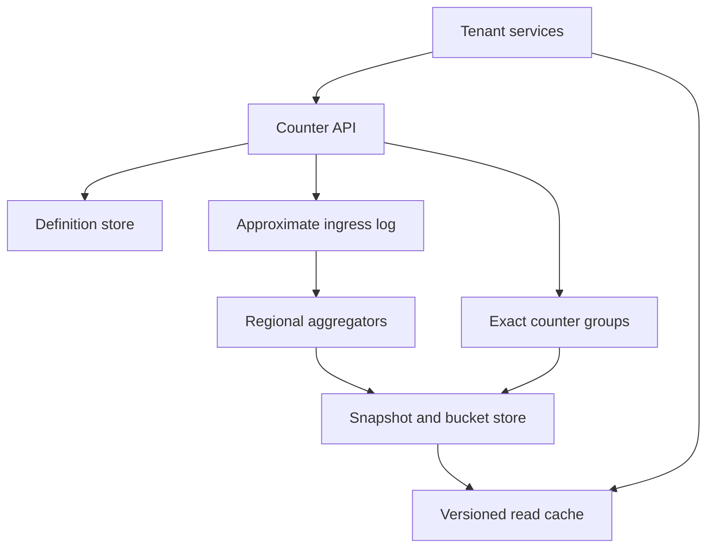
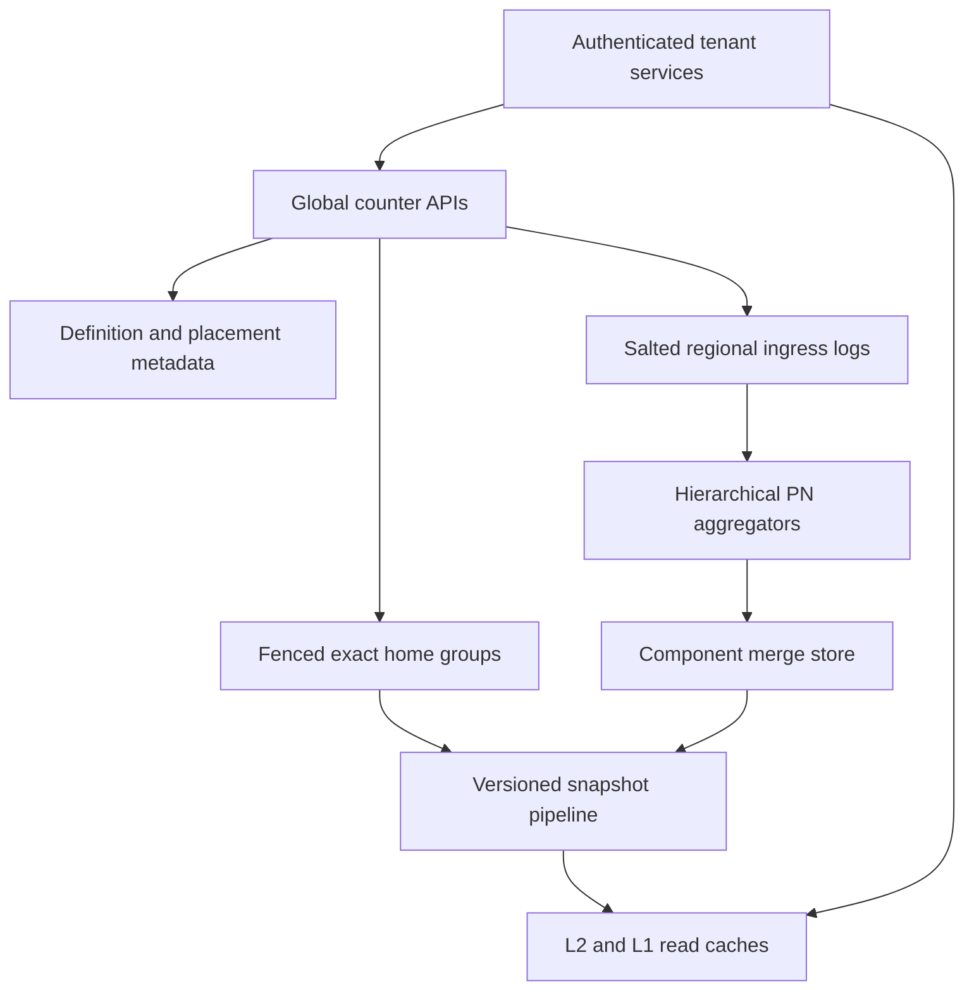

# Design a Global Distributed Counter Service

**Difficulty:** Medium–Hard  
**Primary themes:** write scaling, hot keys, sharding, batching, caching, idempotency, consistency, multi-region reliability  
**Interview time budget:** roughly 40–45 minutes  
**Educational walkthrough:** intentionally more detailed than what you would say in the timed interview

This is a reusable infrastructure problem rather than one product’s view-count implementation. Application teams use the service for counters such as video views, reactions, downloads, API usage, unread items, and limited exact quantities. The important design move is to avoid pretending that every counter needs the same consistency or cost.

The delivery order follows the public [Hello Interview System Design Delivery Framework](https://www.hellointerview.com/learn/system-design/in-a-hurry/delivery): requirements, core entities, interface, a complete baseline built operation by operation, and then focused deep dives. The problem, assumptions, calculations, dialogue, and design are original.

---

# Interviewer prompt

> Design a globally distributed, multi-tenant counter service. Applications should be able to increment named counters and read totals with low latency. Some counters require exact, idempotent values; others may trade a small amount of freshness or precision for very high write throughput. The system must handle extremely hot keys and regional failures.

# Targeted clarifying questions and assumed interviewer answers

**Candidate:** “What kinds of counters should I support?”

**Interviewer:** “Examples include exact reaction counts and quota usage, plus approximate video views and page impressions. Counters may be global or broken down by a small set of dimensions such as region or device type.”

**Candidate:** “Can counters decrement?”

**Interviewer:** “Yes. Exact counters support signed deltas. Approximate event counters usually increment, but the underlying design should support correction deltas.”

**Candidate:** “Do exact counters require a linearizable read after every increment?”

**Interviewer:** “An exact counter must not lose or double-apply an accepted idempotent update. A caller may request a linearizable read, but the default exact read may be a few seconds stale. Return a consistency token so the caller can request read-your-write.”

**Candidate:** “How accurate can approximate counters be?”

**Interviewer:** “Within 1% relative error for large counters, generally within 10 seconds of accepted traffic. Small counters should avoid surprising error, so you can keep them exact until they become hot.”

**Candidate:** “What throughput should I design for?”

**Interviewer:** “Five million update events per second globally, 500,000 reads per second, and one viral counter may receive one million increments per second.”

**Candidate:** “How many counters exist?”

**Interviewer:** “Up to ten billion logical counters across tenants, with a heavy Zipfian distribution: most are cold, a few are extremely hot.”

**Candidate:** “What latency and availability targets matter?”

**Interviewer:** “For regional traffic, p99 update acceptance under 100 ms, cached reads under 50 ms, and 99.99% availability. Approximate updates should remain available during a regional partition. Exact writes may reject rather than split-brain.”

**Candidate:** “Should clients supply tenant or user identity?”

**Interviewer:** “Tenant and service identity come from authentication. A request supplies a counter namespace and key but cannot claim another tenant.”

**Candidate:** “How long must idempotency be remembered?”

**Interviewer:** “For exact updates, seven days. For approximate view-style events, duplicates below 0.1% are acceptable, but obvious retries should be suppressed for 24 hours.”

**Candidate:** “Do we need historical time series or top-K?”

**Interviewer:** “Expose optional minute/hour buckets for the last 30 days, but do not build a general analytics database or top-K service. The primary product is the current value.”

**Candidate:** “Can a request update more than one counter atomically?”

**Interviewer:** “A batch may contain many independent updates, but atomicity is only per counter. Cross-counter transactions are out of scope.”

**Candidate:** “Can counters have arbitrary dimensions?”

**Interviewer:** “No. A counter definition declares allowed low-cardinality dimensions. Reject undeclared or excessive cardinality so tenants cannot create an unbounded key explosion.”

> **What I would say aloud:** “The key clarification is that exact quota-style counters and million-write-per-second view counters need different contracts. I’ll expose those contracts explicitly rather than force either linearizable coordination or approximation on every workload.”

---

# 1. Requirements (~5 minutes)

## 1.1 Core functional requirements

Prioritize three.

### FR1 — Define and update counters

- A tenant creates a counter definition with `EXACT` or `APPROXIMATE` mode, allowed dimensions, optional lower/upper bounds, and retention policy.
- Authenticated services add signed deltas.
- Exact updates accept an idempotency key or event ID and never apply the same accepted operation twice within seven days.
- Approximate updates may be batched and locally aggregated, with bounded duplicate/error behavior.

### FR2 — Read current values with an explicit consistency level

- Read a single counter or a batch of counters.
- Default reads are cacheable snapshots.
- Exact counters support `LINEARIZABLE` and `AT_LEAST_TOKEN` reads.
- Responses include value, snapshot version, freshness time, and whether the result is exact or estimated.

### FR3 — Produce bounded historical buckets and operational status

- Return minute/hour/day buckets for the last 30 days.
- Expose update acceptance status, lag/freshness, and counter health.
- Permit safe reset/archive through a new counter epoch rather than destructive in-place history edits.

## 1.2 Quantified non-functional requirements

1. **Scale:** 5 million updates/s global peak, 500,000 reads/s, 10 billion logical counters, and a single approximate hot key at 1 million updates/s.
2. **Latency:** regional update acceptance p99 under 100 ms; cached current-value read p99 under 50 ms; linearizable exact read p99 under 200 ms in the counter’s home region.
3. **Availability:** 99.99% for default reads and approximate update acceptance; exact updates prefer consistency and may be unavailable during loss of quorum.
4. **Correctness:** accepted exact updates are durable and applied once per idempotency key for seven days; approximate values are within 1% for sufficiently large counts and generally no more than 10 seconds stale.
5. **Durability:** exact accepted updates survive a zone failure and a single-region failure; approximate regional deltas survive a process/zone failure and converge after partitions heal.

## 1.3 Scope

### In scope

- multi-tenant counter definitions
- exact and approximate update modes
- signed deltas, idempotency, batching, dimension validation
- current values, consistency tokens, cached reads
- bounded historical rollups
- hot-key scaling, multi-region behavior, recovery, and observability

### Out of scope

- arbitrary transactions across counters
- general SQL/OLAP querying
- unbounded high-cardinality tags
- ranking/top-K and recommendation logic
- billing invoices or financial ledger semantics
- client-side UI and dashboards

## 1.4 Consistency and availability contract

| Mode or operation | Contract |
|---|---|
| Exact update | Serialized in one home group; idempotent and durable before success |
| Exact default read | Exact snapshot, possibly a few seconds stale |
| Exact linearizable read | Reads current home-group state after preceding committed updates |
| Exact read with token | Returns a version at least as new as the supplied token or times out |
| Approximate update | Region-local acceptance and asynchronous merge; may accept during partition |
| Approximate read | Eventually consistent estimate with error/freshness metadata |
| Historical buckets | Eventual, typically under 60 seconds late |
| Reset | New epoch; old epoch remains immutable/auditable |

For exact counters, a network partition favors consistency over availability. Only the current fenced home leader with quorum may accept updates. For approximate counters, region-local components remain available and merge commutative deltas later.

> **What I would say aloud:** “I’m applying consistency per operation. Exact writes are CP at the counter’s home group; approximate writes are AP and converge. Default reads are cheap snapshots, while callers that truly need current exact state must pay for a linearizable or token-constrained read.”

---

# 2. Core entities (~2 minutes)

The framework recommends naming the essential entities before committing to a complete schema.

- **Tenant** — authenticated customer, quota, residency policy, and namespace.
- **CounterDefinition** — mode, bounds, dimensions, retention, and consistency policy.
- **CounterIdentity** — tenant, namespace, key, normalized dimensions, and epoch.
- **UpdateEvent** — signed delta, event/idempotency ID, caller, timestamp, and target identity.
- **ExactCounterState** — authoritative value and commit version for an exact counter.
- **ApproximateDelta** — aggregated increments/decrements from one region/replica component.
- **Snapshot** — materialized current value, version/vector, freshness, and quality metadata.
- **IdempotencyRecord** — remembered result for an exact update.
- **TimeBucket** — rolled-up delta/value for a minute, hour, or day.
- **ConsistencyToken** — opaque proof of a committed exact version or approximate merge frontier.

> **What I would say aloud:** “A counter’s identity includes an epoch. Reset creates a new epoch, which avoids racing an old delayed update against a destructive zeroing operation.”

---

# 3. API and system interface (~5 minutes)

REST works for external management and update/read operations; internal high-volume ingestion uses streaming RPC with the same logical envelope. Identity is derived from the bearer token or mutually authenticated service certificate.

## 3.1 Create a counter definition

```http
POST /v1/counter-definitions
Authorization: Bearer <tenant-service-token>
Idempotency-Key: create-video-views-v1
Content-Type: application/json

{
  "namespace": "video",
  "name": "views",
  "mode": "APPROXIMATE",
  "allowed_dimensions": {
    "region": ["na", "eu", "apac"],
    "device": ["web", "ios", "android", "tv"]
  },
  "history_retention_days": 30,
  "target_relative_error": 0.01,
  "freshness_target_seconds": 10
}
```

```json
{
  "definition_id": "cdef_01KB5...",
  "tenant_id": "tenant_42",
  "namespace": "video",
  "name": "views",
  "mode": "APPROXIMATE",
  "schema_version": 1
}
```

`tenant_id` comes from authentication, not the body.

## 3.2 Exact update

```http
POST /v1/counters/reactions/like-count/updates
Authorization: Bearer <tenant-service-token>
Idempotency-Key: like-user_9-post_88-v1
Content-Type: application/json

{
  "counter_key": "post_88",
  "dimensions": {},
  "delta": 1,
  "event_id": "evt_01KB6...",
  "expected_epoch": 3
}
```

```json
{
  "status": "APPLIED",
  "counter_id": "ctr_8d92...",
  "epoch": 3,
  "value": 14021,
  "commit_version": 982771,
  "consistency_token": "exact:home-us-east:3:982771"
}
```

If the same idempotency key is retried with the same payload, return the original result. If it is reused with a different payload, return `409 Conflict`.

## 3.3 Approximate batch update

```http
POST /v1/counters/video/views/batches
Authorization: Bearer <tenant-service-token>
Content-Type: application/json

{
  "updates": [
    {
      "counter_key": "video_771",
      "dimensions": {"region": "na", "device": "tv"},
      "delta": 37,
      "event_batch_id": "player-edge-19-000884"
    },
    {
      "counter_key": "video_992",
      "dimensions": {"region": "na", "device": "web"},
      "delta": 12,
      "event_batch_id": "player-edge-19-000885"
    }
  ]
}
```

```json
{
  "status": "ACCEPTED",
  "accepted": 2,
  "regional_frontier": "us-east-1/agg-19/551902",
  "estimated_visible_within_seconds": 10
}
```

This response means the regional durable ingress accepted the deltas. It does not imply immediate global visibility.

## 3.4 Read a counter

```http
GET /v1/counters/video/views/video_771?region=na&device=tv&consistency=EVENTUAL
Authorization: Bearer <tenant-service-token>
```

```json
{
  "counter_id": "ctr_2af1...",
  "epoch": 1,
  "value": 842193301,
  "quality": "ESTIMATED",
  "estimated_relative_error": 0.002,
  "snapshot_version": "merge:442901",
  "as_of": "2026-11-15T06:11:04Z",
  "staleness_seconds": 3.1
}
```

Exact linearizable read:

```http
GET /v1/counters/reactions/like-count/post_88?consistency=LINEARIZABLE
Authorization: Bearer <tenant-service-token>
```

```json
{
  "counter_id": "ctr_8d92...",
  "epoch": 3,
  "value": 14021,
  "quality": "EXACT",
  "commit_version": 982771,
  "as_of": "2026-11-15T06:11:07Z"
}
```

## 3.5 Read-your-write with a token

```http
GET /v1/counters/reactions/like-count/post_88
Authorization: Bearer <tenant-service-token>
X-Min-Consistency-Token: exact:home-us-east:3:982771
```

The router serves from a cache/replica only if its applied version is at least 982771. Otherwise it waits briefly, routes to the leader, or returns a retryable timeout.

## 3.6 Batch read

```http
POST /v1/counter-values:batchGet
Authorization: Bearer <tenant-service-token>
Content-Type: application/json

{
  "counters": [
    {"namespace": "video", "name": "views", "key": "video_771"},
    {"namespace": "reactions", "name": "like-count", "key": "post_88"}
  ],
  "consistency": "SNAPSHOT"
}
```

The response returns independent values and versions. It is not an atomic cross-counter snapshot.

## 3.7 Historical buckets

```http
GET /v1/counters/video/views/video_771/history?granularity=hour&start=2026-11-14T00:00:00Z&end=2026-11-15T00:00:00Z
Authorization: Bearer <tenant-service-token>
```

```json
{
  "quality": "ESTIMATED",
  "complete_through": "2026-11-14T23:59:00Z",
  "buckets": [
    {"start": "2026-11-14T22:00:00Z", "delta": 1830442},
    {"start": "2026-11-14T23:00:00Z", "delta": 2241991}
  ]
}
```

## 3.8 Reset by epoch

```http
POST /v1/counters/reactions/like-count/post_88:reset
Authorization: Bearer <tenant-admin-token>
Idempotency-Key: moderation-reset-post-88
Content-Type: application/json

{"expected_epoch": 3, "new_value": 0, "reason": "content-restored"}
```

```json
{
  "status": "RESET",
  "old_epoch": 3,
  "new_epoch": 4,
  "value": 0,
  "consistency_token": "exact:home-us-east:4:982812"
}
```

Delayed epoch-3 updates are rejected or quarantined rather than silently changing epoch 4.

## 3.9 Interface-to-requirement map

| Requirement | Interface |
|---|---|
| Define mode and dimensions | `POST /counter-definitions` |
| Exact idempotent update | single update with idempotency key |
| High-throughput updates | approximate batch ingestion |
| Consistent reads | explicit `consistency` plus token |
| Efficient reads | batch get and cacheable snapshots |
| History | bounded bucket endpoint |
| Safe reset | new epoch with expected-epoch check |

> **What I would say aloud:** “Every read tells the caller whether the value is exact or estimated and how fresh it is. The update response gives a token instead of pretending every cache is instantly current. Reset is an epoch transition, so late writes cannot resurrect old state.”

---

# 4. Data flow

The service has two write paths because their contracts differ.

## 4.1 Exact update flow

1. Authenticate the service and derive `tenant_id`.
2. Normalize the counter identity and validate declared dimensions, delta, bounds, and epoch.
3. Route the identity to its exact-counter home group.
4. In one serialized transaction/consensus command, check the idempotency record, apply the delta, enforce bounds, store the result, and append a change event.
5. Replicate across zones and the paired region according to durability policy.
6. Return the value, commit version, and consistency token.
7. A change stream asynchronously refreshes read caches and historical buckets.

## 4.2 Approximate update flow

1. Authenticate and validate schema/quota.
2. Accept a batch into a regional replicated ingress log.
3. Regional aggregators combine deltas by `(counter_id, epoch, time_bucket, component_id)` for a short interval.
4. Flush component deltas to a merge store.
5. Snapshot workers merge components into a materialized current value and time buckets.
6. Publish versioned cache updates.
7. Replicate/merge regional components asynchronously; commutative component IDs prevent reapplying the same flush.

## 4.3 Read flow

1. Authenticate and normalize identity.
2. Resolve definition and mode from a versioned local cache.
3. For eventual/snapshot reads, check the regional value cache.
4. On a miss, read the materialized snapshot store and single-flight cache fill.
5. For linearizable exact reads or an unmet token, route to the home group.
6. Return quality, version, and freshness metadata.

## 4.4 Reset flow

1. Authorize an administrative reset and check the expected epoch.
2. Commit a new epoch with its initial value.
3. Mark the old epoch closed but retain it for audit/history.
4. Invalidate the logical-key-to-active-epoch cache.
5. Reject delayed updates carrying the old epoch.

---

# 5. High-level design (~10–15 minutes)

Build a complete design before optimizing it.

## 5.1 Baseline architecture



The diagram shows two mutation engines feeding one read-optimized snapshot layer. Exact groups remain authoritative for strong reads; approximate component deltas remain authoritative for reconstruction.

## 5.2 Operation 1: create a definition

Use a strongly consistent metadata store because mode, allowed dimensions, and bounds change how updates are interpreted.

```text
CounterDefinition(
  definition_id,
  tenant_id, namespace, name,
  mode,
  allowed_dimension_schema,
  lower_bound, upper_bound,
  target_error,
  freshness_target_seconds,
  history_retention_days,
  schema_version,
  lifecycle_state
)
```

A unique constraint covers `(tenant_id, namespace, name)`. Gateways cache definitions by version. A schema change creates a new schema version; incompatible dimension changes require migration or a new definition.

## 5.3 Operation 2: apply an exact update

Start with a hash-partitioned transactional key-value/SQL store. Each partition has a consensus leader and replicas. The full logical identity hashes to one partition.

```text
ExactCounterState(
  counter_id,
  tenant_id, definition_id,
  normalized_key,
  dimension_hash,
  epoch,
  value,
  commit_version,
  updated_at
)
```

Co-locate idempotency:

```text
IdempotencyRecord(
  tenant_id,
  idempotency_key,
  request_hash,
  counter_id, epoch,
  result_value,
  commit_version,
  expires_at
)
```

One transaction checks/creates the idempotency record and updates the counter. If bounds would be violated, it stores/returns a deterministic rejection result so retries do not race into a different answer.

**Interviewer:** “Could I just use `UPDATE counters SET value = value + 1`?”

**Candidate:** “That is a valid baseline for ordinary keys and gives atomicity inside one database partition. It stops working for a million updates per second to one row, so I’ll preserve it for exact counters within a documented per-key limit and use a different aggregation contract for viral counters.”

## 5.4 Operation 3: accept approximate updates

The API appends batches to a replicated regional stream partitioned initially by a salted counter key:

```text
ApproximateUpdate(
  tenant_id, definition_id,
  counter_id, epoch,
  event_batch_id,
  delta,
  event_time,
  ingest_time,
  region,
  salt
)
```

The stream absorbs bursts and allows replay. It does not make an underprovisioned system magically sustainable; admission control watches lag and rejects traffic before violating the freshness contract.

## 5.5 Operation 4: aggregate deltas

Each regional aggregator owns stream partitions and keeps a bounded in-memory map for a short flush interval such as one second. It combines thousands of `+1` events into one component delta.

```text
CounterComponent(
  counter_id, epoch,
  region_id, aggregator_id,
  component_sequence,
  positive_total,
  negative_total,
  last_event_time,
  checksum
)
```

The persistent merge store applies a component flush only if `component_sequence` is newer. Retried flushes are idempotent. A PN-counter represents signed values as the sum of positive components minus negative components; each component owner advances only its own monotonically increasing totals.

## 5.6 Operation 5: materialize current values

Snapshot workers merge component totals into:

```text
CounterSnapshot(
  counter_id, epoch,
  value,
  quality,
  merge_version,
  component_frontier,
  estimated_relative_error,
  complete_through,
  updated_at
)
```

For exact counters, change events copy committed state into the same snapshot shape. The read API can therefore share caching and response code while preserving mode-specific consistency behavior.

## 5.7 Operation 6: read through a cache

Use two cache layers:

- a tiny in-process cache for definitions and the hottest snapshots;
- a distributed regional cache for current values.

Cache keys include `counter_id` and `epoch`. Values include snapshot/commit version and `as_of`. The cache never invents a stronger guarantee: a linearizable request bypasses it unless the cache can prove a sufficient commit token.

On a miss, request coalescing lets one caller load the snapshot while peers wait briefly or receive the previous value. TTLs are jittered to avoid synchronized expiry.

## 5.8 Operation 7: historical buckets

The same approximate stream feeds event-time rollups:

```text
TimeBucket(
  counter_id, epoch,
  granularity, bucket_start,
  delta,
  quality,
  complete_through,
  revision
)
```

Late events revise open buckets. After a watermark, compact minute buckets into hours and days. Exact updates use their committed change stream, so history never drives exact current state.

## 5.9 Operation 8: reset/archive

The metadata mapping for `(tenant, definition, key, dimensions)` points to an active epoch. Reset serializes through the exact home/metadata coordinator, closes epoch N, creates N+1, and publishes invalidation. Approximate aggregators discard or quarantine old-epoch events after the close frontier.

## 5.10 Baseline requirements check

The baseline can define counters, apply exact idempotent deltas, accept high-throughput approximate batches, merge component state, serve cached or strong reads, build history, and reset safely.

Three hard areas remain:

1. How can a single viral key accept one million updates/s without moving approximation error or durability outside the stated contract?
2. How do retries, batching, crashes, and component replay avoid both lost and double-applied deltas?
3. How do exact and approximate counters behave across regions while caches remain fast and honest about freshness?

> **What I would say aloud:** “The baseline deliberately uses a database increment for ordinary exact keys and a log-plus-hierarchical aggregator for high-volume approximate keys. Both publish versioned snapshots into a shared read layer, but strong reads still route to the exact authority.”

---

# 6. Deep dives (~10–15 minutes)

## Deep dive 1 — Hot-key write scaling and adaptive aggregation

### Where the baseline breaks

Hash sharding distributes different counter keys, but it does nothing when one video receives one million increments per second: every event hashes to the same logical key. A single database row, partition leader, lock, or stream partition becomes the bottleneck. Adding more ordinary shards does not split that hot key.

The public [Hello Interview scaling-writes guide](https://www.hellointerview.com/learn/system-design/patterns/scaling-writes) highlights sharding, queues/load shedding, batching, and hierarchical aggregation. A counter service needs all four, but in the right order: salt the hot key, batch locally, aggregate hierarchically, and reject if sustained load exceeds the freshness budget.

### Compare plausible approaches

| Approach | Benefit | Failure or tradeoff |
|---|---|---|
| One atomic database row | exact and simple | one leader/lock caps hot-key throughput |
| Randomly striped rows, sum on read | scales writes | expensive/stale reads; linearizable total requires coordination |
| Queue every event to one partition | durable and ordered | partition remains the hot-key bottleneck |
| Client/edge batching | huge write reduction | trust, retry, and batch-dedup concerns |
| Salted stream plus hierarchical component aggregation | parallel ingest, replay, bounded merge cost | eventual result and more moving parts |
| CRDT component per region/aggregator | active-active commutative merge | metadata/component growth and no instantaneous global total |

For approximate counters, choose salted partitions, one-second local batching, and monotonic per-aggregator PN components. For exact counters, retain one serialized home authority and enforce a lower per-key throughput limit; callers that require both one million updates/s and immediate linearizability are asking for physically conflicting properties.

### Scale estimate tied to the decision

Global peak is five million events/s. At an average encoded envelope of 100 bytes:

```text
5,000,000 × 100 bytes = 500 MB/s raw ingress
```

With replication factor 3 and protocol/index overhead, plan for multiple GB/s across the regional stream fleet.

For the viral key at one million events/s, 256 salted partitions receive about:

```text
1,000,000 / 256 ≈ 3,906 events/s per partition
```

If each aggregator flushes one combined component per second, the persistent merge write rate becomes roughly 256 component updates/s rather than one million row increments/s—a reduction near 3,900×. Read snapshots merge cached component frontiers rather than scanning raw events.

**Design consequence:** add a salt derived from `event_id` or producer ID only after routing identifies a hot counter. Keep the unsalted logical identity in the event so all salts merge back correctly.

### Adaptive hot-key promotion

Cold counters should not pay for 256 components. A popularity controller measures per-key update rate and promotes through tiers:

1. **Cold:** direct regional aggregate partition, one component.
2. **Warm:** 8–16 salts.
3. **Hot:** 64 salts.
4. **Viral:** 256 or more salts plus dedicated quotas.

Promotion publishes a routing version. Producers/gateways attach that version. During transition, both old and new salt sets remain readable and mergeable. Demotion waits until old components are flushed and the snapshot frontier covers them.

### Small-count accuracy

A blanket 1% sampling policy can turn a count of 12 into 0 or 100. Keep low-volume counters exact within the regional aggregation pipeline: combine all observed deltas without sampling. Sampling begins only above a configured rate/value threshold.

If sampling is used, record the probability and estimator metadata with each component. For Bernoulli sampling probability `p`, estimate `sample_count / p`; expose statistical error. Prefer full aggregation whenever infrastructure capacity allows because batching alone often yields enough reduction.

### Why a PN-counter works

A PN-counter has positive and negative grow-only components per replica. Global value is:

```text
sum(max positive component per owner)
- sum(max negative component per owner)
```

Merging uses component-wise maximum, so messages can duplicate or reorder without double-counting a flush. Only the component owner may advance its sequence/totals. If ownership changes, allocate a new component ID rather than reuse an old one.

### Bounds and nonnegative counters

An approximate active-active counter cannot reliably enforce a strict global lower bound such as “never below zero” without coordination. Options:

- make it exact and home-region serialized;
- allocate escrow rights/credits to regions, each decrementing only its local allocation;
- allow temporary negative estimates and reconcile.

Select exact or escrow for quota/inventory-like bounds. Do not advertise an approximate counter as a safe inventory primitive.

### Backpressure and overload

The regional log absorbs short bursts. Monitor `lag_seconds`, not only message count. If lag threatens the 10-second freshness SLO:

- raise aggregation batch size within latency budget;
- activate more consumers/partitions;
- shed optional dimensions first;
- apply per-tenant rate limits;
- reject new batches with `429` and `Retry-After` before accepting an impossible promise.

A queue is temporary elasticity, not infinite capacity.

### Failure modes

- **Aggregator crashes before flush:** stream replay reconstructs its in-memory batch.
- **Crash after flush before checkpoint:** same component sequence is retried and ignored idempotently.
- **Hot-key detector lags:** partition saturation triggers emergency salting and tenant shaping.
- **Promotion overlaps old routing:** snapshot merges both routing versions until the old frontier is closed.
- **Component owner disappears:** new owner gets a new component ID; old durable total remains mergeable.
- **Sampling metadata lost:** reject the component rather than merge with the wrong estimator.
- **Sustained overload:** admission control protects freshness and other tenants.

### Observability

- events/s and bytes/s by tenant, definition, key percentile, and partition
- hottest keys and salt count
- events per persisted component flush
- aggregation lag p50/p95/p99 and freshness SLO violations
- promotion/demotion count and duration
- stream partition skew and consumer utilization
- sampled versus fully counted traffic and estimated error
- rejected/throttled updates by reason
- component count per counter and orphaned components

> **What I would say aloud:** “Normal hash sharding cannot split one hot key. I introduce a versioned salt plan for approximate counters, aggregate locally for about one second, and persist monotonic PN components. That turns a million raw events per second into hundreds of idempotent component updates while preserving replayability.”

## Deep dive 2 — Idempotency, retries, and exactness boundaries

### Where the baseline breaks

Distributed clients retry when responses time out. A server may commit `+1` and crash before replying. A stream consumer may persist an aggregate and crash before checkpointing. Without a precise deduplication boundary, retries double-count; with an unreliable in-memory dedup cache, eviction changes correctness.

### Exact update alternatives

| Approach | Benefit | Failure or cost |
|---|---|---|
| Blind atomic increment | fast | ambiguous retry double-counts |
| Read-before-write event table | conceptually simple | race unless transactionally coupled |
| Transactional idempotency record plus counter update | exact retry semantics | storage cost for seven-day records |
| Permanent event ledger and fold | strongest audit/rebuild | enormous storage and read/compaction cost |

Choose a transactional idempotency record co-located with the exact counter partition. Optionally append a compact audit change stream, but do not require scanning it for every read.

### Exact transaction

Within one consensus command:

1. Look up `(tenant_id, idempotency_key)`.
2. If found and request hash matches, return stored result.
3. If found and hash differs, reject reuse.
4. Validate active epoch and bounds.
5. Compute the new value.
6. Store counter state, idempotency result, and change-stream outbox position.
7. Commit and replicate before replying.

The outbox/change event is committed in the same state machine so cache/history propagation cannot be forgotten after a crash.

### Dedupe storage estimate

Assume exact traffic is 100,000 updates/s—not the full approximate firehose—and each idempotency record is 160 bytes after indexing/overhead:

```text
100,000 × 86,400 × 7 × 160 bytes
≈ 9.7 TB before replication
```

At replication factor 3, this is roughly 29 TB. That is substantial but feasible across a distributed store. It also proves why retaining every approximate view event for seven days merely for perfect dedupe would be expensive.

**Design consequence:** exact tenants pay for durable seven-day dedupe; approximate ingestion uses bounded batch IDs, producer sequences, and component idempotency rather than a global record per raw event.

### Approximate dedupe layers

1. **Producer batch sequence:** each producer has `(producer_id, sequence)`. The regional ingress rejects a repeated or old sequence within a moving window.
2. **Short-lived event-ID filter:** a sharded Bloom/Cuckoo filter suppresses obvious retries. False positives slightly undercount and are included in the error budget.
3. **Aggregator component sequence:** durable flush is idempotent even if stream consumption repeats.
4. **Snapshot frontier:** a component version is merged once by maximum/version, not by replaying `+delta` blindly.

The critical distinction is that probabilistic filters are acceptable only for approximate counters. Never use a Bloom filter as the authoritative exact dedupe store because false positives would silently drop valid updates.

### Producer trust and batch deltas

A malicious or buggy producer could claim `delta=1,000,000`. Enforce tenant policy:

- authenticated producer identity;
- maximum batch delta and event rate;
- monotonic producer sequence;
- schema/version validation;
- anomaly detection against historical rates;
- optional raw sampled audit events.

For high-trust internal edge collectors, aggregated deltas are allowed. Untrusted public clients submit individual signed events through a tenant backend or an abuse-checked ingestion edge.

### Exactly-once terminology

Do not say “the queue gives exactly once.” The service offers an idempotent effect for exact updates because the dedupe record and counter mutation share one transaction. Transport remains at least once.

For approximate aggregation, component merge is idempotent, but raw-event duplicates may remain within the error contract. Be explicit about the level at which the effect is once.

### Crash matrix

| Failure point | Exact path result |
|---|---|
| Before transaction | retry applies normally |
| During uncommitted transaction | consensus rolls back; retry applies |
| After commit before response | retry returns stored result |
| After response before cache update | value is authoritative; change stream repairs cache |
| Cache invalidation lost | TTL/version reconciliation corrects it; strong read bypasses |

Approximate component flush:

| Failure point | Approximate path result |
|---|---|
| Before ingress replication | caller retries batch |
| After ingress commit before response | producer sequence suppresses retry |
| Before component flush | stream replay rebuilds batch |
| After flush before checkpoint | repeated component sequence is ignored |
| During snapshot merge | versioned merge retries safely |

### Reconciliation

Background jobs compare:

- exact home commit version versus snapshot/cache version;
- component store frontiers versus materialized snapshot frontiers;
- ingress offsets versus aggregator checkpoints;
- closed epochs versus late-arriving updates;
- idempotency record/result hashes versus audit samples.

Reconciliation repairs derived state; it never invents missing exact mutations.

### Failure modes

- **Idempotency store hot key:** partition by tenant plus hashed idempotency key; co-location metadata routes the transaction.
- **Retry after seven days:** contract no longer guarantees dedupe; clients should use business-level unique IDs for permanent uniqueness.
- **Clock skew:** expiry uses server commit time, not client time.
- **Bloom filter saturation:** rotate windows and monitor false-positive probability.
- **Producer sequence reset:** require a new producer epoch/identity.
- **Poison update:** reject to a diagnostic stream without blocking the partition.
- **Outbox relay stuck:** committed events remain discoverable and replayable.

### Observability

- idempotency hit, conflict, and expiry rates
- ambiguous client retry rate
- exact transaction latency and abort/conflict rate
- dedupe storage growth and compaction lag
- producer sequence gaps/resets
- approximate filter saturation and estimated false-positive rate
- component replay/duplicate suppression count
- cache/snapshot reconciliation repairs
- late old-epoch events and quarantine volume

> **What I would say aloud:** “I claim idempotent effect, not magical exactly-once transport. For exact counters the idempotency record and increment commit in one consensus transaction. For approximate counters I dedupe producer batches and make component flushes idempotent; probabilistic raw-event dedupe is allowed only inside the published error budget.”

## Deep dive 3 — Multi-region consistency, cache correctness, and failover

### Where the baseline breaks

If every region increments the same exact value independently, concurrent totals diverge and reconciliation cannot determine which bounded update should have failed. If every read crosses the ocean to one leader, latency and availability suffer. Caches can also return a value older than a caller’s just-acknowledged write or stampede the snapshot store when a viral key expires.

### Regional models compared

| Model | Benefit | Tradeoff |
|---|---|---|
| One global leader for every counter | simple exact order | high latency and large blast radius |
| Home region per exact counter | localized order, scalable across keys | remote write/read hop and failover protocol |
| Active-active last-write-wins value | available | loses concurrent increments; incorrect |
| Active-active CRDT components | convergent and available | eventual totals; strict bounds unavailable |

Choose home-region consensus groups for exact counters and active-active component merges for approximate counters.

### Exact home placement

Consistent hashing assigns each exact counter to a home group respecting tenant residency. The home group replicates across three zones and to a paired region. A directory maps shard ranges to home epoch and replicas.

For the requirement that accepted exact updates survive a region loss, the home group waits for:

- local quorum; and
- durable paired-region acknowledgement

before returning success. This adds inter-region latency. Tenants may choose a lower-durability tier only if the API contract changes explicitly.

### Failover fencing

A paired region promotes only after acquiring a higher `home_epoch` from a small global placement quorum/witness. Every exact command carries the epoch. The old home cannot accept after lease expiry or without the current epoch.

If regions cannot establish which side owns the epoch, exact writes fail closed. Cached/default reads may continue with an `as_of` time. This is the intentional CP choice.

### Approximate active-active merge

Each region writes only its own PN components. Cross-region replication can duplicate, delay, and reorder messages; merge by component-wise maximum remains correct for flushed totals. During a partition, each region serves a local estimate and discloses that its `component_frontier` lacks remote regions. After healing, snapshots converge.

The 1% contract assumes partitions are not indefinitely long. If global staleness exceeds the contract, mark the read `DEGRADED` rather than returning an apparently precise estimate.

### Cache architecture

Use versioned cache-aside plus proactive refresh for hot keys:

- key includes counter ID and epoch;
- value includes mode, value, version/frontier, quality, `as_of`, and expiry;
- change streams push fresh exact snapshots and approximate merges;
- TTL is a safety net with jitter;
- in-process L1 is very short-lived; regional distributed L2 carries most reads;
- strong/token reads validate version and fall through to authority.

The [Hello Interview caching guide](https://www.hellointerview.com/learn/system-design/core-concepts/caching) emphasizes freshness, invalidation, cache failure, and thundering-herd behavior. Version-aware reads prevent the cache from silently violating read-your-write.

### Hot-read estimate

At 500,000 reads/s, assume 90% cache hit rate:

```text
500,000 × 10% = 50,000 snapshot-store reads/s
```

That may be feasible across shards, but a single viral counter can still receive hundreds of thousands of reads/s. An in-process L1 with a one-second TTL can collapse repeated reads on each API instance, while L2 provides regional sharing.

If 1,000 instances simultaneously expire the same key, single-flight per instance still creates 1,000 L2 reads. Add probabilistic early refresh and lease-based refresh at L2 so only a few workers rebuild while others serve the slightly older valid snapshot.

### Read consistency paths

1. **EVENTUAL:** L1 → L2 → snapshot store; return freshness/quality.
2. **SNAPSHOT:** L2/store value at a published merge version; batch items need not share one global version.
3. **AT_LEAST_TOKEN:** use cache/replica only if version satisfies token; otherwise route to home or wait.
4. **LINEARIZABLE:** exact home leader performs a quorum/lease-valid read after preceding log entries.

Approximate counters do not offer `LINEARIZABLE`; reject that request rather than mislabeling an estimate.

### Cache outage behavior

A full cache outage must not redirect all 500,000 reads/s to storage. Apply:

- circuit breakers and per-tenant read budgets;
- stale-if-error from L1 for eventual reads;
- request coalescing;
- selective load shedding for bulk dashboards;
- direct authority only for strong exact reads;
- gradual cache warm-up after recovery.

### Historical bucket consistency

Buckets use event time with watermarks. A query returns `complete_through`. Late data revises recent buckets with a higher revision. Current exact value never depends on bucket summation, so late analytical events cannot corrupt authoritative exact state.

### Failure modes

- **Exact home zone fails:** remaining local quorum continues.
- **Exact home region fails:** paired region promotes with higher epoch after fencing.
- **Inter-region partition:** exact writes lacking durability quorum reject; approximate regions accept local components.
- **Old home returns:** it replays current epoch and cannot publish stale commands.
- **Snapshot stream lag:** default reads expose increasing staleness; token/strong reads bypass.
- **Cache stampede:** early refresh, jitter, and single-flight bound origin load.
- **Cache serves pre-reset epoch:** request resolves active epoch first or cache key mismatch forces miss.
- **Definition cache stale:** schema-version mismatch rejects/reroutes update; definitions carry version.
- **Component replication missing:** completeness monitor marks estimate degraded and replays from durable component log.

### Observability

- exact home/paired replication latency and quorum availability
- home-epoch promotions and stale-epoch rejections
- approximate component convergence lag by region
- snapshot freshness and percentage outside 10-second SLO
- cache hit ratio by L1/L2, key, tenant, and mode
- cache version misses caused by consistency tokens
- origin read QPS during cache degradation
- stale-if-error responses and shed reads
- bucket watermark lateness and revision count
- external synthetic checks comparing regional snapshots

> **What I would say aloud:** “Exact and approximate counters use different multi-region strategies. Exact keys have one fenced home epoch and may reject during partition; approximate keys use per-region monotonic components that merge by maximum. Caches carry versions and freshness, so they accelerate reads without pretending to be the source of truth.”

---

# 7. Final design

## 7.1 Evolved architecture



## 7.2 Component responsibilities

| Component | Responsibility |
|---|---|
| API gateway | Authentication, tenant derivation, schema validation, quotas, request limits |
| Definition store | Counter mode, dimensions, bounds, error/freshness and retention contracts |
| Placement directory | Exact home group/epoch and approximate salt-plan version |
| Exact home groups | Serialized idempotent updates, bounds, commit tokens, strong reads |
| Regional ingress logs | Durable approximate batch acceptance and replay |
| Hot-key controller | Detect skew and publish versioned salt plans |
| Regional aggregators | Batch raw events and advance owned PN components |
| Component merge store | Idempotent component sequences/totals and cross-region convergence |
| Snapshot workers | Materialize current values, quality, frontiers, and exact replicas |
| Time-bucket workers | Event-time minute/hour/day rollups with watermarks |
| L2 distributed cache | Regional high-QPS snapshot reads with versions/freshness |
| L1 process cache | Collapse viral reads for a very short interval |
| Idempotency store | Seven-day exact retry results, transactionally coupled to updates |
| Reconciliation | Repair derived state, stalled frontiers, stale caches, and closed epochs |
| Quota/admission control | Protect freshness and isolate tenants during sustained overload |

## 7.3 Final end-to-end narrative

A tenant defines a counter’s mode and dimensions. Every request derives tenant identity from authentication and normalizes the logical identity to a stable counter ID plus epoch.

An exact update routes to one fenced home consensus group. In one replicated command, the group checks the seven-day idempotency record, validates epoch and bounds, applies the signed delta, records the deterministic result, and emits a change obligation. It replicates to a paired region before returning the new value and consistency token. Default reads may use a versioned snapshot cache; token or linearizable reads route to state at least as new as the required commit.

An approximate update batch commits to a regional replicated ingress log. A versioned salt plan spreads a viral logical key over many partitions. Aggregators combine raw events for about a second and advance monotonic positive/negative components. Retried flushes and cross-region messages merge idempotently by owner and sequence. Snapshot workers merge components into a current estimate with error, frontier, and freshness metadata, then refresh regional caches and time buckets.

Cold approximate counters use few components; hot counters promote adaptively. Every in-memory batch and queue is bounded. If lag threatens the freshness contract, the service scales, sheds optional dimensions, and eventually rejects before accepting an impossible promise. Reset creates a new epoch, so delayed old events cannot mutate new state.

## 7.4 Requirements check

| Requirement | Design response |
|---|---|
| 5M updates/s | Regional streams, batching, hierarchical aggregation, partitions |
| 1M updates/s to one key | Versioned salting plus hundreds of PN components |
| 500K reads/s | L1/L2 caches, snapshots, single-flight and early refresh |
| Exact idempotency | Co-located idempotency record and counter transaction |
| Approximate 1%/10s | Full aggregation by default; optional measured sampling; lag admission control |
| Read-your-write | Commit token and version-aware routing/cache |
| Linearizable exact read | Fenced home leader/quorum path |
| Partition availability | Exact fails closed; approximate accepts local components and converges |
| Region-loss durability | Exact paired-region acknowledgement before success; durable regional logs/components |
| 30-day history | Event-time rollups with watermarks and revisions |
| Safe reset | Monotonic epoch transition and old-epoch rejection |
| Tenant isolation | Cardinality, update, storage, lag, and read quotas |

## 7.5 Final 60-second interview summary

> **What I would say aloud:** “I expose two honest contracts. Exact counters route to one fenced home consensus group, where idempotency and the delta commit together; strong reads use the home or a commit token. Approximate counters accept batches into regional logs, salt hot keys, aggregate for about a second, and persist monotonic PN components that merge idempotently across regions. Both paths feed versioned snapshots, history, and L1/L2 caches that always return quality and freshness. A million-event-per-second key becomes hundreds of component flushes per second. Exact writes reject during ambiguous partitions, approximate writes remain available and converge, and epoch-based reset prevents delayed traffic from corrupting new state.”

---

# Realistic interviewer follow-up questions with strong sample answers

## 1. “Why not use one database row per counter?”

**Strong answer:** “That is my baseline for ordinary exact keys. It provides atomic increment and simple reads, but one viral key still serializes through one row/leader. Approximate hot keys need salted ingestion and hierarchical aggregation.”

## 2. “Can striped rows provide an exact counter?”

**Strong answer:** “They can store exact partial sums, but a linearizable total requires a consistent cut across all stripes while writes continue. Without coordination, the read is exact for some mixed moments but not linearizable. I use stripes for eventual/approximate reads or keep a serialized exact authority.”

## 3. “What is approximate about the approximate mode if you count every delta?”

**Strong answer:** “The value may be stale because batching and cross-region merge are asynchronous, and bounded dedupe can admit or suppress a tiny number of events. Sampling is optional at extreme scale. The API groups precision and freshness into a documented estimate contract.”

## 4. “Why use PN-counter components instead of writing `+delta` messages?”

**Strong answer:** “Component totals are monotonic and merge by maximum, so duplicate or reordered flushes do not double-count. Blind `+delta` replay needs perfect exactly-once application.”

## 5. “How do you handle decrements without going below zero?”

**Strong answer:** “A strict global lower bound requires coordination. Use exact mode or allocate escrow decrement rights to regions. An unconstrained active-active PN-counter cannot promise never-negative during partitions.”

## 6. “How do you pick the salt count?”

**Strong answer:** “Measure per-key rate and partition utilization. Promote through versioned tiers—1, 8, 64, 256—so cold keys stay cheap. During transition, snapshots merge both routing versions until the old frontier closes.”

## 7. “What happens if an aggregator flushes and crashes before committing its stream offset?”

**Strong answer:** “It replays and emits the same or newer component sequence. The merge store accepts only a newer sequence for that component, so the retry is idempotent.”

## 8. “Would you use a Bloom filter for exact event dedupe?”

**Strong answer:** “No. False positives would silently drop valid exact updates. Exact dedupe uses a durable record. A probabilistic filter is acceptable only for approximate events and its false-positive rate belongs in the error budget.”

## 9. “Why is exact idempotency expensive?”

**Strong answer:** “At 100,000 exact updates/s and seven days, even 160-byte records approach 10 TB before replication. That is why exact and approximate tiers should have different pricing and dedupe machinery.”

## 10. “How does read-your-write work through a cache?”

**Strong answer:** “The update returns a commit token. A cache value includes its applied version. If it is older than the token, the router waits briefly or reads from the exact home; it never returns the stale cached value as satisfying the token.”

## 11. “How do you reset a counter while old updates are in flight?”

**Strong answer:** “Reset creates epoch N+1 and closes N. Updates carry expected epoch. Delayed N updates are rejected or quarantined and cannot modify the new value.”

## 12. “How do you survive a cache outage?”

**Strong answer:** “I do not send all 500,000 reads/s to storage. Serve bounded stale L1 data for eventual reads, coalesce misses, enforce read budgets, shed bulk queries, and preserve direct authority for strong exact reads.”

## 13. “What if the exact home region fails?”

**Strong answer:** “Accepted writes already exist in a paired region. The pair promotes only after acquiring a higher home epoch from a placement quorum. Until fencing is certain, new exact writes reject rather than split-brain.”

## 14. “What if approximate regions are partitioned for an hour?”

**Strong answer:** “Each region continues advancing its own components and serves a local estimate marked degraded/missing remote frontiers. After healing, component-wise-max merge converges. The normal 10-second global freshness SLO is explicitly violated and alerted during the partition.”

## 15. “How do you prevent dimension-cardinality abuse?”

**Strong answer:** “Definitions whitelist dimension names and values or enforce cardinality budgets. The API rejects undeclared values before ingestion and reports per-tenant active-series usage.”

## 16. “Why not compute current values by summing time buckets?”

**Strong answer:** “Late and revised analytical buckets would complicate correctness and strong reads. Current state comes from exact authority or component totals; buckets are a derived query product.”

## 17. “How would you migrate an exact counter to approximate mode?”

**Strong answer:** “Create a new epoch/mode, seed its base from a linearizable exact snapshot, establish the component routing frontier, then switch writes. Keep the old epoch immutable for audit. Do not reinterpret existing rows in place.”

## 18. “Can you support a compare-and-increment operation?”

**Strong answer:** “Only in exact mode at the home group, using expected value/version within the same transaction. It is incompatible with highly available approximate active-active updates.”

## 19. “What should page an operator first?”

**Strong answer:** “Accepted exact update durability failures, stale-home epoch acceptance, and approximate lag exceeding the promised freshness. Cache hit loss is secondary unless it threatens the authority.”

## 20. “How would you test the design?”

**Strong answer:** “Property-test exact idempotency and bounds, replay duplicate/reordered component flushes, crash at every checkpoint boundary, partition regions, promote homes, race reset against delayed updates, and compare snapshots with offline event samples within the declared error.”

---

# Common pitfalls

1. **Giving every counter the same consistency contract.** View counts and quotas have different needs.
2. **Claiming hash sharding fixes a hot key.** All updates to one logical key still collide.
3. **Putting one million updates/s through one stream partition.** The partition itself becomes the hot key.
4. **Saying “use Redis INCR” without discussing durability, idempotency, and regional failover.**
5. **Promising linearizable reads from striped shards without a consistent-cut protocol.**
6. **Calling transport exactly once.** Idempotent effects require explicit state and transaction boundaries.
7. **Using a Bloom filter for exact dedupe.** False positives lose valid updates.
8. **Keeping seven-day per-event dedupe for the entire view firehose without sizing it.**
9. **Blindly adding deltas on retry.** Aggregator replay will double-count.
10. **Reusing a component ID after ownership changes.** Two writers can corrupt monotonic state.
11. **Allowing arbitrary dimensions.** Cardinality explosion overwhelms storage and cache.
12. **Sampling small counters.** Relative error becomes surprising and user-visible.
13. **Treating queue capacity as processing capacity.** Lag can grow beyond the freshness SLO.
14. **No admission control.** The system accepts promises it cannot meet.
15. **Serving a cached value without version/freshness metadata.** Callers cannot reason about consistency.
16. **Invalidating every viral read synchronously.** Push storms can overwhelm caches.
17. **No stampede protection.** One hot-key expiry can crush snapshot storage.
18. **Letting approximate mode enforce inventory-like bounds.** Global bounds require coordination or escrow.
19. **Active-active last-write-wins for increments.** Concurrent increments are lost.
20. **Failing exact writes open during a region partition.** Two homes can diverge.
21. **Resetting to zero in place.** Delayed updates can resurrect the old value.
22. **Using client timestamps for idempotency expiry.** Clock skew changes semantics.
23. **Building history as the source of current exact truth.** Late buckets can corrupt current values.
24. **Monitoring average freshness only.** Hot partitions can violate p99 while averages look healthy.
25. **Hiding degraded approximate frontiers.** A precise-looking stale number breaks the API contract.

---

# Compact interview scripts

## Opening script

> “I’ll first separate exact, idempotent counters from approximate, high-throughput counters. Both share definitions and read snapshots, but exact writes serialize at a fenced home while approximate writes batch and merge regionally.”

## Transition into high-level design

> “The interface now makes consistency explicit and returns a token or error/freshness metadata. I’ll build definition creation, exact update, approximate ingestion, snapshotting, reads, history, and reset before optimizing hot keys.”

## Transition into deep dives

> “The baseline fails at a million updates to one key, ambiguous retries, and cross-region cache consistency. I’ll address hot-key salting and hierarchical aggregation, idempotency boundaries, and then regional failover plus version-aware caching.”

## Closing script

> “The core idea is two honest contracts: fenced consensus and transactional dedupe for exact state; salted logs and monotonic mergeable components for approximate scale. Versioned snapshots and caches unify reads without weakening those contracts.”

---

# Public guidance referenced

- [Hello Interview — System Design Delivery Framework](https://www.hellointerview.com/learn/system-design/in-a-hurry/delivery)
- [Hello Interview — Scaling Writes](https://www.hellointerview.com/learn/system-design/patterns/scaling-writes)
- [Hello Interview — Scaling Reads](https://www.hellointerview.com/learn/system-design/patterns/scaling-reads)
- [Hello Interview — Caching](https://www.hellointerview.com/learn/system-design/core-concepts/caching)
- [Hello Interview — Key Technologies: Queues and Backpressure](https://www.hellointerview.com/learn/system-design/in-a-hurry/key-technologies)

These sources support the interview-delivery structure and general scaling/caching patterns. The counter-service problem, contracts, arithmetic, dialogue, architecture, and tradeoff analysis are original.
