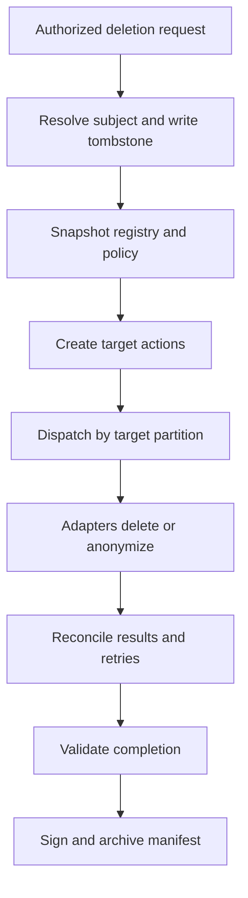
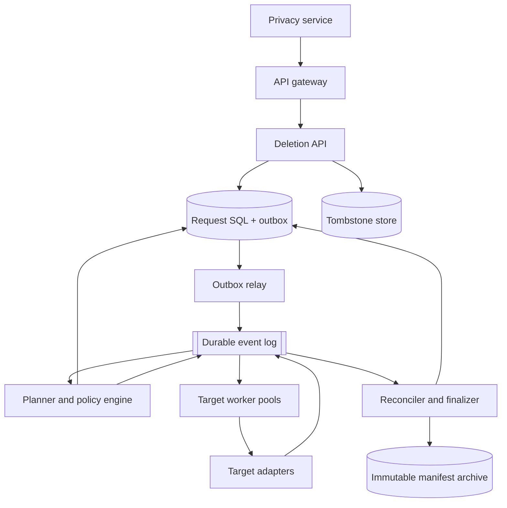
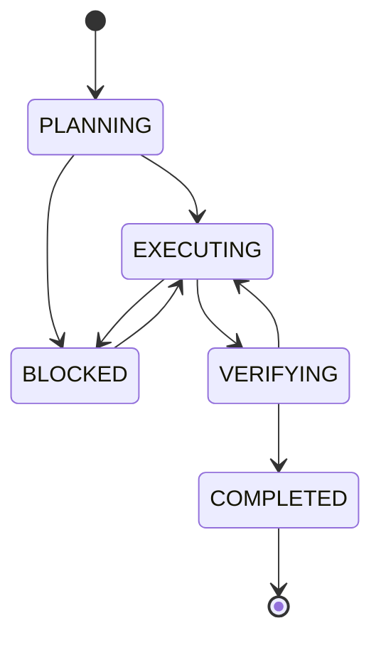
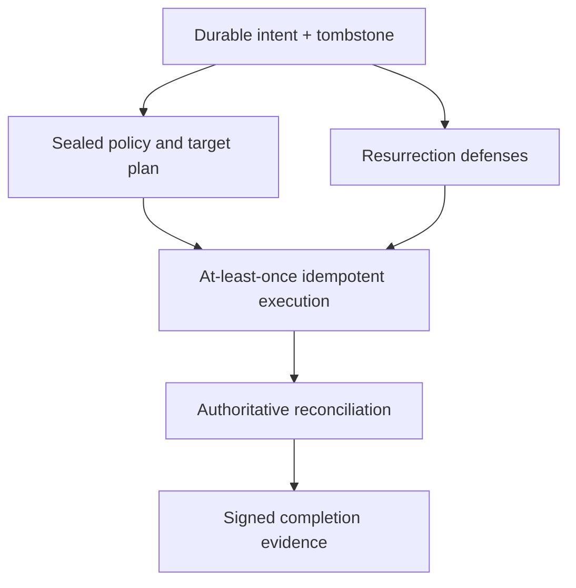

# Design a Global Data Deletion and Retention Platform

**Difficulty:** Hard  
**Primary themes:** databases, queues, long-running workflows, reliability, consistency, caching, compliance evidence  
**Interview time budget:** roughly 40–45 minutes  
**Educational walkthrough:** intentionally more detailed than what you would say during the interview

## Why this problem today?

Recent walkthroughs covered feature flags, LLM inference serving, distributed counters, WebSocket gateways, DNS, authentication sessions, and webhooks. This problem rotates toward a data-lifecycle control plane: coordinating deletion across heterogeneous stores while proving what happened. It tests whether you can separate intent from execution, reason about retries and partial failure, and state an honest consistency contract.

## Delivery-framework note

This walkthrough follows the sequence advocated by Hello Interview's public [Delivery Framework](https://www.hellointerview.com/learn/system-design/in-a-hurry/delivery): prioritize a small set of functional requirements, quantify the most important non-functional requirements, identify core entities, define the interface, build a working design requirement by requirement, and then harden it in deep dives. It also follows their public guidance to introduce only a practical schema tied to access patterns rather than attempting a complete database design up front ([Data Modeling](https://www.hellointerview.com/learn/system-design/core-concepts/data-modeling)), and to keep the API portion reasonable before moving to architectural tradeoffs ([API Design](https://www.hellointerview.com/learn/system-design/core-concepts/api-design)).

Everything below—the product assumptions, architecture, examples, failure analysis, and dialogue—is original to this walkthrough.

---

# Interviewer prompt

> Design a global platform that accepts requests to delete a person's data and reliably removes or anonymizes that data from thousands of internal datasets and services. The platform should track progress, retry failures, respect retention exceptions, and produce trustworthy evidence that the request was completed.

The interviewer is deliberately leaving several things ambiguous. Do not immediately draw Kafka, databases, and workers. First establish what “delete” means, which systems participate, and what guarantee the customer sees.

## Targeted clarifying questions and assumed answers

### 1. Who submits deletion requests?

**Candidate:** “Are requests submitted directly by end users, or by trusted internal privacy and account services?”

**Interviewer:** “A trusted privacy service authenticates the user and submits the request. Internal administrators may also submit legally authorized requests. Your system should not own user login.”

**Why this matters:** The deletion platform can derive the tenant, requester, and authorization scope from a service identity rather than accepting them as user-controlled body fields.

### 2. What must be deleted?

**Candidate:** “Do we know every data location for a user, or must the platform discover arbitrary data?”

**Interviewer:** “Each participating system registers a deletion adapter and declares which identity keys it stores, such as account ID, email hash, or device ID. The platform orchestrates registered targets; discovering unknown shadow data is out of scope.”

### 3. Is physical deletion always required?

**Candidate:** “Can some data be anonymized or retained because of fraud, tax, security, or legal-hold obligations?”

**Interviewer:** “Yes. A policy engine decides per target whether to hard-delete, anonymize selected fields, retain until a date, or skip under an active legal hold. The decision must be auditable.”

### 4. What data stores are involved?

**Candidate:** “Should the system work only with online databases?”

**Interviewer:** “No. Targets include relational databases, key-value stores, object storage, search indexes, caches, analytics warehouses, and event-derived materialized views. Backups are handled through cryptographic erasure or expiry rather than rewriting every backup.”

### 5. What is the completion promise?

**Candidate:** “Does the API wait synchronously until all stores finish?”

**Interviewer:** “No. Submission is synchronous, execution is asynchronous. Ninety-nine percent of ordinary requests should finish within 24 hours; the policy deadline is 30 days. The status should be visible within seconds.”

### 6. What if a service is down?

**Candidate:** “Should we fail the whole request immediately, or retry until the deadline?”

**Interviewer:** “Retry safely. A request is complete only when every required target has a terminal acceptable outcome: deleted, anonymized, validly exempted, or retained-until with an enforceable follow-up.”

### 7. Can data reappear?

**Candidate:** “Could delayed events or a database restore recreate deleted data?”

**Interviewer:** “Yes, and preventing resurrection is a key part of the problem.”

### 8. What scale should I design for?

**Candidate:** “How many requests, targets, and tenants?”

**Interviewer:** “Assume 50 million deletion requests per year, up to 2,000 target registrations, around 200 target actions per request on average, and ten times normal traffic during a breach response or regional migration.”

### 9. Is search across requests required?

**Candidate:** “What are the principal reads?”

**Interviewer:** “Fetch a request by ID, list requests for an account or tenant, and inspect target-level progress. Rich analytics can lag and is not on the critical path.”

### 10. Multi-region behavior?

**Candidate:** “Can we assign each request a home region, or must every request be actively written in every region?”

**Interviewer:** “A request may have a home region. Submission should survive an availability-zone failure. Region loss may trigger controlled failover; duplicate execution is acceptable if adapters are idempotent.”

### Scope summary to say aloud

> “I’ll design the control plane that accepts an authorized erasure intent, snapshots the applicable targets and policy, dispatches idempotent target actions, tracks their outcomes, prevents resurrection, and emits completion evidence. Identity verification, unknown-data discovery, and rewriting historical backups are outside scope.”

---

# 1. Requirements (~5 minutes)

In the interview, write only the prioritized requirements on the board. The fuller explanations below are for study.

## Core functional requirements

### FR1: Submit a deletion request with a stable subject identity

A trusted caller submits a request for a subject. The platform resolves aliases into a canonical subject ID, evaluates policy, snapshots the target plan, and returns a request ID.

### FR2: Execute and track deletion across all required targets

The system asynchronously invokes the correct adapter for every applicable target, retries transient failures, schedules deferred retention actions, and exposes request-level and target-level status.

### FR3: Finalize with verifiable evidence and prevent resurrection

When all required target actions reach acceptable terminal states, the platform creates an immutable completion manifest. Tombstones must block late events, cache refills, replay, and restores from recreating live subject data.

## Below the line

- User authentication and proof of identity
- Automatically discovering unregistered datasets
- Building every storage-specific adapter
- Arbitrary data export or “right to access”
- A general-purpose workflow product
- Legal interpretation of policy rules
- Rewriting every immutable backup
- Full data-lineage analytics UI

This boundary prevents the discussion from becoming a tour of every privacy feature.

## Quantified non-functional requirements

### NFR1: Correctness and durability

- Once accepted, no request intent or terminal target result may be lost.
- A request must never be marked complete while a required target is unresolved.
- Duplicate dispatch and duplicate completion messages must not change the final meaning.
- Evidence must reveal later tampering.

### NFR2: Timeliness

- Submission: p99 under 300 ms, excluding an unavailable external identity resolver.
- Status reads: p99 under 500 ms.
- New target work becomes dispatchable within 60 seconds.
- 99% of ordinary requests finish within 24 hours; every request is escalated well before the 30-day policy deadline.

### NFR3: Scale

- 50 million requests/year.
- 200 target actions/request on average, or 10 billion target executions/year.
- 10× burst tolerance.
- 2,000 registered targets and hundreds of logical tenants.

### NFR4: Availability

- Submission and status APIs: 99.99% monthly availability.
- Execution is durable and delay-tolerant; temporary target outages must not lose work.
- The service must tolerate an availability-zone failure without manual data repair.

### NFR5: Security and isolation

- Strong tenant isolation and least-privilege adapter credentials.
- No raw email, phone, or other unnecessary PII in queues, logs, metrics, or idempotency keys.
- Every state transition and administrative override is attributable.

## Consistency and availability contract

This is the most important sentence in the interview:

> “I will provide strongly consistent acceptance and state transitions within a request’s home region, at-least-once delivery to target adapters, and eventual cross-region visibility. Completion is conservative: unavailable or ambiguous required targets keep the request incomplete. During a partition, I prefer correctness over falsely claiming erasure, while status reads may serve a slightly stale projection labeled with its update time.”

Break that down:

- **Submission:** linearizable per idempotency key. Two retries create one logical request.
- **Plan snapshot:** immutable for a request version. Later registry changes do not silently change what the request originally promised.
- **Dispatch:** at least once, because exactly-once execution across independent databases is not achievable without their cooperation.
- **Adapters:** idempotent by action ID and subject generation.
- **Status:** authoritative reads from the request store; cached projections may be stale by seconds.
- **Completion:** monotonic and strongly validated. A terminal request cannot move backward except through an explicit, separately audited reopen operation.
- **Cross-region:** eventually consistent for dashboards; controlled failover uses fencing to avoid two active coordinators.

### What to say aloud

> “The phrase ‘exactly once’ would be misleading here. I can guarantee one durable intent and idempotent effects, but messages and adapter calls may repeat. The user-visible invariant is that repetition cannot resurrect data or incorrectly complete the request.”

---

# Scale estimates that change the design

Use arithmetic only where it justifies a component or partitioning decision.

## Request and action rate

```text
50,000,000 requests/year ÷ 31,536,000 seconds/year ≈ 1.6 requests/second average
Assume 20× daily peak and 10× incident burst ≈ 320 requests/second burst

1.6 requests/second × 200 actions/request ≈ 320 actions/second average
320 requests/second × 200 actions/request = 64,000 actions/second burst
```

The submission rate is modest, but the **fan-out rate** is not. This pushes us toward:

- durable asynchronous queues between orchestration and execution;
- partitioning by target and region so one slow service cannot block others;
- admission control to smooth bursts;
- a relational source of truth for correctness, with a separate scalable execution log or partitioned task table.

## State volume

Assume:

- request row plus policy snapshot metadata: 2 KB;
- target-action row including status and references: 1 KB;
- 50 million requests/year;
- 10 billion actions/year.

```text
Request metadata ≈ 100 GB/year before indexes and replication
Action metadata ≈ 10 TB/year before indexes and replication
```

Keeping every historical action forever in one OLTP cluster is unattractive. We retain active and recent rows in partitioned SQL, then archive terminal action history and manifests to immutable object storage. The API reads old detail through an archive service.

## Queue payload

At a 64,000 action/second burst and roughly 500 bytes per envelope:

```text
64,000 × 500 B ≈ 32 MB/s before replication
```

That is plausible for a partitioned log. More importantly, target-specific concurrency—not raw broker throughput—will usually be the constraint.

## Cache sizing

The 2,000-target registry and compiled policy metadata are small enough to cache fully in each planner. Request status is not cached indefinitely; active requests are volatile, and stale completion is dangerous.

### What to say aloud

> “The top-level QPS looks small, but each request fans out to about 200 targets. The meaningful peak is roughly 64,000 target actions per second, so I’ll decouple planning from execution and partition work by target. The 10-terabyte-per-year action history also tells me to tier completed detail out of the OLTP database.”

---

# 2. Core entities (~2 minutes)

Name the entities before drawing schemas.

| Entity | Purpose |
|---|---|
| **DeletionRequest** | One durable erasure intent for a canonical subject |
| **SubjectTombstone** | Monotonic record that prevents deleted data from being recreated |
| **TargetRegistration** | A participating datastore/service, supported identity keys, adapter, owner, and limits |
| **PolicyDecision** | Immutable explanation of delete, anonymize, defer, or exempt decisions |
| **TargetAction** | One planned operation against one target for one request |
| **ActionAttempt** | An append-only record of an execution attempt |
| **CompletionManifest** | Immutable summary and cryptographic evidence for the finished request |
| **AuditEvent** | Append-only record of control-plane changes and privileged actions |

Do not add User as a table merely because a person is involved. The privacy service owns users; this platform stores a pseudonymous canonical subject reference.

### What to say aloud

> “My core unit of orchestration is TargetAction. DeletionRequest is the parent intent, TargetRegistration describes capabilities, PolicyDecision freezes why an action is required or exempt, SubjectTombstone prevents resurrection, and CompletionManifest is the durable proof.”

---

# 3. API or system interface (~5 minutes)

Use REST for external control-plane APIs and gRPC for internal adapters. Authentication supplies caller identity and tenant context.

## Authentication and identity

The API gateway validates a workload identity token. It derives:

- `tenant_id`
- `caller_service`
- allowed purpose and action scopes
- audit principal

The client must **not** supply `tenant_id` or an arbitrary “authorized by” field in the JSON body.

The submitted subject reference is encrypted at the edge and resolved to:

- `canonical_subject_id`: random opaque identifier;
- `subject_generation`: increasing integer used to fence stale writes;
- target-specific opaque lookup tokens created only for eligible adapters.

## FR1: Submit a deletion request

```http
POST /v1/deletion-requests
Authorization: Bearer <workload-token>
Idempotency-Key: delreq-20261118-7f3a
Content-Type: application/json

{
  "subject": {
    "account_id": "acct_8F2K",
    "email": "rahul@example.com"
  },
  "reason": "USER_REQUEST",
  "jurisdiction": "US-MA",
  "requested_at": "2026-11-18T05:02:00Z"
}
```

```json
{
  "request_id": "dr_01JCB4N8V7P4",
  "status": "PLANNING",
  "accepted_at": "2026-11-18T05:02:00Z",
  "policy_deadline": "2026-12-18T05:02:00Z",
  "status_url": "/v1/deletion-requests/dr_01JCB4N8V7P4"
}
```

Semantics:

- `Idempotency-Key` is unique within `(tenant_id, caller_service)`.
- A retry with the same key and same body returns the original response.
- A retry with the same key and a different body returns `409 IDEMPOTENCY_CONFLICT`.
- `202 Accepted` means durable intent, not completed deletion.

## FR2: Read status

```http
GET /v1/deletion-requests/dr_01JCB4N8V7P4
Authorization: Bearer <workload-token>
```

```json
{
  "request_id": "dr_01JCB4N8V7P4",
  "status": "EXECUTING",
  "version": 18,
  "summary": {
    "total": 204,
    "succeeded": 173,
    "deferred": 7,
    "exempted": 3,
    "retrying": 20,
    "permanent_failure": 1
  },
  "oldest_unresolved_target_age_seconds": 4210,
  "updated_at": "2026-11-18T06:12:19Z",
  "policy_deadline": "2026-12-18T05:02:00Z"
}
```

Target detail is cursor-paginated:

```http
GET /v1/deletion-requests/dr_01JCB4N8V7P4/actions?status=RETRYING&limit=100&cursor=...
```

## FR3: Retrieve completion evidence

```http
GET /v1/deletion-requests/dr_01JCB4N8V7P4/manifest
```

```json
{
  "request_id": "dr_01JCB4N8V7P4",
  "request_version": 37,
  "completed_at": "2026-11-18T09:41:00Z",
  "outcome_counts": {
    "DELETED": 184,
    "ANONYMIZED": 10,
    "EXEMPTED": 3,
    "RETAINED_UNTIL": 7
  },
  "plan_hash": "sha256:6c53...",
  "result_merkle_root": "sha256:b891...",
  "previous_audit_root": "sha256:11d0...",
  "signature": "kms:v3:MEUCIQ..."
}
```

The manifest contains hashes and opaque target IDs, not subject PII or deleted payloads.

## Target registration interface

```http
POST /v1/targets

{
  "name": "orders-primary",
  "adapter_endpoint": "grpcs://privacy-adapter.orders.internal",
  "regions": ["us-east", "eu-west"],
  "supported_identifiers": ["CANONICAL_SUBJECT_ID"],
  "supported_actions": ["DELETE", "ANONYMIZE"],
  "max_concurrency": 200,
  "owner": "orders-data"
}
```

Registration changes are versioned. A planner snapshots the registry version used for a request.

## Internal adapter contract

```protobuf
rpc ExecuteDeletion(TargetActionEnvelope) returns (TargetActionResult);

message TargetActionEnvelope {
  string action_id = 1;
  string request_id = 2;
  string target_id = 3;
  int64 subject_generation = 4;
  ActionType action_type = 5;
  bytes encrypted_lookup_token = 6;
  string policy_decision_id = 7;
  string deadline = 8;
}
```

The result is one of:

- `SUCCEEDED`
- `NOT_FOUND` — acceptable and treated as successful absence
- `RETRYABLE_FAILURE`
- `PERMANENT_FAILURE`
- `DEFERRED(until)`

### What to say aloud

> “The external API returns 202 after the request and outbox event commit atomically. The internal execution interface carries a stable action ID and subject generation, so retries and stale producers are safe. The tenant and caller come from authentication, not the body.”

---

# 4. Data flow

This is a processing pipeline, so a brief data flow is useful.



The crucial ordering is **tombstone before downstream deletion**. If the platform deletes first and records the tombstone later, a late event can recreate data in the gap.

---

# 5. High-level design (~10–15 minutes)

Build the simplest complete system one functional requirement at a time.

## Compact architecture



The SQL store is the source of truth for intent and state. The log moves work; it is not the only record of work. Object storage holds immutable long-term evidence. The tombstone store is optimized for high-volume “may this subject be recreated?” checks.

## Operation 1: Accept a request

### Baseline flow

1. The API gateway authenticates the privacy service and derives `tenant_id`.
2. The Deletion API validates the idempotency key and request shape.
3. The Identity Resolver maps presented identifiers to a canonical subject ID. Raw identifiers are not written to logs.
4. In a serializable SQL transaction, the service:
   - inserts `DeletionRequest`;
   - inserts the initial immutable `PolicyDecision` reference;
   - inserts an outbox event;
   - reserves the idempotency key.
5. Before returning, it writes or advances `SubjectTombstone(subject_id, generation)` using a compare-and-set operation.
6. It returns `202 Accepted`.

There is an apparent cross-store problem between SQL and the tombstone store. The safest simple design is to keep the authoritative tombstone in the same transactional SQL shard and publish it through the outbox to a globally readable tombstone KV projection. New writers treat an unavailable projection conservatively for sensitive creates, or query the authority.

### Data model introduced with this operation

```text
deletion_requests
  request_id UUID/ULID PK
  tenant_id
  canonical_subject_id_encrypted
  subject_generation
  reason
  jurisdiction
  status
  policy_deadline
  registry_version
  plan_hash
  version
  created_at, updated_at

UNIQUE (tenant_id, caller_service, idempotency_key)
INDEX (tenant_id, created_at DESC)
INDEX (tenant_id, canonical_subject_hash, created_at DESC)
INDEX (status, policy_deadline)

subject_tombstones
  tenant_id
  canonical_subject_hash
  generation
  request_id
  state              -- ACTIVE, REVOKED_BY_AUTHORIZED_REOPEN
  created_at
  PRIMARY KEY (tenant_id, canonical_subject_hash)
```

Why SQL? Request acceptance requires uniqueness, conditional updates, and a transactional outbox. The request rate is not high enough to justify giving up those properties.

### State machine



`FAILED` is intentionally not a casual terminal state. A permanent target failure blocks and escalates the request; it does not erase the obligation.

## Operation 2: Plan and execute target actions

### Planning

The outbox relay publishes `DeletionRequestAccepted`. A planner:

1. reads the immutable registry version;
2. evaluates policy for each applicable target;
3. creates a deterministic action ID:

```text
action_id = HMAC(platform_key, request_id || target_id || policy_version)
```

4. bulk-inserts target actions;
5. computes and stores a canonical `plan_hash`;
6. moves the request from `PLANNING` to `EXECUTING`;
7. publishes action-ready events through an outbox.

Deterministic IDs make planner replay safe. A unique constraint on `(request_id, target_id, policy_decision_id)` prevents duplicate logical actions.

### Action schema

```text
target_actions
  action_id PK
  request_id
  target_id
  target_region
  action_type
  policy_decision_id
  state
  next_attempt_at
  attempt_count
  lease_owner
  lease_expires_at
  last_error_class
  result_digest
  completed_at

PARTITION BY time and hash(request_id)
UNIQUE (request_id, target_id, policy_decision_id)
INDEX (state, next_attempt_at)
INDEX (request_id, action_id)

action_attempts
  action_id
  attempt_number
  worker_id
  started_at, ended_at
  outcome
  error_code
  response_digest
  PRIMARY KEY (action_id, attempt_number)
```

### Dispatch and execution

The durable log has logical partitions by `target_id` and region. Target worker pools:

1. consume action envelopes;
2. enforce per-target rate and concurrency limits;
3. acquire a short execution lease using conditional update;
4. obtain a short-lived target credential;
5. invoke the adapter with `action_id` and `subject_generation`;
6. record the result and an outbox result event in one transaction;
7. acknowledge the broker message only after the database commit.

If a worker crashes after the target deletes data but before it records success, the message is retried. The adapter sees the same `action_id` and returns the stored result or safely repeats the delete. This is the standard “at-least-once plus idempotency” pattern.

### Adapter responsibilities

Each adapter translates the common contract:

- SQL: delete or redact rows in bounded batches, including child tables.
- KV: delete keys or write a generation-aware tombstone.
- Search: delete by stable subject routing key and refresh asynchronously.
- Cache: invalidate known keys and ensure cache fills consult the tombstone/generation.
- Object store: delete indexed object keys and versions according to policy.
- Warehouse: submit partition-aware delete/anonymization jobs.
- Derived view: consume the tombstone and rebuild or retract subject contributions.

The platform should not send raw SQL to target systems. Target owners retain schema knowledge and deploy adapters alongside their services.

## Operation 3: Track progress and finalize

### Result reconciliation

Result events update counters and action state. Counters are a projection for fast reads, not the completion authority.

The Reconciler periodically scans:

- expired execution leases;
- `RETRYABLE_FAILURE` actions whose `next_attempt_at` has arrived;
- deferred actions near their retention date;
- blocked requests approaching SLO or policy deadline;
- requests whose projection says all actions are terminal.

For candidate completion, the Finalizer performs an authoritative query over the request’s action rows and policy decisions. It checks:

1. the plan is sealed;
2. every required action has an acceptable terminal outcome;
3. every exemption has an active, signed policy decision;
4. every retained-until action has a durable follow-up task;
5. no newer subject generation or plan amendment is unresolved.

It then atomically changes `VERIFYING → COMPLETED` using `WHERE version = expected_version`.

### Completion manifest

The Finalizer constructs a canonical manifest:

- request ID and version;
- registry and policy versions;
- plan hash;
- sorted target outcome digests;
- exemption and retention references;
- audit-chain root;
- completion timestamp.

It stores the manifest in versioned, write-once object storage and signs its hash with a key-management service. SQL stores the URI, digest, and signature.

### Status reads

For recent active requests, the API reads SQL or a read replica with bounded staleness. A small cache may hold:

- request summaries for 5–15 seconds;
- target registry and compiled policy;
- never the sole copy of completion state.

On completion, an invalidation event evicts the summary. The manifest endpoint reads the authoritative row and immutable object.

### What to say aloud

> “I’m using SQL as the correctness boundary and the event log as transport. The planner seals a deterministic plan. Workers can execute more than once, adapters deduplicate by action ID, and the finalizer does not trust counters—it rechecks all required rows before signing completion.”

---

# 6. Deep dives (~10–15 minutes)

Choose three. Each deep dive starts with where the baseline fails, compares options, selects one, and evolves the design.

## Deep dive 1: At-least-once execution without false completion

### Where the baseline breaks

Distributed execution has ambiguous outcomes:

- adapter deletes data, then the network times out;
- worker commits success, then crashes before acknowledging the queue;
- broker redelivers;
- two workers acquire work during a delayed lease handoff;
- a stale result arrives after policy was amended.

If the system treats every retry as new work, it can overload targets. If it trusts a single “success” message, a forged, stale, or misrouted result could falsely complete the request.

### Plausible approaches

| Approach | Benefit | Failure/tradeoff |
|---|---|---|
| Distributed exactly-once transaction | Simple mental model | Impractical across thousands of independent stores and brokers |
| At-most-once delivery | Avoids duplicate calls | A crash can permanently lose deletion work |
| At-least-once + idempotent adapters | Durable and operationally realistic | Requires adapter contract and dedup state |
| Read-after-delete verification for every target | Strong evidence | Expensive; absence queries may be unsupported or eventually consistent |

### Selection

Choose at-least-once delivery with:

- deterministic action IDs;
- adapter-side result journal or naturally idempotent delete;
- fenced subject generations;
- conditional state transitions;
- selective verification based on target risk.

### Evolved protocol

1. Worker leases action at database version 12.
2. It calls adapter with `action_id=A`, `generation=7`.
3. Adapter transaction:
   - checks `adapter_results[A]`;
   - if present, returns prior result;
   - otherwise deletes/redacts records and writes `adapter_results[A]` atomically where supported.
4. Adapter returns `result_digest` containing target, action, generation, outcome, and adapter schema version.
5. Worker updates only if:

```sql
UPDATE target_actions
SET state = 'SUCCEEDED', result_digest = :digest
WHERE action_id = :id
  AND state IN ('LEASED', 'RETRYING')
  AND subject_generation = :generation;
```

6. Stale generations and unexpected target identities are rejected.

For a target that cannot atomically journal and delete, the adapter must make deletion naturally idempotent and return `NOT_FOUND` on replay. For high-risk stores, a separate verifier later queries for absence using a privacy-safe lookup.

### Retry policy

- exponential backoff with full jitter;
- bounded per-target concurrency;
- retry budget to prevent a failing target from monopolizing workers;
- circuit breaker when a target’s failure rate spikes;
- dead-letter **review queue**, not a terminal trash can;
- deadline-aware escalation.

An action in a review queue still counts unresolved.

### Failure modes and observability

Track:

- redelivery rate;
- adapter dedup-hit rate;
- lease-expiry rate;
- ambiguous timeout count;
- result-generation mismatch;
- action age by target;
- fraction of requests with at least one blocked action.

Alert on the oldest unresolved required action, not just average latency.

### What to say aloud

> “I won’t claim exactly-once deletion. I’ll make a single logical action repeatable: stable action ID, generation fence, idempotent adapter, and conditional state transition. A dead-letter message is an escalation state, never evidence of completion.”

## Deep dive 2: Preventing deleted data from coming back

### Where the baseline breaks

Deleting current records is insufficient. Data can reappear when:

- an old event is replayed into a materialized view;
- a mobile client syncs an offline write;
- a cache miss refills from a lagging replica;
- disaster recovery restores a backup from before deletion;
- a CDC consumer catches up after deletion;
- the same person creates a new account.

This is the “resurrection” problem.

### Plausible approaches

| Approach | Benefit | Failure/tradeoff |
|---|---|---|
| Delete rows only | Easy | Late writers recreate them |
| Permanent tombstone in every store | Strong local defense | Expensive and difficult to distribute consistently |
| Central tombstone lookup on every write | Simple authority | Adds latency and creates a critical dependency |
| Signed tombstone stream + local caches + generation fencing | Fast and scalable | Eventual propagation needs a safe fallback |

### Selection

Use an authoritative tombstone plus a signed, replayable tombstone stream. Sensitive writers maintain local tombstone caches and compare subject generations. The platform assigns a new generation only through an authorized lifecycle operation.

### Generation rule

Every subject-scoped event carries:

```text
(tenant_id, canonical_subject_hash, subject_generation)
```

A consumer may apply an event only if:

```text
event.generation >= local_live_generation
AND no active tombstone exists for that generation
```

After a deletion tombstone for generation 7:

- delayed generation-7 events are discarded;
- generation-6 events are also discarded;
- generation-8 data is allowed only if the identity service issued a legitimate new lifecycle generation.

This distinguishes “old data returning” from “the person later opened a new account,” which policy may permit.

### Caching strategy

Each region keeps:

- an in-memory negative/positive cache of recent tombstones;
- a durable local KV projection keyed by subject hash;
- the stream offset and signature checkpoint.

Positive tombstones have very long TTLs or no TTL. Negative cache entries are short-lived because a new deletion may arrive. On stream lag beyond a threshold:

- high-risk writes synchronously consult the authority or fail closed;
- low-risk derived analytics pause or quarantine writes;
- no component silently assumes “not deleted.”

This is a useful example where cache semantics are asymmetric: a stale positive is safe but may block a legitimate new lifecycle; a stale negative can violate deletion.

### Backups

Rewriting every backup is operationally dangerous and may destroy recovery guarantees. Instead:

1. encrypt subject-partitioned or tenant-partitioned backup material with envelope keys where practical;
2. destroy relevant data-encryption keys for cryptographic erasure when granularity permits;
3. otherwise allow backup expiry under a documented retention policy;
4. on restore, replay the authoritative tombstone log before reopening writes or serving traffic;
5. run a post-restore scrub that reapplies target actions.

The completion manifest records the backup policy and expiry/key-destruction evidence; it must not falsely say every backup byte was immediately overwritten.

### Failure modes and observability

Track:

- tombstone propagation lag per region and consumer;
- blocked stale-generation writes;
- cache negative-hit age;
- restored data scrub counts;
- CDC/event replay rejection counts;
- targets not acknowledging the latest tombstone checkpoint.

Run synthetic “canary subjects” through delete and replay tests continuously.

### What to say aloud

> “Erasure is not just a delete query. I’ll publish a monotonic subject-generation tombstone before fan-out. Writers and replay consumers reject events from deleted generations. After a restore, tombstones are replayed before traffic resumes, so an old backup cannot become live truth.”

## Deep dive 3: Policy evolution, plan completeness, and trustworthy evidence

### Where the baseline breaks

The set of targets and legal rules changes while a request is running:

- a new dataset registers after the plan was created;
- a target owner changes an adapter endpoint;
- a legal hold begins or ends;
- an exemption was approved incorrectly;
- counters claim 200/200 while the registry actually had 204 applicable targets.

If the plan is dynamic, completion may never stabilize. If it is frozen forever, the system may ignore a critical dataset discovered minutes later.

### Plausible approaches

| Approach | Benefit | Failure/tradeoff |
|---|---|---|
| Evaluate live registry on every reconciliation | Always current | Non-deterministic; requests keep changing |
| Freeze registry/policy forever at acceptance | Deterministic | Newly discovered required target may be missed |
| Versioned sealed plan with explicit amendments | Deterministic and auditable | More state-machine complexity |

### Selection

Use a sealed, versioned plan plus explicit plan amendments.

### Plan protocol

1. Planner reads registry version `R42` and policy bundle `P18`.
2. It creates the sorted action list and computes:

```text
plan_hash = SHA256(canonical(request_id, R42, P18, sorted actions))
```

3. It marks the plan sealed.
4. A later critical registration change emits `PlanAmendmentRequired`.
5. An amendment transaction:
   - increments request version;
   - adds new actions;
   - records reason and approver;
   - computes a new plan hash linked to the old hash;
   - moves `VERIFYING` or even a specially reopenable request back to `EXECUTING`.

Ordinary non-retroactive registry changes apply only to new requests. Critical changes have an explicit effective time and backfill policy.

### Completion validation

Do not finalize from an incremented counter alone. Counters can drift due to duplicate events or partial writes.

The Finalizer:

- locks or compare-and-swaps the request version;
- reads the sealed plan;
- validates each action’s terminal outcome;
- verifies policy decision signatures and effective times;
- confirms deferred follow-ups exist;
- recomputes the plan and result roots;
- writes completion row and manifest pointer atomically through an outbox.

For 200 actions per request, this verification query is inexpensive. If a request has millions of actions, maintain partition-level signed summaries and verify their roots.

### Tamper-evident evidence

A signed PDF is not enough. Store canonical machine-readable evidence:

```text
leaf = SHA256(action_id || target_id || outcome || result_digest || completed_at)
result_merkle_root = MerkleRoot(sorted leaves)
manifest_hash = SHA256(plan_hash || result_merkle_root || audit_root || request_version)
signature = KMS.Sign(manifest_hash)
```

A Merkle tree lets an auditor verify that one target result belongs to the signed manifest without downloading all results. It does **not** prove that the target told the truth; that requires adapter controls, selective verification, and operational audits.

### Legal holds and retained-until

`EXEMPTED` and `RETAINED_UNTIL` are not casual success values:

- decision references a versioned policy rule;
- scope is target and data-class specific;
- approver identity and effective interval are recorded;
- retained data is access-restricted;
- a durable future task exists;
- expiry produces a new deletion action and evidence leaf.

### Observability and operations

Dashboards:

- requests by state, tenant, jurisdiction, and deadline bucket;
- completion latency p50/p95/p99;
- unresolved action age by target;
- policy exemption rate and sudden changes;
- registry coverage and adapters with stale heartbeats;
- plan amendments per day;
- manifest-signing failures.

Audit queries should answer:

- What did we know when the request was accepted?
- Which policy and registry versions were used?
- Which target was skipped, by whom, and why?
- Did a later amendment add newly discovered data?
- Can the stored manifest be verified with the historical signing key?

### What to say aloud

> “I need deterministic completion, so I’ll seal a versioned target plan. Registry or policy changes never mutate it invisibly; they create an auditable amendment. The finalizer revalidates the plan and terminal rows, computes a Merkle root, and signs the manifest. That proves integrity of our recorded evidence, while adapter verification addresses truthfulness.”

---

# Reliability details worth mentioning if probed

## Transactional outbox

Whenever SQL state and a broker event must agree, write the domain row and an outbox row in one database transaction. A relay publishes the outbox row and marks it sent. Duplicate publish is acceptable because consumers deduplicate by event ID.

This prevents:

- committed request with no planning event;
- emitted success event with no committed success row.

## Leases and fencing

A lease prevents ordinary duplicate work but is not a correctness guarantee; clocks pause and packets delay. Therefore, every lease has a monotonically increasing fencing token. A target that supports it rejects commands with older tokens. Where it does not, action idempotency remains the primary defense.

## Poison requests

A malformed identity token or unsupported policy combination should fail during planning with an actionable blocked reason. Repeating it forever in the hot queue wastes capacity. Move it to a review topic while retaining it as unresolved and alerting its owner.

## Regional failover

Each request has a home region. SQL replicates synchronously across availability zones and asynchronously to a paired region. A failover controller:

1. verifies primary unavailability;
2. obtains a global epoch/fencing token;
3. promotes the paired region;
4. resumes outbox and reconciliation from durable offsets;
5. allows duplicate adapter calls but prevents two finalizers from signing different request versions.

RPO may be near zero only if cross-region replication is synchronous, which hurts latency and availability. A pragmatic contract is zero loss of accepted intent by replicating the small acceptance journal synchronously to a second region, while bulk attempt details may have a small RPO and be reconstructed from the event log and adapters.

## Backpressure

Each target gets:

- token-bucket rate limit;
- maximum in-flight calls;
- separate retry quota;
- queue depth and oldest-age SLO;
- circuit breaker.

The global dispatcher uses weighted fair scheduling so a target with millions of retries cannot starve healthy targets or small tenants.

## Security

- Encrypt subject references with tenant-scoped keys.
- Put only opaque lookup tokens in queue messages.
- Use mTLS and workload identity for adapters.
- Issue short-lived, target-scoped credentials.
- Redact PII from logs and traces.
- Separate “view status,” “approve exemption,” “reopen,” and “register target” permissions.
- Require two-person approval for broad overrides.
- Rotate signing keys while retaining public verification material.
- Audit reads of sensitive request detail, not only writes.

---

# Final design

The final system has:

1. An authenticated Deletion API that durably accepts one request per idempotency key.
2. An authoritative, monotonic subject tombstone written before deletion fan-out.
3. A versioned target registry and policy engine that produce a sealed deterministic plan.
4. Partitioned SQL tables for requests, active actions, attempts, and outboxes.
5. A durable event log partitioned by target and region.
6. Fair, rate-limited worker pools invoking owner-managed idempotent adapters.
7. Generation fencing and tombstone projections that block replay, refill, restore, and late-write resurrection.
8. A reconciler that repairs expired leases, schedules retries and deferred actions, and escalates deadline risk.
9. A conservative finalizer that rechecks authoritative action state instead of trusting counters.
10. A signed, immutable completion manifest with plan, result, and audit roots.
11. Archival of completed detail to object storage so the OLTP database contains mostly active and recent work.
12. Multi-AZ operation and controlled regional failover with coordinator fencing.



---

# Requirements check

| Requirement | How the design satisfies it |
|---|---|
| Submit deletion request | Auth-derived tenant, idempotency key, SQL transaction, outbox, 202 response |
| Execute across targets | Sealed plan, durable log, target partitions, adapters, retries, deferred tasks |
| Track progress | Authoritative action rows plus fast summary projection and paginated detail |
| Produce evidence | Canonical manifest, Merkle root, immutable object storage, KMS signature |
| Prevent resurrection | Tombstone-first ordering, subject generations, local projections, restore replay |
| No lost accepted intent | Multi-AZ SQL, transactional outbox, paired-region journal |
| No false completion | Conservative state machine and authoritative finalizer scan |
| 24-hour ordinary SLO | Async fan-out, fair scheduling, target concurrency control, deadline prioritization |
| 10× bursts | Queue buffering and 64,000-action/s partitioned dispatch design point |
| 99.99% API availability | Stateless APIs, multi-AZ database, bounded cache use, controlled failover |
| Tenant isolation and PII safety | Workload identity, tenant-scoped keys, opaque queue tokens, scoped credentials |

---

# Realistic interviewer follow-up questions and strong sample answers

## Follow-up 1: “Why not use a workflow engine such as Temporal for everything?”

**Strong answer:**

> “A durable workflow engine is a reasonable implementation choice for timers, retries, and long-running state. I would still preserve the same domain invariants: immutable plan, idempotent activities, tombstone generation, and authoritative completion. At our scale, 50 million workflows and 10 billion target activities per year require careful history sizing and archival. I might use a workflow engine per request for coordination, but I would not make its event history the only compliance record or send 200 unbounded activities without target-level backpressure.”

## Follow-up 2: “What happens when the target says success but data is still present?”

**Strong answer:**

> “Transport success is not sufficient for high-risk targets. The result includes an adapter schema version and digest, and selected targets get an independent absence-verification action. We also run sampled audits and canary subjects. If verification fails, the action reopens, the target is quarantined, related completions can be investigated by adapter version, and the audit trail shows that the original claim was later invalidated.”

## Follow-up 3: “Could Redis store all tombstones?”

**Strong answer:**

> “Redis could be a low-latency regional projection, but not the sole durable authority. Tombstones may need to live for years and must survive eviction and regional loss. I would keep authority in a durable replicated store and distribute a signed log into local KV or Redis caches. A cache miss cannot automatically mean the subject is safe to recreate.”

## Follow-up 4: “How do you delete from Kafka?”

**Strong answer:**

> “I would avoid promising immediate mutation of an append-only shared log. Producers should minimize PII and use opaque subject IDs. Consumers receive tombstones and remove the subject from serving stores. For retained raw events, use short retention, subject- or tenant-scoped encryption keys for cryptographic erasure where feasible, and compaction only as a secondary mechanism because compaction is not immediate. The policy and completion evidence must state the actual guarantee.”

## Follow-up 5: “Why is NOT_FOUND a success?”

**Strong answer:**

> “The required postcondition is absence of subject data, not proof that a row once existed. If the adapter performed an authoritative lookup and reports NOT_FOUND under the correct generation and target, the postcondition holds. I still record NOT_FOUND distinctly for audit and anomaly detection.”

## Follow-up 6: “How would you add a new target while requests are in flight?”

**Strong answer:**

> “Registration is versioned. New requests use the new registry version. The registration specifies whether it is retroactive and from what effective time. If retroactive, an amendment service finds affected unfinished or recently completed requests, adds deterministic actions, links a new plan hash to the previous one, and moves them back to execution through an audited transition.”

## Follow-up 7: “Would you shard SQL?”

**Strong answer:**

> “Initially I would partition tables by time and request hash within one managed cluster, because 1.6 request submissions per second is small. The action table is the pressure point at roughly 10 terabytes per year. I would archive terminal rows aggressively, and if one cluster is insufficient, shard by tenant plus request hash or home region. Every request and its actions should remain colocated so finalization avoids cross-shard transactions.”

## Follow-up 8: “What if one giant tenant dominates the queue?”

**Strong answer:**

> “I would schedule hierarchically: first by target health and capacity, then weighted fair queues per tenant, with a separate retry budget. Per-tenant admission limits and deadline priority prevent one burst from starving others. I would expose throttling and projected completion time to the control plane.”

## Follow-up 9: “Can a completed request ever be reopened?”

**Strong answer:**

> “Normal processing is monotonic, but discovery of missed data may require remediation. I would never mutate the signed manifest. I would create a new request version or linked remediation request with its own plan and manifest, referencing the previous evidence. That preserves history rather than pretending the first completion never happened.”

## Follow-up 10: “How do you protect against a malicious administrator exempting data?”

**Strong answer:**

> “Exemption is a separate privileged capability with two-person approval for broad scope, policy-as-code validation, immutable audit events, reason and expiry, and anomaly alerts on exemption rate. Target workers accept only signed policy decisions. Administrators cannot edit manifests or action results.”

## Follow-up 11: “What is your disaster-recovery test?”

**Strong answer:**

> “Regularly restore a production-like backup into an isolated environment, replay tombstones before enabling readers, run the scrubber, and verify canary subjects remain absent. Then fail over the request coordinator with in-flight actions and confirm duplicate adapter calls are harmless and only one manifest version is signed.”

## Follow-up 12: “Where would caching help, and where would it be dangerous?”

**Strong answer:**

> “Cache the small target registry, compiled policy, and short-lived active status summaries. Cache positive tombstones for a long time. Avoid treating a negative tombstone-cache result or a cached COMPLETED counter as authoritative. For correctness-sensitive decisions, fall back to the authority when the projection is stale.”

---

# Common pitfalls

1. **Claiming exactly-once deletion.** Independent stores and network failures make this dishonest. Use durable intent, at-least-once delivery, and idempotency.
2. **Marking a dead-lettered action complete.** A DLQ is a review mechanism; the obligation remains unresolved.
3. **Deleting before writing a tombstone.** Late events can recreate data in the gap.
4. **Treating Kafka or a queue as the only source of truth.** Retention, compaction, or operational mistakes can erase evidence of unfinished work.
5. **Trusting counters for finalization.** Duplicate or missing result events can corrupt counters; recheck the sealed plan.
6. **Ignoring backups and restores.** A restore must replay tombstones before serving traffic.
7. **Sending raw PII through queues and logs.** Use encrypted or opaque target-specific tokens.
8. **Letting the live registry mutate an in-flight plan silently.** Use versioned snapshots and explicit amendments.
9. **Using one global worker pool.** A failed target or large tenant can cause head-of-line blocking.
10. **Treating every exemption as success without expiry or evidence.** Exemptions need scoped, signed, reviewable policy decisions.
11. **Overdesigning the external API.** The architectural challenge is orchestration and correctness, not dozens of endpoints.
12. **Promising immediate physical deletion from immutable backups.** State the actual expiry or cryptographic-erasure contract.
13. **Assuming cache miss means no tombstone.** Stale negative information is dangerous.
14. **Storing deleted payloads in “audit” records.** Evidence should contain hashes and metadata, not the sensitive data being erased.

---

# A concise 45-minute delivery script

## Minutes 0–5: requirements

> “I’ll focus on accepting an authorized erasure request, executing it across registered targets, and producing evidence while preventing resurrection. Submission and status are highly available; completion is conservative. I’ll target 50 million requests a year, 200 actions each, 99% within 24 hours, and a 30-day deadline.”

## Minutes 5–7: entities

> “The central entities are DeletionRequest, TargetRegistration, PolicyDecision, TargetAction, SubjectTombstone, ActionAttempt, and CompletionManifest.”

## Minutes 7–12: interfaces

> “The external REST API uses an idempotency key and derives tenant identity from auth. It returns 202. Internal adapters receive a stable action ID, subject generation, action type, and encrypted lookup token.”

## Minutes 12–25: high-level design

> “SQL is the correctness boundary. An outbox feeds a planner, which snapshots registry and policy and seals a deterministic plan. A partitioned log feeds rate-limited target workers. Adapters are idempotent. Results update action state; a reconciler retries and a finalizer authoritatively checks every required action before signing a manifest.”

## Minutes 25–40: deep dives

Lead with:

1. ambiguous outcomes → at-least-once plus idempotency;
2. late events/restores → tombstone generations;
3. evolving registry/policy → sealed plan plus amendments and signed evidence.

## Minutes 40–45: close

> “The core tradeoff is that status may be eventually visible, but completion is never optimistic. The system favors durable, replayable work and honest evidence over claiming synchronous or exactly-once deletion.”

---

# Closing mental model

Think of the system as five promises:

1. **Remember the intent.**
2. **Freeze what must be done.**
3. **Repeat work safely until it is done.**
4. **Prevent old data from becoming live again.**
5. **Prove the recorded outcome without storing the deleted data.**

If you keep those promises visible while drawing the design, your components and tradeoffs follow naturally.
