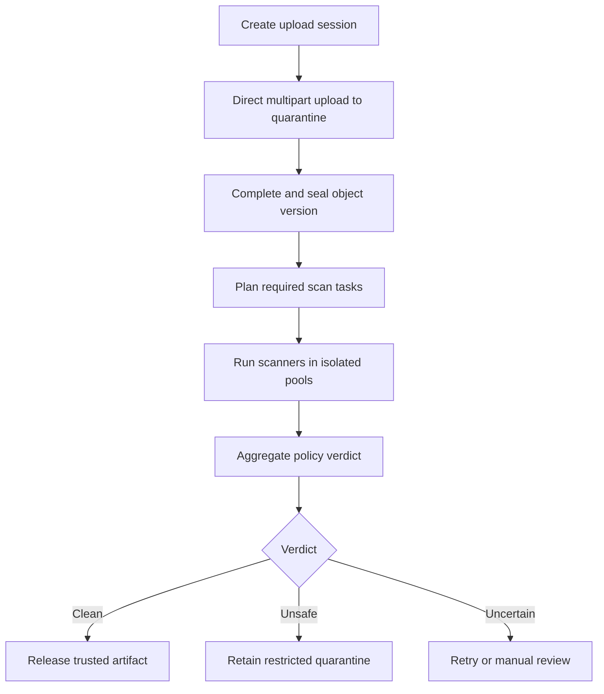
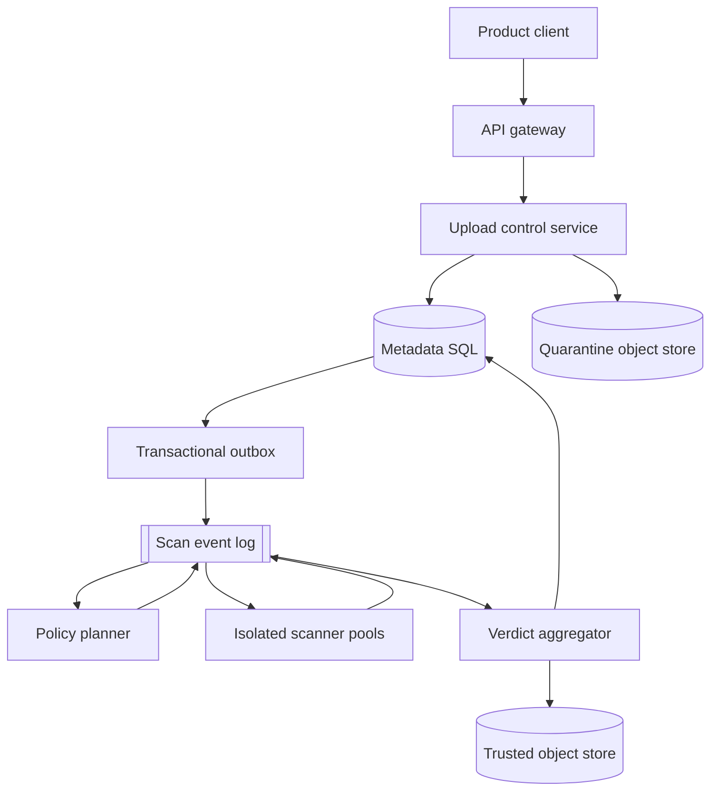
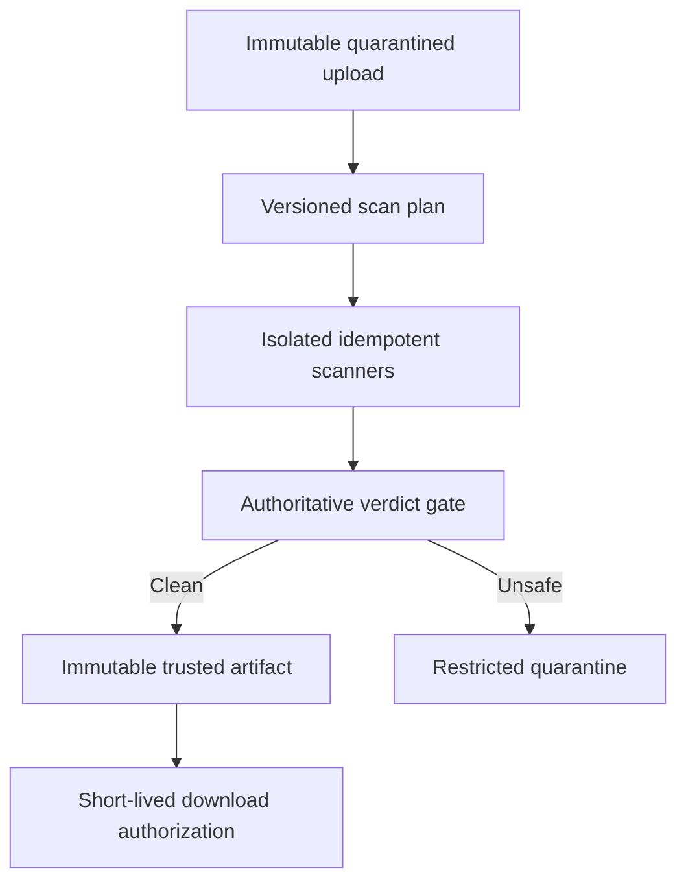

# Design a Secure File Ingestion and Malware Scanning Platform

**Difficulty:** Medium–Hard  
**Primary themes:** large blobs, object storage, queues, caching, backpressure, reliability, consistency, security  
**Interview time budget:** approximately 40–45 minutes  
**Educational walkthrough:** intentionally more detailed than the spoken interview answer

## Rotation note

The latest walkthroughs covered a data-deletion control plane, feature flags, LLM inference, distributed counters, WebSocket gateways, DNS, sessions, and webhooks. Today’s problem changes both domain and difficulty: it is a content-processing system whose most important invariant is that an untrusted file must never become downloadable as trusted content before the required scan policy has completed.

## Framework note

The structure follows Hello Interview’s public [Delivery Framework](https://www.hellointerview.com/learn/system-design/in-a-hurry/delivery): prioritize a small number of requirements, identify core entities, define the interface, build a complete design one requirement at a time, and then use deep dives to harden the design. The API and schema portions follow their guidance to stay practical and connect decisions to access patterns rather than overdesigning them ([API Design](https://www.hellointerview.com/learn/system-design/core-concepts/api-design), [Data Modeling](https://www.hellointerview.com/learn/system-design/core-concepts/data-modeling)).

The problem, architecture, dialogue, examples, tradeoffs, and wording below are original.

---

# Interviewer prompt

> Design a shared platform that lets applications accept large file uploads, scan them for malware and policy violations, quarantine unsafe files, and release safe files for download. Thousands of internal products should be able to use the service without implementing their own upload and scanning pipelines.

The wording hides several important choices. Before drawing components, clarify whether bytes pass through application servers, what “safe” means, whether scan results can be reused, and what happens when scanning is unavailable.

## Targeted clarifying questions with assumed interviewer answers

### 1. Who uses the service?

**Candidate:** “Are end users calling the platform directly, or do product services integrate with it?”

**Interviewer:** “Product services create upload sessions. Their web and mobile clients upload directly to storage using a scoped URL. Authentication belongs to the product, while our platform authenticates the product service.”

### 2. What file sizes and formats must we support?

**Candidate:** “What is the maximum object size, and do we need resumable uploads?”

**Interviewer:** “Files range from a few kilobytes to 20 GB. Anything large should support multipart, resumable upload. Common documents, archives, images, executables, and media are in scope.”

### 3. What does scanning include?

**Candidate:** “Is this only signature-based antivirus?”

**Interviewer:** “The required policy may include antivirus, file-type validation, archive inspection, a sandbox for suspicious executables, and an optional data-loss-prevention scanner. Different tenants choose different policy bundles.”

### 4. What is the user-visible workflow?

**Candidate:** “Can clients download an object before scanning finishes?”

**Interviewer:** “No. An upload can be acknowledged, but the object is quarantined until the required policy finishes. Clients poll or receive a callback when it is released or rejected.”

### 5. Can scan results be reused?

**Candidate:** “If identical bytes were scanned recently, may we reuse the result?”

**Interviewer:** “Yes, but only when the content hash, scanner-engine versions, policy version, and relevant tenant isolation rules match. A new threat-intelligence update may invalidate earlier results.”

### 6. What happens when scanners are unavailable?

**Candidate:** “Should availability win, or should files be released without a scan?”

**Interviewer:** “Fail closed. Uploads may continue into quarantine, but protected download must remain unavailable until required scanners complete.”

### 7. What throughput should I design for?

**Candidate:** “What are the upload and byte rates?”

**Interviewer:** “Assume 100 million files per day, 50 MB average size, 5× traffic peaks, and occasional customer batches of millions of small files.”

### 8. How fast should results arrive?

**Candidate:** “What latency matters?”

**Interviewer:** “For files below 100 MB, 95% should receive an initial verdict within 60 seconds and 99% within five minutes, excluding a required sandbox detonation. Very large files can take longer, but progress must be visible.”

### 9. Do we retain rejected files?

**Candidate:** “Do we delete malware immediately?”

**Interviewer:** “Keep encrypted quarantine copies for seven days by default so security teams can investigate, then delete them. Access is highly restricted and audited.”

### 10. Multi-region?

**Candidate:** “May we process a file in a different region from its upload?”

**Interviewer:** “Respect data residency. Upload and scanning occur within an allowed region. Metadata may be replicated globally, but file bytes do not cross prohibited boundaries.”

### 11. Are callbacks required?

**Candidate:** “Should products poll, subscribe to events, or receive webhooks?”

**Interviewer:** “Support status polling and an internal event stream. Webhook delivery can be delegated to an existing notification platform.”

### 12. What is out of scope?

**Interviewer:** “Building antivirus engines, end-user authentication, collaborative file editing, and long-term file sharing are outside scope.”

### Scope statement to say aloud

> “I’ll design an ingestion control plane, direct multipart upload, immutable quarantine storage, an asynchronous scanning pipeline, policy-aware verdict aggregation, safe release, status and events. Scanner internals and product-specific sharing permissions are outside scope.”

---

# 1. Requirements (~5 minutes)

## Core functional requirements

### FR1: Create and complete a resumable upload

A trusted product service creates an upload session. The client uploads bytes directly to quarantine object storage using scoped multipart URLs, then completes the session.

### FR2: Scan the immutable object and produce a policy verdict

The platform computes or validates a content digest, schedules the required scanners, retries failures, aggregates results against the tenant’s policy, and exposes progress.

### FR3: Release clean content or quarantine rejected content

Only a clean, policy-complete object can receive a trusted download path. Rejected objects remain isolated for a retention period and generate security evidence and events.

## Below the line

- End-user login and authorization
- Implementing antivirus, sandbox, or DLP engines
- Editing or transcoding files for product features
- Permanent consumer file sharing
- Cross-tenant search over file contents
- A generic webhook platform
- Human incident-response tooling beyond basic quarantine access

## Quantified non-functional requirements

### NFR1: Safety and correctness

- No object may be released unless every required scan for the exact immutable bytes and policy version has an acceptable terminal result.
- Upload retries and duplicate completion calls must not create conflicting objects or verdicts.
- A changed threat signature or revoked scanner version must make affected cached verdicts ineligible for new releases.

### NFR2: Scale

- 100 million files/day, about 1,160 files/s average.
- 5× peak: roughly 5,800 completed uploads/s.
- 50 MB average: approximately 5 PB/day of logical uploaded bytes before deduplication.
- Bursts of millions of small objects must not starve large-file processing.

### NFR3: Latency

- Create-upload API: p99 under 300 ms.
- Upload completion acknowledgement: p99 under one second after storage validates the parts.
- For files below 100 MB: 95% initial verdict within 60 seconds and 99% within five minutes, excluding required sandbox work.
- Status read: p99 under 300 ms.

### NFR4: Availability and durability

- Control-plane APIs: 99.99% availability.
- Accepted object bytes must have at least eleven nines durability from the underlying object store.
- Scanner outages delay release but do not lose uploaded data or work.
- The pipeline tolerates availability-zone failure.

### NFR5: Isolation and compliance

- Tenant-specific encryption, policy, quotas, and residency.
- Quarantine bytes are never served from the trusted-content domain.
- Every privileged read of rejected content is audited.

## Consistency and availability contract

> “Upload-session creation and state transitions are strongly consistent within the object’s home region. Task delivery is at least once, so scanners and result consumers must be idempotent. Scan progress may be eventually consistent by a few seconds, but the release decision is strongly checked against the immutable object version, required policy, and scanner versions. During a partition or scanner outage, uploads remain available where possible, while release fails closed.”

Important implications:

- A successful upload is not a clean verdict.
- A queue message is not proof that scanning happened.
- Cached results are hints until validated against the current policy envelope.
- Cross-region dashboards may lag; the home region owns release.
- Once released, a later intelligence update may produce a new `REVOKED` state for future downloads, depending on tenant policy.

### What to say aloud

> “I will separate upload availability from content-release availability. The system may accept bytes while scanners are degraded, but it will never convert uncertainty into a clean verdict.”

---

# Scale estimates that affect the design

## File and byte rates

```text
100,000,000 files/day ÷ 86,400 ≈ 1,160 files/s average
5× peak ≈ 5,800 files/s

100,000,000 × 50 MB = 5,000,000,000 MB/day ≈ 5 PB/day
5 PB/day ÷ 86,400 ≈ 58 GB/s average ingress
5× peak ≈ 290 GB/s
```

This makes one decision immediate: application servers cannot proxy the bytes. Clients must upload directly to regional object storage through narrowly scoped URLs.

## Scanner work

Assume a policy averages three scanner stages per object:

```text
1,160 files/s × 3 ≈ 3,480 scan tasks/s average
5,800 files/s × 3 ≈ 17,400 scan tasks/s peak
```

Archives may expand into thousands of entries, and sandboxes are much more expensive than signature scanners. A single FIFO queue would cause head-of-line blocking. We need queues or scheduler classes by scanner, size, risk, and tenant.

## Metadata volume

At roughly 3 KB of session, object, task, and verdict metadata per file:

```text
100 million × 3 KB ≈ 300 GB/day before indexes and replicas
```

Hot metadata must be partitioned and lifecycle-managed. Detailed scan evidence can move to object storage after the active retention window.

## Hashing cost

Computing SHA-256 over 58 GB/s is feasible only as a distributed streaming operation, ideally while bytes are uploaded or read once for the first scanner. Re-reading every 20 GB object merely to hash it adds delay and storage egress. The uploader may provide a checksum, but the platform must verify it rather than trust it.

## Result-cache value

If even 20% of content is duplicate:

```text
20 million files/day × 3 scans ≈ 60 million scanner executions/day avoided
```

The cache can materially change cost, but only if its correctness key includes content and policy/scanner versions.

### What to say aloud

> “The system handles only thousands of file completions per second, but about five petabytes per day. The byte rate—not request QPS—forces direct-to-object-storage upload. Scanner heterogeneity forces separate work classes, and duplicate content makes a versioned verdict cache economically important.”

---

# 2. Core entities (~2 minutes)

| Entity | Purpose |
|---|---|
| **UploadSession** | Authorizes and tracks a resumable upload |
| **ObjectVersion** | Identifies the exact immutable bytes in quarantine storage |
| **ScanPolicy** | Versioned set of required scanners and acceptance rules |
| **ScanJob** | One orchestration instance for one object and policy |
| **ScanTask** | One scanner’s required work and result |
| **Verdict** | Aggregated release, reject, or manual-review decision |
| **ContentArtifact** | Released content reference or retained quarantine reference |
| **ScanEvidence** | Immutable engine versions, signatures, hashes, and result details |

Keep end-user identity outside this platform. Store the product’s opaque `owner_reference`, not profile data.

### What to say aloud

> “ObjectVersion is the core identity because verdicts apply to immutable bytes, not a mutable filename. ScanPolicy defines required work, ScanTask records each engine result, and Verdict is the policy aggregation that gates release.”

---

# 3. API or system interface (~5 minutes)

Use REST for product-facing control APIs. Internal scanners use gRPC or queue-based worker contracts. The gateway derives tenant and caller identity from workload authentication.

## Create an upload session

```http
POST /v1/uploads
Authorization: Bearer <product-service-token>
Idempotency-Key: upload-7a31
Content-Type: application/json

{
  "filename": "quarterly-report.zip",
  "declared_content_type": "application/zip",
  "expected_size_bytes": 734003200,
  "policy_id": "standard-enterprise",
  "owner_reference": "attachment_98KY",
  "region": "us-east"
}
```

```json
{
  "upload_id": "upl_01JD0A3W",
  "object_id": "obj_01JD0A42",
  "state": "UPLOADING",
  "multipart": {
    "part_size_bytes": 67108864,
    "max_parts": 10000,
    "sign_part_url_endpoint": "/v1/uploads/upl_01JD0A3W/parts/{part_number}"
  },
  "expires_at": "2026-11-19T09:20:00Z"
}
```

The server chooses part size so the upload stays within storage limits. The signed URL permits only:

- one bucket and quarantine prefix;
- one upload ID and part number;
- a bounded content length;
- a short expiry;
- required checksum and encryption headers.

## Complete multipart upload

```http
POST /v1/uploads/upl_01JD0A3W/completions
Idempotency-Key: complete-upl_01JD0A3W-v1

{
  "parts": [
    {"part_number": 1, "etag": "a81...", "sha256": "8b2..."},
    {"part_number": 2, "etag": "7f4...", "sha256": "90c..."}
  ],
  "client_sha256": "4de..."
}
```

```json
{
  "upload_id": "upl_01JD0A3W",
  "object_id": "obj_01JD0A42",
  "object_version": "v_3f9c",
  "state": "SCAN_PENDING",
  "status_url": "/v1/objects/obj_01JD0A42"
}
```

Completion is idempotent. A second request with a different part list conflicts rather than silently mutating the object.

## Read status

```http
GET /v1/objects/obj_01JD0A42
```

```json
{
  "object_id": "obj_01JD0A42",
  "object_version": "v_3f9c",
  "state": "SCANNING",
  "progress": {
    "required_tasks": 4,
    "succeeded": 2,
    "running": 1,
    "queued": 1
  },
  "policy_version": "standard-enterprise@42",
  "updated_at": "2026-11-19T07:24:10Z"
}
```

## Request a trusted download

```http
POST /v1/objects/obj_01JD0A42/download-authorizations
```

Clean response:

```json
{
  "state": "RELEASED",
  "download_url": "https://trusted-files.example/...",
  "expires_at": "2026-11-19T07:40:00Z",
  "verdict_id": "ver_01JD0B12"
}
```

Pending response:

```http
HTTP/1.1 409 Conflict
```

```json
{
  "code": "OBJECT_NOT_RELEASED",
  "state": "SCANNING",
  "retry_after_seconds": 10
}
```

Never return a signed quarantine-storage URL to an ordinary product caller.

## Internal scan-task contract

```protobuf
message ScanTaskEnvelope {
  string task_id = 1;
  string scan_job_id = 2;
  string tenant_id = 3;
  string object_id = 4;
  string object_version = 5;
  string quarantine_uri = 6;
  string expected_sha256 = 7;
  string scanner_type = 8;
  string required_engine_version = 9;
  string policy_version = 10;
  int64 attempt = 11;
}
```

A result carries:

- `task_id`
- observed object version and digest
- engine and signature database versions
- `CLEAN`, `MALICIOUS`, `SUSPICIOUS`, `UNSUPPORTED`, or `ERROR`
- structured findings
- evidence digest

### Identity from authentication

The API gateway supplies:

- `tenant_id`
- `caller_service`
- allowed regions
- allowed policy IDs
- quota tier

The body cannot override them.

### What to say aloud

> “The product service creates metadata, but the client sends bytes directly to quarantine storage. Completion binds the immutable storage version and checksum. Downloads are a separate authorization resource and are created only after the release gate revalidates the verdict.”

---

# 4. Data flow



---

# 5. High-level design (~10–15 minutes)

## Compact architecture



## Operation 1: Create and complete a large upload

### Session creation

The Upload Control Service:

1. authenticates the product and derives tenant constraints;
2. validates filename length, expected size, region, quota, and policy;
3. reserves an upload ID and object ID;
4. creates a multipart upload in the regional quarantine bucket;
5. stores the session and an expiry;
6. returns the part-signing endpoint.

Bytes never traverse the service. This keeps stateless API servers from becoming a 290 GB/s bottleneck.

### Multipart details

Clients request a signed URL for each part. A URL expires quickly and includes the expected part number, checksum, and size. Clients may retry the same part; storage replaces or deduplicates that part according to the multipart protocol.

An expiry sweeper aborts abandoned multipart uploads and releases quota. The sweeper is best effort because object-storage lifecycle rules provide a second cleanup layer.

### Completion transaction

The service asks object storage to complete the multipart upload. Storage returns an immutable version ID. The service then verifies:

- expected size versus actual size;
- part count and checksums;
- server-side encryption key;
- quarantine bucket and prefix;
- storage version;
- no prior conflicting completion.

In one SQL transaction it:

- changes `UploadSession: UPLOADING → SEALED`;
- inserts `ObjectVersion`;
- inserts a `ScanJob` in `PENDING`;
- inserts an outbox event.

If SQL fails after storage completion, a reconciler discovers sealed storage objects by upload tag and repairs metadata. The object stays in quarantine and cannot leak.

### Initial schema

```text
upload_sessions
  upload_id PK
  tenant_id
  object_id
  storage_upload_id
  home_region
  expected_size_bytes
  declared_content_type
  policy_id
  state
  idempotency_key
  expires_at
  created_at

UNIQUE (tenant_id, idempotency_key)
INDEX (state, expires_at)

object_versions
  object_id
  object_version
  tenant_id
  quarantine_uri
  size_bytes
  verified_sha256 nullable
  storage_etag
  encryption_key_ref
  state
  created_at
  PRIMARY KEY (object_id, object_version)
```

The object is immutable after completion. A replacement upload creates a new version and new scan job.

## Operation 2: Scan according to policy

### Policy planning

The outbox relay publishes `ObjectSealed`. The Policy Planner reads the exact policy version and produces a directed acyclic graph of tasks. Example:

```text
verify-format ─┬─> antivirus
               ├─> archive-expansion ─> child-file-scan
               └─> DLP
antivirus suspicious ─> sandbox
```

Not every task must be scheduled immediately. The sandbox is conditional because detonating every document or executable is expensive.

The plan is sealed with:

- object ID and version;
- expected hash if already verified;
- policy version;
- required scanner types and minimum versions;
- dependency edges;
- verdict rules.

### Task schema

```text
scan_jobs
  scan_job_id PK
  object_id
  object_version
  tenant_id
  policy_version
  plan_hash
  state
  final_verdict_id nullable
  created_at, updated_at

UNIQUE (object_id, object_version, policy_version)

scan_tasks
  task_id PK
  scan_job_id
  scanner_type
  required_engine_version
  state
  priority_class
  attempt_count
  next_attempt_at
  lease_expires_at
  observed_sha256
  result_code
  evidence_uri

UNIQUE (scan_job_id, scanner_type, required_engine_version)
INDEX (state, priority_class, next_attempt_at)
```

### Queue and worker design

Use a durable log or queue with independent topics/classes:

- small-file antivirus;
- large-file streaming antivirus;
- archive expansion;
- DLP;
- sandbox;
- result events.

Within each class, schedule fairly by tenant and age. Large-file tasks have byte-based admission control, while small-file tasks use item-based concurrency. This avoids millions of 10 KB files starving a 10 GB upload and avoids a few 20 GB files occupying every worker.

Workers:

1. consume a task;
2. obtain a lease using conditional update;
3. fetch the exact immutable storage version;
4. stream bytes through the scanner rather than loading the whole file into memory;
5. validate the observed digest;
6. store detailed evidence in immutable evidence storage;
7. commit the result and outbox event;
8. acknowledge the message.

The queue is at least once. `task_id` is the idempotency key. A duplicate result is ignored unless it is from a newer, explicitly requested rescan generation.

### Isolation

Scanner workers process attacker-controlled bytes. Run each untrusted parser or sandbox with:

- minimal filesystem and network access;
- read-only input;
- ephemeral runtime;
- CPU, memory, output-size, and wall-clock limits;
- no control-plane credentials;
- separate pools for high-risk formats;
- patched parser images and signed deployments.

The scanning platform itself is a malware target.

## Operation 3: Aggregate and release

### Verdict aggregation

The Verdict Aggregator consumes task results and updates a fast progress projection. It never releases solely because a counter says “4 of 4.”

When the projection suggests completion, the Release Gate performs an authoritative transaction:

1. read the sealed scan plan;
2. read all required task rows;
3. confirm object ID, immutable version, and observed hash match;
4. confirm each result meets minimum engine/signature versions;
5. evaluate policy rules;
6. create one immutable `Verdict`;
7. conditionally move the object to `RELEASED`, `REJECTED`, or `REVIEW_REQUIRED`;
8. insert an outbox event.

### Release options

There are two plausible ways to release clean content:

1. **Copy to a trusted bucket.** Strong physical separation and simple serving policy, but doubles write work and temporarily duplicates bytes.
2. **Keep one object and change metadata/access policy.** Cheaper, but a policy error could expose quarantine data.

Choose copy-on-release for a security-first baseline. The trusted bucket permits reads only through the Download Authorization Service. Copy uses the exact source version and verified digest. A later lifecycle task may delete the clean quarantine copy.

For very large cost-sensitive deployments, keep content-addressed encrypted chunks in shared storage while maintaining logically separate quarantine and trusted manifests. That optimization belongs in a deep dive, not the baseline.

### Verdict schema

```text
verdicts
  verdict_id PK
  scan_job_id
  object_id
  object_version
  content_sha256
  policy_version
  outcome
  scanner_version_set_hash
  evidence_root
  created_at

released_artifacts
  artifact_id PK
  object_id
  object_version
  trusted_uri
  verdict_id
  release_generation
  state
  created_at
```

### Status and event delivery

- Polling reads a denormalized status projection or regional read replica.
- Internal products consume `ObjectReleased`, `ObjectRejected`, and `ReviewRequired`.
- Event envelopes use stable IDs so downstream consumers can deduplicate.
- An existing webhook platform may translate events for external customers.

### What to say aloud

> “The control plane stores intent and state in SQL; the queue transports work; object storage holds bytes. A result counter improves status reads, but the release gate re-reads the sealed plan and exact task rows before copying that immutable version into trusted storage.”

---

# 6. Deep dives (~10–15 minutes)

## Deep dive 1: Safe scan-result caching and deduplication

### Where the baseline breaks

Scanning five petabytes per day is expensive. Identical installers, email attachments, and corporate templates appear repeatedly. A cache keyed only by SHA-256 looks attractive but is unsafe:

- one tenant requires DLP while another does not;
- antivirus signatures changed;
- a scanner version was found defective;
- a clean file may be allowed for one product but disallowed by another MIME policy;
- storing a global hash can reveal cross-tenant file possession.

### Options

| Approach | Benefit | Tradeoff |
|---|---|---|
| Never reuse results | Simplest security model | Highest cost and latency |
| Cache by content hash only | Maximum hit rate | Stale and policy-incompatible verdicts |
| Cache by content + full policy and scanner envelope | Correct reuse | Lower hit rate and more invalidation metadata |
| Reuse individual scanner-task results | Flexible across policies | More complex aggregation |

### Selection

Cache individual scanner-task results with a strict eligibility envelope:

```text
cache_key = HMAC(cache_namespace_key,
  content_sha256 ||
  scanner_type ||
  engine_version ||
  signature_set_id ||
  scanner_config_hash ||
  parser_version)
```

The policy planner may reuse a task result only if:

- the content digest was server-verified;
- scanner type and configuration match;
- engine and intelligence versions meet the current minimum;
- the result has not expired or been revoked;
- tenant-sharing policy permits the lookup;
- evidence remains available.

The final verdict is still recomputed for the current policy.

### Privacy-aware namespaces

Default to tenant-scoped cache keys. Large enterprises may opt into an organization-wide namespace. A truly global cache provides the best economics but introduces a side channel: a caller might infer that another customer possesses a file. If global reuse is used, never expose “cache hit” or timing details to tenants, and strictly control hash-probing.

### Content-addressed storage

Deduplicating physical bytes is separate from reusing verdicts. Maintain:

- tenant-visible object references;
- a content manifest keyed by verified digest;
- encrypted chunks;
- reference counts updated transactionally or reconciled asynchronously.

Encryption complicates cross-tenant deduplication. Convergent encryption leaks equality, so the safer default is tenant-scoped encryption and deduplication.

### Invalidation

Threat intelligence publishes `ScannerEnvelopeRevoked` events. Rather than deleting billions of cache rows synchronously:

- advance the minimum acceptable signature-set or engine version;
- make old entries instantly ineligible;
- asynchronously compact them;
- optionally enqueue rescans for previously released, high-risk artifacts.

This is logical invalidation, which is faster and safer than chasing every cache entry.

### Observability

Track cache hit rate by scanner and namespace, avoided bytes, stale-entry rejection reasons, hash-verification failures, and any release that relied on a later-revoked envelope.

### What to say aloud

> “I would not cache the word ‘clean’ by hash. I would cache individual scanner evidence keyed by verified content plus the complete scanner envelope, then reevaluate today’s policy. Version floors make revocation immediate without synchronously deleting the cache.”

## Deep dive 2: Archive bombs, parser risk, and resource fairness

### Where the baseline breaks

A 10 MB archive can expand to terabytes, contain millions of tiny files, recurse hundreds of levels, or exploit a parser. If workers eagerly unpack everything, one malicious upload can exhaust storage and compute.

### Options

| Approach | Benefit | Tradeoff |
|---|---|---|
| Fully extract archives | Complete inspection | Vulnerable to expansion bombs |
| Reject all archives | Safe and simple | Unacceptable product behavior |
| Inspect with bounded budgets | Practical safety | Some archives become unsupported/review-required |
| Scan compressed bytes only | Cheap | Misses malicious children |

### Selection

Use bounded recursive inspection with explicit policy limits:

- maximum recursion depth;
- maximum child count;
- maximum expanded bytes;
- maximum expansion ratio;
- maximum per-entry size;
- parser CPU and wall time;
- maximum symbolic-link and path complexity;
- total output budget per tenant.

Before writing extracted bytes, stream metadata and enforce budgets. Children are stored in ephemeral encrypted scratch space and deleted after evidence is committed.

If a limit is exceeded, return `UNSUPPORTED_LIMIT_EXCEEDED`, not `CLEAN`. The tenant policy decides whether that means reject or manual review.

### Scheduler fairness

Use hierarchical scheduling:

1. scanner pool and region;
2. priority/SLO class;
3. weighted fair share by tenant;
4. age within the tenant;
5. separate byte and task-count tokens.

Reserve capacity for small interactive uploads and a separate bulk lane. Retries have their own budget so a broken parser version cannot consume every worker.

### Backpressure

Signals include:

- queue oldest age;
- queued bytes, not only queued items;
- scanner CPU/memory saturation;
- object-store read bandwidth;
- per-tenant outstanding bytes;
- sandbox slot availability.

When overloaded:

- reduce new bulk-upload admission;
- issue longer retry-after values;
- keep uploads already accepted in quarantine;
- prioritize objects close to their SLO;
- never skip a required scan to reduce the queue.

### Parser isolation

Run archive and document parsers in sandboxed micro-VMs or hardened containers. Disable outbound network by default. Use a one-way result channel containing structured findings, not arbitrary worker output.

### What to say aloud

> “Archive inspection is adversarial computation. I’ll bound recursion, entries, expanded bytes, ratios, CPU, and time. Exceeding a budget is an explicit unsupported result, never clean. The scheduler accounts for both task count and bytes so small-file floods and huge files cannot starve each other.”

## Deep dive 3: Preventing time-of-check/time-of-use bugs

### Where the baseline breaks

A classic security failure is scanning one set of bytes but serving another. It can happen if:

- an object key is overwritten after scanning;
- completion metadata points to the wrong storage version;
- a copy operation uses “latest” rather than an immutable version;
- the download service trusts a stale clean status;
- a scanner observes a different digest from another scanner;
- a released artifact is replaced in place.

This is a time-of-check/time-of-use, or TOCTOU, problem.

### Options

| Approach | Benefit | Tradeoff |
|---|---|---|
| Address objects by mutable path | Simple UX | Unsafe binding between scan and use |
| Bind verdict to storage version | Strong identity | Storage-specific version handling |
| Bind verdict to verified digest | Portable identity | Requires reliable server-side hashing |
| Use both version and digest | Strongest practical binding | More metadata and verification |

### Selection

Bind every task, verdict, release copy, and download authorization to:

```text
(tenant_id, object_id, immutable_storage_version, verified_sha256, size_bytes)
```

### End-to-end protocol

1. Completion seals storage version `v17`.
2. Hash verifier streams `v17` and stores digest `H`.
3. Every scanner opens `v17`, computes or checks `H`, and reports observed version and digest.
4. Aggregator rejects mismatched results.
5. Release Gate conditionally changes state only if the current sealed identity remains `(v17, H)`.
6. Copy-to-trusted explicitly names source `v17`.
7. Trusted storage returns destination version `t4`; a checksum comparison confirms `H`.
8. Download authorization names immutable trusted version `t4` and verdict ID.
9. Released artifacts are never overwritten; a replacement creates a new generation and scan job.

### Revocation after release

A new signature may classify an old file as malicious. Keep the verdict append-only and create a new `REVOKED` decision linked to it. The Download Authorization Service checks the current artifact state, not merely possession of an old verdict ID.

Already issued signed URLs should be short-lived. For urgent revocation, place a CDN or authorization layer in front of storage rather than issuing long-lived raw bucket URLs.

### Failure modes

- Copy succeeds but SQL update fails: the trusted object is not addressable because no artifact row exists; a sweeper removes it.
- SQL says released but copy failed: prevent with a `RELEASING` intermediate state and finalize only after destination verification.
- Hash worker crashes: retry against the same immutable version.
- Two finalizers race: unique `(object_id, object_version, release_generation)` plus compare-and-set makes one win.

### Observability

Alert on digest disagreement, storage-version mismatch, trusted objects without artifact rows, artifact rows without verified trusted objects, and downloads denied due to revocation.

### What to say aloud

> “The verdict does not apply to a filename. It applies to an immutable storage version and verified digest. Every scanner and the copy operation must observe that identity, and the download URL names the immutable released version. That closes the gap between what we checked and what we serve.”

---

# Reliability and operational details

## Transactional outbox

When metadata and an event must agree, write the state transition and outbox row in one SQL transaction. The relay may publish twice; consumers deduplicate by event ID. This prevents a sealed upload with no scan event or a completed task whose result event vanished.

## Retry semantics

Retry transient storage, scanner, and network errors with exponential backoff and jitter. Permanent outcomes include unsupported encrypted archives or policy-prohibited formats. These are verdict inputs, not infrastructure failures.

A dead-letter queue is a review and repair path. Its task remains unresolved and cannot contribute to release.

## Scanner health

Each scanner deployment publishes:

- engine version;
- signature/intelligence version;
- supported formats;
- last update time;
- self-test result;
- queue age and capacity.

The planner refuses to use a scanner below the policy’s version floor. Canary files—known clean and known malicious—continuously test the entire path.

## Regional failure

Object bytes stay in their residency region. Metadata is synchronously replicated across availability zones. A paired in-residency region may receive asynchronous object replication if policy permits.

On regional failover:

- promote metadata using a region epoch;
- resume outboxes from durable state;
- repeat scan tasks safely;
- do not release objects whose source bytes or required evidence are unavailable;
- fence the old release coordinator to avoid conflicting verdicts.

## Quarantine lifecycle

- Clean source quarantine copy: delete after verified release and a short recovery window.
- Rejected content: retain encrypted for seven days by default.
- Abandoned multipart data: abort after session expiry.
- Evidence: retain longer according to tenant and security policy.
- Encryption keys: separate quarantine, scratch, evidence, and trusted-content domains.

## Security controls

- Workload identity and mTLS for services.
- Tenant-scoped policy and quotas.
- Short-lived signed part URLs.
- No public access on quarantine buckets.
- Scanner workers have read-only access to one object version.
- Privileged malware-sample access requires explicit reason and audit.
- Filenames are sanitized for display and never used as storage paths.
- Logs contain opaque IDs, not file contents or sensitive names.
- Scanner images and policy bundles are signed.

## Useful metrics

- upload create/completion latency and failures;
- abandoned multipart bytes;
- queue age and queued bytes by scanner/tenant;
- verdict latency by size bucket and policy;
- cache reuse and invalidation rate;
- scanner error, timeout, and malicious-detection rates;
- archive expansion-limit outcomes;
- digest/version mismatches;
- release-gate denials by reason;
- unreconciled storage/metadata objects;
- quarantine age approaching retention deadline.

---

# Final design

The completed system contains:

1. An authenticated upload-control API that derives tenant, region, policy access, and quota from workload identity.
2. Direct multipart upload into private, regional quarantine storage.
3. Immutable object versions and verified content digests.
4. SQL metadata with idempotency constraints and transactional outboxes.
5. A policy planner that seals a versioned DAG of required scan tasks.
6. Durable, isolated work classes for antivirus, archive, DLP, and sandbox scanning.
7. Sandboxed workers with bounded resources and at-least-once, idempotent execution.
8. A scanner-result cache keyed by verified content and the complete scanner envelope.
9. A release gate that authoritatively revalidates plan completeness, versions, digest, and policy.
10. Physical or strong logical separation between quarantine and trusted artifacts.
11. Short-lived trusted download authorizations that consult current revocation state.
12. Reconcilers for storage/metadata gaps, expired leases, retries, abandoned uploads, and orphan copies.



---

# Requirements check

| Requirement | Design response |
|---|---|
| Resumable 20 GB uploads | Direct multipart upload with scoped part URLs and completion validation |
| Scan by tenant policy | Versioned policy DAG and task-specific worker pools |
| Safe release | Fail-closed authoritative release gate and trusted storage |
| Quarantine unsafe files | Separate encrypted bucket, restricted access, seven-day lifecycle |
| 100 million files/day | Stateless control API, direct storage path, partitioned queues and metadata |
| 5 PB/day | Bytes bypass API servers; streaming scanners avoid full in-memory files |
| Fast common-case verdict | Small-file lanes, cached eligible evidence, conditional expensive scans |
| Scanner outage tolerance | Durable queues and quarantined backlog; release remains closed |
| No wrong-byte release | Immutable version plus verified digest binding end to end |
| Tenant isolation | Auth-derived identity, scoped encryption, quotas, policies, and cache namespaces |
| Availability-zone failure | Multi-AZ metadata, durable object store, replayable outbox and tasks |

---

# Realistic interviewer follow-ups with strong sample answers

## 1. “Why SQL instead of a NoSQL metadata store?”

> “The file bytes dominate scale, but metadata transitions need uniqueness, idempotency, conditional updates, and an outbox. At roughly 5,800 completions per second peak, partitioned relational storage is reasonable. I would shard by tenant and object hash if necessary, keeping one object’s session, tasks, and verdict colocated.”

## 2. “Why copy clean files instead of changing the ACL?”

> “Copying creates a strong security boundary: quarantine credentials can never read trusted content and ordinary download credentials can never read quarantine. It costs bandwidth and temporary duplicate storage. If cost later dominates, I can use shared content-addressed chunks with separate signed manifests, but I would begin with the easier-to-audit boundary.”

## 3. “Can the client’s SHA-256 be trusted?”

> “No. It is useful for early corruption detection, but the platform verifies the digest from the immutable stored version. Cache lookup and release require the server-verified digest.”

## 4. “How would you scan a 20 GB file?”

> “Use a large-file lane and a streaming scanner. The worker reads ranges or a continuous stream, updates the digest incrementally, and keeps bounded memory. Admission control is based on bytes and estimated scanner time, not just file count.”

## 5. “What if a ZIP is password-protected?”

> “Return a structured unsupported or encrypted-archive result. The policy may reject it, request a password through a product workflow, or require manual review. It must never default to clean because its contents were inaccessible.”

## 6. “Could a hash collision release malware?”

> “For SHA-256 this is not the dominant practical risk, but the design does not rely on the hash alone. It binds the verdict to tenant, immutable storage version, size, digest, policy, and scanner envelope. High-risk cached hits can be sampled or rescanned.”

## 7. “How do you update antivirus signatures without stopping the service?”

> “Deploy a new immutable scanner envelope beside the old one, run canaries, then advance the policy’s minimum accepted version. New tasks use the new envelope. Old cached results become logically ineligible. High-risk released artifacts can be queued for background rescan.”

## 8. “What if malware is discovered after release?”

> “Append a revocation decision, block new download authorizations, purge CDN copies, and emit an event to the owning product. Keep signed URLs short-lived. Depending on policy, rescan affected artifacts and notify the security team and downstream consumers.”

## 9. “How do you prevent a tenant from overwhelming the scanners?”

> “Enforce upload-byte quotas, outstanding quarantined-byte quotas, and weighted fair scheduling. Give retries a separate budget and bulk traffic a separate lane. Admission control responds before global saturation while already accepted files remain durable in quarantine.”

## 10. “What is the queue partition key?”

> “I would not use one universal key. Topics separate scanner and size class. Within a topic, hash task ID for distribution, while the scheduler maintains tenant fairness. Results partition by scan-job ID so one job’s aggregation is ordered or easily serialized.”

## 11. “Can two scanners read the same object simultaneously?”

> “Yes. The object is immutable, so concurrent reads are safe. The scheduler still limits aggregate object-store bandwidth. Each result reports the observed version and digest, and mismatches block release.”

## 12. “How would you test the platform?”

> “Use known clean and malicious canaries, archive bombs, parser exploits, truncated multipart uploads, digest mismatches, duplicate events, worker crashes after scanning, stale engine results, queue outages, and region failover. The most important assertion is that no fault causes an unverified object to receive a trusted download.”

## 13. “Would you scan before or after deduplicating?”

> “First verify the uploaded object’s digest. Then check for eligible cached scanner evidence. Physical deduplication is independent and should not allow an unverified tenant reference to inherit trust automatically. Policy evaluation still runs per object.”

## 14. “What if the release copy takes ten minutes?”

> “Expose `RELEASING` separately from `CLEAN`. The verdict is complete, but download is not authorized until the destination version and checksum are verified. This keeps the state machine honest.”

---

# Common pitfalls

1. **Proxying all bytes through API servers.** The byte rate overwhelms the application tier.
2. **Treating upload completion as safety approval.** It means bytes are durable, not clean.
3. **Using mutable object keys.** A verdict can accidentally apply to replaced bytes.
4. **Caching “clean” by hash alone.** Policy, engine, signatures, parser, and tenant namespace matter.
5. **Serving quarantine URLs to normal clients.** Quarantine and trusted access must be separated.
6. **Using one FIFO queue.** Sandboxes and huge files cause head-of-line blocking.
7. **Counting tasks rather than bytes.** A 10 KB file and 20 GB file do not consume equal capacity.
8. **Scanning archives without expansion limits.** Archive bombs can exhaust storage and compute.
9. **Calling unsupported content clean.** Incomplete inspection is uncertainty, not safety.
10. **Trusting progress counters to release.** Re-read the sealed plan and authoritative task rows.
11. **Ignoring scanner compromise.** Parsers process hostile input and require isolation.
12. **Long-lived signed download URLs.** They weaken revocation.
13. **Letting retries execute unbounded.** Broken scanner versions can create retry storms.
14. **Logging filenames or sample contents indiscriminately.** They may contain sensitive data.
15. **Deleting rejected objects immediately.** Security teams may need short, controlled investigation access.
16. **Keeping malware forever.** Retention and key lifecycle must be explicit.

---

# Concise 45-minute delivery script

## Minutes 0–5: requirements

> “I’ll focus on resumable direct uploads, policy-driven scanning, and safe release or quarantine. We handle 100 million files and five petabytes per day, fail closed on release, and target a 60-second p95 verdict for sub-100 MB files.”

## Minutes 5–7: entities

> “The core entities are UploadSession, ObjectVersion, ScanPolicy, ScanJob, ScanTask, Verdict, ContentArtifact, and ScanEvidence.”

## Minutes 7–12: APIs

> “The service creates a multipart session; clients upload directly to quarantine storage. Completion seals an immutable version. Status and download authorization are separate APIs, and tenant identity comes from authentication.”

## Minutes 12–25: high-level design

> “SQL and an outbox manage state, object storage holds bytes, the planner creates a versioned scan DAG, separate queues feed isolated scanner pools, and the release gate revalidates the exact version, hash, plan, engine versions, and results before creating a trusted artifact.”

## Minutes 25–40: deep dives

Lead with:

1. versioned evidence caching;
2. archive-bomb limits and fair scheduling;
3. immutable version-plus-hash binding to eliminate TOCTOU.

## Minutes 40–45: finish

> “Uploads can remain available during scanner failures, but release cannot. The central invariant is that the bytes served are exactly the immutable bytes scanned under the required current policy.”

---

# Closing mental model

Keep four boundaries clear:

1. **Upload is not trust.**
2. **A scan applies to immutable bytes, not a filename.**
3. **Cached evidence is reusable only inside a versioned eligibility envelope.**
4. **Uncertainty remains quarantined.**

Those four statements lead naturally to the object model, queue topology, release gate, and failure behavior.
