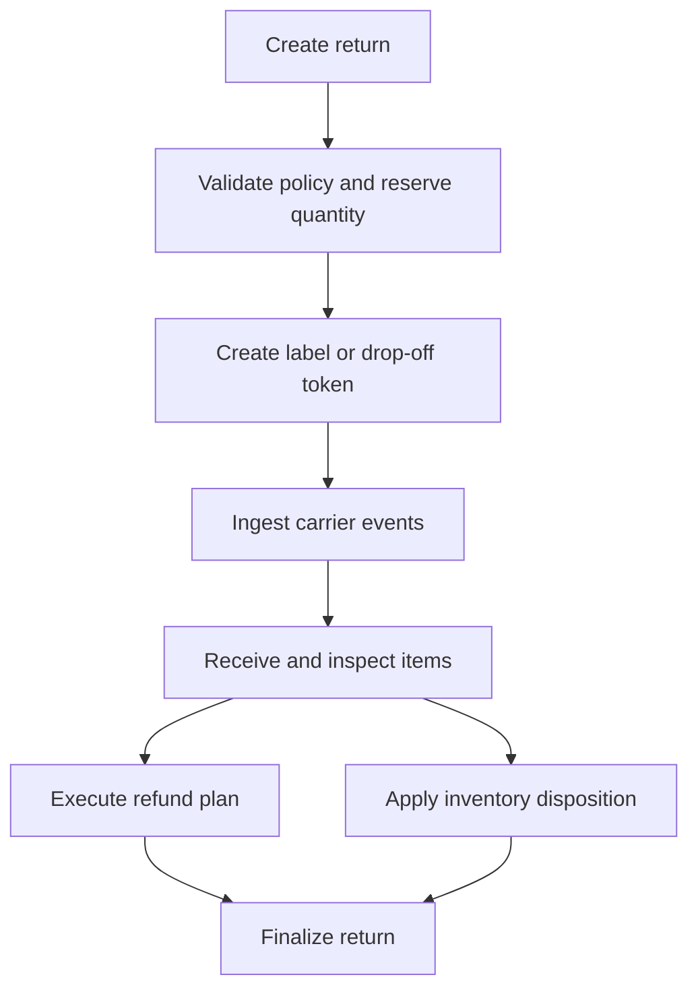
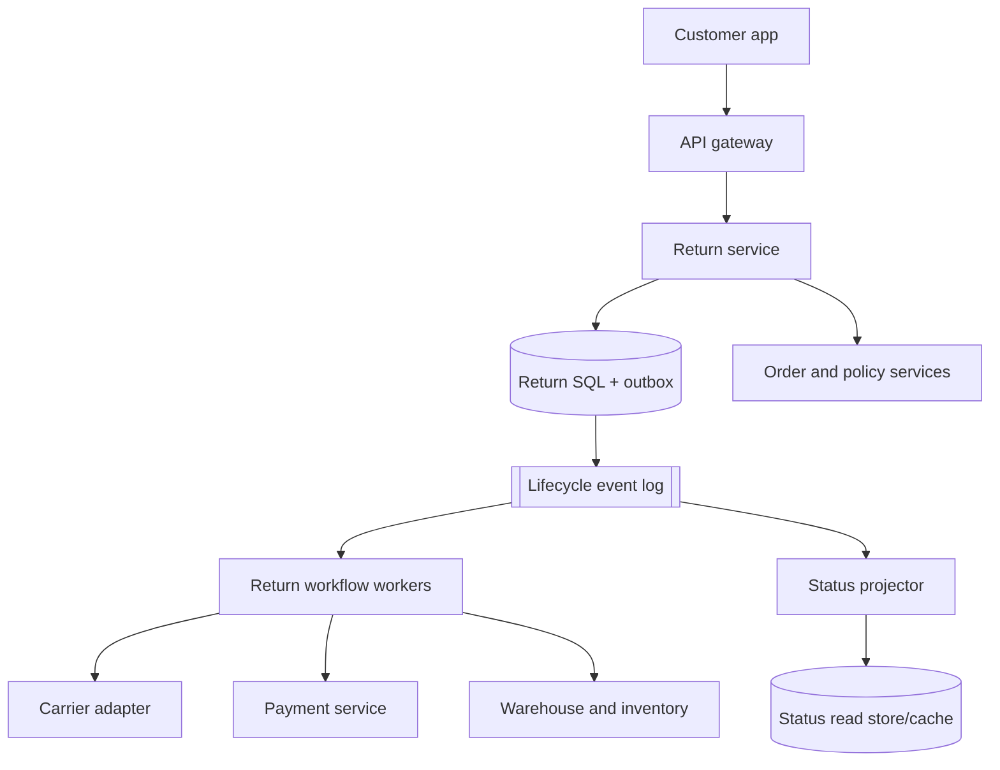
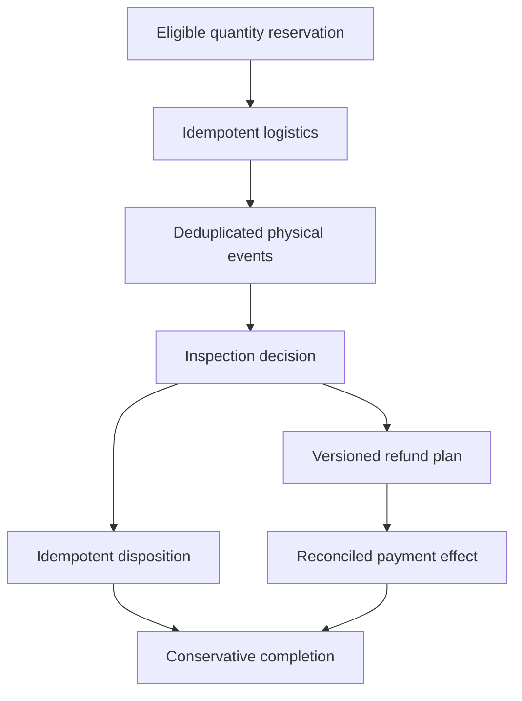

# Design a Global Returns and Refunds Platform

**Difficulty:** Medium  
**Primary themes:** distributed transactions, relational databases, queues, idempotency, consistency, reliability, caching  
**Interview time budget:** approximately 40–45 minutes  
**Educational walkthrough:** intentionally more detailed than the spoken interview answer

## Rotation note

The latest problems focused on malware scanning, privacy deletion, feature flags, inference serving, counters, WebSockets, DNS, sessions, and webhooks. This problem moves into commerce orchestration. Its central challenge is not raw request throughput; it is preserving financial and inventory correctness while carriers, warehouses, payment processors, and notification systems complete at different times and sometimes disagree.

## Framework note

This walkthrough uses Hello Interview’s public [Delivery Framework](https://www.hellointerview.com/learn/system-design/in-a-hurry/delivery): narrow the functional requirements, quantify the most important non-functional requirements, identify entities, sketch interfaces, build a complete baseline requirement by requirement, and then harden it through deep dives. The API and schema sections follow the public guidance to keep interfaces practical and connect the data model to access patterns ([API Design](https://www.hellointerview.com/learn/system-design/core-concepts/api-design), [Data Modeling](https://www.hellointerview.com/learn/system-design/core-concepts/data-modeling)).

The scenario, dialogue, architecture, tradeoffs, and examples below are original.

---

# Interviewer prompt

> Design a global returns and refunds platform for a large e-commerce marketplace. A customer should be able to request a return for eligible order items, receive shipping or drop-off instructions, track the return, and receive the correct refund after the item is accepted. The system must coordinate with order, payment, carrier, warehouse, inventory, seller, and notification systems.

Do not begin by drawing Kafka and microservices. First determine whether refunds happen before inspection, how partial returns work, who owns money, and which state is authoritative.

## Targeted clarifying questions with assumed interviewer answers

### 1. What can be returned?

**Candidate:** “Are returns created for an entire order, an individual item, or a quantity from one line item?”

**Interviewer:** “A request can include quantities from multiple order lines. Partial returns are common, and the same order line may have multiple return requests as long as total returned quantity does not exceed purchased quantity.”

### 2. Who decides eligibility?

**Candidate:** “Does our platform own product and seller return policies?”

**Interviewer:** “It evaluates versioned policy using order date, product category, seller rules, region, return history, and reason. The order service remains the source of purchased items and prices.”

### 3. When is the customer refunded?

**Candidate:** “Do we refund on request, on carrier scan, or after warehouse inspection?”

**Interviewer:** “The policy decides. Low-risk items may get an instant refund, some refund on first carrier acceptance, and high-value or condition-sensitive items refund after warehouse inspection.”

### 4. What logistics options exist?

**Candidate:** “Should we support prepaid labels, QR-code drop-off, pickup, and return-to-store?”

**Interviewer:** “Support prepaid labels and QR-code drop-off in the baseline. The logistics provider returns a label or drop-off token and later sends tracking events.”

### 5. What happens to returned inventory?

**Candidate:** “Does an accepted item always become sellable?”

**Interviewer:** “No. Inspection can classify it as restockable, damaged, refurbishable, counterfeit, or missing. Inventory and seller settlement consequences depend on that disposition.”

### 6. What payment methods are in scope?

**Candidate:** “Can an order have split tender, gift cards, promotions, or store credit?”

**Interviewer:** “Yes. A refund plan allocates money back to original tenders when possible. Promotions and non-refundable shipping can change the amount. The payment service executes refunds; our platform orchestrates them.”

### 7. Can carrier and warehouse events duplicate or arrive out of order?

**Candidate:** “May tracking and inspection events be duplicated, delayed, or reordered?”

**Interviewer:** “Yes. Assume at-least-once partner delivery and occasional reconciliation by batch file.”

### 8. What scale should I design for?

**Candidate:** “What order and return volume should I assume?”

**Interviewer:** “Assume 100 million orders per day at peak season, a 10% eventual return rate, an average of 1.5 items per return, and 10× bursts during holiday return windows or carrier recovery.”

### 9. What latency matters?

**Candidate:** “Does a return request need to synchronously create the shipping label?”

**Interviewer:** “The eligibility decision and request ID should return within two seconds. Label generation may be asynchronous but should normally finish within 30 seconds. Status reads should be under 500 ms.”

### 10. What availability and correctness contract matters most?

**Candidate:** “During a partition, should we accept requests even if we cannot verify remaining quantity or refund history?”

**Interviewer:** “Do not accept a return that could over-return an item or cause an unauthorized refund. It is acceptable to temporarily ask the customer to retry.”

### 11. Can a return be cancelled?

**Candidate:** “Can the customer cancel after creating the request?”

**Interviewer:** “Yes, until the first carrier acceptance or store handoff. Cancellation must not undo a refund that has already been committed without a separately authorized recovery flow.”

### 12. What is out of scope?

**Interviewer:** “Order placement, payment authorization, carrier routing, warehouse robotics, seller payouts, and customer-service tooling beyond basic override APIs.”

### Scope statement to say aloud

> “I’ll design the return lifecycle from eligibility and quantity reservation through logistics, receipt or inspection, refund orchestration, inventory disposition, and status. Existing services own orders, payments, carrier operations, inventory, seller settlement, and notifications.”

---

# 1. Requirements (~5 minutes)

## Core functional requirements

### FR1: Create an eligible return for selected item quantities

The platform validates order ownership and policy, atomically reserves the returnable quantities, computes a preliminary refund quote, and returns a durable return ID.

### FR2: Provide logistics instructions and track the physical return

The system creates a shipping label or drop-off token, ingests duplicate and out-of-order carrier events, and exposes a monotonic customer-facing status.

### FR3: Complete inspection, refund, and disposition reliably

Based on policy and events, the platform triggers the refund at the correct milestone, records financial evidence, and sends an idempotent disposition command to inventory or downstream recovery systems.

## Below the line

- Order checkout and payment authorization
- Carrier network routing
- Warehouse picking or robotics
- Seller payout implementation
- Customer-service user interface
- Fraud-model training
- Exchange orders
- Cross-border customs calculations
- Notification delivery internals

## Quantified non-functional requirements

### NFR1: Financial and quantity correctness

- Total reserved, completed, and pending return quantity for an order line must never exceed purchased quantity.
- A logical refund must never be financially applied twice.
- A return cannot be marked completed until every required refund and disposition step has a durable terminal result.

### NFR2: Scale

- 100 million orders/day at seasonal peak.
- 10% eventual return rate: 10 million returns/day.
- Approximately 1.5 items/return: 15 million return-item records/day.
- Design for 10× bursts, especially after holidays and carrier outages.

### NFR3: Latency

- Create-return API: p99 under two seconds, including synchronous policy evaluation.
- Status reads: p99 under 500 ms.
- Label or QR token: 95% under 30 seconds.
- Internal event-to-status visibility: 99% under one minute.

### NFR4: Availability and durability

- Status and tracking reads: 99.99% availability.
- Mutating APIs: 99.95% availability, favoring correctness over accepting unverifiable returns.
- No accepted return, refund intent, or terminal inspection result may be lost.
- Tolerate availability-zone failure and temporary partner outages.

### NFR5: Auditability and isolation

- Every eligibility, price adjustment, override, refund, and state change must identify its input versions and actor.
- Marketplace sellers can access only their own return details.
- Payment credentials and sensitive customer data remain in owning systems.

## Consistency and availability contract

> “Within a return’s home region, request creation, quantity reservation, and state transitions are strongly consistent. Partner events and internal workflow messages are delivered at least once and deduplicated. Customer-facing projections may be eventually consistent by seconds, but financial refund decisions and completion are validated against authoritative state. During a partition, status remains available from replicas, while a new return may be rejected or delayed if remaining quantity or refund safety cannot be proven.”

More precisely:

- **Return creation:** linearizable for `(order_line_id, quantity reservation)`.
- **Idempotency:** the same client key and body return the same return request.
- **Partner events:** at least once and possibly out of order.
- **Refund execution:** one logical refund intent with idempotent processor calls; physical settlement may be asynchronous.
- **Status:** monotonic customer projection even when raw carrier events arrive out of order.
- **Completion:** conservative; unresolved refund or inventory commands keep the return incomplete.

### What to say aloud

> “I will spend availability where it is safe: status can remain readable and partner work can queue. But if I cannot prove remaining quantity or refund uniqueness, I would rather reject the mutation than over-return or double-refund.”

---

# Scale estimates that change the design

## Return request rate

```text
10,000,000 returns/day ÷ 86,400 ≈ 116 returns/s average
Assume 10× burst ≈ 1,160 return creations/s

15,000,000 return items/day ÷ 86,400 ≈ 174 item rows/s average
10× burst ≈ 1,740 item rows/s
```

The write rate is moderate for partitioned relational storage. Correct transactions and constraints matter more than choosing a write-optimized NoSQL database prematurely.

## Event rate

Assume each return produces:

- 6 carrier events;
- 2 warehouse events;
- 2 payment events;
- 3 internal workflow/audit events.

```text
10 million × 13 ≈ 130 million events/day
≈ 1,500 events/s average
≈ 15,000 events/s burst
```

This justifies a durable partitioned event log and asynchronous materialized status views, but it is not beyond standard streaming infrastructure.

## Storage

Assume:

- return header: 1 KB;
- item, policy, refund plan, and audit metadata: 4 KB average;
- raw partner events: 1 KB × 10 external events.

```text
≈ 15 KB/return × 10 million/day ≈ 150 GB/day
≈ 55 TB/year before indexes, replication, and archival
```

Keep active returns and recent history in partitioned SQL. Archive old partner payloads and completed audit evidence to immutable object storage while retaining queryable summaries.

## Cache decision

Catalog metadata, policy bundles, carrier capabilities, and reason-code mappings are read heavily and change slowly, so regional caches help. Remaining returnable quantity and refund state are correctness-sensitive and must not be decided from an eventually consistent cache.

### What to say aloud

> “The peak create rate is only around 1,200 returns per second, so I’ll choose relational transactions for quantity correctness. The larger workload is roughly 15,000 lifecycle events per second, which I’ll decouple through a log and consume into projections.”

---

# 2. Core entities (~2 minutes)

| Entity | Purpose |
|---|---|
| **ReturnRequest** | Parent lifecycle and customer-visible return |
| **ReturnItem** | Quantity from one order line, reason, eligibility, and disposition |
| **PolicyDecision** | Immutable explanation of eligibility and refund timing |
| **LogisticsLeg** | Label, drop-off token, carrier, and physical tracking state |
| **Inspection** | Warehouse-observed quantity, condition, and evidence |
| **RefundPlan** | Versioned calculation of amount and allocation across tenders |
| **RefundAttempt** | One idempotent execution attempt against the payment service |
| **Disposition** | Restock, refurbish, liquidate, destroy, or investigate command |
| **LifecycleEvent** | Deduplicated raw event and audit record |

Do not duplicate the full Order, Customer, Product, or PaymentInstrument entities. Store stable references and immutable snapshots of the fields required to explain decisions.

### What to say aloud

> “ReturnItem protects quantity, PolicyDecision freezes why the return is allowed and when refunding is permitted, RefundPlan freezes the financial calculation, and LifecycleEvent lets us absorb duplicate and reordered partner updates.”

---

# 3. API or system interface (~5 minutes)

Use REST for customer/product-facing APIs and event or gRPC contracts internally. Customer identity and tenant context come from authentication.

## Create a return

```http
POST /v1/returns
Authorization: Bearer <customer-session>
Idempotency-Key: return-order-9837-attempt-1
Content-Type: application/json

{
  "order_id": "ord_9837",
  "items": [
    {
      "order_line_id": "line_1",
      "quantity": 1,
      "reason_code": "TOO_SMALL"
    },
    {
      "order_line_id": "line_4",
      "quantity": 2,
      "reason_code": "DAMAGED"
    }
  ],
  "logistics_preference": "DROP_OFF"
}
```

```json
{
  "return_id": "ret_01JE7N2X",
  "state": "LOGISTICS_PENDING",
  "items": [
    {
      "order_line_id": "line_1",
      "quantity": 1,
      "eligibility": "APPROVED",
      "refund_timing": "ON_CARRIER_ACCEPTANCE"
    },
    {
      "order_line_id": "line_4",
      "quantity": 2,
      "eligibility": "APPROVED",
      "refund_timing": "AFTER_INSPECTION"
    }
  ],
  "estimated_refund": {
    "currency": "USD",
    "amount": "84.25"
  },
  "status_url": "/v1/returns/ret_01JE7N2X"
}
```

The caller cannot supply `customer_id`, seller identity, currency, prices, or refund amount. These come from authentication and authoritative order/payment snapshots.

If one item is ineligible, the API can either reject the complete request or return per-item decisions. Choose per-item decisions if the product allows a single request to contain an approved subset; the transaction reserves only approved quantities.

## Fetch status

```http
GET /v1/returns/ret_01JE7N2X
```

```json
{
  "return_id": "ret_01JE7N2X",
  "state": "IN_TRANSIT",
  "display_status": "Your return is on the way",
  "tracking": {
    "carrier": "ExampleCarrier",
    "tracking_reference": "trk_7F3",
    "last_event": "ACCEPTED_AT_DROP_OFF",
    "last_event_time": "2026-11-20T14:05:00Z"
  },
  "refunds": [
    {
      "refund_id": "rfd_A1",
      "state": "SUCCEEDED",
      "amount": "24.25",
      "currency": "USD"
    },
    {
      "refund_id": "rfd_A2",
      "state": "WAITING_FOR_INSPECTION",
      "amount": "60.00",
      "currency": "USD"
    }
  ],
  "updated_at": "2026-11-20T14:05:08Z"
}
```

## Cancel a return

```http
POST /v1/returns/ret_01JE7N2X/cancellations
Idempotency-Key: cancel-ret-01JE7N2X
```

This succeeds only if the authoritative workflow state permits cancellation. Model cancellation as a resource because it has an identity, reason, actor, and outcome.

## Internal partner-event contract

```json
{
  "event_id": "carrier:example:evt_8831",
  "event_type": "CARRIER_ACCEPTED",
  "return_id": "ret_01JE7N2X",
  "logistics_leg_id": "leg_01",
  "carrier_sequence": 44,
  "occurred_at": "2026-11-20T14:05:00Z",
  "received_at": "2026-11-20T14:05:07Z",
  "payload_version": 3
}
```

## Refund command

```protobuf
message ExecuteRefund {
  string refund_id = 1;
  string return_id = 2;
  string payment_reference = 3;
  Money amount = 4;
  string destination_type = 5;
  string idempotency_key = 6;
  string refund_plan_hash = 7;
}
```

The payment service returns `PENDING`, `SUCCEEDED`, `FAILED_RETRYABLE`, or `FAILED_TERMINAL`. A timeout is ambiguous and must be reconciled by `refund_id`, not treated as failure.

### Identity from authentication

The edge derives:

- customer or service principal;
- marketplace and region;
- allowed order scope;
- seller or administrator role;
- audit actor.

Authorization verifies that the order belongs to the authenticated customer or permitted operator.

### What to say aloud

> “The API accepts order-line references and quantities, never prices or refund amounts. Identity comes from authentication, order facts come from the order service, and an idempotency key makes client retries safe.”

---

# 4. Data flow



Refund timing may branch earlier: an instant-refund item triggers after B, while a refund-on-scan item triggers after D.

---

# 5. High-level design (~10–15 minutes)

## Compact architecture



## Operation 1: Validate and reserve a return

### Read authoritative inputs

The Return Service requests an immutable order snapshot containing:

- customer and marketplace;
- order-line IDs and purchased quantities;
- unit prices, tax, shipping allocation, discounts, and currency;
- seller and fulfillment channel;
- delivery timestamp;
- payment allocation references.

It reads a versioned policy bundle and risk decision. Slowly changing product category and seller rules may come from a cache, but the policy response includes the source versions used.

### Why quantity reservation needs a transaction

Suppose the customer bought two units and sends two simultaneous requests for two units each. A read-then-write sequence can approve both.

Keep one aggregate row per order line:

```text
return_quantity_ledger
  order_line_id PK
  purchased_quantity
  reserved_quantity
  completed_quantity
  released_quantity
  version
```

In a serializable transaction or conditional update:

```sql
UPDATE return_quantity_ledger
SET reserved_quantity = reserved_quantity + :requested,
    version = version + 1
WHERE order_line_id = :line
  AND purchased_quantity - reserved_quantity - completed_quantity >= :requested;
```

If no row is updated, the quantity is no longer available. This is stronger and cheaper than a distributed lock.

### Creation transaction

For approved items, one transaction:

1. reserves quantities;
2. inserts `ReturnRequest` and `ReturnItem`;
3. stores immutable policy decisions and order-pricing snapshot references;
4. creates a preliminary `RefundPlan`;
5. inserts an outbox event;
6. records the idempotency key and response hash.

The API returns after this transaction. Label generation can fail independently without losing the return.

### Initial schema

```text
return_requests
  return_id PK
  customer_id_hash
  marketplace_id
  home_region
  order_id
  state
  policy_bundle_version
  idempotency_key
  version
  created_at, updated_at

UNIQUE (marketplace_id, customer_id_hash, idempotency_key)
INDEX (order_id, created_at)
INDEX (customer_id_hash, created_at DESC)
INDEX (state, updated_at)

return_items
  return_item_id PK
  return_id
  order_line_id
  seller_id
  requested_quantity
  accepted_quantity
  reason_code
  policy_decision_id
  refund_timing
  disposition_state

INDEX (return_id)
INDEX (order_line_id)
```

## Operation 2: Generate logistics and track the return

### Logistics creation

A workflow worker consumes `ReturnCreated` and selects a carrier product using region, size, seller routing, and policy. It calls the carrier adapter with a stable `logistics_leg_id` as the idempotency key.

The carrier may:

- synchronously return a label/QR token;
- return pending and deliver it later;
- time out after creating it.

On timeout, query by the stable external reference before retrying. Never create a second label blindly.

Store the label itself in encrypted object storage with a short-lived download authorization. SQL stores metadata and object URI.

### Logistics schema

```text
logistics_legs
  logistics_leg_id PK
  return_id
  carrier_id
  carrier_service
  external_reference
  state
  label_uri
  tracking_reference
  carrier_sequence
  last_occurred_at
  created_at, updated_at

UNIQUE (carrier_id, external_reference)
```

### Partner event ingestion

Carrier webhooks arrive through a hardened ingestion endpoint:

1. authenticate signature and source;
2. validate schema;
3. write raw event and inbox key transactionally;
4. acknowledge quickly;
5. publish a normalized event through an outbox.

```text
partner_inbox
  source
  source_event_id
  payload_hash
  received_at
  processing_state
  PRIMARY KEY (source, source_event_id)
```

The primary key handles duplicates. If the same source ID arrives with a different payload hash, quarantine it as a partner-integrity error.

### Out-of-order events

Do not set customer status directly from arrival order. Use:

- carrier-provided sequence when trustworthy;
- event occurrence time plus a transition table;
- monotonic state ranks only for the simplified customer projection;
- raw history preserved for audits.

For example, a delayed `LABEL_CREATED` event must not move `IN_TRANSIT` backward.

Physical reality is not always strictly monotonic—packages can be returned to sender or lost—so model exceptional branches explicitly rather than assigning every event a naive integer.

### Status projection

A stream processor creates a denormalized status document:

```text
return_status
  return_id
  display_state
  last_tracking_summary
  refund_summary[]
  next_expected_action
  updated_at
  projection_offset
```

This can live in a key-value store and a short-TTL cache. It is read-optimized and rebuildable; SQL remains authoritative for mutations.

## Operation 3: Inspect, refund, and dispose

### Warehouse receipt and inspection

The warehouse emits:

- package received;
- item matched to return;
- observed quantity;
- condition grade;
- evidence references;
- suspected counterfeit or wrong item.

Each event has an idempotent inspection ID. The platform compares observed items to expected `ReturnItem` rows. Differences may produce partial acceptance.

### Refund plan

The Refund Calculator uses the immutable order snapshot, accepted quantity, policy, and inspection results. The plan contains line-level arithmetic:

```text
item subtotal returned
+ refundable tax
+ refundable shipping
- promotion clawback
- restocking fee
= customer refund
```

It then allocates the amount across original tenders according to business rules:

```text
refund_plans
  refund_plan_id PK
  return_id
  plan_version
  currency
  total_amount_minor
  calculation_input_hash
  plan_hash
  state
  created_at

refund_allocations
  refund_id PK
  refund_plan_id
  payment_reference
  destination_type
  amount_minor
  state
  processor_reference
```

Use integer minor currency units, never floating point.

### Refund execution

For each allocation:

1. create durable `RefundIntent` before the external call;
2. publish it through an outbox;
3. call Payment Service using `refund_id` as the idempotency key;
4. record the response;
5. if the response is ambiguous, query status by `refund_id`;
6. retry only after reconciliation.

The payment service owns the financial ledger. Our platform owns the orchestration record and must agree with the payment result before completion.

### Inventory disposition

Accepted inspection results generate a stable `disposition_id`:

- `RESTOCK`
- `REFURBISH`
- `LIQUIDATE`
- `DESTROY`
- `INVESTIGATE`

Inventory commands are also at least once and idempotent. A restock event must reference the physical received unit or lot so duplicate messages do not increment stock twice.

### Finalization

The Return Finalizer authoritatively verifies:

- all expected physical items are accepted, rejected, missing, or otherwise resolved;
- every required refund allocation is successful or validly zero;
- every inventory disposition is acknowledged or validly exempt;
- seller settlement adjustment is durably queued if required;
- no cancellation or override race is unresolved.

It transitions to `COMPLETED` using optimistic concurrency and emits a final event.

### What to say aloud

> “I’ll use SQL as the correctness boundary for quantity, workflow state, and refund intent; the event log connects long-running steps. Every external call has a stable business ID, and finalization rechecks authoritative rows rather than trusting counters or message arrival.”

---

# 6. Deep dives (~10–15 minutes)

## Deep dive 1: Preventing over-returns and cancellation races

### Where the baseline breaks

Race examples:

- customer submits the same return from two devices;
- support creates a return while the customer creates one;
- cancellation races with carrier acceptance;
- an expired request releases quantity while a late carrier event arrives;
- two partial returns collectively exceed purchased quantity.

### Options

| Approach | Benefit | Tradeoff |
|---|---|---|
| Distributed lock by order line | Intuitive | Lease expiry and operational complexity |
| Read then insert | Simple | Lost-update race |
| Serializable transaction | Strong and clear | Potential contention/retries |
| Conditional aggregate update | Efficient and strong | Requires a maintained aggregate row |

### Selection

Use a conditional aggregate row inside the same relational shard as return-item creation. Shard or route by `order_id` so lines from one order remain colocated.

### Quantity lifecycle

Track:

- `reserved_quantity`: active approved returns not yet physically resolved;
- `completed_quantity`: items accepted as returned;
- `released_quantity`: reservations cancelled or expired before handoff.

State transitions update the ledger and return item in one transaction:

- create: available → reserved;
- cancel before handoff: reserved → released;
- accepted receipt: reserved → completed;
- rejected after receipt: business rules decide whether quantity stays completed or becomes separately recoverable; do not blindly make it returnable again.

### Cancellation fencing

Cancellation uses compare-and-set:

```sql
UPDATE return_requests
SET state = 'CANCELLED', version = version + 1
WHERE return_id = :id
  AND state IN ('APPROVED', 'LOGISTICS_PENDING', 'LABEL_READY')
  AND version = :expected;
```

Carrier acceptance transitions from those states to `IN_TRANSIT` using the same version discipline. One wins. If the carrier event actually occurred before cancellation but arrived later, policy must define the correction: reopen the return or create an exception, never silently lose the package.

### Expiry

An expiry task releases reserved quantity only if:

- the return is still pre-handoff;
- no accepted carrier/store event exists;
- the workflow version matches;
- the deadline passed.

Late handoff events enter an exception flow and may create a new reservation generation. This is safer than mutating history.

### Observability

Track conditional-update conflicts, duplicate-idempotency hits, quantity invariant violations, late-after-expiry handoffs, cancellation/carrier races, and lines near zero remaining quantity.

### What to say aloud

> “I do not need a distributed lock. A conditional update on the authoritative order-line return ledger and item creation in one transaction makes over-return impossible. Cancellation and handoff race through versioned state transitions, so only one wins.”

## Deep dive 2: Exactly-once financial effect without claiming exactly-once messaging

### Where the baseline breaks

The workflow calls the payment service, the processor applies the refund, and the response is lost. Retrying with a new ID can double-refund; marking failure can leave the customer refunded while our platform says otherwise.

### Options

| Approach | Benefit | Tradeoff |
|---|---|---|
| At-most-once call | Avoids duplicates | Lost response leaves permanent ambiguity |
| Distributed transaction with processor | Theoretical atomicity | External processors do not join our transaction |
| At-least-once call with stable refund ID | Practical | Requires processor idempotency and reconciliation |
| Internal financial ledger only | Strong local record | Does not prove external settlement |

### Selection

Use one durable refund intent, stable idempotency key, and reconciliation.

### Protocol

1. In SQL, create:

```text
refund_id = deterministic(return_id, plan_version, allocation_number)
state = CREATED
amount, currency, destination, plan_hash
```

2. Commit intent and outbox.
3. Worker sends `ExecuteRefund(refund_id, ...)`.
4. Payment Service enforces uniqueness on `refund_id`.
5. If response is `SUCCEEDED`, store processor reference and result event.
6. If timeout occurs, mark `UNKNOWN`, not `FAILED`.
7. Reconciler queries Payment Service by `refund_id`.
8. Only retry execution if Payment Service confirms no such refund, or repeat safely with the same ID.

### Refund-plan versioning

An inspection adjustment may change the amount after a preliminary plan. Never edit an executed plan. Create plan version 2 and:

- execute only the delta;
- or create a separately authorized recovery charge if policy permits;
- link every adjustment to prior plans.

A plan hash prevents a reused `refund_id` from being paired with different money. The payment service should reject the same key with a different amount.

### Split tender

Each allocation has its own refund ID and state. The parent refund is:

- `PENDING` while any allocation is unresolved;
- `PARTIALLY_SUCCEEDED` if some terminally fail;
- `SUCCEEDED` only when all required allocations succeed.

Do not roll back a successful gift-card refund merely because a credit-card refund is delayed. Continue the saga forward and expose partial progress.

### Reconciliation

Daily and continuous reconciliation compares:

- local refund intents;
- payment-service ledger;
- processor settlement reports;
- customer-visible status.

Differences produce repair tasks, not ad hoc database edits.

### What to say aloud

> “Messages may repeat, but the financial effect is logically once because every allocation has one durable refund ID. A timeout becomes UNKNOWN and is reconciled by that ID. I never retry with a new key or mutate an executed refund plan.”

## Deep dive 3: Out-of-order physical events and a trustworthy saga

### Where the baseline breaks

Carriers and warehouses are independent:

- warehouse receipt arrives before delayed carrier scans;
- delivery-to-warehouse is followed by a late “in transit” event;
- a batch reconciliation repeats a month of events;
- two packages belong to one return;
- one package is lost while another arrives;
- an instant refund succeeds before the item is found counterfeit.

A simple linear state machine driven by arrival order produces regressions and incorrect triggers.

### Options

| Approach | Benefit | Tradeoff |
|---|---|---|
| One mutable status field | Simple reads | Loses evidence and mishandles reordering |
| Sort all events by timestamp | Better history | Partner clocks and semantic branches are unreliable |
| Event-sourced aggregate | Full replayability | More operational and modeling complexity |
| Authoritative relational state plus append-only inbox/history | Balanced | Requires explicit transition logic |

### Selection

Use append-only normalized lifecycle events plus authoritative relational aggregates. This gains audit and replay without making every query reconstruct the full history.

### Event processing rules

Each normalized event includes:

- source and source event ID;
- return, leg, item, or refund ID;
- source sequence when available;
- occurred and received timestamps;
- schema version;
- payload hash.

Consumers:

1. deduplicate through the inbox;
2. lock or compare-and-swap the relevant aggregate;
3. validate whether the event is new information;
4. apply a legal transition or record an exception;
5. emit a derived event through an outbox.

### Separate state machines

Do not force everything into one enum. Maintain:

- return-request state;
- each logistics-leg state;
- each return-item inspection state;
- each refund-allocation state;
- each disposition state.

The customer display state is a projection over them. For example:

```text
if refund failed terminally -> ACTION_REQUIRED
else if all required refunds succeeded -> REFUND_COMPLETED
else if any item under inspection -> INSPECTION_IN_PROGRESS
else if any leg in transit -> IN_TRANSIT
else -> AWAITING_DROP_OFF
```

### Saga orchestration

Use an orchestrated saga because refund timing and exception paths require a central view:

- after approval → create logistics;
- after eligible milestone → create refund intent;
- after inspection → update plan and disposition;
- after all obligations → finalize.

The orchestrator stores durable step state. It does not hold a thread open or depend on an in-memory timer.

Compensation is not always “undo.” A refund may be irreversible. Recovery may mean freezing seller settlement, opening an investigation, or issuing a separate charge. State this explicitly.

### Failure recovery

Periodic reconciliation finds:

- workflow states with no scheduled next action;
- carrier legs whose last event is stale;
- received items lacking inspection;
- completed inspection lacking refund intent;
- successful refunds not reflected in status;
- returns whose components are terminal but parent is not.

### Observability

Measure event duplication, reorder distance, source clock skew, saga step age, partner-specific lag, returns stuck by component, and projection rebuild mismatches.

### What to say aloud

> “I’ll preserve raw partner history but keep authoritative component state in relational aggregates. Each component has its own state machine, and the customer status is a projection. The saga moves forward with idempotent steps; it does not pretend every external side effect can be rolled back.”

---

# Reliability and operational details

## Transactional inbox and outbox

- **Inbox:** partner event and dedup key commit together before acknowledgement.
- **Outbox:** state transition and derived event commit together.

Both relays may publish repeatedly; consumers deduplicate. This avoids dual-write gaps without a distributed transaction over SQL and the broker.

## Retry classes

- transient network or 5xx: exponential backoff with jitter;
- partner rate limit: honor retry-after and apply circuit breaking;
- invalid schema: quarantine for operator review;
- terminal business rejection: update state and surface action;
- ambiguous refund: reconcile, never blindly retry.

## Backpressure and fairness

Partition work by home region and workflow ID. Apply per-partner concurrency limits. Separate:

- interactive return creation;
- carrier-event ingestion;
- payment execution;
- bulk reconciliation;
- holiday backfills.

Bulk replays must not starve live refunds.

## Multi-region

Assign every return a home region based on marketplace and order. Keep its transactional state and orchestration there. Replicate status projections globally for reads.

For failover:

- replicate SQL across availability zones synchronously;
- replicate durable logs and backups to an allowed paired region;
- promote with a region epoch/fencing token;
- replay inbox/outbox safely;
- allow duplicate external calls only with stable IDs;
- prevent two active finalizers with epoch validation.

## Caching

Safe to cache:

- versioned policy bundles;
- product-category mappings;
- carrier capabilities;
- reason-code display strings;
- completed status documents for short periods.

Unsafe as the sole authority:

- remaining returnable quantity;
- whether a refund already executed;
- cancellation eligibility;
- final completion.

## Security

- Derive customer, seller, and marketplace from authenticated claims.
- Encrypt label documents and inspection evidence.
- Tokenize payment references.
- Restrict customer-service overrides by role and amount.
- Require reason, actor, and before/after values for overrides.
- Redact customer addresses from logs and events.
- Sign and validate partner webhooks.
- Audit seller and support reads of return evidence.

## Core metrics

- create-return latency and eligibility rejection reasons;
- quantity-conflict rate;
- label-generation latency and partner failures;
- event duplicate and reorder rates;
- time in each physical and financial state;
- refund UNKNOWN age and reconciliation discrepancy value;
- partial-refund count and amount;
- inspection backlog;
- disposition acknowledgement age;
- completed-component/unfinished-parent mismatches;
- returns approaching policy or customer-promise deadlines.

---

# Final design

The final platform contains:

1. An authenticated Return Service that reads authoritative order facts and versioned policy.
2. A relational quantity ledger that atomically prevents over-returns.
3. Immutable policy decisions, order-price snapshots, and versioned refund plans.
4. SQL workflow state with transactional inboxes and outboxes.
5. A durable event log for carrier, warehouse, payment, inventory, and derived lifecycle events.
6. A logistics adapter using stable leg IDs for idempotent label creation.
7. Separate component state machines for logistics, inspection, refund, and disposition.
8. An orchestrated saga that triggers steps at policy-defined milestones.
9. Stable refund IDs and reconciliation to provide one logical financial effect.
10. Idempotent physical inventory disposition commands.
11. A read-optimized status projection and cache for low-latency tracking.
12. Reconcilers that repair missing steps, ambiguous external results, and projection drift.



---

# Requirements check

| Requirement | How the design satisfies it |
|---|---|
| Create partial-item returns | Per-line quantities, policy decisions, atomic quantity ledger |
| Prevent over-return | Conditional update or serializable transaction on order-line aggregate |
| Provide labels and QR tokens | Async logistics saga with stable external reference |
| Track duplicate/out-of-order events | Transactional inbox, append-only history, explicit state machines |
| Refund at policy milestone | Versioned policy and orchestrated saga |
| Prevent duplicate refunds | Durable refund ID, processor idempotency, UNKNOWN reconciliation |
| Handle split tender | Multiple allocations under one immutable refund plan |
| Apply inventory disposition | Stable physical-unit/lot disposition ID |
| 10× seasonal bursts | Event buffering, partner backpressure, separate bulk/live lanes |
| Low-latency status | Denormalized projection and short-TTL cache |
| Correctness during partitions | Mutations fail when quantity/refund safety cannot be proven |
| Auditability | Versioned inputs, lifecycle history, immutable plans, attributed overrides |

---

# Realistic interviewer follow-up questions with strong sample answers

## 1. “Why not use a workflow engine?”

> “A durable workflow engine is a good implementation option for timers, retries, and saga state. The business invariants remain in domain storage: quantity reservation, immutable refund plans, stable refund IDs, and authoritative completion. I would avoid putting all query history or financial evidence only in workflow history.”

## 2. “What if the order service is down?”

> “I cannot safely approve a new return without authoritative order and ownership data unless I have a signed immutable order snapshot with an explicit freshness contract. Status remains available, but return creation should return a retryable error rather than guess.”

## 3. “Could Redis enforce remaining quantity?”

> “Redis can reduce reads but should not be the durable authority. The reservation must share a transaction with ReturnItem creation and survive eviction or failover. A relational conditional update is straightforward at this scale.”

## 4. “What if a carrier sends DELIVERED and then IN_TRANSIT?”

> “Preserve both raw events. The leg aggregate rejects the stale normal transition based on sequence or legal transition rules, so the customer projection does not regress. If the later event represents a real exception, it needs a distinct semantic event such as RETURNED_TO_SENDER.”

## 5. “How do instant refunds change the design?”

> “They change the trigger milestone, not the refund protocol. Policy can emit RefundEligible immediately after reservation. The same durable refund ID and reconciliation apply. The increased loss risk is handled by fraud policy and seller-settlement controls, not weaker idempotency.”

## 6. “How do you refund a promotion?”

> “Freeze the order’s promotion allocation and use versioned business rules. The calculator may prorate a discount or claw it back if the remaining basket no longer qualifies. Store line-level arithmetic and input hashes so support and finance can reproduce the amount.”

## 7. “What happens when one split-tender allocation fails?”

> “Do not reverse successful allocations automatically. Mark the parent partially succeeded, retry or route the failed amount according to policy—possibly store credit—and show partial progress. Final completion waits for an accepted terminal resolution.”

## 8. “How would you partition the database?”

> “Route by order ID or a stable hash of it, keeping an order’s quantity ledger and returns together. Return ID encodes or maps to the home shard. Secondary customer-history views can be built asynchronously because they do not enforce correctness.”

## 9. “Can a customer return an item after cancelling the return?”

> “If a late physical handoff occurs, do not resurrect the cancelled row invisibly. Create an exception or new return generation linked to the original, reserve quantity again if available, and process it under policy. Preserve both decisions in history.”

## 10. “How do you reconcile with finance?”

> “Continuously compare local refund intents with the payment ledger by refund ID, then compare the payment ledger with processor settlement files. Differences create repair cases. Local success alone is insufficient evidence of final settlement.”

## 11. “What if the warehouse receives more items than expected?”

> “Record observed quantity separately. Do not increase the refund automatically. Match units to eligible order lines, create an overage exception, and require policy or support approval before a new refund plan version.”

## 12. “Why use orchestration instead of choreography?”

> “A central orchestrator makes refund timing, cancellation, inspection exceptions, and completion conditions visible. Services still communicate by events, but a pure choreography would scatter the business state machine across carrier, payment, and inventory consumers and make stuck returns hard to explain.”

## 13. “How do you handle a payment timeout?”

> “Set the allocation to UNKNOWN and query the payment service using the same refund ID. Never create a new refund key just because the response was lost.”

## 14. “What would you degrade during a holiday spike?”

> “Preserve creation correctness, carrier-event ingestion, and refunds. Delay noncritical notifications, analytics, seller dashboards, and bulk history rebuilds. Apply per-partner backpressure and communicate longer label-generation estimates, but never relax quantity or refund invariants.”

---

# Common pitfalls

1. **Modeling only one return per order.** Real returns are partial and repeated.
2. **Checking quantity with a read followed by a write.** Concurrent requests can over-return.
3. **Accepting refund amounts from clients.** Money comes from authoritative snapshots and policy.
4. **Claiming exactly-once messaging.** Use at-least-once delivery with stable business IDs.
5. **Retrying an ambiguous payment with a new key.** This can double-refund.
6. **Using one giant return-status enum.** Logistics, inspection, refund, and disposition progress independently.
7. **Applying carrier events in arrival order.** Partner events duplicate and reorder.
8. **Treating every saga step as reversible.** A settled refund may require forward recovery, not rollback.
9. **Trusting status projections for mutations.** They are eventually consistent and rebuildable.
10. **Mutating an executed refund plan.** Create a new version and explicit delta.
11. **Blindly retrying label generation.** A timeout may have created the label already.
12. **Ignoring split tender and promotion allocation.** Refund totals and destinations become wrong.
13. **Restocking on message receipt alone.** Duplicate disposition messages can inflate inventory.
14. **Letting bulk reconciliation starve live events.** Separate capacity and priority lanes.
15. **Deleting raw partner evidence.** You need it for dispute and replay.
16. **Completing when payment succeeded but disposition is unresolved.** Completion must match the declared contract.

---

# Concise 45-minute delivery script

## Minutes 0–5: requirements

> “I’ll focus on partial-item eligibility and quantity reservation, logistics tracking, and reliable refund plus inventory disposition. The key contracts are no over-return and no duplicate financial effect.”

## Minutes 5–7: entities

> “The core entities are ReturnRequest, ReturnItem, PolicyDecision, LogisticsLeg, Inspection, RefundPlan, RefundAttempt, Disposition, and LifecycleEvent.”

## Minutes 7–12: interfaces

> “The create API accepts order-line references, quantities, and reasons—not prices or customer identity. Partner events use stable event IDs, and refunds use stable allocation IDs.”

## Minutes 12–25: high-level design

> “A relational transaction reserves quantity and creates the return. Outboxes feed a durable event log. The saga creates idempotent logistics, consumes deduplicated carrier and warehouse events, executes immutable refund allocations, and sends idempotent inventory dispositions. A projection serves status.”

## Minutes 25–40: deep dives

Lead with:

1. conditional quantity reservation and cancellation races;
2. logical exactly-once refund effect through stable IDs and reconciliation;
3. component state machines for reordered partner events and saga recovery.

## Minutes 40–45: close

> “The design does not rely on exactly-once transport or universal rollback. It relies on durable intent, idempotent external effects, explicit component states, reconciliation, and conservative finalization.”

---

# Closing mental model

Keep four ledgers conceptually separate:

1. **Quantity:** how much may still be returned?
2. **Physical custody:** where is each package or item?
3. **Money:** which refund allocations actually succeeded?
4. **Disposition:** what happened to each returned unit?

The return is complete only when the required entries across all four are durably resolved.
