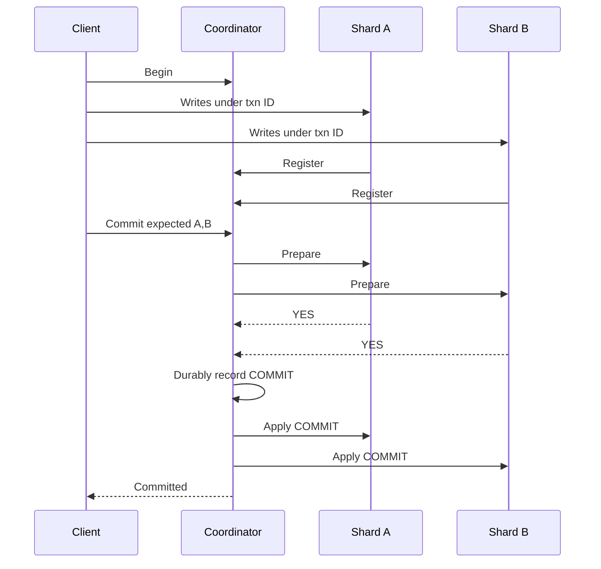
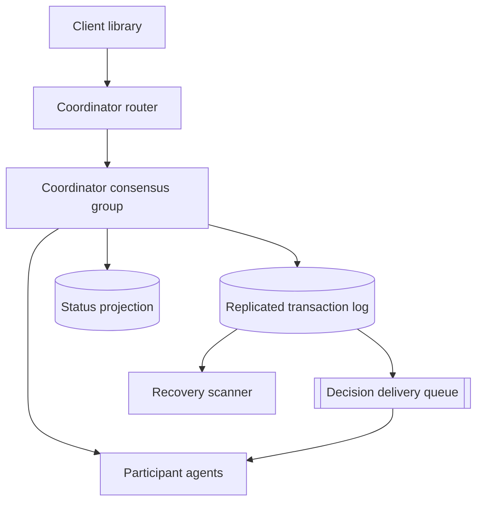
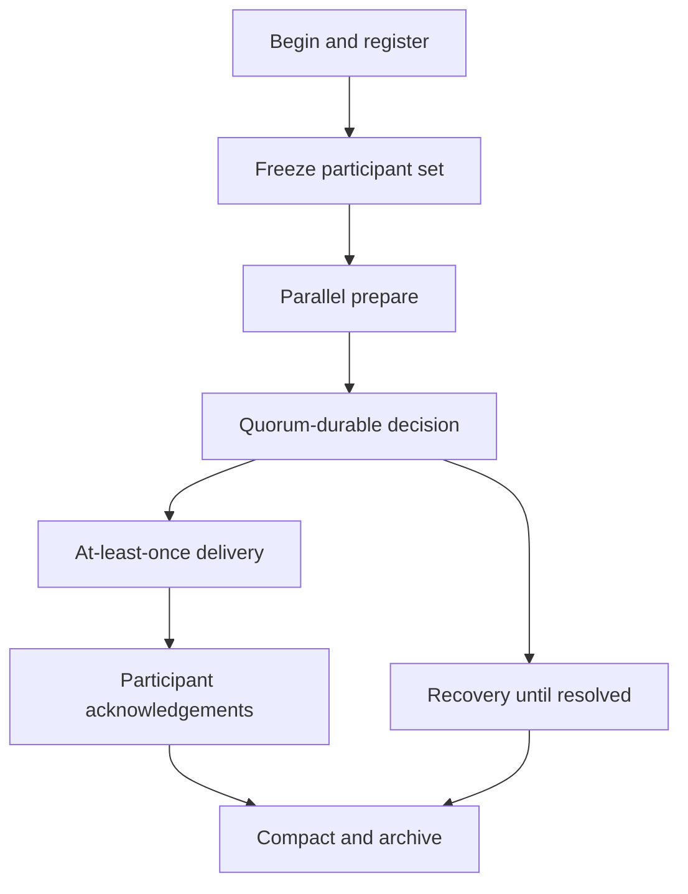

# Design a Multi-Region Distributed Transaction Coordinator

**Difficulty:** Hard  
**Primary themes:** distributed transactions, databases, consensus, queues, reliability, consistency, idempotency, observability  
**Interview time budget:** approximately 40–45 minutes  
**Educational walkthrough:** intentionally more detailed than the spoken interview answer

## Rotation note

The most recent walkthroughs covered returns and refunds, malware scanning, privacy deletion, feature flags, AI inference serving, counters, WebSockets, DNS, sessions, and webhook delivery. Today’s problem moves below the application layer into database infrastructure. The central question is not how to move messages quickly; it is how to make one irreversible decision across several independently failing storage participants without ever allowing some to commit while others abort.

## Framework note

This walkthrough follows Hello Interview’s public [Delivery Framework](https://www.hellointerview.com/learn/system-design/in-a-hurry/delivery): establish a small prioritized requirement set, identify entities and interfaces, construct a complete baseline one operation at a time, and use the remaining interview time to deepen the design around its hardest guarantees. The API and schema discussion also follows the public guidance to keep interfaces reasonable and introduce fields alongside the components and access patterns that require them ([API Design](https://www.hellointerview.com/learn/system-design/core-concepts/api-design), [Data Modeling](https://www.hellointerview.com/learn/system-design/core-concepts/data-modeling)).

The problem, dialogue, architecture, algorithms, and examples below are original.

---

# Interviewer prompt

> Design a distributed transaction coordinator for a global database platform. A client may update records on several database shards, potentially across regions, and needs all updates to commit or all to abort. The coordinator must survive machine and availability-zone failures, handle duplicate and delayed messages, expose transaction status, and recover transactions whose clients disappear.

This problem tests whether the candidate can distinguish atomic commit from message delivery, explain two-phase commit precisely, and evolve a correct single-coordinator design into a scalable recoverable service.

## Targeted clarifying questions with assumed interviewer answers

### 1. What kind of participants are involved?

**Candidate:** “Are participants arbitrary external services or database shards that implement a transaction protocol?”

**Interviewer:** “Database shards managed by our platform. Each shard has a participant agent that can durably prepare, commit, abort, and answer recovery queries.”

This matters because atomic commit cannot be imposed safely on an arbitrary API that lacks durable prepare semantics.

### 2. Does the coordinator execute application reads and writes?

**Candidate:** “Does the coordinator proxy statements, or does it only decide the final outcome?”

**Interviewer:** “Clients send reads and writes directly to shards under a transaction ID. The coordinator tracks participants and decides commit or abort.”

### 3. What isolation level is required?

**Candidate:** “Must the coordinator provide serializability across transactions?”

**Interviewer:** “No. Shards provide local serializable execution and conflict detection. The coordinator provides atomic commit across shards. Global serializability would require an additional concurrency-control or timestamp layer.”

This is an important scope boundary: atomicity and isolation are separate properties.

### 4. Can participants be discovered automatically?

**Candidate:** “Does the client register each shard, or may a shard enlist itself?”

**Interviewer:** “Support participant self-registration using the transaction ID and coordinator epoch. Commit must freeze the participant set before voting begins.”

### 5. What happens if the client times out during commit?

**Candidate:** “May the client retry, and does timeout mean abort?”

**Interviewer:** “The client may retry with the same transaction ID or idempotency key. A timeout means the outcome is unknown until status is queried.”

### 6. May the system sacrifice availability during a partition?

**Candidate:** “If the coordinator cannot reach a quorum or every prepared participant, should it guess an outcome to stay available?”

**Interviewer:** “No. Atomicity is non-negotiable. It may delay progress rather than risk split outcomes.”

### 7. How long can transactions remain open?

**Candidate:** “Are these sub-second OLTP transactions or long-running business workflows?”

**Interviewer:** “OLTP only. Default lease is 15 seconds, maximum 60 seconds. Long-running business processes should use sagas, not hold database locks.”

### 8. What scale should I design for?

**Candidate:** “What transaction rate and participant count should I assume?”

**Interviewer:** “Design for 200,000 distributed transaction starts per second globally, 100,000 commit attempts per second, two to eight participants per transaction, and 5× regional bursts.”

### 9. What latency is acceptable?

**Candidate:** “What is the expected commit latency?”

**Interviewer:** “For participants in one region, p99 commit under 150 ms. For cross-region participants, p99 under 700 ms, excluding an unavailable participant.”

### 10. What failures must be tolerated?

**Candidate:** “Should we survive process, machine, zone, and region failures?”

**Interviewer:** “Survive coordinator process, machine, and zone loss without losing decisions. A complete region failure may pause transactions homed there; status and recovery should fail over to a paired region without producing two active coordinators.”

### 11. Can prepared transactions block?

**Candidate:** “Is temporary blocking acceptable if a participant has voted yes and cannot learn the decision?”

**Interviewer:** “Temporarily, yes. Minimize it with a replicated decision log and recovery protocol. Never unilaterally abort a participant after it has prepared unless the protocol proves no commit decision exists.”

### 12. What is out of scope?

**Interviewer:** “Query planning, cross-shard deadlock detection, global serializable timestamps, application sagas, and arbitrary third-party systems.”

### Scope statement to say aloud

> “I’ll design atomic commit for short database transactions over cooperative shard participants. Shards own reads, writes, locking, and local isolation. The coordinator owns participant membership, one durable commit-or-abort decision, decision delivery, status, expiry before prepare, and recovery after failures.”

---

# 1. Requirements (~5 minutes)

## Core functional requirements

### FR1: Begin a transaction and enlist participants

The client begins a transaction, obtains a globally unique transaction ID and coordinator epoch, and executes operations directly on shards. Each touched shard durably registers as a participant before commit can freeze membership.

### FR2: Atomically commit or abort across all participants

Commit succeeds only if every frozen participant durably prepares. The coordinator records exactly one durable global decision and eventually delivers it to every participant. Any no vote before the decision forces abort.

### FR3: Query and recover an uncertain transaction

Clients and participants can retrieve authoritative status. If a coordinator, client, or network path fails, another coordinator replica can resume from durable state without changing a recorded decision.

## Below the line

- Executing SQL statements or routing application reads and writes
- Global serializable ordering or timestamp allocation
- Cross-shard deadlock detection
- Long-running sagas and compensating business actions
- Arbitrary external payment, email, or shipping APIs
- Schema migration
- Participant storage-engine implementation beyond its transaction-agent contract

## Quantified non-functional requirements

### NFR1: Atomicity and decision uniqueness

- A transaction has at most one terminal global decision: `COMMIT` or `ABORT`.
- No participant may durably commit unless the coordinator has a durable commit decision.
- If commit is decided, every prepared participant must eventually learn commit.
- Duplicate requests and messages must not change the outcome.

### NFR2: Scale

- 200,000 transaction starts/second globally.
- 100,000 commit attempts/second globally.
- Two to eight participants, with an assumed average of three.
- 5× regional bursts.
- Millions of concurrently open transactions because leases overlap.

### NFR3: Latency

- Begin transaction: p99 below 30 ms in the home region.
- Same-region commit: p99 below 150 ms when all participants are healthy.
- Cross-region commit: p99 below 700 ms when all participants are healthy.
- Status lookup: p99 below 100 ms in the home region.

### NFR4: Availability and durability

- 99.99% API availability outside partitions that prevent safe decisions.
- Survive one availability-zone loss without losing an accepted transaction or decision.
- Acknowledged decisions must survive coordinator restarts and failover.
- Prefer blocking or an explicit unknown result over violating atomicity.

### NFR5: Bounded resource use and observability

- Open transactions expire before prepare after at most 60 seconds.
- Prepared transactions trigger urgent recovery and age alerts.
- Every vote, decision, delivery acknowledgement, epoch change, and operator action is auditable.

## Consistency and availability contract

The authoritative transaction record is linearizable within its coordinator shard:

- participant membership becomes immutable when commit enters `PREPARING`;
- only one decision can be appended for a transaction;
- coordinator leadership uses a monotonically increasing epoch and fencing;
- participant RPCs are at least once and idempotent;
- status replicas may lag for nonterminal transactions, but terminal status served to recovery callers must come from the authoritative coordinator group or a quorum-confirmed snapshot;
- during a partition without quorum, the system does not make a new decision.

Atomic commit has an unavoidable liveness tradeoff. If a participant is durably prepared but cannot discover the decision, it must retain locks and wait. Replication reduces how often this happens; it does not make the impossibility disappear.

### What to say aloud

> “The primary contract is safety over availability. I can retry messages and fail over coordinators, but I cannot let a partition create two decisions. A transaction that has not prepared can expire and abort. Once a participant is prepared, it waits for authoritative recovery rather than guessing.”

---

# Scale estimates that change design decisions

## Coordinator traffic

Assume 100,000 commit attempts/second and three participants on average.

```text
Prepare RPCs: 100,000 × 3 = 300,000/s
Decision RPCs: 100,000 × 3 = 300,000/s
Total participant RPCs ≈ 600,000/s average
5× regional burst can create several million RPCs/s globally
```

This rules out one global coordinator process or one database leader. It does not require one coordinator per transaction; transactions can be hash-partitioned across many replicated coordinator groups.

## Durable log volume

Assume a compact record contains:

- transaction header and decision: 400 bytes;
- participant membership and vote evidence: 250 bytes per participant;
- delivery acknowledgement and audit metadata: 150 bytes per participant.

With three participants:

```text
400 + 3 × (250 + 150) ≈ 1.6 KB/transaction
100,000 terminal transactions/s × 1.6 KB ≈ 160 MB/s
≈ 13.8 TB/day before replication and indexes
```

Keep active state in a replicated log-backed key-value or relational store, compact terminal transactions after a retention period, and archive audit records to object storage. The arithmetic also motivates batched log appends and compact participant bitmaps or arrays.

## Concurrent open transactions

If starts peak at 200,000/s and the average open duration is five seconds:

```text
200,000 × 5 = 1,000,000 open transactions globally
```

At the 60-second maximum, a pathological client population could create 12 million open transactions. Leases, admission control, per-tenant limits, and an efficient timing wheel are concrete requirements, not cleanup polish.

## Latency implication

Two-phase commit needs at least:

1. one prepare round trip to the slowest participant;
2. a durable coordinator decision;
3. one decision-delivery round trip if the API waits for acknowledgements.

Cross-region latency is therefore dominated by network geography. No cache removes these causal round trips.

### What to say aloud

> “The service is write-heavy but naturally partitionable by transaction ID. At 100,000 commits per second and three participants, the coordinator drives roughly 600,000 participant RPCs per second. I’ll use many consensus-replicated coordinator shards, batched log appends, and bounded transaction leases.”

---

# 2. Core entities (~2 minutes)

| Entity | Purpose |
|---|---|
| **Transaction** | Identity, tenant, home shard, lease, phase, and terminal decision |
| **Participant** | Shard identity, registration generation, prepare token, vote, and acknowledgement |
| **CoordinatorEpoch** | Fences an old leader after failover |
| **DecisionRecord** | Immutable commit or abort decision with participant-set hash |
| **ProtocolMessage** | Deduplicated prepare, decision, and acknowledgement message |
| **RecoveryTask** | Durable retry or investigation for an unresolved transaction |

The `DecisionRecord` is the most important entity. A transaction is not committed because an API handler returned success or because every participant once said yes. It is committed only when an authorized coordinator epoch durably records `COMMIT` for the frozen participant set.

### What to say aloud

> “I need a Transaction, its frozen Participant set, a fencing Epoch, and one immutable DecisionRecord. Protocol messages may repeat, so votes and acknowledgements are state attached to stable participant identities rather than append-only assumptions about delivery.”

---

# 3. API or system interface (~5 minutes)

Use a client library over gRPC for low latency and typed internal contracts. A REST administrative surface can wrap the same operations. Tenant identity, permissions, and quotas come from mutual TLS and the authenticated service principal, not request fields.

## Begin a transaction

```protobuf
rpc BeginTransaction(BeginTransactionRequest) returns (BeginTransactionResponse);

message BeginTransactionRequest {
  string idempotency_key = 1;
  int32 requested_lease_ms = 2;
}

message BeginTransactionResponse {
  string transaction_id = 1;
  string coordinator_endpoint = 2;
  uint64 coordinator_epoch = 3;
  int64 lease_expires_at_unix_ms = 4;
}
```

The authenticated tenant is excluded from the body. The server bounds the requested lease to 60 seconds and maps the transaction ID to a coordinator shard.

## Enlist a participant

The shard participant agent calls:

```protobuf
rpc RegisterParticipant(RegisterParticipantRequest)
    returns (RegisterParticipantResponse);

message RegisterParticipantRequest {
  string transaction_id = 1;
  uint64 coordinator_epoch = 2;
  string participant_id = 3;
  string participant_endpoint = 4;
  string write_set_digest = 5;
}
```

Registration is idempotent on `(transaction_id, participant_id)`. The same participant with a different write-set digest is a protocol error. Registration is rejected once membership is frozen.

## Commit

```protobuf
rpc Commit(CommitRequest) returns (CommitResponse);

message CommitRequest {
  string transaction_id = 1;
  string idempotency_key = 2;
  repeated string expected_participant_ids = 3;
}

message CommitResponse {
  enum Result {
    COMMITTED = 0;
    ABORTED = 1;
    IN_PROGRESS = 2;
    UNKNOWN = 3;
  }
  Result result = 1;
  string status_token = 2;
}
```

Why include `expected_participant_ids` if shards self-register? It lets the client detect a lost registration before the participant set freezes. The coordinator compares the expected set with its durable registered set.

`UNKNOWN` means the client could not obtain an authoritative answer, not that the system is free to retry under a new transaction ID.

## Abort

```protobuf
rpc Abort(AbortRequest) returns (AbortResponse);
```

Abort is guaranteed only before a commit decision exists. If `COMMIT` is already durable, abort returns `ALREADY_COMMITTED`.

## Get authoritative status

```http
GET /v1/transactions/txn_01JF2Z7C
Authorization: Bearer <service-identity>
```

```json
{
  "transaction_id": "txn_01JF2Z7C",
  "phase": "DECIDED",
  "decision": "COMMIT",
  "coordinator_epoch": 42,
  "participants": [
    {"id": "shard-us-17", "vote": "YES", "decision_ack": true},
    {"id": "shard-eu-08", "vote": "YES", "decision_ack": false}
  ],
  "decided_at": "2026-11-21T07:04:31Z"
}
```

## Participant protocol

```protobuf
rpc Prepare(PrepareRequest) returns (PrepareResponse);
rpc ApplyDecision(ApplyDecisionRequest) returns (ApplyDecisionResponse);
rpc RecoverDecision(RecoverDecisionRequest) returns (RecoverDecisionResponse);

message PrepareRequest {
  string transaction_id = 1;
  uint64 coordinator_epoch = 2;
  string participant_set_hash = 3;
}

message PrepareResponse {
  enum Vote { YES = 0; NO = 1; }
  Vote vote = 1;
  string durable_prepare_token = 2;
}

message ApplyDecisionRequest {
  string transaction_id = 1;
  uint64 coordinator_epoch = 2;
  string decision_record_hash = 3;
  string decision = 4;
}
```

The participant persists `YES` and its prepare token before replying. `ApplyDecision` is idempotent: repeated commit remains commit; an opposite decision is rejected and alerted.

### Identity from authentication

The edge or mTLS certificate supplies:

- tenant and service principal;
- allowed database and shard scope;
- regional routing policy;
- quota class;
- audit actor.

The client cannot select a coordinator epoch, impersonate another participant, or bypass its tenant’s transaction limits.

### What to say aloud

> “The client begins and commits, while each touched shard self-registers. Commit carries the expected participant set as a completeness check. Every mutating method is idempotent, and a timeout returns unknown rather than inventing an abort.”

---

# 4. Data flow



If either participant votes no, or fails before it can durably vote yes within policy, the coordinator records `ABORT` and delivers abort to all participants.

---

# 5. High-level design (~10–15 minutes)

## Compact architecture



## Operation 1: Begin and enlist participants

### Route to a home coordinator group

`BeginTransaction` creates a time-sortable random transaction ID containing or mapping to:

- tenant partition;
- home region;
- coordinator shard.

The router uses consistent hashing plus a shard map. A coordinator shard is not one machine; it is a three- or five-replica consensus group spread across availability zones. One leader serializes state changes and appends them to the replicated log.

The begin record contains:

```text
transactions
  transaction_id PK
  tenant_id
  home_region
  coordinator_shard
  coordinator_epoch
  phase              // OPEN, PREPARING, DECIDED, COMPLETE
  decision           // null, COMMIT, ABORT
  participant_set_hash
  lease_expires_at
  version
  created_at, decided_at
```

The begin API returns after the record is quorum committed. A client retry with the same tenant-scoped idempotency key returns the same transaction.

### Participant registration

When a shard receives the first write for a transaction, its participant agent:

1. creates local provisional transaction state;
2. calls `RegisterParticipant` using a stable participant ID;
3. waits for registration acknowledgement before acknowledging the first write to the client, or records a durable intent to retry registration;
4. includes the coordinator endpoint and epoch in local metadata.

Coordinator storage adds:

```text
participants
  transaction_id
  participant_id
  endpoint
  write_set_digest
  registration_generation
  vote
  durable_prepare_token
  decision_ack
  last_rpc_at
  PRIMARY KEY (transaction_id, participant_id)
```

Registration and transaction-version update occur in one replicated state-machine command. Duplicate registration is harmless.

## Operation 2: Run the baseline two-phase commit protocol

### Phase 1: Freeze and prepare

When `Commit` arrives, the leader verifies:

- transaction is `OPEN` and the lease has not expired;
- authenticated tenant owns it;
- registered participants equal the expected participant set;
- no prior abort request or protocol violation exists.

It then atomically changes the phase to `PREPARING` and stores the participant-set hash. Membership is frozen.

The coordinator sends `Prepare` to all participants in parallel. Each participant uses local serializable concurrency control to determine whether it can commit. Before replying `YES`, it must durably record:

- transaction ID;
- coordinator epoch and participant-set hash;
- redo/undo information or prepared storage-engine transaction;
- local locks or equivalent conflict protection;
- durable prepare token.

If it cannot prepare, it durably aborts locally and votes `NO`.

### Phase 2: Decide and distribute

The coordinator applies this rule:

```text
all frozen participants voted YES -> COMMIT
any participant voted NO          -> ABORT
deadline before all YES           -> ABORT only if no participant-safety rule is violated
```

The timeout wording needs precision. During ordinary phase one, lack of a yes vote can lead to abort because no commit decision has been made. Participants that did vote yes are prepared and can safely receive the eventual abort decision. The coordinator must first durably record that abort.

The leader proposes a `DecisionRecord` to its consensus group:

```text
decision_records
  transaction_id PK
  decision
  coordinator_epoch
  participant_set_hash
  vote_evidence_hash
  decided_at
  log_index
```

Only after the decision reaches quorum may the coordinator tell participants or the client that it committed. The decision is immutable.

Decision delivery is asynchronous and at least once. Each acknowledgement updates participant state. Depending on the product contract, the client can receive:

- `COMMITTED` after the commit decision is durable, even if some acknowledgements are pending; or
- `COMMITTED` only after all participants acknowledge.

Choose the first for lower latency and define that the platform guarantees eventual application. The status response exposes pending acknowledgements.

### Why the queue is not the source of truth

The durable coordinator log is authoritative. The decision-delivery queue is a retry mechanism. If an event is lost, the recovery scanner recreates delivery work from transactions whose decision is durable but whose acknowledgements are incomplete.

## Operation 3: Abort and expiry

### Explicit abort

For an `OPEN` transaction, the coordinator freezes the current participant set, durably records `ABORT`, and distributes it. For `PREPARING`, abort may be selected if commit has not been recorded. For a durable `COMMIT`, abort is rejected.

### Lease expiry

A hashed timing wheel indexes open transaction deadlines without scanning millions of rows every second. On expiry, a worker submits an idempotent `Expire(transaction_id, expected_version)` command to the coordinator group.

If the transaction is still `OPEN`, it records abort. If it is `PREPARING`, the coordinator completes the protocol based on votes and its prepare deadline. If it is already decided, expiry does nothing.

The lease prevents abandoned pre-prepare transactions from consuming participant resources indefinitely. It is not permission for a prepared participant to abort itself.

## Operation 4: Query status and recover

### Client recovery

If commit times out, the client calls `GetStatus` with the same transaction ID. It does not start a replacement transaction unless the application can tolerate duplicate business effects.

### Participant recovery

After restart, a participant scans its local prepared records. For each unresolved record it calls `RecoverDecision` on the transaction’s coordinator group.

- Durable `COMMIT`: apply commit idempotently.
- Durable `ABORT`: roll back idempotently.
- `PREPARING` with no decision: keep prepared and retry.
- Unknown transaction: do not guess if local state is prepared; escalate to coordinator-log recovery and operator alarms.

### Coordinator failover

A new leader replays the consensus log. It never recomputes a terminal decision. It resumes:

- outstanding prepare requests for `PREPARING` transactions;
- decision deliveries for decided transactions;
- expiry scheduling for open transactions.

Every outbound request carries the new coordinator epoch. Participant agents reject commands from lower epochs.

### What to say aloud

> “The baseline is two-phase commit backed by a consensus-replicated coordinator log. Prepare makes each participant promise it can later honor either decision. Then the coordinator records one immutable decision before exposing it. Queues accelerate retries, but recovery always derives from durable transaction state.”

---

# 6. Deep dives (~10–15 minutes)

## Deep dive 1: Surviving coordinator failure without two decisions

### Where the baseline breaks

A single coordinator can fail at the worst moments:

- after collecting all yes votes but before recording commit;
- after recording commit but before replying to the client;
- after telling one participant commit but before telling another;
- during failover while the old leader is merely slow, not dead.

Persisting to one machine is insufficient. Electing a new coordinator without fencing can create two active leaders.

### Plausible approaches

| Approach | Benefit | Failure or tradeoff |
|---|---|---|
| Single coordinator with local WAL | Simple | Machine loss can lose the only decision |
| Active-passive database replica | Familiar | Promotion and stale-primary fencing are subtle |
| Store decision in every participant | Distributed evidence | Participants can disagree before a global decision exists |
| Consensus-replicated coordinator state machine | One ordered durable history | Extra quorum latency and operational complexity |

### Selection

Use a consensus group per coordinator shard. The leader proposes membership freeze, votes, and decision transitions to one ordered replicated log. A majority quorum is required for a new decision.

### Safety invariants

1. `decision` changes from null to one terminal value at most once.
2. `COMMIT` is valid only if the frozen participant set has durable yes-vote evidence.
3. Participant membership cannot change after `PREPARING` begins.
4. A leader may act only under the current committed epoch.
5. A participant accepts a decision only if its transaction ID, participant-set hash, and epoch are valid.

The state machine enforces these invariants, not application convention.

### Fencing old leaders

Consensus prevents an old leader from committing new log entries, but it may still send delayed RPCs. Include a monotonically increasing `coordinator_epoch` in protocol messages. Participants persist the highest epoch observed and reject lower epochs.

Epoch alone does not authorize an arbitrary decision. The message also carries a decision-record hash or verifiable log proof/reference. In a tightly managed platform, the participant can query the coordinator quorum if a decision conflicts with local evidence.

### Region failover

Keep the active consensus group within a region for normal latency, spread across three zones, and asynchronously replicate log segments to a paired region. Region promotion requires:

- proof the old region is fenced through an external region-lease authority or operator-controlled failover;
- recovery to a known durable log index;
- a higher region epoch;
- participant routing updates.

If the system cannot prove the old coordinator is fenced or cannot recover the latest decision log, it pauses. This is the correct consistency choice.

### What to say aloud

> “Consensus gives every coordinator shard one durable ordered history. The new leader replays decisions rather than recalculating them, and epochs fence delayed RPCs from old leaders. If regional failover cannot prove fencing and decision-log continuity, it blocks instead of risking two coordinators.”

## Deep dive 2: Scaling the coordinator without creating a global bottleneck

### Where the baseline breaks

One consensus group handling 100,000 commits per second must replicate every begin, registration, vote, decision, and acknowledgement. It becomes CPU, network, and log-I/O bound. A globally synchronous group also adds cross-ocean latency to every local transaction.

### Plausible approaches

| Approach | Benefit | Tradeoff |
|---|---|---|
| One global consensus group | Simple global truth | Severe throughput and latency bottleneck |
| Coordinator per transaction | Isolation | Too many processes and elections |
| Stateless coordinators over one database | Easy scaling of RPC layer | Database leader remains bottleneck |
| Many transaction-hash consensus groups | Parallelism and locality | Requires routing and shard rebalancing |

### Selection

Hash transactions across many regional coordinator groups. Each group owns thousands or millions of active transactions and contains several replicas. There is no need for a total order across unrelated transactions.

### Partitioning

Use:

```text
home_region = policy(tenant, participant locality)
coordinator_shard = hash(transaction_id) mod virtual_shard_count
```

Virtual shards let operators move ranges between consensus groups gradually. The transaction ID or routing directory preserves the original owner throughout a transaction; an active transaction is not moved mid-protocol.

### Batching and write amplification

Batch independent state-machine commands into one log append and one fsync. Coalesce repeated acknowledgements. Keep verbose protocol payloads in an append-only audit stream while the consensus state contains compact hashes and current state.

Do not acknowledge a commit decision merely because it entered an in-memory batch. It must be quorum durable.

### RPC fan-out

The coordinator sends prepares in parallel, using connection pools per participant shard. Apply:

- tenant concurrency limits;
- participant-specific circuit breakers;
- bounded retry queues;
- jittered backoff;
- deadline propagation;
- separate lanes for prepares, decisions, and background cleanup.

Decision delivery deserves higher priority than new prepares because prepared transactions hold locks.

### Hot tenants and hot participants

Hashing spreads transaction coordinators but cannot spread one hot database shard. The participant protects itself with admission control and returns retryable overload before durable prepare. Once it votes yes, recovery messages must bypass ordinary traffic limits.

Per-tenant token buckets prevent one tenant from consuming all open-transaction slots or recovery bandwidth.

### Caching

Safe to cache:

- routing maps with version numbers;
- tenant quotas and regional policy;
- terminal status for ordinary user interfaces after immutable decision;
- participant endpoint metadata.

Unsafe to derive from cache:

- current participant membership;
- whether all votes are yes;
- whether a decision exists;
- current coordinator epoch for mutation authorization.

### What to say aloud

> “Transactions are independent, so I do not need one global order. I’ll hash them across many regional consensus groups and batch log writes. Decision delivery gets priority because it releases prepared locks; bulk audit export and cleanup can lag.”

## Deep dive 3: Duplicate messages, uncertain outcomes, and participant recovery

### Where the baseline breaks

Networks create ambiguity:

- the prepare response is lost after a participant durably voted yes;
- commit delivery succeeds but its acknowledgement is lost;
- a client retries commit on a different frontend;
- a participant restarts with a prepared transaction;
- delayed abort from an old epoch arrives after commit.

Trying to make the transport exactly once is the wrong abstraction.

### Idempotent participant state machine

Each participant maintains:

```text
local_transactions
  transaction_id PK
  coordinator_group
  highest_epoch
  participant_set_hash
  local_state       // ACTIVE, PREPARED, COMMITTED, ABORTED
  prepare_token
  decision_hash
  updated_at
```

Legal transitions are monotonic:

```text
ACTIVE -> PREPARED -> COMMITTED
ACTIVE -> ABORTED
PREPARED -> ABORTED
```

`COMMITTED` and `ABORTED` are terminal. A repeated same decision returns success. An opposite decision is a critical invariant violation.

### Uncertain client outcome

If the client loses the `Commit` response, it retries the same transaction or queries status. It must not infer abort from a timeout. This mirrors payment idempotency: retry the same logical operation, not a new one.

The coordinator stores the commit idempotency key and request fingerprint. Reusing the key with a different expected participant set is rejected.

### Presumed abort and presumed commit

An optimization may omit durable abort records for transactions that never prepared, allowing missing state to imply abort. This is **presumed abort**. It reduces log and cleanup cost, but only when recovery rules can prove no participant prepared under a possible commit decision.

Presumed commit optimizes the opposite case but makes missing information mean commit and requires durable participant membership. It is less intuitive for this workload, where abandoned transactions are common.

Use explicit durable decisions in the baseline. Mention presumed abort only as a later optimization with a carefully specified recovery proof. Never say “not found means abort” for a participant already known to be prepared.

### Heuristic decisions

Some transaction systems allow an operator or participant to heuristically abort a long-blocked prepared transaction. That restores availability but can violate atomicity if commit exists elsewhere. For this design:

- disable automatic heuristic decisions;
- page operators on age thresholds;
- recover coordinator logs and quorum state;
- if an emergency heuristic action is permitted, mark the transaction `HEURISTIC_HAZARD`, retain evidence permanently, and require reconciliation.

### Recovery and reconciliation

Run two complementary scanners:

1. **Coordinator scanner:** finds `PREPARING` transactions past deadline and decided transactions missing acknowledgements.
2. **Participant scanner:** finds local `PREPARED` records without a terminal decision.

Cross-check counts and hashes. A prepared record with no known coordinator owner is a highest-severity event.

### Observability

Track:

- transaction starts, commits, aborts, and unknown client outcomes;
- prepare latency by participant and region;
- coordinator quorum append latency;
- open, preparing, and prepared transaction age histograms;
- duplicate RPC rates and conflicting request fingerprints;
- decision-delivery backlog and oldest unacknowledged commit;
- epoch changes and fenced old-leader requests;
- participant-set mismatches;
- recovery query success and heuristic hazards;
- locks and bytes retained by prepared transactions.

Use trace IDs equal to or derived from transaction IDs, but control high-cardinality metric labels.

### What to say aloud

> “I assume every RPC can repeat. Participant transitions are monotonic and keyed by transaction ID, while terminal decisions are immutable. A client timeout is unknown, and a prepared participant recovers from the authoritative coordinator—it never treats silence as permission to abort.”

---

# Reliability and operational details

## Deadlines and retries

- Client deadline controls how long the caller waits, not whether the transaction exists.
- Protocol deadlines are stored durably and survive leader changes.
- Prepare retries use the same transaction ID, epoch, set hash, and request fingerprint.
- Decision retries continue until acknowledgement or retention policy transfers responsibility to archival recovery.
- Retry queues are bounded; overflow becomes durable scan work rather than memory growth.

## Backpressure

Reject new begins before admitting more transactions than the coordinator can expire and recover. Once a transaction is prepared or decided, its recovery traffic is protected from ordinary admission control.

Separate resource pools for:

- interactive begin/register/commit;
- prepare fan-out;
- decision delivery;
- participant recovery queries;
- audit export and compaction.

## Data retention and compaction

After every participant acknowledges and a safety retention window passes:

- compact detailed vote and delivery state into a terminal summary;
- retain transaction ID, tenant, set hash, decision, epoch, decision hash, and timestamps in hot or warm storage;
- archive full audit evidence to immutable object storage;
- retain idempotency mappings for the maximum client retry window.

Never compact a decision while a participant may legally ask for recovery and has no other durable decision source.

## Security

- Mutual TLS between coordinator and participant agents.
- Tenant-scoped authorization on client APIs.
- Participant identity bound to a shard certificate.
- Decision records signed or MACed when crossing trust boundaries.
- Encryption at rest for transaction metadata and audit logs.
- Strict operator roles for failover and heuristic actions.
- Immutable audit of epoch changes and manual recovery.

## Testing strategy

Correctness needs more than happy-path integration tests:

- deterministic simulation of message loss, duplication, and reordering;
- process and machine crash injection at every protocol step;
- zone partition and stale-leader tests;
- model checking for decision uniqueness and legal participant transitions;
- replay tests from compacted logs;
- load tests with hot tenants and slow participants;
- invariant checker comparing coordinator decisions with participant terminal states.

---

# Final design

The final system has:

1. A client library that begins transactions, carries stable IDs, registers expected participants, and treats timeouts as unknown.
2. A regional router mapping each transaction to one home coordinator shard.
3. Many availability-zone-spanning consensus groups, each owning an independent subset of transactions.
4. A linearizable transaction state machine that freezes membership and records at most one decision.
5. Cooperative database participant agents that durably prepare and apply idempotent decisions.
6. Two-phase commit for atomicity, with all participant RPCs parallelized.
7. A durable decision-delivery queue backed by recovery scans, not used as the source of truth.
8. Coordinator and participant recovery protocols for ambiguous failures.
9. Epoch fencing that rejects delayed messages from obsolete leaders.
10. Leases and timing wheels for abandoned pre-prepare transactions.
11. Priority isolation that protects prepared-transaction recovery under overload.
12. Compaction, archival audit records, invariant checking, and reconciliation.



---

# Requirements check

| Requirement | How the design satisfies it |
|---|---|
| Begin and enlist participants | Stable transaction ID, self-registration, expected-set validation |
| Atomic commit | Frozen set, durable prepare votes, one immutable decision |
| No split outcome | Consensus-replicated coordinator log and participant state machines |
| Retry safety | Idempotency keys, fingerprints, stable transaction and participant IDs |
| Coordinator failure recovery | Log replay, new leader, durable timers, epoch fencing |
| Participant failure recovery | Local prepared record and authoritative `RecoverDecision` |
| Zone failure tolerance | Coordinator replicas distributed across zones |
| Region failover safety | Paired log replication, external fencing, higher region epoch |
| 100,000 commits/s | Transaction-hash sharding, batching, parallel RPCs |
| Bounded abandoned work | Maximum lease, timing wheel, admission control |
| Low-latency status | Routed authoritative read plus immutable terminal cache |
| Auditability | Vote evidence, decision hashes, epoch history, archived protocol records |

---

# Realistic interviewer follow-up questions with strong sample answers

## 1. “Why do we need consensus and two-phase commit? Aren’t they the same thing?”

> “They solve different problems. Consensus gives the coordinator replicas one durable ordered state and one leader. Two-phase commit reaches one atomic decision across database participants that hold application data. I use consensus inside each coordinator shard and 2PC between that shard and participants.”

## 2. “Can 2PC guarantee progress during every partition?”

> “No. Atomic commit can block when a prepared participant cannot discover the decision. Replicated coordinators and recovery reduce blocking, but safety requires waiting rather than guessing.”

## 3. “Why not use a saga?”

> “A saga is appropriate for long-running business operations whose steps have compensations. Here the requirement is database-level all-or-nothing visibility, and participants support durable prepare. A compensation is a new action, not equivalent to atomic rollback.”

## 4. “What if a participant votes yes and then crashes?”

> “Its yes vote was returned only after its prepared state and redo or undo information became durable. After restart it remains prepared, queries the coordinator decision, and applies it idempotently.”

## 5. “What if every participant voted yes but the coordinator crashes before recording commit?”

> “The new coordinator leader replays the replicated log. If no commit decision exists, it may durably decide abort. Participants remain prepared until they learn that decision. All yes votes alone do not constitute commit.”

## 6. “What if the coordinator records commit but the client sees a timeout?”

> “The client outcome is unknown. Retrying commit with the same transaction ID returns the existing commit, and `GetStatus` returns the authoritative decision. Starting a new transaction could duplicate business effects.”

## 7. “Can a participant join after prepare starts?”

> “No. Commit atomically freezes membership and stores its hash. A late registration is rejected. The expected participant list in the commit request helps detect a registration that was lost before freezing.”

## 8. “Could Kafka be the decision log?”

> “A partitioned replicated log can be part of the implementation, but I need conditional state transitions, authoritative keyed reads, leader epochs, and a clear quorum durability contract. A generic event topic alone does not enforce transaction invariants. I would put a replicated state machine or transactional store behind the coordinator and optionally publish decisions to Kafka.”

## 9. “How do you choose the home region?”

> “Prefer the region containing most participants or the tenant’s primary database. The transaction remains pinned there. If participants span regions, at least one protocol round trip is cross-region regardless of coordinator placement.”

## 10. “Why wait only for a durable decision before replying committed?”

> “Once commit is quorum durable and every participant prepared, the decision cannot legally change, so participant application can finish asynchronously. If the product requires immediate read-your-write across all shards, I would wait for all commit acknowledgements at higher latency.”

## 11. “How do you prevent an old leader from sending abort after failover?”

> “Every command carries a committed coordinator epoch. Participants persist the highest epoch and reject lower ones. Terminal participant states also reject an opposite decision. Epoch fencing complements consensus because stale leaders may still have network access.”

## 12. “What if the participant set is very large?”

> “The fan-out, lock duration, and failure probability all increase. I would cap participants for OLTP, store the set compactly, use tree or hierarchical coordination only if necessary, and direct very large workflows toward a different batch or saga architecture.”

## 13. “Can we cache transaction status?”

> “Immutable terminal decisions can be cached after verification. Open or preparing status used for recovery must come from the authoritative coordinator group. A cache must never decide whether commit or abort exists.”

## 14. “What is the difference between atomicity and serializability here?”

> “Atomicity says all participant writes commit or none do. Serializability says concurrent transactions appear in a valid serial order. The coordinator supplies atomic commit; shard concurrency control and a separate global ordering mechanism would be needed for cross-shard serializability.”

## 15. “What is your most important alert?”

> “The oldest prepared transaction without a learned decision. Prepared transactions retain locks and represent both customer impact and potential safety risk. I would also page immediately on conflicting terminal decisions or a prepared participant whose coordinator owner cannot be found.”

---

# Common pitfalls

1. **Claiming 2PC provides global serializability.** It provides atomic commit, not concurrency ordering.
2. **Using one global coordinator.** It creates a throughput, latency, and failure bottleneck.
3. **Treating all yes votes as the commit decision.** Commit exists only after the authorized coordinator durably records it.
4. **Replying commit before decision durability.** A crash could later produce abort.
5. **Allowing participant registration after prepare begins.** Membership must be frozen.
6. **Treating a client timeout as abort.** The result is unknown until queried.
7. **Retrying under a new transaction ID.** This may duplicate business effects.
8. **Letting a prepared participant expire itself.** It may contradict an existing commit.
9. **Believing consensus eliminates 2PC blocking.** It reduces coordinator unavailability but cannot resolve every unreachable-participant case.
10. **Using a queue as the only decision record.** Recovery needs authoritative keyed state and invariant enforcement.
11. **Ignoring stale leaders after election.** Use participant-visible fencing epochs.
12. **Unbounded transaction leases.** Abandoned transactions exhaust locks and storage.
13. **Rate-limiting recovery behind new traffic.** Prepared decisions must receive priority.
14. **Caching nonterminal state for safety decisions.** It may be stale.
15. **Deleting decisions too early.** A recovered participant may still need them.
16. **Saying exactly-once RPC.** Use at-least-once delivery and idempotent state transitions.
17. **Applying presumed abort casually.** Missing state cannot imply abort for an already prepared participant without a proof.
18. **Failing over a region without fencing the old one.** This risks two active coordinators.

---

# Concise 45-minute delivery script

## Minutes 0–5: requirements

> “I’ll provide atomic commit across cooperative database shards, participant registration, and authoritative recovery. Local shard engines own reads, writes, locks, and isolation. Safety beats availability during a partition.”

## Minutes 5–7: entities

> “The essential entities are Transaction, Participant, CoordinatorEpoch, DecisionRecord, ProtocolMessage, and RecoveryTask. The immutable decision record is the safety anchor.”

## Minutes 7–12: interfaces

> “The client begins and commits; touched shards self-register. Commit freezes an expected participant set. Participant methods are Prepare, ApplyDecision, and RecoverDecision, all keyed by stable transaction IDs and epochs.”

## Minutes 12–25: high-level design

> “Hash transactions to regional consensus-backed coordinator groups. Phase one durably prepares every participant in parallel. The coordinator then quorum-commits one decision before replying or distributing it. A durable queue and scanner deliver decisions until acknowledged.”

## Minutes 25–40: deep dives

Prioritize:

1. consensus log, immutable decisions, failover, and fencing;
2. transaction-hash sharding, batching, priority, and admission control;
3. duplicate messages, unknown outcomes, participant recovery, and prepared-state blocking.

## Minutes 40–45: close

> “The design does not promise availability through every partition or exactly-once transport. It promises one durable decision, idempotent application, fenced failover, and recovery that never guesses after prepare.”

---

# Closing mental model

Remember four boundaries:

1. **Shard execution:** local writes, locks, and conflict detection.
2. **Prepare promise:** each participant can honor either later decision.
3. **Global decision:** exactly one quorum-durable commit or abort record.
4. **Recovery:** repeated delivery and authoritative status until every participant resolves.

If you keep those boundaries distinct, the design remains understandable even under the hardest failure interleavings.
