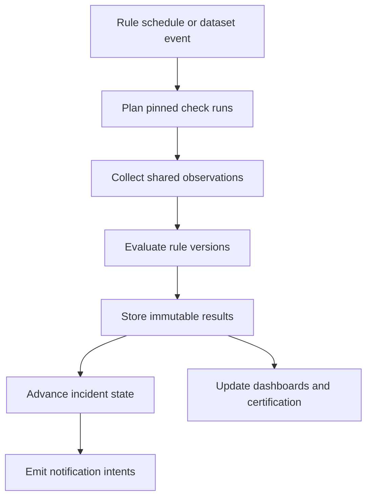
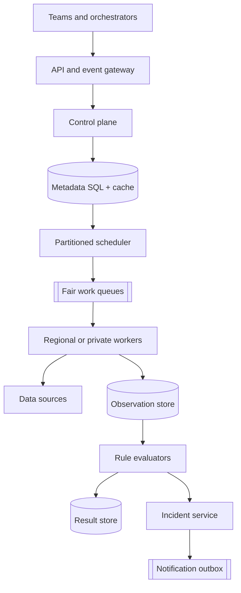
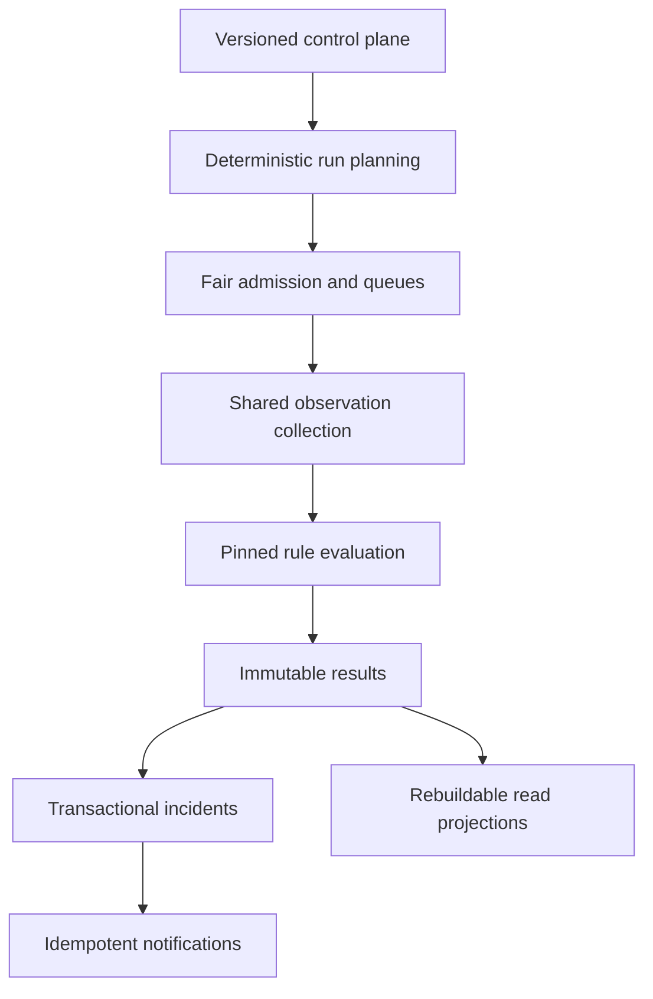

# Design a Global Data Quality Monitoring Platform

**Difficulty:** Medium–Hard  
**Primary themes:** data pipelines, scheduling, queues, time-series storage, caching, multi-tenancy, reliability, consistency, observability  
**Interview time budget:** approximately 40–45 minutes  
**Educational walkthrough:** intentionally more detailed than the spoken interview answer

## Rotation note

The latest walkthroughs covered a distributed transaction coordinator, returns and refunds, malware scanning, privacy deletion, feature flags, inference serving, counters, WebSockets, DNS, sessions, and webhook delivery. Today’s problem moves into data infrastructure. Its core challenge is turning millions of heterogeneous datasets and rule definitions into trustworthy, timely, deduplicated quality incidents without allowing slow warehouses, noisy tenants, or delayed observations to overwhelm the platform.

## Framework note

This walkthrough uses Hello Interview’s public [Delivery Framework](https://www.hellointerview.com/learn/system-design/in-a-hurry/delivery): prioritize a small set of requirements, identify the core entities, define practical interfaces, build the simplest complete design one operation at a time, and then deepen it around the most important non-functional requirements. The API and schema sections follow the public guidance to connect interfaces and data models to concrete access patterns rather than designing every field up front ([API Design](https://www.hellointerview.com/learn/system-design/core-concepts/api-design), [Data Modeling](https://www.hellointerview.com/learn/system-design/core-concepts/data-modeling)).

The scenario, dialogue, architecture, calculations, and tradeoffs below are original.

---

# Interviewer prompt

> Design a global data quality monitoring platform for a large enterprise. Data teams should register datasets, define quality rules such as freshness, schema compatibility, null rate, uniqueness, row-count change, and custom SQL assertions, run those checks against batch and streaming data, and receive actionable incidents when quality degrades. The platform must support many tenants and data systems without becoming a bottleneck for the underlying pipelines.

A strong answer separates the control plane from execution, treats observations as versioned evidence, and does not assume that every data source is fast, reachable, or safe to query centrally.

## Targeted clarifying questions with assumed interviewer answers

### 1. Which data sources are in scope?

**Candidate:** “Are we checking only our own warehouse, or arbitrary databases, lakes, and streams?”

**Interviewer:** “Support cloud warehouses, relational databases, object-storage tables, and event streams through connectors. Some sources are in private networks, so execution may need to happen in a customer-managed worker.”

### 2. Which rule types matter most?

**Candidate:** “Should the baseline include built-in metrics and arbitrary code?”

**Interviewer:** “Support freshness, schema, volume, null-rate, accepted-value, uniqueness, and custom SQL assertions. Arbitrary user code is out of scope; custom SQL runs with a restricted service identity.”

### 3. Are checks scheduled or event-driven?

**Candidate:** “Do rules run on a fixed cadence, after a dataset update, or both?”

**Interviewer:** “Both. Batch rules may run every few minutes or after an orchestration event. Stream rules evaluate windowed metrics continuously.”

### 4. Does the platform block data pipelines?

**Candidate:** “Should failed checks stop publication or only alert?”

**Interviewer:** “The baseline is observational and must not sit in the critical path. A pipeline may later query the latest certified status and choose to block, but the monitoring platform does not directly stop writes.”

### 5. What is the incident model?

**Candidate:** “Does every failed run create a new alert?”

**Interviewer:** “No. Repeated failures of the same rule should update one open incident. Recovery should resolve it after a configurable number of passing evaluations. Notifications must not spam users.”

### 6. How are owners and destinations determined?

**Candidate:** “Who receives an incident?”

**Interviewer:** “Datasets have owners and tags. Notification routes can use team, severity, environment, and domain. Existing messaging systems deliver email, chat, and paging notifications.”

### 7. How fresh must the results be?

**Candidate:** “What detection delay should we target?”

**Interviewer:** “For event-triggered batch checks, 99% should start within one minute of the event and publish a result within five minutes, excluding the source query itself. Streaming window incidents should appear within two minutes after the window closes.”

### 8. What scale should I assume?

**Candidate:** “How many tenants, assets, rules, and executions?”

**Interviewer:** “Assume 20,000 tenants, 10 million registered data assets, 50 million active rules, 500 million rule evaluations per day, and 10× bursts near common hourly boundaries.”

### 9. How expensive can source queries be?

**Candidate:** “May the platform scan entire petabyte tables?”

**Interviewer:** “No. Prefer metadata APIs, partition pruning, incremental profiling, sampling, and shared scans. Enforce per-source and per-tenant query budgets.”

### 10. What consistency matters?

**Candidate:** “If a rule changes while an old run is executing, which definition evaluates the result?”

**Interviewer:** “Every run is pinned to an immutable rule version. The result must record that version and the exact data window or snapshot it observed.”

### 11. What availability contract matters most?

**Candidate:** “Should an unreachable source count as bad data?”

**Interviewer:** “No. Distinguish `FAILED_QUALITY` from `EXECUTION_ERROR`, `TIMED_OUT`, and `SOURCE_UNAVAILABLE`. Continue accepting configurations and other tenants’ work during a connector outage.”

### 12. What is out of scope?

**Interviewer:** “Building the warehouse, changing source data, automatically repairing data, arbitrary user code, full data lineage discovery, and implementing the downstream messaging providers.”

### Scope statement to say aloud

> “I’ll design a control plane for assets and versioned rules, a multi-tenant scheduler and execution plane for batch and streaming checks, immutable observations and results, deduplicated incident lifecycle, and read APIs for dashboards and optional pipeline gates. Source systems, repair, and message delivery remain external.”

---

# 1. Requirements (~5 minutes)

## Core functional requirements

### FR1: Register data assets and versioned quality rules

Teams register a dataset reference, ownership and routing metadata, connector credentials by reference, and rules with cadence, severity, thresholds, and evaluation semantics. Updates create immutable rule versions.

### FR2: Execute batch and streaming checks and store trustworthy results

The platform schedules or receives triggers, runs checks close to each source, records the exact rule version and observed data boundary, and classifies the outcome as quality pass/fail or an execution failure.

### FR3: Maintain deduplicated incidents and notify owners

Repeated failures for the same rule and incident key update one incident. Consecutive passes resolve it. Notification policies route opening, escalation, and recovery events without duplicate sends.

## Below the line

- Writing or repairing source data
- Operating customer warehouses, databases, lakes, or brokers
- Arbitrary user-provided code execution
- Full column-level lineage discovery
- Training anomaly-detection models
- Implementing email, chat, or paging providers
- Pipeline orchestration beyond receiving trigger events
- Long-term business intelligence over every historical row

## Quantified non-functional requirements

### NFR1: Scale and tenant isolation

- 20,000 tenants.
- 10 million registered assets.
- 50 million active rules.
- 500 million rule evaluations/day.
- 10× bursts around common minute and hour boundaries.
- One noisy tenant or source cannot starve others.

### NFR2: Detection and API latency

- 99% of event-triggered batch checks start within one minute.
- 95% of inexpensive checks publish within five minutes, excluding source-side queueing beyond our control.
- Streaming incidents appear within two minutes after a window closes.
- Dashboard queries: p99 below 500 ms for recent results and open incidents.
- Configuration mutations: p99 below one second.

### NFR3: Reliability and durability

- No accepted rule version, completed observation, or incident transition is lost.
- Scheduler and executor delivery is at least once; duplicate runs and results are tolerated.
- Survive availability-zone loss.
- Continue unrelated tenants and connectors during a localized outage.

### NFR4: Semantic correctness

- Every run is bound to one immutable rule version.
- Every result identifies a source snapshot, partition, offset range, or time window.
- Source unavailability is not mislabeled as bad data.
- One logical failure transition produces at most one notification per route and policy stage.

### NFR5: Cost and safety

- Respect per-source query concurrency, bytes-scanned, and rate budgets.
- Prefer shared scans and precomputed profiles when several rules need the same columns.
- Secrets remain in a dedicated secrets manager and are never placed on queues.
- Custom SQL uses restricted, read-only credentials and enforced timeouts.

## Consistency and availability contract

- Asset and rule mutations are strongly consistent within a tenant’s home region.
- A rule update creates a new version; already-created runs continue on their pinned version.
- Runs, observations, and results are immutable after publication except for clearly separated correction records.
- Scheduler and queue delivery is at least once.
- Incident transitions use conditional writes and are strongly consistent per incident key.
- Dashboard projections, aggregates, and search indexes may be eventually consistent by seconds or minutes.
- During a control-plane partition, existing cached schedules and versioned rules may continue executing, but unsafe configuration mutations are rejected.
- During source failure, work is retried or marked operationally failed; the platform never fabricates a quality pass or fail.

### What to say aloud

> “Configuration and incident state need strong per-key consistency. Execution is naturally at least once, so runs and results use stable identities and immutable versions. Dashboards may lag, but a delayed source is operationally unknown, not evidence that the data itself is bad.”

---

# Scale estimates that change design decisions

## Evaluation rate

```text
500,000,000 evaluations/day ÷ 86,400 ≈ 5,787 evaluations/s average
10× boundary burst ≈ 58,000 evaluations/s
```

This requires a partitioned scheduler, durable queueing, and horizontally scalable workers. It does not justify firing 58,000 independent warehouse queries per second: many evaluations must share profiles or scans.

## Observation volume

Assume an average evaluation reads 12 reusable observations: row count, freshness, schema hash, and column statistics.

```text
500 million × 12 = 6 billion observations/day
≈ 69,400 observations/s average
≈ 694,000/s at a 10× burst
```

Raw observations belong in a write-optimized time-series or wide-column store, not in the same relational database that serves rule configuration and incident transactions.

## Storage

Assume:

- compact result and evidence summary: 1.5 KB/evaluation;
- reusable metric observation: 80 bytes compressed average;
- indexes and metadata excluded from the first-order calculation.

```text
Results: 500M × 1.5 KB ≈ 750 GB/day
Observations: 6B × 80 bytes ≈ 480 GB/day
Total ≈ 1.23 TB/day before replication and indexes
≈ 450 TB/year
```

Keep recent results and incident evidence online, downsample older metrics, and archive detailed evidence to object storage with tenant-defined retention.

## Scheduler state

If 50 million rules average one run per hour:

```text
50 million ÷ 3,600 ≈ 13,900 scheduled evaluations/s
```

But the stated daily volume averages only about 5,800/s, meaning many rules are less frequent or event-driven. The scheduler should store `next_run_at`, not expand every future occurrence into queue rows far in advance.

## Shared-scan implication

Suppose 100 rules inspect the same table partition and each query scans 10 GB:

```text
Independent scans = 1 TB scanned
One profile scan + 100 evaluations ≈ 10 GB scanned
```

Separating **observation collection** from **rule evaluation** changes cost by two orders of magnitude in this example. That becomes a core architectural choice.

### What to say aloud

> “The platform evaluates about 5,800 rules per second on average and roughly 58,000 at boundary bursts, but the expensive dimension is source scanning. I’ll collect reusable observations once per asset window, then evaluate many rules against them.”

---

# 2. Core entities (~2 minutes)

| Entity | Purpose |
|---|---|
| **DataAsset** | Stable dataset identity, source reference, ownership, and tags |
| **Connector** | Source type, network placement, capability, and secret reference |
| **Rule** | Stable logical check identity and current enabled version |
| **RuleVersion** | Immutable expression, threshold, schedule, severity, and required observations |
| **CheckRun** | One planned evaluation pinned to a rule version and data boundary |
| **Observation** | Reusable measured fact such as row count, freshness, null count, or schema hash |
| **CheckResult** | Immutable evaluation outcome with evidence and execution classification |
| **Incident** | Deduplicated lifecycle for repeated failures of one logical condition |
| **NotificationAttempt** | Idempotent delivery intent for one route and incident transition |

Do not put connector secrets in the asset or job records. Store a secret reference and resolve it only inside an authorized worker.

### What to say aloud

> “The key separation is RuleVersion, CheckRun, Observation, and CheckResult. A run says what should be evaluated, observations say what was measured, and the result applies one immutable rule version to that evidence. Incident then tracks repeated failures over time.”

---

# 3. API or system interface (~5 minutes)

Use REST for team-facing configuration and query APIs, and typed RPC or event contracts between schedulers, workers, and incident processors. Tenant and actor identity come from authentication.

## Register a data asset

```http
POST /v1/assets
Authorization: Bearer <service-or-user-token>
Idempotency-Key: register-orders-prod-v1
Content-Type: application/json

{
  "name": "analytics.orders",
  "environment": "PRODUCTION",
  "connector_id": "con_snowflake_us_1",
  "source_locator": {
    "database": "ANALYTICS",
    "schema": "COMMERCE",
    "object": "ORDERS"
  },
  "owners": ["team-commerce-data"],
  "tags": ["tier-1", "orders", "pii-restricted"]
}
```

The authenticated tenant is not accepted from the body. The platform validates that the caller may use the connector and source namespace.

## Create a rule

```http
POST /v1/assets/ast_orders_prod/rules
Idempotency-Key: create-orders-freshness

{
  "name": "orders-arrive-within-20-minutes",
  "type": "FRESHNESS",
  "severity": "CRITICAL",
  "schedule": {
    "mode": "INTERVAL",
    "every_seconds": 300
  },
  "expression": {
    "timestamp_column": "ingested_at",
    "maximum_age_seconds": 1200
  },
  "incident_policy": {
    "open_after_failures": 2,
    "resolve_after_passes": 2,
    "renotify_after_seconds": 3600
  }
}
```

```json
{
  "rule_id": "rul_01JF5A",
  "version": 1,
  "state": "ENABLED",
  "next_run_at": "2026-11-22T05:10:00Z"
}
```

Updating the rule creates version 2. Version 1 remains readable for historical runs.

## Trigger checks for a published data boundary

An orchestrator or ingestion system publishes:

```json
{
  "event_id": "airflow:orders:2026-11-22T05:00Z:attempt-1",
  "event_type": "DATASET_PUBLISHED",
  "asset_id": "ast_orders_prod",
  "boundary": {
    "kind": "PARTITION",
    "value": "event_date=2026-11-22/hour=05"
  },
  "source_snapshot": "snowflake-query-id-or-table-version",
  "occurred_at": "2026-11-22T05:03:10Z"
}
```

The event ID deduplicates retries. The platform resolves enabled rule versions at trigger-processing time and creates stable run IDs.

## Start an ad hoc run

```http
POST /v1/rules/rul_01JF5A/runs
Idempotency-Key: manual-check-ticket-4821

{
  "boundary": {
    "kind": "PARTITION",
    "value": "event_date=2026-11-22/hour=05"
  }
}
```

```json
{
  "run_id": "run_01JF5C",
  "rule_id": "rul_01JF5A",
  "rule_version": 1,
  "state": "QUEUED"
}
```

## Fetch a result

```http
GET /v1/runs/run_01JF5C
```

```json
{
  "run_id": "run_01JF5C",
  "rule_id": "rul_01JF5A",
  "rule_version": 1,
  "asset_id": "ast_orders_prod",
  "boundary": "event_date=2026-11-22/hour=05",
  "outcome": "FAILED_QUALITY",
  "observed": {
    "maximum_timestamp": "2026-11-22T04:34:01Z",
    "age_seconds": 1749
  },
  "threshold": {
    "maximum_age_seconds": 1200
  },
  "incident_id": "inc_01JF5D",
  "completed_at": "2026-11-22T05:03:57Z"
}
```

## Query open incidents

```http
GET /v1/incidents?state=OPEN&severity=CRITICAL&owner=team-commerce-data&limit=50
```

Use cursor pagination based on `(updated_at, incident_id)`, not offsets across a changing result set.

## Executor result contract

```protobuf
message ObservationBatch {
  string collection_id = 1;
  string tenant_id = 2;
  string asset_id = 3;
  DataBoundary boundary = 4;
  string source_snapshot = 5;
  repeated Observation observations = 6;
  string collector_version = 7;
}

message CheckResult {
  string run_id = 1;
  int64 rule_version = 2;
  string evaluation_fingerprint = 3;
  Outcome outcome = 4;
  repeated Evidence evidence = 5;
}
```

### Identity from authentication

The gateway derives:

- tenant;
- user or service principal;
- allowed connector and namespace scope;
- owner-team memberships;
- administrative override capability;
- audit actor.

The caller cannot submit a different tenant ID, secret value, or notification destination outside authorized policy.

### What to say aloud

> “Configuration APIs create stable assets and immutable rule versions. Triggers identify the exact data boundary. A run returns operational state separately from the final quality outcome, and identity comes from authentication rather than user-supplied tenant fields.”

---

# 4. Data flow



The expensive source access happens in observation collection. Many rule evaluations can reuse one collection for the same asset, boundary, and compatible collector plan.

---

# 5. High-level design (~10–15 minutes)

## Compact architecture



## Operation 1: Register assets and rules

### Control-plane database

A relational database is a good default because configuration mutations require constraints, transactions, ownership queries, and version histories.

```text
data_assets
  tenant_id
  asset_id
  connector_id
  normalized_locator
  environment
  owners_json
  tags_json
  state
  version
  created_at, updated_at
  PRIMARY KEY (tenant_id, asset_id)

UNIQUE (tenant_id, connector_id, normalized_locator)
INDEX (tenant_id, updated_at DESC)

rules
  tenant_id
  rule_id
  asset_id
  current_version
  enabled
  next_run_at
  schedule_bucket
  priority
  version
  PRIMARY KEY (tenant_id, rule_id)

INDEX (schedule_bucket, next_run_at)
INDEX (tenant_id, asset_id)

rule_versions
  tenant_id
  rule_id
  version
  rule_type
  expression_json
  required_observations_json
  severity
  schedule_json
  incident_policy_json
  definition_hash
  created_by
  created_at
  PRIMARY KEY (tenant_id, rule_id, version)
```

Rule update transaction:

1. validates connector and asset ownership;
2. inserts immutable `rule_versions(version + 1)`;
3. conditionally updates `rules.current_version`;
4. recomputes `next_run_at` if the schedule changed;
5. inserts an outbox event for cache invalidation and scheduler refresh.

### Configuration cache

Cache immutable rule versions by `(tenant_id, rule_id, version)` with long TTLs because their contents never change. Cache current rule pointers and asset metadata with shorter TTLs plus versioned invalidation.

Never overwrite an immutable version key. This makes retries and old runs reproducible.

## Operation 2: Plan scheduled and event-triggered runs

### Scheduled rules

Partition rules into schedule buckets using a hash of tenant and rule ID. Each scheduler owner claims buckets through leases and scans a bounded time horizon such as the next minute.

For every due rule, one transaction or conditional write:

1. reads current enabled rule version;
2. calculates a canonical planned boundary;
3. inserts a `CheckRun` with deterministic identity;
4. advances `next_run_at`;
5. writes a job-outbox record.

```text
run_id = hash(tenant_id, rule_id, rule_version, trigger_id_or_scheduled_time, boundary)
```

The deterministic ID prevents two scheduler owners from creating different logical runs after a lease race.

### Event-triggered rules

The event gateway authenticates the publisher and inserts the source event into a transactional inbox keyed by `(tenant_id, source, event_id)`. A planner resolves every enabled event-driven rule and creates pinned runs.

If a rule is updated one millisecond later, those existing runs still use the old version. Future triggers use the new one.

### Avoiding boundary stampedes

Schedules like “top of every hour” create large bursts. Apply deterministic jitter when semantics permit:

```text
actual_start = nominal_start + hash(rule_id) mod allowed_jitter
```

Critical freshness checks may have zero jitter. Background profile rules may spread over several minutes.

### Work queue structure

Do not use one FIFO queue. Partition by:

- region and worker placement;
- connector type;
- priority class;
- tenant fairness shard.

The queue carries IDs and safe metadata, never credentials. A worker resolves the connector and secret immediately before execution.

## Operation 3: Collect reusable observations

### Plan one compatible collection

Runs for the same `(asset, boundary, source_snapshot)` are grouped by required observation type. A collection planner may combine:

- row count;
- maximum event timestamp;
- schema hash;
- null counts for requested columns;
- approximate distinct counts;
- quantiles and value histograms.

The planner produces one connector-specific query with partition pruning and sampling policy. Rules that require exact uniqueness may need a separate expensive plan from approximate profile rules.

```text
collections
  tenant_id
  collection_id
  asset_id
  boundary_hash
  source_snapshot
  collector_plan_hash
  state
  lease_owner
  lease_expires_at
  attempt
  created_at, completed_at

UNIQUE (tenant_id, asset_id, boundary_hash, source_snapshot, collector_plan_hash)
```

The uniqueness constraint and stable collection ID collapse duplicate jobs.

### Worker placement

Use two worker modes:

1. **Managed regional workers** for publicly reachable or peered sources.
2. **Customer-network workers** that make outbound authenticated connections to the control plane for private sources.

Workers lease jobs, retrieve short-lived source credentials from the secrets system, execute read-only queries with statement timeouts, and upload observations. Lease expiry allows another attempt, so execution is at least once.

### Source protection

Each connector has token buckets for:

- concurrent queries;
- queries per minute;
- bytes scanned;
- warehouse credits or cost units;
- maximum query duration.

The worker estimates cost before execution when the source supports explain or metadata APIs. An over-budget job is delayed or classified `BUDGET_EXCEEDED`; it is not called a quality failure.

### Observation storage

Store compact observation points in a time-series or wide-column system keyed by:

```text
(tenant_id, asset_id, metric_id, window_start, source_snapshot)
```

The payload includes value, type, collection ID, sampling rate, boundary, collector version, and quality flags such as approximate or incomplete.

Large evidence such as sampled bad rows belongs in encrypted object storage. Results store only a reference and redacted summary.

## Operation 4: Evaluate pinned rules

The evaluator receives `ObservationBatchAvailable(collection_id)` and locates waiting runs. It loads immutable rule versions from cache or metadata storage, evaluates them deterministically, and writes results with a stable fingerprint:

```text
evaluation_fingerprint = hash(
  rule_definition_hash,
  source_snapshot,
  boundary_hash,
  observation_ids,
  evaluator_version
)
```

```text
check_results
  tenant_id
  run_id PK
  rule_id
  rule_version
  asset_id
  boundary_hash
  source_snapshot
  outcome
  execution_classification
  evaluation_fingerprint
  evidence_summary_json
  evidence_uri
  completed_at

UNIQUE (tenant_id, run_id, evaluation_fingerprint)
```

Outcome dimensions should not be collapsed into one boolean:

- `PASSED`
- `FAILED_QUALITY`
- `EXECUTION_ERROR`
- `SOURCE_UNAVAILABLE`
- `TIMED_OUT`
- `BUDGET_EXCEEDED`
- `CANCELLED`

An evaluator retry with the same fingerprint returns the existing result. A different fingerprint for the same run signals a nondeterminism or correction workflow rather than silently replacing evidence.

## Operation 5: Maintain incidents and notify owners

The incident processor consumes immutable quality results. Compute an incident key such as:

```text
incident_key = hash(tenant_id, rule_id, monitored_dimension_or_boundary_series)
```

For recurring checks, different windows normally update one incident. For independent partitions whose failures need separate ownership, include the partition group in the key.

Use one transactional state transition:

```text
incidents
  tenant_id
  incident_id
  incident_key
  rule_id
  state                 // PENDING, OPEN, ACKNOWLEDGED, RESOLVED
  severity
  consecutive_failures
  consecutive_passes
  first_failed_at
  last_failed_at
  resolved_at
  version
  PRIMARY KEY (tenant_id, incident_id)

UNIQUE (tenant_id, incident_key, active_generation)
INDEX (tenant_id, state, severity, updated_at DESC)
```

The transaction:

1. locks or conditionally updates the incident key;
2. applies the configured failure or recovery threshold;
3. records a timeline event;
4. inserts a notification outbox row if a visible transition occurred.

Notification workers call the existing messaging system with:

```text
notification_key = hash(incident_id, transition_id, route_id, policy_stage)
```

The downstream messaging service must deduplicate that key or the platform keeps a successful-delivery ledger.

### What to say aloud

> “The control plane stores assets and immutable rule versions. The scheduler creates deterministic runs, workers collect shared observations close to each source, and stateless evaluators apply pinned definitions. A transactional incident service deduplicates repeated failures and emits idempotent notification intents.”

---

# 6. Deep dives (~10–15 minutes)

## Deep dive 1: Scheduler bursts, slow sources, and multi-tenant fairness

### Where the baseline breaks

A global priority queue appears simple until:

- millions of hourly rules become due together;
- one tenant registers millions of checks;
- one warehouse permits only ten concurrent queries;
- a connector outage causes retries to grow faster than completions;
- slow bulk profiles block critical freshness checks;
- a scheduler crashes after queueing but before advancing `next_run_at`.

### Plausible approaches

| Approach | Benefit | Tradeoff |
|---|---|---|
| One cron service and FIFO queue | Simple | Hotspot, duplicate scheduling, no fairness |
| Pre-expand all future runs | Easy queue consumption | Huge storage and difficult schedule changes |
| Partitioned `next_run_at` scheduler | Bounded state and scalable | Requires leases and duplicate-safe planning |
| Source-pull execution | Source controls load | Harder priority and central visibility |

### Selection

Use partitioned schedule buckets, deterministic run IDs, transactional outboxes, and hierarchical fair queues.

### Hierarchical admission control

A job must acquire capacity at several levels:

1. global worker capacity;
2. region and connector-type capacity;
3. tenant quota;
4. source-specific query budget;
5. priority-class allowance.

Use weighted fair scheduling among tenants, then earliest deadline or priority within a tenant. Reserve a small lane for critical freshness and recovery work.

### Retry policy

Classify failures:

- transient network or source overload: exponential backoff with jitter;
- explicit source rate limit: honor retry-after;
- bad credentials: stop retrying and open a connector-health incident;
- invalid SQL or missing column: terminal execution error tied to the rule version;
- platform worker crash: lease expiry and safe retry;
- budget exhaustion: defer to the next budget window.

Retries retain the same run and collection IDs. Do not create a new logical evaluation per attempt.

### Backlog behavior

Track deadline slack. When backlog exceeds capacity:

- preserve critical and event-triggered checks;
- delay low-priority profiling;
- coalesce superseded windows when policy allows;
- avoid retry storms with circuit breakers;
- surface schedule delay separately from source-query duration.

Do not silently mark a delayed check passed or failed.

### Scheduler recovery

The authoritative `next_run_at` and run uniqueness constraints let a new owner rescan a schedule bucket. The queue is not the only record of planned work. Outbox relays may publish twice; workers deduplicate by run or collection ID.

### Observability

Measure:

- schedule-to-queue and queue-to-start delay by priority;
- backlog age by tenant, source, and connector;
- fairness share versus configured weight;
- connector token utilization;
- retry amplification;
- source query duration and scanned bytes;
- percentage of work reused by shared collections.

### What to say aloud

> “I’ll partition the scheduler and make run creation idempotent, but fairness belongs in admission control. Every job must pass tenant and source budgets, and critical checks use protected capacity. Retries preserve identity and back off behind a connector circuit breaker.”

## Deep dive 2: Correct results with late observations and changing rules

### Where the baseline breaks

Data quality evidence can arrive out of order:

- a streaming window closes, then late events update its count;
- a warehouse query retries against a newer snapshot;
- a rule changes while collection is running;
- two workers collect the same metric with different sampling rates;
- an evaluator bug is fixed and historical results need correction.

A mutable “latest result” row loses which data and semantics produced the answer.

### Plausible approaches

| Approach | Benefit | Tradeoff |
|---|---|---|
| Mutate latest result | Simple reads | Destroys provenance and auditability |
| Re-evaluate old run in place | Stable run ID | Same identity can mean different evidence |
| Immutable observations and result revisions | Reproducible | More storage and projection logic |
| Full event sourcing of all control state | Maximum history | Unnecessary complexity for configuration queries |

### Selection

Keep control metadata relational, but make observations and result publications immutable. Corrections create a new revision linked to the original result.

### Version and boundary contract

Every run pins:

- `rule_id` and `rule_version`;
- normalized data boundary;
- expected source snapshot semantics;
- evaluator compatibility version;
- trigger ID or scheduled time.

Every observation records:

- the actual source snapshot or offset range;
- collection plan and collector version;
- exact versus approximate method;
- sampling rate;
- observation time and upload time.

The evaluator rejects incompatible evidence rather than comparing a threshold against an unknown snapshot.

### Streaming windows

For streams, use event time and watermarks. A watermark is the platform’s estimate that most events earlier than a timestamp have arrived. At window close:

1. emit a provisional or final observation according to policy;
2. evaluate the rule;
3. accept late events until an allowed-lateness deadline;
4. if evidence changes materially, emit a new observation revision and result correction.

The incident policy decides whether a corrected result can retract an incident automatically. Preserve both the original alert evidence and correction.

### Latest-result projection

Dashboards should not scan immutable history. Build a projection keyed by `(tenant, rule)` containing:

- latest authoritative result revision;
- last successful execution;
- last quality pass;
- current incident ID;
- freshness and projection offset.

This projection is rebuildable and eventually consistent. Pipeline gates that require a strict answer can request the authoritative result and minimum source snapshot.

### Cache safety

Safe to cache:

- immutable rule versions;
- asset metadata by version;
- connector capabilities;
- terminal result documents by result revision;
- latest projections with explicit freshness.

Unsafe as sole authority:

- incident transition state;
- whether a scheduled run already exists;
- source budgets;
- which rule version a previously created run uses.

### What to say aloud

> “A result is meaningful only with its rule version and observed data boundary. I’ll preserve immutable observations and results, publish corrections as new revisions, and build a fast latest-result projection. Late stream data changes evidence; it does not rewrite history invisibly.”

## Deep dive 3: Incident deduplication and trustworthy notification delivery

### Where the baseline breaks

Without a stateful incident layer:

- every five-minute failure pages the team again;
- duplicate result messages open duplicate incidents;
- one pass resolves a flaky rule prematurely;
- concurrent results race open versus resolve;
- notification timeout causes duplicate pages;
- operational connector errors are mixed with bad-data incidents.

### Plausible approaches

| Approach | Benefit | Tradeoff |
|---|---|---|
| Notify directly from each result | Low latency | Spam and no lifecycle |
| Deduplicate in the messaging provider | Reuses provider | Provider lacks quality-domain state |
| Cache-based incident counters | Fast | Loss and race risk during failover |
| Transactional incident aggregate plus outbox | Correct lifecycle | More state and partitioning work |

### Selection

Use a strongly consistent incident aggregate keyed by logical monitored condition. Process result events at least once with an inbox and conditional incident version.

### Incident state machine

An example policy:

```text
CLOSED + first failure       -> PENDING (failure_count = 1)
PENDING + threshold failure  -> OPEN
OPEN + repeated failure      -> OPEN, update evidence and maybe renotify
OPEN + first pass            -> OPEN (recovery_count = 1)
OPEN + recovery threshold    -> RESOLVED
RESOLVED + new failure       -> new active generation
```

Execution errors update connector or rule-health state, not the data-quality incident, unless product policy explicitly links them.

### Transactional inbox and outbox

Within one incident transaction:

1. insert `(consumer, result_event_id)` into the inbox;
2. compare and update the incident version;
3. insert timeline evidence;
4. insert notification intent for visible transitions;
5. commit.

The notification relay can publish more than once. Stable `notification_key` and a delivery ledger make repeats harmless.

### Notification routing

Resolve routes from a versioned snapshot of:

- asset owners;
- severity;
- environment;
- business domain and tags;
- quiet hours and escalation policy.

Store the route-policy version with the notification intent so later ownership changes do not make historical delivery inexplicable.

### Failure recovery

Reconcilers find:

- results that never reached incident processing;
- incidents whose counters disagree with timeline events;
- outbox intents without delivery attempts;
- delivery attempts stuck in unknown state;
- open incidents whose rules are disabled or assets deleted;
- projections that disagree with authoritative incident state.

### Observability

Measure duplicate results, incident-transition conflicts, open-to-notified latency, suppressed notification count, repeated-delivery rate, oldest undelivered critical transition, flapping incidents, and operational-error-to-quality-failure ratios.

### What to say aloud

> “A result does not page directly. It advances a transactional incident state machine with configurable failure and recovery thresholds. Visible transitions create outbox intents with stable notification keys, so at-least-once delivery does not become repeated paging.”

---

# Reliability and operational details

## Transactional inboxes and outboxes

Use inboxes for dataset triggers, observation batches, and result events. Use outboxes for planned jobs, result publication, incident transitions, and notifications. They eliminate database-plus-broker dual-write gaps while accepting duplicate relay delivery.

## Connector health as a separate signal

Maintain connector health from authentication failures, rate limits, source latency, and worker reachability. A connector incident may suppress thousands of derived execution-error notifications while leaving quality incidents unchanged.

## Regional model

Assign each tenant a control-plane home region. Execute checks in the source’s permitted region or private network. Replicate immutable rule versions and job metadata to execution regions. Results return to the home region for incident serialization.

For home-region failover:

- replicate metadata and incident storage across zones synchronously;
- replicate backups and logs to an allowed paired region;
- promote with a tenant-region epoch;
- fence old scheduler and incident writers;
- replay inboxes and outboxes idempotently.

## Security and privacy

- Store secret references, not credentials, in metadata or jobs.
- Issue short-lived credentials to authorized workers.
- Enforce read-only source roles and query allowlists where practical.
- Redact or hash sampled bad values.
- Encrypt evidence objects and apply tenant-specific retention.
- Restrict custom SQL functions and set statement timeouts.
- Audit configuration, evidence access, incident overrides, and route changes.
- Prevent cross-tenant metric and cache keys by including tenant identity at every layer.

## Cost controls

- Incremental profiles over new partitions or offsets.
- Metadata APIs for freshness and schema where possible.
- Sampling for distribution checks with confidence metadata.
- Shared scans for compatible rules.
- Approximate distinct counting when exact uniqueness is unnecessary.
- Per-rule cost estimates and owner-visible budgets.
- Retention tiers and downsampling for old observations.

## Core metrics

- Scheduler lag and queue age by priority and tenant.
- Check start and completion SLOs.
- Source query count, latency, bytes scanned, and cost.
- Shared-observation reuse ratio.
- Run outcomes split by quality failure and operational class.
- Observation and result ingestion lag.
- Incident opening, acknowledgement, and resolution time.
- Notification delivery and duplicate suppression.
- Connector health and circuit-breaker state.
- Projection freshness and reconciliation mismatches.

---

# Final design

The final platform contains:

1. A strongly consistent tenant control plane for assets, connectors, and immutable rule versions.
2. Cached immutable definitions and versioned invalidation for current pointers.
3. Partitioned schedulers and a trigger inbox that create deterministic pinned runs.
4. Hierarchical fair queues and admission control by tenant, source, priority, and cost.
5. Regional or customer-network workers with short-lived, read-only credentials.
6. A collection planner that shares scans and emits reusable observations.
7. A high-volume time-series observation store plus object storage for large evidence.
8. Stateless deterministic evaluators producing immutable versioned results.
9. A transactional incident service with failure and recovery thresholds.
10. Notification outboxes and stable delivery keys for duplicate-safe routing.
11. Read-optimized latest-result, certification, search, and dashboard projections.
12. Reconcilers for missed work, stuck executions, incident drift, and undelivered transitions.



---

# Requirements check

| Requirement | How the design satisfies it |
|---|---|
| Register assets and rules | Relational control plane with tenant isolation and immutable versions |
| Scheduled and event-driven checks | Partitioned `next_run_at` scheduler plus deduplicated trigger inbox |
| Batch and stream support | Connector collectors and event-time window observations |
| Version-consistent evaluation | Runs pin rule versions, boundaries, and source snapshots |
| Avoid source overload | Shared scans, budgets, admission control, pruning, and sampling |
| Handle duplicate work | Deterministic run and collection IDs, inboxes, idempotent writes |
| Distinguish bad data from outages | Separate quality outcome and execution classification |
| Deduplicate incidents | Strong incident key and conditional state machine |
| Avoid notification spam | Transition outbox, route snapshot, stable notification key |
| 500 million evaluations/day | Partitioned scheduling, fair queues, scalable workers and evaluators |
| Low-latency dashboards | Latest-result and incident projections with caches |
| Auditability | Immutable rule versions, observations, results, revisions, and timelines |

---

# Realistic interviewer follow-up questions with strong sample answers

## 1. “Why separate observations from results?”

> “Many rules need the same row count, freshness, schema, or column profile. Collecting once avoids repeated source scans. It also makes the result reproducible: the evaluator applies a pinned rule version to explicit observation IDs.”

## 2. “Why not run every rule as one SQL query?”

> “That is the simplest baseline for a small system, but at this scale it multiplies warehouse cost and contention. I would compile compatible rules into shared collection plans, while keeping separate queries for semantics that cannot safely share.”

## 3. “What if the scheduler publishes the same job twice?”

> “The run ID is deterministic, the database has a uniqueness constraint, and the worker leases a stable collection ID. Delivery is at least once, but the logical run and result remain one.”

## 4. “What if a rule changes during execution?”

> “The run keeps its pinned immutable rule version. New runs use the new version. Historical results remain explainable and are not reinterpreted silently.”

## 5. “How do you check a private database?”

> “Deploy a customer-network worker that establishes an outbound authenticated channel. It leases jobs, obtains short-lived credentials, queries locally, and uploads observations. Secrets never pass through the queue.”

## 6. “How do you avoid scanning an entire table for uniqueness?”

> “Use partition-level incremental state, source-native metadata, or approximate distinct sketches when policy permits. Exact global uniqueness may require an expensive scan or maintained index, so the rule definition should expose its cost and accuracy contract.”

## 7. “Would you use Kafka?”

> “A partitioned log is useful for triggers, planned work, observations, and results. It is not the authority for rule versioning or incident transitions. Those use transactional storage, while inboxes and outboxes bridge the systems safely.”

## 8. “What happens when the source is down?”

> “The run becomes `SOURCE_UNAVAILABLE` after bounded retries. Connector health opens or updates an operational incident. I do not open a bad-data incident because no quality observation was made.”

## 9. “How do you prevent one tenant from taking all workers?”

> “Use weighted fair queues and hierarchical admission control. A job needs tenant and source tokens, and every tenant has concurrency and cost quotas. Critical recovery traffic has reserved capacity.”

## 10. “Can a pipeline block on these results?”

> “Yes, as an optional client behavior. The pipeline requests certification for a minimum source snapshot and specifies its maximum tolerated result age. It must define behavior for unknown or unavailable status rather than reading a stale dashboard cache.”

## 11. “How do you handle late stream events?”

> “Use event-time windows and watermarks. Accept late observations until an allowed-lateness deadline, then publish a correction revision if the evidence materially changes. Preserve the original result and incident timeline.”

## 12. “Why not store everything in PostgreSQL?”

> “Metadata and incident transitions fit relational transactions. Six billion observations per day have different write, retention, and range-query patterns, so a time-series or wide-column store plus object storage is a better fit.”

## 13. “How do you prevent repeated pages?”

> “Results advance one incident aggregate. Only visible transitions or configured renotification stages create notification intents, each keyed by incident, transition, route, and policy stage.”

## 14. “What if a result is wrong because the evaluator had a bug?”

> “Publish a correction revision tied to the original result and evaluator version. Rebuild projections and reprocess incident policy explicitly. Never overwrite the original evidence or pretend the first alert did not occur.”

## 15. “What would you degrade first during overload?”

> “Delay low-priority profiling, historical backfills, search indexing, and noncritical dashboard aggregates. Preserve trigger ingestion, critical freshness checks, result durability, incident transitions, and recovery delivery.”

---

# Common pitfalls

1. **Running one expensive source query per rule.** Shared observations are the central cost optimization.
2. **Mutating rule definitions in place.** Historical runs become impossible to explain.
3. **Using one boolean for every outcome.** Bad data, source outage, timeout, and platform error are different.
4. **Putting the monitoring platform in the write path by default.** Source availability should not depend on monitoring.
5. **Using one FIFO queue.** It provides neither tenant fairness nor source protection.
6. **Expanding years of future schedules.** Store the next due time and plan incrementally.
7. **Assuming exactly-once job delivery.** Use stable identities and idempotent state transitions.
8. **Letting retries create new logical runs.** Attempts belong under one run.
9. **Sending credentials through the queue.** Resolve short-lived secrets only in authorized workers.
10. **Treating source unavailability as failed quality.** That creates false incidents.
11. **Paging directly from every failed result.** Use a deduplicated incident state machine.
12. **Resolving after one pass regardless of policy.** Flaky checks will flap.
13. **Overwriting late or corrected results.** Preserve immutable evidence and publish revisions.
14. **Using a cache to decide incident transitions.** Strong per-key state is required.
15. **Ignoring source cost and concurrency.** Monitoring can become the outage it is supposed to detect.
16. **Mixing connector health with dataset quality.** Operators need separate failure domains.
17. **Ignoring private-network execution.** Central workers cannot reach every enterprise source.
18. **Building dashboards from authoritative stores synchronously.** Use rebuildable projections.

---

# Concise 45-minute delivery script

## Minutes 0–5: requirements

> “I’ll focus on versioned asset rules, scheduled and event-driven evaluation, and deduplicated incident notification. Source repair and pipeline execution remain outside the platform.”

## Minutes 5–7: entities

> “The essential entities are DataAsset, Connector, Rule, immutable RuleVersion, CheckRun, Observation, CheckResult, Incident, and NotificationAttempt.”

## Minutes 7–12: interfaces

> “Teams register assets and rules, orchestrators publish exact data boundaries, and workers return observations and results under stable IDs. Tenant identity and connector permission come from authentication.”

## Minutes 12–25: high-level design

> “A relational control plane feeds partitioned schedulers and fair queues. Regional or private workers collect shared observations under source budgets. Stateless evaluators apply pinned rules, then a transactional incident service emits idempotent notification intents.”

## Minutes 25–40: deep dives

Lead with:

1. boundary stampedes, slow connectors, retries, and tenant fairness;
2. immutable evidence, versioning, streaming lateness, and result corrections;
3. incident lifecycle, notification deduplication, and reconciliation.

## Minutes 40–45: close

> “The design keeps configuration strongly versioned, execution at least once, evidence immutable, source load budgeted, and incidents transactional. Fast dashboards are projections, not the correctness boundary.”

---

# Closing mental model

Keep five stages separate:

1. **Intent:** which immutable rule version should run?
2. **Boundary:** which exact data snapshot, partition, offsets, or window is inspected?
3. **Observation:** what facts were actually measured, and with what accuracy?
4. **Evaluation:** does that evidence satisfy the pinned rule?
5. **Response:** should an incident open, escalate, notify, or resolve?

Most subtle bugs come from collapsing two of these stages into one mutable status field.
