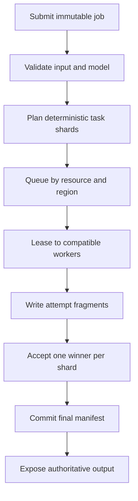
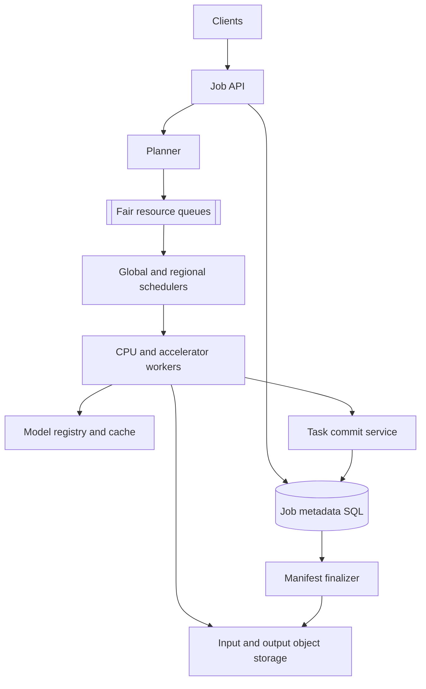
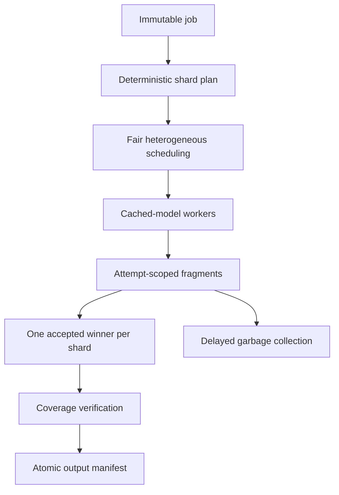

# Design a Multi-Tenant Batch AI Inference Platform

**Difficulty:** Hard  
**Primary themes:** AI inference serving, distributed scheduling, queues, object storage, model caching, heterogeneous compute, reliability, consistency, multi-tenancy  
**Interview time budget:** approximately 40–45 minutes  
**Educational walkthrough:** intentionally more detailed than the spoken interview answer

## Rotation note

The latest walkthroughs covered data quality monitoring, distributed transaction coordination, returns and refunds, malware scanning, privacy deletion, feature flags, online LLM inference, counters, WebSockets, and DNS. Today’s problem returns to AI infrastructure from a different angle: durable offline inference over enormous immutable datasets. The central challenge is not token-by-token interactive latency. It is scheduling heterogeneous CPU and accelerator capacity fairly, recovering work without duplicating logical output, and publishing a reproducible result only after every input partition is accounted for.

## Framework note

This walkthrough follows Hello Interview’s public [Delivery Framework](https://www.hellointerview.com/learn/system-design/in-a-hurry/delivery): prioritize a few requirements, identify core entities, define practical interfaces, build a complete baseline operation by operation, and reserve deep-dive time for the hardest bottlenecks and guarantees. The API and schema discussion follows the public guidance to connect interfaces and fields to actual access patterns rather than fully designing the schema before the architecture ([API Design](https://www.hellointerview.com/learn/system-design/core-concepts/api-design), [Data Modeling](https://www.hellointerview.com/learn/system-design/core-concepts/data-modeling)).

The prompt, dialogue, architecture, examples, and tradeoffs below are original.

---

# Interviewer prompt

> Design a multi-tenant batch AI inference platform. Customers submit an immutable input dataset and model version, choose an output location and service objective, and receive predictions for billions of records. The platform should support CPU and accelerator-backed models, schedule work fairly, recover from worker failures, expose progress and cost, and publish results without duplicate or missing logical records.

A strong answer distinguishes task execution from result publication. Workers may execute at least once; the completed job should still expose one authoritative output manifest covering the intended input snapshot exactly once logically.

## Targeted clarifying questions with assumed interviewer answers

### 1. Which inference workloads are in scope?

**Candidate:** “Are we serving only generative LLMs, or also embeddings, classifiers, vision, and ranking models?”

**Interviewer:** “Support all of them through a model-runtime contract. Models may run on CPU, one accelerator, or a fixed multi-accelerator group. Training and online serving are out of scope.”

### 2. What form does input take?

**Candidate:** “Do jobs point to immutable files, database queries, or a live stream?”

**Interviewer:** “The baseline accepts versioned object-storage datasets such as Parquet or JSONL. A query service may first export a snapshot. Each record has or receives a stable record ID.”

### 3. How large can a job be?

**Candidate:** “What is the expected range of records and bytes?”

**Interviewer:** “From one million to ten billion records. Some jobs contain small tabular rows; others reference images or long prompts. A job may run for minutes to many hours.”

### 4. How are models supplied?

**Candidate:** “Does the platform accept arbitrary containers?”

**Interviewer:** “Models come from an approved model registry as immutable artifacts with runtime, tokenizer or preprocessor, hardware constraints, memory estimates, and a content digest. Arbitrary unreviewed containers are out of scope.”

### 5. What output guarantee is required?

**Candidate:** “Do users require byte-for-byte exactly-once execution?”

**Interviewer:** “No. Tasks may execute more than once. The final published output must contain one logical result per accepted input record, or a documented terminal error record, with no duplicate logical keys.”

### 6. Is output order important?

**Candidate:** “Must results preserve global input order?”

**Interviewer:** “No global ordering. Preserve record IDs and optionally order within one input shard. Global sorting is a separate downstream operation.”

### 7. What latency objective matters?

**Candidate:** “Is there an interactive deadline?”

**Interviewer:** “No. Jobs choose a service class: best effort, standard with a completion target, or reserved capacity. The control-plane APIs should be fast, and large jobs should begin useful work within a few minutes when quota and capacity exist.”

### 8. What scale should I assume?

**Candidate:** “How many tenants, jobs, records, and workers?”

**Interviewer:** “Assume 10,000 tenants, 100,000 submitted jobs/day, one trillion records/day, 100,000 worker slots globally, and 10× submission bursts at common business boundaries.”

### 9. How should fairness work?

**Candidate:** “Can one huge tenant consume all accelerators?”

**Interviewer:** “No. Enforce tenant quotas, weighted fair sharing, service-class priorities, and reserved capacity. A running best-effort task may be preempted at a safe checkpoint.”

### 10. Can jobs cross regions?

**Candidate:** “May compute run far from the input data?”

**Interviewer:** “Prefer data-local execution. Some tenants require their data and outputs to remain in an allowed region. Cross-region movement needs explicit policy and cost accounting.”

### 11. What happens on cancellation?

**Candidate:** “Should cancellation delete partial output?”

**Interviewer:** “Stop scheduling new work and request running tasks to checkpoint or terminate. Temporary fragments may be garbage-collected. A cancelled job must never publish a success manifest.”

### 12. What is out of scope?

**Interviewer:** “Model training, online endpoints, model approval, building the object store, cross-record global aggregation, arbitrary code execution, and downstream analytics.”

### Scope statement to say aloud

> “I’ll design submission against immutable input and model snapshots, task planning, fair heterogeneous scheduling, worker execution with local model caches, durable progress, retry-safe output fragments, one atomic final manifest, cancellation, and observability. Model training, online serving, and arbitrary containers remain outside the platform.”

---

# 1. Requirements (~5 minutes)

## Core functional requirements

### FR1: Submit a reproducible batch inference job

The client supplies a versioned input manifest, immutable model version, inference parameters, output destination, and service class. The platform validates access, freezes the job specification, estimates resources, and returns a durable job ID.

### FR2: Partition and execute work fairly on compatible compute

The platform converts the job into independently retryable task shards, assigns them to CPU or accelerator workers that meet runtime and memory constraints, reuses cached model artifacts, and enforces tenant quotas and priorities.

### FR3: Recover work and publish one authoritative result

Workers write attempt-scoped output fragments. The control plane tracks accepted shard results, retries failures, supports cancellation, and atomically publishes a final output manifest only when every planned shard is terminal and coverage is complete.

## Below the line

- Model training and fine-tuning
- Interactive inference endpoints
- Model security approval and benchmarking pipelines
- Arbitrary customer containers
- Live stream processing
- Global sorting or cross-record aggregation
- Object-store implementation
- Downstream analytics or vector indexing

## Quantified non-functional requirements

### NFR1: Scale and throughput

- 10,000 tenants.
- 100,000 job submissions/day.
- One trillion input records/day.
- 100,000 worker slots globally across CPU and accelerator classes.
- 10× submission bursts.
- Individual jobs from one million to ten billion records.

### NFR2: Correctness and reproducibility

- Every job is pinned to immutable input, model, runtime, preprocessing, and parameter versions.
- The published manifest covers every planned shard exactly once logically.
- Every accepted input record yields one prediction or one explicit terminal error record.
- Retried attempts cannot create duplicate logical output in the authoritative result.
- A cancelled or failed job cannot publish success.

### NFR3: Reliability and durability

- No accepted job specification, accepted shard result, or published manifest is lost.
- Worker and queue delivery is at least once.
- Survive worker, machine, and availability-zone failures.
- Resume large jobs after control-plane failover without replanning them inconsistently.

### NFR4: Latency and progress

- Submit and status APIs: p99 below 500 ms excluding external manifest validation.
- Standard jobs begin work within five minutes when quota and compatible capacity are available.
- Progress becomes visible within 30 seconds of accepted task checkpoints.
- Cancellation stops new dispatch within 30 seconds.

### NFR5: Isolation, fairness, and cost

- One tenant cannot starve another or exceed configured concurrency and spend limits.
- Data executes only in allowed regions and trust domains.
- Worker utilization and model-cache reuse should be high without violating service objectives.
- Usage accounting must be attributable by tenant, job, model, hardware class, and attempt.

## Consistency and availability contract

- Job creation, state transitions, accepted task-result selection, and manifest publication are strongly consistent within the job’s home control-plane shard.
- Task delivery and worker heartbeats are at least once.
- Job specifications and plans are immutable once execution begins.
- Output fragments are immutable and attempt-scoped.
- Exactly one fragment set is accepted per planned task shard.
- The final manifest is published with conditional creation and is immutable.
- Progress counters and dashboards may be eventually consistent.
- During a control-plane partition without a writable quorum, running workers may finish leased tasks and upload attempt fragments, but no new authoritative acceptance or success manifest is published.

### What to say aloud

> “I won’t claim exactly-once execution. Tasks can repeat. Correctness comes from immutable attempt fragments, one conditional winner per planned shard, and one final manifest that references only accepted winners. If the control plane cannot safely choose winners, it pauses publication.”

---

# Scale estimates that change design decisions

## Job submission rate

```text
100,000 jobs/day ÷ 86,400 ≈ 1.2 jobs/s average
10× burst ≈ 12 jobs/s
```

Job submission is not the scaling bottleneck. The planner can afford transactional metadata and careful validation.

## Record throughput

```text
1,000,000,000,000 records/day ÷ 86,400
≈ 11.6 million records/s average
```

If the mean inference consumes 5 ms of one worker slot after batching efficiencies:

```text
11.6M × 0.005 = 58,000 worker-slot seconds per second
```

That first-order estimate fits within 100,000 global slots but leaves limited headroom for skew, long prompts, retries, model loading, and maintenance. Capacity planning must use model-specific measured throughput, not one universal records/second assumption.

## Task count

Suppose a planner targets five-minute tasks for retry efficiency. At 58,000 continuously busy slots:

```text
58,000 slots × 86,400 seconds/day ÷ 300 seconds/task
≈ 16.7 million task attempts/day before retries
```

If smaller shards or retries raise this toward 50 million attempts/day:

```text
50M ÷ 86,400 ≈ 579 task completions/s average
10× localized burst ≈ 5,800/s
```

The control-plane database must batch heartbeats and keep high-frequency progress out of its hottest transactional rows.

## Output volume

Assume an average output record is 500 bytes, including record ID, prediction, metadata, and encoding overhead:

```text
1T × 500 bytes = 500 TB/day of logical output
```

Outputs must stream directly from workers to object storage. They cannot pass through a central API service or transactional database.

## Model-cache impact

Assume a 40 GB model takes 80 seconds to fetch and initialize, while one task runs for five minutes.

```text
Cold task overhead = 80 / 300 ≈ 27%
```

Running six consecutive tasks on a warm worker amortizes loading to roughly 4% of useful runtime. Model-aware placement and bounded worker reuse materially improve cost.

### What to say aloud

> “The job API is small, but the platform processes about 11.6 million records per second and may write hundreds of terabytes of output per day. Workers must read and write object storage directly. Five-minute task shards balance retry cost and scheduler overhead, while model-aware placement avoids spending a quarter of task time on cold loads.”

---

# 2. Core entities (~2 minutes)

| Entity | Purpose |
|---|---|
| **InferenceJob** | Immutable specification, service class, region, state, and aggregate progress |
| **InputSnapshot** | Versioned manifest of files, row groups, counts, checksums, and record-ID rules |
| **ModelRevision** | Registry digest, runtime, preprocessing, hardware constraints, and memory profile |
| **TaskShard** | Deterministic unit of input coverage and required resource shape |
| **TaskAttempt** | One lease and execution of a shard on a worker |
| **OutputFragment** | Immutable attempt-scoped object plus count, checksum, and key-range evidence |
| **AcceptedShardResult** | The single authoritative winning fragment set for a task shard |
| **OutputManifest** | Immutable job-level list of accepted fragments and coverage evidence |
| **CapacityAllocation** | Tenant quota, service class, reservation, and hardware usage ledger |

Do not store model binaries, input data, or prediction payloads in the metadata database. Store immutable object references and content digests.

### What to say aloud

> “The important separation is TaskShard, TaskAttempt, OutputFragment, and AcceptedShardResult. Attempts may multiply, but each planned shard has one accepted winner. The job-level manifest then commits the complete set of winners.”

---

# 3. API or system interface (~5 minutes)

Use REST or gRPC for control-plane operations. Large manifests and outputs live in object storage. Tenant, project, quota class, and allowed regions derive from authentication and policy.

## Submit a job

```http
POST /v1/batch-inference/jobs
Authorization: Bearer <service-token>
Idempotency-Key: nightly-catalog-embeddings-2026-11-23
Content-Type: application/json

{
  "input": {
    "manifest_uri": "s3://tenant-data/catalog/2026-11-23/manifest.json",
    "manifest_version": "v_7821",
    "record_id_field": "product_id"
  },
  "model": {
    "model_id": "mdl_catalog_embedder",
    "revision": "sha256:8e91..."
  },
  "parameters": {
    "max_sequence_length": 512,
    "output_embedding_format": "FLOAT16"
  },
  "output": {
    "prefix_uri": "s3://tenant-results/catalog/2026-11-23/",
    "format": "PARQUET"
  },
  "service_class": "STANDARD",
  "completion_target": "2026-11-23T12:00:00Z",
  "allowed_regions": ["us-east-1"]
}
```

```json
{
  "job_id": "job_01JF7K2A",
  "state": "VALIDATING",
  "status_url": "/v1/batch-inference/jobs/job_01JF7K2A"
}
```

The client cannot supply tenant ID, billing account, arbitrary image, or unrestricted worker region. The platform resolves these from the authenticated principal and policy.

## Get status

```http
GET /v1/batch-inference/jobs/job_01JF7K2A
```

```json
{
  "job_id": "job_01JF7K2A",
  "state": "RUNNING",
  "model_revision": "sha256:8e91...",
  "input_snapshot": "sha256:53ba...",
  "progress": {
    "planned_shards": 12000,
    "accepted_shards": 7412,
    "running_attempts": 886,
    "terminal_error_shards": 3,
    "records_completed": 6184021190,
    "records_total": 10000000000
  },
  "estimated_completion": "2026-11-23T10:42:00Z",
  "usage": {
    "cpu_seconds": 188421,
    "accelerator_seconds": 2240190,
    "bytes_read": 943200000000,
    "bytes_written": 721000000000
  }
}
```

Progress is explicitly approximate until the manifest commits.

## Cancel a job

```http
POST /v1/batch-inference/jobs/job_01JF7K2A/cancellations
Idempotency-Key: cancel-job-01JF7K2A-ticket-883

{
  "reason": "Input snapshot was superseded"
}
```

The cancellation request is durable and idempotent. A job already committed as `SUCCEEDED` cannot be retroactively cancelled; result retention is a separate operation.

## Worker lease request

```protobuf
message LeaseTasksRequest {
  string worker_id = 1;
  string region = 2;
  repeated ResourceShape supported_shapes = 3;
  repeated string cached_model_digests = 4;
  int32 available_slots = 5;
}

message TaskLease {
  string job_id = 1;
  string task_id = 2;
  string attempt_id = 3;
  int64 lease_generation = 4;
  int64 lease_expires_at_ms = 5;
  string input_fragment_uri = 6;
  string input_fragment_digest = 7;
  string model_digest = 8;
  string output_attempt_prefix = 9;
}
```

The queue never carries model-registry credentials or customer storage secrets. The worker exchanges its identity for short-lived scoped credentials.

## Commit a task attempt

```protobuf
message CommitAttemptRequest {
  string job_id = 1;
  string task_id = 2;
  string attempt_id = 3;
  int64 lease_generation = 4;
  repeated OutputFragment fragments = 5;
  int64 input_record_count = 6;
  int64 output_record_count = 7;
  string coverage_digest = 8;
  Usage usage = 9;
}
```

The response is one of:

- `ACCEPTED`: this attempt won the shard;
- `ALREADY_ACCEPTED`: another or the same attempt already won;
- `STALE_LEASE`: lease generation is obsolete;
- `JOB_TERMINAL`: job is cancelled, failed, or already published;
- `INVALID_EVIDENCE`: counts, checksums, or boundaries do not match the plan.

## Fetch the committed output

```http
GET /v1/batch-inference/jobs/job_01JF7K2A/output
```

```json
{
  "state": "SUCCEEDED",
  "manifest_uri": "s3://tenant-results/catalog/2026-11-23/_MANIFEST.json",
  "manifest_digest": "sha256:18df...",
  "input_records": 10000000000,
  "prediction_records": 9999998211,
  "error_records": 1789
}
```

### Identity from authentication

The edge derives:

- tenant and project;
- billing and quota account;
- allowed model namespaces;
- allowed input and output storage prefixes;
- data-residency policy;
- service-class entitlement;
- audit actor.

### What to say aloud

> “The submit API references immutable manifests and model digests; it does not upload large payloads. Workers lease stable task IDs and write only under attempt-scoped prefixes. Attempt commit chooses a winner, while the job output endpoint exposes only the final immutable manifest.”

---

# 4. Data flow



---

# 5. High-level design (~10–15 minutes)

## Compact architecture



## Operation 1: Validate and freeze the job

### Validate the immutable input snapshot

The Job API performs cheap authorization and stores an initial `VALIDATING` job. An asynchronous validator reads the input manifest and verifies:

- every object lies under an authorized prefix;
- object versions, ETags, or content digests are immutable;
- file formats and schemas are supported;
- each record has a stable unique ID or a deterministic generated ID such as `(file_digest, row_group, row_offset)`;
- total byte and record estimates are plausible;
- the selected region may access the data;
- the output prefix is authorized and has no committed manifest collision.

Do not treat a mutable prefix listing as a snapshot. Freeze an explicit ordered manifest of object versions and row-group metadata.

### Validate the model contract

Load the registry revision by content digest:

```text
model_revision
  model_id
  digest
  runtime_image_digest
  tokenizer_or_preprocessor_digest
  supported_hardware_shapes
  minimum_memory_bytes
  tensor_parallel_degree
  max_batch_tokens_or_items
  deterministic_mode_support
  estimated_throughput_profiles
```

The submitted job pins all relevant digests. A registry tag such as `production` is resolved once and not followed during execution.

### Job schema

```text
inference_jobs
  tenant_id
  job_id
  idempotency_key
  specification_hash
  home_region
  service_class
  state
  input_manifest_uri
  input_snapshot_digest
  model_digest
  runtime_digest
  parameter_hash
  output_prefix
  plan_version
  cancellation_generation
  version
  created_at, started_at, completed_at
  PRIMARY KEY (tenant_id, job_id)

UNIQUE (tenant_id, idempotency_key)
INDEX (home_region, state, service_class, created_at)
```

Reusing an idempotency key with a different specification hash is rejected.

## Operation 2: Plan deterministic task shards

The planner turns the input snapshot into tasks based on predicted work, not only bytes. Relevant features include:

- row-group boundaries;
- token or image-size estimates;
- model throughput profile on each hardware shape;
- target task duration;
- region and data locality;
- maximum retry cost;
- multi-accelerator gang size.

For tabular models, a shard may map to several Parquet row groups. For LLM prompts, equal record counts can be badly skewed, so use sampled token estimates and smaller shards for long-tail inputs.

Task identity is deterministic:

```text
task_id = hash(job_id, plan_version, ordered_input_ranges)
```

```text
task_shards
  tenant_id
  job_id
  task_id
  plan_version
  input_ranges_json
  expected_record_count
  expected_work_units
  resource_shape
  state
  accepted_attempt_id
  accepted_fragment_digest
  attempt_count
  priority
  version
  PRIMARY KEY (job_id, task_id)

INDEX (job_id, state)
INDEX (resource_shape, state, priority)
```

The planner writes task rows and queue-outbox records transactionally in bounded batches. Once the plan commits, it is immutable. If a planning bug requires a new plan, create a new job or an explicit plan generation before any output publication.

### Avoid one row per record

Ten billion records cannot produce ten billion metadata rows. A task references ranges in input files. Per-record success or error lives in the output fragment, while task-level coverage is summarized by counts and digests.

## Operation 3: Schedule on compatible compute

### Queue taxonomy

Separate logical queues by:

- region and trust domain;
- hardware family and memory class;
- single-device versus gang-scheduled shape;
- service class;
- runtime compatibility.

Within those constraints, apply weighted fair sharing across tenants and projects. Reserved jobs draw from assigned capacity; standard jobs receive target-aware priority; best-effort jobs consume spare capacity.

### Worker pull model

Workers advertise resource shape, free slots, runtime versions, and cached model digests. They pull leases rather than receiving unsolicited jobs, which naturally respects local capacity and private-cluster network boundaries.

The scheduler scores compatible candidates using:

```text
score = urgency
      + tenant_fair_share_deficit
      + data_locality
      + model_cache_affinity
      - predicted_queueing_penalty
      - fragmentation_cost
```

Correctness constraints filter candidates before scoring. A cached model never justifies violating data residency or insufficient memory.

### Leases and generations

Each attempt receives:

- stable task ID;
- unique attempt ID;
- monotonically increasing lease generation;
- lease expiry;
- scoped input and output credentials.

Workers heartbeat to a scalable ephemeral-progress service. Heartbeats may be lost. The transactional database records coarse attempt transitions and accepted winners, not every heartbeat.

## Operation 4: Execute, checkpoint, and write fragments

### Worker lifecycle

A worker:

1. validates the lease and cancellation generation;
2. obtains the model artifact from local cache or the registry/object store;
3. verifies every digest;
4. initializes the pinned runtime and preprocessing stack;
5. streams its input ranges;
6. forms hardware-efficient microbatches;
7. performs inference;
8. writes prediction and terminal per-record error rows;
9. periodically checkpoints completed input subranges;
10. closes immutable output fragments and submits commit evidence.

### Model cache

Worker-local NVMe caches artifacts by content digest. A node cache daemon coordinates downloads so ten worker processes do not fetch the same 40 GB model independently.

Use:

- checksum verification;
- admission based on expected future reuse;
- size-aware LRU or GreedyDual-style eviction;
- pin counts while a model is loaded;
- separate disk artifact cache from accelerator-memory residency.

Model cache corruption causes eviction and refetch; it must never silently run a different artifact under the expected digest.

### Dynamic batching inside a task

For fixed-shape models, batch by item count. For LLMs, cap total input tokens, expected output tokens, and memory. Bucket similar lengths to reduce padding.

Batching policy is pinned or recorded because it may affect determinism and numerical output. Reproducibility does not necessarily mean bitwise equality across hardware; the product must state whether it guarantees identical versions and settings, bounded numerical tolerance, or deterministic kernels.

### Attempt-scoped output

Workers never write directly to the final manifest path. They use:

```text
<output-prefix>/_attempts/<task-id>/<attempt-id>/part-000.parquet
```

Each closed fragment has:

- object version and checksum;
- input range and coverage digest;
- prediction row count;
- terminal error row count;
- min/max or digest of record IDs;
- model and runtime digests;
- attempt ID and lease generation.

Temporary fragment names and immutable object versions prevent two attempts from overwriting each other.

## Operation 5: Accept shard winners and finalize the job

### Commit one task attempt

The Task Commit Service verifies:

- the job is still eligible to succeed;
- task belongs to the immutable plan;
- attempt evidence matches the task input ranges;
- output plus terminal errors equals expected record count, or an explicit reconciliation policy applies;
- every referenced object exists with the declared checksum;
- model, runtime, and parameter digests match the job;
- no winner is already accepted.

Then it conditionally updates:

```sql
UPDATE task_shards
SET state = 'ACCEPTED',
    accepted_attempt_id = :attempt_id,
    accepted_fragment_digest = :digest,
    version = version + 1
WHERE job_id = :job_id
  AND task_id = :task_id
  AND state != 'ACCEPTED'
  AND version = :expected_version;
```

Only one attempt wins. A losing attempt’s fragments remain unreachable from the final manifest and are garbage-collected later.

### Finalization

Progress counters can be stale or duplicated, so the finalizer does not trust only `accepted_count == planned_count`. It reads the immutable plan generation and verifies:

- every planned task is accepted or terminal under an explicitly allowed error policy;
- accepted input ranges cover the snapshot without overlap or gaps;
- accepted output counts reconcile with input counts;
- cancellation did not win the state race;
- no unresolved planning or integrity exception exists.

It builds a manifest containing accepted fragment URIs, versions, checksums, coverage, schema, model lineage, and usage summary. It writes the manifest to a versioned temporary object, then conditionally creates the final `_MANIFEST.json` or commits its pointer in metadata.

Job state changes from `FINALIZING` to `SUCCEEDED` in a transaction that records the final manifest digest. If the object write succeeds but the database transaction fails, recovery verifies the digest and completes idempotently. If a conflicting final object exists, stop and alert.

### What to say aloud

> “The job freezes immutable input and model versions, plans deterministic range tasks, and schedules them through fair hardware-specific queues. Workers write attempt-scoped fragments. One conditional task commit selects each winner, and a conservative finalizer verifies complete non-overlapping coverage before publishing one immutable manifest.”

---

# 6. Deep dives (~10–15 minutes)

## Deep dive 1: Heterogeneous scheduling, fairness, and model locality

### Where the baseline breaks

A simple FIFO queue wastes capacity and violates objectives:

- a CPU-compatible model waits behind accelerator-only jobs;
- small accelerator-memory jobs strand unusable fragments on large devices;
- every task cold-loads the same model;
- one tenant floods the queue;
- a four-accelerator tensor-parallel task receives only three devices and cannot start;
- best-effort work blocks a reserved deadline job;
- excessive preemption discards useful computation.

### Plausible approaches

| Approach | Benefit | Tradeoff |
|---|---|---|
| One global FIFO | Simple | Poor fairness, locality, and utilization |
| Queue per exact hardware shape | Strong compatibility | Fragmented queues and capacity |
| Central global optimizer | Potentially efficient | Expensive and stale at 100,000 slots |
| Hierarchical fair scheduler with regional placement | Scalable and practical | May be locally rather than globally optimal |

### Selection

Use a hierarchy:

1. global control allocates tenant and service-class shares to regions and hardware pools;
2. regional schedulers own live workers and leases;
3. worker pull advertises precise compatibility and cache state.

### Fairness

Use dominant-resource fairness or weighted fair share across scarce resources such as CPU, accelerator count, accelerator memory, and reserved spend. A tenant using mostly CPU should not be judged identically to one monopolizing high-memory accelerators.

Each tenant has:

- maximum concurrent slots by hardware class;
- weighted share;
- burst credits;
- daily or monthly spend limit;
- reserved allocation;
- preemption policy.

### Service classes and deadlines

- **Reserved:** capacity is preallocated; queue delay should be minimal.
- **Standard:** scheduler estimates remaining work and raises priority as completion target slack shrinks.
- **Best effort:** consumes spare capacity and is preemptible.

Use admission control before promising a completion target. Estimate:

```text
required_slot_seconds = estimated_work_units / measured_throughput_per_slot
```

Compare required work with quota and forecast capacity. Return an honest rejection or later estimate instead of accepting an impossible SLA.

### Gang scheduling

A model with tensor-parallel degree four needs four compatible accelerators simultaneously, usually with fast interconnect. Reserve the entire gang before dispatch. A partial allocation is worse than no allocation because it strands devices.

Use gang lease generations and release the whole group if startup misses a deadline.

### Cache locality versus fairness

Model-cache affinity is a secondary score after eligibility, fairness, and urgency. To increase reuse:

- assign short sticky runs of tasks from the same model to a warm worker;
- cap stickiness so a tenant cannot bypass fairness;
- prewarm popular models only when forecast reuse exceeds load cost;
- keep a minimum free-capacity reserve for uncommon models.

### Preemption

Preempt only at safe checkpoints. Prefer:

- best-effort tasks with recent checkpoints;
- tasks whose model remains cached for later resume;
- tasks with low wasted work;
- single-device tasks before complex gangs, unless policy says otherwise.

The scheduler records preemption as an operational attempt outcome, not a model failure.

### Observability

Measure queue delay, deadline slack, fair-share deficit, capacity by hardware class, stranded memory, gang wait, cold-load percentage, cache hit rate, preemption waste, and utilization excluding model load.

### What to say aloud

> “Compatibility is a hard filter; locality is a score. I’ll allocate fair shares hierarchically, reserve full accelerator gangs before dispatch, and use model-cache affinity only after tenant fairness and deadline urgency. Best-effort tasks are checkpoint-preemptible.”

## Deep dive 2: Logically exactly-once output over at-least-once execution

### Where the baseline breaks

Ambiguous failures are normal:

- a worker uploads output and crashes before committing the attempt;
- the commit response is lost after acceptance;
- lease expiry starts a speculative retry while the original worker continues;
- two attempts finish nearly together;
- the final manifest is written but the metadata transaction times out;
- object listing is stale or a fragment is overwritten.

### Plausible approaches

| Approach | Benefit | Tradeoff |
|---|---|---|
| Exactly-once worker execution | Simple mental model | Unrealistic under crashes and partitions |
| Write directly to deterministic final filenames | Easy consumption | Racing attempts can overwrite or expose partial output |
| Deduplicate every record in a central database | Strong | Impossible cost at trillion-record scale |
| Attempt fragments plus one winner per shard and manifest commit | Scalable and auditable | Requires immutable planning and coverage proof |

### Selection

Use at-least-once execution, immutable attempt fragments, one accepted attempt per deterministic task shard, and one immutable job manifest.

### Coverage proof

The immutable input manifest defines ordered ranges. The planner partitions each range exactly once. For each accepted shard, store:

- input range list;
- expected count;
- output prediction count;
- error-record count;
- coverage digest derived from record IDs or deterministic positions;
- fragment checksums.

At scale, the finalizer verifies task-range coverage from the plan, not by loading all record IDs into a central set. Inside each task, the worker guarantees one output row per input position and emits summary evidence. Periodic audits can sample or deeply verify fragments.

### Stable record identity

Prefer a source-provided unique record ID. If absent, define:

```text
record_id = hash(input_snapshot_digest, object_version, row_group, row_offset)
```

This identity remains stable across retries of the same job. A different input snapshot naturally produces different IDs.

### Attempt commit race

The first valid conditional acceptance wins. Later attempts receive `ALREADY_ACCEPTED` and stop. Acceptance references immutable object versions, so the winning fragment cannot later be replaced under the same URI.

Do not delete losing fragments immediately: a delayed worker or retrying commit may still reference them. Mark them with retention metadata and garbage-collect after the maximum retry and audit window.

### Manifest commit race

Use both object-store conditional creation and metadata state:

1. acquire finalization through job-version compare-and-set;
2. construct manifest from accepted database rows;
3. write a content-addressed manifest object;
4. conditionally create or update the authorized final pointer with expected absence/version;
5. record manifest digest and `SUCCEEDED` in metadata.

Recovery examines the content-addressed object and pointer. A matching digest lets it resume; a conflict is an invariant violation.

### Cancellation race

Cancellation and finalization compare and update the same job version.

- If cancellation commits first, finalization cannot publish success.
- If success commits first, cancellation returns `ALREADY_SUCCEEDED`.

Workers include the observed cancellation generation in leases and commits. A stale worker cannot win after cancellation.

### What to say aloud

> “Exactly once is a publication property, not an execution property. Stable input ranges and record IDs define coverage. Attempts write immutable private fragments, one conditional winner is accepted per shard, and only a fully reconciled manifest becomes visible.”

## Deep dive 3: Stragglers, batching, checkpointing, and cost efficiency

### Where the baseline breaks

Even with equal byte ranges, tasks vary because of:

- prompt or document length;
- image resolution;
- malformed records;
- noisy neighbors on shared hardware;
- cold model loads;
- object-store throttling;
- slow or failing devices;
- generative output-length variance.

The final 1% of shards can dominate completion time.

### Plausible approaches

| Approach | Benefit | Tradeoff |
|---|---|---|
| Large static shards | Low scheduler overhead | Expensive retries and severe skew |
| Tiny static shards | Good balancing | Metadata and queue explosion |
| Medium shards with checkpoints and adaptive splitting | Balanced | More worker and planner complexity |
| Speculative duplicate execution | Cuts tail latency | Extra compute and output garbage |

### Selection

Target multi-minute shards, checkpoint within shards, and use adaptive mitigation for observed stragglers.

### Work-based partitioning

Estimate work units rather than using bytes alone:

- classifier: records × feature cost;
- embedding model: total tokens or pixels;
- autoregressive model: input tokens plus predicted output-token distribution;
- multimodal model: modality-specific cost model.

Sampling the input manifest provides estimates. Record estimate error for future planner calibration.

### Checkpointing

A checkpoint records a durable completed subrange and closed fragment checksum. On retry, a worker starts at the next unprocessed subrange. Checkpoints should be coarse enough to avoid excessive metadata but frequent enough to bound wasted work, such as every one to five minutes.

Never append concurrently to the same object from multiple attempts. Close immutable checkpoint fragments under attempt prefixes.

### Adaptive splitting

If an unstarted task is predicted too large, split it into child ranges before lease. Once a parent attempt begins, avoid changing authoritative plan coverage casually. Instead:

- let the worker checkpoint;
- mark the unfinished suffix eligible for a controlled continuation task;
- record parent-child coverage in the plan generation;
- ensure only one owner for each suffix.

The simplest interview baseline keeps fixed tasks and uses retry/checkpoint. Introduce adaptive splitting only after explaining its consistency cost.

### Speculative execution

For a task slower than a model- and hardware-specific percentile, start one duplicate attempt if:

- enough work remains;
- spare capacity exists;
- the job has deadline pressure;
- expected saved latency exceeds duplicate cost.

Both attempts use private outputs, and the first valid commit wins. Cap speculation per tenant and job.

### Dynamic batching and OOM protection

Workers maintain batch limits from measured memory curves. For variable-length inputs:

- bucket by length;
- cap total tokens or pixels;
- reserve memory margin;
- reduce batch after a recoverable out-of-memory event;
- quarantine repeatedly pathological records as terminal per-record errors according to policy.

An OOM caused by platform misestimation is an attempt failure, not a model prediction error. Feed its telemetry back into the resource profile.

### Autoscaling

Scale pools on queued estimated work, not job count:

```text
backlog_slot_seconds = sum(remaining_work / throughput_for_shape)
```

Include:

- node startup time;
- model prewarm time;
- reserved capacity;
- deadline slack;
- minimum warm pool;
- cloud quota and cost ceiling.

Scale down only workers without active leases or pinned model use, and preserve a warm floor for common models when economically justified.

### Observability

Track p50/p95/p99 task duration by model and shape, estimate error, checkpoint age, retry waste, speculative-win rate, OOM rate, batch utilization, tokens/items per second, model-load time, input/output throughput, and cost per successful million records.

### What to say aloud

> “I’ll size tasks by predicted inference work, not bytes, and target a few minutes so retries remain affordable. Checkpoints bound lost work, while selective speculation attacks the tail. Autoscaling uses backlog slot-seconds and model-specific throughput rather than raw queue length.”

---

# Reliability and operational details

## State machines

Job states:

```text
VALIDATING -> PLANNING -> QUEUED -> RUNNING -> FINALIZING -> SUCCEEDED
                                      |              |
                                      v              v
                                  CANCELLING      FAILED
                                      |
                                      v
                                  CANCELLED
```

Task states:

```text
PENDING -> LEASED -> ACCEPTED
             |
             v
       RETRYABLE / TERMINAL_ERROR
```

Transitions use conditional versions. Worker heartbeats do not directly decide terminal state.

## Retry classification

- Worker crash or lost lease: retry.
- Object-store throttle: retry with jitter and connector-aware backpressure.
- Model artifact checksum failure: evict, refetch, and alert if repeated.
- Runtime initialization failure: retry only on compatible healthy image or mark revision unhealthy.
- Recoverable OOM: reduce batch or move to larger shape.
- Invalid record: emit terminal error record if policy permits.
- Invalid model/input schema contract: fail the job deterministically.
- Quota exhaustion: pause scheduling, not fail inference.

## Multi-region behavior

Assign a job to one home control-plane region and one or more allowed execution regions. Keep metadata strongly consistent across zones in the home region. Replicate durable logs and backups to a policy-approved paired region.

Regional failover requires a higher control-plane epoch that fences old schedulers and commit services. Workers include the epoch and lease generation with attempt commits. If safe failover cannot prove the latest accepted shard state, pause acceptance; uploaded attempt fragments remain available for later reconciliation.

## Backpressure

- Admission control rejects or delays jobs that exceed storage, quota, or forecast capacity.
- Schedulers cap outstanding leases per worker and model.
- Object-store throttling reduces read and write concurrency.
- Commit service overload causes workers to retain completed fragments and retry evidence submission, not rerun inference immediately.
- Usage and progress telemetry uses bounded queues and sampling so it cannot block task completion.

## Security and isolation

- Authenticate services and workers with mutual TLS and workload identity.
- Exchange worker identity for short-lived, prefix-scoped object credentials.
- Validate model and runtime digests before execution.
- Encrypt local caches and wipe tenant-sensitive temporary files.
- Never co-locate tenants on a worker if the selected isolation tier forbids it.
- Enforce regional and project policy before queue placement.
- Sign output manifests and audit every accepted shard result.
- Redact prompts and predictions from operational logs.
- Apply network egress restrictions to inference runtimes.

## Reconciliation and garbage collection

Reconcilers find:

- queued tasks with no corresponding outbox delivery;
- expired leases without retry work;
- accepted task rows whose fragments are missing or checksum-invalid;
- uploaded fragments with no accepted task;
- jobs with all tasks accepted but not finalizing;
- final manifests whose metadata state is incomplete;
- terminal jobs retaining temporary fragments beyond policy.

Garbage collection is mark-and-sweep:

1. mark every fragment reachable from an accepted task or retained audit attempt;
2. wait through retry and consistency safety windows;
3. delete unreferenced attempt prefixes in bounded batches;
4. retain deletion audit evidence.

## Core metrics

- Submission, validation, and planning latency.
- Queue delay and deadline slack by service class.
- Fair-share allocation and quota rejections.
- Worker and accelerator utilization.
- Model artifact and accelerator-memory cache hit rates.
- Cold-load duration and bytes transferred.
- Task throughput, checkpoint age, retries, and speculative duplicates.
- Accepted-versus-losing output bytes.
- Commit-service conflicts and stale lease submissions.
- Finalization latency and coverage mismatches.
- Cost per job and per successful million records.
- Oldest running, finalizing, and cancelling job.

---

# Final design

The final platform contains:

1. An authenticated Job API that stores an immutable specification under an idempotency key.
2. A validator that freezes explicit input-object versions and approved model/runtime digests.
3. A deterministic planner that creates work-sized input-range task shards.
4. Transactional job metadata plus outboxes feeding regional resource queues.
5. Hierarchical fair schedulers aware of quota, service class, data locality, hardware compatibility, gang requirements, and model cache locality.
6. CPU and accelerator workers that pull leases and obtain short-lived scoped credentials.
7. Content-addressed local model caches with verified digests and controlled eviction.
8. Dynamic batching, checkpoints, and optional speculative attempts for tail reduction.
9. Immutable attempt-scoped output fragments written directly to object storage.
10. A strongly consistent Task Commit Service selecting one winner per planned shard.
11. A conservative finalizer that verifies complete coverage and conditionally publishes one immutable manifest.
12. Reconcilers, usage accounting, progress projections, and garbage collection.



---

# Requirements check

| Requirement | How the design satisfies it |
|---|---|
| Submit reproducible jobs | Immutable input, model, runtime, preprocessing, and parameter digests |
| Process huge datasets | Range-based shards; no per-record control-plane rows |
| CPU and accelerator support | Resource-shape queues and compatibility-aware workers |
| Multi-accelerator models | Gang scheduling with all-or-nothing leases |
| Tenant fairness | Weighted shares, quotas, reservations, and admission control |
| Model load efficiency | Content-addressed worker caches and cache-aware placement |
| Worker failure recovery | Leases, checkpoints, stable tasks, and retry attempts |
| No duplicate logical output | Attempt fragments and one conditional winner per task |
| No missing output | Immutable plan, range coverage, count and digest reconciliation |
| Safe publication | One conditionally created immutable manifest |
| Cancellation | Versioned cancellation generation and finalization race protection |
| Regional compliance | Allowed-region placement and scoped storage access |
| Progress and cost | Eventual projections plus attributable usage records |

---

# Realistic interviewer follow-up questions with strong sample answers

## 1. “Why not send every record as a queue message?”

> “At one trillion records per day, per-record scheduling metadata and broker overhead would dominate. A task references object ranges containing many records. Workers stream and batch within the task; per-record results live in output fragments.”

## 2. “How do you provide exactly-once output if tasks retry?”

> “I provide logical exactly-once publication, not exactly-once execution. Each attempt writes immutable private fragments. A conditional task update accepts one winner, and the final manifest references only accepted winners after complete range reconciliation.”

## 3. “What if two attempts finish simultaneously?”

> “Both may upload fragments, but only one wins the compare-and-set on the task. The loser receives `ALREADY_ACCEPTED`; its unreachable fragments are removed after a safety window.”

## 4. “Why not write deterministic final filenames directly?”

> “Racing attempts could overwrite or expose partial data, and object stores do not give a multi-file transaction. Attempt-scoped immutable paths plus a manifest create a clean publication boundary.”

## 5. “How do you choose task size?”

> “Target several minutes using estimated model work—tokens, pixels, or feature cost—not bytes alone. That amortizes scheduling and model load while bounding retry loss. I calibrate the estimator from completed-task telemetry.”

## 6. “How do you schedule a model requiring four GPUs?”

> “Represent it as a resource shape with tensor-parallel degree four and interconnect constraints. The regional scheduler reserves the full gang before dispatch and releases all members if startup fails.”

## 7. “What if a 40 GB model is not cached?”

> “The scheduler may prefer a warm compatible worker, but fairness and deadlines come first. On a cold worker, a node cache daemon performs one verified download shared by local processes. Popular models can be prewarmed based on forecast reuse.”

## 8. “Can you guarantee identical predictions on a retry?”

> “Only if the runtime supports deterministic kernels and randomness is seeded from stable job and record IDs. Otherwise I guarantee pinned artifacts and parameters with a declared numerical or probabilistic reproducibility contract, while accepting only one attempt’s output.”

## 9. “How do you handle a single malformed record?”

> “According to job policy, emit a terminal error row with the stable record ID and continue, or fail the task or job. The final manifest reconciles predictions plus allowed error rows to the input count.”

## 10. “How do you avoid one tenant monopolizing GPUs?”

> “Use weighted dominant-resource fairness, per-hardware quotas, spend caps, reserved allocations, and service classes. Best-effort tasks may be preempted at checkpoints when higher-priority work needs capacity.”

## 11. “What if the commit service is unavailable after inference finishes?”

> “The worker keeps immutable fragments and retries only the small commit evidence call under the same attempt ID. It does not rerun inference immediately. If its lease expires, another attempt may run, but only one can be accepted.”

## 12. “How do you estimate completion time?”

> “Use remaining work units, measured throughput for the assigned model and shape, current fair-share allocation, queue delay, retry rate, and cold-load cost. Expose a confidence range because capacity and input skew change.”

## 13. “What happens if cancellation races with finalization?”

> “Both conditionally update the same job version. Whichever terminal transition commits first wins. Workers also submit the cancellation generation from their lease, so stale attempts cannot be accepted after cancellation.”

## 14. “Why use SQL for metadata?”

> “Job creation, task winner selection, cancellation, and finalization need conditional transactions and indexes. Payloads remain in object storage. At this submission and task-completion rate, sharded relational metadata is a reasonable correctness boundary.”

## 15. “How do you recover if the final manifest object exists but the database says finalizing?”

> “The manifest is content-addressed and has a known digest. Recovery verifies it and the conditional final pointer, then idempotently records the same digest as `SUCCEEDED`. A conflicting digest triggers an invariant alert.”

## 16. “What do you degrade during extreme overload?”

> “Pause best-effort admission, reduce speculative execution and prewarming, delay low-priority usage aggregation, and lengthen progress refresh. Preserve accepted job state, active lease recovery, task commits, cancellation, and final manifest correctness.”

---

# Common pitfalls

1. **Treating batch inference like an online endpoint.** The critical metrics and architecture differ.
2. **Creating one queue message or database row per record.** Metadata explodes at trillion-record scale.
3. **Claiming exactly-once worker execution.** Use at-least-once execution with one accepted result.
4. **Writing attempts directly to final output paths.** Racing retries can corrupt publication.
5. **Using mutable input prefixes.** A job must pin object versions or content digests.
6. **Following a mutable model tag during execution.** Resolve it once to immutable digests.
7. **Partitioning only by bytes.** Token length, image size, and generation length drive compute.
8. **Ignoring model load time.** Cold starts can consume a large fraction of task runtime.
9. **Letting cache affinity override fairness or residency.** Locality is an optimization, not permission.
10. **Allocating partial accelerator gangs.** This strands devices without running the model.
11. **Trusting progress counters for finalization.** Verify the immutable plan and accepted coverage.
12. **Deleting losing fragments immediately.** Delayed commit retries and audits still need a safety window.
13. **Treating every OOM as a bad record.** It may be a resource-profile or batch-sizing error.
14. **Autoscaling on job count.** Use estimated remaining slot-seconds by hardware shape.
15. **Sending object credentials through queues.** Workers should receive short-lived scoped access.
16. **Allowing cancellation and success to race without one versioned state machine.** Both could appear terminal.
17. **Passing outputs through the API tier.** Hundreds of terabytes per day belong on direct object-storage paths.
18. **Ignoring usage from losing attempts.** Retries and speculation still cost money and capacity.

---

# Concise 45-minute delivery script

## Minutes 0–5: requirements

> “I’ll focus on reproducible job submission, fair execution on compatible CPU or accelerator capacity, and retry-safe result publication. Training and online serving are out of scope.”

## Minutes 5–7: entities

> “The core entities are InferenceJob, InputSnapshot, ModelRevision, TaskShard, TaskAttempt, OutputFragment, AcceptedShardResult, OutputManifest, and CapacityAllocation.”

## Minutes 7–12: interfaces

> “The submit API references immutable storage and registry digests. Workers pull attempt leases and commit fragment evidence. Clients read only the authoritative final manifest.”

## Minutes 12–25: high-level design

> “Validate and freeze the job, plan deterministic input ranges, enqueue by region and resource shape, schedule fairly with model-cache affinity, write attempt-scoped fragments, select one winner per shard, then verify coverage and conditionally publish one manifest.”

## Minutes 25–40: deep dives

Prioritize:

1. heterogeneous scheduling, gang allocation, fairness, and cache locality;
2. logical exactly-once output over repeated attempts and manifest finalization;
3. work-based partitioning, checkpoints, stragglers, dynamic batching, and autoscaling.

## Minutes 40–45: close

> “The design makes job inputs and models immutable, lets execution repeat safely, and places the consistency boundary at accepted shard winners plus a reconciled manifest. Fairness and model locality improve utilization without weakening correctness.”

---

# Closing mental model

Keep four identities separate:

1. **Job identity:** the immutable user request.
2. **Task identity:** one deterministic portion of input coverage.
3. **Attempt identity:** one execution that may fail, repeat, or lose a race.
4. **Published identity:** the single accepted shard set and final manifest.

Most correctness errors happen when attempt identity is mistaken for authoritative output identity.
