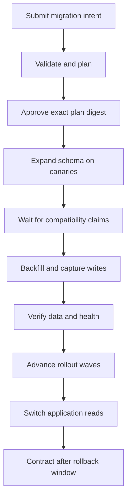
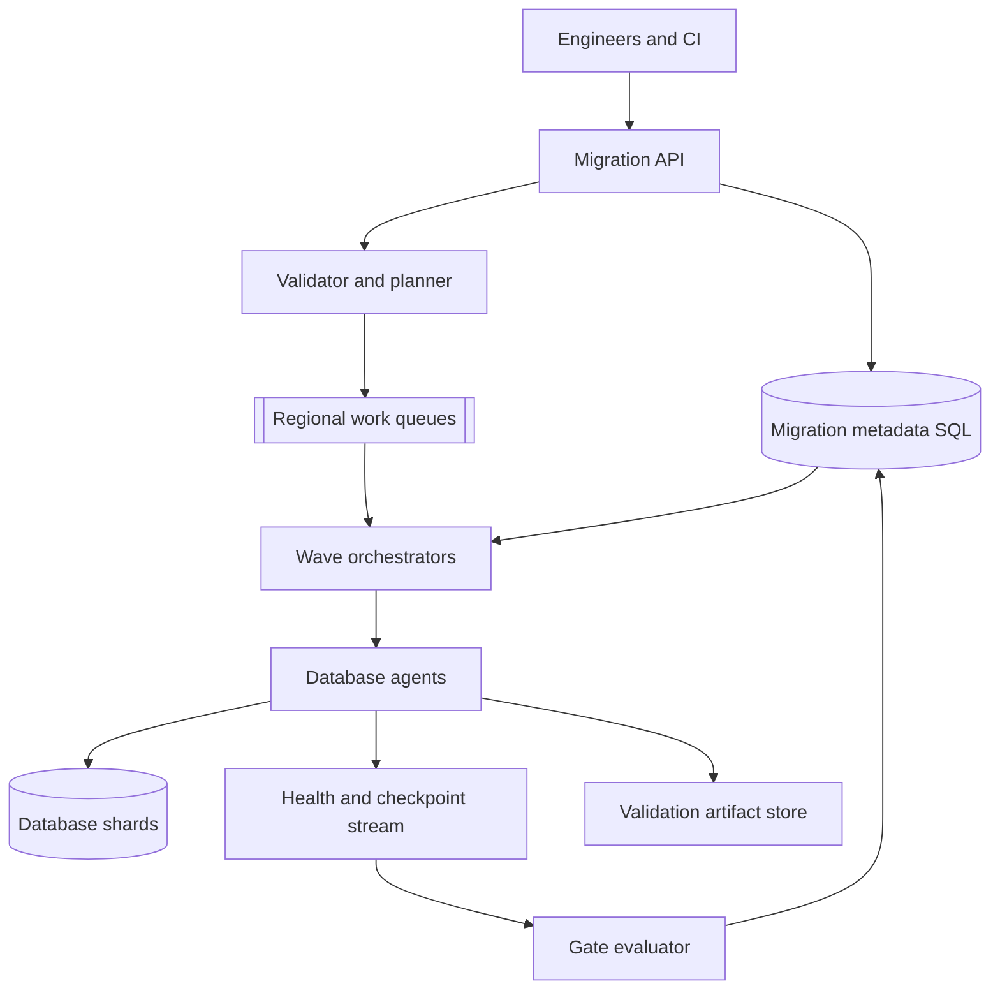
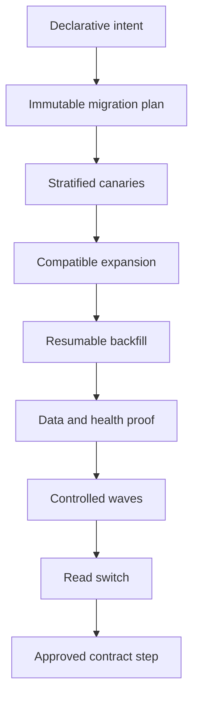

# Design a Global Database Schema Migration Control Plane

**Difficulty:** Hard  
**Primary themes:** databases, online schema evolution, queues, distributed orchestration, consistency, reliability, backfills, observability  
**Interview time budget:** approximately 40–45 minutes  
**Educational walkthrough:** intentionally more detailed than the spoken interview answer

## Rotation note

Recent walkthroughs covered batch AI inference, data quality monitoring, transaction coordination, returns and refunds, malware scanning, privacy deletion, feature flags, online LLM inference, counters, WebSockets, and DNS. Today’s problem rotates into database infrastructure: safely changing schemas and backfilling data across thousands of independently operating database clusters without taking applications offline.

## Framework note

This walkthrough follows Hello Interview’s public [Delivery Framework](https://www.hellointerview.com/learn/system-design/in-a-hurry/delivery): define a small set of functional and non-functional requirements, identify core entities, map interfaces to those requirements, build a simple complete design, and then harden the design through focused deep dives. The interface and schema sections also apply the public [API Design](https://www.hellointerview.com/learn/system-design/core-concepts/api-design) and [Data Modeling](https://www.hellointerview.com/learn/system-design/core-concepts/data-modeling) guidance by deriving resources and fields from concrete operations and access patterns.

The prompt, dialogue, examples, architecture, failure analysis, and tradeoffs below are original.

---

# Interviewer prompt

> Design a global control plane that performs online database schema migrations across tens of thousands of relational database shards. Teams submit a desired change, such as adding a column, building an index, changing a data representation, or splitting a table. The platform should validate safety, roll out gradually, run resumable backfills, protect production traffic, expose progress, and pause or recover safely when databases or applications fail.

The central insight is that a schema migration is not one DDL statement. It is a versioned workflow spanning application compatibility, database metadata changes, background data movement, validation, traffic gates, and cleanup.

## Targeted clarifying questions with assumed interviewer answers

### 1. Which databases are in scope?

**Candidate:** “Should I support one relational engine or arbitrary databases?”

**Interviewer:** “Design primarily for MySQL- and PostgreSQL-like relational engines. Engine adapters may implement different DDL mechanisms. NoSQL schema evolution is out of scope.”

### 2. What kinds of migrations must be supported?

**Candidate:** “Only additive DDL, or destructive changes and data transformations too?”

**Interviewer:** “Support additive columns, indexes, constraints, type or representation changes, table replacements, and data backfills. Destructive cleanup is allowed only after explicit compatibility gates.”

### 3. Can applications be stopped?

**Candidate:** “May we schedule downtime or block writes?”

**Interviewer:** “Assume continuously serving systems. Short metadata locks may be tolerated within a small bound, but long blocking DDL and extended write outages are unacceptable.”

### 4. Who owns application changes?

**Candidate:** “Does the migration system deploy application code?”

**Interviewer:** “No. Application deployment is external, but services publish compatibility capabilities and traffic metrics. A migration may wait for evidence that all relevant versions can read or write both schemas.”

### 5. What is the unit of rollout?

**Candidate:** “Are we changing one database, or a logical table spread over many shards?”

**Interviewer:** “A migration targets a logical dataset that may exist on one to 50,000 database shards across regions. Roll out through canaries and waves.”

### 6. What scale should I assume?

**Candidate:** “How many migrations, targets, and backfilled rows?”

**Interviewer:** “Assume 10,000 migration requests/day, up to five million shard-target executions/day, 50,000 database shards, and backfills ranging from thousands to tens of trillions of rows.”

### 7. What correctness guarantee is required?

**Candidate:** “Can a backfill miss concurrent writes temporarily?”

**Interviewer:** “A migration cannot report success until every row in scope is represented correctly under the new schema, including writes concurrent with the backfill. No committed user write may be lost.”

### 8. How aggressive may the system be?

**Candidate:** “What production impact is acceptable?”

**Interviewer:** “Keep added p99 query latency below 2%, database CPU below configured headroom, replication lag below 30 seconds, and metadata-lock waits below two seconds. Automatically pause when a guardrail is violated.”

### 9. What does rollback mean?

**Candidate:** “Must every migration be automatically reversible?”

**Interviewer:** “Rollback means returning applications to the previously supported representation without data loss. Before destructive cleanup that is usually possible; afterward it may require a forward repair. The system must state the rollback boundary explicitly.”

### 10. Can migrations run concurrently?

**Candidate:** “Can two teams modify the same logical table at once?”

**Interviewer:** “Unrelated tables may migrate concurrently. Conflicting changes on the same table or dependency chain must be serialized or proven compatible.”

### 11. Are cross-region control-plane failures in scope?

**Candidate:** “Should an ongoing migration survive a regional control-plane outage?”

**Interviewer:** “Yes. Database agents should fail safe, leases must fence stale controllers, and work should resume without repeating destructive effects.”

### 12. What is out of scope?

**Interviewer:** “Application deployment, database provisioning, query routing, disaster recovery for the databases themselves, and authoring arbitrary untrusted transformation code.”

### Scope statement to say aloud

> “I’ll design a control plane that validates a declarative migration, builds an expand–migrate–contract plan, schedules canaries and waves, executes engine-specific online DDL, performs throttled resumable backfills while capturing concurrent writes, verifies correctness, and gates destructive cleanup on application compatibility. Application deployment and database failover remain external.”

---

# 1. Requirements (~5 minutes)

## Core functional requirements

### FR1: Create and validate a safe migration plan

A team submits the logical dataset, desired schema or transformation, rollout policy, and safety limits. The system resolves physical shards, detects conflicts, classifies operations, checks application compatibility, and produces an immutable multi-step plan for approval.

### FR2: Execute online through canaries and waves

The platform runs engine-specific schema changes and resumable backfills with bounded concurrency. It monitors database and application health, automatically pauses unsafe work, and advances only after wave gates pass.

### FR3: Verify, finalize, and recover safely

The platform proves target coverage and data correctness, records an auditable outcome for every shard, supports pause/resume/cancel, fences stale workers, and performs contract or cleanup steps only after rollback prerequisites and approvals are satisfied.

## Below the line

- Deploying application binaries
- Provisioning or failing over database clusters
- Arbitrary customer transformation containers
- Query routing and connection pooling
- Full database backup and restore
- Cross-engine data replication
- Ad hoc analytical ETL

## Quantified non-functional requirements

### NFR1: Scale

- 50,000 database shards across multiple regions.
- 10,000 submitted migrations/day.
- Up to five million target-step executions/day.
- One migration may cover 50,000 shards and tens of trillions of rows.
- 10× bursts after major software releases.

### NFR2: Safety and correctness

- No committed application write is lost.
- Successful migrations have complete target coverage and validated data invariants.
- Destructive steps execute only after explicit compatibility and rollback gates.
- Every target action is idempotent or protected by a fencing token and observed postcondition.
- Conflicting migrations on the same schema resource cannot execute concurrently.

### NFR3: Production isolation

- Added p99 query latency below 2% under normal rollout.
- Respect per-database CPU, I/O, lock-wait, and replication-lag budgets.
- Metadata-lock wait below two seconds.
- Backfill work yields quickly when production traffic needs capacity.

### NFR4: Reliability

- 99.99% control-plane API availability.
- Durable plans, approvals, target states, checkpoints, and audit evidence.
- Survive worker, availability-zone, and home-region control-plane failures.
- Resume an interrupted migration without rescanning completed ranges unnecessarily.

### NFR5: Observability and control

- Status changes visible within 30 seconds.
- Pause new dispatch within 15 seconds of a breached guardrail.
- Per-wave progress, estimated completion, database impact, retry history, and rollback boundary are visible.
- Every approval and state transition is attributable to an authenticated actor.

## Consistency and availability contract

- Migration definition, plan version, approvals, dependency locks, wave transitions, and terminal state are strongly consistent within a migration’s home control-plane shard.
- Target execution uses at-least-once delivery with idempotent, postcondition-based actions.
- Each active target lease contains a monotonically increasing fencing token. A stale executor cannot commit state after reassignment.
- Backfill checkpoints are monotonic and durable; progress dashboards may be eventually consistent.
- Database and application health signals may be delayed, so gates use freshness requirements and conservative failure behavior.
- During loss of a writable control-plane quorum, agents may finish a bounded, already-leased chunk but must not begin destructive steps or advance waves.
- The platform favors safety over availability: when compatibility, freshness, ownership, or health is uncertain, the migration pauses.

### What to say aloud

> “The control plane is strongly consistent for plan ownership and phase transitions, but delivery to executors is at least once. Every action therefore needs an idempotency key, fencing token, and observed postcondition. If the system cannot prove safety, it pauses rather than guessing.”

---

# Scale estimates that change design decisions

## Control-plane request rate

```text
10,000 migrations/day ÷ 86,400 ≈ 0.12 migrations/s average
10× burst ≈ 1.2 migrations/s
```

Migration submission is small. We can afford transactional validation, immutable plan versions, and human approvals.

## Target-step rate

```text
5,000,000 executions/day ÷ 86,400 ≈ 58 executions/s average
10× burst ≈ 580 executions/s
```

The raw rate is moderate, but operations are long lived and highly skewed. The scheduler must manage leases and fairness without polling every shard continuously.

## Heartbeat volume

Suppose 100,000 target steps may be active and each agent reports every 10 seconds:

```text
100,000 ÷ 10 = 10,000 heartbeats/s
```

Do not write every heartbeat into the transactional migration row. Use an ephemeral heartbeat store or stream and persist only coarse checkpoints and state transitions.

## Backfill duration

Assume one logical table has 10 trillion rows. If 10,000 shards each safely scan 5,000 rows/s:

```text
10,000 × 5,000 = 50 million rows/s
10 trillion ÷ 50 million ≈ 200,000 seconds ≈ 55.6 hours
```

Even massive parallelism leaves a multi-day operation. The design needs resumable range checkpoints, continuously enforced resource budgets, and code compatibility that can coexist for days.

## Checkpoint size

If each shard processes 100,000-row chunks, a 10-trillion-row migration creates:

```text
10T ÷ 100,000 = 100 million chunk completions
```

Storing every chunk forever as a hot SQL row is expensive. Keep current per-range checkpoints in a compact target state, append audit events to object storage or a log, and compact completed contiguous ranges.

### What to say aloud

> “Submission traffic is tiny, but long-running fan-out and heartbeats dominate. A trillion-scale backfill can last days, so I need durable resumability and compatibility across versions. Heartbeats belong in an ephemeral path; authoritative phase and checkpoint changes remain transactional.”

---

# 2. Core entities (~2 minutes)

| Entity | Purpose |
|---|---|
| **Migration** | Immutable intent, owner, logical dataset, desired outcome, safety policy, and lifecycle state |
| **PlanVersion** | Ordered expand, migrate, verify, switch, and contract steps with a content digest |
| **Target** | One physical database shard and table governed by the migration |
| **TargetStep** | Execution state of one plan step on one target |
| **ExecutionLease** | Executor ownership, expiry, generation, and fencing token |
| **BackfillRange** | Stable key range, snapshot boundary, checkpoint, and reconciliation state |
| **CompatibilityClaim** | Application version evidence describing readable and writable schema versions |
| **SafetyGate** | Metric, freshness, threshold, evaluation window, and pass/fail decision |
| **ValidationArtifact** | Counts, checksums, samples, query plans, or invariant evidence |
| **SchemaLock** | Serialized ownership of a logical schema resource or dependency |
| **AuditEvent** | Append-only actor, decision, state transition, and evidence reference |

The core separation is between the immutable plan, per-target execution, and evidence used to advance phases. Progress is not proof; the system advances only from durable target outcomes and gate results.

### What to say aloud

> “I’ll model the migration once, then fan it out into target-step state per physical shard. Leases describe who may act, while validation artifacts and safety gates explain why a phase may advance. Schema locks prevent incompatible plans from overlapping.”

---

# 3. API or system interface (~5 minutes)

The public control plane uses REST or gRPC. Engine agents use a lease protocol. Tenant, organization, environment, permitted databases, approval role, and audit actor derive from authentication; clients cannot assert them in the request.

## Create a migration

```http
POST /v1/schema-migrations
Authorization: Bearer <service-token>
Idempotency-Key: orders-add-total-v3
Content-Type: application/json

{
  "dataset": "commerce.orders",
  "desired_change": {
    "type": "REPLACE_REPRESENTATION",
    "source_column": "total_cents",
    "destination_column": "total_micros",
    "expression": "total_cents * 10000"
  },
  "rollout": {
    "canary_targets": 5,
    "wave_percentages": [1, 5, 20, 50, 100],
    "minimum_observation_seconds": 600
  },
  "limits": {
    "max_database_cpu_percent": 70,
    "max_replication_lag_seconds": 30,
    "max_metadata_lock_ms": 2000,
    "max_added_p99_latency_percent": 2
  },
  "rollback_policy": "REQUIRE_DUAL_WRITE_UNTIL_CONTRACT"
}
```

```json
{
  "migration_id": "mig_01JH4Z6D",
  "state": "VALIDATING",
  "status_url": "/v1/schema-migrations/mig_01JH4Z6D"
}
```

The server resolves `commerce.orders` to authorized physical targets and rejects an idempotency key reused with a different request hash.

## Inspect and approve the generated plan

```http
GET /v1/schema-migrations/mig_01JH4Z6D/plan
```

```json
{
  "plan_version": 3,
  "digest": "sha256:8c7a...",
  "targets": 12480,
  "steps": [
    "ADD_NULLABLE_DESTINATION_COLUMN",
    "WAIT_FOR_DUAL_WRITE_CAPABILITY",
    "BACKFILL_DESTINATION_COLUMN",
    "VERIFY_EQUIVALENCE",
    "WAIT_FOR_READ_SWITCH",
    "ENFORCE_NEW_INVARIANTS",
    "DROP_OLD_COLUMN_AFTER_RETENTION"
  ],
  "rollback_boundary": "DROP_OLD_COLUMN_AFTER_RETENTION",
  "risk": "HIGH"
}
```

```http
POST /v1/schema-migrations/mig_01JH4Z6D/approvals
Idempotency-Key: change-ticket-48291-db-approval

{
  "plan_version": 3,
  "plan_digest": "sha256:8c7a...",
  "decision": "APPROVE",
  "ticket": "CHG-48291"
}
```

Approval binds to the exact plan digest. A replan invalidates prior approval.

## Publish application compatibility

```http
PUT /v1/datasets/commerce.orders/compatibility/checkout-service

{
  "deployment_version": "checkout-2026.11.24.3",
  "readable_schema_versions": [17, 18],
  "writable_schema_versions": [17, 18],
  "dual_write_enabled": true,
  "traffic_fraction": 1.0,
  "expires_at": "2026-11-24T08:00:00Z"
}
```

The authenticated workload identity determines the service name. Claims expire so an old deployment cannot authorize cleanup indefinitely.

## Pause, resume, or cancel

```http
POST /v1/schema-migrations/mig_01JH4Z6D/actions
Idempotency-Key: incident-983-pause

{
  "action": "PAUSE",
  "reason": "Replication lag exceeded regional guardrail"
}
```

Resume requires fresh gates. Cancel means stop advancing and preserve the last safe compatible state; it does not blindly reverse completed DDL.

## Get status

```http
GET /v1/schema-migrations/mig_01JH4Z6D
```

```json
{
  "state": "BACKFILLING",
  "phase": "MIGRATE",
  "wave": 3,
  "targets": {
    "total": 12480,
    "succeeded": 2460,
    "running": 410,
    "paused": 7,
    "failed": 0
  },
  "backfill": {
    "rows_estimated": 870000000000,
    "rows_processed": 291400000000,
    "remaining_seconds_range": [19200, 28800]
  },
  "health": {
    "worst_cpu_percent": 66,
    "worst_replication_lag_seconds": 18,
    "added_p99_latency_percent": 0.8
  },
  "rollback_boundary_crossed": false
}
```

## Agent lease and checkpoint

```protobuf
message LeaseWorkRequest {
  string agent_id = 1;
  string region = 2;
  repeated string engine_capabilities = 3;
  int32 available_slots = 4;
}

message TargetStepLease {
  string migration_id = 1;
  string target_id = 2;
  string step_id = 3;
  string execution_id = 4;
  int64 lease_generation = 5;
  int64 fencing_token = 6;
  int64 expires_at_ms = 7;
  string plan_digest = 8;
  bytes engine_specific_command = 9;
}

message CheckpointRequest {
  string execution_id = 1;
  int64 fencing_token = 2;
  string range_id = 3;
  bytes completed_through_key = 4;
  string validation_digest = 5;
  ResourceImpact impact = 6;
}
```

### Identity from authentication

The edge derives:

- organization and environment;
- migration owner and audit actor;
- authorized logical datasets;
- permitted regions and database classes;
- approval roles;
- cost center and concurrency quota.

### What to say aloud

> “The client submits intent and safety policy, not arbitrary DDL to run everywhere. The server produces an immutable plan for an exact target set. Applications publish expiring compatibility claims, while agents lease fenced target steps and checkpoint stable key ranges.”

---

# 4. Data flow



---

# 5. High-level design (~10–15 minutes)

## Compact architecture



## Operation 1: Validate intent and build an immutable plan

The Migration API authenticates the caller, stores the request under an idempotency key, and transitions the migration to `VALIDATING`.

The planner resolves the logical dataset through a catalog:

```text
dataset_target
  logical_dataset_id
  target_id
  engine
  region
  database_cluster_id
  schema_name
  table_name
  primary_key_shape
  estimated_rows
  schema_fingerprint
  application_dependencies
```

It checks:

- target schemas match an expected starting fingerprint;
- the transformation is deterministic and approved;
- the engine adapter supports a safe mechanism;
- required primary or chunking keys exist;
- sufficient disk and replication headroom exists;
- no conflicting active migration owns the same schema resource;
- application dependencies can advertise the required compatibility;
- the requested cleanup has an explicit rollback boundary.

The planner converts intent into an expand–migrate–contract sequence.

**Expand** adds compatible structures without breaking old code.  
**Migrate** moves or derives data while old and new representations coexist.  
**Contract** removes the old representation only after all readers and writers have moved.

Example plan:

```text
1. ADD total_micros NULL
2. WAIT until every writer dual-writes total_cents and total_micros
3. BACKFILL rows where total_micros IS NULL
4. VERIFY total_micros = total_cents * 10000
5. WAIT until every reader uses total_micros
6. ADD constraints or make column NOT NULL safely
7. RETAIN old column for seven days
8. DROP total_cents after final approval
```

Do not perform the dangerous direct operation `ALTER total_cents TYPE BIGINT` across all shards. A shadow representation makes compatibility and rollback explicit.

### Authoritative metadata

```text
migrations
  organization_id
  migration_id
  idempotency_key
  request_hash
  logical_dataset_id
  state
  current_phase
  plan_version
  plan_digest
  rollback_boundary_step
  pause_generation
  version
  created_at, updated_at
  PRIMARY KEY (organization_id, migration_id)

plan_steps
  migration_id
  plan_version
  step_id
  ordinal
  phase
  action_type
  precondition_json
  postcondition_json
  rollback_action_json
  destructive
  PRIMARY KEY (migration_id, plan_version, step_id)

schema_locks
  resource_key
  migration_id
  lock_mode
  lease_epoch
  PRIMARY KEY (resource_key)
```

The plan is content-addressed. Any change creates a new version and invalidates approval.

## Operation 2: Acquire schema locks and start canaries

Before execution, the orchestrator transactionally acquires logical schema locks. Lock keys may include:

- dataset;
- table;
- column or index name;
- dependent view or foreign-key relationship.

Use exclusive locks for incompatible mutations and shared locks for proven-independent validation. Avoid permanent distributed mutexes held only in memory. Persist ownership and renew it with an epoch; failover increments the epoch and fences old orchestrators.

The orchestrator selects representative canaries:

- one small and one large shard;
- different engine minor versions;
- different regions;
- high-traffic and ordinary workloads;
- a replica topology representative of production.

It creates target-step rows and writes queue-outbox records in the same transaction.

```text
target_steps
  migration_id
  target_id
  step_id
  wave_id
  state
  attempt_count
  lease_generation
  fencing_token
  checkpoint_uri
  observed_schema_fingerprint
  validation_artifact_digest
  last_error_class
  version
  PRIMARY KEY (migration_id, target_id, step_id)

INDEX (migration_id, wave_id, state)
INDEX (region, state, next_eligible_at)
```

## Operation 3: Execute engine-specific online DDL

Regional agents pull compatible target steps. Keeping agents near databases avoids exposing privileged database credentials to a global service.

An engine adapter translates a logical operation into a safe mechanism:

- native nonblocking or concurrent index creation;
- instant or online additive DDL where supported;
- shadow-table copy plus change capture and atomic rename;
- validation-only constraints followed by later enforcement;
- chunked application-level backfill.

Before acting, the agent:

1. verifies the plan digest and fencing token;
2. reads current schema and compares the expected fingerprint;
3. checks database health and replication lag;
4. configures a strict metadata-lock timeout;
5. executes or resumes the idempotent action;
6. reads the schema again and records the postcondition.

Success is based on observed postcondition, not merely a successful RPC. If an agent times out after the database applied DDL, the next attempt observes that the desired column or index already exists with the exact definition and marks the step complete.

If an object exists with the same name but a different definition, the agent reports `POSTCONDITION_CONFLICT` and stops.

## Operation 4: Gate application compatibility

Schema expansion alone does not make destructive migration safe. The compatibility service aggregates expiring claims from every application dependency.

For the example representation change:

- all writers must first understand both columns;
- dual write must cover 100% of write traffic;
- the old and new values must agree for newly written rows;
- only then may the historical backfill begin at full speed;
- all readers must later support and use the new column;
- only after the rollback window may the old column be removed.

Claims include deployment version, traffic fraction, region, schema versions, and expiry. The gate evaluator also queries deployment inventory to detect a silent service that never published a claim.

Never infer compatibility solely from “no errors observed.” Absence of traffic or telemetry is not proof that an old binary is gone.

## Operation 5: Run throttled, resumable backfills

The backfill planner partitions each target table by stable primary-key ranges. If the primary key is composite, use lexicographic ranges. Avoid `OFFSET` pagination because concurrent inserts and deletes shift positions and large offsets become slow.

```text
backfill_ranges
  migration_id
  target_id
  range_id
  start_key
  end_key
  snapshot_boundary
  completed_through_key
  state
  rows_scanned
  rows_changed
  checksum_digest
  lease_generation
  version
  PRIMARY KEY (migration_id, target_id, range_id)
```

The agent updates small chunks:

```sql
UPDATE orders
SET total_micros = total_cents * 10000
WHERE id > :last_id
  AND id <= :chunk_end
  AND total_micros IS NULL;
```

The predicate is idempotent and avoids overwriting a newer dual-written value. After commit, the agent persists `completed_through_key` with its fencing token.

The controller adjusts chunk size and sleep time using feedback from:

- foreground p99 latency;
- database CPU and I/O queue depth;
- lock waits and deadlocks;
- replication lag;
- buffer-cache pressure;
- rows updated per second.

Production traffic owns the budget. A breached guardrail stops new chunks and lets already-open transactions finish quickly.

## Operation 6: Verify canaries, advance waves, and finalize

After each target step, validators collect:

- schema fingerprints;
- row counts and null counts;
- deterministic checksums by primary-key range;
- source-to-destination equivalence samples;
- constraint violations;
- query latency and error rates;
- replication lag and storage growth;
- execution plans for important queries.

The gate evaluator requires fresh signals across a minimum observation window. It then records an immutable decision artifact.

Wave advancement uses a compare-and-set:

```sql
UPDATE migrations
SET current_wave = current_wave + 1,
    version = version + 1
WHERE migration_id = :id
  AND current_wave = :expected_wave
  AND state = 'RUNNING'
  AND version = :expected_version;
```

Only one orchestrator advances the wave. The next wave is materialized through a transactional outbox.

After all targets satisfy the migrate and verify phases, the platform waits for reader-switch compatibility. Contract steps require:

- 100% fresh new-schema read capability;
- zero observed old-schema reads over a retention window, using query telemetry or explicit instrumentation;
- backups or recovery evidence required by policy;
- final human approval for destructive changes;
- no active rollback request;
- exact target and schema-fingerprint reconciliation.

The final state records the plan digest, target set digest, validation summary, cleanup boundary, and audit references.

### What to say aloud

> “I build an immutable expand–migrate–contract plan, lock the logical schema resource, and begin with representative canaries. Agents execute fenced, postcondition-based operations near each database. Backfills use stable key ranges and adaptive throttling. Fresh application claims and database health gates control every wave, and destructive cleanup is a separate approved phase.”

---

# 6. Deep dives (~10–15 minutes)

## Deep dive 1: Compatibility and the expand–migrate–contract protocol

### Where the baseline breaks

Running one DDL command everywhere ignores application version skew:

- an old writer does not populate a new required column;
- a new writer changes representation while old readers still parse the old one;
- a rolling deployment leaves binaries from multiple versions active for hours;
- offline workers or disaster-recovery regions restart old code later;
- a column drop succeeds on canaries but breaks a rare query path;
- rollback of application code becomes impossible after destructive DDL.

### Plausible approaches

| Approach | Benefit | Tradeoff |
|---|---|---|
| Stop applications and run DDL | Simple consistency story | Violates availability requirement |
| Trust deployment completion | Easy integration | Misses stale or unregistered consumers |
| Versioned expand–migrate–contract | Supports mixed versions and rollback | More phases and temporary storage |
| Database compatibility views only | Hides some changes | Adds query complexity and cannot solve every write path |

### Selection

Use versioned expand–migrate–contract with explicit application capability gates.

### Compatibility matrix

For each phase, define allowed binaries and schemas:

| Phase | Old app | Transitional app | New app | Database state |
|---|---:|---:|---:|---|
| Before expand | yes | no | no | old only |
| Expanded | yes | yes | if backward compatible | old + empty new structure |
| Dual write | read yes, write restricted | yes | yes | both populated for new writes |
| Backfilled | read yes | yes | yes | historical and new rows represented twice |
| Read switch | rollback-capable only | yes | yes | new is authoritative, old retained |
| Contracted | no | no | yes | old representation removed |

The planner should generate this matrix and identify the exact irreversible boundary.

### Type changes

Many type changes that appear simple are unsafe in place because they rewrite a table, hold locks, or change semantics. Prefer:

1. add a destination column;
2. deploy dual-write code;
3. backfill only missing destination values;
4. validate equivalence;
5. switch reads;
6. retain the source through rollback window;
7. drop later.

If database triggers provide dual write, they reduce application coordination but add hidden write latency and operational coupling. Prefer application dual write when teams can implement it; use triggers as a carefully bounded adapter where necessary.

### Index creation

Even “concurrent” index creation can consume I/O, increase replication lag, or fail late. Build on canaries, monitor disk and query plans, and treat invalid partial indexes as explicit cleanup artifacts. Do not automatically route queries to the new index; application or optimizer behavior remains a separate gate.

### Constraint rollout

For an expensive constraint:

1. add it without validating historical rows if the engine supports this;
2. prevent new violations;
3. scan historical data in chunks;
4. remediate violations;
5. mark the constraint validated.

This separates foreground write protection from the historical scan.

### Rollback semantics

Rollback is phase-dependent:

- before expand: cancel with no database effect;
- after expand: leave harmless additive structures or remove them later;
- during dual write/backfill: stop backfill and switch reads/writes back to old representation;
- after read switch but before contract: switch application behavior back, preserving both forms;
- after contract: automatic rollback may be impossible; use a forward repair or restore process.

Expose this boundary prominently rather than promising universal rollback.

### What to say aloud

> “Schema compatibility is a protocol between database state and every live application version. Expand keeps old code working, migrate maintains both forms, and contract is deliberately delayed. Rollback is easy before contract and may become a forward repair afterward, so I make that boundary explicit.”

## Deep dive 2: Correct online backfill under concurrent writes

### Where the baseline breaks

A naive full-table scan races with foreground writes:

1. backfill reads an old value;
2. application updates the source and destination;
3. backfill writes its stale derived value over the new destination.

Other failures include:

- skipped or duplicated rows from offset pagination;
- a worker crash after committing data but before checkpointing;
- inserts behind the scanner’s cursor;
- long transactions bloating logs and replicas;
- retries issuing a non-idempotent transformation twice;
- snapshot retention exhausting storage.

### Plausible approaches

| Approach | Benefit | Tradeoff |
|---|---|---|
| Stop writes during backfill | Simple | Unavailable for hours or days |
| One long repeatable-read snapshot | Stable view | Long snapshot pressure and still needs change reconciliation |
| Dual write before range backfill | Simple ownership for new writes | Requires application coordination |
| Snapshot plus CDC catch-up | General and precise | More infrastructure and ordering complexity |
| Conditional idempotent updates | Safe for many derived columns | Not enough for arbitrary multi-row transformations |

### Selection

Use one of two declared strategies per migration:

1. **Dual-write strategy:** establish correct new writes first, then conditionally backfill missing historical values.
2. **Snapshot-plus-CDC strategy:** record a change-log boundary, scan a consistent snapshot, replay ordered changes through a high-water mark, briefly fence or validate the handoff, then switch authority.

For the column example, dual write plus `destination IS NULL` is simpler and safer.

### Stable range partitioning

Partition by immutable or monotonically ordered primary-key ranges. Record the target’s initial high-water key. Rows inserted above it are handled by dual write or CDC, not by extending the historical scan indefinitely.

If primary keys can change, range ownership becomes ambiguous. Use an immutable surrogate key or CDC-based enumeration.

### Checkpoint ambiguity

Suppose a worker commits database updates and crashes before saving its checkpoint. The range will repeat. That is safe only if:

- the transformation is deterministic;
- the write has a guard such as `destination IS NULL` or a source-version predicate;
- repeated execution cannot increment, append, or emit duplicate side effects;
- validation is based on database state, not attempt count.

For non-idempotent transformations, write a per-row migration version or transactional deduplication marker, though that adds storage and write cost.

### Avoiding stale overwrite

For dual-write backfills:

```sql
UPDATE orders
SET total_micros = total_cents * 10000
WHERE id BETWEEN :lo AND :hi
  AND total_micros IS NULL;
```

If `NULL` is a valid business value, use an explicit migration-version marker or compare source row version:

```sql
UPDATE orders
SET total_micros = :derived,
    migrated_from_version = :source_version
WHERE id = :id
  AND row_version = :source_version
  AND migrated_from_version < :source_version;
```

The compare prevents a stale scanner from overwriting a newer foreground write.

### CDC ordering and handoff

For snapshot plus CDC:

1. record log position `L0`;
2. scan a snapshot consistent at or before `L0`;
3. replay changes after `L0` in per-key commit order;
4. reach a current high-water mark `L1`;
5. verify lag is zero or within a fenced handoff;
6. switch reads or table names atomically where supported;
7. continue CDC through a rollback window.

Exactly-once CDC delivery is unnecessary if applying a change is idempotent by source log position and key. Persist the greatest applied source position transactionally with destination changes or use per-key version comparison.

### Throttling controller

Static “1000 rows per batch” limits do not generalize. A controller can adjust chunk work:

```text
if replication_lag or p99_latency exceeds limit:
    halve chunk size and increase sleep
elif all signals stay below low watermark:
    grow chunk size slowly
```

Use additive increase and multiplicative decrease to approach available capacity without oscillating wildly. Cap transaction duration and affected rows independently.

### Validation

Use layered validation:

- row and null counts per range;
- deterministic aggregate hashes over canonical values;
- source/destination equivalence predicates;
- targeted sampling;
- business invariants such as sum preservation;
- continuous validation of newly written rows;
- full reconciliation before contract.

Checksums are evidence, not magic: weak commutative hashes can hide swaps or collisions. Include range identity, counts, and a strong digest over canonical ordered records when full proof is required.

### What to say aloud

> “I establish ownership of concurrent writes before scanning history. For simple representation changes, applications dual-write and the scanner fills only missing values with a version guard. For table replacement, I combine a stable snapshot with CDC and a recorded log boundary. Retries are safe because the postcondition, not execution count, defines completion.”

## Deep dive 3: Distributed orchestration, waves, and failure recovery

### Where the baseline breaks

A single controller looping through 50,000 shards creates:

- one failure domain;
- duplicate execution after failover;
- hot metadata rows;
- head-of-line blocking across regions and engines;
- synchronized load spikes when a wave starts;
- ambiguous state when database calls time out;
- unsafe continuation with stale telemetry.

### Plausible approaches

| Approach | Benefit | Tradeoff |
|---|---|---|
| One central sequential coordinator | Simple | Slow and fragile |
| Fully autonomous database agents | Scalable | Hard to enforce global waves and conflicts |
| Queue-driven stateless workers only | Elastic | Needs durable phase authority and fencing |
| Hierarchical orchestrators plus agents | Scalable, locality-aware, auditable | More control-plane components |

### Selection

Use a hierarchical design:

- a home-shard orchestrator owns migration phase and wave;
- regional orchestrators materialize target work and enforce regional budgets;
- agents near databases execute fenced steps;
- a gate service aggregates fresh metrics and evidence;
- transactional outboxes bridge state changes to queues.

### Lease and fencing protocol

Every target-step assignment increments a generation and obtains a fencing token. Agents include the token in checkpoints and completion.

If worker A pauses and its lease expires, worker B receives token 42. A late completion from worker A with token 41 is rejected by the control plane. For actions that modify the database directly, include a migration metadata table on the target where practical:

```text
schema_migration_fence
  migration_id
  step_id
  greatest_fencing_token
  observed_postcondition_digest
```

The agent updates or checks the fence transactionally before a chunk. For engine-level DDL that cannot participate in the same transaction, rely on short leases, advisory locks where appropriate, strict preconditions, and postcondition reconciliation. Never assume an RPC timeout means failure.

### Transactional outbox

When a target step becomes runnable, write both its state and an outbox record in one database transaction. A relay publishes the message at least once. Duplicate queue messages are harmless because leasing is conditional.

This avoids the dual-write failure where metadata says `READY` but no queue message exists, or a message exists for uncommitted state.

### Wave design

Choose waves by both percentage and risk dimensions. Random 1% can miss an entire engine version or high-traffic region. Stratify targets by:

- region;
- database engine and version;
- size and write rate;
- replica topology;
- customer or business criticality;
- existing schema fingerprint.

Apply jitter so thousands of targets do not begin lock acquisition simultaneously.

### Gate freshness and hysteresis

A metric under threshold once is not enough. Require:

- signal timestamp newer than a freshness bound;
- a minimum observation window;
- enough traffic to make the measurement meaningful;
- consecutive healthy intervals;
- separate pause and resume thresholds to prevent flapping.

For example, pause at replication lag above 30 seconds and resume only after it remains below 10 seconds for five minutes.

### Failure handling

- **Agent crash before action:** lease expires; retry.
- **Agent crash during idempotent chunk:** transaction commits or aborts; retry from last durable checkpoint.
- **DDL RPC timeout:** read schema and engine operation status; do not immediately issue conflicting DDL.
- **Database unavailable:** exponential backoff and pause target; do not fail entire migration immediately.
- **Canary validation fails:** halt later waves automatically and preserve evidence.
- **Control-plane region fails:** promote a replica with a higher epoch; regional orchestrators reject old epoch work.
- **Queue unavailable:** state remains durable in outbox and is published later.
- **Metric pipeline stale:** fail the gate closed.
- **Application claim expires:** pause before the next compatibility-sensitive step.

### Fairness and admission control

Multiple migrations compete for the same databases. Enforce:

- one disruptive operation per cluster or configured resource pool;
- organization and team concurrency quotas;
- weighted priority for urgent security or compliance changes;
- disk-space reservations for index or shadow-table growth;
- backfill token buckets per database and replica set;
- global limits on simultaneous contract steps.

Do not let an urgent priority bypass correctness gates. Priority changes scheduling order, not safety requirements.

### Observability

Measure:

- queue age and active leases;
- target-step duration by engine and operation;
- retry and ambiguous-timeout rates;
- metadata-lock wait and aborted DDL;
- rows scanned and changed per second;
- backfill checkpoint age;
- database CPU, I/O, cache pressure, and replication lag;
- application error rate and p99 delta;
- gate evaluation freshness and reason;
- canary-to-wave regression rate;
- time spent waiting for application compatibility;
- count of migrations near or beyond rollback boundary.

### What to say aloud

> “A home orchestrator owns phase, regional controllers own budgets, and agents own only fenced target leases. Transactional outboxes make dispatch reliable. Waves are stratified, not merely random, and gates require fresh sustained evidence. Any ambiguity—stale metrics, expired compatibility, or uncertain DDL—pauses advancement.”

---

# Reliability and operational details

## Migration state machine

```text
DRAFT -> VALIDATING -> AWAITING_APPROVAL -> EXPANDING
                                           |
                                           v
                              WAITING_FOR_WRITE_COMPATIBILITY
                                           |
                                           v
                                      BACKFILLING
                                           |
                                           v
                                       VERIFYING
                                           |
                                           v
                               WAITING_FOR_READ_SWITCH
                                           |
                                           v
                                      CONTRACTING
                                           |
                                           v
                                       SUCCEEDED

Any active state -> PAUSING -> PAUSED -> previous safe state
Any pre-contract state -> CANCELLING -> CANCELLED_SAFE
Irrecoverable invariant failure -> FAILED_NEEDS_INTERVENTION
```

State transitions use compare-and-set versions and append an audit event in the same transaction.

## Retry classification

- Agent or network failure: retry after lease expiry.
- Database overload: adaptive throttle and later retry.
- Metadata-lock timeout: safe retry with jitter; do not increase lock timeout automatically.
- Deadlock in a small chunk: retry with smaller chunk.
- Schema fingerprint mismatch: stop for replan or manual review.
- Postcondition already satisfied: record idempotent success.
- Same object name with incompatible definition: fail target safely.
- Disk headroom violation: pause before creating index or shadow table.
- Transformation invariant violation: quarantine range, halt wave, and require repair policy.
- Stale compatibility or telemetry: pause, not fail.

## Multi-region behavior

Assign each migration a home control-plane region based on dataset policy. Replicate authoritative metadata synchronously across availability zones and asynchronously to an allowed paired region.

Regional failover increments a migration epoch. Queue messages, leases, checkpoints, and completion requests carry the epoch. Old orchestrators cannot advance waves after failover.

Agents continue only bounded already-leased, non-destructive chunks during control-plane interruption. They stop before acquiring new ranges, renaming tables, enforcing constraints, or dropping objects.

## Backpressure

- Reject plans that exceed disk, change-log, or deadline feasibility.
- Limit active work per database cluster, not merely per migration.
- Slow planners when target materialization outpaces execution.
- Bound heartbeat cardinality and aggregate high-frequency signals.
- Allow the evidence store and analytics pipeline to lag without losing authoritative target state.
- Pause low-priority backfills during traffic peaks.

## Security

- Mutual TLS and workload identity between control plane, orchestrators, and agents.
- Short-lived database credentials scoped to approved operations and targets.
- Parameterized, adapter-generated SQL; no arbitrary submitted SQL by default.
- Separate approval roles for high-risk and destructive changes.
- Encrypt plan artifacts, credentials, checkpoints, and validation samples.
- Redact customer values from validation evidence; prefer counts and digests.
- Sign plan digests and audit events.
- Restrict agent egress and isolate production environments.

## Reconciliation

Reconcilers continuously find:

- runnable steps missing outbox delivery;
- expired leases still marked running;
- completed database postconditions missing control-plane completion;
- target schemas drifting from plan fingerprints;
- all targets complete but phase not advanced;
- stale or missing compatibility dependencies;
- orphan shadow tables, invalid indexes, triggers, or CDC slots;
- migrations holding schema locks without live ownership;
- contract-ready migrations waiting beyond policy.

Reconciliation observes before mutating. Destructive cleanup always requires the same gates as the original workflow.

---

# Final design

The final platform contains:

1. An authenticated Migration API accepting declarative intent, rollout policy, and safety limits.
2. A catalog resolver and validator that freezes an exact target set and starting schema fingerprints.
3. A planner that emits an immutable, content-addressed expand–migrate–contract plan.
4. Strongly consistent metadata for migration phase, approvals, schema locks, waves, and target outcomes.
5. Transactional outboxes feeding regional work queues.
6. Hierarchical orchestrators enforcing waves, quotas, priorities, and regional budgets.
7. Database-local agents using engine adapters, short lock timeouts, fencing tokens, and postcondition checks.
8. Expiring application compatibility claims for dual-write and read-switch gates.
9. Stable primary-key range backfills with conditional idempotent writes, checkpoints, and adaptive throttling.
10. Optional snapshot-plus-CDC execution for table replacement and complex transformations.
11. Layered validators producing immutable schema, data, and health evidence.
12. Conservative gate evaluation, stratified canaries, pause/resume controls, reconciliation, and audited contract cleanup.



---

# Requirements check

| Requirement | How the design satisfies it |
|---|---|
| Validate safe plans | Catalog resolution, fingerprint checks, conflict locks, immutable plan digest |
| Online schema changes | Expand–migrate–contract and engine-specific online DDL adapters |
| Huge shard fan-out | Hierarchical orchestrators, regional queues, and target-step state |
| Safe concurrent writes | Dual write or snapshot-plus-CDC with versioned application |
| Resumable backfill | Stable key ranges, monotonic checkpoints, idempotent conditional writes |
| Low production impact | Adaptive chunking, per-cluster budgets, lock timeouts, automatic pause |
| No duplicate destructive effects | Fencing tokens, observed postconditions, schema fingerprints |
| Gradual rollout | Representative canaries, stratified waves, fresh sustained gates |
| Application compatibility | Expiring capability claims plus deployment inventory reconciliation |
| Safe rollback | Phase-specific rollback and explicit irreversible boundary |
| Regional failure recovery | Home-region epoch, durable metadata, fenced failover |
| Observability and audit | Validation artifacts, health metrics, actor-attributed audit events |

---

# Realistic interviewer follow-up questions with strong sample answers

## 1. “Why not let teams submit SQL directly?”

> “Raw SQL hides intent and is difficult to classify across engines. A declarative change lets the planner choose safe mechanisms, generate compatibility phases, validate preconditions, and produce idempotent postconditions. An expert escape hatch could exist, but it would require stronger review and isolation.”

## 2. “How do you know a timed-out DDL statement failed?”

> “I do not assume it failed. The next executor reads engine operation state and the actual schema. If the exact postcondition exists, the step succeeds idempotently. If the object exists with a different definition, the target stops for intervention.”

## 3. “Why do you need fencing tokens if SQL is idempotent?”

> “Idempotency handles repetition of the same intended action. Fencing prevents an old executor from checkpointing or continuing after ownership moved to a newer executor. We need both because stale work can otherwise overwrite progress or race a newer plan phase.”

## 4. “How do you avoid missing writes during a backfill?”

> “Before scanning history, I establish ownership of new writes through application dual write or CDC. The scanner updates only missing or source-version-matching rows. For table replacement, I scan a snapshot from a recorded log boundary and replay CDC through the cutover high-water mark.”

## 5. “Why not use OFFSET and LIMIT for chunking?”

> “Offsets become progressively expensive and move under inserts or deletes, causing skips or duplicates. I use stable primary-key ranges and a durable last processed key.”

## 6. “What if a worker commits a chunk and crashes before checkpointing?”

> “The chunk repeats. That is safe because its transformation is deterministic and guarded by destination state or source version. The checkpoint is an optimization; database postcondition remains authoritative.”

## 7. “Can you automatically roll back a dropped column?”

> “Not safely in general. Before contract, the old representation remains available and application behavior can switch back. After destructive cleanup, recovery may require a forward repair or restore. I expose and approve that rollback boundary explicitly.”

## 8. “How do you know all applications stopped reading the old column?”

> “I combine expiring capability claims with deployment inventory and observed query or instrumentation telemetry over a retention window. Missing or stale evidence fails closed. No single signal is sufficient.”

## 9. “How do you prevent two migrations from changing the same table?”

> “The planner calculates logical resource keys and acquires strongly consistent schema locks before execution. Incompatible locks serialize. A higher-level dependency graph can permit independent index builds or validations only when the planner proves compatibility.”

## 10. “What does a canary represent?”

> “Not merely a random shard. I stratify by region, engine version, data size, write rate, replica topology, and criticality so canaries exercise meaningful risk dimensions.”

## 11. “How do you avoid overloading replicas?”

> “Backfill tokens are scoped to the whole replica set. The controller watches primary and replica CPU, I/O, log generation, and lag, then reduces chunk size or pauses. Production traffic owns the budget.”

## 12. “What if metrics arrive late?”

> “Every gate includes a freshness bound. Stale or missing metrics cannot pass a wave. I also require sustained healthy windows and hysteresis before resuming.”

## 13. “How would you build an index on a huge table?”

> “Use the engine’s online or concurrent mechanism where available, verify disk headroom first, run representative canaries, cap concurrent builds per cluster, monitor replication lag and query latency, and explicitly clean invalid partial indexes after failure.”

## 14. “How do you estimate completion time?”

> “Use remaining key ranges, measured scan and update throughput per target, throttling duty cycle, expected wave observation time, and compatibility waits. I return a range because traffic load and guardrail pauses dominate uncertainty.”

## 15. “Why use relational metadata for the control plane?”

> “Migration phase, approvals, locks, wave advancement, leases, and target outcomes require conditional transactions and indexes. The rate is manageable when high-frequency heartbeats and large evidence artifacts use separate stores.”

## 16. “What happens during a control-plane regional outage?”

> “A paired region promotes with a higher epoch. Old orchestrators and leases are fenced. Agents may finish bounded non-destructive chunks already leased, but cannot begin cleanup or advance phases until authoritative control returns.”

## 17. “How do you handle a shard whose schema already drifted?”

> “The starting fingerprint fails validation. I classify the shard into a compatible repair path if one is explicitly planned; otherwise I exclude advancement and require replan or manual remediation. I never force DDL against an unknown starting state.”

## 18. “Can an urgent migration bypass canaries?”

> “Priority can raise scheduling order and allocate more capacity, but it cannot bypass correctness gates. A narrowly scoped emergency policy may shorten observation windows with explicit approval, but the resulting risk is recorded and destructive steps remain protected.”

---

# Common pitfalls

1. **Treating a migration as one DDL statement.** Application compatibility and data movement are part of the protocol.
2. **Dropping or renaming first.** Expand before contract.
3. **Claiming every migration is reversible.** State the irreversible boundary.
4. **Using one long transaction for backfill.** It bloats logs, holds locks, and harms replicas.
5. **Using OFFSET pagination.** It is slow and unstable under concurrent writes.
6. **Scanning history before protecting new writes.** Establish dual write or CDC first.
7. **Letting a backfill overwrite newer values.** Use missing-value or source-version guards.
8. **Assuming RPC timeout means DDL failure.** Observe the database postcondition.
9. **Relying on idempotency without fencing.** Stale executors can still corrupt progress.
10. **Writing every heartbeat to the migration row.** Separate ephemeral liveness from authoritative state.
11. **Using random canaries only.** Stratify by meaningful risk dimensions.
12. **Passing gates on stale metrics.** Freshness is part of the condition.
13. **Resuming immediately at the pause threshold.** Use hysteresis to avoid flapping.
14. **Trusting deployment completion as compatibility proof.** Reconcile live inventory and expiring claims.
15. **Running unrelated migrations without cluster-level budgets.** They can overload shared databases together.
16. **Ignoring disk amplification.** Indexes and shadow tables may require table-sized extra space.
17. **Treating progress counters as correctness evidence.** Verify schema fingerprints, coverage, and data invariants.
18. **Automatically cleaning shadow artifacts after ambiguous failure.** Reconcile ownership and rollback needs first.
19. **Allowing priority to bypass safety.** Urgency affects order, not correctness.
20. **Hiding contract cleanup inside the backfill phase.** Make destructive cleanup separately visible and approved.

---

# Concise 45-minute delivery script

## Minutes 0–5: requirements

> “I’ll focus on safe plan creation, online canary-and-wave execution, and verified recovery and cleanup. The key constraints are no lost writes, low production impact, and explicit rollback boundaries.”

## Minutes 5–7: entities

> “The core entities are Migration, PlanVersion, Target, TargetStep, ExecutionLease, BackfillRange, CompatibilityClaim, SafetyGate, ValidationArtifact, and SchemaLock.”

## Minutes 7–12: interfaces

> “Teams submit declarative intent. Approval binds to an exact plan digest. Applications publish expiring compatibility claims, and agents lease fenced target steps and checkpoint stable ranges.”

## Minutes 12–25: high-level design

> “Validate and freeze the target set, generate an expand–migrate–contract plan, acquire conflict locks, run representative canaries, expand schemas, gate on dual-write capability, backfill with stable ranges, verify data and health, advance stratified waves, switch reads, then perform separately approved cleanup.”

## Minutes 25–40: deep dives

Prioritize:

1. application compatibility and expand–migrate–contract;
2. backfill correctness under concurrent writes;
3. leases, fencing, waves, gates, and regional recovery.

## Minutes 40–45: close

> “The design treats schema migration as a versioned distributed protocol. Immutable plans and schema locks establish intent, dual write or CDC protects concurrent data, fenced idempotent agents make retries safe, and fresh sustained evidence controls each wave and the final irreversible contract step.”

---

# Closing mental model

Keep five questions separate:

1. **What is desired?** The immutable migration intent and plan.
2. **Who may act?** The current fenced executor and migration epoch.
3. **Can applications coexist?** The versioned compatibility matrix.
4. **Is the data complete?** Range coverage, CDC boundary, and validation evidence.
5. **May we remove the old world?** Fresh gates, rollback policy, retention window, and explicit approval.

Most migration incidents happen when “the DDL succeeded” is mistaken for “the system is safely migrated.”
