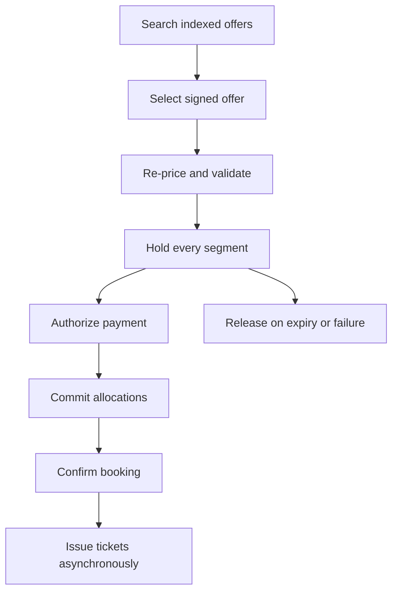
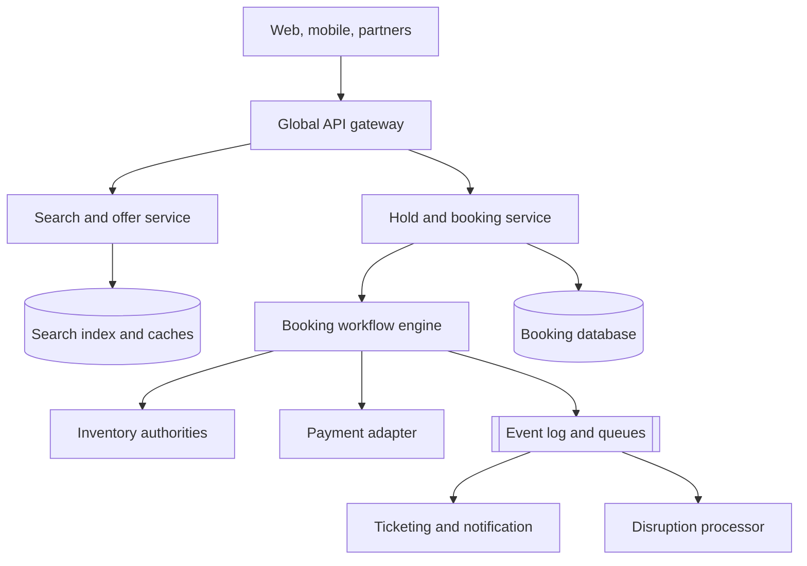
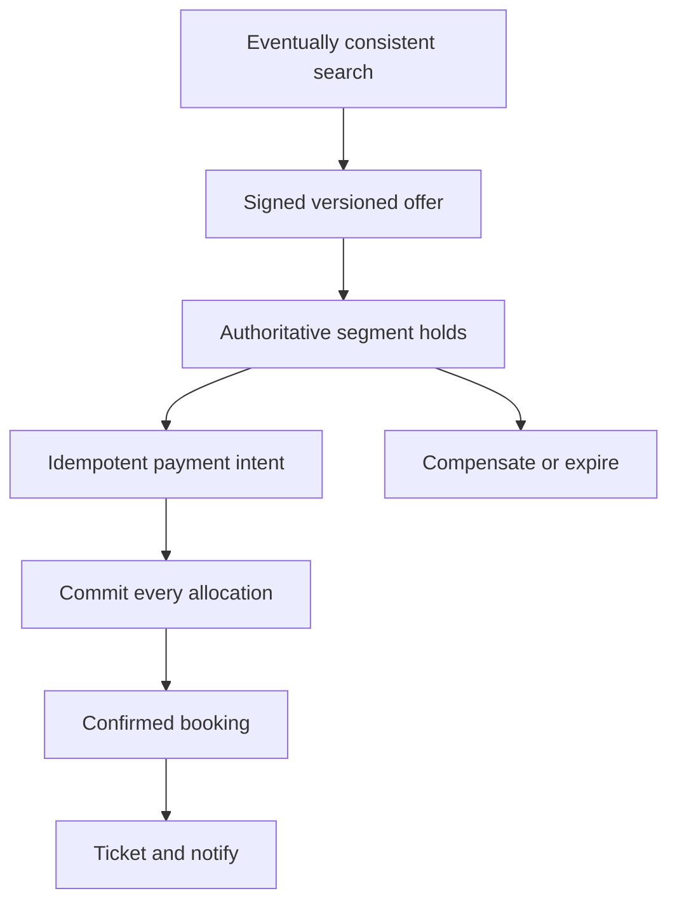

# Design a Global Airline Seat Inventory and Booking Platform

**Difficulty:** Hard  
**Primary themes:** scarce inventory, strong consistency, expiring holds, payments, sagas, queues, caching, reliability, multi-region systems  
**Interview time budget:** approximately 40–45 minutes  
**Educational walkthrough:** intentionally more detailed than the spoken interview answer

## Rotation note

Recent walkthroughs covered a database schema-migration control plane, batch AI inference, data quality, distributed transactions, returns, malware scanning, privacy deletion, feature flags, LLM serving, counters, WebSockets, and DNS. Today’s problem moves into a customer-facing transactional system where globally cached reads coexist with strictly controlled writes to scarce seat inventory.

## Framework note

This walkthrough follows Hello Interview’s public [Delivery Framework](https://www.hellointerview.com/learn/system-design/in-a-hurry/delivery): define focused requirements, identify core entities, derive interfaces, build the simplest complete design one operation at a time, and then use deep dives to harden the important bottlenecks and guarantees. The interface and storage discussion also applies its public [API Design](https://www.hellointerview.com/learn/system-design/core-concepts/api-design) and [Data Modeling](https://www.hellointerview.com/learn/system-design/core-concepts/data-modeling) guidance by introducing fields beside the operations that require them.

The prompt, dialogue, architecture, examples, calculations, and tradeoffs below are original.

---

# Interviewer prompt

> Design a global airline booking platform. Travelers search itineraries, see prices and approximate availability, temporarily hold seats, pay, and receive a confirmed booking. The platform must prevent accidental overselling beyond an explicit airline policy, handle retries and payment ambiguity safely, release expired holds, survive regional failures, and process airline schedule changes.

The key design separation is between the broad, eventually consistent search path and the narrow, strongly consistent inventory-and-booking path.

## Targeted clarifying questions with assumed interviewer answers

### 1. Are we building airline operations or a booking marketplace?

**Candidate:** “Does the platform operate flights, or sell inventory supplied by airlines?”

**Interviewer:** “Build the booking platform. Airlines publish schedules, fare rules, seat maps, inventory, and disruption events. Crew, aircraft assignment, and airport operations are out of scope.”

### 2. Must we support connecting itineraries?

**Candidate:** “Only nonstop flights, or multi-leg itineraries too?”

**Interviewer:** “Support one-way and round-trip itineraries with up to four flight segments. A booking may involve one or more airlines, but start with inventory managed through this platform.”

### 3. What does a user reserve?

**Candidate:** “Do travelers choose exact seats during purchase?”

**Interviewer:** “The essential inventory is seats within a fare bucket, such as economy refundable. Exact seat assignment is optional and may happen during booking or check-in. Treat assigned seats as another scarce resource.”

### 4. How fresh must search be?

**Candidate:** “Can search show stale price or availability?”

**Interviewer:** “Search may be eventually consistent for seconds. The hold operation must revalidate the current fare and inventory and may return a changed price or sold-out result.”

### 5. How long does a hold last?

**Candidate:** “Should inventory remain reserved while the traveler pays?”

**Interviewer:** “Yes. A normal hold lasts five minutes. Some partner or premium flows may receive a policy-controlled longer hold.”

### 6. What is the overselling policy?

**Candidate:** “Must physical seats never be oversold?”

**Interviewer:** “Never exceed a configured sellable-capacity limit per segment and fare bucket. That limit may be above physical capacity if an airline deliberately enables overbooking. The platform must not exceed the policy.”

### 7. What scale should I assume?

**Candidate:** “How many searches, flights, holds, and bookings?”

**Interviewer:** “Assume 50 million searches/day, two million hold attempts/day, 500,000 confirmed bookings/day, 300,000 active flight departures in the planning horizon, 10× traffic spikes, and globally distributed users.”

### 8. What payment behavior should we expect?

**Candidate:** “Can the payment provider return an ambiguous timeout?”

**Interviewer:** “Yes. Authorization, capture, refund, and webhook delivery may all be retried or delayed. Never double charge. A confirmed booking must have valid payment authorization or approved deferred-payment terms.”

### 9. What consistency does the user need?

**Candidate:** “Can two users believe they own the last seat?”

**Interviewer:** “Search may say one seat remains to multiple users, but only holds committed by the inventory authority count. A confirmed booking must reference a valid inventory hold or committed allocation.”

### 10. Can a booking span multiple inventory authorities?

**Candidate:** “How do we atomically hold several flight segments?”

**Interviewer:** “Do not assume a distributed transaction across airlines. Use a saga with ordered holds and compensating release. The final itinerary is confirmed only when every required segment and payment step succeeds.”

### 11. What happens when a flight changes or is cancelled?

**Candidate:** “Should the system rebook passengers automatically?”

**Interviewer:** “Ingest disruption events, mark affected bookings, notify travelers, and propose or reserve alternatives according to policy. Full optimization of reaccommodation is a deep-dive extension.”

### 12. What is out of scope?

**Interviewer:** “Aircraft and crew scheduling, airport check-in systems, loyalty accounting, fraud-model training, tax-rule authoring, and external global distribution system internals.”

### Scope statement to say aloud

> “I’ll focus on itinerary search, authoritative fare and inventory revalidation, expiring multi-segment holds, payment authorization, booking confirmation, cancellation, and disruption handling. Search will be highly available and eventually consistent; inventory allocation and booking state will use strong consistency and idempotent workflows.”

---

# 1. Requirements (~5 minutes)

## Core functional requirements

### FR1: Search itineraries and display offers

Travelers search by origin, destination, dates, passengers, and cabin. The system returns ranked itinerary offers with prices, fare rules, and approximate availability.

### FR2: Create an expiring, authoritative hold

The traveler selects an offer. The platform re-prices it, verifies fare rules, and conditionally reserves inventory on every segment for a bounded time. It returns a hold with the final price and expiry.

### FR3: Pay and confirm or cancel the booking

The platform authorizes payment, converts all valid holds into committed allocations, creates a passenger-name record and ticketing state, and returns one stable confirmation. Failed, abandoned, cancelled, or partially completed workflows release inventory and reconcile payment.

## Below the line

- Crew and aircraft scheduling
- Airport departure-control and boarding systems
- Loyalty-program accounting
- Fraud-model training
- Airline revenue-management algorithms
- Tax and fare-rule authoring
- External global distribution system implementation
- Customer-support tooling beyond workflow hooks

## Quantified non-functional requirements

### NFR1: Scale

- 50 million searches/day.
- Two million hold attempts/day.
- 500,000 confirmed bookings/day.
- 300,000 active flight departures in the searchable horizon.
- Up to four segments and nine passengers per booking.
- 10× bursts during holidays, weather events, and fare sales.

### NFR2: Correctness

- Authoritative allocated inventory never exceeds configured sellable capacity.
- One hold or booking consumes inventory at most once despite retries.
- Booking confirmation requires all required segment allocations and valid payment terms.
- The same idempotency key and request produce the same externally visible result.
- Price and fare rules are frozen for the hold duration unless the hold contract explicitly permits change.

### NFR3: Latency

- Search p95 below 500 ms and p99 below one second.
- Hold creation p99 below two seconds for a single-airline itinerary.
- Booking status reads p99 below 300 ms.
- Confirmation normally completes within five seconds after payment authorization, excluding external-provider delay.

### NFR4: Availability and durability

- Search availability of 99.99% or better.
- Booking and inventory APIs target 99.95%, favoring correctness when quorum is unavailable.
- No acknowledged hold, payment transition, committed allocation, or confirmed booking is lost.
- Survive worker and availability-zone failures; recover from a regional control-plane failure without double allocation.

### NFR5: Security and observability

- Minimize payment-card scope by using provider tokens.
- Encrypt passenger information and enforce regional policies.
- Auditable inventory, price, payment, and booking transitions.
- Status updates visible within seconds; reconciliation detects stuck workflows within minutes.

## Consistency and availability contract

- Search schedules, prices, and availability hints are eventually consistent and may be stale for several seconds.
- Hold creation always revalidates against the authoritative inventory and fare version.
- Inventory counters and hold/commit transitions are linearizable within an inventory authority partition.
- A booking record and its workflow version are strongly consistent in its home shard.
- Multi-segment booking uses a saga, not global atomicity. Partial allocations remain hidden from the user and are compensated if the saga fails.
- Payment provider communication is at least once; internal payment commands and webhooks are deduplicated.
- During a partition without an inventory quorum, search may continue with stale hints, but new holds on affected inventory fail or degrade to waitlist. The system does not guess.

### What to say aloud

> “I’ll make search fast and eventually consistent, but treat it only as a discovery layer. The hold endpoint is the correctness boundary: it re-prices and conditionally reserves inventory. Multi-segment booking is a saga, so users see either one final confirmation or a failure while compensations clean up hidden partial work.”

---

# Scale estimates that change design decisions

## Search traffic

```text
50,000,000 searches/day ÷ 86,400 ≈ 579 searches/s average
10× peak ≈ 5,800 searches/s
```

If one search expands into hundreds of schedule and fare combinations, querying transactional inventory synchronously would be wasteful. Precompute searchable itineraries and use caches plus a search index.

## Hold and booking writes

```text
2,000,000 holds/day ÷ 86,400 ≈ 23 holds/s average
10× peak ≈ 230 holds/s

500,000 bookings/day ÷ 86,400 ≈ 5.8 bookings/s average
10× peak ≈ 58 bookings/s
```

Global write throughput is modest, but it is uneven: one popular flight can become a hot inventory key. Partitioning and conditional updates matter more than aggregate QPS.

## Active holds

At a five-minute hold duration and 230 hold attempts/s at peak:

```text
230 × 300 seconds = 69,000 concurrent holds
```

With four segments and multiple fare buckets, active allocation rows can be several hundred thousand. A durable expiry index and asynchronous sweeper are practical; correctness must not depend on the sweeper running exactly on time.

## Search-index size

Assume 300,000 departures, 20 fare products each, and roughly 1 KB of searchable denormalized data:

```text
300,000 × 20 × 1 KB ≈ 6 GB before replicas and indexes
```

Direct flights are easy to index. Connecting itineraries are combinatorial, so precompute popular origin-destination/date combinations and assemble long-tail routes from a bounded graph search.

## Inventory hot key

A flash sale might drive 10,000 hold attempts in one second for 100 seats. Even though global hold traffic is low, one segment-fare bucket needs serialization or conditional atomic updates. A queue alone does not prevent overselling unless the consumer is the single authoritative writer or the database enforces the invariant.

### What to say aloud

> “The aggregate booking write rate is small, but demand concentrates on popular flights. Search should never fan out to inventory authorities. I’ll use denormalized indexes for discovery, then perform a conditional authoritative hold on a small number of hot inventory records.”

---

# 2. Core entities (~2 minutes)

| Entity | Purpose |
|---|---|
| **FlightSegment** | One scheduled origin-to-destination departure with operating identity and status |
| **FareProduct** | Cabin, booking class, price components, restrictions, and fare version |
| **InventoryBucket** | Sellable-capacity policy and allocated units for one segment and fare bucket |
| **Offer** | A priced, versioned itinerary returned by search |
| **Hold** | Expiring traveler intent covering one or more segment allocations |
| **HoldAllocation** | Units reserved from one inventory bucket under a hold |
| **Booking** | Customer-visible itinerary, passengers, total price, and workflow state |
| **Passenger** | Traveler identity and required travel-document references |
| **PaymentIntent** | Provider token, amount, authorization/capture state, and deduplication data |
| **TicketCoupon** | Ticketed right to travel on one segment, with lifecycle state |
| **DisruptionEvent** | Flight change or cancellation and affected booking-processing state |

The most important separation is `Offer` versus `Hold`. An offer is a stale-able proposal. A hold is an authoritative, expiring allocation.

### What to say aloud

> “Search creates versioned offers, but only hold allocations consume inventory. A booking coordinates passengers, payment, segment allocations, and ticket coupons. This keeps discovery data separate from the scarce-resource ledger.”

---

# 3. API or system interface (~5 minutes)

## Search itineraries

```http
GET /v1/flight-offers?origin=BOS&destination=SFO&departure_date=2026-12-18&passengers=2&cabin=ECONOMY
```

```json
{
  "offers": [
    {
      "offer_id": "off_9af2",
      "segments": [
        {
          "segment_id": "seg_BOS_DEN_421",
          "departure": "2026-12-18T08:00:00-05:00"
        },
        {
          "segment_id": "seg_DEN_SFO_118",
          "departure": "2026-12-18T11:20:00-07:00"
        }
      ],
      "fare_product_id": "fare_econ_flex",
      "fare_version": 184,
      "total": {"currency": "USD", "amount_minor": 92140},
      "availability_hint": "AVAILABLE",
      "offer_expires_at": "2026-11-25T07:05:00Z"
    }
  ],
  "next_cursor": "eyJvZmZzZXQiOjIwfQ"
}
```

The response clearly labels availability as a hint. `offer_id` refers to a signed or server-side offer snapshot so the client cannot modify segment or price fields.

## Create an authoritative hold

```http
POST /v1/holds
Authorization: Bearer <user-token>
Idempotency-Key: checkout-7832-hold-1
Content-Type: application/json

{
  "offer_id": "off_9af2",
  "passenger_count": 2,
  "selected_seats": {
    "seg_BOS_DEN_421": ["14A", "14B"]
  }
}
```

```json
{
  "hold_id": "hold_01JHE8D",
  "state": "HELD",
  "expires_at": "2026-11-25T07:09:30Z",
  "price": {"currency": "USD", "amount_minor": 92140},
  "fare_version": 184,
  "segments": [
    {"segment_id": "seg_BOS_DEN_421", "state": "HELD"},
    {"segment_id": "seg_DEN_SFO_118", "state": "HELD"}
  ]
}
```

If the price changed, return a structured `PRICE_CHANGED` response with a new signed offer requiring acceptance. Do not silently charge a higher amount.

## Confirm the booking

```http
POST /v1/bookings
Authorization: Bearer <user-token>
Idempotency-Key: checkout-7832-confirm-1
Content-Type: application/json

{
  "hold_id": "hold_01JHE8D",
  "passengers": [
    {"given_name": "Asha", "family_name": "Patel", "date_of_birth": "1998-04-17"},
    {"given_name": "Rohan", "family_name": "Patel", "date_of_birth": "1996-08-02"}
  ],
  "contact": {"email": "traveler@example.com"},
  "payment_method_token": "pm_tok_38f"
}
```

```json
{
  "booking_id": "bkg_01JHE92",
  "confirmation_code": "K7M4QX",
  "state": "CONFIRMED",
  "payment_state": "AUTHORIZED",
  "ticketing_state": "PENDING_ISSUANCE"
}
```

For slow external processing, the API may return `202 Accepted` with `state: CONFIRMING`; polling and event delivery reveal the final outcome.

## Get booking status

```http
GET /v1/bookings/bkg_01JHE92
```

```json
{
  "booking_id": "bkg_01JHE92",
  "confirmation_code": "K7M4QX",
  "state": "CONFIRMED",
  "segments": [
    {"segment_id": "seg_BOS_DEN_421", "status": "CONFIRMED", "seat": "14A"},
    {"segment_id": "seg_DEN_SFO_118", "status": "CONFIRMED", "seat": null}
  ],
  "payment_state": "CAPTURED",
  "ticketing_state": "ISSUED"
}
```

## Cancel a booking

```http
POST /v1/bookings/bkg_01JHE92/cancellations
Idempotency-Key: cancellation-bkg-01JHE92-1

{
  "reason": "CUSTOMER_REQUEST",
  "accept_refund": {"currency": "USD", "amount_minor": 79200}
}
```

Cancellation is a workflow because fare rules, ticket voiding, refunds, and inventory release may complete independently.

## Inventory authority command

```protobuf
message ReserveInventoryRequest {
  string hold_id = 1;
  string allocation_id = 2;
  string segment_id = 3;
  string fare_bucket_id = 4;
  int32 units = 5;
  int64 expected_fare_version = 6;
  int64 expires_at_ms = 7;
  string idempotency_key = 8;
}
```

### Identity from authentication

The API derives:

- customer or partner account;
- market and permitted sales channel;
- currency and payment-policy eligibility;
- passenger-data region;
- partner commission policy;
- rate limits and fraud context;
- audit actor.

The client does not supply an authoritative price, available-seat count, airline settlement account, or booking owner.

### What to say aloud

> “Search returns signed, versioned offers. Creating a hold re-prices and allocates inventory authoritatively. Confirmation references the hold and a tokenized payment method under a separate idempotency key. The APIs expose asynchronous states because payment and ticketing can outlive the original request.”

---

# 4. Data flow



---

# 5. High-level design (~10–15 minutes)

## Compact architecture



## Operation 1: Build searchable schedules and offers

Airlines publish schedule, fare, seat-map, and status updates into an ingestion log. Consumers normalize the data into:

```text
flight_segments
  segment_id
  marketing_carrier
  operating_carrier
  flight_number
  origin, destination
  departure_time, arrival_time
  aircraft_type
  status
  schedule_version

fare_products
  fare_product_id
  segment_or_market_key
  booking_class
  cabin
  currency
  base_amount_minor
  tax_rule_version
  restrictions_json
  fare_version
  valid_from, valid_until
```

Search documents denormalize route, times, duration, fare family, price, and an availability hint. They are partitioned by departure date and origin region, with replicas near users.

For popular city pairs, precompute nonstop and common connecting itineraries. For the long tail, perform a bounded graph search over schedule edges:

- at most four segments;
- minimum and maximum connection times;
- no impossible airport transfers;
- bounded total duration;
- fare combinability rules.

Cache search results by normalized query for tens of seconds. Invalidation is best effort; every result carries versions and an offer expiry.

The Offer Service signs or persists the exact segment and fare-version combination. Clients cannot alter it.

## Operation 2: Revalidate price and create a hold

The Hold Service loads the signed offer and verifies:

- it has not expired;
- every segment is still saleable;
- fare versions and rules remain valid;
- passenger count and channel qualify;
- the recalculated taxes and total match;
- selected seats, if any, are compatible.

If revalidation succeeds, a workflow attempts to reserve each segment. Order allocations by the scarcest or most failure-prone segment first to reduce compensation work. Use a deterministic order to avoid cyclic contention between simultaneous itineraries.

For each segment, call its inventory authority with a stable `allocation_id` and expiry. If any reservation fails, release earlier allocations and return sold out or a replacement offer.

The hold becomes externally `HELD` only after all required allocations succeed.

### Hold schema

```text
holds
  hold_id
  owner_id
  offer_digest
  state
  passenger_count
  currency
  total_amount_minor
  fare_version_set
  expires_at
  workflow_version
  created_at, updated_at
  PRIMARY KEY (hold_id)

UNIQUE (owner_id, create_idempotency_key)
INDEX (state, expires_at)

hold_allocations
  hold_id
  allocation_id
  segment_id
  fare_bucket_id
  units
  state
  inventory_version
  expires_at
  PRIMARY KEY (hold_id, allocation_id)
```

The `expires_at` index supports sweeping, but authoritative inventory checks expiry while processing new writes, so a delayed sweeper cannot permanently block inventory.

## Operation 3: Enforce inventory capacity

Partition inventory by `segment_id`, keeping fare buckets for that segment under one authority when possible. This supports atomic cabin or nested-bucket rules.

```text
inventory_buckets
  segment_id
  fare_bucket_id
  physical_capacity
  overbooking_limit
  sellable_capacity
  held_units
  committed_units
  version
  PRIMARY KEY (segment_id, fare_bucket_id)

inventory_allocations
  segment_id
  allocation_id
  hold_id
  fare_bucket_id
  units
  state
  expires_at
  booking_id
  version
  PRIMARY KEY (segment_id, allocation_id)

INDEX (segment_id, state, expires_at)
```

Within a transaction:

1. delete or mark expired allocations needed for this bucket, or compute live holds by indexed expiry;
2. deduplicate `allocation_id`;
3. verify `held_units + committed_units + requested_units <= sellable_capacity`;
4. insert the allocation and increment `held_units`;
5. append an inventory event through an outbox.

An SQL implementation can use a locked bucket row or optimistic compare-and-set:

```sql
UPDATE inventory_buckets
SET held_units = held_units + :units,
    version = version + 1
WHERE segment_id = :segment
  AND fare_bucket_id = :bucket
  AND version = :expected_version
  AND held_units + committed_units + :units <= sellable_capacity;
```

If zero rows update, retry after reading the new version or return sold out. The database invariant, not application timing, prevents overselling.

Fare buckets may nest inside a cabin. A revenue-management system might allow economy-flex demand to consume a shared economy pool. Model this as inventory controls within the same segment authority so updates across affected counters are atomic.

## Operation 4: Authorize payment and confirm booking

The client submits passengers and a provider payment token. The Booking Service creates a booking in `CONFIRMING` under an idempotency key.

```text
bookings
  booking_id
  owner_id
  confirmation_code
  hold_id
  state
  currency
  total_amount_minor
  payment_intent_id
  ticketing_state
  home_region
  workflow_version
  created_at, updated_at
  PRIMARY KEY (booking_id)

UNIQUE (owner_id, confirmation_idempotency_key)
UNIQUE (confirmation_code)

payment_intents
  payment_intent_id
  booking_id
  provider
  provider_payment_id
  amount_minor
  state
  command_sequence
  last_provider_event_id
  version
```

The workflow:

1. verify the hold is owned by the caller and not expired;
2. freeze passenger and contact data;
3. create one payment intent with a stable provider idempotency key;
4. request authorization;
5. convert every hold allocation from `HELD` to `COMMITTED` using the same booking ID;
6. transition the booking to `CONFIRMED`;
7. asynchronously issue ticket coupons and capture payment according to airline policy.

Payment-before-commit risks authorization without seats; commit-before-payment risks seats without money. The saga accepts that either can occur transiently:

- if payment authorizes but inventory commit fails, void the authorization and release allocations;
- if inventory commits but the payment response is ambiguous, query the provider by the stable payment ID before deciding;
- if payment definitively fails before commit, release the hold;
- if the workflow crashes, a reconciler resumes from durable state.

For a hold already created, segment commit should normally succeed because the allocation is owned by that hold. It can fail if the hold expired, was cancelled, or was administratively revoked.

## Operation 5: Expire holds and release inventory

Use two mechanisms:

1. a delayed queue or timing wheel schedules `ExpireHold(hold_id, expected_expiry)`;
2. a periodic sweeper scans the durable `(state, expires_at)` index.

Both are at least once. Expiry is conditional:

```sql
UPDATE holds
SET state = 'EXPIRING', workflow_version = workflow_version + 1
WHERE hold_id = :hold
  AND state = 'HELD'
  AND expires_at <= now()
  AND workflow_version = :expected_version;
```

The expiry workflow releases each allocation idempotently, then marks the hold `EXPIRED`.

Correctness does not depend on immediate physical deletion. Inventory authorities treat an expired `HELD` allocation as non-live and may reclaim it transactionally during a competing reservation.

A confirmation racing with expiry uses the same hold version. Exactly one transition from `HELD` wins: `CONFIRMING` or `EXPIRING`.

## Operation 6: Ticketing, cancellation, and disruption processing

After confirmation, an asynchronous ticketing worker creates one coupon per passenger-segment. Ticket issuance is idempotent by `(booking_id, passenger_id, segment_id)`.

Cancellation validates fare rules and returns a quoted refund. Once accepted, a saga:

1. marks the booking `CANCELLING`;
2. voids unused ticket coupons;
3. releases committed inventory according to departure and airline policy;
4. issues or records the refund;
5. marks the booking `CANCELLED`.

Do not release inventory twice if a refund webhook repeats. Inventory release uses the original stable allocation ID.

Airline schedule changes enter an ordered event log. The Disruption Processor finds affected coupons and marks bookings `DISRUPTED`. It may generate alternative offers or acquire protected reaccommodation holds. Customer notifications are derived from durable disruption workflow events, not from the ingestion request directly.

### What to say aloud

> “Search is a denormalized discovery path. The hold workflow re-prices, then reserves each segment through an authoritative partition. Capacity is enforced by conditional database updates. Booking confirmation is a durable saga across payment and inventory, while expiration, cancellation, ticketing, and disruptions are idempotent asynchronous workflows.”

---

# 6. Deep dives (~10–15 minutes)

## Deep dive 1: Preventing oversell under hot-key contention

### Where the baseline breaks

A cached `available = 1` value is not authoritative. Thousands of clients may read it simultaneously. A naive read-then-write race lets many holds consume the same last seat.

Other problems include:

- fare buckets sharing cabin capacity;
- hold expiry racing with confirmation;
- retries inserting duplicate allocations;
- a leader failing after database commit but before responding;
- multi-region writers partitioning and both accepting demand;
- airline overbooking limits changing during active holds.

### Plausible approaches

| Approach | Benefit | Tradeoff |
|---|---|---|
| Distributed cache counter | Very fast | Difficult durable correctness and failover |
| Queue all requests per flight | Natural serialization | Queue consumer still needs durable deduplication and failover |
| Transactional row lock or compare-and-set | Simple invariant | Hot row contention |
| Per-segment consensus authority | Clear linearizable ordering | More infrastructure and cross-region latency |
| Escrow inventory by region | Local low-latency writes | Rebalancing and stranded inventory complexity |

### Baseline selection

Use one authoritative home partition per flight segment, backed by a transactional database or replicated consensus group. Enforce the capacity inequality in the same transaction that creates the allocation.

Search replicas may be global, but hold requests route to the segment’s authority. For multi-segment itineraries, the booking saga contacts several authorities.

### Hot-flight mitigation

One database row can serialize thousands of contenders, but a flight usually has few successful seats. Techniques:

- reject clearly sold-out demand at edge caches as a hint, while never approving there;
- use admission tokens to limit concurrent requests reaching the authority;
- batch queued hold attempts briefly and evaluate them fairly;
- shard independent seat or fare resources only when shared-capacity invariants allow it;
- maintain a waitlist once remaining capacity reaches zero;
- return overload quickly instead of letting timeouts cause retry storms.

Do not shard one shared cabin counter arbitrarily; summing independently writable counters can exceed the limit.

### Regional escrow extension

If global authority latency becomes unacceptable, allocate inventory quotas to regional cells:

```text
global sellable capacity = 100
US cell escrow = 45
EU cell escrow = 30
APAC cell escrow = 15
central reserve = 10
```

Each cell can allocate only within its escrow. This preserves the global bound without synchronous cross-region consensus on every hold. A coordinator moves unconsumed quota between cells using versioned transfers.

Tradeoffs:

- inventory may be stranded in a quiet region;
- quota transfers need double-spend protection;
- sudden regional demand may wait despite global capacity;
- shared fare-bucket controls become more complicated.

Start with a home authority in an interview and introduce escrow only if latency or availability requirements demand active-active writes.

### Capacity changes

If an aircraft swap reduces capacity below current commitments, do not delete allocations. Record a negative availability condition and initiate an operational exception. Future holds stop. Airline policy decides reaccommodation or denied boarding.

If the airline increases overbooking allowance, version the policy and publish the new sellable capacity. Existing allocations keep their original evidence.

### Observability

Track allocation conflicts, conditional-update retries, authority latency, hot-key queue depth, sold-out rejection accuracy, expired-hold reclamation, committed versus held units, policy changes, and any invariant where live allocations exceed sellable capacity.

### What to say aloud

> “The database transaction is the seat-counting referee. Search caches can be wrong, but a hold succeeds only if a conditional update and allocation insert fit under sellable capacity. I route each segment to one authority; regional escrow is an optimization I would add only when cross-region latency justifies its complexity.”

## Deep dive 2: Multi-segment holds and saga semantics

### Where the baseline breaks

An itinerary with four segments spans multiple inventory authorities. No practical atomic transaction includes every airline, inventory database, payment provider, and ticketing system.

Potential failures:

- first segment holds but second sells out;
- all segments hold, but the response is lost;
- compensation release fails temporarily;
- one segment expires earlier because of clock or policy mismatch;
- two customers acquire opposite segment order and create contention;
- payment authorizes while a final allocation expires;
- the workflow service crashes between steps.

### Plausible approaches

| Approach | Benefit | Tradeoff |
|---|---|---|
| Global distributed transaction | Atomic mental model | External systems do not participate; poor availability |
| Best-effort parallel holds | Low latency | More partial allocations and compensation races |
| Ordered sequential saga | Simple and bounded | Higher latency |
| Parallel saga with deterministic compensation | Faster | More workflow complexity |

### Selection

Use a durable saga. For two to four segments, reserve in deterministic scarcity order. Execute independent segments in parallel only when latency matters and compensation volume is acceptable.

The workflow state is durable:

```text
booking_workflow
  workflow_id
  hold_id
  current_phase
  desired_terminal_state
  completed_steps_bitmap
  compensation_steps_bitmap
  next_retry_at
  version
```

Each command has a stable semantic ID, for example:

```text
reserve:<hold_id>:<segment_id>:<fare_bucket>
release:<allocation_id>
authorize:<payment_intent_id>:1
commit:<allocation_id>:<booking_id>
```

### Making compensation reliable

Compensation is not rollback in the database sense; it is a new action that may fail and retry.

- A release is idempotent: `HELD -> RELEASED`; repeating it returns the same result.
- A committed allocation cannot be released by the abandoned-hold compensator.
- The saga retries with backoff until success or escalates to reconciliation.
- Partial holds are not externally presented as confirmed bookings.
- The hold expiry is common across all allocations and includes safety time for payment.

### Reservation order

If segment A has two seats and segment B has 200, reserve A first. This reduces holds that later unwind. Estimate scarcity from authoritative or near-real-time inventory hints.

Use a deterministic tiebreaker such as `segment_id` so identical itineraries do not continually collide in different orders.

### Hold extension

Avoid arbitrary client-driven extension, which can monopolize inventory. A policy may grant one extension if:

- payment authentication is actively in progress;
- the fare remains valid;
- every allocation authority accepts the new expiry;
- a maximum total hold duration is not exceeded.

The extension itself is a saga. The hold-level expiry changes only after every allocation accepts; otherwise retain the earlier expiry.

### Confirmation versus expiry

The booking workflow first conditionally claims the hold:

```text
HELD -> CONFIRMING
```

The expiry workflow attempts:

```text
HELD -> EXPIRING
```

Only one compare-and-set wins. Once `CONFIRMING`, allocate a short server-controlled grace interval if policy permits, so payment completion is not racing the public expiry timestamp.

### What to say aloud

> “I cannot atomically reserve four flights and a payment provider, so I use a durable saga with stable command IDs. Scarce segments are held first. Partial success stays internal, releases retry idempotently, and confirmation races expiry through one versioned hold state transition.”

## Deep dive 3: Payment ambiguity and exactly-once customer outcomes

### Where the baseline breaks

Payment providers and networks create ambiguous outcomes:

- the authorization succeeded but our request timed out;
- the client retries booking confirmation;
- the provider sends the same webhook several times;
- a webhook arrives before the synchronous response;
- capture succeeds after cancellation began;
- refund succeeds but its response is lost;
- two workflow workers issue the same command.

“Exactly once” network delivery is unavailable. The system needs effectively-once state transitions.

### Plausible approaches

| Approach | Benefit | Tradeoff |
|---|---|---|
| Trust synchronous responses | Simple | Wrong under ambiguous timeouts |
| Generate a new payment request on retry | Easy | Double-charge risk |
| Provider idempotency key plus internal ledger | Safe and reconcilable | More state and workflows |
| Store card and charge locally | Control | Large security and compliance burden |

### Selection

Use provider tokens, stable provider idempotency keys, an internal payment-intent state machine, webhook deduplication, and active reconciliation.

Payment states might be:

```text
CREATED -> AUTHORIZING -> AUTHORIZED -> CAPTURING -> CAPTURED
                   |             |                    |
                   v             v                    v
              DECLINED       VOIDING              REFUNDING
                                  |                    |
                                  v                    v
                                VOIDED              REFUNDED
```

Every command increments a sequence and uses:

```text
provider_idempotency_key = hash(payment_intent_id, command_type, command_sequence)
```

### Handling an authorization timeout

Do not immediately issue a new authorization. Mark the intent `AUTHORIZING_UNKNOWN`, then query the provider by stable payment ID or wait for its webhook.

- If authorized, continue booking.
- If definitively absent, retry the same command key.
- If unresolved near hold expiry, policy may release inventory and later void a delayed authorization.

### Webhook inbox

Authenticate provider signatures, then insert events into an inbox table with a unique provider event ID:

```text
payment_webhook_inbox
  provider
  provider_event_id
  received_at
  payload_digest
  processing_state
  PRIMARY KEY (provider, provider_event_id)
```

The processor loads the payment intent and applies only legal monotonic transitions. An old `AUTHORIZED` event cannot move a `REFUNDED` intent backward.

### Booking confirmation boundary

The booking can be `CONFIRMED` after durable authorization and committed inventory, even if capture and ticket issuance are asynchronous. The exact product policy may instead require ticket issuance before displaying final confirmation; state names should make the distinction explicit.

Never place the provider call inside a database transaction while holding inventory locks. Persist intent, call externally, then apply the observed outcome conditionally.

### Reconciliation

A periodic reconciler compares internal intents with provider reports:

- authorizations without bookings;
- confirmed bookings without authorization;
- captured amounts not matching the frozen booking total;
- cancellations without void or refund;
- unknown synchronous outcomes older than a threshold;
- duplicate provider customer references.

Financial reconciliation is a correctness mechanism, not merely analytics.

### What to say aloud

> “I cannot guarantee exactly-once delivery to the payment provider. I guarantee effectively-once commands using stable provider keys and monotonic internal state. Ambiguous timeouts become an explicit unknown state that we query and reconcile; we never solve uncertainty by creating a fresh charge.”

---

# Reliability and operational details

## Hold state machine

```text
CREATING -> HELD -> CONFIRMING -> COMMITTED
     |        |          |
     v        v          v
  FAILED   EXPIRING   COMPENSATING
               |          |
               v          v
            EXPIRED     FAILED_SAFE
```

## Booking state machine

```text
CONFIRMING -> CONFIRMED -> CANCELLING -> CANCELLED
      |            |
      v            v
 FAILED_SAFE    DISRUPTED -> REACCOMMODATING
```

Transitions use optimistic versions and append an outbox event transactionally.

## Retry classification

- Search backend timeout: use another replica or partial results.
- Stale offer: re-price and return a new offer for acceptance.
- Inventory conflict: retry a bounded compare-and-set or return sold out.
- Inventory authority unavailable: fail the hold or offer waitlist; never assume availability.
- Saga worker crash: resume from durable completed-step bitmap.
- Payment timeout: query by stable provider ID before retry.
- Definite payment decline: release hold.
- Ticketing timeout: retry idempotently; booking and ticket state remain distinct.
- Notification failure: retry independently; never roll back a booking.
- Disruption-event duplicate: deduplicate by airline event ID and version.

## Multi-region behavior

Search is active-active with region-local indexes and caches. Booking records have a home region selected by passenger-data policy and proximity. Inventory segments have a home authority region or a consensus group.

Requests reaching another region route writes to the authority. Read-only booking status may use replicas with session tokens for read-your-writes.

If a booking home region fails, a paired region promotes with a higher workflow epoch. Workers include the epoch in commands. Stable semantic command IDs make replay safe.

Do not allow independent inventory primaries during an uncertain failover. New holds pause until the authority establishes quorum or the system promotes a single fenced leader.

## Caching

- Cache airport, route, and schedule reference data for minutes.
- Cache search queries for seconds with versioned offers.
- Cache availability hints briefly and publish sold-out invalidations best effort.
- Do not cache a successful hold as proof of current ownership without consulting durable hold state.
- Use request coalescing to protect search and fare services during spikes.
- Apply negative-cache TTLs carefully because newly released seats should reappear quickly.

## Backpressure

- Rate-limit automated partner searches separately from customer checkout.
- Shed expensive long-tail route combinations before direct searches.
- Cap concurrent hold workflows per user, partner, flight, and region.
- Reject new holds early when an authority queue is too old to finish before expiry.
- Prioritize confirmation and release commands over new speculative holds.
- During disruptions, isolate reaccommodation traffic from normal booking capacity.

## Security and privacy

- Use tokenized payment methods; do not store raw card data.
- Encrypt passenger data with regional key policies.
- Apply field-level access controls to travel documents and dates of birth.
- Sign offers and authenticate airline updates and payment webhooks.
- Prevent clients from selecting arbitrary price or inventory identifiers outside the signed offer.
- Audit employee and service access to bookings.
- Redact passenger and payment information from logs and metrics.
- Apply bot mitigation to search and scarce-inventory holds.

## Reconciliation

Reconcilers find:

- holds stuck in `CREATING`, `EXPIRING`, or `CONFIRMING`;
- expired allocations still counted as held;
- allocation counters differing from allocation-ledger sums;
- payment authorization without a booking;
- confirmed booking missing a segment commit;
- committed allocation lacking a booking;
- issued coupons with inconsistent booking state;
- cancellations awaiting inventory release or refund;
- stale schedule versions and unprocessed disruption events.

Correct inventory counters periodically from the allocation ledger under controlled maintenance. Alert immediately on any capacity invariant violation.

## Core metrics

- Search latency, cache hit rate, result count, and offer-staleness rate.
- Offer-to-hold conversion and price-change rate.
- Hold success by segment, fare bucket, channel, and authority.
- Conditional inventory conflicts and hot-key queue depth.
- Held, committed, expired, and released units.
- Hold-expiry processing delay.
- Booking confirmation latency and saga compensation rate.
- Payment unknown-outcome age, duplicate webhook count, and reconciliation mismatch.
- Ticket issuance delay and failure rate.
- Cancellation completion and refund age.
- Disrupted passengers awaiting action.
- Inventory-authority quorum and cross-region routing latency.

---

# Final design

The final platform contains:

1. Global search APIs backed by denormalized schedule and fare indexes plus short-lived caches.
2. Signed, versioned offers that clearly separate discovery from authoritative availability.
3. A Hold Service that re-prices and creates a durable multi-segment workflow.
4. Per-segment inventory authorities enforcing sellable-capacity invariants transactionally.
5. Stable allocation IDs, explicit expiries, and ledger rows for every held or committed unit.
6. A durable saga for ordered multi-segment holds and compensating release.
7. Versioned hold transitions resolving confirmation-versus-expiry races.
8. A Booking Service freezing passengers, fare, price, and workflow state under idempotency keys.
9. Tokenized payment intents with stable provider command keys and webhook deduplication.
10. Asynchronous ticketing, cancellation, refund, notification, and disruption workflows.
11. Active-active search with single-authority or quorum-protected inventory writes.
12. Reconciliation jobs validating inventory, payment, booking, and ticket invariants.



---

# Requirements check

| Requirement | How the design satisfies it |
|---|---|
| Search itineraries quickly | Denormalized indexes, precomputed popular routes, bounded graph search, caches |
| Accurate final price | Hold-time fare and tax revalidation against exact versions |
| Prevent accidental oversell | Transactional capacity inequality and allocation ledger |
| Hold several segments | Durable ordered saga with compensating release |
| Release abandoned inventory | Expiry queue, sweeper, and authority-side lazy reclamation |
| Avoid double booking on retry | Stable allocation IDs and API idempotency records |
| Avoid double charging | Stable provider command keys and payment-intent state machine |
| Handle ambiguous payment | Explicit unknown state, provider lookup, webhooks, reconciliation |
| Survive worker failure | Durable workflow checkpoints and idempotent commands |
| Multi-region operation | Active-active search, fenced home authorities for writes |
| Cancellation and refund | Independent idempotent saga with fare-rule quote |
| Flight disruption | Ordered disruption events and affected-booking workflow |
| Security | Payment tokenization, encryption, scoped access, signed offers |

---

# Realistic interviewer follow-up questions with strong sample answers

## 1. “Why is search allowed to show a seat that is gone?”

> “Making global search linearizable would add large fan-out and latency for information that changes immediately. Search is a hint. The hold endpoint revalidates price and inventory and is the only path that promises ownership.”

## 2. “How do you prevent two users from holding the last seat?”

> “Both may reach the inventory authority, but the same transactional bucket row enforces `held + committed + requested <= sellable capacity`. Only one conditional update and allocation insert commits.”

## 3. “Does a queue alone solve overselling?”

> “Only if one durable consumer is the exclusive writer and failover preserves ordering and deduplication. I still enforce the invariant in transactional storage because queue messages and consumers can repeat.”

## 4. “What if the hold response is lost?”

> “The client retries with the same idempotency key. The Hold Service returns the existing hold and allocations instead of creating new ones.”

## 5. “How do you hold four flights atomically?”

> “I do not claim global atomicity. A saga holds segments in deterministic scarcity order. Partial allocations remain hidden and are released idempotently if any later step fails.”

## 6. “What if release compensation keeps failing?”

> “The allocation has a finite expiry, so it eventually stops consuming live capacity even before physical cleanup. The saga and reconciler keep retrying the release and alert on aged compensation.”

## 7. “What happens when confirmation races the hold timer?”

> “Both conditionally transition the same versioned hold from `HELD`. Exactly one of `CONFIRMING` or `EXPIRING` wins. Allocation commit also verifies the winning state.”

## 8. “Why not authorize payment before holding seats?”

> “That creates more authorizations we must void when inventory disappears. Holding first reduces payment compensation. The tradeoff is temporary inventory consumption; the five-minute expiry bounds it.”

## 9. “What if payment authorization succeeds but the request times out?”

> “Mark the intent outcome unknown and query the provider using the stable payment ID. Retry only the same idempotency key after determining state; never create a fresh charge.”

## 10. “Can a confirmed booking exist before ticket issuance?”

> “Yes if the product defines confirmation as valid inventory plus payment authorization. Ticketing is a separate durable state. The UI must expose `ticketing pending`, and failures trigger retry or customer-support escalation.”

## 11. “How would you make holds active-active across regions?”

> “Either use cross-region consensus for the segment authority or escrow bounded inventory to regional cells. Escrow lowers latency but can strand capacity and complicates transfers, so I would add it only for measured need.”

## 12. “How do fare buckets share capacity?”

> “Keep related bucket controls under the same segment authority and update all affected counters transactionally. A nested control can cap a bucket while a cabin-level pool caps the aggregate.”

## 13. “What if an aircraft swap reduces capacity below bookings?”

> “Stop new sales and record an operational exception; do not delete bookings. Airline policy determines reaccommodation, upgrades, volunteers, or denied boarding.”

## 14. “How do you choose which segment to reserve first?”

> “Use a deterministic scarcity score based on remaining capacity, failure rate, and hold latency. Reserving the hardest segment first reduces compensations. Segment ID breaks ties consistently.”

## 15. “How do you prevent a user from extending holds forever?”

> “Extensions are server-policy controlled, limited in count and total duration, and allowed only for active payment authentication. Every segment authority must accept the new expiry.”

## 16. “Why keep an allocation ledger if counters are enough?”

> “Counters make the hot decision fast, but ledger rows provide idempotency, ownership, expiry, auditability, and reconciliation. We can recompute counters from live allocations if drift occurs.”

## 17. “How do you handle airline cancellation of one segment?”

> “Deduplicate and version the disruption event, find affected ticket coupons, mark bookings disrupted, and start a separate reaccommodation or refund workflow. Normal booking traffic remains isolated.”

## 18. “What do you shed during extreme load?”

> “Degrade long-tail and flexible-date search first, shorten cache refresh work, and rate-limit bots and partners. Preserve inventory release, confirmation, payment reconciliation, and booking-status reads.”

---

# Common pitfalls

1. **Treating search availability as authoritative.** Revalidate during hold.
2. **Reading a counter and updating it later.** Enforce capacity in one transaction.
3. **Ignoring deliberate overbooking.** Prevent exceeding policy, not necessarily physical capacity.
4. **Using one global transaction across flights and payment.** External systems require a saga.
5. **Showing partial segment holds as a booking.** Keep them internal until the itinerary is complete.
6. **Generating new IDs on retries.** Use stable semantic command and allocation IDs.
7. **Depending only on a timer message for expiry.** Add durable scanning and lazy reclamation.
8. **Deleting expired allocations before resolving confirmation races.** Use versioned state transitions.
9. **Calling payment while holding database locks.** Persist intent and interact asynchronously.
10. **Retrying an ambiguous payment with a new key.** Query or repeat the same provider command.
11. **Letting duplicate webhooks regress state.** Deduplicate and enforce legal monotonic transitions.
12. **Conflating booking confirmation with ticket issuance.** Model both states explicitly.
13. **Sharding a shared cabin counter without escrow.** Independent writers can exceed capacity.
14. **Allowing unlimited hold extensions.** They become inventory denial-of-service.
15. **Releasing inventory before cancellation policy is committed.** Coordinate the cancellation saga.
16. **Assuming aggregate QPS determines difficulty.** One popular flight is the real hotspot.
17. **Using a cache as the inventory ledger.** Durability and reconciliation matter.
18. **Failing over to two inventory primaries.** Prefer temporary unavailability to double allocation.
19. **Ignoring schedule versions.** Late airline events can overwrite newer flight state.
20. **Treating reconciliation as optional analytics.** It closes ambiguous payment and inventory outcomes.

---

# Concise 45-minute delivery script

## Minutes 0–5: requirements

> “I’ll focus on search, authoritative expiring holds, and payment-backed confirmation. Search may be stale, but inventory allocation cannot exceed the airline’s configured sellable capacity.”

## Minutes 5–7: entities

> “The key entities are FlightSegment, FareProduct, InventoryBucket, Offer, Hold, HoldAllocation, Booking, PaymentIntent, TicketCoupon, and DisruptionEvent.”

## Minutes 7–12: interfaces

> “Search returns signed versioned offers. Hold creation re-prices and allocates inventory. Booking confirmation references the hold and a tokenized payment method under its own idempotency key.”

## Minutes 12–25: high-level design

> “Use indexes and caches for search, route each segment hold to its inventory authority, enforce capacity transactionally, coordinate multi-segment holds with a durable saga, authorize payment idempotently, commit allocations, confirm the booking, and ticket asynchronously.”

## Minutes 25–40: deep dives

Prioritize:

1. hot-key inventory consistency and optional regional escrow;
2. multi-segment hold sagas, expiry, and compensation;
3. ambiguous payment outcomes and effectively-once commands.

## Minutes 40–45: close

> “The design spends strong consistency only on scarce inventory and booking state. Discovery remains cached and available. Stable IDs, conditional transitions, durable sagas, and reconciliation make retries and ambiguous external outcomes safe.”

---

# Closing mental model

Keep four promises distinct:

1. **Offer:** “This itinerary and price were recently available.”
2. **Hold:** “These inventory units are yours until a specific expiry.”
3. **Booking:** “All segments and payment terms are durably confirmed.”
4. **Ticket:** “The carrier has issued the travel document for each passenger-segment.”

Most booking-system errors come from treating one of these promises as though it implied the next.
