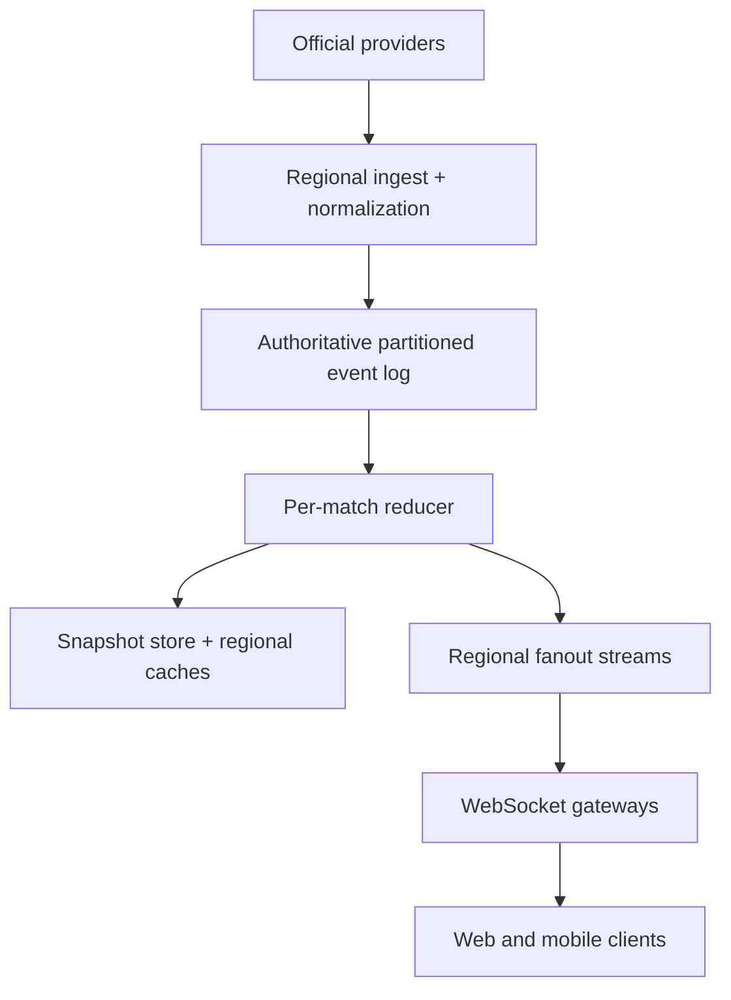
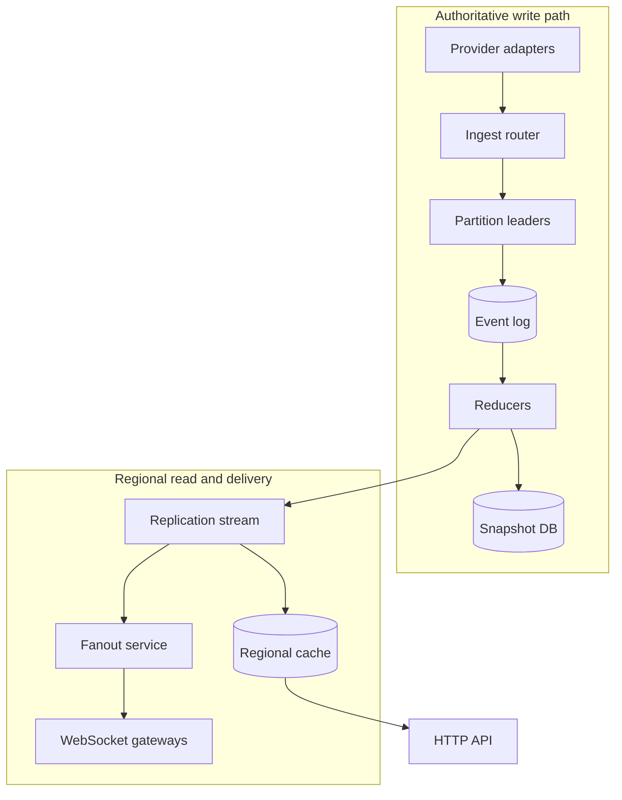
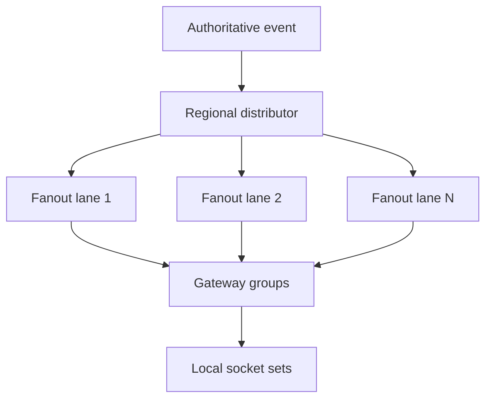
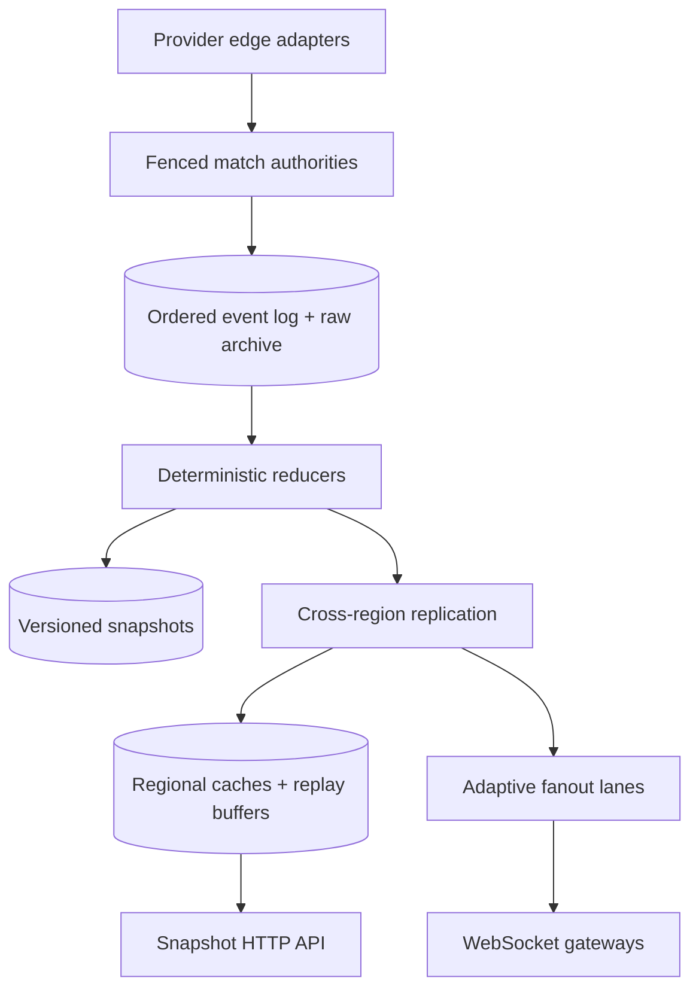

# Design a Global Live Sports Score and Play-by-Play Platform

**Difficulty:** Medium–Hard  
**Primary themes:** event ingestion, per-key ordering, queues, hot-key caching, fanout, multi-region reliability, eventual consistency, corrections  
**Interview time budget:** roughly 35–45 minutes  
**Educational walkthrough:** intentionally more detailed than what you would say in that time

---

## Interviewer prompt

> Design a global platform that receives official live sporting events—scores, clock changes, penalties, substitutions, and play-by-play updates—and delivers them to millions of viewers with very low latency. Users should be able to open a match, see its current state, and receive live updates. The system must also handle duplicate, late, and corrected events from upstream data providers.

This is not primarily a video-streaming problem. We are designing the authoritative event and score path behind experiences such as a live-score application, a broadcaster's scoreboard, or a sports site's match center.

---

## Targeted clarifying questions and assumed interviewer answers

The candidate should not jump straight to Kafka, WebSockets, or Redis. First establish what must be correct and what may be stale.

**Candidate:** Which sports and event types must we support?  
**Interviewer:** The model should be extensible, but use football/soccer as the concrete example. Events include match start/end, goals, cards, substitutions, clock updates, and corrections.

**Candidate:** Are events supplied by trusted official providers, or can users submit them?  
**Interviewer:** Trusted providers only. A match can have a primary provider and a backup provider.

**Candidate:** Do we ingest raw device telemetry, or already-normalized provider messages?  
**Interviewer:** Providers send structured messages, but their schemas differ. Our edge adapters normalize them.

**Candidate:** What must users be able to do?  
**Interviewer:** Browse live/upcoming matches, open a match to get a current snapshot, and receive live play-by-play updates.

**Candidate:** Can upstream events arrive twice, out of order, or be corrected?  
**Interviewer:** Yes to all three. Correctness under duplicates and corrections is an important part of the interview.

**Candidate:** Is betting-grade latency and correctness required?  
**Interviewer:** No. This is a consumer live-score product. A few seconds of temporary delay is acceptable during a failure, but we must never knowingly invent a score. Betting settlement is out of scope.

**Candidate:** What delivery protocols should clients use?  
**Interviewer:** Mobile and web clients should use ordinary HTTP for snapshots and WebSockets or Server-Sent Events for live updates. You may choose.

**Candidate:** Do clients need every intermediate clock tick?  
**Interviewer:** No. The client can render the clock locally from an authoritative anchor. Goals and other discrete events must not be silently dropped.

**Candidate:** What scale should I design for?  
**Interviewer:** Ten million concurrent viewers globally, 100,000 matches per day, and a championship final with three million concurrent viewers on one match.

**Candidate:** What is the expected update latency?  
**Interviewer:** For healthy paths, 99% of accepted official events should reach connected users within two seconds. Snapshot reads should be under 300 ms at p99.

**Candidate:** Is a single total order across all matches required?  
**Interviewer:** No. Ordering matters within a match, not across unrelated matches.

**Candidate:** How should a correction appear?  
**Interviewer:** The final match state must converge to the corrected truth. The audit history should retain the original event and the correction.

**Candidate:** Are search, highlights, standings, push notifications, ticketing, and video in scope?  
**Interviewer:** Match discovery is in scope only as a simple live/upcoming list. Video, recommendations, betting, standings, and push notifications are out of scope.

### Scope statement to say aloud

> “I’ll design the official event path from provider ingestion through an authoritative per-match event log, materialized match state, snapshot reads, and low-latency fanout. I’ll treat match discovery as a simple indexed read. Video, betting, standings, and notifications are outside the core design.”

---

## How to deliver this in an interview

This walkthrough follows the public [Hello Interview System Design Delivery Framework](https://www.hellointerview.com/learn/system-design/in-a-hurry/delivery): establish requirements, name core entities, define the client contract, build the high-level design one operation at a time, and then spend the remaining time on the non-functional requirements most likely to break the baseline. It also follows their public guidance to introduce only the relevant data fields when the component that needs them appears, rather than attempting a complete schema before understanding the flows. See also [Hello Interview's API design guidance](https://www.hellointerview.com/learn/system-design/core-concepts/api-design) and [data-modeling guidance](https://www.hellointerview.com/learn/system-design/core-concepts/data-modeling).

The section labels include an interview time budget. The explanation underneath is a study guide, not a script that must be spoken word-for-word.

---

# 1. Requirements (~5 minutes)

## 1.1 Prioritized functional requirements

### FR1 — Ingest and reconcile official match events

Provider adapters accept structured events, authenticate the provider, normalize its schema, deduplicate retransmissions, preserve an audit trail, and establish the authoritative order within each match.

Examples:

- `MATCH_STARTED`
- `GOAL`
- `YELLOW_CARD`
- `SUBSTITUTION`
- `CLOCK_ANCHOR`
- `EVENT_CORRECTED`
- `MATCH_ENDED`

### FR2 — Read the current match snapshot

A user opening a match receives a self-consistent snapshot containing the score, phase, authoritative clock anchor, participants, and recent play-by-play. The response also contains a monotonic match version that the client can use to resume the live stream.

### FR3 — Subscribe to low-latency live updates

A connected web or mobile client subscribes to one or more matches and receives ordered updates after its last observed version. A reconnecting client can catch up without reloading the entire history.

### Secondary functional requirement — Browse live and upcoming matches

The home screen can list matches by sport, competition, date, and status. This requirement is useful but does not drive the hardest architecture decisions.

### Explicitly out of scope

- Live video or audio
- User-generated events
- Betting odds or financial settlement
- League standings and fantasy scoring
- Highlight generation
- Social comments and chat
- General-purpose notification delivery

## 1.2 Quantified non-functional requirements

1. **Scale:** 100,000 matches/day; 10 million concurrent connected viewers globally; one hot final may have 3 million viewers.
2. **Event latency:** 99% of accepted official discrete events reach connected viewers within 2 seconds in the healthy case; p50 target under 500 ms.
3. **Read latency:** match snapshot p99 under 300 ms from the user's nearest region.
4. **Availability:** snapshot reads and live delivery target 99.99% monthly availability. Provider ingestion targets 99.999% durability once an event is acknowledged.
5. **Correctness:** no duplicate event may change the score twice; per-match versions are monotonic; corrections must converge all clients and read models to the same state. Cross-match ordering is unnecessary.

## 1.3 Consistency and availability contract

Avoid saying “the system is eventually consistent” as if every operation has the same needs. Define the contract per surface.

| Surface | Contract | During a partition |
|---|---|---|
| Provider ingest acknowledgment | Durable append before success | Prefer rejecting or buffering to acknowledging an event that may be lost |
| Authoritative match log | One ordered version sequence per match | Single writer/leader per match; do not create two independent authoritative histories |
| Match snapshot | Read-your-version when `min_version` is supplied; otherwise bounded-stale | Serve a slightly stale snapshot with its version and freshness timestamp |
| Live stream | Ordered by match version; at-least-once transport | Pause/catch up rather than emit known gaps as if complete |
| Match discovery | Eventual consistency, seconds of staleness acceptable | Prefer availability |
| Analytics/audit exports | Eventual; immutable raw history retained | Lag is acceptable |

The key distinction is between **truth** and **distribution**:

- The authoritative per-match event log and reducer define truth.
- Caches, regional read models, and WebSocket delivery distribute that truth and may temporarily lag.
- Every distributed representation carries the authoritative match version, making staleness detectable.

### What to say aloud

> “I need strong serialization only within a match. I’ll acknowledge a provider event after a durable append to that match’s authoritative log. Snapshots and live edges can be eventually consistent, but every state and event carries a monotonic match version so clients can detect gaps, deduplicate retries, and request catch-up.”

---

# 2. Core entities (~2 minutes)

At this stage, list nouns, not a complete schema.

- **Sport** — ruleset identifier, such as soccer or basketball.
- **Competition** — league or tournament grouping.
- **Match** — scheduled contest and its current lifecycle.
- **Participant** — team or individual competitor.
- **Provider** — trusted upstream feed and its credentials/priority.
- **RawProviderEvent** — immutable received payload for audit and replay.
- **MatchEvent** — normalized domain event associated with one match.
- **MatchSnapshot** — current materialized state after reducing events through a version.
- **Subscription** — transient connection interest in a match and last acknowledged version.

The important relationship is:

```text
Match 1 ──> many ordered MatchEvents ──> one current MatchSnapshot
```

`RawProviderEvent` is separate from `MatchEvent` because normalization rules can change. Keeping the raw payload lets us reprocess, audit provider disputes, and repair a bad transformation.

### What to say aloud

> “The central entities are Match, Provider, immutable RawProviderEvent, normalized MatchEvent, and materialized MatchSnapshot. I’ll postpone detailed fields until each storage component appears in the request flows.”

---

# 3. API or system interface (~5 minutes)

## 3.1 Authentication and identity

Public clients authenticate with a user session or anonymous device token. The gateway derives `viewer_id`, region, entitlements, and rate-limit tier from the verified token; the client does not place a trusted `viewer_id` in the request body.

Provider calls use mutually authenticated TLS plus a provider credential. The ingest gateway derives `provider_id` from the certificate/API key and verifies that the provider is authorized for the referenced competition. A provider cannot claim another provider's identity in JSON.

## 3.2 Browse matches

```http
GET /v1/matches?status=live&sport=soccer&competition_id=uefa-cl&limit=50&cursor=...
Authorization: Bearer <viewer-token>
```

```json
{
  "matches": [
    {
      "match_id": "match_9f2",
      "home": {"id": "team_a", "name": "North City"},
      "away": {"id": "team_b", "name": "Harbor United"},
      "status": "SECOND_HALF",
      "score": {"home": 2, "away": 1},
      "state_version": 1842,
      "updated_at": "2026-11-26T02:13:04.221Z"
    }
  ],
  "next_cursor": "eyJ..."
}
```

Cursor pagination is preferable to offset pagination because the live set changes while the user scrolls.

## 3.3 Get a match snapshot

```http
GET /v1/matches/match_9f2?scripts=recent&min_version=1830
Authorization: Bearer <viewer-token>
```

```json
{
  "match_id": "match_9f2",
  "phase": "SECOND_HALF",
  "score": {"home": 2, "away": 1},
  "clock": {
    "period": 2,
    "elapsed_ms_at_anchor": 4021000,
    "anchor_wall_time": "2026-11-26T02:13:03.900Z",
    "running": true
  },
  "recent_events": [
    {
      "event_id": "evt_771",
      "version": 1842,
      "type": "GOAL",
      "team_id": "team_a",
      "player_id": "player_21",
      "occurred_at": "2026-11-26T02:13:02.417Z"
    }
  ],
  "state_version": 1842,
  "generated_at": "2026-11-26T02:13:04.221Z"
}
```

`min_version` provides a conditional monotonic-read contract. If the local region has only version 1829, it can wait briefly, route to the authoritative region, or return `409 SNAPSHOT_BEHIND` with `available_version: 1829`. It must not silently claim to satisfy version 1830.

## 3.4 Subscribe to live updates

We choose WebSockets because clients may subscribe/unsubscribe over one long-lived connection and send acknowledgments. Server-Sent Events would also be reasonable for a simpler one-way browser-only product.

Handshake:

```http
GET /v1/live
Connection: Upgrade
Upgrade: websocket
Authorization: Bearer <viewer-token>
```

Client frame:

```json
{
  "op": "subscribe",
  "match_id": "match_9f2",
  "after_version": 1842
}
```

Server frames:

```json
{
  "op": "event",
  "match_id": "match_9f2",
  "event": {
    "event_id": "evt_772",
    "version": 1843,
    "type": "YELLOW_CARD",
    "team_id": "team_b",
    "player_id": "player_8"
  }
}
```

```json
{
  "op": "resync_required",
  "match_id": "match_9f2",
  "snapshot_url": "/v1/matches/match_9f2",
  "latest_version": 1908
}
```

If the reconnect gap is small and still retained in the regional replay buffer, the gateway sends versions `after_version + 1 ... latest`. If it is too old, it requests a snapshot resync.

## 3.5 Provider event ingestion

```http
POST /internal/v1/matches/match_9f2/provider-events
Idempotency-Key: providerA:match_9f2:sequence_88021
Content-Type: application/json
```

```json
{
  "provider_event_id": "pa_88021",
  "provider_sequence": 88021,
  "event_type": "goal",
  "occurred_at": "2026-11-26T02:13:02.417Z",
  "payload": {
    "team_external_id": "NC",
    "player_external_id": "21"
  }
}
```

```json
{
  "status": "accepted",
  "event_id": "evt_771",
  "match_version": 1842
}
```

Possible responses:

- `200 duplicate` with the previously assigned version for an exact retry.
- `202 buffered` when a small provider-sequence gap is awaiting a predecessor.
- `409 conflict` when the same idempotency key is reused with different content.
- `422 invalid` for impossible schema or mapping.
- `503 retry` if the system cannot durably append or buffer the event.

## 3.6 Provider correction

A correction is a new fact, not an in-place mutation of history.

```http
POST /internal/v1/matches/match_9f2/corrections
Idempotency-Key: providerA:correction:992
```

```json
{
  "provider_event_id": "pa_corr_992",
  "target_provider_event_id": "pa_88021",
  "action": "RETRACT",
  "reason": "goal disallowed after review"
}
```

The response assigns a new match version. Clients may display “goal overturned,” while the reducer produces the corrected score.

### What to say aloud

> “The snapshot and stream share one version contract. A client reads version V, subscribes after V, deduplicates by event ID, and detects a gap if it receives anything other than V+1. Provider identity comes from mTLS credentials, not the payload, and idempotency keys make retries safe.”

---

# 4. Data flow

This problem benefits from an explicit pipeline because ingest, reduction, replication, and fanout are decoupled.



For a provider event:

1. Authenticate and validate the provider.
2. Persist the raw envelope.
3. Normalize external identifiers and event type.
4. Route by `match_id` to the match's authority.
5. Deduplicate and assign the next authoritative match version.
6. Append the normalized event durably.
7. Reduce it into a new snapshot.
8. Publish the committed event to regional fanout streams.
9. Update snapshot caches and deliver to subscribed connections.

The ordering boundary is `match_id`. Events for two different matches can process concurrently.

---

# 5. High-level design (~10–15 minutes)

Build the simplest complete system one operation at a time.

## 5.1 Baseline architecture



This design separates a relatively low-volume, correctness-sensitive write path from an enormous read and connection fanout path.

## 5.2 Operation 1: ingest an official event

### Step A — Provider edge and normalization

Providers connect to the nearest supported ingest region. An **adapter** translates a provider-specific schema into the platform's canonical envelope.

Relevant raw fields appear here:

```text
RawProviderEvent
- provider_id
- provider_event_id
- provider_sequence
- match_external_id
- received_at
- occurred_at
- payload_bytes
- payload_hash
- validation_status
```

The raw payload is appended to durable object storage or a replicated raw-event topic before downstream transformation. This prevents a buggy normalizer from erasing source evidence.

The adapter validates:

- credentials and authorization for the competition,
- payload size and schema,
- timestamp bounds,
- external match/team/player mappings,
- content hash for idempotency conflicts.

### Step B — Route to a match authority

A metadata service maps each `match_id` to an **authoritative home region** and log partition. The router caches this assignment briefly.

Why a home region? We need a single serialization point for each match. Multi-leader writes would reduce cross-region latency but make conflicting provider sequences and corrections much harder to resolve. Provider traffic is tiny compared with viewer traffic, so paying one inter-region hop on ingest is a good trade.

The routing function is conceptually:

```text
partition = hash(match_id) mod active_partition_count
```

In production, use virtual partitions so that adding brokers moves ranges rather than remapping every match.

### Step C — Deduplicate and append

The partition leader maintains or consults an idempotency index:

```text
(provider_id, provider_event_id) ->
  payload_hash, normalized_event_id, assigned_match_version, result
```

Within one transactional append, it:

1. Checks the idempotency key.
2. Verifies provider sequence policy.
3. Allocates `next_version = current_version + 1`.
4. Appends the normalized `MatchEvent`.
5. Records the idempotency result.
6. Commits to a quorum before acknowledging.

Relevant normalized fields:

```text
MatchEvent
- match_id                 # partition key
- version                  # strict sequence within match
- event_id                 # globally unique, immutable
- provider_id
- provider_event_id
- provider_sequence
- event_type
- occurred_at
- accepted_at
- payload
- corrects_event_id?       # optional reference
- semantic_status          # ACTIVE, RETRACTED, SUPERSEDED
```

An ordinary replicated log such as Kafka can preserve order within a partition, but version allocation plus idempotency must still be atomic from the application's perspective. Plausible implementations include:

- a transactional relational row plus outbox per match shard,
- a consensus-backed append log whose leader assigns versions,
- or a stream processor with exactly one active task per match partition and durable state.

The baseline chooses a consensus-replicated partition leader and log because write volume is modest and ordered replay is central to the product.

### Step D — Reduce the event to current state

A reducer consumes each match's events in version order and applies a deterministic function:

```text
new_snapshot = reduce(previous_snapshot, event)
```

Relevant snapshot fields:

```text
MatchSnapshot
- match_id
- version
- phase
- score_home
- score_away
- clock_period
- clock_elapsed_ms_at_anchor
- clock_anchor_wall_time
- clock_running
- participant_state
- recent_event_summaries
- updated_at
```

The reducer writes snapshots with a compare-and-set condition:

```sql
UPDATE match_snapshot
SET ..., version = :event_version
WHERE match_id = :match_id
  AND version = :event_version - 1;
```

If the predicate fails, the reducer has a duplicate or a gap. It does not blindly overwrite newer state.

### Step E — Publish committed change

After the event and resulting snapshot are committed, the reducer publishes a `MatchStateChanged` message. The transactional outbox pattern can ensure a database commit is not lost between “write state” and “publish message.”

An **outbox** is a table or log record written in the same transaction as business state. A relay later publishes it. This converts a dangerous dual write into one atomic local write plus retryable delivery.

### Response

The provider receives the assigned `event_id` and match version. A retry returns the same result.

## 5.3 Operation 2: open a match and read a snapshot

### Step A — Global routing

The client reaches the nearest healthy region through geo-aware DNS or anycast. The API gateway authenticates the session, applies rate limits, and derives viewer context.

### Step B — Cache lookup

The match API looks up:

```text
key: match_snapshot:{match_id}
value: serialized snapshot including version and generated_at
```

This is a read-through cache:

1. Read regional cache.
2. On miss, read the regional snapshot replica.
3. Populate the cache with a short TTL plus event-driven invalidation/update.

For live matches, a 5–15 second TTL alone is too stale, so change events proactively update the cache. TTL remains a safety net if invalidation is lost.

For completed matches, TTL can increase to hours because the data is immutable except for rare corrections.

### Step C — Enforce `min_version`

If the user supplies `min_version`, the API compares it with the cached version.

- Cache version ≥ minimum: return it.
- Cache version < minimum: wait up to a small deadline, read the regional store, or route to the home region.
- Still behind: return an explicit behind response rather than violating the advertised contract.

### Response

The API returns a complete self-consistent snapshot with its version and freshness timestamp. The client renders the match and then subscribes after that version.

## 5.4 Operation 3: deliver live updates

### Step A — Regional replication

Committed match events flow from the authoritative region to replicated regional topics. Replication is asynchronous. Each record retains `match_id`, `version`, and `event_id`.

### Step B — Fanout service

The regional fanout service consumes each event once per region, not once per user. It updates:

- a short replay buffer keyed by `(match_id, version)`,
- the latest-version marker,
- and the regional snapshot cache.

It then publishes to an internal channel for the match.

### Step C — WebSocket gateway subscription index

Connections are distributed across many gateway instances. We do not store three million individual subscriptions in a central database. Each gateway holds its local connection-to-match mapping in memory:

```text
match_id -> set of local connection IDs
connection_id -> subscribed match IDs and last sent versions
```

A lightweight regional membership layer tracks which gateway shards have at least one subscriber for a match. The fanout layer sends one copy per interested gateway, and the gateway copies the frame to its local sockets.

### Step D — Client deduplication and gaps

The gateway may redeliver after a retry. The client tracks `last_version`:

- `event.version == last_version + 1`: apply.
- `event.version <= last_version`: duplicate; ignore.
- `event.version > last_version + 1`: gap; request replay or snapshot.

This at-least-once design is simpler and safer than pretending the network provides exactly-once delivery.

### Clock updates

Sending a tick every second to 10 million clients would create useless traffic. Instead send occasional authoritative anchors:

```text
elapsed_at_anchor + (client_now - anchor_wall_time)
```

The client animates locally and corrects drift on new anchors, phase changes, pauses, or resumptions.

## 5.5 Operation 4: correct or retract an event

Never delete or overwrite an accepted event in the audit log.

1. The provider submits a correction referencing the original provider event.
2. The authority assigns the correction a new match version.
3. The reducer marks the target event retracted/superseded in its derived semantic view.
4. It deterministically recomputes affected state.
5. It publishes the correction and the new snapshot version.
6. Clients display a correction and converge to the new score.

For a simple goal retraction, an inverse operation can adjust the score. For arbitrary corrections, replay from a recent checkpoint is safer:

```text
checkpoint at version 1800 + active events 1801..1848 -> corrected snapshot
```

Store a checkpoint every N events or every minute. Matches have only hundreds or thousands of semantic events, so replay is inexpensive.

## 5.6 Operation 5: browse live matches

The match scheduler writes canonical `Match` metadata:

```text
Match
- match_id
- sport_id
- competition_id
- scheduled_start
- participant_ids
- status
- home_region
- latest_version
```

Change events update a denormalized discovery index keyed by date, competition, sport, and status. Discovery may lag by a few seconds and remains available during write-region issues.

---

# Scale estimates that change design decisions

Back-of-the-envelope math is useful only when it drives architecture.

## Concurrent connections

Assume:

- 10 million concurrent viewers globally.
- A gateway safely maintains 40,000 active sockets after leaving headroom for memory, TLS, heartbeats, and bursts.

```text
10,000,000 / 40,000 = 250 gateway instances
```

With 2× operational headroom and regional failover reserve, plan roughly 500 gateway-equivalents globally. This justifies stateless connection gateways with autoscaling and regional connection draining—not a single WebSocket fleet in one region.

## Hot final fanout

Assume a goal event frame is about 500 bytes after envelope and compression effects, and 3 million viewers watch the same final.

```text
500 bytes × 3,000,000 = 1.5 GB per logical event
```

If copied independently from a central broker to every client, one small event creates huge central egress. Therefore fan out hierarchically: one copy per region, one per interested gateway, then local socket writes.

At 3 million viewers and a modest 1 KB/s average of heartbeat plus occasional event traffic:

```text
3,000,000 × 1 KB/s ≈ 3 GB/s ≈ 24 Gb/s
```

The system must distribute this across regions and many gateways. The bottleneck is not event production; it is connection and egress fanout.

## Ingest rate

Assume 100,000 matches/day and an average of 1,000 raw messages per match, including clock anchors and duplicates:

```text
100,000 × 1,000 / 86,400 ≈ 1,160 raw events/s average
```

At 20× peak, about 23,000 events/s. This is easy for a partitioned log, reinforcing that we can afford strong per-match serialization. The system should optimize correctness here, not prematurely weaken consistency.

## Snapshot traffic

Suppose 10 million connected viewers refresh or reconnect once every five minutes:

```text
10,000,000 / 300 ≈ 33,000 snapshot reads/s
```

During a mass reconnect after an outage, traffic can be much higher. Regional caches and randomized reconnect backoff are necessary to protect the snapshot store.

## Retention

Assume 100 million raw provider messages/day at 1 KB average, including envelope and indexes:

```text
100 million × 1 KB ≈ 100 GB/day
≈ 36.5 TB/year before replication and compression
```

Object storage is appropriate for long-lived raw audit data; keeping all raw payloads in a hot relational database is not.

### What to say aloud

> “The ingest rate is modest enough to serialize each match strongly. The real scale problem is three million subscribers on one hot key: a single 500-byte goal becomes roughly 1.5 GB of delivered data. That drives hierarchical regional fanout and in-memory gateway subscription maps.”

---

# 6. Deep dives (~10–15 minutes)

Choose two or three. In a real interview, explicitly ask which the interviewer prefers. Here we cover three because this is an educational walkthrough.

## Deep dive 1 — Per-match ordering, duplicates, late events, and corrections

### Where the baseline breaks

Provider networks retry. A backup feed may report the same goal with a different identifier. Messages can arrive late. Providers may send sequence 101 before 100. A video-review decision may retract a goal minutes later.

If consumers simply apply arrival order:

- a retried goal increments the score twice,
- a late `MATCH_STARTED` can move a match backward,
- two active writers can both allocate version 1842,
- a correction can be applied on some clients but not others.

### Plausible approaches

| Approach | Advantages | Problems |
|---|---|---|
| Trust provider arrival order | Very simple | Fails under retries, gaps, and multiple feeds |
| Timestamp-sort events | Provider-neutral | Clocks skew; two events may share timestamps; later correction semantics remain ambiguous |
| Multi-leader per region with conflict resolution | Low ingest latency | Conflict resolution for sports rules is complex and user-visible |
| Single authority per match with monotonic versions | Clear order and replay; simple clients | Cross-region hop; authority failover must avoid split brain |

### Selected design

Use one active authority for each match and assign a monotonic version to every accepted canonical event. Use provider identifiers for transport deduplication, and domain identity for cross-provider correlation.

#### Layer 1: exact retry deduplication

Key:

```text
(provider_id, provider_event_id)
```

The stored payload hash detects an invalid key reuse with different content.

#### Layer 2: provider sequence gaps

If a provider guarantees monotonically increasing per-match sequences:

- expected 100, received 100: accept.
- expected 100, received 99: likely duplicate/late; look up prior result.
- expected 100, received 101: buffer briefly and request/resend 100.

Do not buffer forever. After a timeout, mark a provider gap and continue according to event semantics, because availability matters and some event types are independent. The raw history retains the uncertainty.

#### Layer 3: semantic correlation across providers

The primary and backup may use different IDs for the same real-world goal. A correlation key might combine match, event type, team, player, and a time window. But fuzzy matching must not directly mutate truth; it should produce a candidate for the reconciliation policy.

For normal operation, only the designated primary provider is authoritative. Backup events are shadow-consumed and compared. If the primary becomes unhealthy, a controlled provider-leadership transition occurs at a known match version.

#### Corrections as events

Use an append-only correction:

```text
version 1842: GOAL evt_771 ACTIVE
version 1849: RETRACT target=evt_771 reason=VAR
```

The visible score changes, but the historical record remains explainable.

#### Deterministic replay

Reducers must be deterministic and versioned. Store the reducer version in checkpoints. A new rules implementation can shadow-replay historical matches and compare snapshots before rollout.

### Failover without split brain

Partition leadership uses a consensus system and fencing tokens. A **fencing token** is a monotonically increasing leadership epoch included with writes. Storage rejects writes from an older epoch even if a paused former leader wakes up.

```text
authority_epoch = 77
match_version = 1849
```

On failover, the new leader obtains epoch 78, replays committed state, and resumes at version 1850. The old leader's epoch-77 writes are rejected.

### Failure modes

- **Provider retries after timeout:** idempotency returns the same version.
- **Authority crashes after commit but before response:** retry returns the committed result.
- **Reducer crashes:** replay from checkpoint; compare-and-set prevents double apply.
- **Out-of-order replica delivery:** regional consumer buffers small gaps and requests missing versions.
- **Bad correction:** append a new correction; never rewrite audit history.
- **Two providers disagree:** continue primary authority, raise reconciliation alert, retain both raw feeds.

### Observability

Track:

- duplicate rate by provider,
- provider sequence-gap count and age,
- authority election count and epoch,
- reducer gap/replay count,
- correction rate and time-to-convergence,
- authoritative version minus each regional applied version,
- cross-provider disagreement rate.

### Tradeoff

We accept an occasional inter-region ingest hop and brief unavailability during authority election in exchange for a simple, auditable per-match truth.

### What to say aloud

> “Exactly-once delivery is not a network property I want to promise. I’ll provide effectively-once state changes: at-least-once transport, durable idempotency results, one fenced writer per match, monotonic versions, and deterministic replay. Corrections append new events rather than rewriting history.”

## Deep dive 2 — Hot-match fanout, caching, and reconnect storms

### Where the baseline breaks

Normal matches may have hundreds of viewers; a final has millions. Hashing by `match_id` can place all subscribers behind one broker channel or fanout worker. A cache entry for the hot match receives extreme read traffic. If a regional edge restarts, millions of clients reconnect and simultaneously request snapshots.

This is a classic **hot key**: load is concentrated on one logical key rather than spread evenly across the dataset.

### Plausible approaches

| Approach | Advantages | Problems |
|---|---|---|
| Client polling | Simple infrastructure | High redundant read load; slower updates; synchronized polling spikes |
| Central pub/sub topic directly to every socket | Straightforward | Central broker egress and subscription cardinality explode |
| One regional topic per match | Good regional isolation | A single hot regional consumer/gateway still bottlenecks |
| Hierarchical fanout tree | Scales with audience; localizes copies | More components; must monitor lag at each layer |

### Selected design: hierarchical regional fanout

1. The authoritative stream sends one event copy to each active region.
2. A regional match distributor shards a hot match into `N` fanout lanes.
3. Each lane sends one copy to gateway groups with subscribers.
4. Each gateway performs in-process fanout to its local sockets.

The lanes are distribution shards, not ordering authorities. Every lane receives the same ordered version stream for that match.



### Adaptive hot-key splitting

Do not pre-create hundreds of lanes for every amateur match. Promote based on:

- subscriber count,
- bytes/second,
- gateway count,
- distributor CPU or queue lag.

Cold matches share pooled partitions. A hot match gets dedicated lanes. Promotion changes distribution topology but not match versioning.

### Cache strategy

Use two cache layers:

1. **Gateway/process cache** for the very latest snapshot of currently subscribed matches.
2. **Regional distributed cache** for snapshot API requests.

Cache values are immutable by version:

```text
match_snapshot:{match_id}:{version}
latest_match_version:{match_id} -> version
```

Versioned values prevent a delayed invalidation from overwriting a newer state. The `latest` pointer is updated only if the incoming version is greater.

For discovery responses, use short TTLs and request coalescing. **Request coalescing** means one process fetches a missing hot key while concurrent requests await the same future, preventing a cache stampede.

### Reconnect storm controls

After a regional failure, clients use exponential backoff with full jitter:

```text
delay = random(0, min(cap, base × 2^attempt))
```

The handshake returns a regional reconnect token so retries can be rate-limited fairly. Gateways cap new handshakes, prioritize existing connections, and shed optional subscriptions before the primary match stream.

Snapshot APIs use:

- cache request coalescing,
- stale-while-revalidate for clients without `min_version`,
- per-match and per-viewer limits,
- pre-warmed snapshots for scheduled marquee events.

### Slow consumers

A mobile client on a poor network cannot have an unbounded gateway queue.

Classify messages:

- **Discrete semantic events** such as goals: retain until a small byte/time limit.
- **Replaceable state** such as clock anchors: coalesce to the latest.
- **Presence/diagnostics:** drop first.

If the client remains behind, send `resync_required` and close gracefully. This bounds gateway memory.

### Failure modes

- **One fanout lane fails:** clients reconnect to another lane and resume by version.
- **Regional stream lags:** expose lag, pause later versions if a gap exists, optionally route hot matches to another region.
- **Cache cluster fails:** process cache and snapshot replicas provide degraded service; aggressively rate-limit cold reads.
- **Gateway dies:** only its local sockets reconnect; no durable subscription cleanup is required.
- **Mass event burst:** coalesce clock/state frames, preserve semantic events, apply backpressure upstream of gateways.

### Observability

Track per match and region:

- concurrent sockets,
- event-to-edge and edge-to-client latency histograms,
- fanout amplification and bytes/sec,
- lane queue depth and consumer lag,
- socket send-buffer occupancy,
- slow-consumer disconnects,
- reconnect attempts and success latency,
- snapshot cache hit rate and coalesced requests.

Do not label metrics only by raw `match_id` in a general monitoring system; that can create dangerous cardinality. Keep top-K hot-match views and aggregate the rest.

### Tradeoff

Hierarchical fanout adds operational complexity, but it confines audience-dependent scale to the delivery plane while keeping the authoritative write path simple.

### What to say aloud

> “The championship final is a hot-key problem, not an ingest-throughput problem. I’ll replicate one ordered stream per region, split distribution into adaptive lanes, send one copy per interested gateway, and fan out in memory to local sockets. Versions make lane failover and reconnection safe.”

## Deep dive 3 — Multi-region reliability, backpressure, and recovery

### Where the baseline breaks

A single-region design cannot meet global latency or 99.99% read availability. But making every region an independent writer risks split brain. Meanwhile, an outage in a downstream region can cause queues to grow until they exhaust the authoritative system.

### Plausible approaches

| Approach | Write consistency | Read latency | Failure behavior |
|---|---|---|---|
| Single global region | Simple and strong | Poor globally | Region outage is catastrophic |
| Active-active writes for each match | Complex conflict handling | Low | Can fork match history |
| Single home writer per match, active-active reads | Strong per match | Low reads | Brief write failover; reads continue from replicas |
| Synchronous quorum across distant regions | Strong disaster tolerance | High ingest latency | WAN failures reduce write availability |

### Selected design

Use single-home writes per match with synchronous replication across three availability zones in the home region and asynchronous cross-region replication. Read/fanout planes are active-active globally.

This gives:

- low-latency durable ingest inside the home region,
- low-latency snapshots and sockets near users,
- one unambiguous per-match history,
- recoverability from region loss with a bounded recovery point.

For premier matches, optionally synchronously replicate the authoritative log to a nearby disaster-recovery region before acknowledgment. This increases ingest latency and should be a per-tier policy, not a universal cost.

### Region failure sequence

1. Health system detects loss of the home region using multiple independent signals.
2. Control plane freezes automatic reassignment until a lease/consensus rule proves the old authority cannot continue.
3. DR region determines the highest durably replicated match version.
4. It acquires a higher fencing epoch.
5. Provider adapters reconnect/resend from their last acknowledged sequence.
6. The new authority deduplicates retries and resumes version allocation.
7. Read regions repair any missing versions and continue fanout.

If the latest acknowledged event was only replicated inside the destroyed region, the contract would be violated. Therefore acknowledgment policy must match the promised disaster durability. Be explicit: either accept a small regional-disaster RPO or pay for synchronous cross-region replication.

For this consumer product, choose:

- ordinary matches: cross-region RPO under 5 seconds;
- marquee matches: RPO 0 for acknowledged canonical events via synchronous DR append;
- all matches: provider retry plus raw-edge buffering further reduces practical loss.

### Backpressure boundaries

Backpressure must not let slow viewers stop provider ingest.

Use separate retention and queues:

```text
provider ingest -> authoritative durable log -> regional replication -> fanout -> sockets
```

Each boundary has a bounded policy:

- Authoritative log retains enough history for regional catch-up.
- Regional replication can lag without blocking match truth.
- Fanout queue drops/coalesces replaceable state before semantic events.
- Slow sockets are resynced or disconnected.

If a region is far behind, stop streaming partial later data and serve a clearly versioned stale snapshot or redirect users. Never convert a missing goal into an apparently complete timeline.

### Disaster recovery and reconciliation

Periodic jobs compare:

- raw accepted provider events,
- canonical event-log offsets,
- reducer snapshot versions,
- regional applied versions,
- cache latest-version markers.

A Merkle tree or range checksum can compare large logs efficiently. A **Merkle tree** summarizes ranges of records with hashes, allowing two replicas to locate divergent ranges without comparing every event.

Backups include:

- immutable raw events in object storage,
- authoritative log snapshots/checkpoints,
- match metadata and provider mappings,
- reducer code/version artifacts.

Regular restore drills are part of reliability; an untested backup is only a hypothesis.

### Load shedding priority

When capacity is exhausted:

1. Preserve provider ingest and authoritative append.
2. Preserve goal/card/correction delivery for subscribed foreground clients.
3. Preserve snapshot reads from cache.
4. Degrade discovery freshness.
5. Reduce clock-anchor frequency.
6. Shed background clients, analytics, and optional metadata.

This priority aligns capacity with user-visible correctness.

### Observability and SLOs

Measure the full path with a correlation tuple:

```text
(match_id, event_id, version, authority_epoch)
```

Core service-level indicators:

- provider receive → durable acceptance latency,
- acceptance → regional apply latency,
- acceptance → gateway enqueue latency,
- sampled acceptance → client acknowledgment latency,
- snapshot freshness in versions and seconds,
- percentage of streams with detected gaps,
- failover recovery time and possible RPO exposure.

Use synthetic matches to continuously exercise ingest, reduction, replication, snapshot, WebSocket delivery, and correction flows.

### Tradeoff

We favor availability in the read/delivery plane and consistency in the per-match write plane. During a partition, some users may see a versioned stale score briefly, but the platform will not fork the official match history.

### What to say aloud

> “I’ll run active-active regional reads and WebSocket edges, but keep one fenced writer per match. Downstream lag never blocks official ingest. Each layer has bounded queues and a degradation policy, and clients always see a version so stale or gapped state is detectable.”

---

# Security, privacy, and abuse considerations

Even a public score platform has sensitive control surfaces.

- Use mTLS and short-lived credentials for providers; rotate keys and restrict them by competition.
- Sign or hash raw envelopes to support forensic audit.
- Apply schema, size, timestamp, and enum validation before parsing into domain objects.
- Isolate provider ingress from public client networks.
- Enforce least-privilege service identities for log append, reducer, cache, and replay operations.
- Encrypt data in transit and at rest.
- Rate-limit public HTTP and WebSocket handshakes by account, device, IP reputation, and region.
- Protect high-value feeds against scraping with entitlement checks where contracts require it.
- Do not place personal viewer data in match-event topics.
- Keep connection identifiers ephemeral and aggregate analytics where possible.
- Audit manual operator corrections with actor, reason, approval, and before/after versions.

---

# 7. Final design

## Concise final architecture



The final design has five defining properties:

1. **One authoritative, fenced writer per match** assigns monotonic versions.
2. **Immutable raw and canonical logs** support audit, replay, deduplication, and correction.
3. **Deterministic reducers** produce versioned snapshots and can rebuild from checkpoints.
4. **Active-active regional read and delivery planes** provide low latency without creating multiple truths.
5. **Hierarchical adaptive fanout** absorbs millions of viewers on one match, while clients use versions for deduplication, catch-up, and gap detection.

## End-to-end happy path

1. Provider sends goal `pa_88021` to the nearest ingest edge.
2. Edge authenticates, archives raw payload, normalizes identifiers, and forwards to the match home.
3. Match authority deduplicates, assigns version 1842, appends to a quorum, and returns success.
4. Reducer applies version 1842 and writes snapshot 1842.
5. Outbox publishes the committed event to cross-region streams.
6. Regional consumers update cache/replay buffer and fanout lanes.
7. Gateways deliver version 1842 to local subscribers.
8. Clients with version 1841 apply it; duplicates are ignored and gaps trigger replay/resync.

## Requirements check

| Requirement | How the design satisfies it |
|---|---|
| Ingest official events | Authenticated adapters, raw archive, normalized canonical log |
| Handle duplicates | Durable idempotency index plus client version deduplication |
| Handle ordering | One authority and monotonic versions per match |
| Handle corrections | Append-only correction events and deterministic replay |
| Read current match | Regional versioned snapshot store and caches |
| Receive live updates | Replicated streams, adaptive fanout lanes, WebSocket gateways |
| 10M concurrent viewers | Horizontally scaled regional gateways and hierarchical fanout |
| 3M-viewer hot final | Hot-key detection, dedicated distribution lanes, local socket fanout |
| p99 event delivery <2 s | Regional replication, push delivery, lag monitoring, no polling dependency |
| p99 snapshot <300 ms | Geo-routing and regional multi-layer caches |
| 99.99% read/delivery availability | Active-active read regions, replay, reconnect, graceful degradation |
| Correctness contract | Durable append, fencing, versions, CAS reducers, gap detection |

## Thirty-second interview summary

> “I separate match truth from global distribution. Each match has one fenced authority that deduplicates provider messages, assigns monotonic versions, and appends immutable canonical events. A deterministic reducer builds versioned snapshots. Events replicate asynchronously to active-active regions, where caches serve snapshots and adaptive fanout lanes feed WebSocket gateways. Clients use the same versions for dedupe, gap detection, and replay. Corrections append new events and replay state, while slow regions or clients degrade through bounded queues and explicit resync rather than corrupting the official sequence.”

---

# Realistic interviewer follow-up questions and strong sample answers

## 1. Why not put the score directly in Redis and publish updates from there?

**Strong answer:**

> “Redis is excellent for regional low-latency snapshots and ephemeral pub/sub, but I would not make it the sole source of truth. We need durable ordered history, provider idempotency, replay, corrections, and forensic audit. I’d keep the canonical append log durable and use Redis-like stores as derived caches. If Redis is lost, I can rebuild it from the log.”

## 2. Kafka already orders messages. Why invent a match version?

**Strong answer:**

> “Kafka orders records within a partition, but clients and replicated stores should not depend on a broker-specific offset, especially if partitions move or streams are compacted. A domain-level match version provides a stable contract across the log, snapshot, cache, API, and client. It also makes gaps and stale reads explicit.”

## 3. Can one popular match overload a Kafka partition?

**Strong answer:**

> “The canonical ingest volume for one match is tiny—hundreds or thousands of events—so its authoritative partition is not the bottleneck. Millions of viewers make the distribution path hot. I keep one ordered canonical stream but split its regional fanout into multiple lanes, because distribution lanes can duplicate the same ordered sequence without creating competing writers.”

## 4. What if the client reads snapshot version 100 and event 101 is published just before it subscribes?

**Strong answer:**

> “The subscription includes `after_version: 100`. The regional replay buffer returns all retained events after 100 before switching the connection to live tailing. The gateway must establish the handoff atomically relative to its local stream position—for example, register the subscription, read the high watermark, replay through it, then release buffered live events. If version 101 is no longer retained, it returns `resync_required`.”

## 5. How do you atomically update the snapshot and publish an event?

**Strong answer:**

> “I avoid a cross-system dual write with a transactional outbox. The reducer writes the new snapshot and an outbox record in one local transaction. A relay publishes the outbox at least once, and downstream consumers deduplicate by match version/event ID. Alternatively, if the canonical log itself drives both snapshot and fanout independently, each consumer can checkpoint offsets and remain replayable.”

## 6. What happens if version 1843 reaches a region before 1842?

**Strong answer:**

> “The regional consumer compares against its applied version, buffers 1843 within a small bound, and requests or waits for 1842. It does not publish 1843 as a complete stream. If the gap exceeds time or memory limits, it restores from a checkpoint or authoritative snapshot and resumes.”

## 7. Would you use WebSockets or Server-Sent Events?

**Strong answer:**

> “Either can work. I chose WebSockets because one connection can add and remove match subscriptions and return acknowledgments. SSE is simpler for one-way browser delivery and has native HTTP reconnection semantics, so I’d consider it if each client follows only one stream and mobile support is controlled. The version/replay contract remains the same.”

## 8. How do you calculate the live match clock without sending every second?

**Strong answer:**

> “Send an authoritative clock anchor containing elapsed match time, server wall time, period, and whether the clock is running. The client animates locally using elapsed monotonic time. New anchors on pauses, resumes, phase transitions, and occasional drift correction keep it accurate.”

## 9. How do you handle a provider sending the same real-world goal under two IDs?

**Strong answer:**

> “Transport idempotency cannot catch that. I use provider priority plus semantic correlation. Only the designated primary feed directly drives truth in steady state. Backup events are compared using match, type, participant, player, and a time window. A discrepancy becomes a reconciliation signal or controlled failover input, not an automatic second score update.”

## 10. Why not make every region writable for availability?

**Strong answer:**

> “Write load is low, while conflicting truth is costly. Active-active per-match writes require domain-specific conflict resolution for goals, retractions, and provider changes. I prefer a single fenced writer per match and active-active reads. During a rare authority failover, I accept a brief ingest pause rather than fork history.”

## 11. How would you support a replay of the entire match for a newly connected client?

**Strong answer:**

> “The initial snapshot contains current state and recent events. Full history comes from an event-history API backed by the canonical log compacted into queryable segments or object storage, paginated by match version. I would not push thousands of old events through the live WebSocket before current updates.”

## 12. What database would you choose for snapshots?

**Strong answer:**

> “The access pattern is point lookup and conditional update by match ID, so several options work. A sharded relational database gives transactions and compare-and-set semantics; a strongly consistent key-value store also fits. I’d choose based on operational context. The important design properties are partitioning by match ID, conditional version updates, regional replicas, and rebuildability from the event log.”

## 13. How would you deploy a reducer change safely?

**Strong answer:**

> “Version reducer code and checkpoint formats. Replay a representative historical corpus in shadow mode, compare resulting snapshots field by field, and canary on low-risk matches. Keep the old reducer available for rollback. For a schema evolution, use up-converters or support both event versions during migration.”

## 14. What if three million users reconnect at once?

**Strong answer:**

> “Clients use exponential backoff with full jitter. Edges cap handshakes and issue retry hints. Snapshot reads use regional caches, request coalescing, and stale-while-revalidate. Scheduled marquee matches are pre-warmed. Existing streams and official ingest receive higher priority than new background connections.”

## 15. How do you prove an event reached users within two seconds?

**Strong answer:**

> “Stamp receive, durable-accept, regional-apply, gateway-enqueue, and sampled client-ack times under the same event ID/version. Build latency histograms by sport, provider, region, and match tier. Client acknowledgments are sampled to control overhead; synthetic clients continuously test the full path.”

## 16. Could corrections make the score go backward?

**Strong answer:**

> “Yes, and that is legitimate. The match version never goes backward, but derived score values can change downward after a retraction. That distinction—monotonic history version, non-monotonic business state—is important. Clients apply the correction event or replace state with the new snapshot.”

## 17. How would you add push notifications later?

**Strong answer:**

> “Consume the same committed canonical events with an independent notification pipeline. It would maintain user preferences, deduplicate `(user_id, event_id, notification_type)`, and use its own queues and retries. It should not sit in the authoritative ingest path or slow live-score delivery.”

## 18. What would you change for betting-grade use?

**Strong answer:**

> “I’d tighten provenance, time synchronization, provider quorum rules, audit controls, and disaster RPO. I might require multi-provider confirmation or explicitly label provisional versus official events. Settlement would be a separate strongly controlled workflow. The consumer UI's two-second SLO and bounded staleness would not automatically satisfy regulated betting correctness.”

---

# Common pitfalls

1. **Starting with WebSockets before defining truth.** Connections distribute data; they do not solve ordering, duplicates, or corrections.
2. **Claiming exactly-once delivery.** Prefer at-least-once transport plus idempotent, versioned state transitions.
3. **Using wall-clock timestamps as the only order.** Provider clocks skew and corrections are intentionally later than the facts they change.
4. **Making all regions writers without a conflict policy.** This creates split-brain score histories.
5. **Treating Redis pub/sub as durable history.** A disconnected consumer needs replay or a snapshot.
6. **Ignoring the hot-key shape.** The biggest match, not the average match, drives fanout architecture.
7. **Sending clock ticks every second.** Clock anchors plus client-side interpolation remove enormous redundant traffic.
8. **Letting a slow socket have an unbounded queue.** Coalesce replaceable state and force resync when bounded limits are exceeded.
9. **Overwriting corrected events.** Append corrections so the system remains auditable and replayable.
10. **Failing to tie scale math to decisions.** Use connection count to size gateways and hot-match amplification to justify hierarchical fanout.
11. **Storing subscriptions durably per connection.** Gateway-local ephemeral maps are sufficient; versions make reconnection recoverable.
12. **Ignoring reconnect storms.** Jitter, admission control, cache coalescing, and pre-warming are first-class reliability mechanisms.
13. **Listing a giant schema too early.** Introduce the fields needed by ingest, reduction, snapshot, and delivery as those components appear.
14. **Hiding staleness.** Every snapshot and stream event should expose the authoritative match version.
15. **Optimizing the low-volume write path for availability at the cost of correctness.** A brief write pause is preferable to two official scores.

---

# Suggested whiteboard pacing

| Time | Candidate action |
|---:|---|
| 0–5 min | Clarify trusted providers, corrections, scale, latency, and the consistency boundary; write 3 FRs and 5 NFRs |
| 5–7 min | List Match, Provider, RawProviderEvent, MatchEvent, MatchSnapshot, Subscription |
| 7–12 min | Define provider ingest, snapshot, and subscribe contracts with version semantics |
| 12–15 min | Draw provider → authority → log → reducer → snapshot/fanout |
| 15–20 min | Trace ingest and snapshot read, adding relevant fields beside storage |
| 20–25 min | Trace WebSocket subscribe, replay, and correction flows |
| 25–33 min | Deep dive on ordering/idempotency/corrections |
| 33–40 min | Deep dive on hot-key fanout and reconnect storms; use scale estimates |
| Remaining | Discuss multi-region failure, observability, tradeoffs, and requirements check |

If time is short, cover the first two deep dives. The multi-region section can be summarized as single-home writes, active-active reads, fencing, versioned replication, and bounded downstream degradation.

---

# Final candidate closing statement

> “The design meets the three core operations: trusted providers can append official events safely, users can read a versioned current snapshot, and millions of clients can receive ordered live updates. I kept the consistency boundary narrow—one fenced writer per match—while scaling reads and fanout independently across regions. The two risks I would test most aggressively are correction/replay correctness and hot-match reconnect behavior, because those are where a superficially working design usually fails.”

---

# Public guidance referenced

- [Hello Interview — System Design Delivery Framework](https://www.hellointerview.com/learn/system-design/in-a-hurry/delivery)
- [Hello Interview — API Design for System Design Interviews](https://www.hellointerview.com/learn/system-design/core-concepts/api-design)
- [Hello Interview — Data Modeling for System Design Interviews](https://www.hellointerview.com/learn/system-design/core-concepts/data-modeling)

The problem, assumptions, architecture, examples, calculations, dialogue, and tradeoff analysis in this walkthrough are original.
