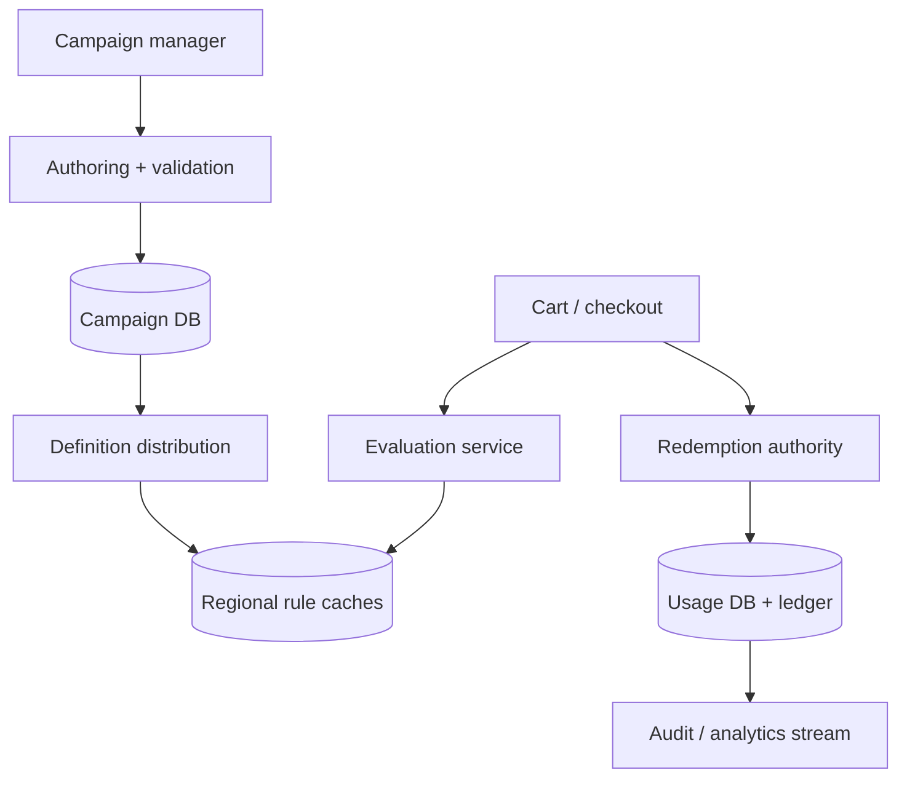
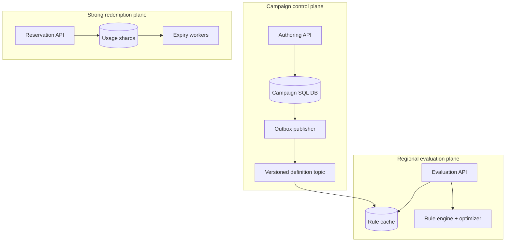
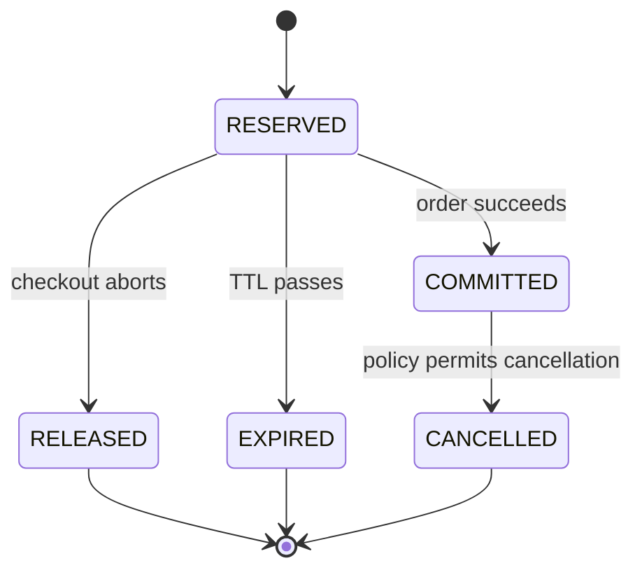
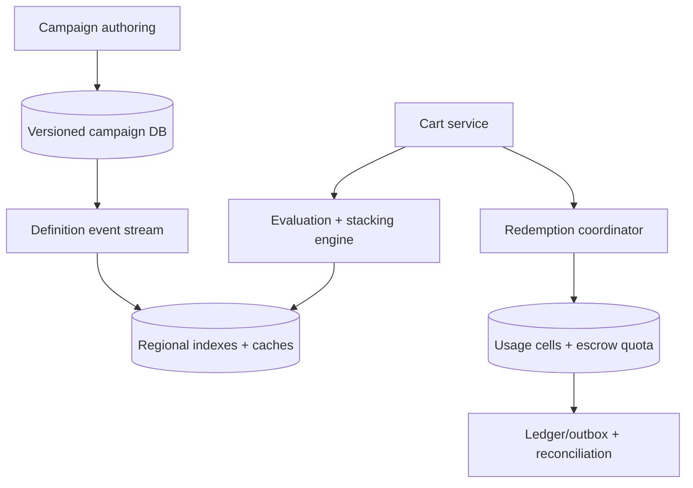

# Design a Global Promotion and Coupon Redemption Platform

**Difficulty:** Medium–Hard  
**Primary themes:** transactional databases, rule evaluation, caching, hot counters, idempotency, consistency, queues, multi-region reliability  
**Interview time budget:** roughly 35–45 minutes  
**Educational walkthrough:** intentionally more detailed than what can be spoken in that time

---

## Interviewer prompt

> Design a global promotion platform for a large e-commerce marketplace. Marketing teams create promotions such as public sales, unique coupon codes, percentage discounts, and fixed-amount discounts. At checkout, the platform must determine whether a promotion applies and redeem it without exceeding global, per-customer, or budget limits. The system must remain correct under concurrent checkouts, retries, payment failures, and regional outages.

We are designing the promotion decision and redemption system—not the entire shopping cart, catalog, payment processor, or order platform.

---

## Targeted clarifying questions with assumed interviewer answers

**Candidate:** Which promotion types are required?  
**Interviewer:** Support automatic promotions, reusable public codes, and single-use codes. Discounts may be a percentage or fixed amount, with caps and minimum basket values.

**Candidate:** Which eligibility rules matter?  
**Interviewer:** Time window, customer segment, country, seller, product/category inclusion and exclusion, minimum subtotal, first purchase, and usage limits.

**Candidate:** Can multiple promotions stack?  
**Interviewer:** At most one order-level promotion and multiple item-level promotions, subject to explicit exclusivity groups and priority.

**Candidate:** When is usage consumed—when the customer previews the cart, starts payment, or completes the order?  
**Interviewer:** Preview must not consume usage. Checkout should reserve scarce promotion capacity for ten minutes, and successful order placement commits it. Failed or expired checkouts release it.

**Candidate:** Must global limits be exact?  
**Interviewer:** Yes. A promotion limited to one million redemptions must not knowingly produce redemption 1,000,001. Per-customer and single-use-code limits are also exact.

**Candidate:** What happens if payment succeeds but our commit response times out?  
**Interviewer:** Retrying must not create a second redemption. The order workflow must be able to reconcile the result.

**Candidate:** Do customers need to see every eligible promotion automatically?  
**Interviewer:** The cart service asks for applicable promotions and the best valid combination. A user can also submit a code and receive a precise acceptance or rejection reason.

**Candidate:** What scale should I assume?  
**Interviewer:** 100 million daily active customers, 5 million active promotions, 200,000 evaluation requests per second at peak, and 20,000 redemption attempts per second. A flash-sale code may receive 100,000 attempts per second for a short burst.

**Candidate:** What latency target should we design for?  
**Interviewer:** Evaluation p99 below 150 ms and reservation p99 below 300 ms in the healthy case.

**Candidate:** Is price calculation authoritative here?  
**Interviewer:** The promotion platform returns signed discount decisions. The checkout/pricing service remains authoritative for product prices, tax, and order totals.

**Candidate:** What should happen during a partition?  
**Interviewer:** Existing cached campaign definitions may still be evaluated for previews. Scarce or single-use promotions must fail closed if the platform cannot prove capacity. Broad unlimited promotions may degrade more permissively if policy allows.

**Candidate:** Are refunds and cancellations in scope?  
**Interviewer:** Yes, only as they affect promotion usage. A policy determines whether cancellation restores capacity; monetary refunds themselves are outside scope.

**Candidate:** Are fraud detection and personalized offer generation in scope?  
**Interviewer:** No. The platform can consume a risk or segment attribute, but model training and fraud systems are out of scope.

### Scope statement to say aloud

> “I’ll cover campaign authoring and publication, low-latency evaluation, exact reservation and commit of limited promotions, cancellation or expiry, and reconciliation with checkout. Catalog pricing, tax, payment processing, and fraud modeling stay external.”

---

## Delivery approach

This walkthrough uses the public [Hello Interview System Design Delivery Framework](https://www.hellointerview.com/learn/system-design/in-a-hurry/delivery): clarify requirements, name core entities, define interfaces, build the simplest complete design one operation at a time, and then deepen the design where non-functional requirements break the baseline. It also follows their public [API design](https://www.hellointerview.com/learn/system-design/core-concepts/api-design) and [data-modeling](https://www.hellointerview.com/learn/system-design/core-concepts/data-modeling) guidance by keeping the initial entity list small and introducing fields beside the components and access patterns that require them.

The timing labels describe interview pacing. The expanded explanation is for study and should not be compressed merely to match the clock.

---

# 1. Requirements (~5 minutes)

## 1.1 Core functional requirements

### FR1 — Create and publish promotions

Authorized campaign managers create draft promotions, validate rules, schedule activation, and publish immutable versions. Changes produce a new version rather than silently changing a decision already used by checkout.

### FR2 — Evaluate applicable promotions

Given an authenticated customer and a priced cart, return eligible promotions, rejection reasons for an entered code, and the selected discount combination. Evaluation is read-heavy and must not consume capacity.

### FR3 — Reserve, commit, or release a redemption

Checkout atomically reserves limited capacity, later commits it to an order, or releases it after failure/expiry. Retries are idempotent. The system enforces:

- one-time code usage,
- per-customer usage,
- global redemption count,
- optional campaign budget,
- campaign version and time window.

### Secondary requirements

- Cancel a committed redemption according to restoration policy.
- Query reservation/redemption status for reconciliation and customer support.
- Produce an immutable audit/event stream for analytics and finance.

### Out of scope

- Product price, tax, shipping, and currency conversion engines
- Payment processing
- Fraud-model training
- Personalized campaign generation
- Email/push delivery
- Full order lifecycle

## 1.2 Quantified non-functional requirements

1. **Scale:** 200,000 evaluation RPS, 20,000 redemption-attempt RPS, and 100,000 RPS bursts on one promotion.
2. **Latency:** evaluation p99 <150 ms; reserve/commit p99 <300 ms in healthy regions.
3. **Availability:** evaluation 99.99%; reservation/commit 99.95%. Correct rejection is preferable to overspending a scarce campaign.
4. **Correctness:** no double use of a single-use code; no committed redemption beyond exact global/per-customer limits; retrying the same checkout operation produces the same result.
5. **Durability and auditability:** acknowledged reservations and commits survive process/AZ failures; every state transition is attributable and replayable for at least seven years.

## 1.3 Consistency and availability contract

Define consistency per operation rather than applying one label to the entire platform.

| Operation | Contract | Partition behavior |
|---|---|---|
| Draft/edit campaign | Strong consistency per campaign | Reject conflicting edits using version checks |
| Publish definition | Atomic immutable version; caches eventually receive it | Existing version remains active until new version is durably published |
| Preview/evaluate | Bounded-stale campaign definitions; deterministic for given inputs/version | Serve cached definitions with version/freshness metadata |
| Reserve scarce promotion | Serializable enforcement of applicable limits | Fail closed if capacity authority is unavailable |
| Commit/release reservation | Idempotent state transition; linearizable per reservation | Retry/reconcile rather than guess |
| Discovery/reporting | Eventual consistency | Lag is acceptable |

The contract separates two questions:

1. **Is this cart eligible?** Mostly a cacheable, deterministic read over a versioned definition.
2. **May this checkout consume scarce capacity?** A strongly consistent state transition.

### What to say aloud

> “I’ll keep evaluation highly available and cacheable, but treat capacity consumption as a transaction. A preview can be slightly stale because it is only advisory; reserve and commit fail closed unless we can prove the customer, code, global count, and budget constraints still hold.”

---

# 2. Core entities (~2 minutes)

- **Campaign** — stable identity and ownership for a promotion.
- **CampaignVersion** — immutable published rule and discount definition.
- **CouponCode** — optional public or unique code associated with a campaign.
- **EligibilityContext** — customer, cart, location, segment, and time inputs.
- **DiscountDecision** — versioned evaluation output and explanation.
- **Reservation** — temporary claim on promotion capacity for a checkout.
- **Redemption** — committed use tied to an order.
- **UsageLedgerEntry** — immutable capacity/budget transition for audit.

Do not design every table yet. The most important lifecycle is:

```text
CampaignVersion -> Evaluation Decision -> Reservation -> Redemption
                                      \-> Expiry/Release
```

### What to say aloud

> “I’m separating immutable campaign rules from mutable usage. CampaignVersion supports reproducible decisions, while Reservation and Redemption represent the scarce state transitions.”

---

# 3. API or system interface (~5 minutes)

## 3.1 Identity and trust boundaries

Campaign-management APIs use employee/service authentication and role-based authorization. The gateway derives `actor_id`, organization, and permissions from verified credentials.

Customer-facing calls come from trusted cart/checkout services, not directly from browser-supplied truth. The service token identifies the caller; the authenticated customer ID is propagated in a signed internal identity context. Product prices, categories, and seller IDs come from the trusted pricing/cart service. A customer cannot lower the subtotal or claim a segment by editing JSON in the browser.

## 3.2 Create and publish a campaign

```http
POST /internal/v1/campaigns
Authorization: Bearer <campaign-manager-token>
Idempotency-Key: create:holiday-2026:owner-42
```

```json
{
  "name": "Holiday 20%",
  "currency": "USD",
  "discount": {
    "type": "PERCENT",
    "value_bps": 2000,
    "max_discount_minor": 5000
  },
  "eligibility": {
    "min_subtotal_minor": 10000,
    "countries": ["US"],
    "included_category_ids": ["electronics"],
    "excluded_seller_ids": ["seller_9"]
  },
  "limits": {
    "global_redemptions": 1000000,
    "per_customer": 1,
    "budget_minor": 2500000000
  },
  "starts_at": "2026-12-01T00:00:00Z",
  "ends_at": "2026-12-31T23:59:59Z"
}
```

Publishing uses optimistic concurrency:

```http
POST /internal/v1/campaigns/cmp_123/publish
If-Match: 7
```

```json
{
  "campaign_id": "cmp_123",
  "campaign_version": 8,
  "status": "SCHEDULED",
  "definition_hash": "sha256:8a9..."
}
```

`If-Match` prevents two managers from unknowingly publishing over each other.

## 3.3 Evaluate promotions

```http
POST /internal/v1/promotion-evaluations
Authorization: Bearer <cart-service-token>
```

```json
{
  "customer_id": "cust_81",
  "cart_id": "cart_55",
  "country": "US",
  "currency": "USD",
  "customer_attributes": {
    "segment_ids": ["student"],
    "completed_order_count": 0
  },
  "items": [
    {
      "line_id": "line_1",
      "product_id": "sku_7",
      "category_ids": ["electronics"],
      "seller_id": "seller_3",
      "quantity": 1,
      "unit_price_minor": 30000
    }
  ],
  "entered_codes": ["HOLIDAY20"]
}
```

```json
{
  "evaluation_id": "eval_b72",
  "selected": [
    {
      "campaign_id": "cmp_123",
      "campaign_version": 8,
      "discount_minor": 5000,
      "scope": "ORDER"
    }
  ],
  "rejected": [],
  "total_discount_minor": 5000,
  "decision_expires_at": "2026-11-27T05:02:30Z",
  "decision_token": "signed-and-tamper-evident-token"
}
```

The signed decision token binds campaign version, cart fingerprint, customer, currency, calculated discount, and expiry. Reservation revalidates scarce limits and token integrity; it does not trust a client-provided discount amount.

For a rejected code:

```json
{
  "code": "HOLIDAY20",
  "reason": "MINIMUM_SUBTOTAL_NOT_MET",
  "message_key": "promo.minimum_subtotal",
  "required_subtotal_minor": 10000
}
```

## 3.4 Reserve promotion capacity

```http
POST /internal/v1/promotion-reservations
Authorization: Bearer <checkout-service-token>
Idempotency-Key: checkout_9001:reserve:promotion
```

```json
{
  "checkout_id": "checkout_9001",
  "customer_id": "cust_81",
  "cart_fingerprint": "sha256:f31...",
  "decision_token": "signed-and-tamper-evident-token",
  "requested_ttl_seconds": 600
}
```

```json
{
  "reservation_id": "prsv_443",
  "status": "RESERVED",
  "campaign_id": "cmp_123",
  "campaign_version": 8,
  "discount_minor": 5000,
  "expires_at": "2026-11-27T05:12:00Z"
}
```

A retry with the same idempotency key and same request returns the same reservation. Reusing the key with different content returns `409 IDEMPOTENCY_CONFLICT`.

## 3.5 Commit a reservation

```http
POST /internal/v1/promotion-reservations/prsv_443/commit
Authorization: Bearer <order-service-token>
Idempotency-Key: order_771:commit:promotion
```

```json
{
  "order_id": "order_771",
  "final_cart_fingerprint": "sha256:f31..."
}
```

```json
{
  "reservation_id": "prsv_443",
  "redemption_id": "red_992",
  "status": "COMMITTED",
  "order_id": "order_771",
  "discount_minor": 5000
}
```

The reservation cannot be committed to two orders. Repeating the same commit returns the original redemption.

## 3.6 Release, cancel, and status

```http
POST /internal/v1/promotion-reservations/prsv_443/release
Idempotency-Key: checkout_9001:release:promotion
```

```http
POST /internal/v1/redemptions/red_992/cancel
Idempotency-Key: order_771:cancel:promotion
```

```http
GET /internal/v1/promotion-operations/by-idempotency-key/{encoded_key}
GET /internal/v1/promotion-reservations/prsv_443
```

Status lookup is essential when the caller times out after an ambiguous response.

### What to say aloud

> “Evaluation returns a signed, short-lived decision tied to the exact cart and campaign version. Reservation is the strongly consistent step. Every mutating endpoint has an idempotency key and a status lookup so checkout can recover from ambiguous timeouts.”

---

# 4. Data flow

The system has a control plane for campaign definitions and a data plane for evaluation and redemption.



The preview path reads immutable definitions and customer/cart attributes. The reservation path verifies the decision and changes capacity state transactionally.

---

# 5. High-level design (~10–15 minutes)

## 5.1 Baseline architecture



## 5.2 Operation 1: author and publish a campaign

### Validate before publication

The authoring service validates schema and semantics:

- start precedes end,
- percentage and fixed values are within policy,
- budget covers at least one possible redemption,
- include/exclude rules do not contradict each other,
- referenced segments/categories exist,
- stacking graph has no cycles,
- currency and locale are supported.

Relevant fields appear now:

```text
Campaign
- campaign_id
- owner_id
- status
- current_draft_version
- published_version
- created_at

CampaignVersion
- campaign_id
- version
- definition_json
- definition_hash
- starts_at
- ends_at
- priority
- exclusivity_group
- status
- created_by
- published_at
```

Use a relational database because authoring needs transactions, uniqueness, relationships, auditability, and flexible administrative queries. `CampaignVersion` is immutable after publication.

### Publish atomically

In one database transaction:

1. Verify `If-Match` version.
2. Insert immutable `CampaignVersion`.
3. Update `Campaign.published_version`.
4. Insert a `CampaignVersionPublished` outbox record.
5. Commit.

An outbox relay publishes the versioned definition to a durable topic. This avoids a dual-write failure where the database commits but caches never hear about it.

### Distribute definitions

Regional consumers compile the declarative definition into an efficient executable form and cache it by immutable key:

```text
campaign_definition:{campaign_id}:{version}
```

They update activation indexes separately:

```text
active_by_country_category:{country}:{category_id} -> campaign IDs + versions
code_lookup:{normalized_code_hash} -> campaign ID + version
```

The immutable definition is safe to cache for hours. Mutable active indexes use event-driven updates plus a short TTL or periodic reconciliation.

## 5.3 Operation 2: evaluate a cart

### Step A — Candidate retrieval

Evaluating all five million campaigns is impossible. Retrieve a small candidate set from indexes using coarse dimensions:

- entered code hash,
- country and currency,
- category/product/seller,
- customer segment,
- active time bucket,
- promotion scope.

Public automatic promotions may be pre-indexed by `(country, category, time_bucket)`. Entered codes use a direct hash lookup. The service unions candidates and deduplicates by campaign ID/version.

### Step B — Load compiled definitions

The evaluator reads immutable compiled rules from an in-process LRU cache, falling back to the regional distributed cache. A cache miss may read a regional definition store populated from the publication stream.

### Step C — Deterministic rule evaluation

Rules execute without network calls. External attributes needed for the decision must be supplied in a trusted, versioned context or fetched in batch before evaluation.

Pseudo-flow:

```text
for campaign in candidates:
    if not within_time_window(campaign, evaluation_time): reject
    if not customer_eligible(campaign, customer_attributes): reject
    eligible_lines = filter_lines(campaign, cart.items)
    if subtotal(eligible_lines) < campaign.minimum: reject
    discount = calculate_discount(campaign, eligible_lines)
    emit eligible candidate
```

### Step D — Select stacking combination

Eligibility and selection are separate. The optimizer respects:

- scope: item, seller, shipping, or order,
- exclusivity group,
- priority,
- “best for customer” versus merchant policy,
- maximum total discount.

General weighted set packing can become expensive, but real promotion policies should constrain the search. With at most one order-level campaign and a small number of item-level exclusivity groups, enumerate valid candidates or use dynamic programming over groups.

Cap the candidate set, execution time, and rule complexity. Reject campaigns that cannot meet these compilation limits rather than letting one pathological rule damage p99.

### Step E — Sign the decision

Relevant decision fields:

```text
DiscountDecision
- evaluation_id
- customer_id
- cart_fingerprint
- selected campaign IDs + versions
- discount_minor by campaign/line
- currency
- evaluated_at
- expires_at
- definition_hashes
- signature
```

The cart fingerprint is a canonical hash of trusted line IDs, quantities, prices, sellers, currency, and relevant attributes. Any cart change invalidates the token.

### Response

Return selected discounts plus explainable rejection codes. Evaluation does not increment usage.

## 5.4 Operation 3: reserve scarce capacity

This is the correctness-critical path.

### Route to the campaign authority

Each limited campaign has a home usage shard or a set of leased regional quota authorities discussed later. The baseline begins with one strongly consistent shard for the campaign.

Partition primarily by `campaign_id`, because global capacity is the contention boundary. Store per-customer usage in the same campaign shard when possible so one transaction can enforce both limits.

### Verify the decision

The reservation service:

1. Authenticates checkout.
2. Verifies token signature and expiry.
3. Verifies customer and cart fingerprints.
4. Loads the exact CampaignVersion.
5. Rechecks time window and revocation status.
6. Computes the requested reserved amount from signed decision data.

### Transactional reservation

Relevant mutable records:

```text
CampaignUsage
- campaign_id                 # shard key
- committed_count
- reserved_count
- committed_budget_minor
- reserved_budget_minor
- row_version

CustomerCampaignUsage
- campaign_id
- customer_id
- committed_count
- reserved_count

CouponCode
- campaign_id
- code_hash
- max_uses
- committed_uses
- reserved_uses
- status

Reservation
- reservation_id
- idempotency_key
- request_hash
- campaign_id
- campaign_version
- customer_id
- checkout_id
- discount_minor
- status                       # RESERVED, COMMITTED, RELEASED, EXPIRED
- expires_at
- order_id?
- created_at
- updated_at
```

Within a serializable transaction or conditional-write batch:

```text
assert campaign active and not revoked
assert committed_count + reserved_count < global_limit
assert committed_budget + reserved_budget + discount <= budget_limit
assert customer committed + reserved < per_customer_limit
assert code committed + reserved < code_limit
insert Reservation if idempotency key absent
increment reserved counters
append usage ledger/outbox record
commit
```

If the idempotency key already exists:

- same request hash: return stored result;
- different request hash: reject conflict.

Unique constraints provide final defense:

```text
UNIQUE(campaign_id, customer_id, usage_ordinal)
UNIQUE(campaign_id, code_hash, code_usage_ordinal)
UNIQUE(idempotency_key)
UNIQUE(committed_order_id)
```

For `per_customer = 1`, a simpler unique key on `(campaign_id, customer_id)` can cover reserved/committed active use, with careful release semantics.

### Why reservation instead of immediate commit?

If evaluation consumed capacity, abandoned carts would exhaust the campaign. If only completed orders consumed capacity, many simultaneous checkouts could all pass and oversubscribe before payment. A short reservation bridges the checkout saga.

## 5.5 Operation 4: commit or release

### Commit

Commit is a state transition, not a new decrement:

```text
RESERVED -> COMMITTED
reserved_count -= 1
committed_count += 1
reserved_budget -= discount
committed_budget += discount
bind order_id
```

The transition and counters update atomically. `COMMITTED -> COMMITTED` with the same order is an idempotent success. Attempting to bind another order is a conflict.

### Release/expiry

```text
RESERVED -> RELEASED or EXPIRED
reserved_count -= 1
reserved_budget -= discount
```

Expiry workers scan a time-ordered index or consume a delay queue. Their transitions are conditional on `status = RESERVED`, so racing with commit is safe: exactly one state change wins.

Do not rely only on a delayed message. If the worker is late, reservation eligibility checks treat `expires_at <= now` as expired and may reclaim it transactionally. A periodic sweeper repairs missed delay events.

### Cancellation

Cancellation policy is part of the immutable campaign version:

- `RESTORE_ON_CANCEL`: decrement committed usage and append restoration entry.
- `DO_NOT_RESTORE`: retain consumed usage to deter abuse.
- `RESTORE_BEFORE_FULFILLMENT`: restore only before an order milestone.

Never delete the redemption; append a compensating ledger entry and mark the logical state.

## 5.6 Operation 5: audit and downstream events

Use a transactional outbox on each usage shard. Publish events such as:

- `PromotionReserved`
- `PromotionCommitted`
- `PromotionReleased`
- `PromotionExpired`
- `PromotionRedemptionCancelled`

Consumers include analytics, finance, support search, and reconciliation. Delivery is at least once; consumers deduplicate by immutable ledger entry ID.

The queue is not the source of truth for a reservation response. The usage transaction is. The queue distributes committed outcomes asynchronously.

---

# Scale estimates that change the design

## Evaluation traffic

At 200,000 evaluation RPS and an average of 25 candidate campaigns:

```text
200,000 × 25 = 5,000,000 rule evaluations/second
```

If a compiled rule averages 20 microseconds of CPU:

```text
5,000,000 × 20 µs = 100 CPU-seconds/second
```

That is roughly 100 fully utilized cores before serialization, optimization, and headroom. With 3× headroom, regional replication, and uneven traffic, plan hundreds of evaluator cores. This justifies compiled rules, in-process definition caches, bounded candidates, and no per-rule network calls.

## Definition cache size

Suppose five million published definitions average 5 KB compiled:

```text
5,000,000 × 5 KB = 25 GB
```

No evaluator needs all definitions resident. Regional distributed caches may hold the working set, while each process keeps a smaller LRU—perhaps 1–2 GB. Candidate indexes and traffic locality determine what becomes hot.

## Redemption traffic versus hot campaigns

Average peak reservation traffic is 20,000 RPS, easy to shard across campaigns. But one flash promotion can receive 100,000 RPS, so ordinary hash sharding still creates one hot partition.

This arithmetic drives the quota-leasing deep dive: exact global capacity needs one logical authority, but we can distribute preallocated, non-overlapping capacity tokens to regional cells.

## Reservation storage

Assume 500 million reservation attempts/day, 1 KB per reservation plus indexes, and 30-day hot retention:

```text
500M × 1 KB × 30 ≈ 15 TB hot logical data
```

Partition by campaign/time, archive immutable ledger history to object storage, and keep operational rows only as long as needed for reconciliation and support. Seven-year audit retention belongs in compressed immutable storage, not solely in hot OLTP tables.

## Expiry load

If 20,000 reservations/s have a ten-minute TTL and 30% are abandoned:

```text
20,000 × 0.30 = 6,000 expirations/s steady state
```

Expiry is not a nightly batch job. It requires continuously partitioned workers, conditional transitions, and repair sweeps.

### What to say aloud

> “The average write rate shards easily, but a flash code puts 100,000 attempts per second on one campaign counter. That hot-key shape, not total RPS, drives me toward preallocated regional quotas while preserving an exact global upper bound.”

---

# 6. Deep dives (~10–15 minutes)

## Deep dive 1 — Exact limits without a single hot counter

### Where the baseline breaks

A single serializable `CampaignUsage` row is correct, but a viral code sends 100,000 attempts per second to one row and one region. Lock contention inflates latency, retries amplify load, and a regional round trip hurts global users.

### Plausible approaches

| Approach | Correctness | Scale | Main drawback |
|---|---|---|---|
| Central atomic counter | Exact | Poor for one hot key | Single contention/latency point |
| Eventually consistent regional counters | May overshoot | Excellent | Violates exact cap |
| Distributed lock per redemption | Exact | Poor | Lock service becomes bottleneck; failure semantics complex |
| Preallocated regional quota/escrow | Exact upper bound | High | Quota may be stranded; rebalancing needed |

### Selected design: escrowed quota tokens

The global authority divides the campaign's remaining capacity into non-overlapping regional grants:

```text
Global limit = 1,000,000
US-East grant = [1 .. 300,000]
US-West grant = [300,001 .. 450,000]
Europe grant = [450,001 .. 650,000]
Asia grant = [650,001 .. 850,000]
Unallocated reserve = 150,000
```

Each grant is a lease/epoch plus a quantity, not necessarily literal numeric IDs. A regional redemption cell can reserve from its local grant using strongly consistent local transactions. Since grants never overlap, the sum of committed plus valid reserved usage cannot exceed the global limit.

This is an **escrow** pattern: the global invariant is decomposed into local rights that can be spent independently.

### Grant lifecycle

1. Global quota service transactionally reduces unallocated capacity and issues a signed grant with `grant_id`, region, quantity, campaign version, epoch, and expiry.
2. Regional cell records the grant durably before using it.
3. Local reservations decrement available grant units.
4. The cell periodically reports committed, reserved, released, and unused units.
5. Unused units can be returned through an idempotent revocation/return protocol.

### Avoid double spending during failover

Never allow two regions to spend the same grant. Grants belong to a **cell**, a replicated database quorum spanning multiple AZs, not an individual process. Process failover preserves the same durable grant state.

If an entire region is unreachable, its unexpired quota is temporarily stranded. The global authority must not immediately reissue it. Options:

- wait for grant expiry plus a safety interval,
- prove the old database quorum is fenced,
- or use a globally coordinated revocation protocol.

Availability may temporarily drop even though global unused capacity exists. That is the cost of exactness.

### Adaptive allocation

Allocate modest initial grants based on traffic forecasts. Refill when a region falls below a threshold. Keep 10–20% centrally unallocated so the control plane can respond to skew.

For the last few hundred units, switch to smaller grants or central serialization to reduce stranded capacity. The system may intentionally reject some requests while reconciling the final units rather than overshoot.

### Budget limits

Counts alone are insufficient when discounts vary. Grant budget currency in minor units as a second escrow dimension. A reservation must hold both one redemption unit and its exact discount amount.

The regional grant is valid only when both remain:

```text
available_count >= 1
available_budget_minor >= requested_discount_minor
```

### Per-customer and unique-code limits

Global campaign quota may be distributed, but a customer must not redeem the same campaign in two regions concurrently.

Choose a deterministic customer authority:

```text
customer_campaign_shard = hash(campaign_id, customer_id)
```

Reservation either routes to that authority or obtains a short-lived single-customer claim. For most checkouts, route the entire reservation to the campaign's assigned cell and use sticky customer home routing. If true active-active customer redemption is required, a globally consistent conditional write for `(campaign_id, customer_id)` remains necessary.

Single-use codes can be deterministically partitioned by code hash. A code belongs to one authority even if the campaign quota is regional. The reservation coordinator may need a small saga across code authority and quota cell; acquire in stable order and compensate on failure.

### Failure modes

- **Quota refill delayed:** region rejects or routes to another cell; never invent quota.
- **Cell crashes:** database quorum preserves local usage and grant balance.
- **Region isolated:** it may spend only its already-issued grants; policy may disable spending if global revocation visibility is required.
- **Grant report duplicated:** idempotent report sequence prevents double return.
- **Returned grant races with use:** conditional state transition closes the grant before return; later spends fail.
- **Final units stranded:** accept temporary under-utilization or use central slow path.

### Observability

Track per campaign and cell:

- granted, available, reserved, committed, and stranded units,
- budget equivalents,
- refill latency and denial rate,
- hot-row lock time,
- grant epoch/fencing failures,
- invariant reconciliation: issued + unallocated = limit.

### Tradeoff

Escrow quotas preserve the exact upper bound and regional latency, but may under-utilize capacity during failures. For promotions, underspending briefly is safer than exceeding a contractual budget.

### What to say aloud

> “I won’t use eventually consistent counters for an exact cap. I’ll escrow non-overlapping count and budget grants to regional cells. Each cell spends locally, while the global sum can never exceed the limit. The tradeoff is temporarily stranded quota during a region failure.”

## Deep dive 2 — Idempotency and the checkout/payment saga

### Where the baseline breaks

Distributed calls have ambiguous outcomes:

- checkout times out after the reservation committed,
- payment succeeds but order creation retries,
- commit response is lost,
- release races with commit,
- an expiry worker fires while the order service is committing.

Naive retries create duplicate redemptions or release capacity already used by an order.

### State machine

Make allowed transitions explicit:



Transitions use compare-and-set on current state. Terminal states do not move backward.

### Idempotency record

For every mutation store:

```text
IdempotencyRecord
- caller_scope
- idempotency_key
- request_hash
- operation_type
- resource_id
- result_status
- response_body_or_pointer
- created_at
- expires_at
```

Write this record in the same transaction as the reservation transition. It is not enough to cache responses in Redis; cache loss must not permit a duplicate financial outcome.

### Checkout orchestration

A reasonable saga is:

1. Price cart and evaluate promotion.
2. Reserve inventory.
3. Reserve promotion.
4. Authorize payment.
5. Create order.
6. Commit inventory and promotion.
7. Capture payment according to business policy.

The precise order depends on which resource is scarcest and which compensations are possible. Promotion reservation has a TTL so it can survive payment latency without becoming permanent.

There is no atomic transaction across promotion, inventory, payment, and order databases. Use a saga with durable workflow state and idempotent steps.

### Ambiguous commit

If commit times out, the order workflow queries by reservation, order ID, or idempotency key:

- `COMMITTED` to this order: continue success.
- `RESERVED`: retry commit.
- `EXPIRED`: invoke exception policy; do not silently charge a higher price.
- `COMMITTED` to another order: invariant violation/manual repair.

### Expiry versus commit race

Both issue a conditional transaction:

```text
commit: WHERE status = RESERVED AND expires_at > commit_policy_time
expire: WHERE status = RESERVED AND expires_at <= now
```

Exactly one wins the state compare-and-set. Decide whether a commit arriving milliseconds after expiry may use a grace interval, but encode that policy consistently.

### Payment succeeded, promotion expired

Possible business policies:

1. Honor the quoted discount from a merchant loss account.
2. Attempt a fresh reservation, then compensate/refund if unavailable.
3. Prevent capture until order and promotion commit are durable.

Choose option 3 when payment integration permits authorize-then-capture. The workflow should not capture an amount inconsistent with the final order.

### Reconciliation

Periodic jobs compare:

- orders with promotion references but no committed redemption,
- committed redemptions whose order is missing/cancelled,
- reservations past expiry,
- payment captures inconsistent with signed decision amounts,
- usage counters versus ledger sums.

Repair operations themselves are idempotent and audited.

### Observability

- idempotency hit and conflict rates,
- ambiguous timeout count,
- reservation age distribution,
- state-transition conflict rate,
- expired-after-payment cases,
- reconciliation discrepancy age,
- compensation success/failure.

### Tradeoff

Reservation adds state, expiry traffic, and customer-visible “offer held” semantics. It is justified because it creates a bounded bridge between a cacheable quote and a multi-service checkout.

### What to say aloud

> “I cannot make checkout one distributed ACID transaction. I’ll use a durable saga. Every promotion mutation stores its idempotency result atomically with the state change, and callers resolve timeouts through status lookup rather than assuming failure.”

## Deep dive 3 — Rule caching, safe rollout, and evaluation correctness

### Where the baseline breaks

At 200,000 RPS, reading campaign SQL rows or calling customer/catalog services per rule is too slow. But aggressive caching can apply revoked or obsolete promotions. A bad rule rollout can create a financial incident globally in seconds.

### Plausible approaches

| Approach | Latency | Freshness | Risk |
|---|---:|---:|---|
| Query authoring DB per evaluation | High | Strong | DB overload |
| TTL-only cache | Low | Bounded by TTL | Slow revocation |
| Event-updated versioned cache | Low | Near real time | Must handle missed/reordered events |
| Embed every rule in clients | Very low server load | Poor control | Trust/security and rollout problems |

### Selected design

Use immutable versioned definitions, event-driven regional distribution, two-level caches, and a revocation fast path.

#### Immutable cache keys

Never mutate `campaign_definition:cmp_123:8`. Publishing creates version 9 and atomically changes the activation pointer. This prevents an old event from overwriting new content.

#### Activation index

The mutable index entry contains:

```text
campaign_id
active_version
status
valid_from
valid_to
revocation_epoch
definition_hash
```

Consumers update it only if the incoming publication sequence or epoch is newer.

#### Revocation

Emergency disable must propagate faster than normal TTL. Publish a high-priority revocation event and maintain a small, frequently refreshed deny set in each evaluator and redemption cell. Reservation always rechecks revocation at the authority; preview may briefly show an offer that reservation rejects.

#### Safe compilation

Campaign definitions are declarative, not arbitrary user code. Compile them in a sandboxed control-plane process into a constrained intermediate representation. Enforce:

- maximum expression depth,
- allowed operators and attributes,
- no loops or network calls,
- deterministic decimal arithmetic,
- execution budget,
- schema version compatibility.

Money uses integer minor units or fixed-precision decimals, never binary floating point.

#### Publication rollout

Before activation:

1. Validate static invariants.
2. Run test carts supplied by campaign owner.
3. Replay sampled historical carts in shadow mode.
4. Estimate spend and eligibility change.
5. Distribute definition to regions.
6. Wait for readiness quorum.
7. Flip activation pointer at scheduled time.

For a risky campaign, canary by region or customer bucket. Because the campaign version is part of the decision, results remain explainable.

#### Deterministic time

Evaluation receives one trusted `evaluation_time`; rules do not call the clock repeatedly. This prevents a cart evaluated at an exact boundary from seeing inconsistent sub-decisions.

#### Customer attributes

Avoid fanout calls per candidate. The cart service supplies a signed attribute snapshot, or the evaluator bulk-fetches one feature document keyed by customer. Include attribute versions and freshness. Sensitive segments should be represented by opaque IDs, not leaked descriptions.

### Cache failure behavior

- In-process miss → regional cache.
- Regional cache miss → local definition replica/object store, then coalesced refill.
- Definition unavailable for an entered code → explicit temporary error, not “invalid code.”
- Activation index stale → decision carries the version; reservation revalidates.
- Publication stream gap → stop advancing the affected partition, repair from authoritative changelog, and alert.

### Observability

- candidate count and rule-execution time percentiles,
- L1/L2 cache hit rate,
- activation propagation lag by region,
- revocation propagation time,
- definition hash mismatches,
- decision differences in shadow evaluation,
- rejection reasons and spend-rate anomalies,
- evaluation-to-reservation rejection due to stale decisions.

### Tradeoff

Evaluation is intentionally a versioned, bounded-stale quote. Strong consistency is deferred to reservation. This keeps the dominant read path fast while preserving financial correctness at consumption time.

### What to say aloud

> “Campaign rules are immutable and versioned, so they cache safely and decisions are reproducible. Publication updates small activation indexes, emergency revocation has a fast path, and reservation revalidates the exact version and scarce constraints before money is committed.”

---

# Reliability, security, and operations

## Multi-region topology

- Campaign authoring has one logical write home with cross-region disaster recovery.
- Definitions replicate globally and evaluations run active-active near carts.
- Redemption uses regional cells with escrowed quota where enabled; customer/code ownership remains deterministic.
- Each cell spans at least three availability zones.
- Global routing sends retries to the same authority when possible.

## Degradation policy

Prioritize:

1. Preserve committed reservation/redemption state and idempotency.
2. Preserve reservation for already-quoted customers.
3. Preserve code evaluation.
4. Serve automatic-promotion previews from bounded-stale caches.
5. Degrade campaign authoring, analytics, and explanation detail first.

Unlimited house-funded promotions may have an explicit fail-open policy. Limited, unique-code, or merchant-funded campaigns fail closed when capacity cannot be proven.

## Security

- Derive identities from authenticated services, not request bodies.
- Hash coupon codes with a keyed hash for indexed lookup; avoid logging plaintext unique codes.
- Encrypt campaign and customer data in transit and at rest.
- Sign decision tokens and rotate signing keys with key IDs.
- Enforce least privilege between authoring, evaluation, and redemption services.
- Require dual approval for unusually large budgets or broad campaigns.
- Audit every publish, revoke, manual adjustment, and repair.
- Rate-limit code guessing by account/device/IP and use generic public messages where enumeration risk matters.
- Keep customer segment data out of broadly consumed event streams.

## Disaster recovery

- Continuous backups and point-in-time recovery for campaign and usage databases.
- Immutable ledger archive in object storage.
- Periodic restore drills.
- Rebuild regional caches entirely from published definitions.
- Reconcile counters against ledger entries after restore.
- Fence old primaries before promoting a DR usage authority.

---

# 7. Final design

## Concise architecture



The design separates three concerns:

1. **Immutable rule truth:** versioned campaign definitions and controlled publication.
2. **Fast advisory decisions:** regional candidate indexes, compiled-rule caches, deterministic evaluation, and signed decision tokens.
3. **Exact scarce state:** idempotent reservation/commit transitions, transactional counters, unique constraints, and escrowed regional quota.

## End-to-end happy path

1. Manager publishes campaign version 8; an outbox distributes it to regional caches.
2. Cart service sends trusted cart/customer context to the nearest evaluator.
3. Evaluator retrieves candidates, executes compiled rules, selects valid stacking, and returns a signed short-lived decision.
4. Checkout submits the token with an idempotency key.
5. Redemption authority verifies the token and atomically creates a reservation while holding count, budget, customer, and code capacity.
6. Payment is authorized and the order is durably created.
7. Order workflow idempotently commits the reservation.
8. Usage ledger/outbox publishes downstream events; reconciliation detects any cross-system discrepancy.

## Requirements check

| Requirement | Design response |
|---|---|
| Create and publish campaigns | Transactional authoring, immutable versions, outbox distribution |
| Evaluate at 200K RPS | Candidate indexes, compiled rules, L1/L2 caches, no per-rule RPC |
| Exact global cap | Transactional usage plus non-overlapping escrow grants |
| Per-customer limit | Conditional/unique record on deterministic customer-campaign authority |
| Single-use codes | Code-hash authority and reserved/committed state |
| Budget enforcement | Reserve count and exact discount minor units atomically |
| Checkout retries | Durable idempotency records and status lookup |
| Payment/order failures | TTL reservation, saga, conditional release/expiry, reconciliation |
| Flash-sale hot key | Regional quota cells and adaptive refill |
| Evaluation p99 <150 ms | Regional active-active evaluation and compiled caches |
| Reservation p99 <300 ms | Local quota spending and strongly consistent regional cells |
| Auditability | Immutable campaign versions, usage ledger, outbox, long-term archive |
| Safe partitions | Preview can be stale; scarce redemption fails closed without authority |

## Thirty-second summary

> “I split promotion handling into an immutable, cacheable rule plane and a strongly consistent usage plane. Regional evaluators retrieve a bounded candidate set, run compiled deterministic rules, optimize stacking, and return a signed decision tied to the cart and campaign versions. Checkout then reserves exact count, customer, code, and budget capacity with a durable idempotency key. Hot campaigns use non-overlapping escrow grants so regions can spend locally without exceeding the global cap. Commit, release, expiry, and cancellation are conditional state transitions with an immutable ledger and reconciliation.”

---

# Realistic interviewer follow-up questions and strong sample answers

## 1. Why not increment usage during evaluation?

> “Evaluation is frequent and users abandon or edit carts. Consuming usage there would strand capacity and make previews stateful. I return an advisory signed decision, then consume temporary capacity only during checkout reservation.”

## 2. Why sign the decision if reservation revalidates it?

> “The signature prevents callers from changing the discount, customer, cart, campaign version, or expiry. Reservation still rechecks dynamic facts such as capacity and revocation. Signing protects integrity; revalidation protects freshness.”

## 3. Can Redis `INCR` enforce the global cap?

> “A single Redis primary with a conditional script can enforce a counter while healthy, but I still need durable reservations, customer/code uniqueness, budget amounts, state transitions, audit, and disaster semantics. Redis may accelerate caches, but I prefer a transactional or consensus-backed usage store as the source of truth.”

## 4. Does escrow quota really preserve the limit?

> “Yes, if grants are non-overlapping and the global authority atomically removes issued units from unallocated capacity. Each cell can spend only durable local rights. The invariant is `unallocated + sum(unspent grants) + reserved + committed = limit`, adjusted for valid restoration policy.”

## 5. What happens when Europe has demand but its quota is empty while US quota is unused?

> “Europe requests refill from central reserve or an idempotent transfer of closed unused US quota. Until transfer is safe, Europe can route to another authority or reject. I accept temporary under-utilization rather than double-issue exact capacity.”

## 6. How do you prevent the same customer from redeeming in two regions?

> “Global campaign quota and per-customer uniqueness are different invariants. I deterministically route `(campaign_id, customer_id)` to one authority or use a globally consistent conditional record. Regional count grants alone do not solve customer uniqueness.”

## 7. How do you handle two managers publishing simultaneously?

> “Use optimistic concurrency with an expected campaign revision. Only one transaction advances the published version; the other receives a conflict, reloads, and intentionally merges or retries.”

## 8. How do you immediately disable a broken campaign?

> “Publish a monotonic revocation epoch on a high-priority channel, update small deny sets in every evaluator, and require redemption authorities to recheck revocation. Preview caches may lag briefly, but no new reservation commits after the authority observes the revocation.”

## 9. What if the cart changes after evaluation?

> “The signed token contains a canonical cart fingerprint. Reservation compares it with the checkout cart. Any price, quantity, seller, currency, or relevant attribute change requires reevaluation.”

## 10. How would you calculate percentage discounts safely?

> “Use integer minor units or fixed-precision decimals, define rounding per currency and campaign, and make allocation deterministic across lines. Never use binary floating point for money. Include the rounding policy in the campaign version.”

## 11. How do you atomically enforce both count and budget?

> “The reservation transaction conditionally holds one count unit and the exact discount amount. With escrow, each regional grant contains both count rights and budget rights. The reservation succeeds only if both local balances are sufficient.”

## 12. What if the commit response is lost?

> “The caller retries with the same idempotency key or queries by order/reservation. Because the transition and stored result are atomic, it receives the original committed redemption instead of consuming capacity again.”

## 13. How do you prevent expiry from releasing a committed reservation?

> “Commit and expiry both use a compare-and-set from `RESERVED`. Only one wins. Expiry never decrements counters unless its state transition succeeds in the same transaction.”

## 14. Is the queue exactly once?

> “No. The usage database and ledger transition are authoritative. The outbox publishes at least once, and consumers deduplicate by ledger entry ID. This provides effectively-once downstream effects without claiming exactly-once networking.”

## 15. How do you choose the best stack of promotions?

> “First filter eligibility, then optimize only over the constrained candidates. Product policy limits the combinatorial space—one order promotion and explicit item-level exclusivity groups. I enumerate or use dynamic programming over groups, with CPU and candidate caps.”

## 16. How do you support a first-order-only rule?

> “The trusted customer context carries a sufficiently fresh completed-order count or a first-order eligibility claim. Because concurrent checkouts could both claim first order, reservation must enforce a unique first-order promotion record on the customer authority; evaluation alone is not enough.”

## 17. What if campaign publication reaches some regions late?

> “Decisions carry campaign version and definition hash. Regions expose propagation lag. Scheduled activation waits for a readiness quorum where required. A stale evaluator can return the old version, but reservation checks whether that version remains acceptable or returns a reevaluation-required error.”

## 18. Why not synchronously call the campaign database from reservation?

> “Reservation needs the exact immutable definition and revocation state, but it can keep replicated authoritative definitions locally. Calling the authoring database across regions adds latency and couples checkout availability to a control-plane database.”

## 19. How would you reconcile usage counters?

> “Partition ledger entries by campaign and compute reserved, committed, released, expired, and restored deltas. Compare the fold with materialized counters and grant balances. Alert on divergence, stop the affected campaign if necessary, and apply an audited idempotent repair.”

## 20. What metrics would page you first?

> “Invariant mismatch, double-use uniqueness violations, budget overshoot risk, reservation error rate, p99 latency, quota exhaustion despite global reserve, expiry backlog, evaluation-to-reservation rejection spikes, revocation lag, and reconciliation discrepancy age.”

---

# Common pitfalls

1. **Treating evaluation and redemption as the same operation.** Preview must remain cheap and non-consuming.
2. **Using eventually consistent counters for exact limits.** They can overshoot during concurrency or partitions.
3. **Ignoring budget when discounts vary.** A count cap does not enforce monetary spend.
4. **Trusting discount amounts from clients.** Bind decisions to trusted inputs with signatures and revalidation.
5. **Caching mutable campaign objects in place.** Immutable version keys make reordering and rollback safer.
6. **Calling external services once per rule.** Bulk-load a trusted context and execute rules locally.
7. **Using arbitrary campaign-manager code.** Use a constrained declarative DSL and deterministic compiler.
8. **Claiming a distributed transaction across payment, order, inventory, and promotion.** Use a durable saga and idempotent compensations.
9. **Keeping idempotency only in an ephemeral cache.** Store the key and result transactionally with the business state.
10. **Forgetting ambiguous timeouts.** Provide lookup by idempotency key, reservation, checkout, and order.
11. **Letting expiry blindly decrement counters.** Conditional state transition and counter update must be atomic.
12. **Assuming hash sharding fixes a viral campaign.** One campaign remains one hot key without quota decomposition.
13. **Reissuing quota immediately after a region disappears.** Fence or expire the old grant first to prevent double spending.
14. **Failing to enforce per-customer uniqueness across regions.** Campaign escrow does not automatically solve customer identity races.
15. **Deleting cancelled redemptions.** Preserve history and append compensating ledger entries.
16. **Using floating point for money.** Use integer minor units or fixed precision with explicit rounding.
17. **Hiding stale preview decisions.** Carry campaign versions, definition hashes, and short expiries.
18. **Optimizing only average RPS.** The flash-sale hot campaign determines the write architecture.

---

# Suggested whiteboard pacing

| Time | Candidate action |
|---:|---|
| 0–5 min | Clarify promotion types, reservation timing, exact limits, scale, and failure policy |
| 5–7 min | List CampaignVersion, CouponCode, Decision, Reservation, Redemption, LedgerEntry |
| 7–12 min | Define evaluate, reserve, commit/release, and authoring interfaces |
| 12–17 min | Draw control plane, regional evaluation plane, and strong usage plane |
| 17–25 min | Trace publish, evaluate, reserve, and commit; add relevant fields beside stores |
| 25–33 min | Deep dive on hot exact counters and escrow quota |
| 33–40 min | Deep dive on idempotency and checkout saga |
| Remaining | Cover rule caching/revocation, failures, observability, and requirements check |

If time is limited, prioritize exact limits and idempotency. Briefly state that versioned immutable definitions make evaluation cacheable and that reservation revalidates dynamic constraints.

---

# Final candidate closing statement

> “The key design decision is separating a fast quote from an exact consumption. Immutable campaign versions and compiled regional caches make evaluation cheap and reproducible. A signed decision then enters a strongly consistent reservation state machine that atomically holds count, budget, customer, and code capacity. Escrow grants remove the hot global counter without weakening the cap, while durable idempotency and reconciliation make checkout failures recoverable.”

---

# Public guidance referenced

- [Hello Interview — System Design Delivery Framework](https://www.hellointerview.com/learn/system-design/in-a-hurry/delivery)
- [Hello Interview — API Design for System Design Interviews](https://www.hellointerview.com/learn/system-design/core-concepts/api-design)
- [Hello Interview — Data Modeling for System Design Interviews](https://www.hellointerview.com/learn/system-design/core-concepts/data-modeling)

The problem, dialogue, assumptions, calculations, APIs, architecture, and tradeoff analysis are original.
