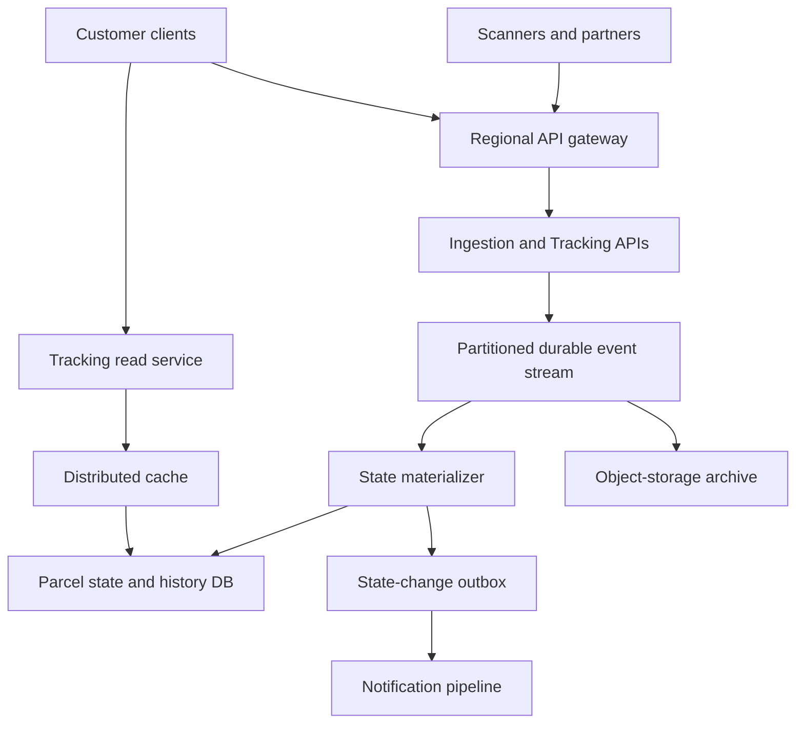
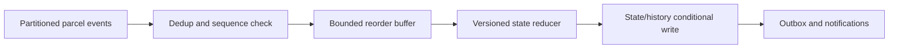
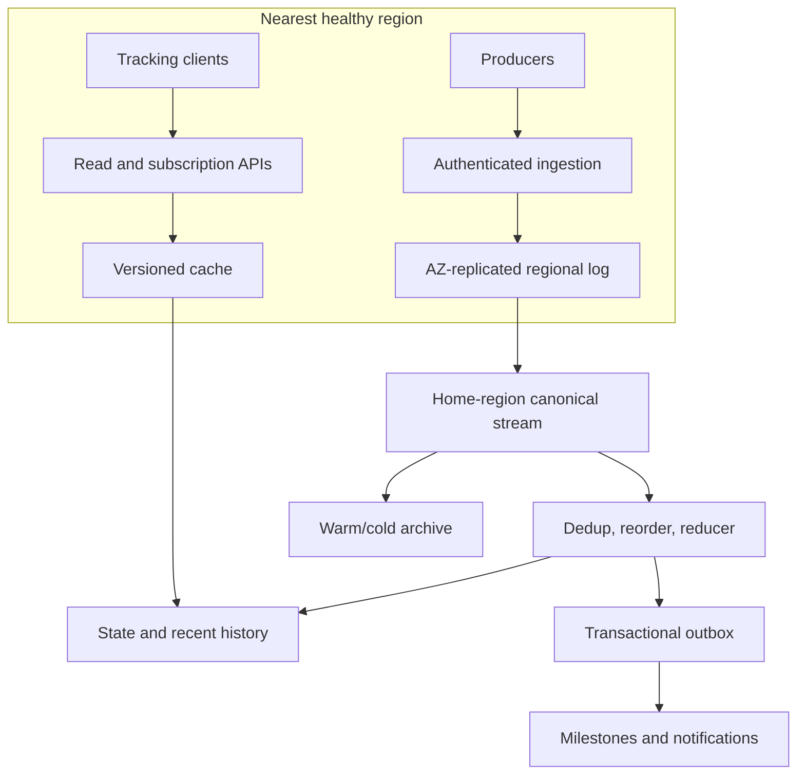

# Design a Global Parcel Tracking Platform

**Difficulty:** Senior / advanced  
**Primary themes:** high-volume event ingestion, queues, per-parcel ordering, idempotency, materialized views, caching, multi-region reliability, consistency

> **Interview time budget:** about 45 minutes: requirements 5, entities 2, interface 5, high-level design 10–15, deep dives 10–15, close 3.  
> **Learning walkthrough:** this document is intentionally much more detailed than what you would say in the timed interview. Use the short “say aloud” passages as the interview track and the surrounding explanation to understand the choices.

This walkthrough follows the public [Hello Interview System Design Delivery Framework](https://www.hellointerview.com/learn/system-design/in-a-hurry/delivery): clarify requirements, name the core entities, define the interface, build a complete design operation by operation, and then harden its most important bottlenecks. The problem, numbers, dialogue, architecture, and tradeoffs below are original.

## Interviewer prompt

> Design the tracking platform for a global parcel carrier. Internal scanners, vehicles, sorting centers, customs partners, and last-mile contractors send tracking events. Customers should be able to enter a tracking number and see the parcel’s current status and history. They may also subscribe to notifications.

## Targeted clarifying questions and assumed interviewer answers

**Candidate:** Are we designing shipment purchasing and label generation too, or only tracking after a shipment exists?  
**Interviewer:** Assume another system creates shipments and tracking numbers. Start when the shipment record is registered with us.

**Candidate:** Which event producers matter?  
**Interviewer:** First-party scanners and vehicles are the majority, but partners also send batches and webhooks. Producers can retry, arrive late, and occasionally send events out of order.

**Candidate:** What should customers see?  
**Interviewer:** The latest derived status, estimated delivery date, last public location, and chronological public history. Sensitive operational details must remain internal.

**Candidate:** How fresh must tracking be? Is a scan financially transactional?  
**Interviewer:** Ninety-nine percent of accepted events should appear on tracking pages within 10 seconds. Tracking is operationally important but not a payment ledger. Never invent or permanently lose accepted events; a brief stale read is acceptable.

**Candidate:** Do subscribers need exactly-once notifications?  
**Interviewer:** No. At-least-once delivery is acceptable, but users should rarely see duplicate messages. Notifications must not block tracking updates.

**Candidate:** What scale and geography should I design for?  
**Interviewer:** About 200 million active parcels, 5 billion tracking events per day globally, 20 million tracking-page reads per minute at ordinary peak, and up to 10 times the normal event rate during regional bursts. Operate in three major regions.

**Candidate:** Are all events customer-visible, and can events be corrected?  
**Interviewer:** No. Some are internal telemetry. Events are immutable, but a later correction or retraction event can change the derived view.

**Candidate:** How long is data retained?  
**Interviewer:** Keep the customer-facing history for 18 months, the operational event log for 7 years in cheap storage, and support privacy-driven redaction of personal fields without destroying non-personal audit facts.

**Candidate:** What is out of scope?  
**Interviewer:** Route optimization, warehouse robotics, payment, label purchase, and the detailed ML model for delivery estimates.

### Framing the problem aloud

> “I’ll design an event-driven tracking system. The hard parts are accepting duplicate and out-of-order events without losing them, producing a low-latency per-parcel view, surviving regional failures, and decoupling notifications. I’ll first complete the three core paths—ingest, read, subscribe—then deepen ordering/idempotency, storage and caching, and multi-region reliability.”

---

## 1. Requirements (~5 minutes)

Hello Interview recommends expressing functional requirements as a short list of user or client capabilities and making non-functional requirements measurable. Three functional requirements keep the design navigable.

### Core functional requirements

1. **Ingest tracking events.** Trusted producer systems can submit single events or batches. The platform authenticates, validates, durably accepts, and exposes a stable event identity so retries are safe.
2. **Read parcel tracking.** A customer can retrieve the current public status, ETA, last public location, and cursor-paginated event history by tracking number.
3. **Manage tracking subscriptions.** An authenticated customer can subscribe a verified channel to milestone notifications; notification failure must not delay tracking state.

### Quantified non-functional requirements

1. **Scale:** sustain 5 billion events/day—about 58,000 events/s average—with a design target of **600,000 events/s burst**. Sustain **333,000 tracking reads/s** at ordinary peak and design for 1 million reads/s during major incidents.
2. **Freshness and latency:** 99% of acknowledged events visible in the derived tracking view within **10 seconds**; tracking-summary reads **p99 under 300 ms** from the serving region; ingestion acknowledgements **p99 under 500 ms** for single-event calls.
3. **Availability and durability:** tracking reads at **99.99% monthly availability**; event ingestion at **99.95%**. Once the API returns `ACCEPTED`, the event must survive an availability-zone failure; target annual durable-loss probability below (10^{-9}) per accepted event through replicated logs and archival.
4. **Correctness:** duplicate submissions do not create duplicate history entries or notifications. For a parcel, a view converges to the deterministic result of all accepted events. During normal operation, a producer that supplies an increasing sequence gets read-your-write behavior within the 10-second freshness SLO.
5. **Recovery:** regional read failover **RTO under 5 minutes**. For a region-wide write outage, **RPO under 30 seconds** for already acknowledged events; producers may safely retry unacknowledged requests.

### Scope and consistency/availability contract

The immutable event log is the system of record. The current parcel view and public history index are derived materializations and may briefly lag.

| Surface | Consistency contract | Partition/failure behavior |
|---|---|---|
| Event acceptance | Idempotent by `(producer_id, event_id)`; acknowledgement only after durable regional quorum append | Prefer rejecting or buffering at the client to falsely acknowledging an event |
| Current parcel state | Per-parcel deterministic convergence; monotonic producer sequences applied in order when available; late events reconciled | Prefer availability and bounded staleness; expose `last_updated_at` |
| Event history | Eventual, normally under 10 seconds; correction events remain visible according to policy | Serve cached/stale history during downstream lag |
| Subscription configuration | Strong consistency per subscription | Reject conflicting concurrent updates rather than lose preferences |
| Notifications | At least once from durable milestones, deduplicated by notification key | Tracking remains available even when providers fail |

This is not global linearizability. A scan in Singapore does not need an immediate synchronous round trip to a US quorum. We trade a small stale window for regional availability, but never use last-writer-wins timestamps to erase valid events.

**Say aloud:**

> “My source of truth is append-only. The customer view is an eventually consistent projection with a 10-second freshness SLO. I will choose availability for reads and regional event capture, but only acknowledge an event after durable replication. Duplicates are harmless, and per-parcel state converges deterministically.”

### Scale estimates that change design decisions

Assumptions:

- 5 billion events/day.
- A normalized event averages 700 bytes; log framing, indexes, and replication take it to roughly 1 KB per copy.
- 20 million reads/minute at peak.
- 200 million active parcels; a compact summary is about 1 KB.

Calculations:

- Event average: (5\times10^9 / 86{,}400 \approx 58{,}000\) events/s.
- Tenfold burst target: about **580,000**, rounded to **600,000 events/s**.
- Raw daily event data: about **5 TB/day** before replication and compression.
- Seven years uncompressed: about **12.8 PB**. At 3:1 columnar compression, about **4.3 PB**, so old history belongs in object storage, not the online database.
- Read peak: (20{,}000{,}000 / 60 \approx 333{,}000) reads/s.
- Active summaries: 200 million × 1 KB ≈ **200 GB**, small enough for a distributed cache working set, though not every key must be resident.

These figures force three decisions: a partitioned durable stream rather than synchronous per-event database writes; separate hot projections from cold history; and a cache/read-replica layer for tracking pages.

---

## 2. Core entities (~2 minutes)

Start with nouns, not a complete schema. Fields appear later beside the components that need them.

- **Parcel** — stable shipment identity and public tracking number.
- **TrackingEvent** — immutable fact emitted by a producer.
- **ParcelState** — derived latest customer-facing and operational state.
- **Subscription** — verified user/channel preferences for a parcel.
- **NotificationDelivery** — an attempt to deliver one derived milestone.
- **Producer** — trusted scanner, vehicle, hub, or partner identity and its capabilities.

**Say aloud:**

> “The fundamental distinction is between an immutable TrackingEvent and a mutable ParcelState projection. That lets me replay when rules change, repair mistakes, and keep ingestion independent of read optimization.”

---

## 3. API or system interface (~5 minutes)

Use REST at the external boundary and a streaming/RPC contract internally. Per the [Hello Interview API guidance](https://www.hellointerview.com/learn/system-design/core-concepts/api-design), caller identity should come from authentication rather than a user-supplied ID.

### 3.1 Register a parcel from the shipment system

```http
POST /v1/parcels
Authorization: Bearer <service-token>
Idempotency-Key: shipment_93e...
Content-Type: application/json

{
  "tracking_number": "PX849302771US",
  "origin_country": "US",
  "destination_country": "DE",
  "service_level": "EXPRESS",
  "promised_delivery_date": "2026-12-02"
}
```

```json
{
  "parcel_id": "par_01J...",
  "tracking_number": "PX849302771US",
  "status": "LABEL_CREATED",
  "version": 1
}
```

The shipment service identity is derived from its service token. The client cannot nominate an arbitrary tenant or producer.

### 3.2 Ingest tracking events

```http
POST /v1/tracking-events:batch
Authorization: Bearer <producer-token>
Content-Type: application/json

{
  "events": [
    {
      "event_id": "scan_fra7_00891827",
      "tracking_number": "PX849302771US",
      "producer_sequence": 4187,
      "event_type": "DEPARTED_FACILITY",
      "occurred_at": "2026-11-28T06:41:12Z",
      "facility_code": "FRA7",
      "attributes": {"vehicle_id": "redacted-in-public-view"}
    }
  ]
}
```

```json
{
  "results": [
    {
      "event_id": "scan_fra7_00891827",
      "status": "ACCEPTED",
      "ingest_receipt": "rcpt_01J..."
    }
  ]
}
```

Possible per-item results are `ACCEPTED`, `DUPLICATE`, `REJECTED_SCHEMA`, `UNKNOWN_PARCEL`, and `RATE_LIMITED`. A `202 Accepted` means durably logged, not yet projected. The producer identity comes from mTLS plus a short-lived token; `producer_id` is not accepted in the body.

For very large partners, support resumable object uploads whose manifest has a checksum and idempotency key. The normal path still produces identical normalized events.

### 3.3 Read the current tracking view

```http
GET /v1/parcels/PX849302771US/tracking
Accept-Language: en-US
```

```json
{
  "tracking_number": "PX849302771US",
  "status": "IN_TRANSIT",
  "status_reason": "DEPARTED_FACILITY",
  "eta": "2026-12-02T18:00:00+01:00",
  "last_public_location": {"city": "Frankfurt", "country": "DE"},
  "last_event_at": "2026-11-28T06:41:12Z",
  "last_updated_at": "2026-11-28T06:41:14Z",
  "view_version": 37,
  "history": [
    {
      "event_id": "scan_fra7_00891827",
      "type": "DEPARTED_FACILITY",
      "occurred_at": "2026-11-28T06:41:12Z",
      "display_text": "Departed facility in Frankfurt, Germany"
    }
  ],
  "next_cursor": "eyJ0cyI6..."
}
```

History uses an opaque cursor based on `(occurred_at, canonical_event_id)` rather than offsets, which are unstable as late events arrive. Public access is rate-limited and may require postal-code proof for sensitive shipments.

### 3.4 Subscribe to milestones

```http
PUT /v1/parcels/PX849302771US/subscriptions/me
Authorization: Bearer <customer-token>
Idempotency-Key: sub_px8493_email
Content-Type: application/json

{
  "channel": "EMAIL",
  "destination_token": "verified_contact_17",
  "milestones": ["OUT_FOR_DELIVERY", "DELIVERED", "EXCEPTION"]
}
```

```json
{
  "subscription_id": "sub_01J...",
  "status": "ACTIVE",
  "version": 3
}
```

The user ID comes from the bearer token. The raw email or phone number is resolved from a verified contact token; it is not repeatedly copied through tracking systems.

### Interface-to-requirement mapping

| Requirement | Interface |
|---|---|
| Ingest events | `POST /v1/tracking-events:batch` |
| Read current state/history | `GET /v1/parcels/{tracking_number}/tracking` |
| Subscribe | `PUT /v1/parcels/{tracking_number}/subscriptions/me` |
| Bootstrap parcel | `POST /v1/parcels` |

---

## 4. Data flow

This problem benefits from an explicit pipeline because acceptance and visibility are separate moments.

1. Producer authenticates and sends an event or batch to its nearest regional ingestion endpoint.
2. Ingestion validates envelope/schema, resolves tracking number to parcel ID, computes canonical partition key, and appends to a replicated durable stream.
3. After quorum append, the API returns `ACCEPTED` with a receipt.
4. A normalizer enriches facility metadata, applies privacy classification, and writes the immutable canonical event log.
5. A keyed state processor consumes events by parcel, deduplicates, handles ordering windows, and updates ParcelState plus the online history index.
6. The processor emits a `ParcelStateChanged` outbox event.
7. Cache invalidation/update refreshes the tracking view. A separate milestone service evaluates transitions and enqueues notification jobs.
8. Notification workers call email/SMS/push providers with retry, deduplication, and dead-letter handling.
9. Raw and canonical streams are continuously archived to object storage for replay and analytics.

**Say aloud:**

> “The ingestion acknowledgement boundary is the replicated event log. Projection, cache refresh, ETA computation, and notification are downstream. This keeps producers fast and makes every derived store rebuildable.”

---

## 5. High-level design (~10–15 minutes)

Build the smallest complete system one operation at a time. Resist solving every failure before a working end-to-end path exists.

### Compact baseline architecture



### Operation 1: register a parcel

The authenticated shipment system calls `POST /parcels`. A Parcel API writes a strongly consistent row and a tracking-number lookup.

Relevant fields introduced here:

```text
Parcel
  parcel_id                 internal immutable ID
  tracking_number_hash     indexed public lookup key
  tracking_number_ciphertext
  tenant_id
  origin_country, destination_country
  service_level
  promised_delivery_at
  created_at
  lifecycle_state
  version
```

Use a relational or distributed SQL database initially: registration needs uniqueness on `(tenant_id, tracking_number_hash)`, conditional updates, and straightforward operational queries. Partition by `parcel_id` or tenant-plus-hash. The raw tracking number is encrypted; a keyed hash supports lookup without exposing it in indexes.

The same transaction inserts an outbox record for `ParcelRegistered`. The transactional outbox means business data and the message pointer commit together; a relay later publishes it, avoiding a database-write-success/message-publish-failure gap.

**Trace:** request → authentication → uniqueness check and insert → commit → response. No queue is required in the user-visible response.

### Operation 2: ingest an event

The regional API gateway terminates mTLS, validates producer credentials, enforces per-producer quotas, and routes to stateless ingestion servers.

The server:

1. checks size and schema version;
2. derives `producer_id` from credentials;
3. looks up `parcel_id` using a small cache backed by the Parcel DB;
4. constructs a canonical envelope;
5. chooses stream partition `hash(parcel_id) mod partition_count`;
6. appends to a replicated durable stream; and
7. acknowledges only after the stream quorum confirms.

Relevant fields:

```text
TrackingEventEnvelope
  canonical_event_id       generated sortable ID
  producer_id
  producer_event_id        producer's idempotency ID
  parcel_id
  producer_sequence?       monotonic within producer/device scope
  event_type
  occurred_at              producer event time
  received_at              trusted server time
  facility_id?
  schema_version
  payload
  payload_checksum
  privacy_classification
```

The uniqueness key is `(producer_id, producer_event_id)`. We can perform an early best-effort duplicate check at ingress, but correctness lives in the downstream keyed processor because a network retry may hit another server.

Why a log rather than direct DB writes? At 600,000 events/s bursts, the log absorbs spikes, allows sequential replicated writes, supports multiple consumers, and makes replay possible. It also makes backpressure measurable through consumer lag.

**Trace:** event request → validate → append → durable receipt. The event may not yet be visible, so the response is `202 Accepted`.

### Operation 3: materialize state and history

The state processor consumes partitions. Because all events for a parcel share a partition key, one consumer task owns that parcel at a time within a consumer group.

For each event it:

1. checks a deduplication state store;
2. validates the transition rules and privacy policy;
3. places mildly late events in a bounded reorder buffer;
4. writes the immutable canonical event to the online history store;
5. computes the latest ParcelState;
6. commits state, an outbox row, and its consumed offset atomically where supported—or uses idempotent conditional writes plus checkpointing;
7. emits `ParcelStateChanged`.

Relevant projection fields:

```text
ParcelState
  parcel_id                 primary key
  public_status
  status_reason
  last_public_event_id
  last_public_event_at
  last_public_location
  eta, eta_model_version
  operational_state
  applied_rule_version
  view_version              monotonically increasing
  updated_at
  max_received_at

ParcelHistoryItem
  parcel_id                 partition key
  sort_key                  occurred_at + canonical_event_id
  canonical_event_id
  event_type
  public_payload
  is_correction
  supersedes_event_id?
  received_at
```

The ParcelState table is a point-read workload. The history table is a bounded range-scan by parcel and time. They may be physical tables in a wide-column store or separate logical projections. We do not query the petabyte-scale archive on a tracking-page request.

The first complete rule can be simple: rank normal states (`LABEL_CREATED`, `PICKED_UP`, `IN_TRANSIT`, `OUT_FOR_DELIVERY`, `DELIVERED`) but allow exception/correction rules to override. In the deep dive we will replace naive rank ordering with deterministic transition logic.

### Operation 4: read tracking

The read service hashes the tracking number, resolves `parcel_id`, and reads a preassembled summary from a distributed cache. On a miss, it reads ParcelState plus the first page of ParcelHistoryItem, renders locale-specific display text, returns the response, and populates the cache.

Cache entry:

```text
tracking:view:{parcel_id}:{locale}
  summary
  first_history_page
  view_version
  generated_at
  soft_expiry
  hard_expiry
```

Use cache-aside with a short soft TTL, for example 30 seconds, and a longer hard TTL, for example 10 minutes. A `ParcelStateChanged` consumer deletes or refreshes affected keys. The TTL repairs lost invalidations. Request coalescing ensures only one read service instance rebuilds a hot missing key.

Public pages are read-heavy, and delivered parcels become nearly immutable. We can use a longer TTL after delivery. The read response includes `last_updated_at`, making bounded staleness visible instead of pretending it is linearizable.

**Trace:** client → rate limit/auth policy → tracking-number resolution → cache hit → response. On a miss: state/history DB → assemble → cache → response.

### Operation 5: subscribe and notify

The Subscription API authenticates the customer, confirms a verified contact token, authorizes access to the parcel, and conditionally upserts the subscription.

```text
Subscription
  subscription_id
  parcel_id
  user_id
  channel
  destination_token
  milestone_mask
  status
  version
  created_at, updated_at

NotificationDelivery
  notification_key         hash(subscription, milestone, view_version)
  subscription_id
  parcel_id
  milestone
  state_view_version
  provider
  attempt_count
  next_attempt_at
  status
  provider_message_id?
```

On `ParcelStateChanged`, the milestone evaluator compares old and new public states. If a subscribed milestone is newly crossed, it creates a notification job keyed by `(subscription_id, milestone, state_view_version)`. Workers send through providers. Provider timeouts cause exponential backoff with jitter; permanent failures disable or quarantine the destination.

The notification pipeline is entirely asynchronous. A broken SMS provider increases notification lag but cannot block event projection or reads.

### Baseline completeness checkpoint

At this point every functional requirement works:

- producers durably append events;
- materializers create a customer view and history;
- customers read through a cache;
- customers subscribe and receive asynchronous milestones.

Now the remaining interview time should harden the risky assumptions.

---

## 6. Deep dives (~10–15 minutes)

### Deep dive 1: duplicates, out-of-order events, corrections, and deterministic state

#### Where the baseline breaks

Sorting only by `occurred_at` fails because device clocks drift. Applying arrival order fails because a partner batch may arrive hours late. Taking the highest status rank fails for real workflows: a parcel marked `DELIVERED` may later receive a valid correction to `IN_TRANSIT`, while a late `ARRIVED_AT_FACILITY` must not roll an actually delivered parcel backward. Retries may also duplicate history and notifications.

#### Plausible approaches

| Approach | Strengths | Weaknesses |
|---|---|---|
| Last write wins by event timestamp | Very simple | Clock skew can erase truth; nondeterministic ties |
| Global sequence number | Total ordering | Central bottleneck; does not represent physical causality |
| Per-producer sequence plus event time | Detects gaps and orders a producer’s stream | Multiple producers still need reconciliation |
| Domain state machine with correction events | Encodes business truth explicitly and replays deterministically | More rule/version complexity |

#### Selection

Use four layers:

1. **Idempotency:** exact dedup key `(producer_id, producer_event_id)` retained online for at least the maximum retry horizon, say 30 days. Older duplicates are still detectable during archival compaction if necessary.
2. **Ordering hints:** use `producer_sequence` to detect duplicate/gap/reorder within a device or partner stream. Use trusted `received_at` as a tie-breaker, never as the sole business ordering rule.
3. **Bounded reorder window:** buffer events for a parcel for up to 30 seconds or until known sequence gaps close. This improves normal display without making the system wait forever.
4. **Versioned domain reducer:** a pure function `reduce(previous_state, ordered_facts, rule_version)` determines state. Explicit `CORRECTION` and `RETRACTION` facts refer to the superseded event. Terminal states can change only through authorized transitions.

The reducer is deterministic: replaying the same canonical facts with the same rule version yields the same ParcelState. If rules improve, run a shadow replay, compare output, then deliberately migrate `applied_rule_version`.

#### Evolved event processing



Keep the diagram compact in an interview; explain the policy in words.

#### Atomicity and exactly-once claims

“Exactly once” across a stream, database, cache, and notification provider is not credible as one magic guarantee. Build **effectively-once business effects**:

- stream delivery can be at least once;
- dedup makes projection idempotent;
- state writes use `expected_view_version` compare-and-set;
- the state-change outbox commits with state;
- notification jobs have unique `notification_key`;
- provider retries reuse a provider idempotency key where supported.

If a processor crashes after the DB commit but before checkpointing, it reprocesses the event. The dedup record or view-version condition turns the second attempt into a no-op, then the outbox relay continues.

#### Very late events

A late event is always stored. Whether it changes the current state is a domain decision:

- an old facility scan usually enriches history but leaves current status unchanged;
- a verified customs exception may update current state even if late;
- a correction can supersede a previous fact;
- suspicious time travel is quarantined for operational review.

The public history sorts by business occurrence time but can show a “reported later” marker. Internally preserve both `occurred_at` and `received_at`.

#### Failure modes and observability

- **Poison event:** send to a quarantine stream after bounded retries; do not block the partition forever.
- **Sequence gap:** emit `producer_sequence_gap_total`, start a timer, and request retransmission when supported.
- **Reducer bug:** retain raw facts, version rules, shadow replay, and roll back projection version.
- **Duplicate storm:** rate-limit the producer and track dedup ratio by producer.

Key metrics: accepted-to-visible latency percentiles, reorder-buffer age, gap count, late-event age, dedup hit rate, conditional-write conflicts, quarantine count, and replay divergence.

**Say aloud:**

> “I won’t promise global exactly once. I’ll accept at-least-once delivery and make each business effect idempotent. A versioned deterministic reducer handles late facts and explicit corrections. That makes state replayable and notifications deduplicable.”

### Deep dive 2: partitioning, hot parcels, history storage, and cache correctness

#### Where the baseline breaks

Hashing by parcel gives good average distribution, but exceptional parcels—celebrity shipments, public incidents, or mass tracking pages—can create millions of reads to one cache key. Large partners can also concentrate event traffic if we partition by producer. Keeping all history in the online store would cost petabytes and hurt compaction. Invalidating the cache before the DB commit risks stale data; invalidating after commit can be lost.

#### Stream partitioning alternatives

| Key | Benefit | Cost |
|---|---|---|
| `producer_id` | Producer batches stay together | One large partner becomes hot; parcel events scatter |
| random/event ID | Perfect write spread | Stateful ordering requires expensive repartition |
| `parcel_id` | All facts for one parcel reach one ordered processor | A single extremely active parcel has one-key ceiling |

Choose `parcel_id`. Typical parcels receive tens of events, so event hot keys are rare. If telemetry-heavy devices create thousands of location pings, aggregate them before the canonical tracking stream and keep only meaningful tracking events. Do not destroy ordering merely to solve an atypical workload.

At 600,000 events/s and a conservative 2,000 events/s sustainable per partition including headroom, we need at least 300 active partitions. Start around 1,024 partitions per global logical stream, distributed across brokers, leaving room for failures and consumers. Use virtual partitions so physical placement can change without redefining every key.

#### Tiered storage

Use three layers:

1. **Hot:** ParcelState plus recent history (for example, 90 days) in replicated online stores.
2. **Warm:** 18-month customer history in a compressed history store, still queryable but not in every first-page cache.
3. **Cold:** seven-year canonical events in immutable, encrypted object storage, partitioned by event date/region and bucketed parcel hash, stored as columnar files with manifests and checksums.

Compaction workers move closed time windows to warm/cold tiers. A deletion/redaction service maintains cryptographic erasure or field-level tombstones for personal fields while preserving non-personal audit events. Object manifests are versioned; readers never rely on listing an eventually updated prefix as the only source of truth.

#### Cache alternatives

| Strategy | Behavior | Decision |
|---|---|---|
| TTL only | Simple, but freshness can be 30+ seconds | Insufficient alone for 10-second SLO |
| Write-through | Fresh cache, but cache outage affects projection writes | Reject coupling |
| Cache-aside + invalidation | Fast reads and decoupled writes; invalidations may be lost | Choose with TTL repair |
| Versioned keys | No stale overwrite; cleanup needed | Combine for hot summaries |

Selected pattern:

- DB is authoritative for the projection.
- State transaction emits an outbox event containing `parcel_id` and `view_version`.
- Cache updater writes only if incoming version is newer than cached version.
- Read service treats `soft_expiry` as refresh-needed but may serve stale briefly; `hard_expiry` forces DB read.
- Add single-flight request coalescing and randomized TTL jitter.
- For a viral parcel, use a small L1 process cache (1–3 seconds) and CDN caching only for explicitly public pages. Private pages remain behind authorization.

Version checks prevent an older delayed invalidation/update from overwriting a newer cached view. The TTL heals lost messages.

#### Read repair and freshness token

The ingest response may optionally return a receipt whose status endpoint reveals the projected `view_version`. Internal operator clients can request `min_view_version=N`; the read service either waits briefly for the projection or reads the authoritative state store. Public clients normally accept bounded staleness.

This offers targeted read-your-write semantics without making every global read synchronous.

#### Failure modes and observability

- **Cache outage:** shed anonymous abusive traffic, fall back to protected DB reads, and serve stale edge copies where policy allows.
- **Cache stampede:** single-flight locks, TTL jitter, stale-while-revalidate, admission control.
- **History store lag:** return current state plus `history_partial=true`; tracking summary remains available.
- **Archival gap:** compare stream offsets with object manifests and alarm on missing ranges/checksum mismatch.
- **Oversized history:** cursor pagination and server-side limits; no unbounded parcel document.

Metrics: cache hit rate by parcel lifecycle, cache-version lag, DB QPS after cache misses, hot-key frequency, partition skew, online-history size, archive offset lag, and read p99 by cache outcome.

**Say aloud:**

> “The scale estimate puts seven-year history in object storage, not the serving database. I’ll keep current state and recent history online, use versioned cache-aside invalidation, and tolerate stale cache only within a bounded hard TTL. Parcel-key partitioning preserves the property I care about: single-owner state evolution.”

### Deep dive 3: multi-region availability, backpressure, and disaster recovery

#### Where the baseline breaks

A single global stream adds cross-ocean latency and is a large blast radius. Fully synchronous three-region writes would miss ingestion latency and reduce availability. Independent active-active materializers can race on the same parcel if a parcel crosses regions. A regional outage may also cause devices to retry against another region, duplicating events. Finally, if consumers slow down, an unbounded queue silently violates the 10-second freshness SLO.

#### Regional topology alternatives

| Model | Strengths | Weaknesses |
|---|---|---|
| One global write region | Simple ownership/order | High latency, large outage blast radius |
| Synchronous multi-region quorum | Strong global consistency | WAN latency; partitions reject more writes |
| Active-active regional logs with deterministic merge | Low-latency capture and regional availability | Reconciliation and ownership complexity |

Choose **active-active regional ingestion with a home region per parcel**, plus durable asynchronous cross-region replication.

- Parcel registration assigns `home_region` using tenant policy, origin, regulatory constraints, and capacity.
- Producers write to the nearest healthy ingestion region. The event is durably replicated across three availability zones before acknowledgement.
- The local log asynchronously copies accepted envelopes to the parcel’s home-region canonical stream and to an independent archive region.
- The home region is the normal single writer for ParcelState.
- If home is unavailable, another region captures events locally and serves the last replicated state. After a controlled lease transfer, a failover region can become the state writer.

Relevant control fields:

```text
ParcelRouting
  parcel_id
  home_region
  writer_epoch
  lease_owner
  lease_expires_at
  routing_version
```

Every state write includes `writer_epoch`. A stale former owner cannot write after failover because the database rejects the old epoch—a fencing token. This prevents split-brain projection writes.

#### RPO nuance

If we acknowledge after only regional AZ replication, a total-region loss before cross-region copy could lose up to the replication lag. That matches the specified RPO under 30 seconds, not zero. For regulated producers needing RPO 0, offer a slower ingestion class that waits for a second-region append before acknowledgement. Explicit service tiers are more honest than claiming both low WAN latency and zero cross-region loss.

#### Read failover

Each region has replicated ParcelState/history and a cache. Global traffic management sends users to a nearby healthy region. During failure:

- reads serve the last replicated version with `last_updated_at`;
- anonymous tracking remains available even if history is partially stale;
- subscription mutations route to the subscription home region or temporarily reject conflicting updates;
- event capture continues locally;
- notification milestones wait for canonical state instead of firing from two regions.

#### Backpressure and overload policy

Track backlog in **seconds of event time**, not only message count. A million queued events might be seconds at peak or hours off-peak.

Overload steps:

1. autoscale normalizers/materializers based on partition lag and CPU;
2. reserve capacity per producer tier so one partner cannot starve scanners;
3. reject low-priority telemetry before milestone scans;
4. return `429`/`503` with `Retry-After` before memory queues overflow;
5. allow authenticated devices to spool encrypted events locally and retry with the same IDs;
6. pause noncritical analytics consumers independently;
7. if projection lag breaches 10 seconds, surface degraded freshness and page operators.

The durable stream is a shock absorber, not infinite capacity. Admission control starts before broker disk exhaustion.

#### Notification-provider failures

Use per-provider circuit breakers. When a provider fails, stop immediate calls, retain jobs, and probe recovery. Exponential backoff with jitter avoids synchronized retries. A dead-letter queue is not a graveyard: it has an owner, reason codes, dashboards, replay tooling, and retention policy. Notifications older than a milestone-specific usefulness window may be marked expired rather than sending “out for delivery” after “delivered.”

#### Disaster-recovery tests

- quarterly controlled region evacuation;
- restore projection from archive plus stream checkpoint;
- prove routing lease fencing under network partition;
- compare canonical offsets across regions;
- inject broker, cache, database replica, and provider faults;
- measure real RTO/RPO rather than relying on configuration.

#### Observability and SLOs

Use a per-event trace identity from ingress receipt through projection and notification, sampled aggressively for errors and long tails. Do not attach raw tracking numbers or addresses to metrics labels.

Primary service-level indicators:

- acceptance success and p99 acknowledgement latency;
- accepted-to-visible latency p50/p95/p99 by region and producer;
- canonical replication lag and oldest unreplicated event;
- materializer lag in seconds and partition skew;
- tracking read availability/p99 and stale-view age;
- cache hit rate and version lag;
- notification milestone-to-send delay, provider errors, duplicate suppression;
- archive completeness and replay verification.

Alert on customer impact: for example, more than 1% of accepted events exceeding 10 seconds for 10 minutes—not merely a host’s CPU.

**Say aloud:**

> “I’ll capture events active-active but keep one fenced projection writer per parcel. Regional quorum gives fast durable acceptance; asynchronous cross-region copy gives an explicit 30-second RPO. During an outage, reads prefer availability and disclose staleness, while writer epochs prevent split brain.”

---

## 7. Final design, check, follow-ups, and pitfalls

### Concise final design



The system accepts events in the nearest region, persists them to an AZ-replicated log, and asynchronously routes them to a home-region canonical stream. A parcel-keyed processor deduplicates, reorders within bounds, and applies a versioned deterministic state machine. It conditionally writes current state and recent history and emits an outbox event. Reads use a versioned cache with TTL repair; long-term history moves to object storage. Notifications consume state transitions and use unique delivery keys, retries, and provider circuit breakers. Cross-region replicas serve stale-but-labeled reads, while fenced writer epochs control failover.

### Requirements check

| Requirement | Design evidence |
|---|---|
| Ingest events | Authenticated regional API, validation, durable replicated log, receipts, batch support |
| Read state/history | Point-read ParcelState, paginated history, cache-aside read service |
| Subscribe/notify | Strong subscription store, milestone outbox, independent retrying workers |
| 600k event/s bursts | Partitioned log, 1,024 logical partitions, asynchronous materialization, admission control |
| 333k–1M reads/s | Distributed cache, read replicas, immutable-delivered TTL, optional public edge caching |
| Visible within 10 s | Lag-driven autoscaling, lightweight keyed processors, freshness SLI and alerts |
| p99 read <300 ms | Regional cache hit path; bounded DB point/range queries on miss |
| No duplicate business effects | Producer event key, idempotent state writes, outbox, notification key |
| Multi-region resilience | Active-active capture, async replication, regional reads, fenced writer failover |
| Long retention | Hot/warm/cold tiering, object archive, manifests and checksums |

### Strong closing statement

> “The core choice is to separate immutable facts from derived state. Regional logs make capture fast and durable; parcel-keyed deterministic materialization makes duplicates and late events manageable; the cache and tiered history make reads economical; and notifications remain an isolated consumer. The explicit tradeoff is bounded stale reads and up to 30 seconds of cross-region RPO for the standard ingestion class, in exchange for low-latency regional availability.”

## Realistic interviewer follow-up questions with strong sample answers

### 1. Why not put every parcel’s entire history in one document?

**Answer:** A document is convenient initially, but it grows without bound, creates write amplification, and causes concurrent update conflicts. One large parcel document also makes every append rewrite or reindex too much data. I would store current state as one small row and history as separately paginated items keyed by parcel and sort key. That keeps point reads and range scans predictable.

### 2. Can Kafka or another stream guarantee ordering?

**Answer:** Only within a partition, not globally. I preserve the only useful ordering boundary by partitioning on `parcel_id`. Even then, partition order is arrival order, not necessarily physical occurrence order, so the domain reducer still uses producer sequences, event time, correction semantics, and a bounded reorder window.

### 3. What happens if two regions both believe they are the writer?

**Answer:** Ownership is fenced with a monotonically increasing writer epoch stored in a strongly consistent routing record. Every projection write includes the epoch. After failover increments it, writes from the old region are rejected even if its lease process is still alive. That is stronger than relying only on lease expiry and wall clocks.

### 4. How do you prove an accepted event was not lost?

**Answer:** The receipt identifies the regional log position and checksum. We reconcile accepted offsets against canonical replication and archive manifests. Each closed archive range has count and checksum metadata. Missing offsets, checksum mismatches, or an oldest-unreplicated age above the SLO alarm. Operators can trace the receipt through projection.

### 5. Would you use a relational database or NoSQL?

**Answer:** I choose by access pattern, not ideology. Parcel registration and subscriptions benefit from uniqueness and conditional transactions, so distributed SQL or a sharded relational system is attractive. Current state is a keyed point read and history is a partitioned range scan, so a wide-column or key-value store fits. At smaller scale, one relational system with careful partitioning is the simpler starting point; the interfaces keep projections separable later.

### 6. How do you update ETA without delaying scans?

**Answer:** State materialization emits a feature/state event to a separate ETA service. The ETA result is versioned with the input `view_version` and model version. A conditional update rejects results computed from an older parcel view. If inference is slow or unavailable, tracking still advances and serves the previous ETA with its generated timestamp.

### 7. A partner uploads a day-old batch after the parcel is delivered. What happens?

**Answer:** All valid facts enter immutable history. The reducer evaluates each against the current facts. Ordinary old transit scans enrich history but do not roll back the terminal status. An authorized correction may change it. Notifications fire only for newly effective state transitions, not merely because an old fact arrived.

### 8. How would you support customer deletion while retaining audit records?

**Answer:** Separate personal data from operational facts. Addresses, contact destinations, and free text use encrypted references or segregated fields. Deletion removes keys or writes field tombstones across hot, warm, and cold indexes, while non-personal facts such as “parcel entered facility X at time Y” remain under the applicable retention policy. Access to re-identification maps is tightly audited.

### 9. How do you avoid duplicate SMS messages after a timeout?

**Answer:** The notification job has a unique business key. If the provider supports idempotency keys, reuse it on retry. If a timeout leaves the outcome unknown and the provider lacks idempotency, query provider status when possible; otherwise accept a rare duplicate because dropping a delivery would violate the chosen at-least-once contract. Record provider message IDs for reconciliation.

### 10. What is the first thing you would simplify for a startup-scale version?

**Answer:** Use one region, a managed stream, PostgreSQL for parcel state/subscriptions/recent history, Redis for cache, and object storage for raw events. Keep event IDs, outbox semantics, and the immutable-event/derived-view boundary from day one. Those correctness seams are cheap early and prevent painful migration; multi-region routing and separate wide-column projections can wait for real load.

### 11. What if one parcel receives millions of reads per second?

**Answer:** The state changes slowly compared with reads. I would serve explicitly public data through a CDN with short versioned caching, retain a tiny per-instance L1 cache, coalesce misses, and protect the origin with admission control. The cache key includes view version or uses version-aware updates, so scaling reads does not compromise freshness beyond the stated bound.

### 12. Why not synchronously notify from the state processor?

**Answer:** Provider latency and outages would block partitions, causing tracking freshness failures. The outbox makes the milestone durable, and independent workers handle slow I/O, retries, expiration, and provider failover. Tracking correctness should not inherit a third-party provider’s availability.

## Common pitfalls

1. **Treating event time as perfect.** Scanner clocks drift and partners batch; preserve occurrence and receipt time and use domain rules.
2. **Claiming exactly once end to end.** Explain idempotent effects and each atomic boundary instead.
3. **Writing directly to the current-status row.** This loses replay, audit, correction, and multiple-consumer capabilities.
4. **Partitioning by producer.** It makes large partners hot and scatters one parcel’s events.
5. **Using one unbounded parcel document.** Separate current state and paginated history.
6. **Adding a cache without invalidation semantics.** State versions, outbox-driven refresh, TTL repair, and stampede control matter.
7. **Letting notification delivery block projection.** Isolate it with a durable outbox and queue.
8. **Ignoring regional split brain.** Leases alone are insufficient; use fencing epochs on writes.
9. **Treating a queue as infinite.** Define backpressure, priority, quotas, local spooling, and overload responses.
10. **No privacy boundary.** Public views must exclude vehicle IDs, internal exceptions, addresses, and operational notes.
11. **Doing scale arithmetic without a decision.** Tie event volume to partitions, retention to object storage, and read volume to caching.
12. **Overdesigning before completeness.** First trace ingest, read, and subscribe; deepen the risky parts afterward.

## A 45-minute delivery map

| Interview minute | Candidate action |
|---:|---|
| 0–5 | Clarify producers, reads, notification scope, scale, freshness, ordering, and consistency contract |
| 5–7 | List six core entities; emphasize event versus projection |
| 7–12 | Sketch ingest, read, and subscribe interfaces; derive identity from auth |
| 12–16 | Draw regional gateway, ingestion service, durable stream |
| 16–20 | Add parcel-keyed materializer, state/history data model, and outbox |
| 20–24 | Add cache/read path and subscription/notification path; verify completeness |
| 24–31 | Deep dive on idempotency, ordering, corrections, and reducer versioning |
| 31–37 | Deep dive on partitioning, storage tiers, hot reads, and cache versions |
| 37–42 | Deep dive on multi-region capture, writer fencing, RPO, and backpressure |
| 42–45 | Recheck requirements, state the main tradeoff, invite follow-ups |

## Final practice cue

If you remember only one narrative, use this:

> “Durably capture every fact, partition by parcel, derive state deterministically, serve a versioned cached projection, and isolate every slow side effect behind an outbox. Then be explicit about where the system chooses availability, where it requires consistency, and how it detects when the 10-second freshness promise is failing.”

